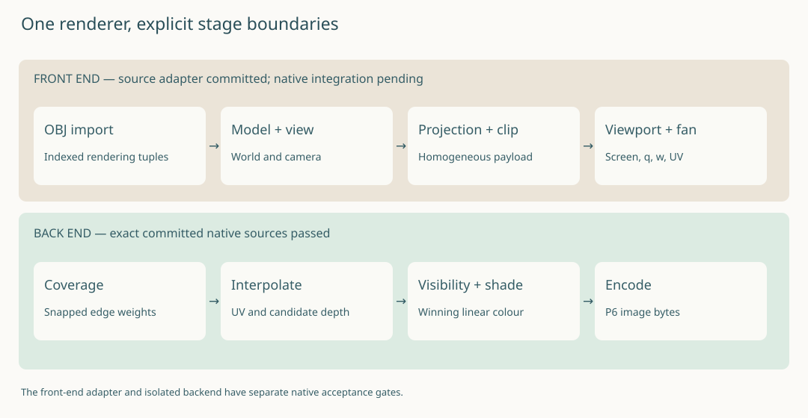
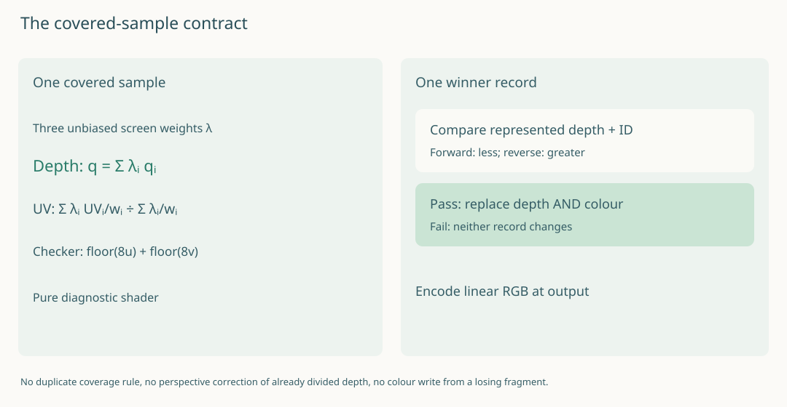
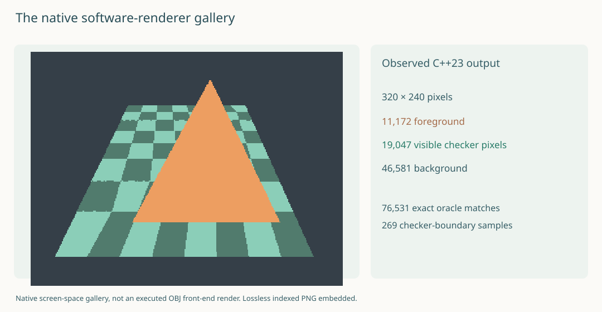

# Chapter 21 — A Whole Rasterizer We Can Explain

*From Geometry to Images — Part IV: The picture becomes an algorithm*  
*Reader edition / C++23 laboratory P21*

> A renderer is not a mysterious machine that turns a model into a picture. It is a collection of small, compatible agreements about geometry, samples and light.

## The first picture of our own

At the beginning of this book we could put a coloured dot into a little image. We learned how numbers describe points, how three points form a triangle, how meshes share corners, how a camera sees the world, how clipping changes a primitive, and how two triangles decide which one owns a sample.

Now imagine standing in the garden with a camera and looking down at a painted tile floor. A bright orange paper dragon passes between the camera and the tiles. The tiles shrink toward the distance. The dragon hides the part of the floor behind it.

We want to make this image with our own code, not by calling a black-box Draw function.

The challenge is no longer to derive another isolated equation. The challenge is to ensure that every stage agrees with the next one. A wonderful clipper and a wonderful rasterizer cannot cooperate if they disagree about the meaning of an image coordinate. A depth comparison can be mathematically correct and still choose the wrong object if its input uses the opposite convention.

We will therefore assemble a deliberately modest opaque software rasterizer. Its first native picture is a perspective checkerboard with an opaque triangular foreground. The code also contains an OBJ-to-image adapter using our previous model, camera and clipping stages. The native backend has been executed and independently checked; the earlier-stage integration must still pass its own build and tests. That distinction matters more than pretending the entire project is finished.

## The conveyor belt

The input is not a bag of screen points. A rendering asset contains positions, optional texture coordinates and normals, and triangles referencing complete rendering tuples.

The model map places the asset in the world. The view map expresses it in the camera frame. The projection produces homogeneous clip coordinates. The primitive assembler takes indexed corners, clips each triangle against the permitted region, and triangulates the surviving polygon.

Only then do we divide by w and map to the viewport.

*Figure 21.1 — The front end prepares valid clipped triangles; the native-tested backend evaluates their sample coverage, varyings, depth and colour.*

Every stage has a small input/output contract. We can write them beside one another:

| Stage | Input | Output |
|---|---|---|
| Asset import | Supported OBJ records | Decoded rendering tuples and index triples |
| Vertex processing | Tuple, model, view, projection | Raw clip tuple and varying payload |
| Primitive clipping | Three homogeneous corners | Ordered surviving polygon |
| Assembly and viewport | Polygon with positive w | Triangles with continuous screen addresses |
| Coverage | Snapped screen triangle | Sample addresses and unbiased weights |
| Interpolation | Weights, raw UV, clip w and NDC z | Texture address and candidate depth |
| Visibility and shader | Depth, stable ID, material | Winning linear-light colour |
| Output | Linear-light framebuffer | Encoded P6 image |

Our implementation keeps these boundaries explicit. It does not require a GPU, driver, graphics API or external texture library. It also does not yet implement blending, physically based materials, shadow mapping or actual multisampling.

## A small contract for the backend

Chapter 16 introduced a full processed vertex record. Once clipping is complete, the backend only needs a subset for this diagnostic material: screen position, divided depth q, positive clip w and a raw texture address.

In `software_renderer.hpp` that subset is called RenderVertex. Why do we keep w after division? Because the screen triangle does not tell us how quickly texture coordinates should vary across the original surface.

Our input screen positions have the same image-edge convention as Chapter 18. They are snapped once, by that chapter's coverage kernel. The callback returns unbiased barycentrics in the original vertex order.

Suppose the weights at one sample are \(\lambda_i\). The normalized device depth is

\[
q=\sum_i\lambda_i q_i.
\tag{21.1}
\]

The texture coordinates use a different denominator:

\[
D=\sum_i\lambda_i/w_i,\qquad
(u,v)=\frac{\sum_i\lambda_i(u_i,v_i)/w_i}{D}.
\tag{21.2}
\]

In the implementation, every reciprocal-w term is scaled by the minimum positive vertex w. That common factor cancels. Within the stated positive-w and UV bounds, the denominator remains positive and the checker indexing is representable. The interpolation is defined on the snapped screen geometry, which is a small but deliberate approximation to the unsnapped projected primitive.

There is no reason to calculate separate coverage rules for depth and colour. Both refer to exactly the same sample. The backend invokes the P18 coverage kernel once, computes the smooth attribute and screen-linear depth, and uses P19's visibility buffer to decide whether the candidate wins.

For teaching purposes our shader is pure and cheap, so its arithmetic is evaluated before committing the depth result. Only a winning submission updates the stored colour. Expensive shaders could benefit from early visibility rejection, but that optimization requires an explicit policy for shader side effects, depth modification, and discard.

## Paint with mathematics

A checkerboard is wonderfully useful because it makes interpolation mistakes visible. Define a simple periodic square pattern using eight cells in each unit of texture space:

\[
k=\lfloor 8u\rfloor+\lfloor 8v\rfloor.
\tag{21.3}
\]

Choose one colour when k is even and a darker shade when k is odd. Our implementation uses a multiplier of 0.32 for the darker cells. Negative UV values are handled through floor and integer parity, rather than truncation toward zero.

This is a procedural **diagnostic shader**. It is not a texture image, a filtered checker, or a material whose appearance follows the laws of light transport. The colour multiplier is constant for the triangle, and a foreground triangle can disable the checker entirely.

The important part is the way the texture address reaches that simple function. A projected plane may have a very large difference in depth between its near and far ends. If we use ordinary screen barycentrics on the original UVs, the pattern will not have the intended perspective.

*Figure 21.2 — The same coverage weights feed screen-linear depth and reciprocal-w texture interpolation. Only an accepted fragment writes the colour buffer.*

A checker discontinuity deserves special attention. At an exact boundary where 8u is an integer, an arbitrarily small numerical difference can change the selected square. A large jump in colour does not necessarily imply a large numerical error in u. This is a concrete example of the sampling and discontinuity issues from Chapter 20.

## Choose a winner and keep its colour

Our SoftwareRenderer owns both an opaque visibility buffer and a linear-light colour array. A winning depth submission updates the matching colour record. A failed submission leaves both the old winner and its colour intact.

Consider a nearer orange triangle and a farther green triangle that cover one sample. Under forward depth, the smaller represented q wins; under reversed depth, the larger represented q wins. The same projection and comparison convention must apply across the draw batch.

The standalone tests exercise both comparison directions. They submit the nearer and farther triangles in either order, check every occupied sample, independently compute the checker address, and compare the encoded images between the two submission orders.

A stable ID can break exact represented-depth ties. Here an ID identifies a draw surface, not necessarily a unique geometric triangle. If distinct coplanar triangles share one ID but have different shading, LowestID does not distinguish them. Order-independent colour requires distinct stable identities for competing equal-depth candidates, or an additional rule. We make no universal bitwise determinism claim for such ambiguous inputs.

The reference also maintains counters:

- candidates: sample centers visited inside the bounding rectangles;
- covered: samples that satisfy the three oriented edge tests;
- passed and failed: covered samples that respectively replace or do not replace the current winner;
- ties: proposals equal to an already stored represented depth;
- degenerate: snapped triangles that collapse.

The invariant is covered = passed + failed after successful draw completion. Passed counts updates, not final visible pixels. A far triangle may write a sample that a later foreground triangle replaces.

A production renderer can optimize rejection, cache locality and shading. But it should preserve these basic semantic distinctions. Faster incorrect images are not better evidence.

## A picture we can check independently

We choose a controlled 320-by-240 image. Two screen-space triangles form a perspective checkerboard quadrilateral. Its near edge has clip w=3 and far edge has w=9. A foreground orange triangle has w=2 and overlaps the board. Each vertex's divided forward depth is

\[
q=\frac{20}{19}(1-1/w),
\tag{21.4}
\]

matching a perspective camera with near one and far twenty. These are already-clipped screen-space witnesses, deliberately specified without depending on the earlier camera implementation.

The four board corners are (25,210), (290,210), (220,55), (100,55). Their UVs are (0,0), (1,0), (1,1), (0,1). The foreground corners are (104,175), (256,175), (184,28). The diagonal divides the board without overlapping coverage under the P18 rule.

*Figure 21.3 — The embedded image is the actual native output, encoded losslessly as a four-colour indexed PNG. It is not a claim that the OBJ front end ran.*

The native gallery reported three triangles, 93,644 candidate centers, 41,012 covered submissions and 41,012 successful updates, with zero failed submissions and ties. The foreground is submitted last, so earlier board updates can be overwritten.

Final image counts are 46,581 background pixels, 11,172 foreground pixels, 9,440 darker checker pixels and 9,607 lighter checker pixels. These sum to the 76,800 samples in the framebuffer.

An independent Python oracle used rational arithmetic for edge determinants, surface weights and depth comparisons. For every pixel it determined the nearer triangle and evaluated its ideal checker parity. There were 76,531 exact colour matches outside checker discontinuities. The other 269 samples lie exactly on a checker boundary; each was checked to belong to one of the two permitted checker colours. This policy reports ambiguity instead of pretending that a floating value must select an exact discontinuity side.

No physical shading, image similarity metric or hardware performance result is inferred from this experiment. It is a geometric, interpolation and visibility witness.

## The front end joins the backend

The new `renderer_frontend.hpp` adapter is short because we already built most of its machinery.

First the strict OBJ importer creates unified rendering tuples. The VertexStage evaluates the supplied model transform, rigid camera pose and projection. For each original triangle, the adapter invokes clip_triangle. If no polygon survives, it records the rejection. Otherwise fan_triangulate produces triangles from the surviving polygon.

Each generated corner keeps its raw UV and clip w. The adapter obtains the viewport position and divided depth using the previous screen adapter, then constructs the backend RenderVertex. Missing UVs disable the checker; mixed optional attribute presence follows the clipper's explicit validation policy.

The model parameter is a SceneAffine, so a caller can pass an evaluated world transform from the Chapter 11 hierarchy. The simple command-line example uses a translation into view. It does not implement a full scene-file loader, material assignment or camera framing algorithm.

The integration test specifies a quad at local coordinates ±1, places it four units forward, and expects the standard calibration to map it onto the 200-by-200 rectangle from (220,140) to (420,340). The two triangles should own exactly 40,000 samples with no duplicate coverage. This is a strong independent expected mask, but it is a source-authored test until the cumulative dependencies compile and the executable runs.

## Write the image, not a lie about the light

The framebuffer's diagnostic colours are linear-light values. We encode each channel with the P20 sRGB transfer function, multiply by 255, and round to the nearest integer. The P6 image header specifies the width, height and maximum byte value; three bytes follow for each sample in row-major order.

A PPM file is a convenient interchange format, not a complete color-managed HDR image container. Our declared transfer convention is sRGB-like; there is no ICC profile embedded in the file. For consistent comparison, inspect the actual bytes and the declared encoding.

The output path is opened only after rendering in the OBJ command. The command rejects an existing output that resolves to the same file as the input. Output files are not atomically replaced. Untrusted arbitrary meshes are still subject to the importer's bounded subset and the clipper's unresolved-boundary rejection.

## A renderer should come with a proof kit

Read the code in this order:

1. `raster_coverage.hpp` and `visibility.hpp` — the already tested sample and winner kernels.
2. `software_renderer.hpp` — the P21 backend and output contract.
3. `tests/renderer_tests.cpp` — independent UV and winner tests.
4. `src/renderer_gallery.cpp` — actual native screen-space picture.
5. `renderer_frontend.hpp` — actual P10/P16/P17 adapter.
6. `tests/renderer_frontend_tests.cpp` and `src/renderer_obj.cpp` — the cumulative integration gate and OBJ command.

After the appropriate native build:

~~~text
book03_renderer_gallery gallery.ppm
book03_renderer obj mesh.obj result.ppm
~~~

The first command and the backend suite passed local GCC 14.2.0 C++23 execution with UBSan. The exact committed source hashes and earlier dependency hashes were checked. The second executable and its full integration test remain unexecuted because the local environment could not retrieve the complete dependency tree from GitHub. Do not mistake that blocker for a successful full build.

A useful next experiment is to reverse draw submission order for non-tied surfaces, compare full images, introduce an outside triangle and check its surviving clipped mask, and compare different model poses. Each test should state exactly which stage it exercises.

## Your turn: connect the contracts

**Reconstruct.** List the vertex, clip, coverage, interpolation and depth stages in order. Which of them must retain w?

**Falsify.** Explain why the same checker UV cannot simply be interpolated with ordinary screen weights when vertex w values differ.

**Implement.** Construct the two unit-triangle weights at a covered sample, then use equation (21.2) to evaluate a raw UV.

**Transfer.** If a draw covers 1,000 samples and 200 fail the depth test, how many updates occur? Why might fewer than 800 samples remain visible at the end?

**Explain.** Why does a stable surface ID not fully resolve an equal-depth conflict between two differently shaded triangles sharing that ID?

**Falsify.** Replace the correct screen-linear depth with perspective-correct depth interpolation. Which earlier mathematical identity does this break?

**Challenge.** Design an OBJ fixture whose triangle crosses the near plane. Independently derive the intersection vertices and their UVs. Compare the actual clipped mask after the cumulative build.

**Implement.** Add an unfiltered stripe shader and compare it with the checker. Then describe how sampling the shader at multiple subpixel positions would change its cost and its image.

### Selected answers

The raw homogeneous position survives through clipping; w also survives division so that smooth attributes can use reciprocal-w interpolation. Eight hundred updates occur in the fourth problem, but later nearer surfaces may replace any of them. An equal stable ID does not specify a unique winner when depth and ID both tie.

## The picture becomes an instrument

We can now produce a real image from the raster backend and explain every byte using geometry, visibility and a stated colour transfer. The front-end adapter defines the missing end-to-end route from object-space assets, with its own acceptance tests.

This is a modest reference renderer, not the end of graphics. A real camera lens may bend rays and a real sensor may measure the world through a more complicated optical process. The next part of the book returns to image formation and calibration.

**Chapter 22 — A Lens Bends the Story** will study optical image formation, focal length, focus, aperture, field of view, thin-lens geometry and the limits of an ideal pinhole.

## Source custody

The new integration reuses the earlier additive Book03 reference libraries and preserves the original Computing Foundations projection and raster sampling notes. The authoritative chapter plan calls for model loading, the CPU draw pipeline, clipping, rasterization, output and proof. PASS21_EVIDENCE.md distinguishes observed backend results from outstanding cumulative integration and publication gates. No original manuscripts or published books are modified.
