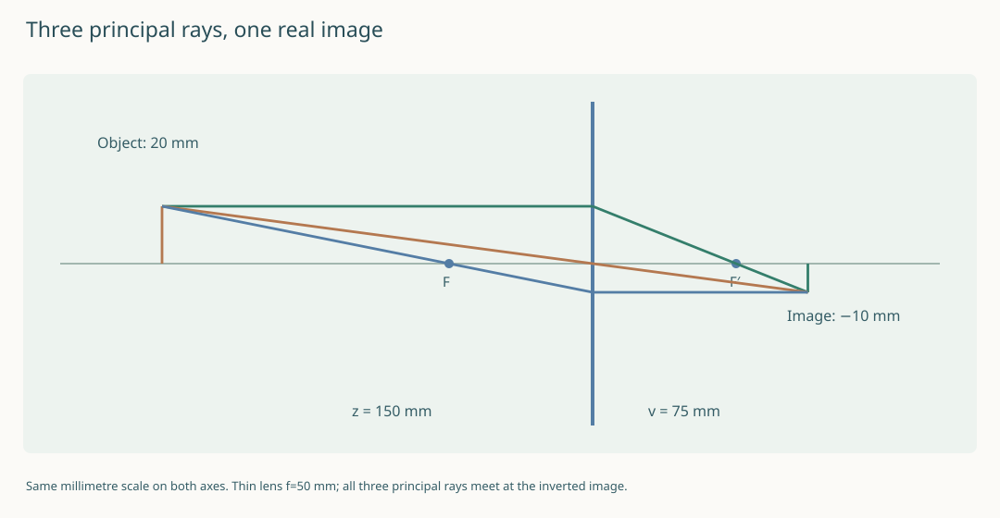
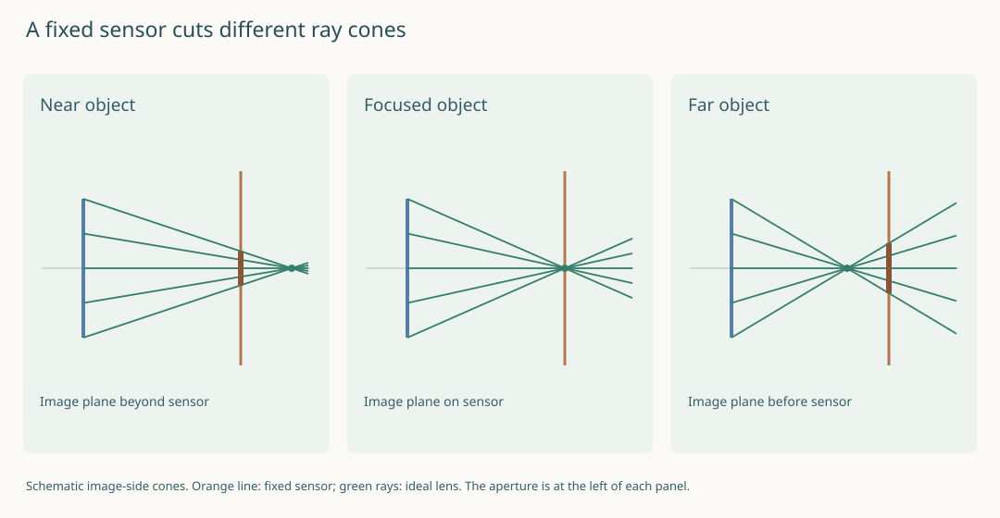
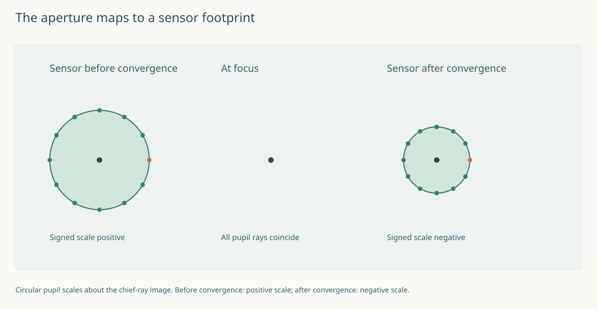
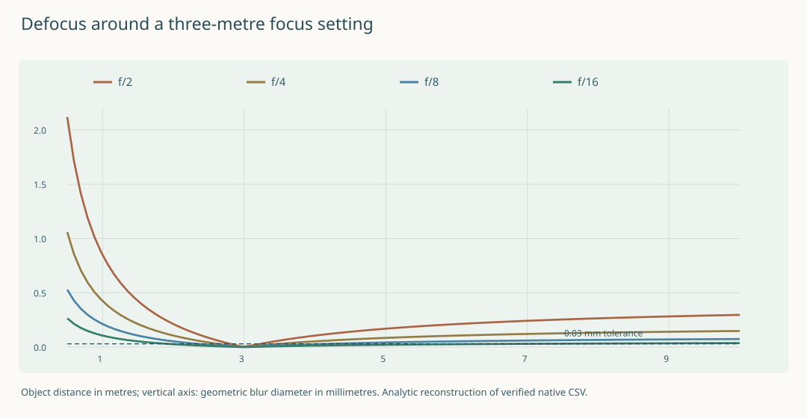
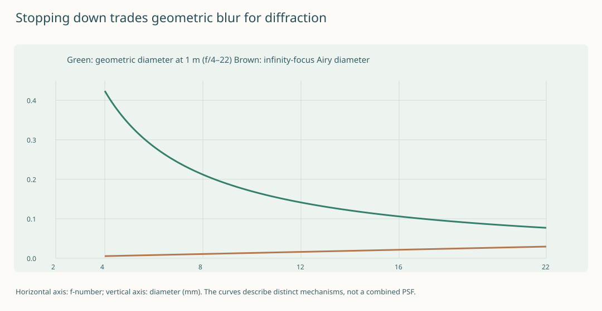

# Chapter 22 — A Lens Bends the Story

*From Geometry to Images — Part V: The camera becomes a measuring instrument*  
*Reader edition / C++23 laboratory P22*

> A camera does not merely decide where a point belongs in a picture. It also decides how widely that point spreads across the sensor.

## The dragon becomes a soft orange cloud

We built a camera with an ideal pinhole. Everything had a geometrically precise projection, whether it was a leaf close to the camera or a mountain far behind the house. Then we assembled a renderer that could find the nearest visible triangle and give its sample a colour.

Now take a real camera into the garden. Focus on the dragon. The house behind it becomes soft. Focus on the house instead, and the dragon turns into a soft orange shape.

Neither object changed its mesh. The computer has not failed to calculate perspective. The optical system has changed which bundles of rays meet at the sensor.

This chapter will replace the single viewpoint of an ideal pinhole with a finite circular aperture and a simple converging lens. We will calculate image distance, magnification, geometric defocus, depth of field and diffraction scales. Most importantly, we will construct rays and measure their intersection points rather than trusting a blur formula merely because it looks plausible.

## Why glass can change a ray's direction

Light travelling through a uniform transparent medium follows a straight path in geometrical optics. At a boundary between media, refraction changes the ray direction. Snell's law, with angles measured relative to the surface normal, states

\[
n_1\sin\theta_1=n_2\sin\theta_2.
\tag{22.1}
\]

The refractive indices describe the phase speed of light in the respective media at the chosen wavelength. A curved glass surface has different normals at different points, so rays meeting different parts of the surface can bend in different directions.

A converging lens can turn a nearly parallel bundle into a converging bundle. Its focal length f describes where an ideal parallel axial bundle meets. In the thin-lens approximation, we compress the effect of the optical surfaces into one plane. This is useful near the optical axis when ray angles are small (the paraxial approximation).

It does not mean a real lens is physically infinitely thin. Compound lenses have multiple surfaces, principal planes, aperture stops and pupils. Accurate simulation can require tracing refraction through each surface and accounting for wavelength, absorption and mechanical blockage.

For our reference we choose millimetres, a positive converging focal length and an object on the front side of the lens. The object distance z is positive; the real image distance v is positive on the opposite side. Transverse coordinates have the same orientation on both sides, so an inverted image has negative magnification.

## Three rays explain one lens

Consider an object point at height X, distance z from the lens. An ideal axial parallel ray refracts through the rear focal point. A ray passing through the optical center continues undeviated. A ray passing through the front focus emerges parallel to the axis.

*Figure 22.1 — An object 150 mm from a 50 mm lens produces a real image 75 mm behind it. A 20 mm object height becomes −10 mm.*

We can derive the familiar equation using the center ray and the initially parallel ray. The center ray has slope \(-X/z\), so at image distance v its height is \(-vX/z\). The parallel ray meets the lens at height X and leaves with slope \(-X/f\); its height at v is \(X(1-v/f)\).

At their common intersection,

\[
-\frac{vX}{z}=X(1-v/f).
\]

For nonzero X, divide by X and rearrange:

\[
\boxed{\frac1f=\frac1z+\frac1v,\qquad
v=\frac{fz}{z-f}.}
\tag{22.2}
\]

The signed transverse magnification is

\[
m=-v/z=-f/(z-f).
\tag{22.3}
\]

The negative sign means inversion. For f=50 mm and z=150 mm, v=75 mm and m=-0.5. The ray diagram uses exactly these numbers.

At z=2f, the image is the same size as the object. As z approaches f from above, v grows without bound. For z=f, outgoing paraxial rays from one object point are parallel. For z<f, the thin-lens relation gives a negative image distance, representing a virtual image on the object side. Our camera simulator deliberately accepts only the real-image case z>f, with a small safety margin.

Moving the sensor to the proper image distance can make a selected object plane sharp. This is the geometric meaning of focusing.

## Focal length is not a pixel count

In the earlier calibrated pinhole camera, focal scales were expressed in pixels. Here f is a physical focal length. They are related, but they are not identical.

At a fixed sensor distance \(v_s\), a chief ray passing through the lens center produces sensor coordinates

\[
(X_s,Y_s)=-\frac{v_s}{z}(X,Y).
\tag{22.4}
\]

For pixel pitches \(p_x,p_y\) in millimetres per pixel, the corresponding ideal positive focal scales are \(v_s/p_x,v_s/p_y\), after the physical image inversion and the chosen digital axis conventions are handled. At distant focus, \(v_s\) approaches f. At close focus, they differ.

For a centered sensor of width W and a rectilinear ideal thin-lens central projection, the horizontal angular field is \(2\arctan(W/(2v_s))\). At infinity focus, a 36 mm-wide sensor behind a 50 mm lens gives roughly 39.6 degrees horizontally. The diagonal and vertical fields are different.

Changing focal length at a fixed camera position changes framing; perspective relationships arise from the viewpoint. Moving the camera to maintain subject framing changes the relative sizes of near and distant objects. This is why the popular expression telephoto compression should not be interpreted as a mysterious direct change to world geometry.

## The aperture is a gate, not a focal plane

The ideal thin lens has a circular aperture with diameter D. Its geometric f-number is

\[
\boxed{N=f/D.}
\tag{22.5}
\]

A smaller f-number means a wider pupil for the same focal length. For a 50 mm lens, f/2 corresponds to D=25 mm, whereas f/8 corresponds to D=6.25 mm.

The pupil area is proportional to \(D^2\). Multiplying N by \(\sqrt2\) halves that area. This is why full-stop aperture sequences approximately follow f/2, f/2.8, f/4, f/5.6, f/8 and so on.

A real lens's entrance pupil is the apparent aperture seen from object space, not necessarily the diameter of a physical iris. Transmission loss also matters. If its transmission fraction is \(\tau\), an approximate transmission-based T-number is \(T=N/\sqrt{\tau}\). Our simulator uses an ideal pupil in the thin-lens plane and does not calculate exposure or transmission.

## Why a point becomes a circle

Focus at distance s. The sensor sits at

\[
v_s=\frac{fs}{s-f}.
\]

An object at some other distance z would form a sharp image at \(v_z=fz/(z-f)\). But we do not move the sensor for every object. The converging or diverging ray cone intersects our fixed sensor at a nonzero width.

*Figure 22.2 — A point whose ideal image plane does not coincide with the sensor produces a geometric blur diameter.*

By similar triangles, the diameter b of the blur circle is

\[
b=D\left|1-\frac{v_s}{v_z}\right|.
\tag{22.6}
\]

Using the thin-lens equation, simplify:

\[
\boxed{
b(z)=\frac{f^2}{N(s-f)}\left|1-\frac{s}{z}\right|.
}
\tag{22.7}
\]

This is a sensor-space diameter in millimetres. It is not a radius, a standard deviation or a number of pixels. Divide by pixel pitch to express the diameter in pixel intervals. In particular, a 0.03 mm circle spans 7.5 pixel intervals at 4 micrometre pitch.

The formula has useful checks. At z=s, it vanishes. At fixed focus and object distance, doubling N halves geometric blur. As z tends to infinity, the blur approaches

\[
b_\infty=\frac{f^2}{N(s-f)}.
\tag{22.8}
\]

The farther background does not keep growing in geometric blur without bound. On the near side, defocus can become much larger.

## Derive the ray simulator

Instead of starting with a cone diameter, let the pupil coordinate be a two-dimensional vector a. The object's transverse coordinate is X. The incoming paraxial ray has slope \((a-X)/z\). An ideal thin lens changes that slope by \(-a/f\).

At the sensor distance \(v_s\), its intersection is

\[
\begin{aligned}
P(a)&=a+v_s[(a-X)/z-a/f]\\
&=-v_sX/z+a(1-v_s/v_z).
\end{aligned}
\tag{22.9}
\]

This formula explains the entire idealized blur footprint. The chief-ray image is the center. The circular pupil is scaled by the signed factor \(1-v_s/v_z\). A uniformly sampled circular pupil maps into a uniformly sampled disc for this model, except at focus where all rays meet.

Choose opposite pupil coordinates \(a=(D/2,0)\) and \(-a\). Their sensor separation is exactly equation (22.6) in real arithmetic. That gives us an independent computational witness: trace two rays using slopes and compare their separation against the simplified geometric formula.

*Figure 22.3 — The signed affine pupil map explains both the blur diameter and the inversion of its orientation across focus.*

In a ray tracer we can construct the same idealized camera backwards. First choose a point on the intended focus plane using the chief ray. Then sample a pupil position and launch a ray from that position toward the focus point. For a uniform circular pupil, use radius \(R\sqrt{\xi_1}\) and angle \(2\pi\xi_2\), where each random variable is uniform on [0,1). Sampling radius uniformly would overpopulate the center, because equal radial intervals do not have equal areas.

The forward ray simulator in this chapter does not trace a full scene. It evaluates point-to-sensor intersections. A complete depth-of-field renderer would need visibility along every sampled pupil ray. Blurring an existing sharp image using a single depth map cannot generally recover hidden background samples revealed through different aperture locations.

## Depth of field is a promise about tolerance

A point is not suddenly in focus at one exact distance and hopelessly blurred a millimetre farther away. Instead choose a maximum acceptable blur diameter c, called a circle-of-confusion criterion.

This threshold depends on sensor sampling, output enlargement, viewing distance and the detail we want to preserve. It is not a universal physical constant.

Let \(K=b_\infty\) and \(k=c/K\). The acceptable condition is

\[
|1-s/z|\le k.
\]

Because z is positive,

\[
1-k\le s/z\le1+k.
\]

Solving produces the near and far limits:

\[
\boxed{z_\mathrm{near}=\frac{s}{1+k},\qquad
z_\mathrm{far}=\frac{s}{1-k}\quad(k<1).}
\tag{22.10}
\]

For \(k\ge1\), the far limit is infinity. These ideal algebraic bounds must be intersected with the model's real-object domain z>f. In code the finite calculation domain is narrower still, so the returned algebraic interval is not a promise that every endpoint can be passed back into the ray function for arbitrary extreme parameters.

The focus distance at which infinity first meets the selected tolerance is obtained from \(b_\infty=c\):

\[
\boxed{H=f+\frac{f^2}{Nc}.}
\tag{22.11}
\]

This is the hyperfocal distance in this convention. At s=H, k=1, so the near acceptable limit is H/2. Infinity is just within tolerance, not perfectly focused.

Our 50 mm example focuses at 3000 mm and uses c=0.03 mm.

| Aperture | Near limit (m) | Far limit (m) |
|---|---:|---:|
| f/2 | 2.802 | 3.229 |
| f/4 | 2.628 | 3.495 |
| f/8 | 2.338 | 4.185 |
| f/16 | 1.915 | 6.919 |

*Figure 22.4 — Closing the aperture widens the acceptable geometric interval. The curves are calculated, not measured from a physical lens.*

At f/8, the hyperfocal distance is about 10.467 m. The far limit expression becomes sensitive as k approaches one. Binary64 cannot reliably distinguish every near-threshold case; the optional far endpoint represents the computed unbounded condition, not a certified exact classification.

Depth of field refers to object distances. Depth of focus is a related but different tolerance for image-plane displacement. From equation (22.6), for a fixed object image at \(v_z\), acceptable sensor positions satisfy \(|v_s-v_z|\le cv_z/D\).

## A smaller aperture does not mean unlimited sharpness

Even a perfectly corrected optical system spreads light because light has wave behaviour. A circular aperture produces an Airy diffraction pattern in the ideal scalar diffraction model. For distant focus, the central disc's diameter to the first dark ring is approximately

\[
d_\mathrm{Airy}=2.44\lambda N.
\tag{22.12}
\]

Use wavelength and diameter in the same units. For green light at 0.55 micrometres, the diameter at f/8 is 10.736 micrometres, or about 2.684 intervals of a 4 micrometre pixel pitch. At f/16 it doubles.

At finite conjugates, the image-side cone angle (and effective f-number) matters. The simple formula above is an infinity-focus comparison scale; it does not simulate a close-focus compound lens.

*Figure 22.5 — Different mechanisms move in opposite directions. Their diameters cannot simply be added to obtain a physically correct point-spread function.*

Diffraction is not spherical aberration. Spherical aberration occurs when marginal and paraxial rays have different focus positions. Chromatic aberration comes from wavelength-dependent refraction. Coma creates asymmetrical off-axis blur; astigmatism separates tangential and sagittal focus; field curvature shifts best focus across the sensor. Vignetting changes illumination, and geometric distortion changes image coordinates. Real optical systems combine these effects.

Bokeh describes the appearance of defocused regions, not merely their diameter. Aperture shape, pupil clipping and optical aberrations can create polygons, cat-eye highlights, rings or asymmetric patterns. A uniform circular defocus disc is only the first model.

Focus stacking captures multiple focus settings and combines sharp regions. Light-field capture retains angular information for computational refocusing. Both trade capture complexity, motion sensitivity or spatial detail for additional information. None removes diffraction or recovers arbitrary missing detail for free.

## The native lens laboratory

Read `include/book03/thin_lens.hpp`, then `tests/lens_tests.cpp` and `src/lens_studio.cpp`. The code uses millimetres consistently, validates finite bounded values and rejects non-real-image objects. The optional far distance represents an unbounded algebraic interval.

The test program uses a 50 mm principal-ray witness, the hyperfocal example, zero geometric blur at focus, and 3,000 seeded lens/object configurations. For each configuration it checks opposite pupil ray separation against equation (22.7) and verifies the chief-ray image center and focused-ray convergence.

The exact three source files compiled and ran with GCC 14.2.0, C++23 and undefined-behavior sanitization. The studio exported 404 rows, covering f/2, f/4, f/8 and f/16 over 101 distances from 500 mm through 10,000 mm. Independent Python calculations verified every row using the reciprocal thin-lens equation and the cone-width formula, as well as the separate infinity-focus Airy diameter.

~~~text
book03_lens csv lens.csv
~~~

The CSV columns give aperture, object distance, geometric blur, ray-measured diameter, pixel-interval diameter at 4 micrometre pitch and the diffraction comparison scale. It is a controlled mathematical experiment, not optical bench data, a photographed image or a full spectral ray tracer.

## Your turn

**Reconstruct.** Derive the image distance and signed magnification of a 50 mm lens observing an object 150 mm away.

**Falsify.** Why does a finite-aperture camera not have the ideal pinhole's infinite geometric depth of field?

**Implement.** Trace rays from opposite pupil edges to the fixed sensor. Compare their separation with the analytic blur diameter.

**Transfer.** At a 4 micrometre pixel pitch, how many pixel intervals does 0.03 mm span? Why is this not a universal acceptable blur threshold?

**Reconstruct.** Derive the near and far limits by solving the absolute-value inequality. What happens at k=1?

**Explain.** Why does infinity lie within geometric tolerance at the hyperfocal distance but not have zero defocus?

**Falsify.** Explain why doubling N does not guarantee a sharper image of every object.

**Challenge.** Sample a circular pupil uniformly in area and plot the sensor intersections for one point before, at and after focus. Compare their diameter against the native analytic reference.

### Selected answers

The image distance is 75 mm and magnification is −0.5. The 0.03 mm diameter spans 7.5 pixel intervals at 0.004 mm pitch. At k=1 the algebraic far limit is unbounded. Doubling N halves the geometric defocus diameter but doubles the distant-focus Airy diameter for fixed wavelength. The complete optical response depends on the combined optical and sensor system.

## Next: the straight line that refuses to stay straight

The simple thin lens explained why a projected point can spread without changing the basic central-perspective geometry. Real optics can also move the center of the image footprint away from where our ideal camera predicts it.

**Chapter 23 — Why Straight Lines Bow** will study radial and tangential distortion, wide-angle and fisheye projection models, forward distortion, inverse undistortion and calibration residuals.

## Source custody

The original Graphics Vision and XR chapter 03, Lens Optics and Image Formation, remains intact. Its optics material at reading-copy lines 18–126, including the focus interval, principal-ray witness and Airy comparison, has been inspected and expanded here. PASS22_EVIDENCE.md and PASS22_LEGACY_AUDIT.md record the source identity, native verification and model limitations. Exposure and sensor portions remain preserved for subsequent chapters. No publication artifact was generated.
