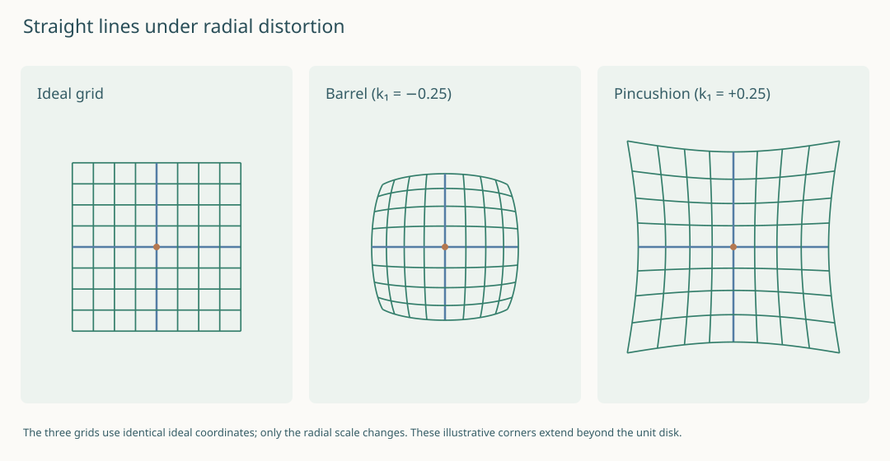
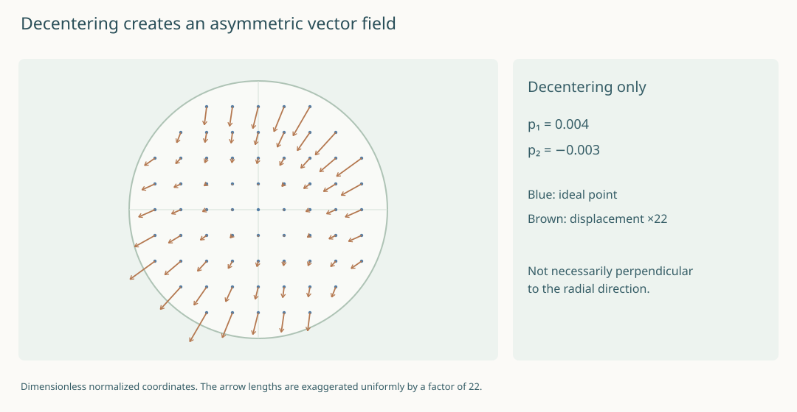
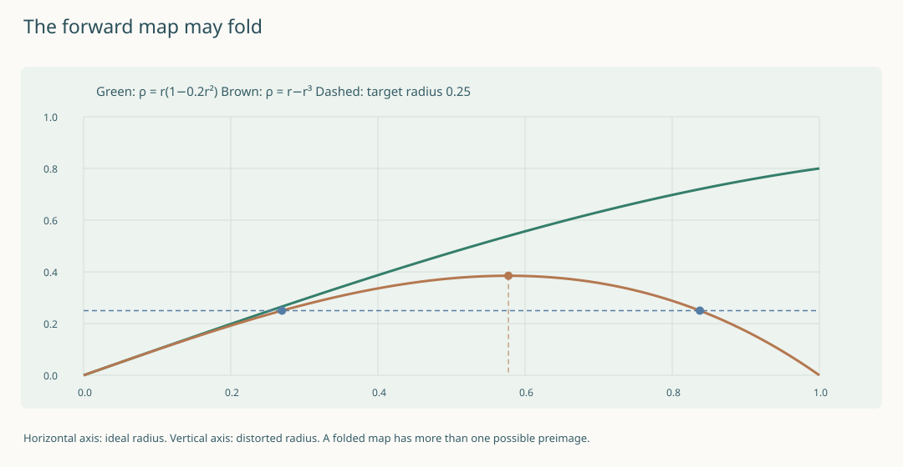
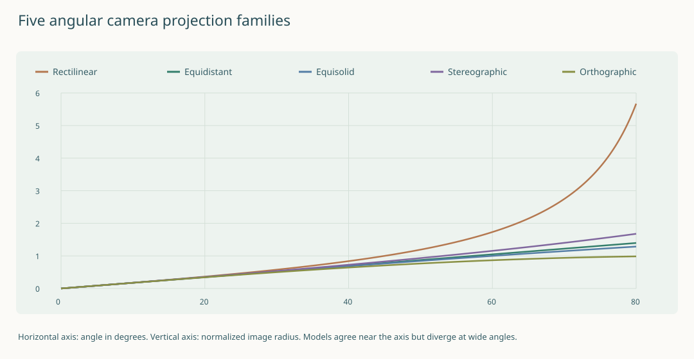

# Chapter 23 — Why Straight Lines Bow

*From Geometry to Images — Part V: The camera becomes a measuring instrument*  
*Reader edition / C++23 laboratory P23*

> A straight fence is a useful instrument: when its photograph bends, it reminds us that a camera is a mathematical model of an optical system, not the optical system itself.

## The house has become a balloon

Imagine photographing our garden with a wide-angle camera. The house is rigid, the window frames are straight, and the fence was built with a ruler. Yet the walls in the photograph seem to bow outward near the corners.

Do not start editing the mesh. First ask whether the camera is doing something that our ideal pinhole equation cannot describe.

In Chapter 22, a thin lens changed the spread of a point on the sensor. Now we will study a different effect: the location of the point's image can move systematically. A sharp image can still be distorted. Conversely, an image with correct geometric positions can be blurred.

The difference matters when a computer tries to measure the world from a photograph. If we triangulate an incorrect ray, the resulting three-dimensional point may be wrong even when the feature was detected with subpixel precision.

We will create a forward distortion map, derive its Jacobian, and then solve the inverse problem. Along the way we will see why the inverse can be ambiguous, why a tiny residual is not sufficient evidence of uniqueness, and why a fisheye camera deserves a model of its own.

## Choose the coordinate system before touching the coefficients

Our graphics camera convention has local X right, Y up and negative Z forward. A conventional computer-vision coordinate frame instead has X right, Y down and positive Z forward.

Convert a graphics-camera point \((X_g,Y_g,Z_g)\) into the CV frame \((X,Y,Z)=(X_g,-Y_g,-Z_g)\). For Z positive, the ideal normalized coordinates are

\[
x=X/Z,\qquad y=Y/Z.
\tag{23.1}
\]

They are dimensionless ratios. A normalized coordinate is not a pixel address. The calibration matrix acts after the normalized optical map:

\[
u=f_x x_d+\sigma y_d+c_x,\qquad v=f_y y_d+c_y.
\tag{23.2}
\]

Here \(\sigma\) is the skew parameter, which is often zero. The measured pixel has the same continuous coordinate convention as the calibration. The half-integer sample centers used in our rasterizer require a consistent conversion if a calibration library labels pixel centers by integer coordinates.

To reverse this affine calibration, solve for \(y_d=(v-c_y)/f_y\) and then \(x_d=(u-c_x-\sigma y_d)/f_x\). Only now do we attempt to remove distortion.

Notice the ordering: ideal projection, nonlinear distortion, then intrinsic calibration. If you apply a normalized radial coefficient directly to raw pixel coordinates, a point 300 pixels from the image center is treated like a normalized radius of 300. Its squared radius is 90,000. The resulting model has a completely different scale.

A change of image resolution usually changes the pixel calibration. It need not change normalized lens coefficients if the same optical model and normalized frame apply. Cropping changes the principal point; resizing changes focal scales and principal point consistently with the pixel convention.

## The simplest bending: change the radius

For an ideal normalized point \(p=(x,y)^T\), let

\[
q=x^2+y^2=r^2.
\]

An axially symmetric model preserves azimuth and changes radius. A useful polynomial is

\[
L(q)=1+k_1q+k_2q^2+k_3q^3,\qquad D(p)=L(q)p.
\tag{23.3}
\]

Powers of squared radius are smooth rotationally invariant polynomials in the two coordinates. With only a negative \(k_1\), points near the periphery typically move toward the center, giving a barrel-shaped distortion of an ideal straight-line grid. A positive \(k_1\) typically gives pincushion distortion. These names describe a visible pattern; a mixed polynomial can change its behavior across the field.

*Figure 23.1 — A radial map can bend a line that does not pass through the distortion center. Lines through the center retain their radial direction.*

At \(x=0.5,y=0\), a model with \(k_1=-0.2\) and all other coefficients zero gives \(L=0.95\), hence \(x_d=0.475\). With an 800-pixel focal scale, that is a shift of 20 pixels from the ideal measurement.

A linear calibration matrix cannot generally absorb this effect. Affine maps send straight lines to straight lines, whereas this radial map need not. Adjusting focal length can absorb some scale error but cannot straighten every warped line simultaneously.

Some optical models use a rational radial scale with a polynomial numerator and denominator. The denominator must remain nonzero on the supported domain; a fit with a pole just outside the calibration observations can be dangerous when extrapolated. Our native reference deliberately uses the polynomial subset.

## An asymmetric displacement

Real optical alignment may not be perfectly rotationally symmetric. The common five-coefficient Brown–Conrady-style forward model includes two decentering terms:

\[
\begin{aligned}
x_d&=xL+2p_1xy+p_2(q+2x^2),\\
y_d&=yL+p_1(q+2y^2)+2p_2xy.
\end{aligned}
\tag{23.4}
\]

Although traditionally called tangential distortion, these terms are not necessarily perpendicular to the radius at every point. They describe a particular asymmetric displacement field.

Our coefficient order in C++ is \(k_1,k_2,k_3,p_1,p_2\), followed by the supported radius. Other libraries can use a different order. Do not serialize a struct as an external calibration record without an explicit field mapping.

For a pure decentering witness with \(p_1=0.004,p_2=-0.003\), at (0.5,0), the added X displacement is \(3p_2(0.5)^2=-0.00225\), and the Y displacement is \(p_1(0.5)^2=0.001\). Even a point on the horizontal axis can move off it.

*Figure 23.2 — The two decentering coefficients produce a vector field, not merely a radial magnification. Arrows are exaggerated for readability.*

In calibration, the parameters are fitted to actual image observations. These polynomial coefficients are not a physical description of every glass element. They are an effective mapping over an observed range of ray directions.

## The map may fold

Suppose someone gives us a measured normalized point and asks us to recover its ideal position. Could we just subtract the forward displacement?

No. The displacement depends on the unknown ideal point. Evaluating it at the measured point generally evaluates the wrong displacement.

There is an even deeper problem. For pure radial distortion the signed radial expression is

\[
\rho(r)=r(1+k_1r^2+k_2r^4+k_3r^6).
\]

Its derivative is

\[
\rho'(r)=1+3k_1r^2+5k_2r^4+7k_3r^6.
\tag{23.5}
\]

Choose \(k_1=-1\) and all other coefficients zero. On the positive radial axis, \(\rho=r-r^3\). It increases up to \(r=1/\sqrt3\), then decreases, returning to zero at r=1. Two different positive radii can therefore produce the same distorted radius. The origin and radius one even map to the same center.

*Figure 23.3 — The folded polynomial cannot have a single-valued inverse across its entire disk. A small inverse residual does not identify the intended branch.*

The correct response is not to keep iterating until the software finds some root. It is to state a valid domain and demonstrate that the model is suitable there. A lens may be calibrated only for the area covered by observations; extrapolation into an unsupported corner is not automatically meaningful.

## Derive the Jacobian

Let \(D\) denote equation (23.4) and

\[
L_q=k_1+2k_2q+3k_3q^2.
\]

The chain rule gives \(L_x=2xL_q\) and \(L_y=2yL_q\). Differentiating both output components yields

\[
J_D=
\begin{bmatrix}
L+2x^2L_q+2p_1y+6p_2x & 2xyL_q+2p_1x+2p_2y\\
2xyL_q+2p_1x+2p_2y & L+2y^2L_q+6p_1y+2p_2x
\end{bmatrix}.
\tag{23.6}
\]

Each entry describes how one measured coordinate changes with one ideal coordinate. The matrix maps small displacements: \(D(p+\delta)\approx D(p)+J_D(p)\delta\).

This model's Jacobian is symmetric. That is useful for our domain argument. A different distortion model need not have that symmetry.

A nonzero determinant at a point supports local inversion, but does not guarantee that two distant points cannot map to the same value. We can derive a stronger, conservative sufficient condition on a disk of radius R.

For the radial part, the tangential and radial eigenvalues are L and \(L+2qL_q\). Subtracting the identity and bounding the absolute values of both eigenvalue changes gives

\[
B_r=3|k_1|R^2+5|k_2|R^4+7|k_3|R^6.
\]

The decentering Jacobian is symmetric. Each absolute row sum is bounded by \(8R(|p_1|+|p_2|)\). A symmetric matrix's spectral norm is bounded by its maximum absolute row sum. Hence

\[
\|J_D-I\|_2\le
B=B_r+8R(|p_1|+|p_2|).
\tag{23.7}
\]

When B is less than one, the nonlinear displacement \(g(p)=D(p)-p\) is Lipschitz with constant at most B on the convex disk. To prove this, integrate its derivative along the segment connecting any two points a and b:

\[
\|g(a)-g(b)\|\le B\|a-b\|.
\]

The reverse triangle inequality now gives

\[
\boxed{\|D(a)-D(b)\|\ge(1-B)\|a-b\|.}
\tag{23.8}
\]

If a and b differ, their distorted coordinates differ too. We have injectivity throughout this disk in real arithmetic. Moreover, a normalized residual e bounds the distance to an existing true preimage by \(e/(1-B)\).

This is a sufficient condition, not a necessary one. Many valid cameras fail the conservative bound. Rejecting them means our reference cannot establish this particular guarantee, not that every such lens is invalid.

The native inverse chooses B strictly below 0.9 as an engineering margin. Its binary64 evaluation is not a formal interval-arithmetic certificate. The conservative derivation supplies a real-arithmetic argument and the margin avoids operating close to its theoretical threshold.

## Solve the inverse with a small linear problem

Given a measured normalized point m, define

\[
F(p)=D(p)-m.
\]

We want F(p)=0. Linearize at a current estimate p:

\[
F(p+\delta)\approx F(p)+J_D(p)\delta.
\]

Set the approximation to zero and solve

\[
J_D(p)\delta=-F(p).
\tag{23.9}
\]

This is Newton's method. With two coordinates we can write the two-by-two solve directly. If \(J=\begin{bmatrix}a&b\\c&d\end{bmatrix}\), its determinant is \(ad-bc\), and its inverse when nonzero is \(\frac1{ad-bc}\begin{bmatrix}d&-b\\-c&a\end{bmatrix}\).

An undamped step can overshoot. We therefore try the full Newton displacement, then halve it repeatedly until the candidate lies inside the supported disk and strictly reduces the residual. The estimate starts at the origin, which is always inside the disk.

*Figure 23.4 — An inverse result carries a status, coordinate estimate, residual and iteration count. Failure is not silently reported as a recovered ray.*

The implementation stops when the residual is at most \(10^{-12}\) in normalized coordinates, or when its finite iteration or line-search limits are exhausted. It explicitly distinguishes convergence, uncertified model, no progress and iteration limit. The latter two do not prove that the target lies outside the image of the disk; they mean that this solver did not establish a solution.

Even convergence is a tolerance statement. A target very slightly outside the image can fall within the residual tolerance of a boundary point. And if a real calibration has systematic model error, solving its polynomial extremely accurately cannot remove that model error.

A fixed-point alternative is \(p_{n+1}=m-g(p_n)\). The same derivative bound gives contraction when iterates stay in a suitable invariant domain. The disk need not be invariant for arbitrary measured m, so domain handling still matters.

For small noise, the inverse Jacobian also propagates uncertainty: \(\Sigma_p\approx J_D^{-1}\Sigma_m J_D^{-T}\). The covariance must be expressed in distorted normalized coordinates first; pixel covariance is transformed through the inverse intrinsic map. A point near an ill-conditioned inverse can amplify otherwise small observation noise.

## Recover a photograph by asking the right question

Undistorting a single keypoint and resampling an entire image are different operations.

A naive image algorithm moves every input pixel to its estimated undistorted location. Some destination pixels receive several values and others receive none. This is forward splatting, and it needs a coverage/filter policy to avoid holes.

A conventional backward resampler visits each destination sample center. Convert that desired ideal pixel to its normalized coordinate using the chosen output calibration. Apply the **forward distortion** map to locate its source coordinate. Apply the source calibration, then sample the source image using an appropriate reconstruction filter.

Thus producing an undistorted raster can use the forward optical map, even though recovering an ideal ray from a measured feature requires the inverse optical map.

Outside the valid optical domain or source image, use an explicit invalid mask or border policy. Do not clamp every out-of-range coordinate to the nearest edge and pretend it was observed. The local Jacobian also changes the source footprint; bilinear sampling may be insufficient under substantial minification. The sampling lessons from Chapter 20 apply here.

Our native lab verifies point maps. It does not yet resample full photographs. This separation makes the coordinate inverse test independent of image filtering.

## A fisheye is not a broken pinhole

A direction can be represented by its angle \(\theta\) from the forward optical axis and azimuth \(\phi\). For CV axes, one unit direction is

\[
d=(\sin\theta\cos\phi,\sin\theta\sin\phi,\cos\theta).
\]

A rotationally symmetric angular camera maps that direction to image radius \(f\,g(\theta)\), with image azimuth \(\phi\). The following functions describe several ideal projection families:

| Model | \(g(\theta)\) |
|---|---|
| Rectilinear | \(\tan\theta\) |
| Equidistant | \(\theta\) |
| Equisolid-angle | \(2\sin(\theta/2)\) |
| Stereographic | \(2\tan(\theta/2)\) |
| Orthographic fisheye | \(\sin\theta\) |

All agree to first order near the optical axis because \(g(\theta)\approx\theta\). They differ substantially at wide angles.

*Figure 23.5 — Rectilinear radius diverges at the horizon; other projection families keep the radius finite over this interval.*

Rectilinear projection preserves ideal projected straight lines, but its radius tends to infinity as \(\theta\) approaches 90 degrees. Equidistant projection makes radial distance proportional to angle. Equisolid-angle projection preserves solid-angle density in the ideal radial mapping: an image annulus has area \(2\pi r\,dr\), while the matching spherical annulus has solid angle \(2\pi\sin\theta\,d\theta\). Substituting \(r=2f\sin(\theta/2)\) makes their ratio \(f^2\).

Stereographic projection is conformal on its valid spherical domain. Orthographic fisheye projection compresses the peripheral angular range strongly and ceases to be monotone beyond 90 degrees.

The inverse of an equidistant normalized radius is simply \(\theta=r\). For equisolid it is \(2\arcsin(r/2)\), for stereographic \(2\arctan(r/2)\), for orthographic \(\arcsin r\), and for rectilinear \(\arctan r\).

Our angular helpers deliberately restrict all five families to the common forward hemisphere, excluding its rim. Real fisheye cameras can see beyond that hemisphere and need model-specific angular domains, calibration and branch handling. At the center azimuth is undefined, but the forward ray is well defined.

## The native distortion laboratory

Read `include/book03/distortion.hpp`, followed by `tests/distortion_tests.cpp` and `src/distortion_studio.cpp`. The polynomial coefficients are bounded, the normalized disk radius lies between 0.01 and 2, and forward evaluation refuses points outside that disk.

The reference model uses \(k=(-0.18,0.04,-0.005)\), \(p=(0.004,-0.003)\), and R=1. Its derivative bound is 0.831. This establishes a conservative real-arithmetic uniqueness margin of 0.169. The test suite generates 4,000 deterministic points within radius 0.98, distorts and recovers each point, and checks all four Jacobian entries against centered finite differences. It also checks a deliberately folded model, an outside target and 505 angle/radius round trips across the five angular families.

The native GCC 14.2 C++23/UBSan test passed, with maximum seeded inverse coordinate error about \(1.378\times10^{-12}\). The CSV studio also passed. An independent Python oracle verified all 265 grid points using the expanded polynomial, recovered-coordinate error and a recomputed residual. The largest grid coordinate error was approximately \(1.300\times10^{-12}\); the largest reported residual was \(9.525\times10^{-13}\); at most five accepted Newton iterations were needed in this grid.

~~~text
book03_distortion distortion.csv
~~~

These results are mathematical synthetic-camera measurements. They are not a calibration of a physical lens. At focal scale 800 pixels, a normalized residual of \(10^{-12}\) corresponds to a sub-nanopixel model residual; that numerical fact says nothing about the accuracy of a real measurement. Real calibration uncertainty, feature localization, model choice and acquisition geometry dominate long before this tolerance becomes useful.

## Different lenses can produce similar pictures for different reasons

Suppose two photographs of our house both show the straight roofline bending. We might explain the bend by a polynomial radial distortion around a pinhole, or by a camera whose basic mapping from angle to radius is not rectilinear at all. A fitted coefficient cannot tell us which physical explanation is right without a declared camera model and measurements across an adequate field of view.

Consider a unit viewing direction d=(d_x,d_y,d_z) and define a polar angle theta=atan2(sqrt(d_x²+d_y²),d_z). The azimuth identifies the direction in the image plane. A rotationally symmetric camera uses a radius r(theta) and a unit radial image direction. In normalized coordinates several common idealized mappings are:

| Model | Radius divided by focal scale | Angular interpretation |
|---|---:|---|
| Rectilinear | tan(theta) | Perspective projection onto a plane |
| Equidistant | theta | Equal radial increment per angular increment |
| Equisolid-angle | 2 sin(theta/2) | Equal image area per solid angle |
| Orthographic | sin(theta) | Projection of a unit sphere onto a plane |
| Stereographic | 2 tan(theta/2) | Conformal spherical projection |

These expressions are ideal laws with restricted angular domains. The orthographic radius stops increasing at theta=pi/2 and is ambiguous if we extend the same law to directions on both sides of that angle. The rectilinear mapping diverges at pi/2. The stereographic mapping diverges at pi. The optical-axis case should be handled by continuity: the normalized radial direction is undefined when both transverse components vanish, but the forward axis maps to the image center.

Why call one of these equisolid-angle? A small spherical strip at polar angle theta has solid angle dOmega=sin(theta)dtheta dphi. A ring on the sensor has area dA=r dr dphi. If r=2f sin(theta/2), then dr/dtheta=f cos(theta/2), so r dr/dtheta=f² sin(theta). Therefore dA=f² dOmega. The local area scale with respect to solid angle is constant. In contrast, an equidistant law r=f theta gives dA/dOmega=f² theta/sin(theta), which increases toward the periphery.

**Worked example.** At theta=60 degrees, the five normalized radii are approximately 1.73205, 1.04720, 1.00000, 0.86603 and 1.15470 respectively. All five have derivative one at the forward axis when normalized by f. A narrow central calibration may therefore fit several models almost equally well, but the predictions diverge toward the edge. This is a model-selection problem, not merely a matter of adding more radial coefficients.

## Inverse angular projection returns a ray, not a point

For the equidistant law, divide the image radius by focal scale to recover theta. The world point is somewhere along the corresponding optical ray:

\[
d=(\sin\theta\cos\phi,\sin\theta\sin\phi,\cos\theta).
\]

For a normalized image coordinate p=(x,y), set r=sqrt(x²+y²). The transverse components can be computed as sin(r) times p/r. Near r=0, the factor sin(r)/r tends to one, so a stable implementation uses the limiting value or a short series. Do not normalize (x,y,1) and call it the inverse of an equidistant lens: that is the pinhole inverse and returns the wrong viewing direction away from the center.

The corresponding forward projection obtains theta from the direction and multiplies by its azimuth. The following bounded standalone C++23 function returns a unit ray for a normalized equidistant image address within the declared forward hemisphere. It intentionally does not handle intrinsics, principal-point offsets or a learned distortion polynomial.

~~~cpp
#include <array>
#include <cmath>
#include <numbers>
#include <optional>

std::optional<std::array<double, 3>>
equidistant_ray(double x, double y) {
    const double r = std::hypot(x, y);
    if (!std::isfinite(r) ||
        r > std::numbers::pi_v<double> / 2) return std::nullopt;
    // A continuous approximation at the forward optical axis.
    const double a = r < 1e-6
        ? 1.0 - r * r / 6.0 : std::sin(r) / r;
    return std::array<double, 3>{
        a * x, a * y, std::cos(r)
    };
}
~~~

Test the origin, horizontal and vertical axes, and a radius of pi/3. The last must give axial component 0.5 and transverse magnitude sqrt(3)/2. A radius just beyond pi/2 is rejected under this declared policy even though a physical fisheye might support it. A different domain needs a different contract, including the treatment of the backward axis.

## Pixel uncertainty changes when we undistort a picture

We have already derived the forward distortion Jacobian. To understand what it means physically, return to a simple radial map with k_1=-0.2 and other coefficients zero. At radius 0.5 its tangential stretch is L=0.95, while its radial stretch is L+2r²k_1=0.85. A small radial movement is compressed more strongly than a tangential movement.

If the distorted measurement has isotropic standard deviation 0.5 pixels and both focal scales are 800 pixels, its normalized standard deviation is 0.000625. Locally inverting the map expands the uncertainty by 1/0.85 along the radial direction and 1/0.95 along the tangential direction. The resulting equivalent ideal-image standard deviations are about 0.588 and 0.526 pixels. Near a fold where the radial derivative tends to zero, the linear inverse uncertainty can grow dramatically. The first-order covariance becomes inadequate if noise spans a region with strongly changing derivatives or multiple inverse branches.

The same mathematics tells us how to resample the distorted image. The inverse map for an output pixel determines the input address, and its Jacobian determines the local footprint in the input. A model can be accurate as a coordinate transform and still generate a bad image if its resampling is poor. Keep coordinate residuals and photometric resampling residuals separate.

## Build a calibration residual field, not just one score

Imagine estimating a radial coefficient from features confined to the center of a photograph. With k_1 the radial displacement is proportional to r³, and the derivative with respect to the coefficient grows as r³. Moving a sample from r=0.2 to r=0.8 increases that sensitivity by a factor of 64. The coefficient may be nearly unobservable in a central crop even if the fit there is excellent.

Create three synthetic calibration groups: points only near the center, points distributed across the field, and points concentrated in an off-center patch. Hold the camera model and noise distribution fixed. Fit using one group and evaluate on a separately generated full-field grid. Plot residual vectors over position, and record radial and tangential components as functions of radius. A systematic radial residual may indicate an inadequate radial law; a directional pattern may arise from decentering, incorrect principal point or a different unmodeled effect. The pattern is a diagnostic clue, not a unique causal identification.

**Research exercise.** Use an equidistant camera as a synthetic truth model and fit a pinhole-plus-radial polynomial on successively wider angular domains. Compare training error, held-out angular error and the derivative sign over the full declared domain. Add noise with a known covariance and compare the observed angular spread to the linear prediction. The exercise should reveal why a model with more coefficients can fit observed data while behaving poorly outside the observed domain. The existing P23 laboratory implements the bounded normalized distortion model and inversion; the angular calibration study above is new extension material, not a claim of an existing full fisheye estimator.

## Your turn

**Reconstruct.** Convert a graphics-camera point (2,1,-4) to CV normalized coordinates.

**Implement.** Apply the radial model with \(k_1=-0.2\) to (0.5,0), then use an 800-pixel focal scale.

**Falsify.** Plot \(\rho=r-r^3\) for radii between zero and one. Why can two different radii produce the same measured radius?

**Reconstruct.** Derive the four Jacobian entries from equation (23.4). Explain why the off-diagonal entries agree.

**Challenge.** Prove equation (23.8) from the derivative bound. Explain why failing the bound is not proof of non-injectivity.

**Implement.** Solve a two-coordinate Newton update, report a residual, and reject an iterate outside the supported domain.

**Explain.** Why is a backward image resampler allowed to use the forward distortion function?

**Transfer.** Compare rectilinear and equidistant radii at 60 degrees. Which gives a smaller radius for equal scale f?

### Selected answers

The normalized coordinate is (0.5,-0.25). The radial witness maps X=0.5 to 0.475, a 20-pixel shift inward with focal scale 800. For the folded model, the derivative vanishes at \(1/\sqrt3\); the two monotonic branches can produce the same value. At 60 degrees, rectilinear normalized radius is \(\sqrt3\), while equidistant radius is \(\pi/3\).

## Next: a ray becomes a measurement

We have learned to move between ideal and distorted camera coordinates without pretending that all polynomial fits are invertible. The next question is how light itself becomes a stored number.

**Chapter 24 — Light Becomes a Measurement** will develop radiometry, exposure, photon collection, sensor response, noise and dynamic range.

## Source custody

Computing Foundations chapter 35, Camera Extrinsics and Projection Geometry, preserves the radial/tangential map, Jacobian, inverse methods, calibration residuals and angular camera models. Its located sections at lines 521–1444 and 2915–2990 were used to identify the original scope; the Jacobian derivation at 1194–1309 was read directly. Graphics Vision and XR chapter 03 retains the optical calibration context. The new global derivative-bound argument, bounded Newton reference and native tests are additive. PASS23_LEGACY_AUDIT.md and PASS23_EVIDENCE.md record inspected source identities and observed results. Original manuscripts and published books remain unchanged.
