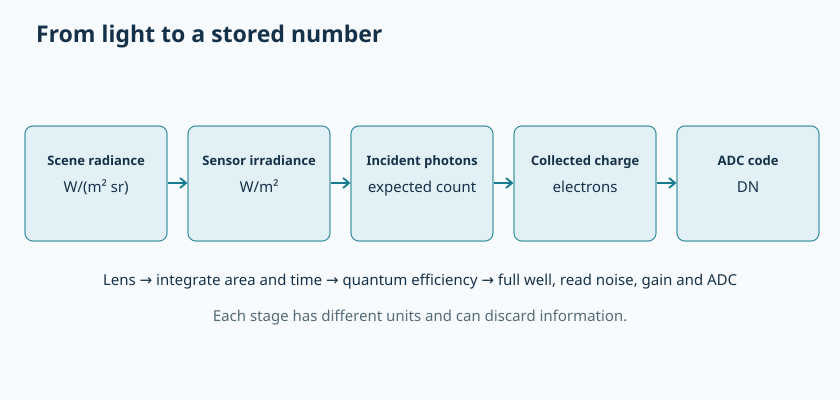
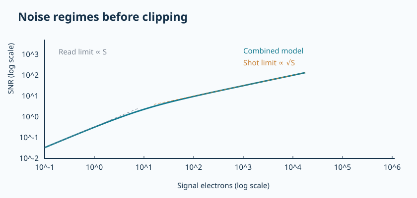
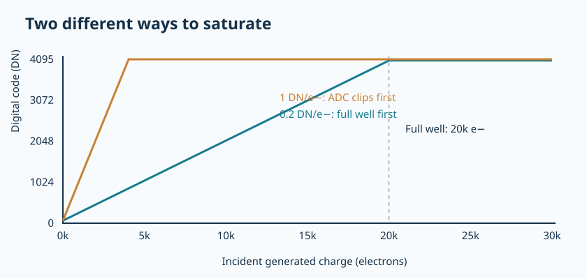

# Chapter 24 — Light Becomes a Measurement

*From Geometry to Images — Part V: The camera becomes a measuring instrument*  
*Reader edition / C++23 laboratory P24*

> A camera does not receive a brightness number from the world. It receives light and must manufacture a number from it.

## The garden has gone dark

Our paper house is still standing beside the tree. The camera has not moved. The lens has not changed. But the sun has set, and suddenly the photograph looks as though somebody scattered coloured sand across the garden.

We could make the photograph brighter on a computer. Yet brightening the image brightens the sand too. Why? Because the camera never knew the exact brightness of the house in the first place. It collected a finite number of tiny packets of energy. A darker house supplied fewer packets, and the relative uncertainty became larger.

The previous chapters taught us where a scene point should appear. Today we ask what numerical value should appear there. These are separate questions. Distortion can move a perfectly measured point to the wrong location; a perfectly calibrated camera can locate a point correctly but measure its brightness poorly. Eventually, when we reconstruct the garden, both errors will matter.

Imagine a pixel as a little bucket left outside in the rain. Counting drops is an analogy, not an exact description of semiconductor physics. A larger bucket collects more drops, leaving it outside longer collects more, and a full bucket cannot remember how much additional rain fell. If the rain is light, one bucket might catch five drops while its identical neighbour catches eight. Neither bucket is defective. The rain itself is random.

## The four quantities that people call brightness

We must separate the light travelling towards the camera from the light landing on the sensor, the energy accumulated during capture, and the digital number eventually written to memory.

Radiance describes directional optical power per projected area per solid angle, in watts per square metre per steradian when integrated over wavelength. Irradiance, denoted E, is optical power arriving per sensor area, in watts per square metre. Radiant exposure H is accumulated energy per area, in joules per square metre. For constant irradiance during a shutter interval t,

\[
H=Et.
\tag{24.1}
\]

If irradiance changes with time, replace multiplication with an integral. An object moving during that interval can illuminate several sensor positions; this is one origin of motion blur. A rolling shutter adds another complication: different rows can have different exposure intervals. Our emulator assumes a global, constant exposure.

The fourth quantity is a digital number, or DN, with no direct radiometric unit unless calibrated. A displayed brightness is another stage still. Keep these domains distinct, just as we separated world coordinates from pixel coordinates.

For a finite pixel area A, constant irradiance and monochromatic light, the incident energy is EAt. More generally one integrates over the pixel footprint and the exposure interval. The pixel is not an infinitely small point. Chapter 20's footprint becomes a physical collection area here.

*Figure 24.1 — A measurement chain is a sequence of models with different units. Loss at one stage cannot be undone merely by increasing a later number.*

## Aperture and time: two controls that change the collected light

Chapter 22 gave us the f-number N=f/D, where f is focal length and D is entrance pupil diameter in the ideal model. At fixed focal length, pupil area is proportional to D squared. Under the idealized on-axis, distant-scene assumptions with fixed transmission, sensor irradiance scales approximately as 1/N squared. Thus relative exposure scales as

\[
H \propto \frac{t}{N^2}.
\tag{24.2}
\]

This is a ratio, not a complete radiometric calibration. A useful ideal radiance-to-irradiance relation for an on-axis, distant extended source in air is approximately E = tau pi L/(4N^2), with transmission tau, a small cone approximation and no vignetting. At close focus the effective f-number changes; off-axis illumination can fall and real pupil geometry complicates the model. Do not use that approximate formula as a universal lens simulator.

Suppose we photograph the garden at f/2 and 1/100 second. Closing the aperture to f/4 quarters the ideal light collection rate. To keep exposure the same we need four times the shutter duration: 1/25 second. The ideal static signal can agree while the two photographs differ in motion blur and depth of field.

A stop is a factor of two. Doubling t is one additional stop of exposure. Multiplying N by the square root of two removes one stop. The conventional exposure value EV = log2(N^2/t), with t in seconds under the photographic convention, increases when the settings admit less light. This convention should not be confused with an exposure multiplier that increases image intensity.

Increasing electronic gain is different. It can make the same collected electrons occupy more digital codes. It cannot retroactively collect another photon. ISO is a camera sensitivity/exposure convention, not a universal direct conversion to electrons or an independent source of light.

## Counting packets of energy

A photon of wavelength lambda has energy

\[
\epsilon_\gamma=\frac{hc}{\lambda}.
\tag{24.3}
\]

Here h = 6.62607015 × 10^-34 joule seconds and c = 299792458 metres per second. The expected incident count under our monochromatic constant model is

\[
\mu_\gamma=\frac{EAt\lambda}{hc}.
\tag{24.4}
\]

Notice the word expected. The formula does not guarantee an integer count in a single photograph.

Take E = 1 W/m², A = 10^-12 m², t = 0.01 s and lambda = 550 nm. Convert 550 nm to 550 × 10^-9 m before using the equation. The energy collected is 10^-14 J, each photon carries approximately 3.612 × 10^-19 J, and the expected incident count is 27687.64 photons.

Not every incident photon produces a collected signal electron. Quantum efficiency eta is a probability-like conversion factor in this simplified counting model. If eta = 0.6, the mean useful signal is approximately 16612.58 electrons. The real efficiency depends on wavelength, sensor architecture and optical filters.

For a broadband source, integrate spectral irradiance multiplied by wavelength, quantum efficiency and the collection area and duration, divided by hc. Do not average wavelengths before this multiplication unless you can justify the approximation. A red and a blue source with equal radiant power may generate different expected electron counts.

## Noise is not always a mistake

Consider many independent exposures of a constant scene. Under a Poisson arrival model, the number K of detected photons has probability

\[
\Pr(K=k)=e^{-\mu}\frac{\mu^k}{k!},\qquad
\mathbb E[K]=\mu,\quad \operatorname{Var}(K)=\mu .
\tag{24.5}
\]

Poisson thinning tells us that independently accepting each arrival with probability eta produces another Poisson variable with mean eta times the original mean. Our code therefore samples signal electrons directly; it does not need a loop that tosses a coin for every photon.

At a mean of 100 electrons, the standard deviation is 10 electrons. At 10,000 it is 100 electrons. The bright signal has more absolute fluctuations, but a much smaller relative fluctuation: 1% instead of 10%. This distinction explains why dark scenes look noisier even though the absolute shot fluctuation may be smaller.

A sensor can accumulate thermal dark electrons without incident light. In our model their mean is d t, where d is a dark-current rate in electrons per second per pixel. Treating them as independent Poisson events makes the combined charge Poisson with mean S+D, where S = eta mu_gamma and D = dt. Dark-frame subtraction can remove a stable mean offset; it cannot remove the unpredictable shot fluctuations in that exposure.

Readout electronics also add uncertainty. We use independent zero-mean Gaussian read noise R with standard deviation sigma_r in electrons. Before clipping,

\[
Q \sim \operatorname{Poisson}(S+D),\qquad X=Q+R,
\]
\[
\mathbb E[X]=S+D,\quad \operatorname{Var}(X)=S+D+\sigma_r^2.
\tag{24.6}
\]

Subtracting the known mean dark signal gives an unbiased signal estimator under this model. Its single-exposure signal-to-noise ratio is

\[
\operatorname{SNR}=\frac{S}{\sqrt{S+D+\sigma_r^2}}.
\tag{24.7}
\]

*Figure 24.2 — An analytic model with three electrons RMS read noise and 0.02 mean dark electrons. At low signal the read noise dominates; at high signal shot noise dominates. Saturation invalidates the unclipped curve.*

When read noise dominates and the dark term is negligible, doubling signal nearly doubles SNR. When photon shot noise dominates, doubling signal multiplies SNR by the square root of two. To double shot-noise-limited SNR, you need four times the signal, not twice.

Use SNR as a linear amplitude ratio here. In decibels, use 20 log10(SNR), provided SNR is positive. Do not take the logarithm of zero. In the deterministic zero-signal, zero-noise limit, the code returns zero as an explicit convention rather than claiming an informative measurement.

Our model excludes photon bunching, correlated noise, fixed-pattern offsets, pixel-response variation, row noise, hot pixels and temperature-dependent dark current. These are not insignificant for real calibration. They are simply not covered by the independent-pixel model.

## A full bucket and a full integer are different things

A photosite can hold only a finite charge before saturation. Let W be its full-well capacity in electrons. We approximate the stored charge by min(Q,W). Real saturation can involve blooming, nonlinearity or charge transfer effects, which we do not simulate.

Then add read noise and apply conversion gain g in digital numbers per electron, with a pedestal b in DN. In a b-bit converter (use B for the bit count to avoid confusing it with bias), the maximum code is 2^B-1. Our implemented converter is

\[
Y=\operatorname{round}\left(\operatorname{clamp}(gX+b,0,2^B-1)\right).
\tag{24.8}
\]

In this equation X now denotes the readout of the clipped stored charge, not the earlier unclipped variable. The rounding convention in C++ is round-to-nearest with halfway cases away from zero; after clamping, all values are nonnegative.

With 12 bits, the largest code is 4095. A bias of 64 DN gives the read noise room to fluctuate around a dark measurement. A gain of 0.2 DN/electron means one code corresponds to five electrons in the ideal linear region. A gain of 1 DN/electron can resolve finer changes in electron units but reaches the maximum code with fewer electrons.

The default full-well capacity is 20,000 electrons. At 0.2 DN/electron and a 64 DN pedestal, full well maps to 4064 DN. The pixel can saturate physically while never reaching the digital maximum under ordinary read noise. Alternatively, high gain can clip a digital code before the photosite is full.

*Figure 24.3 — The ideal noiseless transfer curve separates charge saturation from digitizer saturation. The plateau is not recoverable by a later inverse brightness transform.*

The commonly quoted ideal quantization variance of delta squared divided by twelve assumes a uniform quantization error independent of the signal. For a fixed noiseless input the quantization error is deterministic; for clipped data it is not even bounded by half a step relative to the original signal. Treat the formula as a useful conditional approximation, not a universal extra noise term.

An approximate input-referred dynamic range uses full well divided by read-noise standard deviation, if read noise is the limiting floor. For W=20,000 and sigma_r=3 this is about 6667:1, or 12.70 stops. A real usable range also depends on dark current, converter gain, clipping, linearity and the definition of minimum acceptable SNR. The ADC having 12 bits does not prove that the physical sensor has exactly 12 stops of useful dynamic range.

## Write the little bucket in C++23

Open sensor.hpp. The photons function takes physical quantities in SI units. Config owns the sensor response assumptions. moments calculates the unclipped analytical oracle. capture draws the independent random components, clips the collected charge, adds read noise and calls adc. Sample returns each stage rather than only the final integer.

This last decision matters. If we return only a final code of 4064, we cannot tell whether the input was near the full-well limit or orders of magnitude above it. The simulator retains the latent charge for debugging; a real camera normally cannot report the charge that would have accumulated without saturation.

The capture engine receives its random engine by reference. Reusing a seed for a complete experiment helps reproducibility; resetting the engine to the same seed for every pixel instead makes supposedly independent samples artificially repeat. Standard C++ distributions do not promise identical random sequences across standard-library implementations. Test moments and contracts across platforms, not exact sample streams.

The count domain is bounded to 10^8 mean electrons for the educational sampler. Invalid configuration, negative exposure and non-finite inputs are rejected. This does not certify extreme SI-unit arithmetic or turn the model into a commercial sensor simulator.

Build the companion with the book's CMake project, then invoke the executable with one CSV path:

~~~text
book03_sensor sensor.csv
~~~

The studio runs 17 exposure levels, from eight stops below to eight above a reference of 1000 incident photons, with 10,000 simulated exposures at each level. It sweeps incident count while holding the dark integration time at 0.01 seconds: interpret this as a light-level sweep, not a shutter-duration sweep. It reports predicted signal, dark contribution, unclipped variance and SNR, observed mean and variance, mean code and two saturation statistics.

In the separate test with S=100, D=2, and sigma_r=3, the analytical mean is 102 electrons and variance is 111 electrons squared. The native trial of 100,000 samples measured 102.033 and 110.814. A finite random trial should approach the prediction, not equal it bit-for-bit.

At the highest exposure levels, the studio's full-well clipping fraction reaches one and observed analog variance approaches nine electrons squared: the remaining variation is read noise. The unclipped theoretical SNR printed beside it is no longer a description of recovered scene detail. That contrast is deliberate.

## How would we test an actual camera?

Fix a uniform light source, disable automatic processing if possible, and capture repeated RAW frames at several exposure levels. For each pixel or stable region estimate the temporal mean and variance. Subtract a separately estimated bias. In the linear, unsaturated, shot-noise-dominated region, if Y=gQ+b, then variance in DN squared is approximately g times the bias-corrected mean in DN, plus the read-noise variance in DN squared. This is the basic photon-transfer idea.

Do not confuse temporal variance across repeated exposures with spatial variance across different pixels. Spatial variance also sees fixed-pattern response and nonuniform illumination. Two frames can be differenced to suppress stable offsets; if their noise is independent and their means agree, half the variance of the difference estimates the variance of a single frame.

A dark series at multiple shutter durations can help separate electronic pedestal, read-noise floor and dark current. A flat-field series can reveal gain and saturation. Temperature, exposure timing, RAW black-level processing and illumination stability matter. A straight line on a plot is not sufficient proof that these assumptions held.

Our studio produces synthetic data, not a measurement of a real sensor. In Chapter 26 we will ask similar questions about camera geometry: what did we actually observe, what did we assume, and which parameter combinations can the observations identify?

## A photon-transfer experiment separates two kinds of noise

The little electron bucket is a mathematical model, but we can design an experiment that asks a camera whether it behaves approximately that way. The difficulty is that a real array contains both temporal randomness and stable differences among pixels. If we measure the spatial variance of a single photograph of a uniform target, those effects are mixed together.

Suppose an unsaturated linear sensor reports a black-subtracted digital value Y=gN+e, where g is digital units per electron, N is a Poisson electron count with mean S, and e is a zero-mean independent read term in digital units. Let its variance be sigma_e². Then

\[
\operatorname{E}[Y]=gS,\qquad
\operatorname{Var}(Y)=g^2S+\sigma_e^2.
\]

Eliminate S using the mean M=gS. The variance is g M+sigma_e². The slope of a variance-versus-mean plot is the gain in digital units per electron, not electrons per digital unit. The intercept is read variance in the reported units. If read noise is initially specified in electrons, convert its standard deviation by g first. Quantization, dark charge and other noise terms complicate this elementary model.

To suppress fixed-pattern contributions, capture two independent frames of the same uniform target without moving the camera. Let D=Y_1-Y_2. A stable additive offset cancels. For independent identically distributed temporal fluctuations, Var(D)=2 Var(Y). Thus the variance of the difference divided by two estimates temporal variance under the model. A common illumination fluctuation, motion or correlated electronic noise violates the simple independence assumption; estimate those effects separately instead of treating the formula as universal.

**Worked example.** Suppose two exposure settings have measured black-subtracted means 100 and 400 digital units and temporal variances 54 and 204 digital units squared. The slope is (204-54)/(400-100)=0.5 digital units per electron. The intercept is 4 digital units squared. Under the simple model, the read standard deviation is 2 digital units, or 4 electrons. The inferred mean electron counts are 200 and 800. A single saturated or aggressively processed exposure could destroy the linear relationship.

### Build the experiment with a reproducible data layout

The following standalone C++23 function estimates the sample temporal variance from paired frames of equal size. A real camera study must also decide whether pixels are sufficiently homogeneous to pool, handle defective and saturated pixels according to a declared policy, and verify that the frame differences are independent across repeated captures. This snippet is a minimal estimator, not a complete sensor characterization program.

~~~cpp
#include <cmath>
#include 
#include <stdexcept>

double paired_variance(std::span<const double> a,
                       std::span<const double> b) {
    if (a.size() != b.size() || a.size() < 2)
        throw std::invalid_argument("incompatible frames");
    // Welford's update avoids subtracting two large raw moments.
    double mean = 0.0, m2 = 0.0;
    std::size_t count = 0;
    for (std::size_t i = 0; i < a.size(); ++i) {
        const double d = a[i] - b[i];
        if (!std::isfinite(d))
            throw std::invalid_argument("invalid difference");
        const double delta = d - mean;
        mean += delta / double(++count);
        m2 += delta * (d - mean);
    }
    return m2 / (2.0 * double(count - 1));
}
~~~

For differences [-2,0,2], the unbiased sample variance of the differences is 4, so the function returns 2. A common offset added to both frames leaves the result unchanged. A common offset added to only one frame also disappears from the centered variance, which is why the mean difference should be recorded separately. The estimator is not a detector of every exposure mismatch.

## A saturated value carries an inequality

Let an ideal charge-well limit be Q_max. If the sensor returns the maximum value, the unknown preclipped charge may equal the limit or be greater. This is a censored observation. It cannot be treated as an ordinary precise measurement of Q_max.

For example, two locations receive 10,000 and 40,000 electrons under a 20,000-electron well. Their stored charges become 10,000 and 20,000. The true ratio was four; the observed ratio is only two. Shortening exposure by a factor of four would ideally produce 2,500 and 10,000 electrons, now both inside the range. But the shorter exposure also reduces the number of detected photons and therefore changes shot-noise SNR.

Exposure bracketing records the same scene at multiple exposure times. Under a linear stationary model, divide each unsaturated black-subtracted measurement by its exposure time to estimate an irradiance-proportional rate. Measurements from a very short exposure may be dominated by read noise; measurements from a long exposure may clip. A weighted estimator can combine them if the noise covariance and response model are understood.

Take two unsaturated measurements in electron units, with exposure times t_1 and t_2. If the scene rate is rho electrons per second, the estimates N_i/t_i have variance approximately rho/t_i plus sigma_read²/t_i². With independent errors, inverse-variance weighting reduces variance relative to an unweighted mean when their uncertainties differ. The unknown rate in those weights may require an initial estimate. Saturated measurements must be excluded or modeled as inequalities, rather than assigned the same ordinary weight.

## The sensor measures an area and a time interval

A point sampler is an abstraction. A pixel collects light over its active area and integrates it during exposure. If irradiance at the sensor is E(x,y,t), the expected number of collected electrons is proportional to an integral of E over both the sensitive area and the shutter interval, with spectral response included as appropriate. This is the same space-time filtering problem that appeared in Chapter 20.

For a one-dimensional moving edge travelling at v pixels per second, a rectangular exposure of duration T smears the edge over vT pixels under an ideal constant-velocity model. At v=120 pixels per second and T=1/60 second, the smear width is two pixels. Halving exposure halves this geometric motion-blur extent but also halves expected signal if illumination and aperture remain unchanged. A camera setting is a coupled trade-off between exposure, noise and blur.

A rolling shutter adds another complication: rows can start exposure at different times. Let the start time for row j be t_0+j delta_t. A horizontally translating point is measured at different positions by different rows. If the effective sampling time is the exposure midpoint, its horizontal displacement relative to the first row is v j delta_t. A line that was vertical can appear slanted. This simple constant-velocity example is not a full rolling-shutter reconstruction model, but it shows why time belongs in the camera calibration record.

## How to report a measurement rather than a polished photograph

A defensible experimental report includes a dark series at several exposure settings, a stable uniform target, repeated frame pairs, saturation masks, a temporal variance plot and residuals from the proposed gain model. Record temperature if dark current is important. Keep automatic white balance, tone mapping and denoising disabled where raw access permits. If the camera cannot provide linear measurements, state the limitation instead of fitting a Poisson model directly to compressed display values.

**Research exercise.** Extend the sensor simulator to create a stable per-pixel offset field in addition to independent temporal noise. Compare spatial variance, paired temporal variance and the known noise parameters at increasing signal. Introduce an exposure-dependent illumination fluctuation and observe how the paired estimate changes. Fit gain using only unsaturated data, hold out some exposure settings, and report the parameter uncertainty across repeated fits. The existing P24 laboratory supplies the bounded physical and stochastic sensor model; these characterization experiments are proposed extensions and not reported as completed camera measurements.

### Guided workshop: separate bias, temporal noise and saturation

Construct a synthetic sensor with an expected signal of 100 electrons, read noise of standard deviation 4 electrons, gain 0.5 DN per electron and black offset 64 DN. Ignore dark noise and quantization initially so the elementary model can be checked. The expected reported mean is 114 DN. Its temporal variance is 0.25 times (100+16), or 29 DN squared. If we subtract the known black level, the mean is 50 but the temporal variance is unchanged. Offsets shift means; stable offsets do not add temporal variance at a single pixel.

Now give each pixel a stable random offset with variance 25 DN squared and zero population mean. A spatial variance estimate over a sufficiently large homogeneous array has expected contributions from temporal variation and the offset field, approximately 54 DN squared in this model. A paired-frame difference removes the stable offset and yields a temporal variance estimate near 29 after division by two. Finite realizations will fluctuate. The two measurements answer different questions, so report both.

Repeat at expected electron signals of 25, 100, 400 and 1600. Under the unsaturated model the temporal variance in DN squared is 0.25S+4, giving 10.25, 29, 104 and 404. The black-subtracted means are 12.5, 50, 200 and 800 DN. These four pairs lie exactly on a line of slope 0.5 and intercept 4 before sampling error. In a simulated experiment, draw independent noise realizations for each frame and retain the random seed and repeated estimates.

Introduce a maximum reported digital value of 255 while retaining the black offset 64. The ideal noiseless clipping threshold is (255-64)/0.5=382 electrons. The 400- and 1600-electron levels are no longer valid points for fitting the original linear variance model. Around the threshold, some noisy samples may remain below saturation while others clip, distorting both mean and variance. Plot the saturation fraction beside the photon-transfer curve rather than fitting every observation indiscriminately.

Use the native P24 simulator to understand its precise order of physical and digital operations before adapting the fixture. The simplified derivation here omits quantization and dark noise intentionally; introduce them one at a time. An eight-bit output near the noise floor does not behave exactly like a continuous DN value. A noisy estimate that disagrees with the ideal line could be a model effect rather than a bug.

When fitting the slope, compare a regression using every nominal signal level with one using only the declared linear range. Report the fitted gain, read variance, residuals and seed-to-seed variation. Reserve one unsaturated level for validation. A successful experiment should recover the known parameters approximately within sampling uncertainty, and clearly explain why the saturated data cannot support the same claim. This is a complete answer key for the simplified synthetic model, not a measurement of a real commercial sensor.

## Exercises: measure before you trust

**Reconstruct 24A.** Derive the photon equation by tracking units. Compute the incident count for the numerical example at 450 nm instead of 550 nm. Explain why equal energy does not mean equal photon number.

**Reconstruct 24B.** Calculate SNR for S=100, D=2, sigma_r=3. Repeat for four times S, holding dark time fixed. Compare with the ideal shot-limited factor of two.

**Falsify 24C.** Change gain to 1 DN/electron in the studio. Identify which saturation occurs first and explain why the two CSV fractions describe different events. At the digital maximum, the code alone cannot identify whether the analog value was strictly clipped or merely rounded to the largest code.

**Falsify 24D.** Set read noise and dark current to zero, then increase S by factors of four. Fit the log-log slope of the measured standard deviation below saturation. It should approach one half, not one.

**Transfer 24E.** Double shutter duration for a constant scene and compare that experiment with doubling irradiance at fixed time. The photon signal agrees in the ideal model, but dark contribution does not.

**Transfer 24F.** Add a per-pixel stable dark offset and a temporally random read component. Compare the spatial variance of a single flat frame with the temporal variance of repeated captures.

**Explain 24G.** Explain to a child why making a dark photograph brighter later is not the same as leaving the camera's little buckets open for longer.

**Explain 24H.** Draw the units over every edge of the measurement chain, then explain to a camera engineer why 12-bit ADC output is not a claim of 12-stop dynamic range.

### Selected answers and experiment criteria

**24A–B.** Collected energy is EAt in joules, photon energy is hc/lambda in joules per photon, so their ratio is a photon count. At 450 nm the same energy gives about 22,653.52 photons, or 450/550 of the original count. For S=100 the SNR is 100/sqrt(111), approximately 9.49; for S=400 it is 400/sqrt(411), approximately 19.73. Their ratio is about 2.08: the fixed read and dark terms matter more at the smaller signal.

**24C–D.** Ignoring read noise and rounding, the ADC reaches its top at (4095-64)/1=4031 electrons, below the 20,000-electron well. The two clipping fractions describe different mechanisms. Fit standard deviation against signal only in the unsaturated regime; under ideal Poisson statistics the log-log slope is 1/2. Use repeated trials to see how the fitted slope varies.

**24E–F.** Doubling irradiance or exposure time doubles ideal signal, but only longer exposure doubles dark charge at a fixed dark-current rate. A stable per-pixel offset contributes spatial variation but cancels from the repeated-frame temporal variance at that same pixel. Report both estimators, their sample counts and the measurement units.

**24G–H.** Digital gain remaps stored values, including their noise; it cannot replace photons that never arrived. Trace photons, electrons, analog noise, DN and quantized codes separately. Dynamic range needs a saturation limit and a stated usable noise floor, not merely a bit count.

## What happens next?

Today the garden became a collection of numbers whose uncertainty we could explain. The numbers are not yet colours. In Chapter 25 we will ask why two equal-looking digital triplets can represent different physical lights, why encoded values cannot safely be averaged as though they were linear energy, and how white balance and response curves change the story.
