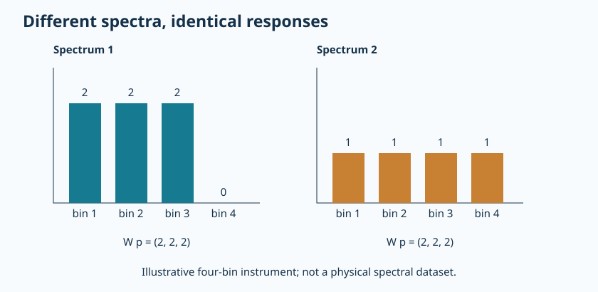
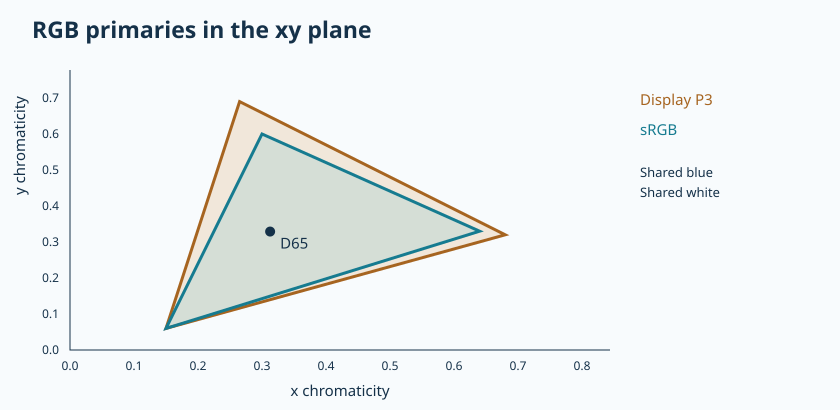
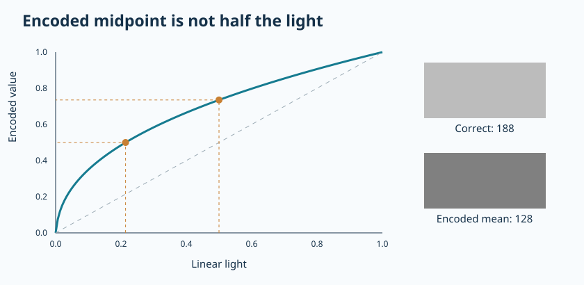
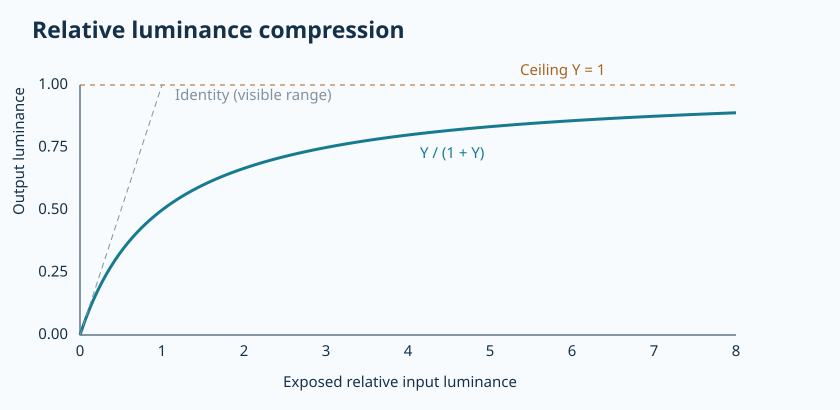

# Chapter 25 — Colors That Tell the Truth

*From Geometry to Images — Part V: The camera becomes a measuring instrument*  
*Reader edition / C++23 laboratory P25*

> Three numbers can describe the color of a flower, but only after somebody tells us what the three numbers mean.

## The house has changed color without moving

Our garden has survived an extraordinary journey. We built its triangles, aimed a camera at it, traced its image through a lens and finally counted the electrons collected by a sensor. Now imagine putting a white sheet of paper beside the house at noon. In the evening the same sheet looks warm and orange. Under a blue lamp it looks blue. Your brain often recognizes that the paper itself has not changed.

This is a magnificent little puzzle. A white surface does not emit a special substance called whiteness. It reflects some of the light arriving at it. The camera measures a mixture of the illumination, the surface and its own spectral response. What we perceive depends on the visual system and its adaptation.

A triplet such as (128, 128, 128) is not a universal color measurement. It is a stored number whose meaning depends on how it was encoded, what reference it uses and which transformation eventually turns it into light. Today we learn how to keep that promise intact.

## Light has a spectrum, not an RGB label

Visible light is electromagnetic radiation over a range of wavelengths. For our purposes, imagine a spectrum as a function P(lambda) that says how much power there is in each small wavelength interval. A narrow blue LED and daylight have very different spectra.

A camera channel is a weighted measurement of that spectrum. With channel-dependent quantum efficiency eta_i(lambda), a simplified expected signal in electrons is

\[
s_i=At\int E_\lambda(\lambda)\eta_i(\lambda)\frac{\lambda}{hc}\,d\lambda.
\tag{25.1}
\]

Here E_lambda is spectral irradiance at the sensor. As in Chapter 24, A is area and t is duration. The spectral irradiance and integration variable must use consistent wavelength units. Integrating a per-nanometre quantity over metres without conversion would introduce a factor of a billion.

Most common color cameras use a mosaic of color filters, such as a Bayer pattern. A single photosite generally measures one filtered response, not three independent channels at the same location. Demosaicing estimates missing responses from nearby samples. A camera without such a mosaic can use a different architecture. Do not confuse the storage of three numbers in a finished image with the physical measurement arrangement.

An observer also reduces a spectrum to a small number of responses. Cone sensitivities overlap; they are not three perfectly isolated red, green and blue detectors. Standard colorimetry describes color matches with three standardized functions rather than reproducing the full physiology of vision.

The CIE 1931 standard observer provides one such reference. In simplified notation,

\[
X=k\int P(\lambda)\bar x(\lambda)\,d\lambda,\quad
Y=k\int P(\lambda)\bar y(\lambda)\,d\lambda,\quad
Z=k\int P(\lambda)\bar z(\lambda)\,d\lambda.
\tag{25.2}
\]

The normalization k depends on whether we are reporting absolute or relative quantities. For our RGB conversions, reference white has Y=1. The Y component represents relative photopic luminance, not subjective brightness and not a raw camera green channel.

For reflected objects, the spectrum reaching an observer depends on both illumination and reflectance. Even if we know a color match, we cannot in general uniquely recover both.

## Three numbers can forget an entire spectrum

Suppose we discretize the spectrum into n wavelength bins. The three measurement equations become a 3-by-n matrix W multiplied by a vector p. When n exceeds three, the null space is nontrivial: some nonzero vectors v obey Wv=0. If p is strictly positive, a sufficiently small perturbation p+av remains nonnegative and gives the same measurement.

That is the mathematical heart of metamerism. Different spectra can give the same tristimulus values for a specified observer. They need not look alike under a different illuminant or produce the same responses in a different camera.

Consider an intentionally invented four-bin instrument:

\[
W=\begin{bmatrix}1&0&0&1\\0&1&0&1\\0&0&1&1\end{bmatrix}.
\]

The vectors (2,2,2,0) and (1,1,1,1) both produce (2,2,2). They represent different spectra in this toy model. This is not a table of measured CIE sensitivities; it is an exact algebraic counterexample.

*Figure 25.1 — Information can disappear during measurement. The toy weights and spectra are illustrative, not physical standard-observer data.*

This explains why a camera-to-XYZ matrix fitted to a color chart is not a universal spectral reconstruction. If the camera's spectral response functions do not span the same measurement space as the observer's functions, one fixed linear transform cannot reproduce all observer matches exactly. It may nevertheless work very well over a relevant collection of illuminants and materials.

## Remove brightness to inspect chromaticity

For XYZ values whose sum T=X+Y+Z is positive, define

\[
x=X/T,\qquad y=Y/T,\qquad z=Z/T=1-x-y.
\tag{25.3}
\]

Multiplying all three tristimulus values by the same positive constant does not change x and y. These two coordinates describe chromaticity, while Y separately retains the luminance scale.

If y is positive, the inverse relation is

\[
X=xY/y,\qquad Z=(1-x-y)Y/y.
\tag{25.4}
\]

At black, X=Y=Z=0, the denominator in equation 25.3 is zero. There is no unique chromaticity for black in this model. The C++ function returns an empty optional rather than quietly substituting white or dividing by zero. Similarly the inverse expression needs a declared domain; not every arbitrary coordinate pair represents a realizable color.

A common display white reference is D65, with chromaticity x=0.3127, y=0.3290. Setting Y=1 gives XYZ approximately (0.950456, 1, 1.089058). D65 is a defined standard daylight illuminant, not a statement that every daylight photograph has this white point.

## RGB is a coordinate system with primaries

Recall how three basis vectors described a point in Chapter 06. Linear RGB works similarly: a primary contributes a column of XYZ values, and the three linear channel coefficients specify a combination.

But we cannot choose the basis by writing the letters R, G and B. We need the primary chromaticities and a white point. The sRGB primaries are R=(0.64,0.33), G=(0.30,0.60), B=(0.15,0.06); Display P3 uses R=(0.68,0.32), G=(0.265,0.69), B=(0.15,0.06). Both use D65. Display P3 is not interchangeable with the cinema DCI-P3 encoding and white-point convention.

For each primary with chromaticity (x_i,y_i), construct a provisional unit-Y column

\[
p_i=(x_i/y_i,\;1,\;(1-x_i-y_i)/y_i)^T.
\]

Collect these columns in a matrix P. Let w be the white XYZ vector with Y=1. Solve Pq=w for the column scale factors q. The RGB-to-XYZ matrix is

\[
M=P\operatorname{diag}(q).
\tag{25.5}
\]

By construction M times (1,1,1) equals w. This is not magic color science hidden inside a library: it is a change of basis plus normalization.

The linear sRGB matrix, to six decimal places, is

\[
M_s=\begin{bmatrix}
0.412391&0.357584&0.180481\\
0.212639&0.715169&0.072192\\
0.019331&0.119195&0.950532
\end{bmatrix}.
\tag{25.6}
\]

Notice that Y is a weighted sum, not the arithmetic mean of R, G and B. For example full linear green and full linear blue do not have the same relative luminance.

When both RGB spaces use the same white reference, converting between them is

\[
r_d=M_d^{-1}M_s r_s.
\tag{25.7}
\]

If the source and destination white points differ, a chromatic adaptation step may be appropriate depending on the intended interpretation. Do not insert adaptation into a same-white conversion, and do not claim a matrix can reproduce every aspect of visual adaptation.

*Figure 25.2 — The triangles show primary chromaticities in the xy plane, not a complete spectral locus or a guarantee of the brightness available at every point.*

## A negative channel is a useful warning

Convert Display P3 red (1,0,0) into linear sRGB. The result is approximately (1.22494,-0.04206,-0.01964). This is not a bug. The source primary lies outside the destination's set of reproducible nonnegative mixtures.

A negative coordinate here is analogous to a point described by a signed basis coefficient. It does not mean a real display should emit negative photons. It says that this color cannot be represented by that destination's three primaries under the assumed range.

Our conversion function preserves the signed result. A separate in_gamut test checks the unit RGB cube with a small numerical tolerance. A separate clip function deliberately clamps each channel. Clipping P3 red to (1,0,0) in sRGB changes the XYZ value and loses information. Advanced gamut mapping can trade chroma, hue and lightness to make a more useful perceptual approximation. It is not simply another invertible basis transformation.

The triangle in a chromaticity diagram says which chromaticities are attainable by nonnegative mixtures with unconstrained overall scaling. It does not describe the finite luminance volume of a real display. A linear RGB value above one can exceed the normalized white level even when its chromaticity lies inside the triangle.

## The halfway number that is not halfway light

Chapter 20 warned us not to average encoded pixel values as though they were linear light. Let's make the warning impossible to forget.

For a normalized nonnegative linear channel L in [0,1], the sRGB encoding is

\[
C=\begin{cases}
12.92L & L\le 0.0031308,\\
1.055L^{1/2.4}-0.055 & \text{otherwise}.
\end{cases}
\tag{25.8}
\]

The inverse is

\[
L=\begin{cases}
C/12.92 & C\le0.04045,\\
((C+0.055)/1.055)^{2.4} & \text{otherwise}.
\end{cases}
\tag{25.9}
\]

It is often loosely called gamma, but it is a piecewise transfer curve, not exactly a single power of 2.2. Its rounded standard breakpoints create a tiny discontinuity. Do not demand mathematical bit-exact inversion across that narrow transition interval. Our educational functions use the normalized unit domain; signed and extended-range encodings used elsewhere need a separate contract.

A black pixel emits zero relative linear light in our ideal display model and a white pixel emits one. Averaging them in linear light gives 0.5, encoded as 0.735357. Averaging their encoded values gives 0.5, which decodes to approximately 0.214041. In an eight-bit representation the first result rounds to 188 and the second to 128.

*Figure 25.3 — Two ways of averaging the same endpoints produce substantially different linear light. The plot and swatches assume the sRGB transfer convention.*

This distinction affects mipmaps, image filtering, resizing, antialiasing, blending and the image residuals used in reconstruction. A color texture stored in sRGB typically needs decoding before linear-light arithmetic. A normal map, roughness map or depth map is not an sRGB color texture simply because its bytes happen to occupy three channels.

The same idea applies when we composite transparent surfaces. A coverage fraction is not a nonlinear color channel. For a simple opaque background and foreground color F with opacity alpha, the output is alpha F+(1-alpha)B in a common linear color space. Premultiplied alpha requires its own representation contract.

## Teach the camera what neutral means

Under warm illumination, a neutral reference card may produce raw responses (0.4,0.6,0.3) after black subtraction. Holding green fixed, choose gains (0.6/0.4,1,0.6/0.3)=(1.5,1,2). Multiplying componentwise yields (0.6,0.6,0.6).

This is a toy raw-domain white balance. It depends on the assumption that the reference really is neutral and the responses are linear, positive and unsaturated. The relative gains are not absolute exposure. A different overall common gain produces the same channel ratios.

Apply these gains after removing the black pedestal, not to unrelated encoded values. A zero or saturated reference channel cannot reliably estimate its gain. A noisy blue response multiplied by two also doubles its noise standard deviation in that linear domain. White balance cannot recover a channel that clipped earlier.

Neutral equalization is a useful first step, but a real camera pipeline also requires camera-to-working-space characterization. The simple diagonal correction does not guarantee a correct color for every material, especially under mixed lighting. In standard XYZ workflows, chromatic adaptation transformations use a specified model and source/destination whites; they are not generally the same as RAW-channel gain adjustment.

## High dynamic range is not a bigger gamma curve

A scene-linear working image may hold values well above one. These are useful relative radiance or exposure values, not invalid colors. Book 4 will investigate where the light values themselves come from.

To display them in a limited range, we can apply exposure and compress luminance. Let r be a nonnegative linear sRGB triplet and Y its relative luminance. With exposure factor e>=0, define r_e=e r and Y_e=eY. A small teaching operator is

\[
r_{\mathrm{out}}=\frac{r_e}{1+Y_e}.
\tag{25.10}
\]

Its output luminance is Y_e/(1+Y_e). Since every component is multiplied by the same positive scale for positive exposure and nonzero input, chromaticity is preserved before gamut mapping. That does not guarantee each channel lies inside the display cube. A saturated bright primary may still require gamut mapping. Componentwise compression, in contrast, generally changes channel ratios.

*Figure 25.4 — The simple teaching curve approaches a normalized ceiling. This is not a calibrated HDR display standard.*

Tone mapping is distinct from transfer encoding. A display-specific pipeline may use an absolute-luminance HDR encoding such as PQ, or an HLG workflow with its own signal and display conventions. We are not implementing those standards in this chapter. Likewise, quantization to eight bits is a later operation and cannot recreate values already discarded during clipping.

## The C++23 color and response laboratory

Read color.hpp with a pencil nearby. The two RGB-to-XYZ matrices use a common D65 normalization. The small inverse function computes the adjugate and determinant; it is intended for these known, well-scaled matrices, not as a replacement for a numerically robust general solver.

convert() accepts linear triplets and does not clamp. encode() and decode() enforce the unit interval. clip() is explicitly lossy. xyY() refuses negative XYZ coordinates and represents the black singularity with an empty optional. neutral_gains() uses a positive measured reference, and compress() is a simple relative linear-sRGB HDR operator.

The test uses 10,000 seeded triplets to check the round-trip sRGB → P3 → sRGB, alongside transfer round trips, all 256 eight-bit codes, white chromaticity, black, out-of-gamut P3 red and neutral gain correction. The maximum observed matrix round-trip error is about 1.22×10^-15. Floating-point agreement here measures arithmetic, not display color accuracy.

Run the studio after building the companion:

~~~text
book03_color color.csv
~~~

It exports the 9×9×9 grid of 729 linear sRGB triplets, their XYZ coordinates, the corresponding linear P3 coordinates and encoded sRGB. A separate Python calculation builds both matrices from their primary chromaticities and D65 white instead of copying the C++ constants, and checks every row. The largest XYZ disagreement was about 3.33×10^-16 and the largest P3 disagreement about 1.11×10^-15.

The studio is a numerical inspector, not an ICC color-management system or a display profiler. The illustrations use ordinary display colors as aids; their screen appearance cannot prove the colorimetry. A calibrated monitor and instrument would be required for claims about a physical display.

## A camera's three measurements need a calibration model

Our three-channel toy sensor demonstrated that different spectra can give the same response. A real camera's red, green and blue filters do not in general match the standard observer's color-matching functions. A matrix fitted to a calibration chart approximates a mapping from camera RGB to a reference space over the sampled illuminants and surfaces. It cannot manufacture spectral information that the sensor did not measure.

Write each linear black-subtracted camera observation as a three-vector c_i and its reference tristimulus target as x_i. Stack the camera observations as rows in a matrix C and the reference rows in X. Find a matrix A minimizing the squared Frobenius norm

\[
\|CA-X\|_F^2.
\]

This is three least-squares problems sharing the same design matrix. When C has full column rank, one can express the normal-equation solution as A=(C^TC)^{-1}C^TX, although a QR or SVD solve is preferable when conditioning matters. With row vectors, the prediction is c_i^T A; a column-vector convention would use A^T. Confusing those two forms can generate a plausible-looking but systematically wrong color transform.

If every calibration patch is neutral, its camera response may be close to a scalar multiple of one common vector. Then C is nearly rank one. A matrix that maps that vector correctly can behave arbitrarily in the other two directions. More gray patches do not resolve the missing color information. Include colored patches with distinct responses, and evaluate on withheld surfaces.

**Worked example.** Consider a deliberately artificial sensor whose response is twice the reference red, equal to green, and half the reference blue. With three linearly independent calibration patches, the inverse transform is diagonal with entries 0.5, 1 and 2. A response (0.8,0.3,0.2) maps to (0.4,0.3,0.4). If all training patches are proportional to (2,1,0.5), this diagonal solution is one of infinitely many matrices agreeing with the training data. The solution looks simple only because we assumed the sensor model.

## White adaptation is a change of viewing condition, not a universal correction

A neutral object photographed under warm illumination may produce unequal camera channel responses. White balance compensates for an estimated neutral under a chosen model. But the spectrum of a light source can change the relationship between camera responses and standard-observer tristimulus coordinates. Two lights with the same apparent chromaticity can have very different spectra. No three-channel gain rule guarantees identical colors for every surface under both lights.

A common mathematical approach to chromatic adaptation transforms tristimulus coordinates into an approximate cone-response space, scales the three components to map a source white to a destination white, then transforms back. Let M be the chosen cone-space matrix and let w_s and w_d be source and destination tristimulus white vectors. Define

\[
D=\operatorname{diag}((Mw_d)_1/(Mw_s)_1,
 (Mw_d)_2/(Mw_s)_2,(Mw_d)_3/(Mw_s)_3),\qquad
x_d=M^{-1}DMx_s.
\]

The construction maps w_s exactly to w_d if the denominators are nonzero and M is invertible. It does not prove that every surface's appearance is predicted perfectly. Different adaptation models choose different M and adaptation assumptions. This is a modeling boundary rather than a second color-space conversion disguised as a physical law.

A useful verification fixture checks white mapping, identity when the two whites coincide, round-trip behavior before clipping and sensitivity near small cone components. Apply the transforms in floating point and retain signed intermediate values. If a subsequent display gamut clips them, the inverse cannot generally reconstruct the original value. Keep adaptation error and clipping error separate.

## What is a color difference measuring?

The ordinary Euclidean distance between two RGB coordinate vectors is easy to calculate but depends on the chosen primaries and transfer encoding. The same physical colors may have very different numerical distances in different coordinate systems. For a more perceptually motivated comparison one can transform a reference XYZ and its white to CIELAB.

Let f(t)=t^(1/3) for t above delta³, and f(t)=t/(3delta²)+4/29 otherwise, with delta=6/29. The piecewise function joins continuously with matching derivative. For a specified positive reference white (X_n,Y_n,Z_n), the coordinates are

\[
L^*=116 f(Y/Y_n)-16,\quad
a^*=500[f(X/X_n)-f(Y/Y_n)],\quad
b^*=200[f(Y/Y_n)-f(Z/Z_n)].
\]

For the reference white itself, all normalized coordinates equal one, so the result is (100,0,0). For a neutral at half relative tristimulus intensity, the coordinates are approximately (76.07,0,0). Half the physical intensity is not half the lightness coordinate. The simplest CIE76 difference is Euclidean distance in Lab; it is not perfectly perceptually uniform. More elaborate differences exist, but all require explicit viewing and reference conditions.

~~~cpp
#include <array>
#include <cmath>
#include <stdexcept>

std::array<double,3> lab_from_xyz(
    std::array<double,3> xyz, std::array<double,3> white) {
    constexpr double d = 6.0 / 29.0;
    auto f = [=](double t) {
        return t > d*d*d ? std::cbrt(t)
                         : t / (3*d*d) + 4.0/29.0;
    };
    std::array<double,3> r{};
    for (int i=0; i<3; ++i) {
        if (!std::isfinite(xyz[i]) || !std::isfinite(white[i])
            || white[i] <= 0)
            throw std::invalid_argument("invalid XYZ or white");
        r[i] = f(xyz[i] / white[i]);
    }
    return {116*r[1]-16, 500*(r[0]-r[1]), 200*(r[1]-r[2])};
}
~~~

This teaching implementation permits signed XYZ inputs mathematically; a physically interpreted stimulus or a particular color-management pipeline may impose additional domain constraints. The reference white is explicit because the same XYZ triple can produce different Lab coordinates relative to different whites. Test the neutral axis, continuity near delta³, and known reference-white mapping. Do not present this standalone function as a complete ICC color-management system.

## The pipeline must say where information disappears

Draw a data-flow diagram for a camera that records a color image: photons through filters, electron counts, analog gain and black level, digitization, raw correction, demosaicing if required, white balance, camera-to-working-space mapping, tone mapping, gamut mapping and output transfer. A display then has its own electro-optical behavior and viewing environment. Some operations are invertible over a restricted domain; others lose information.

For example, an ideal diagonal white-balance gain with nonzero gains is algebraically invertible before clipping. A rank-deficient color transform is not. Mapping a range of bright linear values to the same output value loses highlight differences. Averaging encoded channels introduces a nonlinear photometric error. Saving an eight-bit output introduces quantization that may erase small differences even if every prior transform was invertible.

Use two comparisons in an experiment: error relative to the linear reference before display processing, and error after the declared display mapping. A tone mapper can make large radiometric errors look small in the displayed image; a correct wide-gamut signal may look wrong if interpreted using the wrong primaries. These are different failures.

**Research exercise.** Generate a synthetic set of linear camera responses under two illuminants. Fit one color matrix using only the first group and evaluate both groups using a declared reference white. Compare rank, held-out linear XYZ error, Lab difference and gamut clipping fraction. Add a chart containing only neutral patches and inspect the singular spectrum. The P25 native lab covers relative linear color spaces and transfer functions; this calibration and appearance experiment is an extension, not a validated physical camera profile.

### Guided workshop: follow one patch through a color pipeline

Take a linear camera response c=(0.2,0.4,0.3). Apply white-balance gains (2,1,1.5). The corrected vector is (0.4,0.4,0.45). It is not neutral, because the gains were chosen to neutralize some other reference patch; a color pipeline is supposed to preserve distinctions among nonneutral surfaces rather than turn everything gray.

For the numerical fixture only, assume this corrected vector is already expressed in linear sRGB primaries. Real camera responses require a calibrated camera-to-working-space mapping, and a diagonal white balance is not a substitute for that mapping. Encode the three linear channels with the sRGB transfer. The first two become approximately 0.665185, and the third about 0.701411. Nearest eight-bit codes are therefore about (170,170,179). Decode those integer codes to linear values and measure the error due to quantization separately from the white-balance transformation.

Now suppose the original camera response had been (0.8,0.4,0.3). The same white balance produces (1.6,0.4,0.45). If the output pipeline clamps linear channels to [0,1], red becomes one. A response of 0.6 in the original red channel would also map to a value above one and clip to the same output red. The clipping operation has made the distinct inputs indistinguishable in that channel. If you divide the clamped result by the gain, you recover 0.5, not either original input. The round trip cannot recover information that was discarded.

For a matrix-calibration experiment, use three linear reference patches (1,0,0), (0,1,0), (0,0,1) and the artificial diagonal sensor response from the earlier example. Fit the inverse matrix from these three independent rows, then evaluate a fourth mixed-color patch. In the exact model its prediction should match the known reference. Add small independent noise to the calibration rows and repeat the fit. Check the sensitivity of the solution and the withheld error. Next train using only neutral patches. The design matrix becomes rank deficient; the correct outcome is a diagnostic of insufficient independent color support, not an arbitrary inverse.

Compare color difference in encoded RGB, linear RGB and Lab relative to an explicitly specified reference white. These distances need not rank all candidate errors in the same order. A Lab conversion expects XYZ relative to a white, so first use the declared RGB-to-XYZ matrix. It is not correct to pass linear RGB straight into the XYZ-to-Lab function because the dimensions happen to agree.

Build a small CSV trace containing raw camera values, black-subtracted values, white-balanced values, the working-space vector, pre-clamp extrema, clipping flags, transfer-encoded values and byte codes. Each output column should have its own convention. Compare the native P25 transfer and color-space functions with the relevant stages of this trace. The synthetic matrix-fit and clipping experiment are proposed extensions. Their purpose is to teach an independent check of a real color-management pipeline without confusing visual appearance, numeric equivalence and sensor calibration.

## Exercises — don't let the numbers fool you

**Reconstruct 25A.** Use the four-bin toy instrument to find a third distinct nonnegative spectrum with responses (2,2,2). State the entire family.

**Reconstruct 25B.** Calculate XYZ for D65 with Y=1. Derive the primary matrix columns using equation 25.5, and explain why their sum must equal the white XYZ.

**Falsify 25C.** Compare a black-white average before and after encoding. Render a two-color checkerboard and downsample it in both ways. Record the decoded linear values.

**Falsify 25D.** Convert saturated P3 red to linear sRGB, then clip and convert back to P3. Measure the XYZ error. Explain why the unclipped round trip is a different experiment.

**Transfer 25E.** Apply the neutral gains to the reference (0.4,0.6,0.3) and to a colored patch (0.5,0.3,0.2). Show why making the reference neutral does not prove that every patch is correct.

**Transfer 25F.** Compare the output of equation 25.10 to applying v/(1+v) independently to (8,4,2). Compute channel ratios before and after both operations.

**Explain 25G.** Explain to a child why the same RGB numbers can mean different colors on two displays. Then explain the precise mathematical interpretation to a graphics programmer.

**Explain 25H.** Write a pipeline contract from Chapter 24's raw ADC output to a displayed encoded RGB image. Label the units, black subtraction, white balance, color transform, exposure, tone mapping, gamut handling, transfer encoding and quantization. Name information lost at each stage.

### Selected answers and experiment criteria

**25A–B.** The toy instrument's three responses are p1+p4, p2+p4 and p3+p4. Every nonnegative spectrum (2-a,2-a,2-a,a), with 0<=a<=2, gives (2,2,2); for example a=0.5 yields (1.5,1.5,1.5,0.5). The white tristimulus values are x/y, 1 and (1-x-y)/y, or approximately (0.950456,1,1.089058). The sum of the scaled primary columns is exactly the XYZ prediction for linear RGB=(1,1,1).

**25C–D.** The equal linear black-white average is 0.5, which encodes to about 0.735357. The average of their encoded endpoints is 0.5, which decodes to about 0.214041. In the P3 experiment, retain the signed linear-sRGB intermediate for the unclipped path; compare XYZ before and after clipping to distinguish gamut loss from conversion roundoff.

**25E–F.** The gains (1.5,1,2) produce (0.6,0.6,0.6) for the card and (0.75,0.3,0.4) for the colored patch. The reference constrains a neutral balance, not an entire spectral model. With positive unit exposure, the luminance-based compression multiplies (8,4,2) by one common factor and preserves 4:2:1. Independent channel compression gives (8/9,4/5,2/3), whose ratio relative to blue is 4/3:6/5:1.

**25G–H.** RGB specifies coordinates in a declared color space, not three universal light quantities. A satisfactory pipeline diagram names the sensor model, black level, raw gain, linear working space and display encoding; clipping, quantization and noninvertible gamut mapping must be marked as information-loss boundaries.

## References and boundaries

- W3C, [CSS Color Module Level 4, 12 November 2026 candidate recommendation draft](https://www.w3.org/TR/2026/CRD-css-color-4-20261112/), predefined sRGB and Display P3 spaces and color-conversion examples. Used for primary/white conventions and transfer functions; our matrix derivation and code are independently written.
- W3C, [Specification of sRGB](https://www.w3.org/Graphics/Color/srgb), reference white and transfer definition.
- CIE 1931 colorimetry: the three standard-observer matching functions. No spectral matching table is embedded in this lab, and the toy spectral matrix is deliberately not CIE data.

## The camera can finally speak in measurements

We can now distinguish a physical light spectrum, an electron count, a linear working color, an encoded number and a displayed approximation. Every time we cross one of those boundaries, we declare what information is preserved and what is lost.

Next, Chapter 26 turns the camera around. Instead of telling a known camera where a known point will appear, we will give the camera a collection of observed points and ask what its own parameters must have been. Our little paper house is about to become a calibration target.
