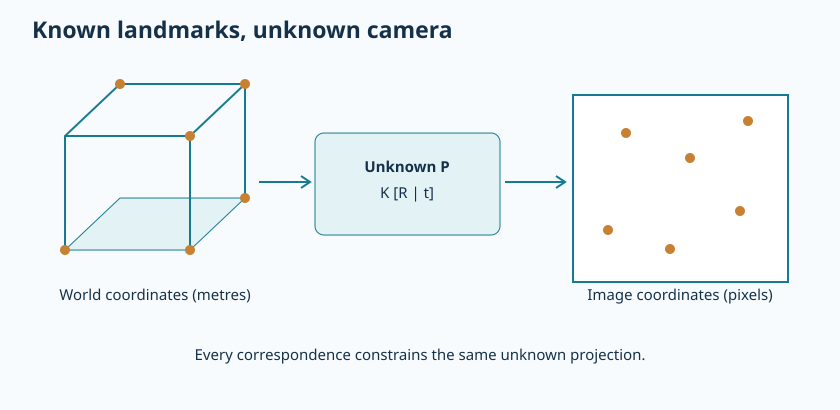
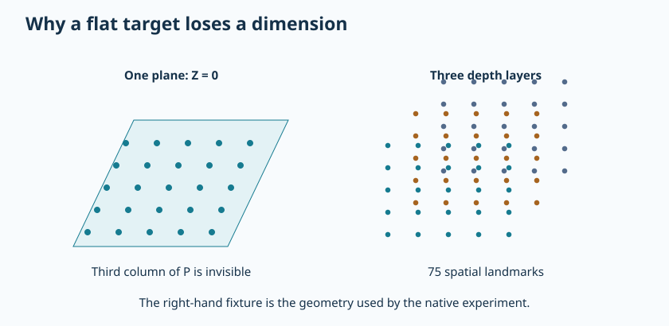
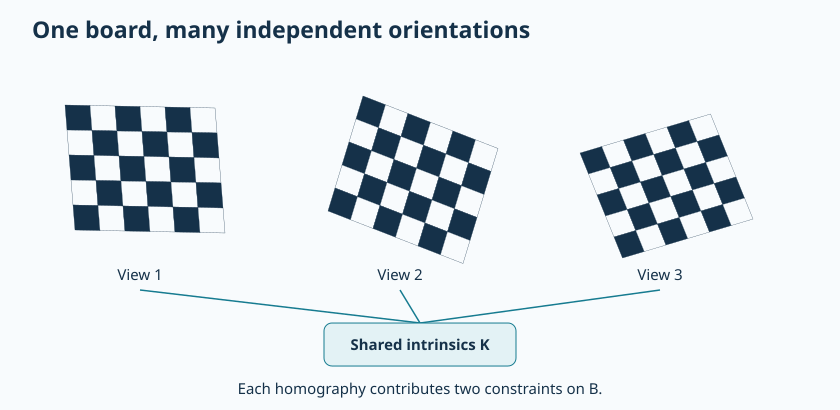
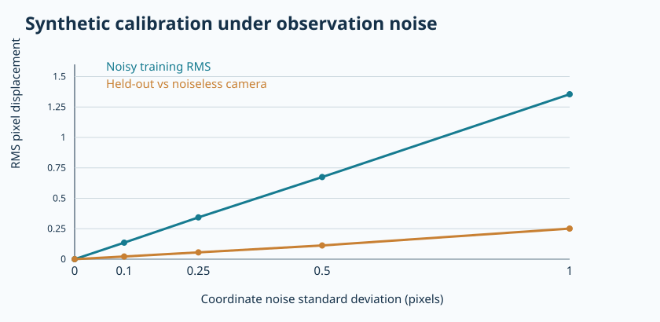

# Chapter 26 — Teaching a Camera About Itself

*From Geometry to Images — Part VI: Images reveal geometry*  
*Reader edition / C++23 laboratory P26*

> A ruler can measure a camera only if the camera first learns how to measure the ruler.

## The detective has a new job

Put our little paper house on a table. Place a wooden ruler beside it and take a picture. The ruler is twenty centimetres long, but its length on the photograph may be a hundred pixels, fifty pixels or something else entirely. Without more information, a hundred pixels cannot tell us how many centimetres a different object measures.

In the preceding chapters, we gave the computer a camera and asked where a point would appear. The computer knew the focal scale, principal point, optical center and orientation because we supplied them. The photograph was the answer.

Now the photograph is part of the question.

We have measured landmarks on a calibration object. We know their positions in metres and their observed image positions in pixels. We want the camera's parameters. This is an inverse problem: the causes are unknown, the consequences are observed, and a mathematical model connects the two.

The difficulty is not merely finding a collection of numbers that reproduces the observations. We must know whether the observations constrain those numbers, whether noise changes them dramatically, and whether the model explains things it has not already seen.

## What exactly is being calibrated?

Recall the optical convention from Chapter 13: +X right, +Y down, +Z forward. Let X be a three-dimensional world point, R a world-to-optical proper rotation and t the corresponding translation. In homogeneous notation,

\[
\lambda\begin{bmatrix}u\\v\\1\end{bmatrix}
=P\begin{bmatrix}X\\Y\\Z\\1\end{bmatrix},\qquad
P=K[R\mid t],
\tag{26.1}
\]

where

\[
K=\begin{bmatrix}f_x&s&c_x\\0&f_y&c_y\\0&0&1\end{bmatrix}.
\]

Here s is skew in pixels; fx and fy are positive focal scales in pixels; cx and cy locate the principal point. The final homogeneous coordinate is not an independent image observation. Divide the first two components of the product by the third. A visible point has positive optical depth under our physical scale convention.

Be careful with t. The camera center in world coordinates is C=-R^Tt, not t. If the renderer uses the graphics convention with +Y up and -Z forward, convert the optical frame before giving the resulting pose to the renderer. The calibration does not silently repair a coordinate convention mismatch.

In the ideal model P has twelve coefficients. Multiplying all of them by a common nonzero scalar leaves the projected image unchanged. This freedom is a gauge: there are only eleven independent projective parameters. A physically valid finite camera with five intrinsics, three rotation parameters and three translation parameters also has eleven degrees of freedom.

The real camera has other parameters, including distortion coefficients from Chapter 23. It may have rolling shutter, changing focus, a noncentral optical model or a sensor with geometric imperfections. We begin with an ideal pinhole because we can derive its estimator and know exactly which question it answers.

*Figure 26.1 — Calibration observes corresponding points. The unknown projection connects two measured coordinate domains; it is not inferred from image colors alone.*

## Make a tiny equation for every corner

Write the rows of P as p1, p2 and p3. Write the homogeneous world point as h=(X,Y,Z,1)^T. The prediction is u=(p1 h)/(p3 h), v=(p2 h)/(p3 h). Multiplying by the denominator gives

\[
p_1h-u p_3h=0,\qquad p_2h-v p_3h=0.
\tag{26.2}
\]

Stack the twelve unknown row coefficients into one column p. Each correspondence contributes two rows to a design matrix:

\[
A_i=\begin{bmatrix}
h^T&0^T&-u h^T\\
0^T&h^T&-v h^T
\end{bmatrix}.
\tag{26.3}
\]

Stack N observations to obtain a 2N-by-12 matrix A. Now the ideal calibration problem reads Ap=0.

Six correspondences give twelve equations, which is the minimum count for the general linear camera estimator. It is not a promise that every collection of six points works. Repeating the same corner six times does not create six independent observations.

With noise, a nonzero exact null vector may not exist. We find

\[
\underset{\|p\|_2=1}{\operatorname{argmin}}\ \|Ap\|_2^2.
\tag{26.4}
\]

The unit constraint rules out the unhelpful zero matrix. If A=U Sigma V^T is a singular value decomposition, the answer is the right singular vector associated with the smallest singular value. This follows by writing p=Vz: the objective becomes a sum of squared singular values times squared coordinates of z, and the unit norm is preserved by V.

This is the direct linear transformation, or DLT. It minimizes an algebraic residual. It does not minimize pixel reprojection error directly, because we multiplied that error by a depth-dependent denominator. Two cameras can rank differently under the two objectives.

An algebraic fit is therefore an initialization for geometric estimation, not a reason to stop asking questions.

## Numbers need a comfortable scale

Our coordinates may be in metres while the image is in pixels. The last component of h is one. The product uX may be hundreds, thousands or more. The columns of A need not have comparable scales, and careless arithmetic can make a mathematically good experiment numerically awkward.

Normalize the world landmarks by subtracting their centroid c and scaling their root-mean-square distance from that centroid to sqrt(3). Normalize the image points by subtracting their centroid d and scaling RMS distance to sqrt(2).

Our code uses RMS distances, an explicitly chosen variant of similarity normalization. If a and b are mean squared distances from their centroids, the scales are

\[
s_w=\sqrt{3/a},\qquad s_i=\sqrt{2/b}.
\]

The homogeneous transforms are

\[
U=\begin{bmatrix}s_w I_3&-s_wc\\0&1\end{bmatrix},\quad
T=\begin{bmatrix}s_i I_2&-s_id\\0&1\end{bmatrix}.
\tag{26.5}
\]

Solve the DLT in the normalized coordinates, obtaining Pn. Because h_n=Uh and x_n=Tx, the original projection is

\[
P=T^{-1}P_nU.
\tag{26.6}
\]

Do not reverse the multiplication order. The transform on the right acts on world coordinates; the inverse transform on the left restores image coordinates. Notice how Chapter 04's composition rules have become a practical instrument.

Normalizing does not manufacture information. If every landmark is on a plane, the similarity transform leaves them on a plane. If all the points coincide, the RMS distance is zero and normalization is undefined. The code rejects a collapsed input.

## A small singular value is not enough

Suppose the target is a perfectly flat board whose world coordinates have Z=0. Look again at h=(X,Y,0,1). The third column of each camera row is multiplied by zero. We can alter these three coefficients without altering any prediction on the board.

No amount of exact arithmetic can retrieve those missing coefficients from this single experiment.

*Figure 26.2 — A free 3D projective camera is underdetermined by one flat target. The three-dimensional fixture in P26 supplies depth variation; planar multi-view calibration is a different constrained problem.*

For an exact well-constrained DLT system, there should be one zero singular value and the other eleven should be positive. If multiple singular values are zero, there is more than one independent direction in the null space. With noise we look for a separated smallest singular value, as well as evidence that the second-smallest is not tiny relative to the largest.

The implementation sorts the singular values in ascending order. It rejects a fit when the second-smallest is at most 10^-8 times the largest, or when the smallest-to-second-smallest ratio exceeds 0.2. These are conservative, scale-relative engineering gates for the teaching fixture, not universal statistical confidence bounds. They may reject an otherwise useful dataset or accept a poorly conditioned physical parameter estimate. A reliable calibration system should also inspect uncertainty and experimental geometry.

The small singular value can be found by forming A^T A and solving an eigenproblem, but that squares the nonzero singular-value condition ratio. In our small twelve-column case we instead implement a one-sided Jacobi SVD. Each plane rotation orthogonalizes two columns of A while accumulating the same rotations in a matrix V. When the columns are mutually orthogonal, their lengths are singular values, and the accumulated columns of V give the right singular directions.

The implementation stops when a sweep finds no column pair requiring a rotation under its relative inner-product threshold. It has a finite sweep limit and reports nonconvergence. A production estimator should use a mature, tested numerical library, especially for more demanding scales, sizes and conditioning.

## Take the camera apart again

We have an estimated P. How do we turn that into focal length, principal point and pose?

For a finite camera write P=[M|m]. From equation 26.1, M=KR. One standard decomposition uses RQ factorization of M. Our teaching case uses the equivalent row geometry because we can derive it without another general matrix routine.

Choose the global scale so the norm of the third row of M is one, and choose its sign so the first observation is in front. The projection routine then checks positive depth for all observations. Let the rows of M be a,b,c. If the model is physical, c is the third unit row of R. Then

\[
c_y=b\cdot c,\quad
f_y=\|b-c_yc\|,\quad
r_y=(b-c_yc)/f_y.
\tag{26.7}
\]

Similarly,

\[
c_x=a\cdot c,\quad s=a\cdot r_y,\quad
f_x=\|a-c_xc-sr_y\|,\quad
r_x=(a-c_xc-sr_y)/f_x.
\tag{26.8}
\]

The rotation rows are rx, ry, c. Check that rx cross ry points along c, rather than accepting a reflection as a rotation. Focal scales must be positive and not degenerate. Finally m=Kt, so triangular substitution gives

\[
t_z=m_3,\quad t_y=(m_2-c_y t_z)/f_y,\quad
t_x=(m_1-c_x t_z-s t_y)/f_x.
\tag{26.9}
\]

The laboratory estimates all five ideal intrinsics from a spatial fixture. Its numerical rank and scale thresholds are intentionally bounded; they do not constitute a formal certificate of camera validity for arbitrary floating-point matrices.

## But real people use checkerboards!

Exactly. A single planar board cannot recover the unrestricted eleven-degree projective matrix from 3D DLT, but a different estimator exploits a stronger physical model and multiple orientations of the same known plane.

Let the checkerboard use Z=0 and let its homogeneous in-plane point be (X,Y,1)^T. For view j,

\[
H_j\sim K[r_{j1}\ r_{j2}\ t_j].
\tag{26.10}
\]

H is a 3-by-3 plane-to-image homography, defined up to scale. The first two columns of the rotation are perpendicular and have equal unit norms. Define B=K^{-T}K^{-1}. If h1 and h2 are the first two columns of a homography, the rotation conditions yield

\[
h_1^TBh_2=0,\qquad
h_1^TBh_1-h_2^TBh_2=0.
\tag{26.11}
\]

B is symmetric with six distinct entries and a common arbitrary scale. Each orientation provides two linear constraints. For the unrestricted five-intrinsic case, at least three independent, suitably varied homographies are needed for this linear initialization; additional views improve redundancy. Two views can suffice under additional intrinsic assumptions. Merely translating a fronto-parallel board does not supply the missing orientation information.

This is the central insight in Zhengyou Zhang's planar calibration method. In practice the linear initialization is followed by estimating each view's pose, distortion parameters and nonlinear reprojection refinement. A valid B must have the appropriate positive-definite structure after choosing scale. Failure is evidence that the input or model requires attention.

Our P26 native workbench implements normalized spatial DLT and its decomposition, not a complete Zhang checkerboard estimator. The homography derivation explains why the planar experiment is possible and what additional components a production implementation needs.

*Figure 26.3 — Diverse plane orientations are valuable because the shared intrinsics must explain each pose. This schematic is not a simulated calibration dataset.*

## The lens joins the optimization

The algebraic initializer did not use distortion. Real observations can bend away from the ideal projection. Let theta contain the intrinsic parameters, distortion coefficients and one pose per calibration image. For each known target point X_i and observed pixel z_ij, predict its distorted pixel using the forward map from Chapters 13 and 23. The residual is

\[
r_{ij}(\theta)=\pi(\theta_j,X_i)-z_{ij}.
\]

A geometric least-squares estimate solves

\[
\min_\theta \sum_{ij}\|r_{ij}(\theta)\|^2.
\tag{26.12}
\]

If observations have different covariance matrices, use their inverse covariance to weight squared residuals. Robust loss functions can reduce the influence of bad corner detections. A model with a different noise assumption may justify a different objective.

For a small parameter increment delta, the residual is approximately r+J delta. The local least-squares step is the solution to minimizing that linear approximation. Levenberg–Marquardt adds a positive damping term, for example lambda times a positive diagonal scaling matrix, to balance stability and progress. In an actual implementation use a stable linear solver and a rotation update on SO(3), not an arbitrary addition to a rotation matrix.

For the simplest radial distortion term, x_d=x(1+k1 q), y_d=y(1+k1 q), q=x^2+y^2. With fixed ideal normalized x,y and fixed intrinsics,

\[
\partial u/\partial k_1=q(f_xx+sy),\qquad
\partial v/\partial k_1=q f_yy.
\tag{26.13}
\]

Points near the optical axis have weak sensitivity to k1. Peripheral observations can be important, provided the model is valid there. This is an example of experiment design: choose measurements that actually respond to the parameter you wish to estimate.

Optimization can reduce reprojection residuals while making an implausible camera if parameters are weakly constrained. Inspect the Jacobian singular directions, physically plausible parameter ranges and correlations. If fx and depth are strongly coupled, more iterations alone cannot resolve the missing information.

Full nonlinear joint calibration, robust corner extraction and uncertainty estimation remain extensions beyond the current executable.

## Train on some points; test on others

Reprojection RMS is

\[
e_{\rm RMS}=\sqrt{\frac1N\sum_i[(\hat u_i-u_i)^2+(\hat v_i-v_i)^2]}.
\tag{26.14}
\]

This is RMS Euclidean pixel displacement per point, not RMS per scalar coordinate. For two independent zero-mean coordinate noises of standard deviation sigma, the expected squared displacement before fitting is 2 sigma squared. Fitting parameters generally lowers training residuals. An RMS below one pixel is therefore neither universal proof of accurate intrinsics nor a reason to ignore which observations were used.

The laboratory constructs 75 noncoplanar landmarks in a 5-by-5-by-3 grid. The exact test uses a rotated camera with fx=800, fy=820, skew=4, principal point (320,240) and translation (0.1,-0.2,4) metres. It recovers these values within the declared tolerances and produces an exact-data RMS of 6.37644e-14 pixels. That is numerical agreement on synthetic data, not an accuracy measurement of glass and silicon.

The separate studio uses the same intrinsic parameters with an identity optical rotation and translation (0,0,4). It injects independent Gaussian noise into the two pixel coordinates. For each of five standard deviations, it fits twenty realizations and evaluates twenty new points against the known noiseless camera. The test set is inside the fixture's approximate spatial region; this is interpolation, not a claim of arbitrary extrapolation.

At one pixel coordinate-noise standard deviation, the mean training RMS was 1.355 pixels while the mean held-out error relative to the noiseless camera was 0.251 pixels. These quantities differ because the training observations contain noise and the held-out reference is exact. A noisy test photograph would not magically have lower observation noise.

*Figure 26.4 — Means of twenty controlled trials per noise level. Held-out errors use a noiseless reference and are not directly comparable to noisy training residuals as a generalization gap.*

The studio writes all one hundred trial summaries, including estimated intrinsics, RMS values and singular-gap ratios. The test separately repeats a rotated-camera experiment one hundred times at sigma=0.2 and checks one withheld point. The worst observed error was 0.0890431 pixels in that particular experiment.

Read calibration.hpp, calibration_tests.cpp and calibration_studio.cpp. Run:

~~~text
book03_calibration calibration.csv
~~~

Check the singular-gap rejection before trusting the numbers. Then change the fixture: flatten its depth layers, shrink its spatial extent or place all its points near the image center. If the estimator fails, record the failure. If it succeeds, examine whether the recovered parameters and unseen projections remain reliable. Do not replace a failure with a random answer merely to keep the demonstration running.

## The practical checklist for a real photograph

Use a dimensionally verified target, diverse orientations, good coverage of the image, stable focus and consistent image coordinates. Keep raw observations and their metadata. Reject incorrectly identified corners by a declared policy. Fit a plausible model, plot residual vectors over the image, and test on additional views not used in the fit. Patterns of residuals can reveal distortion mismatch or systematic target errors that a single RMS hides.

Do not apply the calibration to resized or cropped images without transforming the intrinsics according to Chapter 13. Do not assume different focus or zoom settings preserve the camera model. Keep units explicit, especially when calculating the camera's position or reconstructing object lengths.

If you want an uncertainty statement, repeated experiments or a justified statistical model must support it. Local covariance estimates based on a full-rank, correctly weighted Jacobian describe only the assumptions used to derive them; systematic model error and ambiguous parameters require separate treatment.

## Exercises — make the camera explain its answer

**Reconstruct 26A.** Derive the two DLT rows for a landmark at (1,2,3) observed at (400,300). Count the dimensions and explain why multiplying all twelve coefficients by two changes no image coordinates.

**Reconstruct 26B.** Derive equations 26.7–26.9 from M=KR. Test a known camera with nonzero skew and a nonidentity rotation. Recover the world-space center rather than reporting t as the position.

**Falsify 26C.** Set every training point's Z to zero. Prove algebraically that the third column of P is unobservable. Compare this proof with the numerical rejection in the lab.

**Falsify 26D.** Construct a camera that projects the flat training board correctly but predicts a different position for a point one metre above it. Explain why the training RMS alone cannot distinguish them.

**Transfer 26E.** Vary the width and depth extent of the spatial fixture while keeping the camera and observation-noise distribution unchanged. Compare the parameter errors and held-out reprojection errors.

**Transfer 26F.** Add the radial forward map from Chapter 23 to the synthetic observation generator but fit the ideal DLT. Plot residual vectors and explain how a model mismatch differs from zero-mean observation noise.

**Explain 26G.** Explain to a child why taking many photographs of a checkerboard at the same angle might be less useful than moving the board to different angles. Then derive the two orthogonality constraints.

**Explain 26H.** Design a calibration report for a robot or XR camera. Include pixel conventions, image resolution, units, supported optical domain, training and held-out residuals, parameter uncertainty and failure cases.

## Reading beyond the laboratory

Zhengyou Zhang, [A Flexible New Technique for Camera Calibration](https://www.microsoft.com/en-us/research/publication/a-flexible-new-technique-for-camera-calibration/), IEEE TPAMI 22(11), 2000, presents the planar multi-view method. Hartley and Zisserman, *Multiple View Geometry in Computer Vision*, second edition, Chapter 7, develops camera-matrix estimation, normalization and geometric refinement. Our bounded RMS-normalized DLT implementation and synthetic evidence are independent teaching work.

## We have taught one camera to measure

We now know how a camera can be estimated using landmarks whose world coordinates were supplied. The next mystery is harder: suppose nobody gives us the world's coordinates at all, but we have two photographs of the same point. Where could that point be? Chapter 27 begins with that question.
