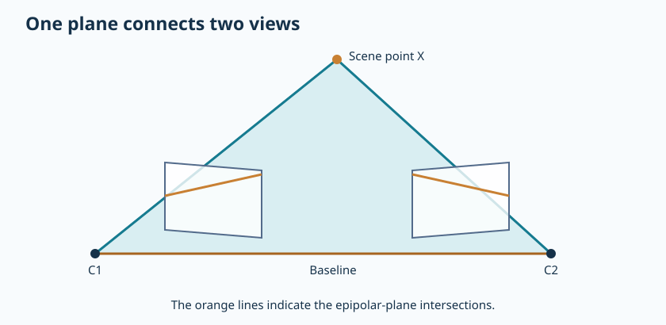
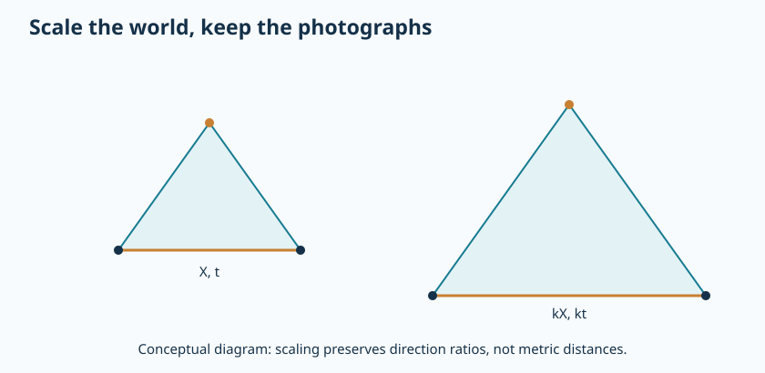
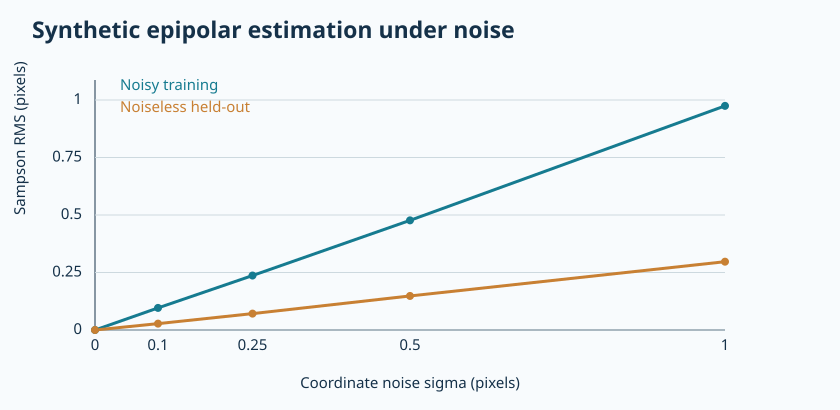

# Chapter 27 — Two Photographs, One Hidden Point

*From Geometry to Images — Part VI: Images reveal geometry*  
*Reader edition / C++23 laboratory P27*

> One photograph tells us where to look. Two photographs can tell us where two lines meet, but only if we know which lines belong together.

## The missing corner

Take two pictures of our little paper house, one from the left and another from the right. On the first image mark the top corner of a window. Now imagine that a friend has hidden the second photograph beneath a sheet of paper and allows you to uncover only one narrow strip.

If the cameras are ideal and their relative geometry is known, you do not have to search the entire second photograph. The corner in the first picture determines a line in the second. Somewhere along that line, provided the corner is visible, lies its partner.

Chapter 15 taught us how to reconstruct a point when the cameras and correspondence are known. This time, we turn the geometry itself into an object that can be estimated from correspondences. We will derive a matrix that describes the relationship between the two photographs, recover that matrix from noisy observations and learn precisely what it cannot tell us.

We assume a stationary scene, global-shutter central cameras, and image coordinates consistent with the ideal pinhole model. If a lens distorts the measurements, use a suitable calibrated undistortion procedure first. A straight epipolar line is not generally straight in a raw distorted image.

## One point, a whole ray

Use the first optical frame as our world frame. Camera one is at the origin. Both optical coordinate frames have +X right, +Y down and +Z forward. Let a 3D point have coordinates X in the first camera; in the second camera it has coordinates

\[
X_2=RX+t .
\tag{27.1}
\]

R is a proper rotation from frame one to frame two, and t is the first camera center expressed in frame two. The second center in frame one is -R^Tt. This sign is important.

Write homogeneous pixel measurements as p1=(u1,v1,1)^T and p2=(u2,v2,1)^T. The normalized optical directions are x1=K1^-1 p1 and x2=K2^-1 p2. For a visible point, there are positive depths z1 and z2 such that

\[
z_2x_2=z_1Rx_1+t .
\tag{27.2}
\]

The three vectors x2, Rx1 and t lie in one plane. A cross product is perpendicular to its two arguments; dotting it with any vector in their span gives zero. Therefore

\[
x_2^T(t\times Rx_1)=0 .
\tag{27.3}
\]

*Figure 27.1 — The two rays and baseline belong to a single plane. Its intersections with ideal image planes give epipolar lines. This is a schematic projection of the spatial relationship.*

## Store the plane constraint in a matrix

A cross product with a fixed vector is linear. We can write it as

\[
[t]_\times=\begin{bmatrix}0&-t_z&t_y\\t_z&0&-t_x\\-t_y&t_x&0\end{bmatrix}.
\]

Define the essential matrix E=[t]_x R. Then

\[
x_2^T E x_1=0 .
\tag{27.4}
\]

This expression uses normalized optical directions, not raw pixel positions. Substituting the inverse intrinsics gives the fundamental matrix

\[
F=K_2^{-T}EK_1^{-1},\qquad p_2^TFp_1=0 .
\tag{27.5}
\]

A fixed point p1 maps to the line l2=Fp1. If l2=(a,b,c)^T, its finite image points satisfy au+bv+c=0. Conversely, p2 maps to the line l1=F^Tp2 in the first image. Transposing F reverses the image order; it does not invert the camera motion.

When t is nonzero, [t]_x has rank two: it annihilates t and acts as a scaled quarter turn in the plane perpendicular to t. Its two nonzero singular values equal the baseline length. Multiplication by a rotation preserves these singular values. Thus an ideal essential matrix has singular values (s,s,0), while a fundamental matrix has rank two but need not have equal nonzero singular values.

The left epipole is the first-image projection of the second center, and the right epipole is the second-image projection of the first center. Homogeneously,

\[
F e_1=0,\qquad F^T e_2=0 .
\tag{27.6}
\]

All corresponding epipolar lines pass through their image's epipole, including the case where it lies at infinity. Parallel epipolar lines are not a violation of the geometry.

*Figure 27.2 — Finite epipoles produce a pencil of lines; rectified stereo has horizontal parallel epipolar lines whose common homogeneous point is at infinity.*

## A numerical witness you can check without a library

Take identical cameras with fx=fy=800, principal point (320,240), zero skew and R=I. Camera two is 0.2 metres to the right of camera one, so t=(-0.2,0,0). The point X=(0.5,0.25,4) projects to (420,290) and (380,290).

The right epipolar line is horizontal at v=290. Any point on that row satisfies the constraint, even (360,290). But the disparity of the latter is 60 pixels instead of 40, giving an apparent depth of 800 times 0.2 divided by 60, or 2.6667 metres instead of four.

The incorrect correspondence can satisfy the geometry exactly and triangulate in front of both cameras. A zero epipolar residual does not prove physical identity. Chapter 28 will use appearance and robust consensus to confront this ambiguity.

## How far did the point miss its line?

Let g=p2^TFp1. Multiplying F by a nonzero number changes g but does not change the geometry. A raw algebraic residual is consequently a poor quantity to compare across differently scaled matrices.

The perpendicular distance from the second measurement to its predicted finite line is

\[
d_2=\frac{|g|}{\sqrt{l_{2x}^2+l_{2y}^2}}.
\]

It treats the first observation as fixed. If both measurements may be noisy, define q=(u1,v1,u2,v2). The gradient of g with respect to q contains the first two entries of F^Tp2 and Fp1. To first order, a correction delta must satisfy g+J delta=0. Among these corrections the minimum squared Euclidean norm is attained by delta=-J^Tg/(JJ^T).

Its squared norm is the Sampson approximation,

\[
d_S^2=\frac{(p_2^TFp_1)^2}{(Fp_1)_x^2+(Fp_1)_y^2+(F^Tp_2)_x^2+(F^Tp_2)_y^2}.
\tag{27.7}
\]

It has units of pixels squared for our pixel-coordinate F. Its square root has units of pixels. It is a local approximation to the joint geometric correction, not the exact distance to the nonlinear correspondence manifold. A vanishing gradient makes it undefined. For unequal or correlated coordinate uncertainty, a covariance-weighted version is more appropriate.

The laboratory normalizes F by its Frobenius norm and rejects a near-zero denominator. This numerical guard is a policy, not a proof of good geometric conditioning.

## Learn the fundamental matrix from eight correspondences

Suppose a friend supplies matching points but does not tell us the camera poses. Write the nine entries of F in row-major order. Every correspondence gives one linear equation with row

\[
[u_2u_1,u_2v_1,u_2,\;v_2u_1,v_2v_1,v_2,\;u_1,v_1,1].
\tag{27.8}
\]

Stack these rows into A. We want the smallest right singular direction of A, excluding the zero solution by a unit norm. The eight-point algorithm needs at least eight suitably independent correspondences for this particular linear estimator. F itself has seven projective degrees of freedom after the determinant constraint, and a different seven-point algorithm exploits that nonlinear constraint.

As in Chapter 26, do not put pixel coordinates of wildly different scales directly into the linear solve. For each image, subtract its centroid and scale the RMS distance to sqrt(2). This is our declared RMS normalization variant of the normalized eight-point method. Hartley's original normalization uses the mean radial distance; both aim to place the coordinates at a useful scale.

Let T1 and T2 transform the homogeneous image points. The estimated normalized matrix Fn must obey

\[
(T_2p_2)^TF_n(T_1p_1)=0,
\]
so the matrix in original pixel coordinates is

\[
F=T_2^TF_nT_1 .
\tag{27.9}
\]

Notice the transpose rather than inverse. The equation is bilinear, unlike the camera projection denormalization in Chapter 26.

Noisy linear estimation need not return rank two. Compute the singular decomposition of Fn and set its smallest singular value to zero. If v is the corresponding unit right singular vector, subtract (Fn v)v^T. This removes exactly that singular component. It minimizes the Frobenius perturbation among rank-at-most-two approximations in the normalized coordinates; it does not minimize Sampson or geometric error in the original pixel coordinates.

The code uses one-sided Jacobi column rotations, with a finite iteration limit, and rejects a poorly separated null direction. If the second-smallest singular value is at most 10^-8 times the largest or the smallest-to-second ratio exceeds 0.3, the estimator rejects the fit. These heuristic thresholds are not universal guarantees. A genuinely rank-one estimate is also rejected before the rank-two correction.

The output is scaled to unit Frobenius norm. Its sign is arbitrary. Comparing two matrices therefore requires accounting for both sign and scale.

## When the world refuses to reveal a baseline

If both cameras have the same center and differ only by rotation, t=0 and E is the zero matrix. Image correspondences may still determine a rotational homography, but there is no translation-based triangulation. Rotating your head without moving it cannot create a stereo baseline.

If every point lies on one plane, the two images are related by a homography H. For any candidate right epipole e, the matrix F=[e]_x H satisfies the correspondence equations, because p2 is proportional to Hp1 and p2^T[e]_x p2=0. The observations alone do not select the actual epipole. The exact planar fixture in the native test exercises this degeneracy.

In a noisy near-planar case the numerical design matrix may have no exact null space. A plausible fitted F still need not establish that the scene supports reliable depth. A production pipeline should compare competing geometric models and investigate parallax, rather than treating a passed singular-gap test as a proof of scene structure.

## From E to relative motion, then a point

With known intrinsics, calculate E=K2^TFK1. For an estimated F this E may violate the equal-singular-value constraint. Project its singular values to (mean of the largest two, mean of the largest two, zero). This is the Frobenius projection onto the essential-matrix singular-value pattern, not a maximum-likelihood pose fit.

For E=U diag(s,s,0)V^T, choose the signs of the null singular vectors so U and V are proper rotations. Define

\[
W=\begin{bmatrix}0&-1&0\\1&0&0\\0&0&1\end{bmatrix}.
\]

The four candidate relative poses use R=UWV^T or UW^TV^T, paired with t=+u3 or -u3, where u3 is the last column of U. Sign conventions may interchange the two rotations; the set of candidates is what matters. E is projective, so we have chosen a unit translation direction, not recovered its magnitude.

Triangulate under each candidate and count reliable points whose depths are positive in both optical cameras. This is the cheirality test. In a generic nondegenerate exact case it selects the physical pose. With weak parallax or noise, a clear winner may be absent. Do not force a pose from an ambiguous vote.

Chapter 15 already implements closest-ray midpoint triangulation with explicit weak-parallax and behind-camera statuses. Another initializer uses homogeneous DLT: for each camera P and observation (u,v), form rows uP3-P1 and vP3-P2. Stack both views' four rows, take the smallest right singular vector, then divide by its homogeneous last component if nonzero. This is an algebraic initializer; for a physically meaningful point check positive depths, reprojection error and conditioning. Pixel-domain nonlinear refinement can improve an initial point when the model and observations justify it.

The P27 executable implements E/F construction, Sampson distance and normalized F estimation. It does not implement the four-pose decomposition or a new triangulator; these derivations connect P15's existing ray estimator to the next reconstruction chapters.

*Figure 27.3 — Scaling the scene and translation by the same positive number preserves the ideal image measurements. A known length is needed to assign metric scale.*

To see the scale ambiguity, replace X by kX and t by kt for k>0 in equation 27.2. Both depths multiply by k; normalized image coordinates stay the same. Even perfect calibrated correspondences do not determine absolute distance from two arbitrary photographs without a scale constraint such as a known baseline or object length. Without calibration, a broader projective ambiguity can remain.

## Our experiment: fit the relation, not the answer key

Read epipolar.hpp and its two companion sources. The exact test generates 100 spatial correspondences using a rotation of 0.13 radians about Y and translation (-0.3,0.04,0.02) metres. The fitted F agrees with the analytically constructed matrix up to sign and normalization; the largest observed squared Sampson residual is 4.68233e-26 pixels squared. A flat target is rejected, and a four-pixel perturbation exposes a nonzero residual while multiplying F by seven leaves the residual unchanged.

The studio uses five independent-coordinate Gaussian noise levels, twenty fits per level, 100 training correspondences and 50 newly generated noiseless correspondences per fit. Unlike Chapter 26's point reprojection error, this metric measures the epipolar constraint, not a recovered 3D point.

*Figure 27.4 — Means across twenty fits at each noise level. The held-out correspondences are noiseless, so the two curves do not represent a conventional noisy train/test gap.*

Run the studio with an output path:

~~~text
book03_epipolar epipolar.csv
~~~

At sigma=1 pixel the mean training Sampson RMS was 0.97449 pixels and the noiseless held-out RMS was 0.29699 pixels. These are measurements from this synthetic distribution, not a universal expected camera error. The export also records the pre-rank-correction singular-gap ratio. Keep the data association assumption in mind: every provided match was generated from the same physical point. The estimator has no outlier rejection.

## Rectification chooses convenient images, not new observations

The epipolar constraint says that the corresponding feature must lie on a particular line. In a general pair of images these lines can have different orientations. Searching along an arbitrary sloping line is possible, but it is convenient to transform the two images into a pair whose corresponding epipolar lines are horizontal.

For two calibrated cameras with centers C_1 and C_2, form the unit baseline direction b=(C_2-C_1)/||C_2-C_1||. Choose a forward reference direction that is not parallel to b. Project it into the plane perpendicular to b and normalize to obtain a common forward axis z_r. With the optical +X right, +Y down, +Z forward convention, choose x_r=b and y_r=z_r cross x_r. The rows x_r^T,y_r^T,z_r^T form a proper world-to-rectified rotation R_r. The construction fails when the baseline vanishes or the chosen reference is parallel to it, so a practical implementation needs an alternative reference policy.

Let R_i be the original world-to-camera rotation and K_i its intrinsic matrix. If the cameras are ideal pinholes, a homogeneous image ray can be mapped into the rectified view using

\[
H_i=K_r R_r R_i^T K_i^{-1}.
\]

This is a rotation of ray directions around each original camera center; it does not move either center. A distorted input image must be converted to an ideal ray first. The new virtual intrinsics K_r determine the output field of view and sampling. Rectification can discard regions, enlarge others and introduce resampling errors, so valid masks and interpolation policies are part of the result.

In the shared rectified coordinate frame, the center difference lies along the X axis. A physical point therefore has identical Y and Z coordinates relative to the two cameras, and its ideal vertical projected coordinate is the same. The horizontal coordinates differ by fB/Z if the virtual cameras share focal scale f and principal point. A different principal-point convention adds an offset. Rectification makes the correspondence search easier; it does not invent a correspondence or recover the missing depth by itself.

## Disparity is a measurement with its own uncertainty

For rectified cameras, a horizontal match with corrected disparity d gives Z=fB/d. The derivative with respect to disparity is -fB/d². The sensitivity grows rapidly when d approaches zero.

**Worked example.** Let f=800 pixels, baseline B=0.1 m, and disparity d=20 pixels. Then Z=4 m. If each horizontal coordinate has independent standard deviation 0.25 pixels, disparity has standard deviation sqrt(2)*0.25, approximately 0.3536 pixels. The first-order depth standard deviation is about 0.07071 m. At d=2 pixels the depth becomes 40 m and the same image uncertainty predicts about 7.071 m of depth uncertainty. The pixel noise has not changed; the geometry has.

The derivative approximation treats the mapping as locally linear. A symmetric disparity interval does not map to a symmetric depth interval. With d=2 and uncertainty interval plus or minus 0.5 pixels, the endpoint depths are 32 m and about 53.33 m. The central prediction is 40 m, so the lower and upper deviations differ substantially. If the interval reaches zero, the positive-depth bound becomes unbounded. Reporting a symmetric Gaussian depth error in that regime may hide the most important limitation.

Uncertainty in focal scale and baseline also matters. For independent small errors in f, B and d, the first-order relative variance is approximately the sum of their relative variances. If the quantities were jointly calibrated, the cross-covariances must be retained. A metric baseline measured incorrectly can create systematic depth error even when matching is exact.

## A plane can explain the data surprisingly well

Suppose all features are on a wall. They can be related by a homography rather than requiring independent depth for every point. Let a plane in the first camera frame satisfy n^T X=h, with h nonzero. For a normalized first-view direction x, the intersection is X=h x/(n^T x) when the denominator is nonzero and the intersection is physically valid. Under relative motion X_2=RX+t,

\[
x_2\sim (R+t n^T/h)x.
\]

The matrix in parentheses maps plane rays; with intrinsics it becomes a pixel homography. The sign depends on how the plane equation was written. A formulation n^T X+d=0 would have a different-looking sign. Derive from the actual equation rather than memorizing the symbol.

For pure camera rotation, t=0 and the direction map R applies to every scene depth. The images can align extremely well without revealing translation or metric structure. Similarly, a plane can dominate an image pair and obscure the information needed for general reconstruction. Comparing a homography fit and an epipolar fit is a useful diagnostic, but the raw residuals have different definitions and degrees of freedom. A reliable model-selection procedure needs comparable observation errors and held-out evidence.

### Why rectified matching can fail even in a perfect camera

Imagine a wall of repeated vertical windows. All corresponding candidates lie on the correct epipolar row. A wrong repeated window can have exactly the same appearance and produce a positive depth. The epipolar relation does not identify which physical window was observed. Constraints from texture, multiple views, ordering, visibility or prior knowledge may help, but none is an unconditional certificate.

A dense stereo matcher commonly constructs a cost for each pixel and disparity hypothesis. A naive cost volume for a 1280 by 720 image with 128 disparities contains 117,964,800 entries. At four bytes per entry that is 450 MiB before intermediate storage. A streaming or tiled implementation may reduce memory, but changing the cost or support window changes the estimator. A large matching window improves robustness in a uniform region yet can mix observations across a depth discontinuity.

For a simplified local cost, compare patches with sums of squared differences in linear intensity. Normalize or otherwise model photometric changes where appropriate. Use left-right consistency: if a left feature maps to a right address and the reverse estimate maps elsewhere, mark the observation as unreliable rather than silently filling it with zero disparity. Occluded pixels may legitimately have no matching point.

## A complete evaluation separates geometric and matching errors

Construct a synthetic rectified pair of a fronto-parallel textured plane at known depth and a nearer rectangle that occludes part of it. The projection model supplies exact disparities and visibility masks. First evaluate with the known correspondences to establish the geometric baseline. Then run a matcher and evaluate only valid comparable pixels, reporting the missing-match and false-match rates separately. Finally, reconstruct depths and report both the disparity errors in pixels and the depth errors in metres.

Repeat at several baselines and texture frequencies. A wider baseline improves ideal triangulation sensitivity but may increase occlusion and appearance variation. The best baseline for a complete pipeline depends on both geometry and correspondence quality.

**Research exercise.** Implement the rectified homography construction with two known camera poses, check that corresponding projected points have matching vertical coordinates, then compare the simple dense matching procedure on a unique texture and a repeated pattern. Include a pure-rotation control and a plane-only control. The P27 native lab estimates and verifies two-view epipolar geometry; the image-warping and dense stereo experiment is a proposed extension, and its results must not be confused with the existing sparse native acceptance.

### Guided workshop: make the stereo answer key before matching

Let two ideal optical cameras have identity rotations and centers (0,0,0) and (0.2,0,0) metres, with f=800 pixels and principal point (320,240). Take three world landmarks P=(0,0,2), Q=(0.2,0.1,4) and R=(-0.1,-0.2,8). Calculate both image coordinates directly from the optical frames.

For P, the left projection is (320,240), and the right is (240,240). The disparity is 80 pixels and the recovered depth is 2 metres. For Q, the left is (360,260), the right is (320,260), and disparity is 40, yielding 4 metres. For R, the left is (310,220), the right is (290,220), and disparity is 20, yielding 8 metres. In all three cases the vertical coordinates agree exactly. A sign-flipped baseline or reversed disparity would produce a negative reconstructed depth in this convention.

Apply the essential-matrix constraint with relative translation t=(-0.2,0,0), because the world-to-right transform subtracts the right camera center. In normalized coordinates the scalar incidence reduces to a multiple of the difference between corresponding vertical coordinates. This verifies the direction and sign convention independently of the disparity formula. An overall sign of E is projectively irrelevant; the sign of the actual physical translation used for triangulation still matters.

Now perturb only the right horizontal coordinate by +0.5 pixels. The measured disparities become 79.5, 39.5 and 19.5. Their depth estimates are approximately 2.01258, 4.05063 and 8.20513 metres. The same image-space perturbation produces a much larger metric error for the more distant point. This is not an epipolar-line error: the vertical coordinates still match perfectly. It shows why a perfect epipolar residual does not certify correspondence accuracy along the line.

Add a false match from a repeated feature on the same row, with horizontal disparity 10 pixels. It satisfies the ideal epipolar constraint and gives positive depth 16 metres. Unless the physical reference point really lies at that location, the estimated depth is wrong. Use the known synthetic feature identity to detect the error. In real images that identity is precisely the difficult unknown that the descriptor and additional observations must help resolve.

To investigate rectification, rotate the original cameras differently while keeping their centers fixed. Project the same landmarks, apply the rectification homographies derived earlier, and compare with direct projection through the shared rectified frame. Use homogeneous coordinates and divide only after the transformation. Exclude invalid or out-of-domain rays. The correct mathematical result is agreement between the two routes up to numerical error; image rasterization can introduce additional interpolation differences.

Finally generate an intensity image of a textured plane and an occluding foreground rectangle. Calculate the reference depth and visible feature masks analytically before attempting any matcher. Measure disparity error on jointly visible points, identify legitimate occlusions, and report the proportion of false correspondences. Start with the native P27 sparse geometry laboratory and build the dense matching extension independently. A useful result is not just a colorful depth map; it is a depth map whose errors, unsupported regions and physical scale can all be explained.

## Exercises — challenge the relationship

**Reconstruct 27A.** Derive E=[t]_x R from equation 27.2 and verify the aligned-camera numerical witness. Repeat with unequal principal points.

**Reconstruct 27B.** Derive the nine coefficients in equation 27.8 and the denormalization equation. Explain why F has arbitrary scale.

**Falsify 27C.** Generate matches for a single plane. Prove that every F=[e]_x H satisfies the constraint. Compare with the native rejection.

**Falsify 27D.** Choose a wrong correspondence along the same epipolar line that triangulates in front of both cameras. Show that zero Sampson error does not establish identity.

**Transfer 27E.** Modify the synthetic translation length and plot the held-out error and rejection rate. Explain why tiny translation changes the information available for reconstruction.

**Transfer 27F.** Inject mismatches instead of only Gaussian coordinate noise. Compare the fitted F with the true one and retain failures. This experiment prepares you for robust estimation.

**Explain 27G.** Explain the scale gauge to a child using a model house and a full-size house, then prove it by scaling equation 27.2.

**Explain 27H.** Design a report that distinguishes epipolar residual, reprojection error, depth uncertainty, cheirality and ground-truth 3D error. State which measurements require known 3D reference data.

### Selected answers and experiment criteria

**27A–B.** From x2 proportional to R x1 times depth plus t, x2 is coplanar with t and R x1. Its scalar triple product with them vanishes, yielding x2^T [t]_x R x1=0. For row-major flattening, a DLT row is (u2*u1,u2*v1,u2,v2*u1,v2*v1,v2,u1,v1,1). If normalized points are T1 x1 and T2 x2, then F=T2^T F_n T1. The zero equation is invariant under any nonzero common factor of F.

**27C–D.** On a plane, x2 is proportional to H x1. Then x2^T [e]_x H x1 is proportional to x2^T [e]_x x2=0 because a cross-product matrix is skew-symmetric. In rectified stereo, any wrong match at the same image row and positive corrected disparity also satisfies the epipolar constraint and may triangulate in front of both cameras. It is not necessarily the same physical feature.

**27E–F.** Include the zero-baseline case as an explicitly degenerate control. Since F is defined only up to scale, compare normalized matrices with the sign ambiguity handled, and report residuals and fit failures. A tiny baseline can preserve an apparently plausible epipolar fit while severely weakening depth.

**27G–H.** Scaling t and every point by the same positive factor multiplies the camera-frame homogeneous direction by that factor and leaves perspective division unchanged. Pixel-space constraints can be measured without metric 3D ground truth; absolute depth error cannot. Report cheirality, uncertainty and residual as separate evidence.

## Further reading

Richard Hartley, [In Defense of the Eight-Point Algorithm](https://www.computer.org/csdl/journal/tp/1997/06/i0580/13rRUyYjKbj), IEEE TPAMI 19(6), 1997, DOI 10.1109/34.601246, motivates normalized linear estimation. Hartley and Zisserman, *Multiple View Geometry in Computer Vision*, second edition, Chapters 9, 11 and 12, develop two-view geometry, estimation and reconstruction. The native implementation is an independent bounded teaching reference, not a replacement for a mature vision library.

## Next: find the corner without being told

Our friend has been extremely generous, supplying correct corresponding points. Real photographs do not arrive with numbered corners. Chapter 28 takes away that answer key: we will detect features, describe them, propose correspondences and decide which ones survive geometric verification.
