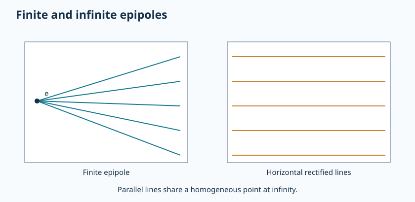

# Chapter 27 — Two Photographs, One Hidden Point

*From Geometry to Images — Part VI: Images reveal geometry*  
*Reader edition / C++23 laboratory P27*

> One photograph tells us where to look. Two photographs can tell us where two lines meet, but only if we know which lines belong together.

## The missing corner

Take two pictures of our little paper house, one from the left and another from the right. On the first image mark the top corner of a window. Now imagine that a friend has hidden the second photograph beneath a sheet of paper and allows you to uncover only one narrow strip.

If the cameras are ideal and their relative geometry is known, you do not have to search the entire second photograph. The corner in the first picture determines a line in the second. Somewhere along that line, provided the corner is visible, lies its partner.

Chapter 15 taught us how to reconstruct a point when the cameras and correspondence are known. This time, we turn the geometry itself into an object that can be estimated from correspondences. We will derive a matrix that describes the relationship between the two photographs, recover that matrix from noisy observations and learn precisely what it cannot tell us.

We assume a stationary scene, global-shutter central cameras, and image coordinates consistent with the ideal pinhole model. If a lens distorts the measurements, use a suitable calibrated undistortion procedure first. A straight epipolar line is not generally straight in a raw distorted image.

## One point, a whole ray

Use the first optical frame as our world frame. Camera one is at the origin. Both optical coordinate frames have +X right, +Y down and +Z forward. Let a 3D point have coordinates X in the first camera; in the second camera it has coordinates

\[
X_2=RX+t .
\tag{27.1}
\]

R is a proper rotation from frame one to frame two, and t is the first camera center expressed in frame two. The second center in frame one is -R^Tt. This sign is important.

Write homogeneous pixel measurements as p1=(u1,v1,1)^T and p2=(u2,v2,1)^T. The normalized optical directions are x1=K1^-1 p1 and x2=K2^-1 p2. For a visible point, there are positive depths z1 and z2 such that

\[
z_2x_2=z_1Rx_1+t .
\tag{27.2}
\]

The three vectors x2, Rx1 and t lie in one plane. A cross product is perpendicular to its two arguments; dotting it with any vector in their span gives zero. Therefore

\[
x_2^T(t\times Rx_1)=0 .
\tag{27.3}
\]

*Figure 27.1 — The two rays and baseline belong to a single plane. Its intersections with ideal image planes give epipolar lines. This is a schematic projection of the spatial relationship.*

## Store the plane constraint in a matrix

A cross product with a fixed vector is linear. We can write it as

\[
[t]_\times=\begin{bmatrix}0&-t_z&t_y\\t_z&0&-t_x\\-t_y&t_x&0\end{bmatrix}.
\]

Define the essential matrix E=[t]_x R. Then

\[
x_2^T E x_1=0 .
\tag{27.4}
\]

This expression uses normalized optical directions, not raw pixel positions. Substituting the inverse intrinsics gives the fundamental matrix

\[
F=K_2^{-T}EK_1^{-1},\qquad p_2^TFp_1=0 .
\tag{27.5}
\]

A fixed point p1 maps to the line l2=Fp1. If l2=(a,b,c)^T, its finite image points satisfy au+bv+c=0. Conversely, p2 maps to the line l1=F^Tp2 in the first image. Transposing F reverses the image order; it does not invert the camera motion.

When t is nonzero, [t]_x has rank two: it annihilates t and acts as a scaled quarter turn in the plane perpendicular to t. Its two nonzero singular values equal the baseline length. Multiplication by a rotation preserves these singular values. Thus an ideal essential matrix has singular values (s,s,0), while a fundamental matrix has rank two but need not have equal nonzero singular values.

The left epipole is the first-image projection of the second center, and the right epipole is the second-image projection of the first center. Homogeneously,

\[
F e_1=0,\qquad F^T e_2=0 .
\tag{27.6}
\]

All corresponding epipolar lines pass through their image's epipole, including the case where it lies at infinity. Parallel epipolar lines are not a violation of the geometry.

*Figure 27.2 — Finite epipoles produce a pencil of lines; rectified stereo has horizontal parallel epipolar lines whose common homogeneous point is at infinity.*

## A numerical witness you can check without a library

Take identical cameras with fx=fy=800, principal point (320,240), zero skew and R=I. Camera two is 0.2 metres to the right of camera one, so t=(-0.2,0,0). The point X=(0.5,0.25,4) projects to (420,290) and (380,290).

The right epipolar line is horizontal at v=290. Any point on that row satisfies the constraint, even (360,290). But the disparity of the latter is 60 pixels instead of 40, giving an apparent depth of 800 times 0.2 divided by 60, or 2.6667 metres instead of four.

The incorrect correspondence can satisfy the geometry exactly and triangulate in front of both cameras. A zero epipolar residual does not prove physical identity. Chapter 28 will use appearance and robust consensus to confront this ambiguity.

## How far did the point miss its line?

Let g=p2^TFp1. Multiplying F by a nonzero number changes g but does not change the geometry. A raw algebraic residual is consequently a poor quantity to compare across differently scaled matrices.

The perpendicular distance from the second measurement to its predicted finite line is

\[
d_2=\frac{|g|}{\sqrt{l_{2x}^2+l_{2y}^2}}.
\]

It treats the first observation as fixed. If both measurements may be noisy, define q=(u1,v1,u2,v2). The gradient of g with respect to q contains the first two entries of F^Tp2 and Fp1. To first order, a correction delta must satisfy g+J delta=0. Among these corrections the minimum squared Euclidean norm is attained by delta=-J^Tg/(JJ^T).

Its squared norm is the Sampson approximation,

\[
d_S^2=\frac{(p_2^TFp_1)^2}{(Fp_1)_x^2+(Fp_1)_y^2+(F^Tp_2)_x^2+(F^Tp_2)_y^2}.
\tag{27.7}
\]

It has units of pixels squared for our pixel-coordinate F. Its square root has units of pixels. It is a local approximation to the joint geometric correction, not the exact distance to the nonlinear correspondence manifold. A vanishing gradient makes it undefined. For unequal or correlated coordinate uncertainty, a covariance-weighted version is more appropriate.

The laboratory normalizes F by its Frobenius norm and rejects a near-zero denominator. This numerical guard is a policy, not a proof of good geometric conditioning.

## Learn the fundamental matrix from eight correspondences

Suppose a friend supplies matching points but does not tell us the camera poses. Write the nine entries of F in row-major order. Every correspondence gives one linear equation with row

\[
[u_2u_1,u_2v_1,u_2,\;v_2u_1,v_2v_1,v_2,\;u_1,v_1,1].
\tag{27.8}
\]

Stack these rows into A. We want the smallest right singular direction of A, excluding the zero solution by a unit norm. The eight-point algorithm needs at least eight suitably independent correspondences for this particular linear estimator. F itself has seven projective degrees of freedom after the determinant constraint, and a different seven-point algorithm exploits that nonlinear constraint.

As in Chapter 26, do not put pixel coordinates of wildly different scales directly into the linear solve. For each image, subtract its centroid and scale the RMS distance to sqrt(2). This is our declared RMS normalization variant of the normalized eight-point method. Hartley's original normalization uses the mean radial distance; both aim to place the coordinates at a useful scale.

Let T1 and T2 transform the homogeneous image points. The estimated normalized matrix Fn must obey

\[
(T_2p_2)^TF_n(T_1p_1)=0,
\]
so the matrix in original pixel coordinates is

\[
F=T_2^TF_nT_1 .
\tag{27.9}
\]

Notice the transpose rather than inverse. The equation is bilinear, unlike the camera projection denormalization in Chapter 26.

Noisy linear estimation need not return rank two. Compute the singular decomposition of Fn and set its smallest singular value to zero. If v is the corresponding unit right singular vector, subtract (Fn v)v^T. This removes exactly that singular component. It minimizes the Frobenius perturbation among rank-at-most-two approximations in the normalized coordinates; it does not minimize Sampson or geometric error in the original pixel coordinates.

The code uses one-sided Jacobi column rotations, with a finite iteration limit, and rejects a poorly separated null direction. If the second-smallest singular value is at most 10^-8 times the largest or the smallest-to-second ratio exceeds 0.3, the estimator rejects the fit. These heuristic thresholds are not universal guarantees. A genuinely rank-one estimate is also rejected before the rank-two correction.

The output is scaled to unit Frobenius norm. Its sign is arbitrary. Comparing two matrices therefore requires accounting for both sign and scale.

## When the world refuses to reveal a baseline

If both cameras have the same center and differ only by rotation, t=0 and E is the zero matrix. Image correspondences may still determine a rotational homography, but there is no translation-based triangulation. Rotating your head without moving it cannot create a stereo baseline.

If every point lies on one plane, the two images are related by a homography H. For any candidate right epipole e, the matrix F=[e]_x H satisfies the correspondence equations, because p2 is proportional to Hp1 and p2^T[e]_x p2=0. The observations alone do not select the actual epipole. The exact planar fixture in the native test exercises this degeneracy.

In a noisy near-planar case the numerical design matrix may have no exact null space. A plausible fitted F still need not establish that the scene supports reliable depth. A production pipeline should compare competing geometric models and investigate parallax, rather than treating a passed singular-gap test as a proof of scene structure.

## From E to relative motion, then a point

With known intrinsics, calculate E=K2^TFK1. For an estimated F this E may violate the equal-singular-value constraint. Project its singular values to (mean of the largest two, mean of the largest two, zero). This is the Frobenius projection onto the essential-matrix singular-value pattern, not a maximum-likelihood pose fit.

For E=U diag(s,s,0)V^T, choose the signs of the null singular vectors so U and V are proper rotations. Define

\[
W=\begin{bmatrix}0&-1&0\\1&0&0\\0&0&1\end{bmatrix}.
\]

The four candidate relative poses use R=UWV^T or UW^TV^T, paired with t=+u3 or -u3, where u3 is the last column of U. Sign conventions may interchange the two rotations; the set of candidates is what matters. E is projective, so we have chosen a unit translation direction, not recovered its magnitude.

Triangulate under each candidate and count reliable points whose depths are positive in both optical cameras. This is the cheirality test. In a generic nondegenerate exact case it selects the physical pose. With weak parallax or noise, a clear winner may be absent. Do not force a pose from an ambiguous vote.

Chapter 15 already implements closest-ray midpoint triangulation with explicit weak-parallax and behind-camera statuses. Another initializer uses homogeneous DLT: for each camera P and observation (u,v), form rows uP3-P1 and vP3-P2. Stack both views' four rows, take the smallest right singular vector, then divide by its homogeneous last component if nonzero. This is an algebraic initializer; for a physically meaningful point check positive depths, reprojection error and conditioning. Pixel-domain nonlinear refinement can improve an initial point when the model and observations justify it.

The P27 executable implements E/F construction, Sampson distance and normalized F estimation. It does not implement the four-pose decomposition or a new triangulator; these derivations connect P15's existing ray estimator to the next reconstruction chapters.

*Figure 27.3 — Scaling the scene and translation by the same positive number preserves the ideal image measurements. A known length is needed to assign metric scale.*

To see the scale ambiguity, replace X by kX and t by kt for k>0 in equation 27.2. Both depths multiply by k; normalized image coordinates stay the same. Even perfect calibrated correspondences do not determine absolute distance from two arbitrary photographs without a scale constraint such as a known baseline or object length. Without calibration, a broader projective ambiguity can remain.

## Our experiment: fit the relation, not the answer key

Read epipolar.hpp and its two companion sources. The exact test generates 100 spatial correspondences using a rotation of 0.13 radians about Y and translation (-0.3,0.04,0.02) metres. The fitted F agrees with the analytically constructed matrix up to sign and normalization; the largest observed squared Sampson residual is 4.68233e-26 pixels squared. A flat target is rejected, and a four-pixel perturbation exposes a nonzero residual while multiplying F by seven leaves the residual unchanged.

The studio uses five independent-coordinate Gaussian noise levels, twenty fits per level, 100 training correspondences and 50 newly generated noiseless correspondences per fit. Unlike Chapter 26's point reprojection error, this metric measures the epipolar constraint, not a recovered 3D point.

*Figure 27.4 — Means across twenty fits at each noise level. The held-out correspondences are noiseless, so the two curves do not represent a conventional noisy train/test gap.*

Run the studio with an output path:

~~~text
book03_epipolar epipolar.csv
~~~

At sigma=1 pixel the mean training Sampson RMS was 0.97449 pixels and the noiseless held-out RMS was 0.29699 pixels. These are measurements from this synthetic distribution, not a universal expected camera error. The export also records the pre-rank-correction singular-gap ratio. Keep the data association assumption in mind: every provided match was generated from the same physical point. The estimator has no outlier rejection.

## Exercises — challenge the relationship

**Reconstruct 27A.** Derive E=[t]_x R from equation 27.2 and verify the aligned-camera numerical witness. Repeat with unequal principal points.

**Reconstruct 27B.** Derive the nine coefficients in equation 27.8 and the denormalization equation. Explain why F has arbitrary scale.

**Falsify 27C.** Generate matches for a single plane. Prove that every F=[e]_x H satisfies the constraint. Compare with the native rejection.

**Falsify 27D.** Choose a wrong correspondence along the same epipolar line that triangulates in front of both cameras. Show that zero Sampson error does not establish identity.

**Transfer 27E.** Modify the synthetic translation length and plot the held-out error and rejection rate. Explain why tiny translation changes the information available for reconstruction.

**Transfer 27F.** Inject mismatches instead of only Gaussian coordinate noise. Compare the fitted F with the true one and retain failures. This experiment prepares you for robust estimation.

**Explain 27G.** Explain the scale gauge to a child using a model house and a full-size house, then prove it by scaling equation 27.2.

**Explain 27H.** Design a report that distinguishes epipolar residual, reprojection error, depth uncertainty, cheirality and ground-truth 3D error. State which measurements require known 3D reference data.

## Further reading

Richard Hartley, [In Defense of the Eight-Point Algorithm](https://www.computer.org/csdl/journal/tp/1997/06/i0580/13rRUyYjKbj), IEEE TPAMI 19(6), 1997, DOI 10.1109/34.601246, motivates normalized linear estimation. Hartley and Zisserman, *Multiple View Geometry in Computer Vision*, second edition, Chapters 9, 11 and 12, develop two-view geometry, estimation and reconstruction. The native implementation is an independent bounded teaching reference, not a replacement for a mature vision library.

## Next: find the corner without being told

Our friend has been extremely generous, supplying correct corresponding points. Real photographs do not arrive with numbered corners. Chapter 28 takes away that answer key: we will detect features, describe them, propose correspondences and decide which ones survive geometric verification.
