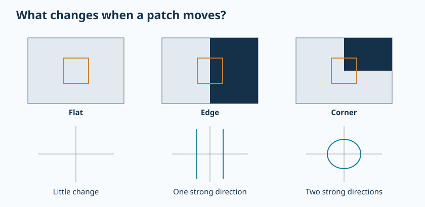
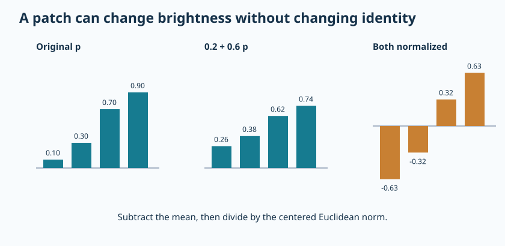
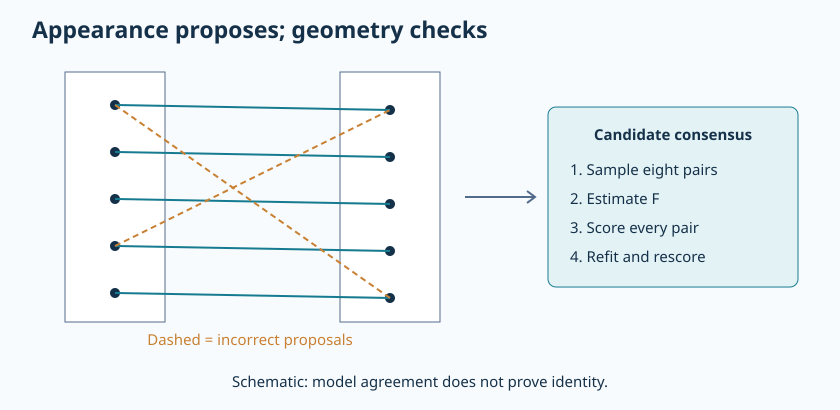
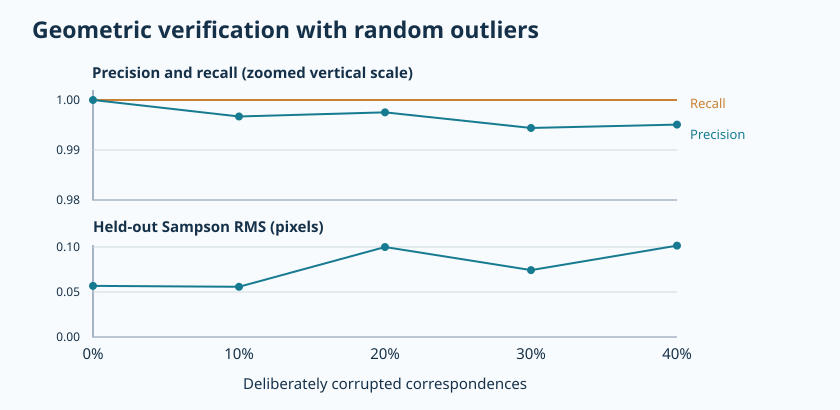
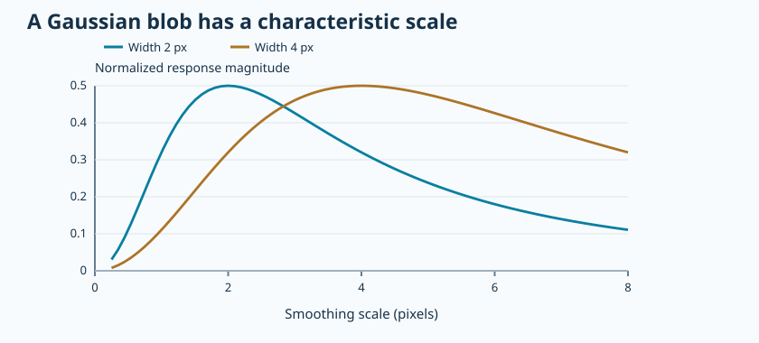
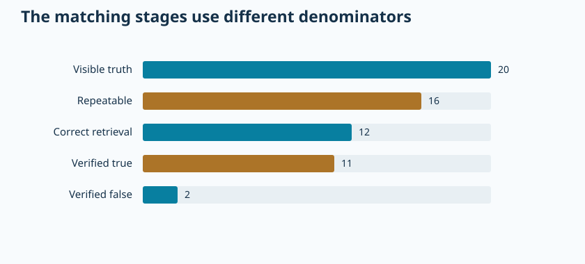

# Chapter 28 — Finding the Same Corner Twice

*From Geometry to Images — Part VI: Images reveal geometry*  
*Reader edition / C++23 laboratory P28*

> A photograph has no little name tags attached to its corners. We must invent a way to recognize them, and then find evidence that our recognition was right.

## The house with too many windows

Our little paper house has four windows. They are almost identical. Take a photograph, walk around the house, and take another. Now ask a computer which window corner in the first photograph belongs to which corner in the second.

The computer does not know what a window is. It receives arrays of numbers. It could compare every possible pair of pixels, but a pixel containing the value 0.42 is hardly a distinctive identity. There may be thousands of them. The image has changed perspective, a tree now obscures one window, and the sun is slightly brighter.

Chapter 27 gave us a way to check whether two observations agree with two-camera geometry. But before we can learn that geometry, we need candidate correspondences. This creates a delightful circular problem: appearance proposes the matches, geometry evaluates them, and a better geometric model helps us find more matches.

We will separate detection, description, matching and verification. A detector finds a location that can be recognized. A descriptor summarizes its surroundings. A matcher proposes a partner. A verifier asks whether a group of proposals is consistent with a model. None of these stages alone establishes physical identity.

## Wiggle a little window over the image

Imagine placing a square magnifying glass on a photograph. If the glass is over a completely white wall, moving it a little to the right or upwards does not change what you see. If it covers a straight vertical edge, moving it vertically changes almost nothing, while moving it horizontally changes a lot. At a corner, both movements can produce changes.

For a small displacement d=(a,b), measure the sum of squared differences between a patch and its shifted version:

\[
E(d)=\sum_{q\in W}w(q)[I(q+d)-I(q)]^2.
\tag{28.1}
\]

The window W contains samples, w is a nonnegative weighting function, and I is a declared grayscale intensity field. We use normalized intensity samples and assume a locally smooth interpolation for the derivation. Differentiating a discrete image requires a numerical approximation.

For sufficiently small displacement, a first-order expansion gives

\[
I(q+d)-I(q)\approx I_x(q)a+I_y(q)b.
\]

Squaring and collecting terms gives

\[
E(d)\approx d^TMd,\qquad
M=\sum_{q\in W}w(q)
\begin{bmatrix}I_x^2&I_xI_y\\I_xI_y&I_y^2\end{bmatrix}.
\tag{28.2}
\]

M is a symmetric positive-semidefinite structure tensor. Each pixel contributes an outer product of its gradient with itself. If all gradients point in one direction, M has at most one nonzero eigenvalue. If gradients span two directions with substantial strength, both eigenvalues are large.

*Figure 28.1 — The structure tensor measures local intensity change under a small translation. The ellipses are qualitative constant-cost contours; the flat case has no bounded positive-cost contour.*

Why does this matter for tracking? For an ideal vertical edge, a sliding point can move along the edge with almost no detectable difference. The observation constrains movement perpendicular to the edge, but not parallel to it. This is the aperture problem. A corner can constrain motion in two directions.

## Harris without an eigensolver

Let the eigenvalues of M be lambda1 and lambda2. We would like both to be large. The Harris response avoids explicitly computing the eigenvalues:

\[
H=\det(M)-k\,\operatorname{tr}(M)^2
=\lambda_1\lambda_2-k(\lambda_1+\lambda_2)^2 .
\tag{28.3}
\]

Our teaching implementation uses k=0.04. If both eigenvalues are zero, H=0. For an ideal edge with eigenvalues (L,0), H=-kL^2. For an isotropic textured patch with eigenvalues (L,L), H=(1-4k)L^2, positive at our k.

This does not mean every positive response corresponds to a physical corner. Fine texture can produce a strong response without looking like the corner of a house. Conversely, a genuine corner with little contrast may be too weak to detect. The Shi–Tomasi alternative scores the smaller eigenvalue directly.

In features.hpp we calculate central differences, e.g. Ix=(I(x+1,y)-I(x-1,y))/2, in intensity units per pixel. We accumulate the tensor over a uniform 3-by-3 window. A production implementation commonly uses Gaussian derivative and integration scales and may refine the peak to subpixel precision.

We skip the two-pixel boundary where the complete gradient window would not fit. We threshold positive responses, then compare each candidate with its eight immediate neighbours. This nonmaximum suppression avoids returning every sample on the shoulder of a peak. For an exact tie, a lexicographically earlier neighbour suppresses the candidate. This deterministic local rule does not guarantee one feature per arbitrarily shaped connected plateau.

A threshold is not dimensionless magic. If image intensities are multiplied by a positive factor a, gradients multiply by a, the tensor by a squared, and H by a to the fourth power. A constant intensity offset cancels from the differences. Thus a fixed absolute Harris threshold changes its behaviour under contrast changes even when the underlying geometry has not changed.

## Give the corner a fingerprint

A location alone cannot identify a patch in another image. Let's store a small neighbourhood around the feature.

Take a 7-by-7 patch, flatten its samples in row-major order, subtract the mean and divide by the Euclidean norm of the centered vector. For raw patch vector p, define

\[
\mu=\frac1{49}\sum_i p_i,\quad
d=\frac{p-\mu\mathbf1}{\|p-\mu\mathbf1\|_2}.
\tag{28.4}
\]

If all values are equal, the denominator is zero. Reject the descriptor instead of manufacturing a normalized constant patch. The implementation rejects a small squared norm and any patch whose footprint crosses the image border.

If a second patch is p'=ap+b1 with a>0, its centered vector is a times the original centered vector, and its norm also multiplies by a. The normalized descriptor is unchanged in exact arithmetic. This is an exact invariance to positive affine intensity changes under the stated assumptions. It does not apply to saturation, nonlinear transfer curves, negative contrast, changes in viewpoint or differing sample footprints.

*Figure 28.2 — Mean subtraction removes the additive offset; unit normalization removes positive multiplicative scale. The chart is a four-sample illustrative witness, not a claim of invariance to every lighting change.*

Our descriptors are fixed-size, orientation-sensitive intensity vectors. Their distance is

\[
D^2(d,e)=\sum_i(d_i-e_i)^2=2-2d^Te
\tag{28.5}
\]

for unit vectors. Thus squared Euclidean distance and normalized correlation rank such descriptors in opposite directions. A smaller distance is a better appearance proposal, not necessarily the same physical point.

Notice the separation between the detector and descriptor: the descriptor can be contrast invariant even while the detector misses a point because its response fell below the threshold. When evaluating a pipeline, check repeatability and matching separately.

## What if the house turns?

If we walk towards the house, a window appears larger. If we tilt the camera, its apparent orientation changes. A 7-by-7 patch may now contain completely different information, although it belongs to the same physical corner.

Scale-space methods smooth the image at multiple spatial scales. A Gaussian scale space is

\[
L(x,y,\sigma)=(G_\sigma*I)(x,y).
\tag{28.6}
\]

The smoothing standard deviation sigma is measured in pixels in the current coordinate system. Gaussian smoothing before subsampling suppresses frequencies that cannot be represented on the coarser grid; Chapter 20 explains why this matters. A scale-space detector examines image response across position and scale, rather than assuming every interesting structure has the same size.

SIFT, developed by David Lowe, detects candidate extrema of differences of Gaussians across position and scale. It localizes candidates, rejects unstable responses, assigns a dominant gradient orientation, and describes a neighbourhood in a scale- and orientation-relative frame. A common descriptor layout contains 4-by-4 spatial cells with eight orientation bins each, producing 128 components. Normalization and clipping of dominant components improve robustness. Orientation or scale selection can still be ambiguous, and substantial viewpoint or illumination changes can break matching.

FAST takes a different approach to detection: examine intensities on a ring around a candidate and look for a contiguous arc sufficiently brighter or darker than the center. Binary descriptors such as BRIEF compare intensities at pairs of patch positions, producing bits rather than floating-point components. ORB combines an oriented FAST detector with a rotated, selected binary descriptor and uses an image pyramid for scale handling. Its matching cost is the Hamming distance, computed by counting the set bits of XOR.

The algorithms answer related but distinct questions. SIFT is not simply Harris with a larger patch. ORB is not a binary encoding of the SIFT histogram. A learned feature model may instead learn a descriptor space and a detector jointly, but it still has training-domain, geometric and uncertainty constraints.

P28 implements the small fixed-scale Harris and normalized-patch route. The above methods are technical context and extensions; the source does not pretend to implement SIFT, ORB or a trained neural descriptor.

## The nearest neighbour may have a twin

Suppose a feature's best match has distance 0.20 and its second-best match has distance 0.21. Both candidates look nearly equally plausible. Compare this with a best distance of 0.20 and a second-best of 0.80.

The ratio test rejects ambiguous candidates using

\[
D_1<\rho D_2,\quad 0<\rho<1.
\tag{28.7}
\]

Our default rho is 0.8. The code uses squared distances, so it tests D1 squared against rho squared times D2 squared. Squaring the measured distances but forgetting to square the threshold changes the actual acceptance policy.

For an exact tie, including two identical zero-distance descriptors, the strict inequality rejects the match. This is preferable to choosing a window arbitrarily just because its index is smaller.

We also require mutual nearest neighbours: the destination's unique closest source descriptor must be the original candidate. The implementation rejects reverse ties, but it does not apply a second ratio test in the reverse direction. This choice can improve precision at the expense of recall.

Brute-force search costs roughly O(N M d) for N and M feature counts and d descriptor components in the forward pass. The reverse checks can add comparable work for this mutually filtered result. Large image collections benefit from indexing or approximate nearest-neighbour search, but approximate distances can change which candidates pass a ratio test. Measure the change rather than assuming an approximate index preserves every decision.

## Let geometry argue with appearance

Our descriptor proposed twenty matches, including a few incorrect ones. Can we estimate the fundamental matrix from all twenty using the algorithm from Chapter 27?

Perhaps. But even a handful of wrong matches can distort a least-squares estimate. The bad points are not necessarily small Gaussian perturbations of the correct point; they can be completely different windows. This is an outlier problem.

Random Sample Consensus, or RANSAC, starts with a different idea. Select a small random set of observations. Estimate a hypothesis from that set. Ask how many of all the observations agree with it. Repeat, retaining a good consensus.

*Figure 28.3 — Appearance proposes candidates; the model's residual threshold selects a consensus. A false match can still land near the predicted line.*

For our normalized eight-point estimator, take eight distinct indices without replacement within a trial. If N matches include I genuine matches, the exact probability that a uniformly selected subset of eight consists entirely of genuine matches is

\[
q=\frac{\binom I8}{\binom N8}.
\tag{28.8}
\]

If I<8, q=0. For large populations relative to the sample size, an approximation is q≈w^8 where w=I/N. Under independent trials and assuming every all-inlier sample yields an acceptable hypothesis, the probability of at least one such sample in L trials is 1-(1-q)^L. To achieve a desired probability p, the planning formula is

\[
L\ge\frac{\log(1-p)}{\log(1-q)}.
\tag{28.9}
\]

Round up and handle q=0 and q=1 separately. Degenerate or noisy all-inlier samples may fail the numerical estimator, so this is not a general success guarantee. The inlier fraction itself is usually unknown. Adaptive stopping based on observed consensus size is an engineering policy; a misleading consensus can make it overconfident.

For N=100 and I=60, q is about 0.0137, compared with the optimistic approximation 0.6^8≈0.0168. The difference is visible. One thousand iterations give ample opportunity in this idealized calculation, but cannot guarantee that the dominant model is correct or that it describes the static background instead of a moving object.

The P28 implementation uses a fixed iteration budget, not adaptive stopping. It reuses Chapter 27's eight-point estimator and its rank and singular-gap checks. For every hypothesis, a candidate is an inlier when its squared Sampson residual is at most tau squared, with tau in pixels. Undefined residual gradients are not inliers. Rank failures or SVD nonconvergence reject the hypothesis.

The score first maximizes inlier count, then minimizes the sum of squared residuals over those inliers to break ties. Refit the model using the winning consensus, classify all original candidates again, and keep the new result only if the same score improves. Our code allows three such refits. A refit is not guaranteed to improve the score because the linear solver and the scoring residual minimize different objectives.

This is a deliberately simple RANSAC policy. MSAC, MLESAC, LO-RANSAC, PROSAC and modern robust estimators use different scoring, sampling or refinement strategies. Choosing a noise-dependent threshold and comparing models are still essential.

## Two experiments, not one misleading benchmark

The first experiment begins with actual synthetic grayscale image arrays. We generate a 64-by-64 textured image and create a second image translated by (5,3) pixels. Where samples overlap, the second image equals 0.2+0.6 times the first. The detector threshold in the second view is adjusted by 0.6 to the fourth power, because we know the contrast change in this controlled test. This is not an automatic contrast adaptation algorithm.

Restrict evaluation to corresponding interior regions where complete patches and detector neighbourhoods fit. Detect, describe, and match. The native test recovered 107 correct feature pairs, one for every selected source feature, with no wrong translation. Every accepted descriptor squared distance was below 10^-25. Separate tests reject flat images, an ideal vertical edge, constant patches, boundary patches, exact descriptor ties and repeated geometric observations.

The second experiment isolates geometric robustness from image appearance. Generate 100 correspondences with a known translated ideal camera pair and a noncoplanar synthetic scene; add independent Gaussian noise of 0.2 pixels to each coordinate. Replace the destination of 0,10,20,30 or 40 correspondences with independent random pixel coordinates. Run ten trials at each corruption level, with a one-pixel Sampson threshold and one thousand attempted hypotheses per fit.

The known labels are retained for evaluation but are not passed to the estimator. True positives are retained genuine matches; false positives are retained deliberately corrupted matches; false negatives are rejected genuine matches. Precision and recall are

\[
\mathrm{precision}=\frac{TP}{TP+FP},\qquad
\mathrm{recall}=\frac{TP}{TP+FN}.
\tag{28.10}
\]

When a denominator is zero it must be handled explicitly; the studio's precision convention is zero if no matches are returned. Its fixtures always have genuine matches. Each fit also evaluates fifty new noiseless correct correspondences, giving an epipolar residual on data not used for fitting.

*Figure 28.4 — Ten trials per corruption level. Recall is one in this experiment, but some random false matches survive; precision is therefore not always one.*

At 40% corruption, all 600 genuine matches across the ten trials were retained, and three corrupted candidates were also accepted. Mean per-trial precision was 0.995082, mean recall 1, and mean held-out Sampson RMS 0.101515 pixels. The other corruption levels have similarly high precision in this fixture; the errors are not monotone because independent random scenes and noise realizations were used at each level.

This is not evidence of 100% recall on arbitrary photographs. Random independent outliers are much easier than coherent repetitive-window mismatches or a second moving object. Also, the image translation test and the epipolar RANSAC sweep are separate controlled experiments. A planar image translation is intentionally not fed into the general eight-point estimator. We have not yet implemented an end-to-end real-image reconstruction pipeline.

## Read the code like a scientist

Open features.hpp, then robust_matches.hpp, and follow the two executables. The Image type uses integer array indices and stores normalized grayscale intensities. When connecting these indices to the image-edge coordinates of Chapter 13, explicitly add 0.5 to each index for its sample center. A descriptor's patch indices are not automatically camera coordinates.

Build the cumulative project and run:

~~~text
book03_feature_tests
book03_matching matching.csv
~~~

The studio writes fifty CSV rows with fit status, label counts, precision, recall and held-out RMS. A missing model is represented explicitly by found=0 and heldout_rms=-1; exclude that sentinel from a successful-fit error summary and report the failure count. The native experiment found a model in all fifty trials.

To make the lab more realistic, take a set of verified images with known geometric reference data. Preserve all detected features, proposed matches and rejected hypotheses in a diagnostic record. Compare detector repeatability, descriptor accuracy, verification precision and recall, and eventual pose/3D error. Include repeated texture, blur, scale, rotation, exposure changes and partial overlap. Do not call a sparse set of correct matches a dense reconstruction.

## A corner has a useful size as well as a position

The earlier Harris example examines a fixed image neighbourhood. It can distinguish a flat region, an edge and a corner at that chosen scale. But move the camera farther away and a large feature occupies fewer pixels. The same neighbourhood may now cover several unrelated details. Move closer and it may contain only a tiny piece of one edge. A fixed window has implicitly made a statement about the scale of the world.

Consider a smoothed image L(x,y,sigma) obtained by convolution with a Gaussian of standard deviation sigma pixels. A larger sigma suppresses smaller features. If we measure derivatives of L at different scales, their raw magnitudes change partly because of the smoothing scale itself. A normalized second-derivative response uses

\[
R(x,y,\sigma)=\sigma^2(L_{xx}+L_{yy}).
\]

Why the squared factor? Under a coordinate dilation by a positive factor a, a corresponding image structure is described by new coordinates x'=ax, y'=ay and smoothing scale sigma'=a sigma. Each spatial derivative contributes a factor 1/a, so the second derivative contributes 1/a². Multiplying by sigma'² cancels that factor. This is an ideal continuous covariance statement; discrete image sampling, limited support, borders and interpolation still change the observed response.

A difference between Gaussian-smoothed images at nearby scales can approximate the scale-normalized Laplacian up to a factor depending on their scale spacing. It gives a practical way to search for extrema in both image position and scale. The original P28 laboratory deliberately uses fixed-scale Harris and normalized patches; the following scale-space discussion is an extension rather than a promise that it already implements SIFT.

**Worked example.** For an ideal isolated two-dimensional Gaussian blob of amplitude one and width s, Gaussian smoothing at sigma produces another Gaussian with central amplitude s²/(s²+sigma²) and variance s²+sigma². Its Laplacian at the center is -2s²/(s²+sigma²)². Multiplying by sigma² gives a negative response of magnitude

\[
A(\sigma)=\frac{2s^2\sigma^2}{(s^2+\sigma^2)^2}.
\]

Set x=sigma²/s². Then A=2x/(1+x)², and its derivative with respect to x is 2(1-x)/(1+x)³. The maximum occurs at x=1, so the preferred scale is sigma=s. The peak magnitude is 0.5, independent of the blob width. The result provides an analytic scale-selection fixture without needing an arbitrary photograph.

### Localize a feature between samples

A detector may find that the largest response lies at a particular integer pixel, although the true maximum is between samples. Approximate the response near that sample by a quadratic

\[
R(p+\delta)\approx R(p)+g^T\delta+\tfrac12\delta^TH\delta.
\]

A stationary displacement satisfies H delta=-g. In one dimension, let the three adjacent response values be l,c,r. Using central differences, g=(r-l)/2 and H=l-2c+r. Therefore the estimated subpixel displacement from the central sample is (l-r)/(2H).

For l=7, c=10, r=9, H=-4 and g=1, so the displacement is +0.25 pixels. The response is increasing at the center, and the quadratic is concave down, which explains the positive move. The estimated position is not a new sensor sample; it is a local fitted maximum. A flat or nearly singular curvature gives unreliable localization, and a large step may mean that the selected sample is not in the appropriate neighbourhood.

~~~cpp
#include <cmath>
#include <optional>

// Fit a concave quadratic to three evenly spaced responses.
// Return only a displacement belonging to the central sample's cell.
std::optional<double> refine_peak(double left, double centre,
                                  double right) {
    if (!std::isfinite(left) || !std::isfinite(centre)
        || !std::isfinite(right)) return std::nullopt;
    const double curvature = left - 2.0 * centre + right;
    if (!(curvature < 0.0) || !std::isfinite(curvature))
        return std::nullopt;
    const double dx = (left - right) / (2.0 * curvature);
    if (!std::isfinite(dx) || std::abs(dx) > .5)
        return std::nullopt;
    return dx;
}
~~~

This deliberately small function requires a bounded, well-scaled response domain. A practical two-dimensional or scale-space implementation also checks the eigenvalues of the fitted Hessian, the residual and feature contrast. The test suite should include the exact quadratic case, a flat response, a convex response, and an asymmetric case whose optimum leaves the central cell.

*Figure 28.5 — The scale-normalized Laplacian magnitude for ideal blobs of widths two and four peaks at their respective widths, with equal peak response one half.*

## A descriptor is a choice about what to forget

The ideal descriptor would return the same representation for the same surface under every permitted observation change and different representations for distinct surfaces. These two wishes conflict. A descriptor that forgets everything is perfectly invariant but useless for matching. A descriptor that retains every raw pixel is highly discriminative under exact repetition but may fail under a small viewpoint or exposure change.

An orientation-normalized gradient descriptor estimates a dominant direction and expresses local gradient orientations relative to it. Histograms can reduce sensitivity to small displacements, while spatial subdivision preserves some arrangement information. A binary descriptor instead compares intensities at selected pairs of sample positions; a bit records which is larger. Positive affine intensity changes preserve exact comparison order before clipping and quantization. Near-equal intensity comparisons are unstable under noise.

For two binary strings, Hamming distance counts differing bits. Consider descriptors 10110010 and 10100011: their exclusive-or is 00010001, with two set bits. The distance is two. An implementation can use the population count of the exclusive-or of machine words, but a fast distance function does not itself establish useful invariance.

~~~cpp
#include <bit>
#include <cstdint>
#include 
#include <stdexcept>

std::size_t hamming_words(std::span<const std::uint64_t> a,
                          std::span<const std::uint64_t> b) {
    if (a.size() != b.size())
        throw std::invalid_argument("descriptor length mismatch");
    std::size_t count = 0;
    for (std::size_t i=0; i<a.size(); ++i)
        count += std::popcount(a[i] ^ b[i]);
    return count;
}
~~~

The representation here uses all bits in each word. If the logical descriptor has a nonmultiple-of-64 length, its unused bits must be masked or canonicalized. Otherwise padding can contribute a fictional feature difference. Test identical strings, complementary strings and a single flipped bit. Then ask whether the descriptor itself is stable, independently of the correctness of this distance routine.

## Separate four sources of matching failure

A detected feature can disappear under viewpoint change. A repeatable detection may be described incorrectly. A correct descriptor may retrieve a wrong candidate in a repeated texture. A wrong correspondence may survive geometric verification because it lies near an epipolar line. The final match count does not identify which stage failed.

Design a controlled experiment with known image transformations and visible correspondence masks. Detector repeatability asks whether the transformed feature is redetected within a declared position and scale tolerance. Descriptor matching evaluates retrieval among the features that were detected in both images. Geometric verification evaluates accepted and rejected candidate labels. Finally, reconstruction evaluates the metric consequence of the survivors. Keep denominators explicit: recall among all physical features and recall among jointly detected features are not the same statistic.

A near-perfect geometric inlier ratio can be achieved by rejecting almost everything. Report both precision and recall, the total number of valid correspondences, and the distribution of residuals. A useful model should generalize to held-out matches. If the same data chose the model and its threshold, a small training residual is optimistic.

**Research exercise.** Build an analytic image family containing isolated blobs, corners, repeated windows and a textureless region. Vary scale, rotation, exposure, blur and noise separately before combining them. Evaluate fixed-scale Harris and normalized patches against a new scale-normalized detector or binary descriptor. Record repeatability, candidate retrieval, robust verification and reconstructed point error as separate stages. This is an extension project, not an observed comparison between full SIFT, ORB and the native P28 reference.

*Figure 28.6 — The illustrative twenty-feature fixture retains sixteen repeated detections, twelve correct retrievals, and eleven verified true matches. Two false matches survive separately.*

### Guided workshop: find the first stage at which matching fails

Create a synthetic 128 by 128 linear-intensity image containing a distinct L-shaped corner, two repeated square windows and two Gaussian blobs of different widths. Save the analytic construction parameters. Generate a second image by translating the original continuous signal by (3.25,-2.5) pixels and sampling it on the same grid. Do not translate the already sampled image with an unrecorded interpolation rule if the goal is an exact analytic reference.

For every reference feature away from the image boundary, its expected transformed position is the original position plus the declared translation. Detect features in both images and associate each detection with its nearest known reference position, within a stated tolerance. This association is used for evaluation, not fed into the actual descriptor matcher. Exclude features which moved outside the valid image domain from the jointly visible denominator.

Suppose a controlled fixture has 20 jointly visible reference features. The detector rediscovers 16 in both views, the descriptor retrieves the correct partner for 12 of those, and geometric verification retains 11 of those correct matches plus two false matches. Detector repeatability under this definition is 16/20=0.8. Conditional descriptor retrieval is 12/16=0.75. Final precision is 11/13, about 84.62 percent, while final recall relative to jointly visible features is 11/20=55 percent. The high precision alone does not show that the complete matching task was solved.

Now change the translation to a rotation around the image center. A fixed patch descriptor may lose retrieval performance even when the detector finds the same structures. Repeat at scale factors 0.5, 1 and 2 using analytic resampling. For Gaussian blobs of widths two and four pixels, the scale-normalized Laplacian should attain its ideal continuous maximum near those widths respectively. A discrete implementation may shift the measured peak due to the finite scale sampling and image grid. Report the scale error as a measured quantity rather than enforcing exact equality with the continuous result.

Add a brightness transformation with positive scale and offset. Verify that normalized patches remain consistent in the ideal affine-intensity model and that binary intensity-order comparisons do not flip unless the signal is tied or rounding changes it. Then introduce clipping. The clipped patches are no longer related by an invertible affine intensity transform. Keep clipping fraction beside the descriptor error to explain why the invariance has broken.

Use the existing P28 native experiment for the measured fixed-scale detector and robust match behavior. Add the scale-space and binary-descriptor experiments as separate modules. Keep the exact feature identities in evaluation files, and record accepted, rejected and missing matches at every stage. Finally feed verified matches to Chapter 29's point-estimation experiment and measure their geometric consequence. The result is a complete diagnostic chain rather than a contest between two unexplained final match counts.

## Exercises — make the corner prove who it is

**Reconstruct 28A.** Derive the tensor in equation 28.2 and evaluate Harris response for eigenvalues (0,0), (4,0) and (4,4). Explain the aperture problem.

**Reconstruct 28B.** Prove equation 28.4 is invariant to positive affine intensity changes. Explain the cases a=0 and a<0, and why clipping invalidates the proof.

**Falsify 28C.** Make two identical destination descriptors and show that the strict ratio test rejects the ambiguity. Construct a case in which mutual nearest-neighbour checking removes a one-way proposal.

**Falsify 28D.** Rotate or rescale the texture fixture rather than translating it. Count feature repeatability and verified matches separately. Explain which assumptions no longer hold.

**Transfer 28E.** Derive the finite-population all-inlier probability for eight samples with N=100 and I=60. Compare with w^8 and calculate a 99% planning budget.

**Transfer 28F.** Sweep the RANSAC threshold. Plot precision, recall and failure rate. Add coherent mismatches generated by a competing camera instead of uniform random destinations.

**Explain 28G.** Explain to a child why two identical windows might fool a computer. Explain to a vision engineer why even a zero epipolar residual does not prove physical identity.

**Explain 28H.** Specify the data contract for feature tracks across three photographs, including frame identity, pixel convention, descriptor provenance, one observation per image, and geometrically rejected edges.

### Selected answers and experiment criteria

**28A–B.** For k=0.04, the Harris response det(M)-k tr(M)^2 is 0, -0.64 and 13.44 for the three eigenvalue pairs. Under I'=aI+b, subtracting the patch mean removes b; dividing by its nonzero norm removes positive a. Negative a reverses the normalized vector and a=0 makes the norm vanish. Clipping is not an affine change of the samples.

**28C–D.** Two identical best descriptors have tied distances; neither wins a strict ratio test. If a source A chooses destination B but B chooses another source, mutual nearest-neighbour checking removes A-to-B. When rotating or rescaling a fixture, record detector repeatability separately from descriptor and geometric-verification success.

**28E.** With eight distinct draws, the all-inlier probability is the product of (60-j)/(100-j) for j=0 through 7. Independent trials of that sampling procedure require the ceiling of log(0.01)/log(1-p_good) for a 99 percent chance of at least one uncontaminated sample. Numerically p_good is about 0.01374953 and the planning budget is 333 trials. The approximation 0.6^8=0.01679616 assumes independent draws within a sample and gives only 272 trials, so it is more optimistic here. An uncontaminated sample can still be geometrically degenerate.

**28F–H.** Compare precision, recall, failure count and held-out geometric error across thresholds. A repeated window may be appearance-identical to the correct one. Track membership requires a declared image identity and an explicit association policy; epipolar agreement alone is not an identity certificate.

## Further reading

Chris Harris and Mike Stephens, *A Combined Corner and Edge Detector*, 1988, DOI 10.5244/C.2.23. David G. Lowe, [Distinctive Image Features from Scale-Invariant Keypoints](https://www.cs.ubc.ca/~lowe/papers/ijcv04.pdf), IJCV 60, 2004. Ethan Rublee et al., *ORB: An Efficient Alternative to SIFT or SURF*, ICCV 2011, DOI 10.1109/ICCV.2011.6126544. Martin Fischler and Robert Bolles, *Random Sample Consensus*, Communications of the ACM 24(6), 1981, DOI 10.1145/358669.358692. These are foundational references; P28 is an independently authored small teaching implementation.

## Next: assemble the photographs

We can now propose matches and reject many of the unreliable ones. But we still have only a collection of relationships between pairs of photographs. Chapter 29 will turn them into tracks, camera poses and a sparse three-dimensional map. The house is about to become a world that the computer reconstructs rather than one we supplied.
