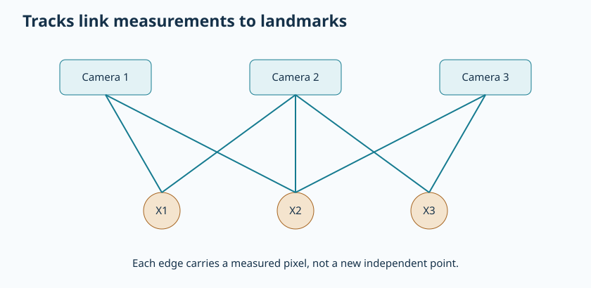
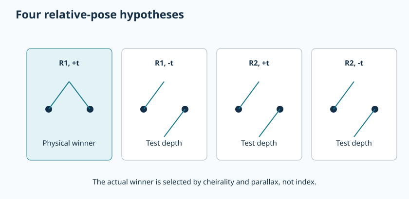
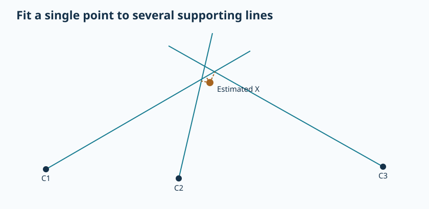
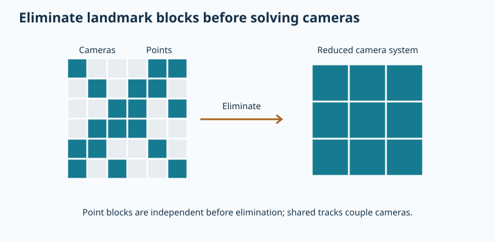
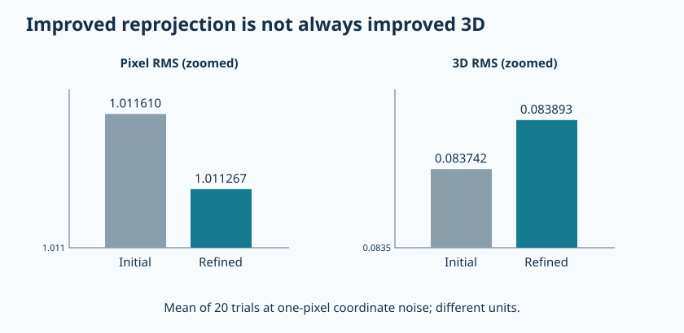

# Chapter 29 — Building a Scene from Pictures

*From Geometry to Images — Part VI: Images reveal geometry*  
*Reader edition / C++23 laboratory P29*

> A photograph is a shadow of the world. A collection of shadows, if we understand how they were made, can tell us where the world stood.

## The house has disappeared

Imagine that we take a dozen photographs of our little paper house and then someone removes the house from the table. We still have its photographs. Can we rebuild the house? Can we discover where each camera stood, where the roof ended, and how the windows were arranged?

A picture taken with a known camera tells us a direction but not a distance. Chapter 27 showed that a pair of corresponding directions can recover relative geometry, subject to ambiguity and scale. Chapter 28 showed how appearance proposes those correspondences and geometric verification rejects many of the incorrect ones. Now the pieces belong to one larger puzzle: **Structure from Motion**, or SfM.

Motion here means changes in the viewpoints of the cameras relative to a static scene. We are not estimating the movement of every object independently. If the house is moving between exposures, the static-scene model may be wrong. We must either restrict the observations to static structure or adopt a different model.

A sparse reconstruction is a set of camera parameters and 3D landmarks, together with the observations that constrain them. It is not a complete surface, a textured mesh, or a guarantee that every visible detail has been recovered. That distinction will matter in Chapter 30.

## A photograph becomes a graph

A feature is an observation inside a particular image. Let the pair (j,k) identify feature k in image j. A verified correspondence is an edge between two such observations. A track groups observations that are believed to represent one physical landmark.

For example, suppose image A's feature 17 matches image B's feature 8, and B's feature 8 matches image C's feature 24. If those matches are consistent, all three observations belong to one track. If another edge tries to add C's feature 31 to that same track, we have a conflict: a single visible point should not have two distinct locations in one ideal image. Reject or resolve the conflict; blindly taking graph connected components can fuse unrelated landmarks.

*Figure 29.1 — A bipartite observation graph relates camera nodes to landmark nodes. Every edge stores a measured image coordinate and its provenance.*

A useful implementation stores frame identity, feature identity, pixel measurement, uncertainty and descriptor provenance. The camera is not the pixel. The feature is not the landmark. A track may have missing observations because the point is occluded, outside the image, or not reliably detected.

The native Track type accepts a list of already-associated observations. It requires two or more observations from distinct valid camera indices and rejects a duplicate camera. It does not construct tracks from a pairwise match graph; the discussion above describes the contract a future track builder must satisfy.

## Start with two cameras, but choose them carefully

A practical incremental system chooses an initial pair with substantial overlap and enough parallax. Many matches alone are insufficient: a panorama captured by rotating in place may have thousands of excellent matches but no translational baseline. A planar facade can also lead to an ambiguous epipolar model. Compare alternative models and inspect the spatial distribution of matches.

For calibrated ideal cameras, place the first optical frame at the origin. Its world-to-camera pose is (I,0). From verified correspondences, estimate F using Chapter 27 or the robust estimator in Chapter 28. With known intrinsics K1 and K2,

\[
E=K_2^TFK_1.
\tag{29.1}
\]

An exact essential matrix has rank two and equal nonzero singular values. With noise, its two dominant right singular directions v1,v2 and the associated left directions u1,u2 can be used to construct proper orthonormal frames. Choose v3=v1 cross v2 and u3=u1 cross u2, with unit normalization. This chooses null-vector signs while keeping both frames right-handed.

Let U and V have those vectors as columns, and set

\[
W=\begin{bmatrix}0&-1&0\\1&0&0\\0&0&1\end{bmatrix}.
\]

The two candidate rotations are UWV^T and UW^TV^T. Each may pair with translation +u3 or -u3. This gives four candidate relative poses, all consistent with the projective essential matrix up to scale/sign in the ideal case.

*Figure 29.2 — Candidate rotations and translation signs are evaluated against the observed tracks. The figure represents hypotheses, not four actual cameras that were used.*

For each candidate, reconstruct points and check positive optical depth in both cameras. A point behind a camera cannot be a visible point in the declared forward pinhole model. Also check parallax: a very distant point can have nearly parallel rays, and its depth estimate may be unreliable.

P29 implements this decomposition, taking the two dominant right singular vectors using P27's Jacobi routine. It rejects a severely rank-one matrix, constructs proper frames, then counts positive-depth points with sine of parallax angle greater than 0.005. It accepts a unique winning candidate with at least eight votes and at least 80 percent of the supplied matches voting for it. These are teaching-policy thresholds, not a proof of reliable pose recovery in every case. The recovered translation direction has unit length. This fixes a scale gauge, not the baseline in metres.

## A point belongs to several rays

Given a camera pose (Rj,tj), the camera center in the world is

\[
C_j=-R_j^Tt_j .
\]

For a homogeneous pixel p_j and known intrinsics K, its world ray direction is

\[
d_j=\frac{R_j^T K^{-1}p_j}{\|R_j^T K^{-1}p_j\|}.
\tag{29.2}
\]

Notice the transpose: Rj maps world coordinates into the optical frame, while we need the opposite direction to obtain a world ray. The native lab assumes common known intrinsics for all views. Real reconstructions often require separate calibration models for each camera or image.

If the observations are exact and refer to one point, their rays meet at X. With noise, the lines may not meet. Choose X that minimizes the sum of squared perpendicular distances to all the supporting lines. The component of X-Cj parallel to dj is dj times its dot product with X-Cj. Subtract it to obtain the perpendicular component. Define

\[
Q_j=I-d_jd_j^T.
\]

Since dj is unit length, Qj is symmetric and idempotent. It is the projection onto the plane perpendicular to the ray. The objective is

\[
L(X)=\sum_j\|Q_j(X-C_j)\|^2 .
\tag{29.3}
\]

Differentiate with respect to X and use Qj^T Qj=Qj. The stationary point satisfies

\[
\left(\sum_jQ_j\right)X=\sum_jQ_j C_j.
\tag{29.4}
\]

This is a small 3-by-3 linear system, regardless of the number of views. If all rays are parallel, their shared direction is a null vector of the sum and no unique depth is determined. Near-parallel directions can make the system numerically weak. Our bounded pivoted solver rejects a tiny relative pivot; it is a heuristic numerical check, not a condition-number certificate. Positive depth is checked after the solution.

For two lines of equal weight this formulation agrees with the midpoint of the closest pair, when that minimizer is unique. For three or more views it fits all the lines simultaneously. It minimizes distances in world units, not image pixels. A pixel error at a nearby point does not correspond to the same world-space displacement as a pixel error at a distant one.

*Figure 29.3 — A single reconstructed point minimizes a geometric line-distance objective. Noisy rays need not intersect at one common point.*

## Ask the photographs directly

A good initializer gets us close, but the photographs are our measurements. Instead of minimizing world-space line distances, we may minimize the errors in their image coordinates.

For a point X, let the projection into view j be pi_j(X). Its observed pixel is z_j. Define residual

\[
r_j(X)=\pi_j(X)-z_j .
\]

For independent, identically distributed Gaussian pixel-coordinate noise, minimizing the sum of squared residuals is the corresponding maximum-likelihood objective under the assumed fixed camera model. This does not make the recovered point the most accurate possible in an arbitrary 3D metric. The camera configuration and noise determine how different depths are constrained.

Recall the optical coordinates y=RX+t, with positive Z. For K having focal scales fx,fy and skew s, the pixel derivative with respect to y is

\[
J_y=
\begin{bmatrix}
f_x/Z&s/Z&-(f_x X_c+sY_c)/Z^2\\
0&f_y/Z&-f_yY_c/Z^2
\end{bmatrix}.
\tag{29.5}
\]

Here Xc and Yc are optical coordinates, not the world point X. By the chain rule J_X=J_yR. The residual Jacobian for one track stacks these two-row blocks. A Gauss–Newton update solves

\[
J^TJ\,\delta=-J^Tr.
\tag{29.6}
\]

For the small three-variable teaching problem, we accumulate the normal system explicitly and solve with pivoting. Large or ill-conditioned problems should favor mature QR/SVD or sparse optimization routines. The code tries progressively smaller steps and accepts only those that decrease the actual squared pixel objective while keeping projections in front of their cameras. It stops after a bounded number of iterations, on a tiny update, or when no descent step is found.

This is **point-only reprojection refinement**. The supplied camera poses remain fixed. There is no claim that the result is a global optimum, or that every point becomes closer to its true position.

## Adding the third camera

Once the first pair has reconstructed landmarks, a third image may observe some of them. These are now 3D-to-2D correspondences. Perspective-n-Point (PnP) solves for the new rigid pose given known camera intrinsics. A minimal P3P method can produce multiple candidates from three points; an additional observation or more observations and robust verification can select a physical pose. A nonminimal estimator uses additional observations to reduce noise.

Chapter 26's general DLT can also provide a projection initialization in suitable noncoplanar geometry, but it estimates more parameters than a calibrated pose-only solver. Do not confuse an unrestricted projective fit with a constrained rigid motion.

A typical incremental pipeline registers a view using visible known landmarks, triangulates tracks that now have sufficient observations, removes or revises unreliable landmarks, then refines cameras and points. Camera registration may fail; retain that state rather than silently inserting an identity camera. View overlap, match coverage, parallax and the number of independent landmarks matter.

This cycle can accumulate drift. A loop closure adds constraints linking views encountered earlier, but a false loop closure can distort an entire map. The system must verify the link. A disconnected observation graph may produce separate reconstructions with independent coordinate gauges.

The P29 lab recovers the two-view seed pose in a native test; its separate three-view reconstruction experiment uses supplied known poses and preassociated tracks. It does not implement PnP, image registration, loop closure, or a full incremental SfM system.

## Bundle adjustment — adjust the entire puzzle together

The word bundle refers to the collection of observation rays. Instead of independently fitting a point with cameras fixed, allow the cameras and landmarks to change jointly. For observed camera-landmark pairs (j,i) in a set O,

\[
\min_{\theta_j,X_i}\sum_{(j,i)\in O}
\rho\left(\| \pi(\theta_j,X_i)-z_{ji}\|_{\Sigma_{ji}^{-1}}^2\right).
\tag{29.7}
\]

Theta may contain rotation, translation, intrinsics or distortion parameters, depending on the problem. The covariance weights distinguish different measurement uncertainties. A robust loss rho limits the influence of large residuals but does not resolve all bad data associations. A rotation update belongs on SO(3), rather than adding arbitrary numbers to its nine entries.

Why is this problem so large? A collection of 100 cameras and 10,000 points has at least 600 camera pose variables and 30,000 point coordinates before intrinsics. Yet a pixel observation connects only one camera and one landmark. Most entries in its Jacobian are zero.

After linearization, partition the increments into camera and point blocks:

\[
\begin{bmatrix}A&B\\B^T&C\end{bmatrix}
\begin{bmatrix}\delta_c\\\delta_p\end{bmatrix}
=-\begin{bmatrix}g_c\\g_p\end{bmatrix}.
\tag{29.8}
\]

Without point-to-point priors, C is block diagonal because a single residual never connects two different landmarks. If its blocks are invertible after appropriate damping, eliminate delta_p:

\[
(A-BC^{-1}B^T)\delta_c=-g_c+BC^{-1}g_p,
\tag{29.9}
\]

then recover delta_p=-C^-1(gp+B^T delta_c). This reduced camera system is the Schur complement. In code one solves the small point blocks rather than explicitly computing their inverses. The reduced system can still be sparse according to which cameras share landmarks; its fill-in and conditioning determine the computational cost.

*Figure 29.4 — An observation couples one camera block and one landmark block. Eliminating independent landmark blocks produces a reduced camera system.*

Bundle adjustment needs gauge constraints. For calibrated monocular reconstruction, a global similarity transform (translation, rotation and positive scale) can leave all image predictions unchanged. Fix the first camera orientation and position and one independent scale constraint, such as the distance to a second camera. If a real metric baseline is known, use it; otherwise call the reconstruction units arbitrary baseline units. Unfixed gauge directions make the normal system singular. Extra unobservable configurations can remain even after those seven similarity freedoms are removed.

The native point-only solver exercises the projection Jacobian and descent rule that appear inside bundle adjustment, but does not implement the joint sparse camera-point optimization. Do not call a point-only descent full bundle adjustment.

## Put two reconstructed houses in the same frame

Two reconstructions may describe the same object with different coordinate origins and orientations. Comparing their vertex coordinates directly would confuse a coordinate choice with geometric error. Suppose we know corresponding three-dimensional points x_i and y_i and that both clouds have the same trusted metric scale. We seek a proper rigid transform minimizing

\[
\sum_i\|Rx_i+t-y_i\|^2,\qquad R^TR=I,\quad\det R=1.
\]

Differentiate with respect to t. The stationary translation is y_bar-R x_bar, where the bars are the cloud centroids. Subtract each centroid from its cloud. Expanding the remaining squared differences leaves two constant sums of squared norms and the term -2 sum_i y_i'^T R x_i'. Consequently minimize the error by maximizing tr(RH), with H=sum_i x_i' y_i'^T.

Let H=U S V^T be its singular value decomposition, with descending nonnegative singular values. Put D=diag(1,1,det(VU^T)). The proper rotation is R=VDU^T. To see why the sign matters, write tr(RH)=tr(V^T R U S). The orthogonal matrix V^T R U has determinant det(V^T U), and each diagonal entry is at most one. When the determinant constraint is negative, the optimal sign correction sacrifices the smallest singular direction. This is the proper-rotation orthogonal Procrustes solution; accepting an unconstrained orthogonal matrix can instead mirror the house. Repeated or deficient singular directions can make the solution nonunique or poorly constrained, so inspect the geometry, not only the returned matrix.

For source points (0,0,0), (1,0,0), (0,1,0), let a positive quarter-turn about +Z and a translation (2,3,4) generate targets (2,3,4), (2,4,4), (1,3,4). Centering removes the translation, the two independent in-plane directions fix the proper rotation, and the centroid formula recovers (2,3,4). The planar cloud can determine this exact rigid transform because the two noncollinear edges also determine an oriented normal. Two distinct points alone leave rotation about their connecting line unresolved. A general affine fit is a different problem; it can introduce shear and independent scales.

If monocular scale is unknown, a similarity alignment can estimate a single positive scale as well, but its objective must be explicit. For fixed proper R, one-sided squared metric error yields s=sum_i y_i'^T R x_i'/sum_i ||x_i'||^2 before imposing a positive-scale constraint. This differs from the symmetric objective that compares y'/sqrt(s) with sqrt(s)R x', which yields s=sqrt(sum_i||y_i'||^2/sum_i||x_i'||^2) when both spreads are nonzero. The two error models answer different questions. Do not use alignment to quietly correct a metric calibration error you intended to measure. In an evaluation, report the estimated alignment and compare the aligned point error with the unaligned physical-scale evidence.

Known 3D correspondences are a different input from the 2D–2D or 3D–2D observations used in earlier pose estimators. Outliers can corrupt the alignment, and a robust subset approach needs a noncollinear sample and a residual threshold in declared length units. P29's native reconstruction lab does not implement this registration solver; the independent Pass 35 numerical witness verifies the rigid fit and reflection constraint on small fixtures.

*Source route: Graphics Vision and XR/32, derived lines 68–110, with the quaternion alternative and robust fitting retained in the original source. See Chapters 12 and 27 for proper rotations and gauge.*

## The experiment that refused to flatter us

The exact test generates eighty noncoplanar landmarks, projects them into an ideal camera pair, estimates F and recovers one of the four pose candidates. It checks every rotation row and translation direction against the generating pose. The vote count was (80,0,0,0) in this run; the candidate order is implementation-dependent. With known poses, the maximum three-view triangulation error was about 5.67e-13 baseline units. Repeated camera observations and exactly parallel rays are rejected.

Add independent 0.3-pixel noise to each coordinate of each track. All eighty noisy tracks reduced the pixel objective after refinement in the observed run.

The separate studio uses three known poses, fixed intrinsics fx=800, fy=820 and a unit first baseline. It generates 100 points per trial, twenty trials at each of five coordinate-noise levels. There are 10,000 point reconstructions and 30,000 camera-point observations across the sweep. Each point is triangulated and refined using the same observations. This measures fitting improvement, not held-out prediction.

At one pixel noise, mean per-trial reprojection RMS fell from about 1.011610 to 1.011267 pixels. Mean per-trial 3D RMS, however, went from about 0.083742 to 0.083893 baseline units. The latter got slightly worse. Across the 100 trial summaries, only 63 had lower 3D RMS after refinement (including the noiseless trials).

*Figure 29.5 — The one-pixel-noise experiment improves the fitted pixel objective but slightly increases the mean 3D error. The two panels use separate units and zoomed axes.*

This is a useful result, not a failure to hide. The ray-distance estimator and the pixel objective weight the information differently. A lower residual on the same observations does not ensure a lower error against a particular true scene. We know the ground truth only because the experiment was synthetic. Real-world verification needs independent measurements or a justified evaluation protocol.

Open sfm.hpp, sfm_tests.cpp and sfm_studio.cpp. Run:

~~~text
book03_sfm_tests
book03_sfm reconstruction.csv
~~~

The CSV records noise level, trial, initial and refined pixel RMS per observation and initial and refined 3D RMS per landmark. Report their units separately. The native code assumes finite, proper rigid poses and common valid upper-triangular intrinsics from the caller. Its bounded numerical solvers are not general arbitrary-input geometry libraries.

## A landmark is a parameterization choice

So far we have represented each landmark by a world point X. That is natural when a point is well constrained in a common metric frame. But a feature near the horizon may have almost no reliable depth. Storing an enormous Euclidean coordinate can be inconvenient and can amplify numerical differences in an optimizer.

Consider anchoring a landmark to its first observing camera, with center C and unit world direction d. Define inverse ray range rho=1/r. The world point is X=C+d/rho for positive rho. In another calibrated camera, write the optical coordinate as R(X-C_j), where C_j is that camera's center. Substitute the parameterization and multiply the homogeneous optical direction by rho:

\[
\widetilde Y=R[d+\rho(C-C_j)].
\]

As rho approaches zero, the projection tends to that of the direction R d. A point at infinity is represented as a limiting direction without constructing an enormous Euclidean position. This projective expression is useful for bearing-only observations, although physical cheirality and the zero-inverse-depth limit need an explicit interpretation. If a landmark's anchor direction is also uncertain, optimize suitable direction parameters rather than pretending it was measured perfectly.

**Worked example.** In rectified stereo with focal length 800 and baseline 0.1 m, inverse axial depth eta=1/Z gives disparity d=80 eta. A disparity observation of 0.5 pixels corresponds to eta=0.00625 inverse metres and nominal Z=160 m. An independent disparity standard deviation of 0.25 pixels corresponds to eta standard deviation 0.003125 inverse metres. The linear inverse-depth interval extends toward zero much more naturally than a symmetric Euclidean depth interval. Converting to Z still creates a skewed and potentially unbounded uncertainty range. Inverse depth improves the parameterization; it does not add information to a small-baseline observation.

## Derive the weighted triangulation system

The point-only ray-intersection method minimizes squared perpendicular distances to viewing rays. For unit directions d_i and camera centers C_i, define Q_i=I-d_i d_i^T. If each ray carries a positive scalar confidence w_i, consider

\[
E(X)=\sum_i w_i\|Q_i(X-C_i)\|^2.
\]

Because Q_i is symmetric and idempotent, differentiating gives

\[
\left(\sum_i w_i Q_i\right)X=\sum_i w_i Q_i C_i.
\]

The normal matrix has a clear geometric meaning: a displacement along a ray contributes no perpendicular error for that ray. If all rays are parallel, their common direction remains a null direction regardless of how large their weights are. If the directions are almost parallel, the smallest eigenvalue is small.

Let two unit rays make an angle theta. With equal weights, the eigenvalues of Q_1+Q_2 are 2, 1+cos(theta) and 1-cos(theta) for theta between zero and pi/2. One eigenvector is perpendicular to the plane spanned by the rays, and the others are proportional to their sum and difference. The weak eigenvalue 1-cos(theta) behaves like theta²/2 near zero. This makes the ill-conditioning of small parallax visible in a simple exact matrix.

This weighted distance objective is not generally maximum-likelihood under equal independent pixel noise, because perpendicular world-distance errors and pixel errors scale differently with depth. It is useful for initialization and geometric reasoning. If the goal is a calibrated reprojection objective, refine with the actual image Jacobian and observation covariance.

### An optimizer must distinguish gauge from a weak measurement

In calibrated monocular SfM, a common positive similarity transformation can preserve all projected image observations. A global translation and rotation of the entire world can be absorbed into the camera poses, and a common scale can multiply point coordinates and camera translations. These seven similarity degrees of freedom are gauges unless constrained by external measurements.

Fixing the first camera pose removes six coordinate freedoms. Fixing the norm of a nonzero baseline, or another independent scale constraint, removes the scale gauge. Choosing the baseline norm to equal one is a convention, not a metre measurement. A separate metric baseline, known object length or suitable external sensor constraint can establish scale.

A disconnected camera-landmark graph can have separate gauges for its components. A single fixed camera in one component does not constrain a disconnected reconstruction elsewhere. Before solving a large joint problem, inspect graph connectivity and the support of each landmark. A camera with too few independent observations may be weakly constrained even when the graph is connected.

## Make the Schur complement tangible

Let a toy least-squares model have one camera scalar c and two landmark scalars p and q. Suppose the linearized residuals are

\[
r_1=c+p-3,\quad r_2=p-1,\quad
r_3=c+q-5,\quad r_4=q-2.
\]

The Jacobian rows are (1,1,0), (0,1,0), (1,0,1) and (0,0,1). The normal matrix has camera block A=2, coupling B=(1,1), and landmark block C=diag(2,2). The normal-equation right-hand side J^T b is (8,4,7), where b=(3,1,5,2).

Eliminate the landmark variables. The reduced camera coefficient is 2-(1/2+1/2)=1. The reduced right-hand side is 8-(4/2+7/2)=2.5. Thus c=2.5, p=(4-2.5)/2=0.75 and q=(7-2.5)/2=2.25. Substituting gives residuals 0.25, -0.25, -0.25 and 0.25. Their signed combinations cancel in each normal equation, although no solution makes all four observations exact.

In a real bundle-adjustment step each landmark block is typically a small matrix, and each camera block may contain six or more local parameters. The block structure follows the observation graph, not the order of features in an input file. Elimination can connect two cameras that observed the same landmark, even if their original direct camera-to-camera coupling was zero. Sparse storage must account for these induced connections.

A stable implementation does not need to explicitly form a matrix inverse for every point block. It can solve the required small systems with a suitable factorization. When a block is singular or poorly conditioned, decide whether to damp it, reject that landmark, or use a different parameterization. A mathematical formula with an inverse symbol is not permission to invert a rank-deficient matrix.

## Growing a reconstruction is a sequence of hypotheses

A two-view seed supplies an initial coordinate system. Additional views require a pose hypothesis from observed landmarks. Once accepted, new features can be triangulated, tracks extended and old estimates refined. The difficult part is deciding whether each new hypothesis is sufficiently supported.

Consider a new camera with fifty proposed 3D-to-2D correspondences. Forty may agree with a candidate pose, but if all forty lie on a small wall patch, other pose or calibration explanations can be difficult to distinguish. Record the distribution of observations across the image, their spatial spread in the world, their residuals and the sensitivity of the pose estimator. Count support after geometric verification, not merely after appearance matching.

A later loop closure can correct accumulated drift, but a false connection can move an entire map. Build a controlled graph with known camera poses and add one deliberately false high-confidence correspondence group. Compare ordinary least squares with a declared robust loss and a policy that verifies the proposed closure independently. A robust loss may reduce the influence of individual outliers without guaranteeing rejection of a coherent wrong model.

**Research exercise.** Extend the controlled P29 three-view fixture using ten known cameras and a mixture of near and distant landmarks. Compare Euclidean and inverse-depth parameterizations, vary parallax, inspect the gauge-fixed singular spectrum, and verify a small Schur-eliminated system against a dense solve. Evaluate held-out image residuals, point error after a declared similarity alignment, metric-scale error and failure counts. The existing native P29 code implements fixed-pose point refinement and a bounded two-view seed, not a full incremental SfM or joint bundle-adjustment solver. This experiment defines the next independently checkable step.

## Exercises — rebuild without inventing evidence

**Reconstruct 29A.** Draw a three-camera observation graph with one missing observation and one conflicting feature edge. Explain why blindly merging graph components can corrupt a track.

**Reconstruct 29B.** Prove that Q=I-dd^T is a symmetric idempotent projector for a unit direction d. Derive equation 29.4 by differentiation.

**Falsify 29C.** Give three distinct cameras whose world rays are parallel. Show the normal system has a null direction and explain why adding more parallel observations cannot determine distance.

**Falsify 29D.** Change the translation sign of a recovered pose, triangulate the observations, and count positive depths. What changes if the baseline becomes tiny relative to the scene?

**Transfer 29E.** Derive the point Jacobian with nonzero skew and a rotated camera. Compare it with centered finite differences across several step sizes; explain truncation and rounding error.

**Transfer 29F.** Build a two-camera, two-landmark linearized bundle system and eliminate the landmark increments by hand. Verify the reduced system agrees with the full solution after fixing gauge freedoms.

**Explain 29G.** Use the CSV to identify trials whose pixel error decreased while the 3D error increased. Explain why neither metric should be silently substituted for the other.

**Challenge 29H.** Design an incremental third-camera registration experiment using known intrinsics and robust PnP. Specify how you would detect a bad registration, handle absent tracks, fix scale and evaluate pose/point error after similarity alignment.

### Selected answers and experiment criteria

**29A–C.** A landmark track may contain at most one observation per camera. If merging two tracks gives two different feature IDs in a single view, the proposed association needs rejection or resolution. For unit d, Q^T=Q and Q^2=I-2dd^T+d(d^Td)d^T=Q. Differentiating sum ||Q_j(X-C_j)||^2 gives equation 29.4. If all rays have direction d, every Q_j annihilates d, so their sum is singular regardless of the number of views.

**29D–E.** Changing translation sign changes which triangulations satisfy positive depth. At tiny parallax, depth sensitivity grows and hypothesis voting becomes less reliable. For a rotated camera, multiply the optical projection derivative by R on the right. Central differences should initially improve quadratically with the step size; at very small steps floating subtraction can dominate.

**29F.** As an algebraic elimination witness, take A=3, B=(1,1), C=diag(2,2), g_c=1 and g_p=(2,0). The reduced coefficient is 2 and the reduced right-hand side is zero; delta_c=0, delta_p=(-1,0). Substitution satisfies all three full equations. This is a scalar block demonstration, not a physical bundle-adjustment dataset.

**29G–H.** Filter the trial CSV for lower refined reprojection RMS and higher refined 3D RMS. Both observations can be true simultaneously. For the new camera experiment record accepted and failed registrations, retain all tracks with their IDs, and declare the gauge/alignment before evaluating pose and landmark errors.

## Further reading

Johannes L. Schönberger and Jan-Michael Frahm, [Structure-from-Motion Revisited](https://openaccess.thecvf.com/content_cvpr_2016/html/Schonberger_Structure-From-Motion_Revisited_CVPR_2016_paper.html), CVPR 2016, describes incremental reconstruction in a practical vision system. Bill Triggs, Philip McLauchlan, Richard Hartley and Andrew Fitzgibbon, [Bundle Adjustment — A Modern Synthesis](https://thoth.inrialpes.fr/people/triggs/pubs/Triggs-hdr-papers.pdf), Vision Algorithms, LNCS 1883, 2000, develops joint estimation, sparsity and gauge freedom. Our small native lab is an independently authored teaching subset, not a reimplementation of either full system.

## The house is a cloud of evidence

We have recovered a collection of landmarks from projections, not a complete house. A point cloud is a record of where observations support structure. The regions between points are still unknown. In Chapter 30 we will investigate normals, surface connectivity, implicit fields and the first principles of volumetric fusion. We must learn to fill space without confusing an interpolation with a new measurement.
