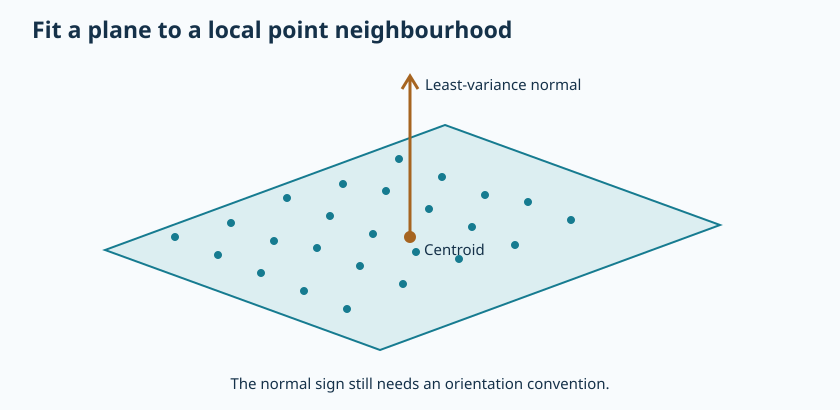
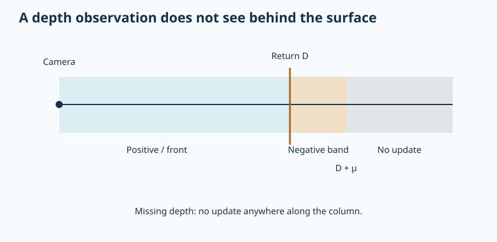
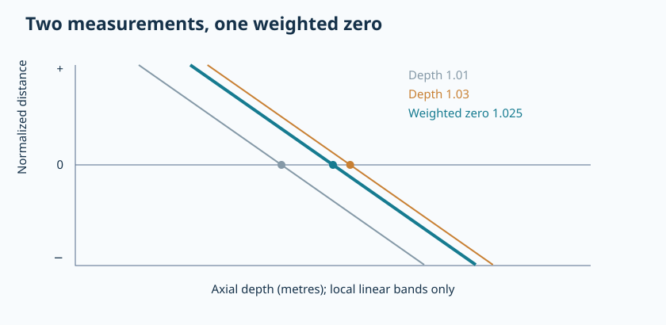
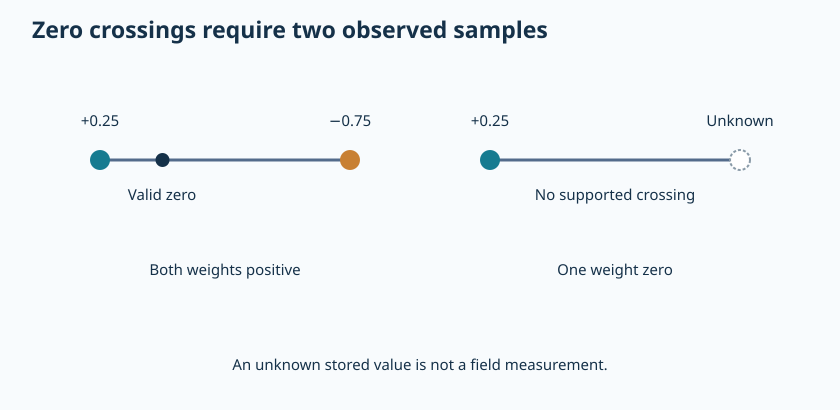
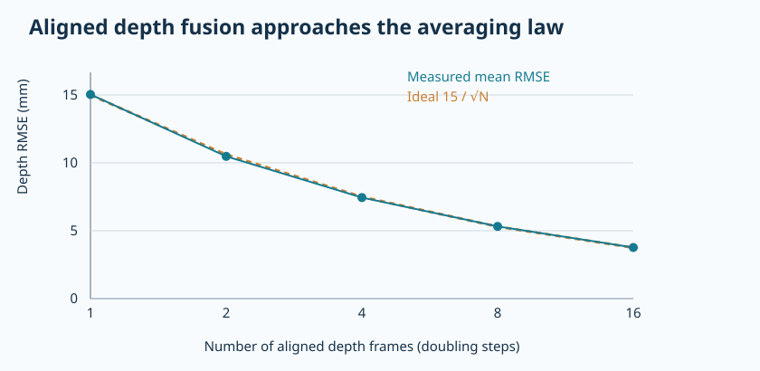

# Chapter 30 — Points Become Surfaces

*From Geometry to Images — Part VI: Images reveal geometry*  
*Reader edition / C++23 laboratory P30*

> A missing observation is a question, not an answer.

## The house made of stars

Imagine the paper house from Chapter 29 has become a constellation. There is a point at the roof tip, another at a window corner, and several scattered along the walls. We can rotate this little cloud and recognize the house. But if we send it to a triangle renderer, there are no walls to draw. We have positions, not connections.

A point cloud is a collection of measurements, potentially with colors, normals, uncertainties and observation identifiers. Its order usually tells us nothing about adjacency. Connecting every point to its nearest neighbour may bridge two sheets of paper separated by a tiny gap. Connecting points that happened to arrive consecutively may join opposite sides of the house.

Surface reconstruction therefore involves inference. It selects a representation, makes assumptions about unmeasured regions, and estimates geometry consistent with the observations. It is possible to produce a beautiful, completely wrong surface. We will learn to distinguish measurements, interpolations and unsupported guesses.

## A small neighbourhood can reveal a direction

Put a ruler across a page. If we know three noncollinear points on the page, their cross product gives its normal. But measured points are noisy, and selecting just three can be unstable. Instead, consider a neighbourhood of N points p_i near a query location.

Calculate their centroid c and covariance matrix:

\[
c=\frac1N\sum_i p_i,\qquad
C=\frac1N\sum_i(p_i-c)(p_i-c)^T .
\tag{30.1}
\]

The covariance has units of squared length. For any unit vector n, the mean squared signed distance to the plane through c with normal n is

\[
\frac1N\sum_i[n^T(p_i-c)]^2=n^TCn.
\tag{30.2}
\]

Minimize this expression subject to n^T n=1. Introducing a Lagrange multiplier gives Cn=lambda n. Because C is symmetric, there is an orthonormal eigenbasis. Expanding n in that basis shows that the minimum is the smallest eigenvalue. Its eigenvector gives a least-squares normal, up to sign.

*Figure 30.1 — The normal minimizes the projected variance, not the variance within the plane.*

In a planar neighbourhood two eigenvalues describe the spread along the surface; the smallest describes the residual thickness. The ratio

\[
v=\frac{\lambda_{\min}}{\lambda_1+\lambda_2+\lambda_3}
\tag{30.3}
\]

is a dimensionless surface-variation statistic. It is sometimes used as a curvature proxy, but it is not the differential-geometric curvature of Chapter 08. It depends on the neighbourhood size, sampling distribution and noise.

For a line, two eigenvalues vanish, so infinitely many planes contain that line. For a spherical isotropic cloud, every normal is equally good. In either case, the eigenvector alone is not reliable evidence of a plane. Our implementation rejects a small gap between the lowest two eigenvalues relative to their total. This is a numerical policy, not a statistical confidence interval.

Read fit_plane() in surface.hpp. It uses symmetric Jacobi rotations to approximately diagonalize the 3-by-3 covariance. Each similarity transform preserves its eigenvalues in exact arithmetic and accumulates the eigenvector transformation. The fixed small sweep budget and relative convergence tolerance serve this bounded teaching problem. A general numerical library should report and test convergence explicitly.

Try the exact plane z=2+0.2x-0.3y. Its normal is proportional to (-0.2,0.3,1). Our 81-point test checks alignment with that normal up to sign and rejects a collinear set. The two possible signs matter: a mesh lighting calculation, a signed implicit field and an inside/outside classification need consistent orientation.

If a single known camera sees the surface, we can choose the sign so that n points towards its camera center. With multiple cameras or a closed object, orient neighbouring normals consistently and use visibility or another global constraint to decide inside versus outside. Merely aligning each normal to its neighbour can propagate a wrong orientation across a thin gap.

Neighbourhood selection is also a model assumption. A tiny radius may contain too few points; a large one smooths sharp corners and can combine opposing surfaces. A k-nearest-neighbour search adapts its physical radius to density, but may grow dangerously large in sparse regions. Report the support size and reject unreliable fits.

## Three ways to give the stars a surface

An explicit triangle mesh stores vertex positions and face connectivity. It is directly useful to the renderer from Chapter 21. For organized depth samples, connect adjacent grid points only when validity and depth-discontinuity tests permit it. For an unorganized cloud, local triangulation, ball-pivoting and related methods make different assumptions about density and neighbourhood geometry. Mesh topology from Chapter 07 remains a separate validation obligation: a visually plausible surface can have inverted faces, nonmanifold edges and disconnected seams.

A parametric surface maps a coordinate pair (u,v) to a point in space. It is attractive for structured smooth patches, but one global parameterization may not describe a complicated shape without seams or singularities.

An implicit surface instead asks where a scalar field F reaches a chosen value:

\[
S=\{x:F(x)=0\}.
\tag{30.4}
\]

For a sphere of radius r centered at c, F(x)=||x-c||-r is its exact signed Euclidean distance, positive outside and negative inside. Its zero level is the sphere. Where the field is differentiable and its gradient does not vanish, the normalized gradient gives a surface normal. A true Euclidean signed distance has gradient magnitude one wherever differentiable away from singularities. A general implicit field need not have that property.

Poisson surface reconstruction uses oriented points to infer a global indicator-like function whose gradient approximates the supplied normal field. It can produce useful closed surfaces, but closure may include regions where no samples were collected. An implicit field is a representation, not a guarantee of correctness.

## Depth maps contain information about empty space

A depth image is not just an unordered cloud. Each valid depth belongs to a known camera ray. In the ideal opaque first-return model, the ray segment in front of that return is evidence of free space; the region behind the observed surface is not measured. A missing depth is not evidence that the whole ray is empty. Transparent materials, multipath and sensor failure can invalidate the ideal model.

For a voxel center X transformed to optical coordinates y=RX+t, project it into the depth map using K. If the depth map stores axial optical Z, let D(u,v) be that depth. A projective signed difference is

\[
s(X)=D(u,v)-y_z.
\tag{30.5}
\]

If the sensor reports Euclidean ray range instead, convert consistently before subtracting. A range is not an axial depth. Moreover, the projective difference generally differs from shortest Euclidean distance to the surface, especially for oblique viewing angles. Do not silently equate them.

A truncated signed distance field, TSDF, stores a bounded value. Choose truncation distance mu>0 in the same units as s. For our policy, if s<-mu, skip the update; otherwise

\[
f(X)=\operatorname{clamp}(s(X)/\mu,-1,1).
\tag{30.6}
\]

This normalized value is dimensionless. Positive values indicate the camera-facing side of the measured return along its ray; negative values just behind it support a local sign change. They do not prove global solid occupancy. Behind the truncation band we have no new observation.

*Figure 30.2 — A missing measurement produces no update. A negative value near a surface is not a license to mark the entire unseen region occupied.*

Our native teaching Volume is a dense regular voxel array with independent registered orthographic columns looking along +Z. Voxel centers are at depths (z+0.5)h, with step h. A depth sample belongs directly to its column; no perspective reprojection or moving-camera registration is implemented. This deliberately isolates fusion arithmetic and visibility policy. A full projective integrator must calculate the correct pixel for every voxel, check the camera's valid domain, and handle depth discontinuities and occlusion.

## Two noisy observations can tell a better story

Store at each voxel a value F and total nonnegative weight W. For a new valid observation f with positive weight w, the weighted least-squares optimum for a scalar is its weighted mean:

\[
F'=\frac{WF+wf}{W+w},\qquad W'=W+w .
\tag{30.7}
\]

The code uses the equivalent incremental form F'=F+(f-F)w/(W+w). An unobserved voxel starts with W=0. Its stored numeric value may be zero, but it has no measured zero crossing. Weight is part of the representation, not optional decoration.

If two depth returns are 1.01 and 1.03 metres, with weights 1 and 3, their weighted mean is 1.025 metres. When both signed-distance samples remain in the linear truncation band and contribute at the crossing, their fused zero is at that mean. Our native test checks this case, front-side clamping and a far-behind unknown cell.

For independent measurements with a common unbiased Gaussian standard deviation sigma, the arithmetic mean of N samples has standard deviation sigma/sqrt(N). Unequal independent variances motivate inverse-variance weights in a simple scalar measurement model. Correlated errors, calibration bias, pose errors and nonlinear truncation change that result. Weight accumulation alone does not certify uncertainty. Inverse-variance weights can also become misleading if the variance model is wrong.

A common real-time engineering policy caps accumulated weight to allow later measurements to influence an old estimate. Depending on the update rule, this changes history dependence and no longer implements an exact unrestricted weighted average. Our lab instead rejects overflow of its explicit weight budget; it does not provide transactional rollback if an integration fails partway through. Use only the bounded fixture domain.

*Figure 30.3 — When contributions remain linear near the crossing, their weighted mean has a correspondingly averaged zero.*

## Find the zero without inventing a triangle

Suppose two adjacent observed voxel centers at depths z_a and z_b store F_a>0 and F_b<0. Linearly interpolate the field along the edge. The zero occurs at

\[
z_0=z_a+(z_b-z_a)\frac{F_a}{F_a-F_b}.
\tag{30.8}
\]

For z_a=1.02, z_b=1.04, F_a=0.25 and F_b=-0.75, the crossing is 1.025 metres. Both endpoints need valid support. Interpolating a measured value with the default zero of an unknown voxel would create a fictitious surface. If both endpoint values are zero, the interpolation cannot locate a unique crossing.

The lab returns the first positive-to-negative crossing along each column. It does not build a mesh. A general isosurface extractor examines a three-dimensional grid. Marching Cubes classifies the signs at eight cell corners, interpolates crossings on grid edges, and constructs triangles using a case scheme. Ambiguous face and interior configurations require a consistent resolution policy; a simplistic table can create cracks or change topology. Marching tetrahedra splits the cell into tetrahedra using a consistent scheme, trading simplicity for different geometry and more triangles. Chapter 09 introduces procedural isosurfaces; here the values originate from measurements with missing support.

*Figure 30.4 — The valid edge has a linearly interpolated zero. Unknown endpoints must not be treated as measured zeroes.*

An extraction system should reuse vertices at shared edges, validate winding and normals, and keep unsupported regions identifiable. Filling a hole may be desirable in a manufacturing workflow. In scientific reconstruction it must be recorded as a separate inference step, not passed off as measured geometry.

## How much memory does space need?

A cubic grid with n samples along each axis uses n cubed cells. Two 32-bit floats per cell, one value and one weight, require about 128 MiB at 256 cubed and 1 GiB at 512 cubed, before metadata. Halving the voxel width for a fixed physical volume multiplies the cell count by eight. The native lab uses doubles instead, a nominal 16 bytes for its two fields on conventional platforms (check sizeof(Cell) on your implementation).

Sparse block grids and hashed voxel blocks allocate storage only for relevant regions, preserving local dense access. Octrees provide hierarchical spatial subdivision. Each brings its own indexing, boundary, scheduling and memory-management contracts. Sparse storage does not automatically provide a correct surface or efficient traversal. It also does not mean unallocated space is free space.

A hybrid representation can maintain point evidence, a volumetric field and a mesh as complementary views of the same scene. If geometry changes, a system needs explicit ownership of authoritative measurements and invalidation rules for derived surfaces. More representations do not automatically create more information.

## Our surface workshop

The studio creates a 16-by-16 depth image of a sloping plane with depth d=0.8+0.01x+0.005y metres. Each trial uses 219 valid columns and 37 permanently missing columns. For valid columns, inject independent Gaussian depth noise with sigma=0.015 metres and integrate one, two, four, eight or sixteen frames into a 16-by-16-by-100 dense volume. The depth spacing is 0.02 metres and truncation distance is 0.12 metres. We extract a crossing per observed column and compare it with the exact generating depth.

Twenty trials per frame count give 100 trial summaries and 21,900 reconstructed column crossings in total. The average of per-trial depth RMSE values is:

| Frames | First measurement RMSE (mm) | Fused RMSE (mm) | Ideal sigma/sqrt(N) (mm) |
|---:|---:|---:|---:|
| 1 | 15.041 | 15.041 | 15.000 |
| 2 | 15.103 | 10.481 | 10.607 |
| 4 | 15.086 | 7.445 | 7.500 |
| 8 | 14.848 | 5.319 | 5.303 |
| 16 | 14.973 | 3.766 | 3.750 |

*Figure 30.5 — Means of twenty trials at each frame count. The ideal curve is a population standard deviation, not an exact prediction of finite-sample mean RMSE.*

The result is close to the expected independent-noise reduction in this aligned planar fixture. It is not evidence that adding sixteen real frames always improves a reconstruction by four times. Errors in camera poses may smear a surface, correlated depth errors may persist, and a moving object may generate ghost surfaces. The missing columns were never integrated; the missing-depth unit test checks that an untouched column cannot generate a crossing.

Run the workshop:

~~~text
book03_surface_tests
book03_surface fusion.csv
~~~

The studio reports separate observed and missing column counts, not a fabricated error of zero for the missing regions. A separate Python check confirms the counts, finite errors, grouped means and one-frame equality. It does not independently reproduce the random measurements. Real-sensor validation, moving perspective fusion and mesh extraction remain future extensions.

## A depth value must pass through a camera before entering a volume

Our aligned-depth teaching experiment uses rays parallel to the volume axis. That makes the fusion geometry easy to inspect. To use a perspective camera, we must make the coordinate transformation explicit for every voxel or ray sample. A depth image is not a world-space array.

Let a voxel center be X in the world. Convert it to optical coordinates Y=RX+t=(x,y,z). Reject nonpositive z and project the remaining point with the calibrated camera. A measured axial depth D(u,v) describes the positive optical Z coordinate of the observed surface at that image address. In a simple projective TSDF, the signed axial difference is

\[
s=D(u,v)-z,\qquad \phi=\operatorname{clamp}(s/\mu,-1,1),
\]

where mu is a positive axial truncation distance. Positive s means the voxel is in front of the measured surface; negative s means it lies behind it. A common policy skips voxels sufficiently far behind the observation rather than treating them as measured free space. Interpolation of D across an occlusion boundary needs care, because averaging foreground and background depths can create a surface that was never observed.

**Worked example.** Suppose f_x=f_y=100 pixels and the principal point is (50,50). A voxel at optical coordinate (0.4,0.2,2) metres projects to (70,60). At that address an axial depth image reports 2.05 m. With mu=0.1 m, the normalized projective value is +0.5. Another voxel along the same ray at z=2.15 m is behind the measured depth by 0.10 m, giving -1 at the truncation boundary. The actual Euclidean distance along this oblique ray is larger than the axial difference by a factor sqrt(1+0.2²+0.1²), approximately 1.0247. Mixing ray range and axial depth without conversion would give a systematic geometric error.

A projective TSDF is also not generally a Euclidean signed distance to the nearest surface. At a grazing incidence the axial difference can be much larger than the perpendicular distance to the surface. The zero crossing can still represent the measured surface under the chosen model, but the numerical field away from the zero has a specific meaning.

### A bounded projective update

Here is a standalone scalar update for an already projected voxel. It assumes a valid depth observation, compatible axial units, a positive finite truncation distance and bounded weights. It avoids manufacturing observations behind the truncation band and represents unobserved cells with weight zero.

~~~cpp
#include <algorithm>
#include <cmath>
#include <stdexcept>

struct FusionCell {
    double phi = 0.0;
    double weight = 0.0; // Zero means no observation.
};

bool integrate(FusionCell& cell, double depth, double z,
               double mu, double observation_weight) {
    if (!std::isfinite(depth) || !std::isfinite(z)
        || !std::isfinite(mu) || !std::isfinite(observation_weight)
        || depth <= 0 || z <= 0 || mu <= 0
        || observation_weight <= 0)
        return false;
    if (!std::isfinite(cell.weight) || cell.weight < 0
        || !std::isfinite(cell.phi)
        || std::abs(cell.phi) > 1)
        throw std::invalid_argument("invalid fusion cell");
    const double s = depth - z;
    if (s < -mu) return false;
    const double observed = std::clamp(s / mu, -1.0, 1.0);
    const double total = cell.weight + observation_weight;
    if (!std::isfinite(total)) return false;
    // Convex combination avoids large weight-times-field products.
    cell.phi += (observation_weight / total)
              * (observed - cell.phi);
    cell.weight = total;
    return true;
}
~~~

This does not select voxels, sample a depth image, calibrate a camera or synchronize threads. The existing P30 aligned-depth implementation remains the native reference. The fragment shows the per-cell arithmetic an extended perspective adapter could reuse with a carefully specified domain.

If two valid observations have normalized values +0.4 and -0.2 with weights one and three, the accumulated value is -0.05 and total weight four. Reversing the order gives the same result in exact arithmetic. Repeated floating-point updates need not be bitwise identical. Introducing a maximum stored weight or temporal decay changes the estimator and can make order matter even in exact arithmetic. Do not claim ordinary weighted-average equivalence after adding a policy that deliberately forgets old observations.

## A sparse volume saves memory only by changing its representation

A dense 512³ grid contains 134,217,728 cells. Two four-byte fields per cell require exactly one GiB before padding, additional attributes or indexing. Much of a large scene may contain no observed surface. A block-sparse structure allocates small dense bricks only where needed, associating each brick with an integer block coordinate.

For an 8³ brick, each block has 512 cells, or 4096 bytes at eight bytes per cell. Ten thousand allocated bricks require about 39.1 MiB for cell payload, plus hash-table, metadata, alignment and allocator overhead. This is a storage calculation, not a measured memory benchmark. A sparse structure can lose its advantage if nearly every block is allocated or if its metadata and random access dominate.

Negative voxel coordinates require floor division rather than truncating signed division. A global voxel index of -1 in a block width of eight belongs to block -1 with local index 7, not block zero with local index -1. The identity global=block*8+local, with local between zero and seven, is an excellent test of the indexing policy. Use it on both sides of zero and near the supported integer limits.

Trilinear interpolation at a block boundary can access eight cells belonging to several different blocks. An unallocated block is unknown unless a separate free-space representation establishes otherwise. Treating an absent block as zero can create false surfaces. A normal estimated from central differences requires neighbouring support too. Sparse allocation and extraction share a boundary contract.

## Extracting a mesh is a second inference

An isosurface algorithm examines field values at cell corners and locates edge crossings. Along an edge with values phi_0 and phi_1 of opposite sign, linear interpolation places the zero at fraction phi_0/(phi_0-phi_1) measured from the first endpoint. If phi_0=0.3 and phi_1=-0.1, the fraction is 0.75. The interpolation gives a position within the edge, but it does not supply a complete triangulation policy.

A square face with alternating positive and negative corner signs admits two possible pairings of its four crossings. If adjacent cubes independently choose different pairings on their shared face, a crack or inconsistent connectivity can result. The chosen interpolation model and tie-breaking rule must agree across cells. Similar ambiguity exists inside three-dimensional cells. A lookup table is a representation of a topology decision, not proof that every sampled field has been reconstructed correctly.

Normals can be estimated from the gradient of the scalar field. Near a regular zero surface, the gradient is perpendicular to the level set. Its magnitude is not necessarily one in a projective or truncated field, so normalize only when a finite nonzero gradient is supported. The orientation depends on the sign convention; our positive-in-front policy makes the gradient point toward increasing field values.

## Evaluate supported surfaces and missing surfaces separately

A reconstructed mesh may have a small nearest-neighbour error simply because it omitted difficult regions. Use a known reference surface sampled by a declared area distribution. Measure accuracy from reconstructed samples to reference, and completeness from reference samples to reconstruction. A symmetric average is helpful but can hide asymmetry; report both directions and a threshold-dependent fraction.

For a tiny example, suppose the reference has points at 0, 1 and 2 on a line, and the reconstruction has 0 and 1. The mean nearest-reference distance from reconstruction is zero. The reverse mean is one third. A claim of perfect reconstruction from the first score alone would be wrong. In three dimensions, compare sampled surface geometry rather than relying solely on mesh vertex density, which can bias the result toward heavily tessellated regions.

**Research exercise.** Build a perspective-depth simulator for two perpendicular walls, a thin object and an unobserved region. Fuse known registered views, then introduce depth bias, pose errors and missing observations separately. Compare dense and sparse storage using the same voxel and update policy. Verify matching field values where both are supported, extraction consistency across block boundaries, accuracy and completeness, memory and total runtime. P30's measured native results concern the aligned orthographic TSDF and plane normals; this larger perspective/sparse system is a proposed extension, not an existing benchmark result.

### Guided workshop: follow a surface through fusion and extraction

Use an axial grid of samples at depths 0.9, 1.0, 1.1 and 1.2 metres. Two registered ideal observations report depths 1.02 and 1.06 metres, with weights one and three respectively, and truncation distance mu=0.1 m. Calculate each observation's field separately before fusing.

At 0.9 m both signed differences exceed the positive truncation limit, so both normalized observations are +1 and the fused value is +1. At 1.0 m the individual values are +0.2 and +0.6, giving weighted mean +0.5. At 1.1 m the individual values are -0.8 and -0.4, giving weighted mean -0.5. At 1.2 m both measurements lie more than 0.1 m in front of the voxel, so under the declared skip-behind policy neither contributes; the cell is unknown with weight zero.

The supported sign change is between 1.0 and 1.1 m. Linear edge interpolation places it at 1.05 m, agreeing with the weighted observed depth (1.02+3*1.06)/4. The unknown 1.2 m sample is not a second measured zero. If a naive implementation initializes its field to zero and ignores its weight, an extractor may invent a surface in the unobserved region. This is a useful regression test because the visible output might otherwise look plausible.

Next repeat the update with the order of the observations reversed. The weighted mean in the common linear band is the same in exact arithmetic. Compare weights as well as values. If a finite weight cap is applied, state exactly when the old weight is clipped and how the update uses it. For instance, repeatedly integrating new values after a capped history no longer corresponds to the same uncapped arithmetic mean. A change in estimator semantics must be visible in the evidence.

Extend the grid to two adjacent 8-voxel blocks. Put a sign change between the last local sample of one block and the first local sample of the next. Extract the crossing once using a global edge identity. If each block owns a separate copy of that crossing, the positions may coincide yet the indexed mesh may be disconnected. Chapter 07's topology tests become directly relevant. Verify the shared edge, the supported weights, the crossing coordinate and the mesh's connectedness separately.

For a perspective extension, generate depth observations from a fronto-parallel plane at a known optical depth. Project voxel centers to image addresses using the correct camera frame and reject invalid rays. Compare the projective TSDF zero against the analytic plane, not merely against another implementation using the same potentially wrong depth conversion. Repeat with a tilted plane and with an oblique camera. Report the difference between projective axial distance and perpendicular Euclidean distance away from the zero.

Finally remove one region of depth observations and introduce a fixed positive bias in another. Measure supported surface accuracy, completeness and unknown volume fraction. A renderer that fills holes can produce an attractive image while inventing geometry. Use the P30 aligned-depth reference to verify the core arithmetic; the perspective, sparse and mesh-extraction experiments require their own implementation and acceptance evidence.

## Exercises — measure the gaps as well as the surface

**Reconstruct 30A.** Derive the least-squares plane objective and its eigenvector solution. Explain the two-dimensional normal ambiguity of a collinear cloud.

**Reconstruct 30B.** Derive the normalized variation statistic and explain why changing metres to centimetres leaves the ratio unchanged.

**Falsify 30C.** Generate two close parallel sheets. Increase the neighbourhood radius until both are included and inspect the fitted plane and variation.

**Reconstruct 30D.** Compute the weighted TSDF crossing for depths 1.01 and 1.03 with weights one and three. Find a case where clipping invalidates a direct weighted-depth interpretation.

**Falsify 30E.** Remove one endpoint of a sign-changing edge. Explain why assigning its missing value to zero creates false evidence.

**Transfer 30F.** Add a common 10 mm bias to every depth frame. Predict how the noise variance and bias of the average change with frame count. Compare with the CSV experiment.

**Transfer 30G.** Design a perspective voxel projection adapter using Chapter 13. List its units, visibility, out-of-image, missing-depth and registration checks.

**Explain 30H.** Describe the difference between a measured point cloud, a fused field, a derived mesh and a filled hole to a child and then to a research reviewer.

### Selected answers and experiment criteria

**30A–B.** Squared plane distance for unit n is n^T C n; constrain n^T n=1 to obtain the minimum eigenvector. A collinear set has two unconstrained normal directions in its perpendicular plane. Scaling coordinates by 100 multiplies every covariance eigenvalue by 10,000, leaving the variation ratio unchanged.

**30C–E.** Two nearby sheets can create a fitted midplane with little evidence of an actual surface there. The weighted crossing in the linear common band is (1.01+3*1.03)/4=1.025 metres. As a counterexample, with mu=0.1 and depths 1 and 1.4 at equal weights, the latter contributes a saturated positive value near the first surface, while the former is skipped sufficiently far behind it. A single global weighted-depth average is no longer the field's zero. An unknown endpoint must not participate merely because its stored value happens to be zero.

**30F.** A common 0.010 m bias is not removed by averaging independent noise. Under the simple unclipped linear model the expected squared error is 0.010^2+0.015^2/N square metres. At sixteen frames the population RMS is about 10.68 mm, not the unbiased 3.75 mm.

**30G–H.** The adapter must transform each world voxel into a positive-depth optical frame, project it within the declared sensor bounds and use a valid, compatible depth measurement. Track confidence separately from the field value. A derived mesh interpolates the field; filling unsupported holes introduces a further modeling assumption.

## Further reading

Brian Curless and Marc Levoy, [A Volumetric Method for Building Complex Models from Range Images](https://visionsystems.stanford.edu/papers/volrange/), SIGGRAPH 1996, develops volumetric range integration. William Lorensen and Harvey Cline, *Marching Cubes: A High Resolution 3D Surface Construction Algorithm*, SIGGRAPH 1987, DOI 10.1145/37402.37422, develops grid isosurface extraction. The native aligned-depth experiment is independently authored and is deliberately narrower than either complete system.

## Give the house a studio

We have moved from coordinates to images, from images to measurements, and from measurements back to geometry. Now the pieces need a common language. Chapter 31 will define the boundaries between mesh, camera, renderer and reconstruction modules and build an inspectable studio instead of another isolated equation.
