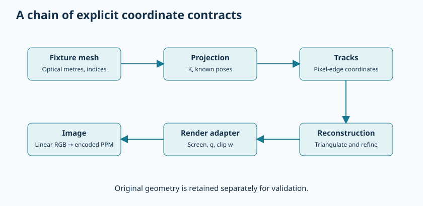
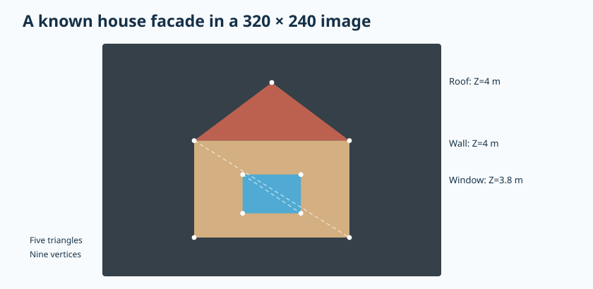
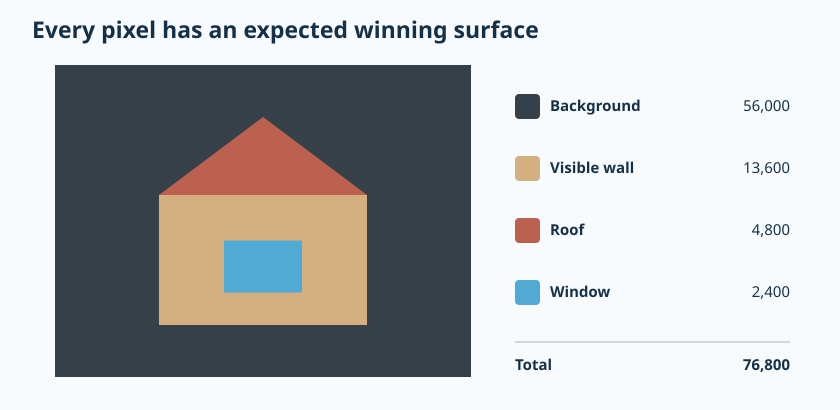
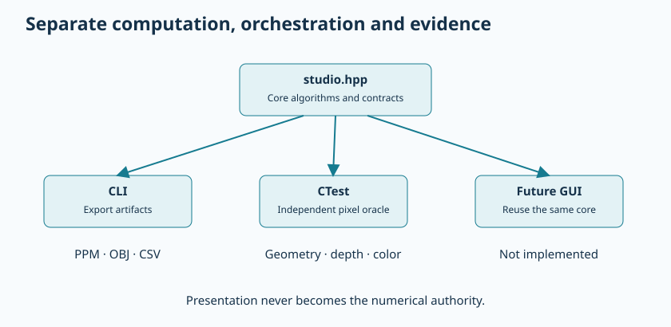

# Chapter 31 — A Studio for Geometry and Images

*From Geometry to Images — Part VII: Building something we can trust*  
*Reader edition / C++23 laboratory P31*

> A collection of clever tools becomes a useful machine when each tool understands exactly what the next one expects.

## Bring the little house home

We began with a point on a piece of paper. We gave it neighbours, formed triangles, lifted the triangles into three dimensions, placed cameras around them and learned to turn their projections into pixels. We then reversed the direction: from measured pixels, we estimated camera relationships and reconstructed points.

Thirty chapters later, the desk is covered in little machines. Each does something useful, but there are wires everywhere. A camera returns a depth that the renderer cannot interpret directly. A reconstructed point can be a metre away or one arbitrary baseline unit away. A three-number color might be linear light or an encoded display value. Two components can compile together and still disagree about what the numbers mean.

This chapter builds a small Geometry-to-Image Studio. It does not need a beautiful graphical interface to deserve that name. It needs to take a repeatable scene, pass data through compatible algorithms, export intermediate results, and let another person discover whether the final image is correct.

The house we reconstruct is a controlled facade: a rectangular wall, triangular roof and nearer rectangular window. It is intentionally not a watertight building or a photogrammetry dataset. Its simple geometry allows us to predict the result independently before running the renderer. We will use known camera poses, exact synthetic observations, supplied triangle topology and a fixed output view. The small scale of the problem makes the entire chain inspectable.

## Begin with the contract, not the interface

A software module should have a contract: what it consumes, what it produces, what assumptions are required, and what failure means. The same C++ type is not proof of the same semantics.

The studio uses optical coordinates with +X right, +Y down and +Z forward. Coordinates are in metres because the synthetic camera translations are known in metres. Image coordinates are continuous distances from the top-left image edge. Pixel index (i,j) names a sample centered at (i+0.5,j+0.5). An indexed mesh owns a list of positions and triangle index triplets. A track contains measured image coordinates and camera identities; it does not own a separate three-dimensional position for each observation.

The renderer's input is already divided screen geometry. It retains clip w for perspective-correct attribute interpolation and consumes normalized device depth q, not optical depth Z. Its internal diagnostic colors are linear RGB. The PPM exporter applies the sRGB transfer once, at the final boundary. The numeric image bytes are display-encoded; the PPM container itself does not carry a rich color-management profile.

*Figure 31.1 — Each arrow crosses a typed conceptual boundary. The reconstruction module receives tracks, not the original vertex positions; the fixture retains the original separately for error evaluation.*

A richer implementation would use distinct wrapper types for quantities such as OpticalDepthMetres, NormalizedDepth, LinearRGB and EncodedRGB. The teaching modules use arrays and doubles in several places; our adapter and documentation carry the semantic checks. A unit-aware type system can catch mistakes at compile time, but not every physical assumption can be encoded in a type.

For example, a projection can be finite and still wrong because its camera transform was inverted. An RGB triplet can be in the unit interval but still use the wrong color space. A well-typed mesh can still be nonmanifold. Types, runtime checks and independent oracles complement each other.

## Give the scene a name and a coordinate system

The synthetic camera has width 320 and height 240 pixels. Its focal scales are 160 pixels and its principal point is (160,120). The intrinsic matrix is

\[
K=\begin{bmatrix}160&0&160\\0&160&120\\0&0&1\end{bmatrix}.
\]

The first camera defines the world coordinate system. The second camera center is displaced 0.4 metres along +X, and the third 0.3 metres along +Y. All three share the identity optical orientation, so the world-to-camera translations are respectively (0,0,0), (-0.4,0,0) and (0,-0.3,0). Remember the negative sign from Chapter 13: the camera moves right, but its coordinates of a fixed object move left.

The fixture chooses continuous screen landmarks in the first camera and known optical depths, then constructs their three-dimensional positions with

\[
X=(u-c_x)Z/f_x,\qquad Y=(v-c_y)Z/f_y .
\tag{31.1}
\]

The wall has corners (80,100), (240,100), (240,200), (80,200) at Z=4. The roof peak is (160,40), also at Z=4. The window corners are (130,135), (190,135), (190,175), (130,175) at Z=3.8. Nine vertices and five triangles describe the fixture. The nearer window deliberately overlaps the wall in the first view. The mesh is open, and its roof is a facade triangle, not a three-dimensional pitched roof.

*Figure 31.2 — Continuous pixel-edge coordinates define the synthetic reference. The window is closer than the wall, so visibility must select it in the overlap.*

Constructing a test fixture this way gives us a powerful oracle. We know the exact screen boundaries, the original 3D points and the camera geometry. We are not relying on an artist's visual opinion to decide whether the output is correct.

## Forward once, inverse once

Use the Chapter 29 projection function to produce three exact observations for each landmark. The resulting 27 observations are grouped into nine tracks. We deliberately supply the associations: the studio does not detect features in actual photographs and does not estimate the camera poses from these tracks.

The reconstruction stage receives each track, the calibrated poses and inverse intrinsics. It calls the existing multiview triangulator, followed by fixed-pose pixel refinement. The returned point positions become a new mesh, using the known original connectivity and color assignments.

This is a useful integration test because it exercises genuine numerical reconstruction while isolating other uncertainties. If we also estimated the camera poses, inferred correspondences and guessed surface connectivity, a wrong final image would be much harder to diagnose. Add those unknowns in separate experiments before claiming full reconstruction.

For a check independent of the multiview least-squares solver, use the first two aligned cameras. A point at Z=4 has corrected disparity

\[
d=f_xB/Z=160(0.4)/4=16\text{ pixels}.
\tag{31.2}
\]

Therefore Z=64/d=4 metres. The window at Z=3.8 produces a disparity of about 16.8421 pixels. This formula is not the implemented reconstruction algorithm; it is an independent simpler witness for the particular fixture. The third camera supplies another observation to the actual solver.

Use the recovered wall corners to fit a local plane with Chapter 30's PCA routine. The smallest-variance normal should align with the optical Z axis up to sign. This checks a geometric property independently of the image. The studio does not feed the perspective tracks into Chapter 30's orthographic TSDF integrator. Their coordinate and measurement contracts differ; forcing them together without an adapter would be a bug.

## The depth adapter is not a depth copy

The renderer expects normalized device depth q in [0,1]. We have optical depth Z in metres. Choose near plane n=1 metre and far plane f=10 metres, with forward-depth ordering. As derived in Chapter 14, the appropriate mapping is

\[
q(Z)=\frac{f}{f-n}\left(1-\frac{n}{Z}\right).
\tag{31.3}
\]

Check the endpoints: q(n)=0, q(f)=1. At the wall's four metres, q=5/6. At the window's 3.8 metres, q is approximately 0.818713. The smaller value belongs to the nearer window, so the depth buffer chooses it.

Copying Z directly into q would fail the renderer's range contract. Simply normalizing linearly between near and far would produce a different interpolation model for triangles with varying depth. The perspective depth mapping is chosen so that divided depth is linear in screen barycentric coordinates for projected triangles.

Our adapter also retains w=Z and maps the projected point into the renderer's continuous screen coordinates. It checks every vertex for finite coordinates and for membership within the supported near/far and image-edge bounds before drawing. Since the frustum is convex and the fixture uses ordinary triangles wholly inside it, no primitive crosses a clipping plane. The adapter rejects such unsupported inputs instead of pretending to clip them. Chapter 17 contains the general clipping machinery, and Chapter 21's front-end integration remains a separate verification obligation.

The adapter validates indices before drawing faces. It is not a general mesh-validation engine: a valid index is only a necessary condition, and a legitimate repeated position can still represent a degenerate triangle. The native fixture contains no degenerate triangle.

## Make the renderer answer a question

The renderer draws five triangles with flat diagnostic linear colors. The wall's two triangles share a surface ID, as do the window's two triangles. These are semantic surface IDs, not globally unique primitive identifiers. The roof has its own ID. Depth storage is binary64 with the lower-ID tie policy and forward ordering.

We render the original mesh, the reconstructed mesh, and the reconstructed mesh again in reverse face submission order. For the fixture, all three images must have identical winning surface IDs, depths within the declared tolerance, and identical flat linear colors.

A simple analytical oracle checks every pixel center (u,v):

- The wall covers 80<=u<240 and 100<=v<200.
- The roof covers 40<=v<100 and |u-160|<(v-40)4/3 for this fixture's sample grid; no pixel center lands exactly on a sloped boundary.
- The window covers 130<=u<190 and 135<=v<175 and wins because it is nearer.

This oracle uses rectangle inequalities and a triangular span equation. It does not call the renderer's edge-function rasterizer. The two triangles forming each rectangle must cover it without a crack. A depth failure must not overwrite the visible color. By reversing submission order, we test that visibility is not accidentally replaced by painter's ordering.

*Figure 31.3 — All 76,800 sample centers have independently predicted surface membership. The nearer window takes 2,400 samples from the wall.*

The expected counts are 56,000 background, 13,600 visible wall, 4,800 roof and 2,400 window pixels. They sum to the image area, 76,800. Each of the three native render passes agrees with the oracle, for 230,400 pixel-pass checks. The test checks the depth at occupied samples separately, and compares the linear color at every sample. The reference and reconstructed PPM files are byte-for-byte identical.

The fixture deliberately keeps surfaces at constant axial depth. It tests the module boundary, screen coverage, depth ordering and encoding; it is not a new comprehensive test of perspective-correct texture interpolation or general clipping. Those need their own fixtures.

## Give the studio a front door

Separate computational libraries from the interface. The header studio.hpp defines the fixture, projection adapter, reconstruction, rendering and OBJ serialization. The command-line executable studio_main.cpp orchestrates those operations and writes files. The separate test executable studio_tests.cpp verifies the pipeline without depending on a graphical event loop.

A graphical interface could later call the same core operations in response to buttons, camera changes or imported files. It would need resource ownership, cancellation, failure states and a policy for stale results. The core reconstruction should not read a text field directly, and the window should not implement its own matrix inversion. This separation also lets automated tests exercise the core without a display server.

Run the integrated studio after building the new targets:

~~~text
book03_studio_tests
book03_studio new-output-directory
~~~

The output directory must not exist. The CLI creates it and refuses to overwrite an existing one. If writing fails after creation, it reports an error; this teaching CLI is not a transactional multi-file writer, so partial output may remain. A production application can write into a temporary directory, verify every artifact, and publish the completed set atomically when the filesystem permits.

The output contains five files:

| File | Meaning |
|---|---|
| reference.ppm | Render of the known generating geometry |
| reconstructed.ppm | Render after multiview point recovery |
| reconstructed.obj | Recovered vertex positions and supplied face indices |
| tracks.csv | Landmark ID, camera ID and observed pixel coordinates |
| metrics.csv | Vertex, face and observation counts; maximum 3D error and pixel RMS |

An OBJ file uses one-based indices, so internal zero-based index i becomes i+1 on export. Our exporter documents the optical frame and metre units in a comment. OBJ does not inherently enforce that convention; an external viewer may choose another up axis or scale. The export contains no materials, normals or texture coordinates, so another renderer should not be expected to reproduce our diagnostic colors from this geometry-only file.

The CSV tracks are sufficient for independently checking the observations with the fixed camera definitions in the source. A general interchange format should also serialize intrinsics, poses, calibration provenance, units, observation uncertainties and schema version. Otherwise, the file can survive while its meaning disappears.

*Figure 31.4 — The core can be used by a CLI or a future GUI. Verification uses an independent oracle, and exports keep geometry and evidence inspectable.*

## What we actually measured

The standalone C++23 laboratory and studio compiled with strict warnings and undefined-behavior sanitization. Exact hashes of the seven reused repository headers and three new source files were checked against their committed Git blob identities.

The recovered nine vertices had maximum Euclidean 3D error 5.376277206893598e-15 metres. The pixel RMS per observation was 1.9780672612164173e-14 pixels. These extremely small values reflect double-precision arithmetic on an exact synthetic fixture, not accuracy of a physical camera.

A separate Python verifier read the exported PPM, OBJ and CSV. It predicted all 76,800 RGB pixels using the analytical regions and the sRGB transfer formula; every pixel agreed. It checked the nine vertices and five one-based face triplets. From the first two camera observations, the independent aligned-stereo equation gave a maximum difference of approximately 5.0e-15 metres relative to the reconstructed OBJ positions. The independently evaluated projection RMS was approximately 1.39e-14 pixels. Small differences from the C++ residual are expected from different arithmetic order.

This is an integration milestone, not a claim that all earlier CTests have been executed together. The full cumulative project still needs a complete build, test and publication audit. A true end-to-end photograph-to-mesh pipeline would need feature extraction, robust matching, view registration, inferred topology, camera uncertainty and real-data evaluation.

## Exercises — extend the studio without breaking its promises

**Reconstruct 31A.** Calculate the generating wall and window positions with equation 31.1. Verify the disparity witness in equation 31.2.

**Reconstruct 31B.** Derive the forward depth mapping from its near/far endpoint conditions. Calculate the two surface depths and explain which wins.

**Falsify 31C.** Change the camera translation sign in a reconstruction observation model. Compare pixel residual, recovered depth and visible image. Explain why a sign convention is more than a stylistic choice.

**Falsify 31D.** Deliberately swap two mesh indices, or move a point across the near plane. Record whether the adapter detects the failure and which checks are still missing.

**Transfer 31E.** Add controlled noise to the tracks, preserving the exact reference. Measure both 3D error and pixel error. Compare image hashes, but do not use byte equality as the only metric for noisy scenes.

**Transfer 31F.** Add a JSON or text camera manifest containing resolution, coordinate convention, K, poses and units. Round-trip the manifest and verify projections against the original.

**Explain 31G.** Draw the module graph and identify the authoritative data at each stage. Explain why an edited camera invalidates a derived image and why changing a display encoding does not change the reconstructed geometry.

**Challenge 31H.** Implement a new GUI or PLY importer without changing the core numerical algorithms. Define failure states, resource ownership, and separate the measurement, reconstruction and presentation stages.

## One final question

We have brought together an entire journey from geometry to images and back again. The temptation is to look at the picture of the house, smile, and declare success.

But what if the same picture could have been produced by two wrong algorithms whose errors canceled? What if an optimized renderer is faster only because it omitted a difficult case? What if an excellent average hides a catastrophic failure at one boundary?

Chapter 32 is not another technique for drawing. It is the chapter that teaches us how to trust the techniques we have already built.
