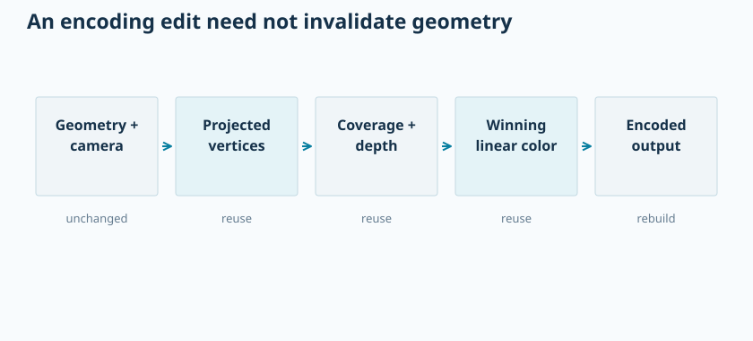
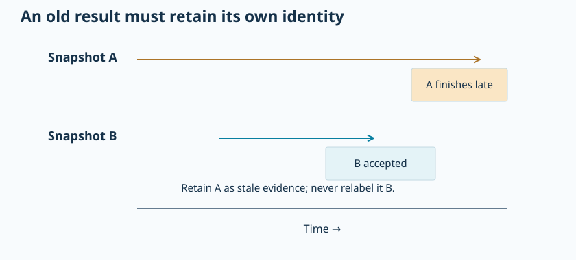

# Chapter 31 — A Studio for Geometry and Images

*From Geometry to Images — Part VII: Building something we can trust*  
*Reader edition / C++23 laboratory P31*

> A collection of clever tools becomes a useful machine when each tool understands exactly what the next one expects.

## Bring the little house home

We began with a point on a piece of paper. We gave it neighbours, formed triangles, lifted the triangles into three dimensions, placed cameras around them and learned to turn their projections into pixels. We then reversed the direction: from measured pixels, we estimated camera relationships and reconstructed points.

Thirty chapters later, the desk is covered in little machines. Each does something useful, but there are wires everywhere. A camera returns a depth that the renderer cannot interpret directly. A reconstructed point can be a metre away or one arbitrary baseline unit away. A three-number color might be linear light or an encoded display value. Two components can compile together and still disagree about what the numbers mean.

This chapter builds a small Geometry-to-Image Studio. It does not need a beautiful graphical interface to deserve that name. It needs to take a repeatable scene, pass data through compatible algorithms, export intermediate results, and let another person discover whether the final image is correct.

The house we reconstruct is a controlled facade: a rectangular wall, triangular roof and nearer rectangular window. It is intentionally not a watertight building or a photogrammetry dataset. Its simple geometry allows us to predict the result independently before running the renderer. We will use known camera poses, exact synthetic observations, supplied triangle topology and a fixed output view. The small scale of the problem makes the entire chain inspectable.

## Begin with the contract, not the interface

A software module should have a contract: what it consumes, what it produces, what assumptions are required, and what failure means. The same C++ type is not proof of the same semantics.

The studio uses optical coordinates with +X right, +Y down and +Z forward. Coordinates are in metres because the synthetic camera translations are known in metres. Image coordinates are continuous distances from the top-left image edge. Pixel index (i,j) names a sample centered at (i+0.5,j+0.5). An indexed mesh owns a list of positions and triangle index triplets. A track contains measured image coordinates and camera identities; it does not own a separate three-dimensional position for each observation.

The renderer's input is already divided screen geometry. It retains clip w for perspective-correct attribute interpolation and consumes normalized device depth q, not optical depth Z. Its internal diagnostic colors are linear RGB. The PPM exporter applies the sRGB transfer once, at the final boundary. The numeric image bytes are display-encoded; the PPM container itself does not carry a rich color-management profile.

*Figure 31.1 — Each arrow crosses a typed conceptual boundary. The reconstruction module receives tracks, not the original vertex positions; the fixture retains the original separately for error evaluation.*

A richer implementation would use distinct wrapper types for quantities such as OpticalDepthMetres, NormalizedDepth, LinearRGB and EncodedRGB. The teaching modules use arrays and doubles in several places; our adapter and documentation carry the semantic checks. A unit-aware type system can catch mistakes at compile time, but not every physical assumption can be encoded in a type.

For example, a projection can be finite and still wrong because its camera transform was inverted. An RGB triplet can be in the unit interval but still use the wrong color space. A well-typed mesh can still be nonmanifold. Types, runtime checks and independent oracles complement each other.

## Give the scene a name and a coordinate system

The synthetic camera has width 320 and height 240 pixels. Its focal scales are 160 pixels and its principal point is (160,120). The intrinsic matrix is

\[
K=\begin{bmatrix}160&0&160\\0&160&120\\0&0&1\end{bmatrix}.
\]

The first camera defines the world coordinate system. The second camera center is displaced 0.4 metres along +X, and the third 0.3 metres along +Y. All three share the identity optical orientation, so the world-to-camera translations are respectively (0,0,0), (-0.4,0,0) and (0,-0.3,0). Remember the negative sign from Chapter 13: the camera moves right, but its coordinates of a fixed object move left.

The fixture chooses continuous screen landmarks in the first camera and known optical depths, then constructs their three-dimensional positions with

\[
X=(u-c_x)Z/f_x,\qquad Y=(v-c_y)Z/f_y .
\tag{31.1}
\]

The wall has corners (80,100), (240,100), (240,200), (80,200) at Z=4. The roof peak is (160,40), also at Z=4. The window corners are (130,135), (190,135), (190,175), (130,175) at Z=3.8. Nine vertices and five triangles describe the fixture. The nearer window deliberately overlaps the wall in the first view. The mesh is open, and its roof is a facade triangle, not a three-dimensional pitched roof.

*Figure 31.2 — Continuous pixel-edge coordinates define the synthetic reference. The window is closer than the wall, so visibility must select it in the overlap.*

Constructing a test fixture this way gives us a powerful oracle. We know the exact screen boundaries, the original 3D points and the camera geometry. We are not relying on an artist's visual opinion to decide whether the output is correct.

## Forward once, inverse once

Use the Chapter 29 projection function to produce three exact observations for each landmark. The resulting 27 observations are grouped into nine tracks. We deliberately supply the associations: the studio does not detect features in actual photographs and does not estimate the camera poses from these tracks.

The reconstruction stage receives each track, the calibrated poses and inverse intrinsics. It calls the existing multiview triangulator, followed by fixed-pose pixel refinement. The returned point positions become a new mesh, using the known original connectivity and color assignments.

This is a useful integration test because it exercises genuine numerical reconstruction while isolating other uncertainties. If we also estimated the camera poses, inferred correspondences and guessed surface connectivity, a wrong final image would be much harder to diagnose. Add those unknowns in separate experiments before claiming full reconstruction.

For a check independent of the multiview least-squares solver, use the first two aligned cameras. A point at Z=4 has corrected disparity

\[
d=f_xB/Z=160(0.4)/4=16\text{ pixels}.
\tag{31.2}
\]

Therefore Z=64/d=4 metres. The window at Z=3.8 produces a disparity of about 16.8421 pixels. This formula is not the implemented reconstruction algorithm; it is an independent simpler witness for the particular fixture. The third camera supplies another observation to the actual solver.

Use the recovered wall corners to fit a local plane with Chapter 30's PCA routine. The smallest-variance normal should align with the optical Z axis up to sign. This checks a geometric property independently of the image. The studio does not feed the perspective tracks into Chapter 30's orthographic TSDF integrator. Their coordinate and measurement contracts differ; forcing them together without an adapter would be a bug.

## The depth adapter is not a depth copy

The renderer expects normalized device depth q in [0,1]. We have optical depth Z in metres. Choose near plane n=1 metre and far plane f=10 metres, with forward-depth ordering. As derived in Chapter 14, the appropriate mapping is

\[
q(Z)=\frac{f}{f-n}\left(1-\frac{n}{Z}\right).
\tag{31.3}
\]

Check the endpoints: q(n)=0, q(f)=1. At the wall's four metres, q=5/6. At the window's 3.8 metres, q is approximately 0.818713. The smaller value belongs to the nearer window, so the depth buffer chooses it.

Copying Z directly into q would fail the renderer's range contract. Simply normalizing linearly between near and far would produce a different interpolation model for triangles with varying depth. The perspective depth mapping is chosen so that divided depth is linear in screen barycentric coordinates for projected triangles.

Our adapter also retains w=Z and maps the projected point into the renderer's continuous screen coordinates. It checks every vertex for finite coordinates and for membership within the supported near/far and image-edge bounds before drawing. Since the frustum is convex and the fixture uses ordinary triangles wholly inside it, no primitive crosses a clipping plane. The adapter rejects such unsupported inputs instead of pretending to clip them. Chapter 17 contains the general clipping machinery, and Chapter 21's front-end integration remains a separate verification obligation.

The adapter validates indices before drawing faces. It is not a general mesh-validation engine: a valid index is only a necessary condition, and a legitimate repeated position can still represent a degenerate triangle. The native fixture contains no degenerate triangle.

## Make the renderer answer a question

The renderer draws five triangles with flat diagnostic linear colors. The wall's two triangles share a surface ID, as do the window's two triangles. These are semantic surface IDs, not globally unique primitive identifiers. The roof has its own ID. Depth storage is binary64 with the lower-ID tie policy and forward ordering.

We render the original mesh, the reconstructed mesh, and the reconstructed mesh again in reverse face submission order. For the fixture, all three images must have identical winning surface IDs, depths within the declared tolerance, and identical flat linear colors.

A simple analytical oracle checks every pixel center (u,v):

- The wall covers 80<=u<240 and 100<=v<200.
- The roof covers 40<=v<100 and |u-160|<(v-40)4/3 for this fixture's sample grid; no pixel center lands exactly on a sloped boundary.
- The window covers 130<=u<190 and 135<=v<175 and wins because it is nearer.

This oracle uses rectangle inequalities and a triangular span equation. It does not call the renderer's edge-function rasterizer. The two triangles forming each rectangle must cover it without a crack. A depth failure must not overwrite the visible color. By reversing submission order, we test that visibility is not accidentally replaced by painter's ordering.

*Figure 31.3 — All 76,800 sample centers have independently predicted surface membership. The nearer window takes 2,400 samples from the wall.*

The expected counts are 56,000 background, 13,600 visible wall, 4,800 roof and 2,400 window pixels. They sum to the image area, 76,800. Each of the three native render passes agrees with the oracle, for 230,400 pixel-pass checks. The test checks the depth at occupied samples separately, and compares the linear color at every sample. The reference and reconstructed PPM files are byte-for-byte identical.

The fixture deliberately keeps surfaces at constant axial depth. It tests the module boundary, screen coverage, depth ordering and encoding; it is not a new comprehensive test of perspective-correct texture interpolation or general clipping. Those need their own fixtures.

## The world's biggest coordinate can hide its smallest movement

The studio uses a little house four metres in front of its camera. What happens when a city simulator places the same house at a world coordinate near one hundred million metres? In exact mathematics, translating camera and geometry together preserves the relative displacement. In finite arithmetic the order in which we convert and subtract matters.

Consider world X = 100000000.125 and camera X = 100000000. Both can be represented exactly in binary64. Binary32 has 24 bits of significand precision; in the interval from 2^26 to 2^27 the spacing between adjacent values is 2^(26-23)=8. Converting each absolute position to binary32 first rounds both to the same value. Subtraction then gives zero instead of 0.125 metres. Computing the difference in binary64 first gives exactly 0.125, also exactly representable in binary32.

~~~cpp
// C++23, assuming IEEE binary32 and binary64, round-to-nearest.
const double world = 100000000.125;
const double camera = 100000000.0;
const float lost = static_cast<float>(world) -
                   static_cast<float>(camera);
const float preserved = static_cast<float>(world - camera);
// lost == 0; preserved == 0.125f
~~~

With a camera-to-world proper rotation R, the optical displacement is R^T(p_W-c_W). Calculate the relative displacement while sufficient precision remains, then rotate and convert according to the renderer's numerical contract. Converting an already rounded absolute position back to double cannot restore lost bits. Neither can replacing only the final matrix multiplication with double arithmetic.

An origin rebase changes the coordinate representation of the world and must keep geometry, camera states and any previous-frame transforms consistent. Camera-relative rendering can instead leave authoritative world coordinates intact and form a local representation for rendering. These are not interchangeable implementation policies. Motion vectors, cached acceleration structures and temporal histories need explicit invalidation or coordinate conversion when the reference origin changes.

**Try it.** At 4 metres optical depth and 160-pixel focal scale, a 0.125-metre transverse difference produces a 5-pixel shift. Losing it in an absolute coordinate conversion can erase a visibly measurable displacement even though the projection and rasterizer themselves are correct. This is a separate arithmetic witness, not an extension of the P31 house experiment to a large-world renderer.

*Source route: Computing Foundations/36, derived lines 1982–2100, with the wider origin-rebasing and temporal-history material routed in the Pass 34 source map.*

## Give the studio a front door

Separate computational libraries from the interface. The header studio.hpp defines the fixture, projection adapter, reconstruction, rendering and OBJ serialization. The command-line executable studio_main.cpp orchestrates those operations and writes files. The separate test executable studio_tests.cpp verifies the pipeline without depending on a graphical event loop.

A graphical interface could later call the same core operations in response to buttons, camera changes or imported files. It would need resource ownership, cancellation, failure states and a policy for stale results. The core reconstruction should not read a text field directly, and the window should not implement its own matrix inversion. This separation also lets automated tests exercise the core without a display server.

Run the integrated studio after building the new targets:

~~~text
book03_studio_tests
book03_studio new-output-directory
~~~

The output directory must not exist. The CLI creates it and refuses to overwrite an existing one. If writing fails after creation, it reports an error; this teaching CLI is not a transactional multi-file writer, so partial output may remain. A production application can write into a temporary directory, verify every artifact, and publish the completed set atomically when the filesystem permits.

The output contains five files:

| File | Meaning |
|---|---|
| reference.ppm | Render of the known generating geometry |
| reconstructed.ppm | Render after multiview point recovery |
| reconstructed.obj | Recovered vertex positions and supplied face indices |
| tracks.csv | Landmark ID, camera ID and observed pixel coordinates |
| metrics.csv | Vertex, face and observation counts; maximum 3D error and pixel RMS |

An OBJ file uses one-based indices, so internal zero-based index i becomes i+1 on export. Our exporter documents the optical frame and metre units in a comment. OBJ does not inherently enforce that convention; an external viewer may choose another up axis or scale. The export contains no materials, normals or texture coordinates, so another renderer should not be expected to reproduce our diagnostic colors from this geometry-only file.

The CSV tracks are sufficient for independently checking the observations with the fixed camera definitions in the source. A general interchange format should also serialize intrinsics, poses, calibration provenance, units, observation uncertainties and schema version. Otherwise, the file can survive while its meaning disappears.

*Figure 31.4 — The core can be used by a CLI or a future GUI. Verification uses an independent oracle, and exports keep geometry and evidence inspectable.*

## What we actually measured

The standalone C++23 laboratory and studio compiled with strict warnings and undefined-behavior sanitization. Exact hashes of the seven reused repository headers and three new source files were checked against their committed Git blob identities.

The recovered nine vertices had maximum Euclidean 3D error 5.376277206893598e-15 metres. The pixel RMS per observation was 1.9780672612164173e-14 pixels. These extremely small values reflect double-precision arithmetic on an exact synthetic fixture, not accuracy of a physical camera.

A separate Python verifier read the exported PPM, OBJ and CSV. It predicted all 76,800 RGB pixels using the analytical regions and the sRGB transfer formula; every pixel agreed. It checked the nine vertices and five one-based face triplets. From the first two camera observations, the independent aligned-stereo equation gave a maximum difference of approximately 5.0e-15 metres relative to the reconstructed OBJ positions. The independently evaluated projection RMS was approximately 1.39e-14 pixels. Small differences from the C++ residual are expected from different arithmetic order.

This is an integration milestone, not a claim that all earlier CTests have been executed together. The full cumulative project still needs a complete build, test and publication audit. A true end-to-end photograph-to-mesh pipeline would need feature extraction, robust matching, view registration, inferred topology, camera uncertainty and real-data evaluation.

## A studio needs a coordinate contract that survives file boundaries

Our small house fixture works because every module knows what its numbers mean. A larger studio accepts imported geometry, camera records, images and reconstruction results from different tools. Each file may have its own unit, frame, coordinate origin and axis convention. A beautiful interface cannot repair an ambiguous data model.

For each asset, record a stable asset identity, revision, local frame, unit scale, vertex layout and topology policy. For each instance, record its world transform and the asset revision it references. For each camera, record the world-to-optical transform, intrinsics, image dimensions, continuous pixel-coordinate convention, distortion model, depth definition, valid domain and time if the scene is moving. An image should identify its color encoding and its parent camera/frame. A reconstructed cloud should name the observations, calibration revision, coordinate gauge and units used by the solver.

A format may store a camera-to-world transform instead of world-to-camera. The inverse of a proper rigid transform Y=RX+t is X=R^T Y-R^T t. The camera center is -R^T t. A camera with R=I and t=(-0.4,0,0) has center (0.4,0,0), not (-0.4,0,0). The scene fixture uses exactly this sort of distinction to derive disparity. A serializer that switches the convention without changing the stored numbers can make the rendered view look plausible while moving the reconstructed point to the wrong side of the world.

**Worked example.** An imported mesh describes a vertex at (1000,0,0) in millimetres. Its local-to-world transform in a metre-based scene translates by (2,0,0) metres. Convert the local coordinates first, obtaining (1,0,0) metres, then apply the transform to obtain (3,0,0). Translating before unit conversion would give 1.002 metres if the translation's numeric value two were mistakenly interpreted as millimetres. The error is not caused by matrix multiplication; the operands were never in a compatible unit system.

### Give a snapshot a stable meaning

A small API can distinguish assets, camera calibration and results by typed identities. The following example describes a possible interface, not the P31 native header. It illustrates how a result can name the exact inputs it consumed.

~~~cpp
#include <cstdint>
#include <string>

struct AssetRevision {
    std::string content_sha256;
};
struct CameraRevision {
    std::string calibration_sha256;
};
struct FrameKey {
    std::uint64_t frame_id;
    AssetRevision geometry;
    CameraRevision camera;
    std::string renderer_policy_sha256;
};
struct OutputRecord {
    FrameKey inputs;
    std::string image_sha256;
    std::string depth_sha256;
    std::string ids_sha256;
};
~~~

A content hash is useful for integrity and reproducibility, but it is not a proof of correctness. Two wrong implementations can generate identical bytes; a change in compression or metadata may alter the hash without changing the decoded image. Use semantic tests and hashes for different questions. A result must be associated with a completed immutable snapshot, not with whichever scene happens to be visible when an asynchronous task finishes.

## Let dependencies decide which work needs rebuilding

Consider four derived records: projected vertices, raster coverage, shaded linear color and encoded output. Projected vertices depend on geometry, world transforms and camera. Coverage depends on projection and raster policy. Shading and visibility depend on covered geometry, attributes, depth and material policy. Encoding depends on the winning linear colors and display transfer.

Change only the output transfer curve. Geometry and coverage should remain valid; the encoded image needs rebuilding. Move the camera. Projection, coverage, depth and image become stale. Change a mesh's UVs without changing positions or topology. Coverage may remain valid, but interpolation and shading must be recomputed. A dependency graph clarifies these cases, and enables independent verification of incremental caching.

A safe cache key includes every dependency affecting the result. A camera identity alone is insufficient if the camera calibration can change while retaining the same name. A path alone is insufficient if the file contents change. If a render depends on sample pattern or color transfer, those choices must be included too. A cache hit is a claim that the previous computation answers the same question; a missing key component makes that claim false.

Test incremental rebuilds against a full rebuild after each edit. For a controlled deterministic scene, compare the actual arrays, not just whether an image was generated. Record which stages reran, which were reused and whether the dependency graph predicted that reuse. The cost of invalidating too much is additional computation. The cost of invalidating too little is a stale result that may be difficult to notice.

*Figure 31.5 — A chain from geometry and camera to projection, coverage, linear color and encoding shows the dependencies. A transfer-only change invalidates only the final encoded output.*

## Separate interaction from numerical computation

A user can drag a camera while reconstruction runs. The interface wants a responsive preview; the solver wants a stable set of inputs. If it reads mutable camera parameters while iterating, different residuals may correspond to different camera states. The resulting objective no longer describes a single mathematical problem.

Use immutable snapshots for numerical work, even if the user interface is mutable. A task receives the geometry, calibration, configuration and frame identity. A completed task publishes its result only with that same identity. If the current view has moved on, the interface may show an explicitly stale preview, discard the result, or store it for later comparison. It should never silently label the old computation as the new camera's measurement.

A cancel request is a scheduling instruction, not proof that an operation has completed. A worker can check a stop flag at safe boundaries. Files should be written to a temporary output and validated before publication; a half-written image or point cloud should not replace the last complete result. Keep the original input intact when an operation fails.

For a single-machine teaching studio, an event log can record an edit, the revision it created, the job that consumed it, and the output that was accepted. This is often more informative than a screenshot of the final UI. To test asynchronous behaviour, deliberately delay an old computation, submit a newer snapshot and force the old result to arrive last. Verify that it cannot overwrite the new result without being explicitly identified as stale.

## Build a complete diagnostic view

A geometry-to-image studio is especially useful when it can display the information that a normal renderer hides. Show the world mesh, camera frusta, projected landmarks, sample coverage, surface IDs, depth values, reprojection vectors and reconstructed points. Every view should identify its coordinate frame and units. An overlay of two cameras should not silently transform one cloud into the other's frame just because it looks better.

Use a known synthetic house first. Make one deliberately wrong adapter at a time: transpose the world-to-camera rotation, use range as axial depth, change the principal point by half a pixel, flip the Y axis, or encode linear colors incorrectly. Predict which diagnostic view changes first. Restore the correct adapter and confirm that the independent fixture agrees again.

Then add a reproducible scene manifest with the camera and mesh identities, image dimensions, near/far convention and output hashes. An importer should validate a manifest before executing numerical work, and an exporter should record enough information to reproduce the result. Version the schema so that a future change does not silently reinterpret an old file.

**Research exercise.** Build an extension around the P31 native studio with a small command-driven scene editor. Implement immutable snapshots and a dependency cache, then compare every incremental output against the full reference rebuild. Add deliberate stale-task and invalid-input cases. Export evidence containing the input revision, output hashes, numerical residuals and stage timing. The existing P31 fixture remains a controlled CPU studio with known topology and cameras; a full interactive GUI and asynchronous renderer are future engineering work. The book's contract tells us how to approach them without weakening the mathematics.

*Figure 31.6 — Snapshot A starts first, snapshot B starts later and finishes first. The late A result cannot overwrite B as if it were the current camera state.*

### Guided workshop: prove that an incremental build is the same calculation

Start with the exact P31 house, not an imported complex model. Record the three known camera poses, the fixed intrinsics and the source mesh identity. Run the native studio once and preserve its reference image, reconstructed image, mesh and metrics. The experiment is easier to understand when the independent projections and disparity relations from the chapter can explain the scene.

Design a dependency table for geometry, camera, projected vertices, coverage/depth, linear color and encoded image. Each derived item has a key made from the identities of the inputs that actually affect its calculation. Use an immutable camera revision and a stable geometry revision, rather than a mutable name such as the current camera. A changed file at the same path must produce a different content identity.

Perform four edits in isolation, restoring the original scene between edits. First, change only the display transfer. Projection, coverage, depth and linear color should stay unchanged. Second, change the flat wall color. The depth and surface-ID arrays should stay unchanged while the winning wall color and encoded image change. Third, move one camera without moving the world. All camera-dependent projection and visibility records must be invalidated. Fourth, edit the mesh's vertex positions. Every dependent camera projection and reconstruction comparison may need recomputation, according to which inputs actually reference that mesh.

For each edit run a full rebuild as the independent baseline for the incremental path. A comparison table should show which keys changed, which stages were rerun, which outputs were reused, and whether the numerical arrays agreed. For a deterministic fixture, compare exact ID and encoded image arrays where the contract promises equality. For floating-point projection and reconstruction quantities, use the existing declared tolerance. An image hash can establish exact byte equality, but a mismatch should lead to a stage-specific numerical comparison rather than automatic failure diagnosis.

Now simulate a delayed task. Create snapshot A, begin a computation and deliberately delay its publication. Change the camera to create snapshot B, compute B's result and publish it. Then let A arrive. The UI state must not be silently replaced by an old result labeled as B. Check frame identity and input revision before accepting a result. A stale result may still be useful as a comparison if clearly stored as A.

Test invalid input as well. Supply a camera with a nonpositive focal scale or a mesh containing an invalid index, depending on the actual native adapter's supported validation. The previously accepted scene and its output files should remain available. A failed edit should not leave the studio in a partly updated state. This is why the transaction boundary matters as much as the numerical algorithm.

Use the native P31 fixture as a known working reference for the existing render/reconstruct path. The incremental scheduler, caching and stale-result experiment are separate extensions, with no performance result claimed yet. The outcome of this workshop should be a small, inspectable scene-processing system whose correctness can be tested independently of its visual interface.

## Exercises — extend the studio without breaking its promises

**Reconstruct 31A.** Calculate the generating wall and window positions with equation 31.1. Verify the disparity witness in equation 31.2.

**Reconstruct 31B.** Derive the forward depth mapping from its near/far endpoint conditions. Calculate the two surface depths and explain which wins.

**Falsify 31C.** Change the camera translation sign in a reconstruction observation model. Compare pixel residual, recovered depth and visible image. Explain why a sign convention is more than a stylistic choice.

**Falsify 31D.** Deliberately swap two mesh indices, or move a point across the near plane. Record whether the adapter detects the failure and which checks are still missing.

**Transfer 31E.** Add controlled noise to the tracks, preserving the exact reference. Measure both 3D error and pixel error. Compare image hashes, but do not use byte equality as the only metric for noisy scenes.

**Transfer 31F.** Add a JSON or text camera manifest containing resolution, coordinate convention, K, poses and units. Round-trip the manifest and verify projections against the original.

**Explain 31G.** Draw the module graph and identify the authoritative data at each stage. Explain why an edited camera invalidates a derived image and why changing a display encoding does not change the reconstructed geometry.

**Challenge 31H.** Implement a new GUI or PLY importer without changing the core numerical algorithms. Define failure states, resource ownership, and separate the measurement, reconstruction and presentation stages.

### Selected answers and experiment criteria

**31A–B.** The wall's top-left point is (-2,-0.5,4) m; the window's top-left point is (-0.7125,0.35625,3.8) m. The respective disparities are 16 and about 16.842105 pixels. With q=a+b/Z, q(1)=0 and q(10)=1 give a=10/9 and b=-10/9. The wall's q=5/6; the window's q=140/171 (approximately 0.818713) wins in forward depth.

**31C–D.** A sign-flipped baseline is inconsistent with the original disparity under the positive-depth model; do not silently accept negative-depth triangulations. An out-of-frustum point is rejected by the adapter. A swap of two valid indices is not necessarily detected: index bounds are not a winding or topology certificate.

**31E–F.** Keep the original noiseless geometry and camera parameters as the reference. Report geometric errors and pixel residuals together; exact image hashes are appropriate for the noiseless fixture, not a complete metric for noisy experiments. Include a schema version, unit and frame declarations in a camera manifest and verify independently projected sample positions after round-tripping.

**31G–H.** Derived images depend on camera, geometry, shading, visibility and encoding. A changed camera invalidates projections; changing display encoding alone does not move reconstructed points. A GUI or importer should call the core and surface its errors without acquiring numerical authority over it.

## One final question

We have brought together an entire journey from geometry to images and back again. The temptation is to look at the picture of the house, smile, and declare success.

But what if the same picture could have been produced by two wrong algorithms whose errors canceled? What if an optimized renderer is faster only because it omitted a difficult case? What if an excellent average hides a catastrophic failure at one boundary?

Chapter 32 is not another technique for drawing. It is the chapter that teaches us how to trust the techniques we have already built.
