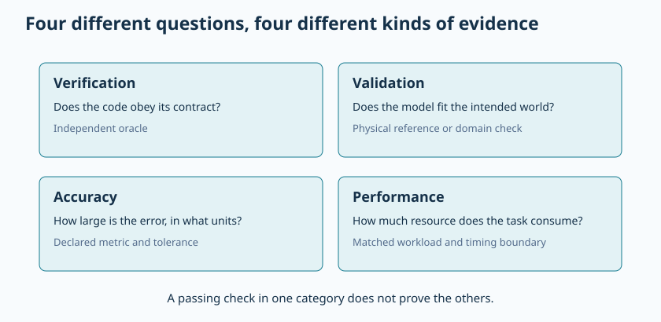
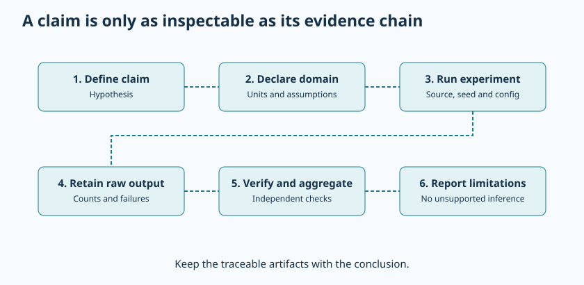

# Chapter 32 — If It Looks Right, Is It Right?

*From Geometry to Images — Part VII: Building something we can trust*  
*Reader edition / C++23 laboratory P32*

> A beautiful picture is a wonderful reason to keep investigating. It is not a measurement of whether we were right.

## The house that lied without telling a lie

Our little paper house is back on the desk. The studio from Chapter 31 has projected its vertices into three cameras, recovered their positions and drawn the same image as the original scene. We could print the image, write a triumphant caption underneath and call the job finished.

Now imagine that someone has secretly changed the camera calibration. The second and third cameras are reported as twice as far from the first camera as they really were. The photographs are unchanged. The reconstruction algorithm trusts the reported translations.

What happens? The house becomes twice as large and twice as far away. Its pictures look exactly the same.

There is no rendering mistake. There is no algebraic contradiction. There is a mistake in what we believe the numbers mean. A computer cannot recover information that its measurements never contained, and a scientist cannot establish accuracy by measuring only something that remains unchanged under the mistake.

This is why the final chapter is not another rendering algorithm. It is a laboratory for deciding what the algorithms have actually established.

## The four questions behind a result

Verification asks whether the implementation obeys its specified mathematical or software contract. Validation asks whether the chosen model and assumptions represent the phenomenon of interest sufficiently well for the intended use. Numerical accuracy concerns the differences between computed and reference quantities. Performance concerns the resources consumed for a particular workload and environment.

These questions overlap, but they are not interchangeable. A perfect implementation of an ideal pinhole camera will not capture every optical phenomenon of a real lens. A fast renderer that drops triangles may be numerically consistent on the triangles it draws and still fail the task. A scientifically validated method can contain a software defect. A result that is reproducible may reproduce the same error.

*Figure 32.1 — Correct implementation, suitable model, numerical error and resource cost require separate evidence.*

A useful claim names its domain. For example, Chapter 31 establishes exact coverage agreement for a controlled facade, in a declared pixel-coordinate system and three particular render passes. It does not establish exact coverage for every scene or validate a real camera. This smaller claim can be tested, defended and extended.

## A friend who calculates differently

An oracle is a way of deciding what the expected answer should be. It can be a closed-form result, an exact arithmetic predicate, an independently written reference implementation, a calibrated physical measurement or a carefully defined test fixture. Each has limits.

In Chapter 05, the exact binary64 orientation predicate evaluates the sign of the determinant of the stored coordinates. It does not recover the original real numbers lost during measurement or rounding. Chapter 18 uses integer edge functions after a specified subpixel snap. The coverage decision can be exact for that snapped grid even though the snapping changes the input geometry.

Chapter 31 uses rectangle inequalities and an analytical triangular span to predict winning pixels independently of the renderer's edge functions. It uses a separate disparity equation to check the reconstructed 3D positions. A second implementation that copies the first one's bug is not automatically an independent oracle; a different derivation and separate input path are valuable.

When an algorithm returns a matrix, compare invariant quantities as well as coefficients. A projective matrix can be multiplied by a nonzero scalar without changing its geometric predictions. A rotation represented by q and -q as unit quaternions is the same physical rotation. A mesh can be reordered without changing its surface. An oracle must respect the representation's equivalence classes.

## The test without a known answer

Sometimes we do not have a reference result for every possible input. We can still know how the answer should change when the input changes. This is metamorphic testing.

Translate all points and the camera centers by the same vector: if the orientations stay fixed and the transforms are converted consistently, the image should stay unchanged. Reorder the drawing of opaque triangles with distinct depths: visibility should not depend on submission order. Reverse the sign of a quaternion: its rotation stays the same. Rescale a scene and all camera translations together: ideal perspective measurements stay the same.

For optical world-to-camera coordinates,

\[
y_j=R_jX+t_j .
\]

If a positive factor k multiplies X and t_j, the resulting optical vector is ky_j. The perspective divide cancels that factor:

\[
\pi(Kk y_j)=\pi(Ky_j).
\tag{32.1}
\]

The P32 native test deliberately changes the assumed translations by factors of 0.5 and 2, leaving the measured pixels fixed. It triangulates the nine facade landmarks using the changed assumptions, checks that the resulting positions are respectively half and twice the original positions, and renders the new geometry. Both encoded PPM images match the original byte-for-byte. The maximum error relative to the expected scaled positions is 4.79633e-13 metres.

*Figure 32.2 — A global positive scale preserves perspective directions. The metric scale must come from independent evidence; equality of these images cannot establish it.*

Do not confuse this with a renderer invariant that applies to arbitrary scenes. Our diagnostic facade has flat colors, no physical light attenuation, and all the scaled vertices remain within the same near and far bounds. Metric depth and normalized depth values change, even though the winning colors do not. A renderer with distance-dependent fog or lighting might produce different colors after scaling.

A deliberately wrong calibration is useful here because we know how the error should propagate. This is not a failure of the triangulator: it correctly solves the wrong physical problem. If we had hidden the original metric positions, the image could not expose the mistake.

## Tolerance is a statement about a quantity

Floating-point comparisons should identify the quantity, its units and expected error scale. For two finite scalar results a and b, a useful mixed tolerance rule is

\[
|a-b|\le \tau_a+\tau_r\max(|a|,|b|).
\tag{32.2}
\]

Absolute tolerance tau_a carries the units of the quantity. Relative tolerance tau_r is dimensionless. Near zero the absolute term prevents an arbitrarily small denominator from dominating the decision. At large magnitudes the relative term allows a proportionate numerical error.

Neither tolerance should be selected just because it makes a failing test green. Use an error analysis, representation precision, a reference uncertainty or a task requirement to choose it before looking at the result. Compare signed orientation and index validity exactly when the contract makes them discrete; a tolerance on an invalid index is meaningless.

The native capstone uses an absolute 1e-10 metre tolerance for the small-scale synthetic reconstruction invariant, and separately compares the projection Jacobian against a centered finite difference with step h=1e-5 metres. For a coordinate direction e_i,

\[
J_i\approx \frac{\pi(X+h e_i)-\pi(X-h e_i)}{2h}.
\tag{32.3}
\]

For sufficiently smooth projection the truncation error is of order h squared, while subtractive rounding errors can grow as h becomes tiny. The best step depends on scale and conditioning. Our bounded nine-point test measured maximum component difference 2.08502e-9 pixels per metre, within the declared 1e-7 threshold. This tests the analytical derivative in the chosen fixture, not every skew, orientation or near-singular configuration.

A failed numerical check may reveal a bug, a weak problem, a reference mistake or a tolerance that was not justified. Investigate which. Do not round away the difference and declare success.

## A smaller residual can conceal a worse world

Consider two identical aligned cameras with focal scale f=800 pixels. The scene points lie at Z=4 metres. The corrected horizontal disparity is

\[
d=fB/Z .
\]

B is the camera baseline in metres. With independent coordinate errors of standard deviation sigma pixels in both images, the disparity error has standard deviation sqrt(2) sigma. Differentiating Z=fB/d gives

\[
\sigma_Z\approx \frac{Z^2}{fB}\sqrt{2}\sigma.
\tag{32.4}
\]

This is a first-order approximation under the rectified, known-calibration and independent-noise assumptions. It is not a confidence bound for disparity approaching zero or for wrong correspondences. The reciprocal mapping can introduce skew and bias in the recovered depth.

Now look at the image-space fitting objective. In the ideal rectified pair, the two horizontal observations can be fit exactly by selecting X and Z when disparity is positive. The two vertical observations must share one predicted vertical coordinate. With equal independent noise, the least-squares prediction is their mean. If the measured vertical difference is Delta v, the sum of the two squared vertical residuals is (Delta v)^2/2. The squared RMS per observation is consequently (Delta v)^2/4. Its population root-mean-square value is sigma/sqrt(2), independent of B.

This is an analytical explanation of why similar image-space residuals can accompany radically different depth errors. They measure different aspects of the same problem.

## The final capstone experiment

We keep the focal scale, scene depth and noise distribution fixed. We vary one factor: the stereo baseline. The baseline choices are 0.05, 0.10, 0.20, 0.40 and 0.80 metres. Each trial generates 200 scene points at four metres, with X and Y sampled uniformly from [-1,1] metres. Each point receives four independent standard-normal draws, scaled by sigma=0.25 pixels for the two coordinates in each view.

The exact same points and noise draws are reused at each baseline within the trial. This pairing helps isolate the effect of baseline rather than comparing unrelated random samples. There are twenty independent trial groups generated from the seeded pseudorandom stream, producing one hundred trial-baseline summaries, 20,000 attempted point reconstructions and 40,000 camera-point observations. The implementation calls the Chapter 29 triangulation and point-refinement functions without changing them.

The model counts rejected results separately. The summary uses zero-initialized numerical fields when no point is accepted, so such a row's error fields are undefined, not perfect zero errors. Inspect the accepted count before interpreting the metrics. In the observed sweep all 20,000 points were accepted. An independent unit test rejects identical zero-baseline rays. The experiment is not a validation of all degenerate configurations.

For N accepted landmarks define depth RMSE as the root mean square of Z error, and position RMSE as the root mean square of Euclidean 3D error:

\[
e_Z=\sqrt{\frac1N\sum_i(\hat Z_i-Z_i)^2},\qquad
e_X=\sqrt{\frac1N\sum_i\|\hat X_i-X_i\|^2}.
\tag{32.5}
\]

Both are in metres. Pixel RMS is the root mean square of the Euclidean pixel residual across the 2N observations. Do not average per-coordinate RMS and call it per-observation RMS. Report the aggregation explicitly: our table uses the arithmetic mean of twenty per-trial RMS values, not the pooled RMS over all 4,000 points at a baseline.

| Baseline (m) | Mean depth RMSE (mm) | Mean 3D RMSE (mm) | Mean reprojection RMS (px) | Predicted depth sigma (mm) |
|---:|---:|---:|---:|---:|
| 0.05 | 143.505 | 146.381 | 0.177192 | 141.421 |
| 0.10 | 71.417 | 72.854 | 0.177192 | 70.711 |
| 0.20 | 35.663 | 36.401 | 0.177192 | 35.355 |
| 0.40 | 17.825 | 18.240 | 0.177192 | 17.678 |
| 0.80 | 8.911 | 9.214 | 0.177192 | 8.839 |

*Figure 32.3 — Twenty paired trial groups, 200 points per baseline per group. The dotted prediction is a first-order population standard deviation. The two panels use different units.*

The depth RMSE improved by roughly sixteen times between the smallest and largest baseline. The pixel residual did not reveal that improvement. The first-order prediction is close to the measured depth error in this particular noise regime, with a slightly larger deviation at the smallest baseline. This is consistent with increased nonlinearity of the inverse disparity map, but the experiment does not isolate all sources of the finite-sample difference.

A larger real baseline is not always preferable. It can reduce overlap, increase occlusion and make correspondence harder. We held the associations correct and the camera intrinsics and poses exact. Our result is a controlled geometric sensitivity result, not a universal camera design recommendation.

## Performance is an experiment, too

Suppose we optimize the triangulator by changing its linear solver, adding SIMD or moving the work to a GPU. A timing comparison must use the same input, output contract and accuracy requirements. Dropping rejected points, using a looser precision policy, omitting allocation costs or comparing a warmed optimized build with a cold debug build can produce an impressive but misleading speedup.

Define the measurement boundary. Kernel time, frame time and end-to-end time answer different questions. GPU submission may return before work has finished, so synchronize appropriately when measuring completed work. On a CPU, compiler optimization, thermal state, frequency, thread scheduling and caches can influence timing.

Use warmup, repeated paired trials, a stable workload and a declared aggregation. For paired positive times t_ref and t_new, report per-case ratios t_ref/t_new; a geometric mean is useful for a multiplicative summary, but also show the individual cases and total elapsed time. A geometric mean speedup is not necessarily the total-runtime speedup. A workload with many easy cases can conceal the few cases that consume most runtime.

If you measure latency, report a distribution or relevant quantiles, not only a mean. If you change an accuracy threshold, show the accuracy-performance tradeoff rather than pretending the workload is identical. For a research result, separate tuning data from the held-out evaluation and record all exclusions.

The P32 sweep deliberately does not report performance results. It was compiled with sanitization for correctness checks, and no controlled timing protocol was executed. A future optimized version needs its own release-mode performance evaluation against the same numerical and failure contracts.

## Keep the evidence near the claim

Reproducibility begins with mundane details: a commit ID, exact source files, compiler version, flags, input generation and seed, configuration, test command and raw output. An experiment should also preserve failure cases, units, and the rule used to aggregate results. A hash checks identity of bytes, not correctness of their contents. A fixed pseudorandom seed does not imply identical draws across every implementation of the C++ standard library's distribution algorithms.

*Figure 32.4 — A claim should be traceable to data, a configuration, a verifier and a defined interpretation.*

A good chart does not mix metres with pixels on an unlabeled axis. It does not crop away failed trials, use a decorative curve to imply more observations than were measured, or compare a noisy residual with a noiseless reference without explaining the difference. If a zoomed axis is useful, label it. Report uncertainty where it is justified and preserve raw values for inspection.

The capstone executable writes the complete 100 summary rows to a CSV. It does not export the individual random draws or raw observation tracks, so the saved summaries alone cannot independently replicate every fit. Another implementation can check the expected relationship and recompute the aggregation; rerunning the exact source on the same implementation provides a stronger repeatability check. Cross-platform equivalence should use tolerances and declared invariants rather than assume bitwise identical random streams.

Run the final native workshop from the compiled companion:

~~~text
book03_capstone_tests
book03_capstone capstone.csv
~~~

The build registration adds a separate contract test. For a full local cumulative verification, from the book03_cpp23 source directory use:

~~~sh
cmake -S . -B build/book03-final -DCMAKE_BUILD_TYPE=Release
cmake --build build/book03-final --parallel
ctest --test-dir build/book03-final --output-on-failure
~~~

These are commands for the reader to run, not a statement that all cumulative tests have already passed. The final publication gate must also check the native frontend, diagrams, links, equation layout, code blocks, navigation, accessibility and original-source custody. A complete manuscript and a ready-to-publish edition are different milestones.

## The final project: make a claim that survives questions

Choose a modest reconstruction task. Start with the controlled facade, then add a known noncoplanar scene, calibrated cameras, noise and deliberate missing observations. Specify the coordinate conventions and data contracts. Implement the forward projection, triangulation and rendering using the modules developed throughout the book. Measure a physically meaningful error against a known reference, alongside the pixel residual and failure rate.

Next, create an independently computed oracle for a restricted case. Construct metamorphic tests for frame changes, scale, submission order and representation equivalence. Add an adversarial degenerate case. Save the generating input and the result, and document why the test should pass or fail. If an assumption is unavailable, report it rather than borrowing certainty from another metric.

Finally, prepare a short evidence dossier: claim, domain, algorithm, experiment, raw data, aggregate, failure cases, reproduction command and limitations. A useful dossier can say that a method failed. It is not a sales brochure. Its success is that a second reader can understand and challenge the conclusion.

## Turn a research claim into a measurement plan

The most dangerous conclusion is often the one we were hoping to find. Suppose we invent a tiled rasterizer and want to show that it is faster than the reference. Before running the experiment, write down exactly what claim the evidence is allowed to support. For example: under a stated image size, triangle distribution, compiler and CPU, the tiled variant reduces rendering time while producing exactly the same coverage and surface-ID arrays. That is narrower and more useful than claiming it is universally better.

Choose the unit of analysis. A frame repeated one hundred times measures within-workload timing variation. One hundred different scenes measure variation across scenes. Neither can replace the other. If repeated frames share geometry, treating them as one hundred independent scene samples exaggerates the apparent evidence. Distinguish workload seeds, scene identities and repeated measurements.

Design a paired experiment: for every generated scene, run both algorithms on exactly the same input. Alternate or randomize execution order to reduce systematic warm-cache, temperature and background-load effects. Use the same compiler flags and comparable instrumentation. Define whether preprocessing and output serialization are included. Reject an invalid output only according to a predetermined failure policy, and retain the failure counts. Do not silently remove slow or incorrect cases from one algorithm.

### Which speedup are we reporting?

Let the reference time on scene i be a_i and the alternative time be b_i, both positive. The per-scene speedup is a_i/b_i. If we care about the total elapsed time across the measured collection, the ratio of sums is sum(a_i)/sum(b_i). If we want a multiplicatively symmetric summary of scene-level ratios, the geometric mean is exp(mean(log(a_i/b_i))). These statistics weight the workloads differently.

**Worked example.** Consider two workloads. On the first the reference takes 10 ms and the alternative takes 5 ms. On the second they take 1000 ms and 1100 ms. The individual speedups are 2 and about 0.909. Their geometric mean is about 1.348; the total-time ratio is 1010/1105, about 0.914. The first says that the typical multiplicative scene ratio favors the alternative; the second says that processing the complete workload collection costs more time. Neither number is inherently wrong. Choosing only the favorable one after examining the results is misleading.

Report individual ratios, the aggregation rule, workload support and uncertainty. For paired resampling, sample scene pairs together rather than breaking the pairing between reference and alternative. If scenes have a natural grouping such as a shared source geometry, a group-aware resampling scheme may be more appropriate. A confidence interval describes variation under its sampling assumptions; it does not establish that untested workload families will behave similarly.

## A numerical claim needs an error budget

Consider the full route from a calibrated image to a reconstructed point and then to a new projected image. Error can enter at several places: camera calibration, image-coordinate localization, correspondence ambiguity, numerical triangulation, world-frame alignment, storage precision and rendering. A single final pixel residual mixes these effects.

Start with a controlled fixture where all inputs are known exactly within the chosen representation. Change one source of error while holding the others fixed. Vary observation noise with exact cameras, then camera uncertainty with exact correspondences, then incorrect matches, then storage precision. The resulting error curves establish which mechanisms dominate under particular conditions. When two errors interact, a factorial experiment can reveal the interaction rather than assuming their separate effects add linearly.

For a differentiable transformation y=f(x), local perturbation obeys delta_y approximately J delta_x. With independent zero-mean input errors and covariance Sigma_x, the output covariance is approximately J Sigma_x J^T. If two input errors are correlated, their covariance matters. Consider y=x_1-x_2. Both inputs have variance one and covariance rho, so Var(y)=2-2rho. At rho=0 the variance is two; at rho=1 it is zero under this ideal model; at rho=-1 it is four. Assuming independence can understate or overstate the predicted uncertainty.

The first-order model itself needs validation. Draw repeated synthetic perturbations, calculate the nonlinear output and compare empirical mean and covariance with the linear prediction. Increase noise until the discrepancy becomes significant. Near singular projections or inverse-depth boundaries, the nonlinear distribution may become asymmetric, multimodal or unbounded. A mathematically convenient covariance matrix is not always an adequate description.

## Metamorphic tests are useful when the answer is expensive

A metamorphic test compares results from related inputs whose outputs must obey a known relation. It can detect errors without constructing an exact answer for every possible scene.

For an opaque renderer with distinct depths and fixed sample positions, reversing submission order should preserve the final surface-ID image. For calibrated projection, moving both the scene and camera by the same rigid world transform should preserve image coordinates when poses are updated consistently. For the monocular similarity gauge, scaling all geometry and translations by the same positive factor should preserve the ideal image. For a linear-light normalized filter, a constant image should remain constant under a boundary extension that preserves constants.

Each invariant has assumptions. An equal-depth tie can intentionally depend on submission order. A world transformation may change floating-point rounding, requiring a representation-aware tolerance. Scaling geometry without scaling the near and far clip planes can change visibility. Filtering an encoded image does not satisfy the intended linear-light contract. A metamorphic test should therefore state its domain and include counterexamples in which the relation is not expected to hold.

A failure should retain enough information to reconstruct the case. Preserve the random seed, generated coordinates, input configuration, compiler mode, expected relation and actual output. Then minimize the failing case. A single tiny triangle that reproduces a coverage discrepancy is much more useful to an engineer than a million-triangle scene whose final image differs in one unknown pixel.

## An ablation needs a meaningful comparison

Suppose a reconstruction method contains a robust match filter, weighted triangulation and nonlinear point refinement. We want to know which component contributes to accuracy. An ablation removes or replaces one component while holding the remaining protocol constant. However, removing a component can change the number of surviving observations, runtime or downstream input distribution. A simple comparison of final RMS values may then be ambiguous.

Use a common input set and measure each stage's output support. If a robust filter rejects twenty percent of observations, compare the final error both on the common accepted subset and with the missing or rejected fraction reported separately. For a point-refinement ablation, start both versions from the same triangulated points. If one implementation fails on difficult tracks, report that explicitly. An improvement in the subset that survived does not imply an improvement on the original task.

Include a no-change control. Run the same method twice under the same declared deterministic configuration, or use paired stochastic seeds where appropriate. If the result varies unexpectedly, investigate that variation before interpreting a small claimed difference between methods. The control is a diagnostic for the experimental apparatus, not an argument that all systems must be deterministic.

## The final research project: a geometry-to-image stress suite

Build a controlled scene generator that combines known meshes, calibrated cameras, synthetic image measurements and independently generated references. Use at least four distinct scene families: simple exact fixtures, narrow or nearly degenerate primitives, repetitive-texture scenes with uncertain correspondences, and scenes with weak parallax or missing surface support. Split seeds and configurations into development and held-out groups before tuning thresholds.

Run the existing Book03 native laboratories as individual contract checks. Build proposed extensions from the previous chapters separately: tile classification, depth hierarchy, texture filtering, camera sensitivity, feature matching, weighted triangulation and perspective fusion. Do not treat those proposed implementations as already delivered. Give each experiment a narrow question and a reference. The complete study can combine them only after their interfaces and validity domains are explicit.

A final report should include the exact repository revision and environment, the data generator and its parameters, the evaluation protocol, the reference outputs, error and timing distributions, failure categories, the limits of the method, and enough artifacts to reproduce at least one experiment from scratch. If a new method loses, the experiment is still valuable when it explains why. If it wins, retain the counterexamples that bound the claim.

**Check your intuition.** A method may reduce average reprojection error while worsening absolute geometry, accelerate a rasterizer while changing its edge ownership, or reduce reconstruction error by deleting difficult points. In each case a second measurement prevents a misleading conclusion. This is the essential lesson of the volume: geometry, images, measurements and evidence are connected, but none is automatically a substitute for another.

## Exercises — finish the book by trying to prove it wrong

**Reconstruct 32A.** Derive the scale invariance in equation 32.1. Construct two camera-and-scene configurations that produce the same image but have different metric dimensions.

**Reconstruct 32B.** Derive the first-order depth uncertainty in equation 32.4 and the ideal rectified per-observation pixel RMS from the vertical residual.

**Falsify 32C.** Change only one camera's translation scale in a three-view fixture instead of all translations. Predict whether the same global similarity can still explain all observations.

**Falsify 32D.** Vary finite-difference step size over several powers of ten and compare the numerical derivative against the analytical Jacobian. Identify the rounding-dominated and truncation-dominated regimes.

**Transfer 32E.** Extend the baseline experiment to near-zero disparity, mismatches, calibration error and unequal noise. Report rejection rate and depth-error quantiles, including failures rather than substituting zero.

**Transfer 32F.** Run an optimized and a reference implementation on identical paired workloads. Check the output contract before measuring performance. Record warmups, repeated times, individual ratios and total elapsed time.

**Explain 32G.** Choose a figure from an earlier chapter and audit its units, axis labels, assumptions, reference data and caption. Identify what conclusion the figure cannot establish.

**Capstone 32H.** Deliver the evidence dossier above, including an example where a convincing image hides an incorrect physical quantity. Explain the discrepancy to a child first and then to a reviewer who can inspect the source.

### Selected answers and experiment criteria

**32A–B.** Replace X and every world-to-camera translation t by sX and st, keeping rotations and intrinsics fixed for positive s. The camera-frame point scales by s, which cancels in perspective division. From Z=fB/d, the derivative is -fB/d^2=-Z^2/(fB). Independent equal horizontal noise gives disparity standard deviation sqrt(2)*sigma, yielding equation 32.4. For the ideal rectified pair, the vertical residuals after fitting their mean are plus and minus half their difference; the population RMS per observation is sigma/sqrt(2).

**32C–D.** Scaling only one translation generally breaks the shared similarity, except in special or uninformative configurations. Centered finite differences have an O(h^2) truncation term for sufficiently smooth functions; rounding cancellation typically grows as h decreases. Plot error against step size, not only the minimum observed value.

**32E–F.** Use the same paired random inputs when comparing baselines or implementations. Predeclare rejection policy; keep counts and residual quantiles for successful cases and separately report all failed cases. Verify output equivalence before timing, exclude compilation and setup consistently, and record the hardware/compiler, warmup, repeats, elapsed sums and per-workload ratios.

**32G–H.** The finished evidence dossier is judged by reproducibility, not a visually pleasing result. A passing report identifies the figure's domain, axes, units, source and limits; it supplies executable checks for at least one exact fixture, one metamorphic invariant and one deliberate failure. An image preserved under global scale is the minimal example of a persuasive picture concealing a physically incorrect quantity.

## Where we go from here

Thirty-two chapters ago, a pixel was just a little colored window. Now we can explain why a triangle appears at a particular address, why some of its edges must be included and others excluded, why a camera bends a ray, why depth is difficult to infer, and why a beautiful surface can be unsupported by measurements.

We built the mathematical language, the forward image pipeline and a controlled path back to geometry. We have also learned where these teaching systems stop. The next books will make the world richer: illumination and materials, simulation, hardware-aware rendering and research. Those topics build upon the geometry and evidence contracts we established here.

If you remember one thing from this book, remember that understanding is not the ability to repeat an equation. It is the ability to make a prediction, implement it, observe the result, discover where the prediction fails and explain why.

The little house is still on the desk. You can now decide what its image tells you, what it does not, and how to find out more.
