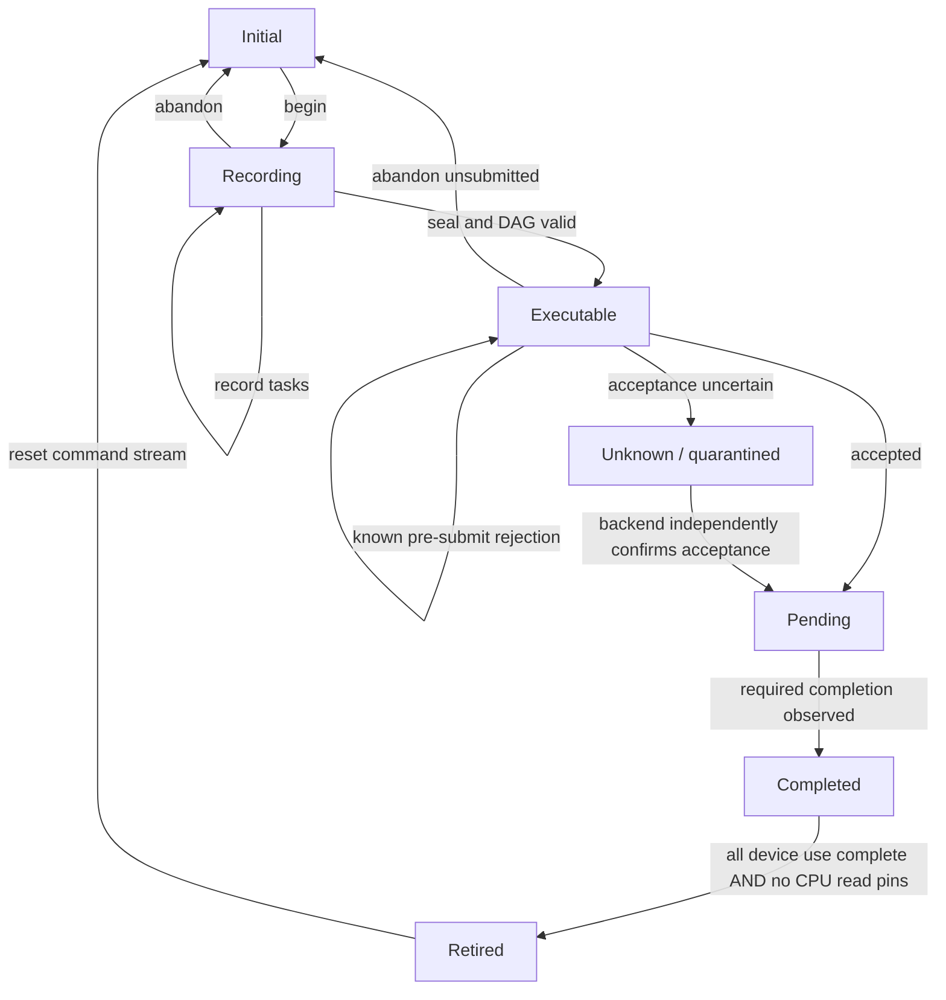

### NES-12Q — Recording a command is not submitting it, and submission is not completion

The earlier chapters have moved our NES project from untrusted cartridge bytes to an owned CPU bus, a partial 6502 executor, a debugger with owned register snapshots, a typed generational asset registry, a dependency-graph planner, a CPU memory-visibility oracle, and a three-slot upload ring with read-pin and per-queue retirement rules. We can produce a frame payload containing the actual emulator's current CPU state and a small RGBA8 texture. We can also show that CPU code must not recycle a slot while an earlier GPU use is pending. Yet one missing boundary remains: how do these resources pass from **recorded intentions** to **accepted asynchronous work**, and how do we handle a return value that does not tell us with certainty whether work was accepted?

This is not another isolated chapter about "how to call a draw function." It is the reason the prior frame-ring invariants exist. A command that has never been submitted can generally be abandoned as a host transaction. A command accepted for asynchronous execution has a lifetime outside the function that created it. A command whose acceptance is uncertain is especially dangerous: neither assuming success nor assuming failure is safe. If we release its buffers on an optimistic "probably failed" branch, the device may still read freed storage. If we wait forever on a signal that nobody will produce, the renderer deadlocks. Both failure modes begin with a confused understanding of the command lifecycle, not with a difficult shader.

We will now extend the **same** project through `tools/labs/nes_course/command_submission_lifecycle.hpp` and `tools/labs/nes_command_lifecycle_cpp23_lab.cpp`. The former is a C++23 single-threaded **CPU command-lifecycle reference model** that composes the existing Pass 08 `DependencyGraph` and Pass 11 `FrameUploadRing`. The latter creates the actual NROM+CPU+typed-texture frame payload and tests recording, rejection, retry, acceptance, indeterminate outcomes, completion notifications, device loss, command ownership and safe retirement. The GPU device, queue, semaphore, fence, native command buffer and asynchronous callback are *not* real in this laboratory. Those are exactly the interfaces to implement and validate later in Kairo and Maveb; claiming hardware execution here would be false.

The original Chapter 12 already contains substantial material on command processors, asynchronous compute, upload arenas, synchronization overhead, profiling zones, occupancy, arithmetic intensity and the performance tradeoffs of batching versus fusion. We retain those original pages. This addition belongs before the chapter's original `### PERFORMANCE MODELING & PRINCIPLED GPU REDESIGN` transition, after its command-execution discussion: first establish the correctness and uncertainty contracts of submission, then return to the existing measurements and optimization reasoning. Neither existing prose nor mathematical derivations are replaced.

#### The six independent questions hidden in the word “submitted”

Take one conceptual graphics task that samples the emulator's overlay texture. A developer might write a host function called `submitFrame`, call it, and print "frame submitted." But that name compresses several different facts. Has the command description been constructed? Has its dependency graph been validated? Has a native driver accepted the command buffer into a queue? Has the GPU started execution? Have the GPU's reads/writes finished? Have the relevant completion and visibility obligations been observed by the host? Finally, have all consumers released the resources so that the frame slot may be recycled?

These questions form a sequence of necessary evidence rather than interchangeable spellings of success. An API call may return once the driver has accepted a command yet long before a shader runs. A queue can legally have earlier work that delays the new submission. A successful completion signal can establish that certain work has reached a terminal execution point without proving that the shader produced mathematically correct output, that every resource barrier was correctly specified or that the rendered image was presented successfully.

The command lifecycle has a **control-plane** component and a **data-plane** component. The control plane records and schedules commands, tracks submission identity, and observes completion. The data plane owns buffers and images, ensures that their contents are valid and visible, and preserves them until no in-flight command can access their storage. The Pass 08 work graph is a control-plane *plan*, while the Pass 09 memory oracle and Pass 11 frame ring teach different data-plane obligations. A correct renderer joins the two: a task may be executable only after its prerequisites exist, and a resource may be retired only when the outstanding uses of its particular generation have ended.

Let a command stream have a logical state $S$. We use

$$
S\in\{\text{initial},\text{recording},\text{executable},
\text{pending},\text{unknown},\text{completed},\text{retired}\}.
$$

These names are conceptual states of **our teaching model**, not the exact enumerators or legal transition table of every Vulkan/Metal API. In particular, "unknown" represents the host's lack of a trustworthy acceptance result; it is not a standard Vulkan `VkCommandBuffer` state. "Retired" means the queue's particular submission has been released and its associated ring storage was successfully retired, not that the C++ CommandStream wrapper itself has been destroyed.



The deliberately missing arrows matter. There is no shortcut from PENDING to INITIAL merely because a host destructor ran. There is no arrow from UNKNOWN to FREE based on a timeout or a guess. There is no automatic GPU completion just because the command's dependencies are a valid DAG. There is also no implicit rule that a completed command's backing resources are immediately reusable: a pinned CPU reader can still prevent the Pass 11 frame slot from retiring.

#### Treat command recording as a separate transaction

A `CommandStream` is a move-only wrapper around a heap-owned state control block. Its `begin()` operation transitions INITIAL to RECORDING. Its `record(task)` method accepts conceptual GPU transfer, compute or graphics tasks built from the exact `Task` and `ResourceKey` types of our existing dependency planner. Host-only tasks are rejected: the program must not masquerade an arbitrary CPU callback as a command that the GPU is expected to execute.

A record is not automatically valid simply because its task ID is unique. The earlier `DependencyGraph` checks malformed access descriptors, duplicates and resource identities, while final planning checks unresolved predecessors, cycles and arithmetic overflows. The CommandStream's `seal()` invokes that **same planner**, not a second less-strict graph algorithm. If the graph cannot be scheduled, the stream stays RECORDING; it does not become EXECUTABLE and cannot be submitted. The accessor `last_graph_failure()` preserves the exact underlying cause, including missing predecessor, duplicate task and directed cycle. This is not generic error-code decoration. It tells the programmer which invariant prevented publication.

Suppose command A explicitly depends on B, while B explicitly depends on A. Both are ordinary valid C++ objects and neither is a malformed GPU resource handle. But the graph contains a directed cycle, so there is no valid topological order under those requirements. The correct response is to refuse the sealed command batch and preserve the ability to edit or abandon the recording, rather than "solving" the cycle by choosing an arbitrary first operation. Removing a dependency may change the program's semantics.

The `abandon()` operation is legal only while a stream is RECORDING or EXECUTABLE—that is, while no submission has been published. It clears the graph, planned order and command count and returns to INITIAL. After a successful queue acceptance or an indeterminate outcome, abandonment is refused. This is a direct transfer of our earlier owned-cartridge transaction principle: before publication, a candidate can be discarded; after publication, its lifetime belongs to the broader system's completion protocol.

The state control block is owned through `std::shared_ptr` not to make the mutable state automatically thread-safe, but because queued work must survive destruction of the caller's small wrapper object. Once the queue accepts the stream, its journal retains the control block. A user can destroy the CommandStream wrapper while the abstract submission remains pending, and the journal still knows its state and the associated resource lifetime. This mirrors a real graphics API's need to retain references or track externally owned resources until completion, though native APIs differ in their exact retention policies.

Move-only semantics matter because copying a mutable command recorder would raise ambiguous questions. Would the copy share the recording and allow two owners to append tasks? Would one copy be reset while the other is pending? Should a copied PIMPL retain a native command buffer or duplicate it? Our model refuses copying at compile time and supports moving the wrapper, which transfers the caller's access path to the same control block without duplicating command ownership.

#### A definitely rejected submission is different from an ambiguous submission

Imagine a queue submission returns an error while encoding validation is still being performed on the CPU and before the driver has accepted any work. If the API really guarantees that no device submission occurred, the caller can preserve the executable command description and the writer's staged frame bytes, correct the error and retry. A completely abandoned writer can also safely let its RAII destructor roll the unsubmitted frame slot back to FREE.

Now imagine an interprocess or remote device boundary, an interrupted queue operation, a connection loss, or a backend failure where the host cannot prove whether acceptance occurred. The host may have seen an error but the device may have received and begun processing the command. Treating that state as the same as a *definite* pre-submit rejection would be unsafe. Releasing a resource could produce a use-after-free in device execution; retrying the same work could execute it twice. Depending on the operation, duplicate execution could overwrite an output, increment an atomic counter twice, trigger duplicate data capture or duplicate an expensive side effect.

Our simulator makes the difference explicit with three **test-controlled decisions**:

```cpp
enum class SimulatedSubmit {
    accepted,
    rejected_before_submit,
    indeterminate
};
```

The names emphasize their scope. They are not a prediction that every real Vulkan or Metal submission function can return exactly these three results. Actual error codes and recovery guarantees vary by API and failure class. The backend integrator must classify errors using the relevant specification and the exact command it called, not assign "definitely rejected" whenever a return code is nonzero.

On a known pre-submit rejection, `CommandSubmissionQueue::submit()` returns `driver_rejected_before_submit` without calling the frame writer's `submit`. The writer still owns the draft; the command stream remains EXECUTABLE, and the queue has no new outstanding record. A later accepted retry can publish the same recorded work and bytes. The test asserts that no frame was consumed by that rejected attempt and that the draft still has its original length.

For an indeterminate outcome, the queue creates a journal entry in the UNKNOWN state and publishes the frame slot into IN_FLIGHT with its recorded completion obligations. The writer relinquishes mutable authority exactly as in an accepted submission: the bytes may be in use and must not be overwritten. The CommandStream may not be reset or abandoned. Ordinary `poll()` does not generate a completion notice for this entry even if the test later advances its simulated queue counters, because the model does not yet have independent evidence that the submission was accepted and is represented by those completion values.

The model offers an explicit `confirm_accepted(ticket)` transition. It may be used only when an external source independently establishes acceptance. It turns UNKNOWN into PENDING, after which actual observed completion obligations can eventually release the frame. There is **no automatic “probably not submitted” release path** for UNKNOWN. That omission is intentional: safely resolving nonacceptance would require a verified backend-specific proof that no device reference was created, a reset or a quiescence protocol, none of which our CPU simulation can establish by guessing.

This is a useful example of a design in which **liveness is deliberately sacrificed to preserve safety under uncertainty**. Quarantined work can occupy capacity indefinitely; that is preferable to freeing storage still referenced by a device. A production engine needs an explicit device-reset, cancellation acknowledgment, or recovery policy to restore liveness. A teaching lab that provides an unconditional `forceFreeAfterTimeout` would train the wrong instinct.

#### Publication must not happen before the journal can remember it

A different failure arises from ordinary CPU memory allocation. Suppose a queue accepts work, the frame writer publishes bytes, and *then* the application allocates a journal node recording which frame was submitted. If that allocation throws `std::bad_alloc`, the command may remain in flight while the host loses the only bookkeeping record needed to retire its resources correctly. This is a strong exception-safety violation across the submission boundary.

Our simulated queue prepares its journal storage before publishing the frame. It checks the stream state, required queue tickets, journal capacity, submission-ID exhaustion and payload existence. It reserves storage for the new record and its eventual completion notification. Only after that bookkeeping is prepared does it call the writer's `submit(required)`, which is the frame ring's own publication boundary. If that frame publication fails with a typed error, the tentative journal entry is removed and the executable command remains retryable.

The principle is **prepare all throwing host allocations before committing an irreversible external side effect**. A real graphics API needs an even more careful ordering because driver submission is not the same operation as our writer's CPU-only `submit`, and a native call may itself fail in a way that requires state reconciliation. The record must also pin native resource objects and ensure command memory outlives execution. But the invariant remains useful: do not publish work and then perform an avoidable potentially throwing bookkeeping allocation whose failure would orphan it.

A further identity guard prevents a subtle cross-owner publication bug. The queue owns a reference to one specific `FrameUploadRing`, but the C++ type of a `WriteLease` is identical for two rings of equal capacity. Without an owner check, the queue could publish bytes into ring A while recording a handle that it later tries to retire through ring B. Both can have slot zero and generation one; neither a matching index nor a shared template parameter proves common ownership. We added a read-only writer `owner_id()` accessor and a prepublication check against the queue's ring owner. A mismatched writer returns `foreign_frame_writer` while leaving both rings and the command journal unchanged. The executable includes a negative case with two independent three-slot rings. This is the same owner-namespace lesson established for assets in Pass 06, now applied to asynchronous queue retirement.

The queue's submission tickets are monotonically increasing 64-bit identifiers. Reusing a ticket could let an ancient completion event refer to a newer submission, the same form of ABA problem we have repeatedly studied for registry slots and frame handles. Our model refuses ticket exhaustion rather than wrapping, and its bounded journal can discard **only retired entries**. This distinction prevents another subtle bug: a journal with a fixed capacity of one should allow a second submission after the first has completed and been retired, but should not reuse that capacity while the first remains pending. Explicit `prune_retired()` removes only proven retired records and never rolls the monotonically increasing ticket backwards.

A command's **ticket** and a frame's **handle** also are not the same identity. A ticket identifies one queue submission record; a FrameHandle names one generation of a storage slot. The journal associates them so callbacks and retirement decisions can be routed to the correct frame. The swapchain's acquired presentation image is a third identity. A real renderer must keep all three apart.

#### A receipt is a statement of accepted responsibility

The submit API returns an owned `Receipt` containing submission ticket, FrameHandle, required completion stamp and the queue's conceptual state at publication. This is stronger than returning just a Boolean. If the caller receives an accepted receipt, it knows which journal entry to query and which frame generation the queue claims to have accepted. If it receives an indeterminate receipt, the same identity can be quarantined and later reconciled by a backend-specific acceptance proof.

The receipt does **not** say that the GPU has executed, that shaders are correct, that the texture has proper native layout or that the frame was presented. It is evidence of **what the CPU-only model accepted** under the supplied simulated decision. In a native backend, a receipt must be populated from actual command-buffer objects and queue outcomes, with any necessary details such as device generation, queue family, timeline semaphore value, resource-retention token and submission error classification.

A common performance anti-pattern is to call a blocking wait immediately after every accepted command. That can make CPU code easier to reason about, because a function returns only after the operation finishes, but it removes the CPU/GPU overlap that asynchronous submission could have provided. The original chapter's Kairo synchronous-compute discussion illustrates this tradeoff as a supplied source snapshot; it has **not** been reaudited against the current Kairo repository revision in this pass. A robust queue model should let multiple independent frames be pending while the CPU continues, subject to the frame-ring's bounded capacity and correct dependency edges.

The fact that asynchronous work *can* overlap never guarantees it *will*. A compute dispatch may contend with graphics for registers, bandwidth or execution capacity; a dependency may serialize them; or the hardware/driver may schedule them on the same engine. Only real GPU timestamps and a correctly paired experimental protocol can establish a throughput benefit. We do not infer performance from the presence of a `gpu_compute` domain label in our task graph.

#### A completion callback should own its identity, not borrow a dead stack object

Imagine the command finishes while the host object that initiated it has already been destroyed or moved. A callback that blindly captures `this` and dereferences it after destruction is a classic use-after-free pattern. The safer design is to capture an owned state token, an appropriately scoped weak reference, or a submission ID that the queue can resolve against a live journal—depending on the backend's callback contract.

In our model completion delivery uses **owned event records** rather than arbitrary callbacks. After the test supplies componentwise completion observations via `observe_completion(stamp)`, it calls `poll()`. Only PENDING entries whose required transfer/compute/graphics values have all been observed can transition to COMPLETED. Each such transition appends one `CompletionEvent` containing the submission ticket, frame handle and observed stamp. Calling `poll()` again does not duplicate the event because the entry is no longer pending. `drain_events()` transfers the event records to the caller, emptying the queue's notification buffer.

This establishes an **at-most-once event emission** property inside the model for each pending-to-completed transition. It does not prove exactly-once delivery to external application code: a caller may discard a drained event, crash before processing it, or process the same copied event twice after storing a duplicate. Exactly-once effects in a distributed or persistent system need stronger transactional or idempotency guarantees. For an interactive graphics application, a single owned completion record with a stable ticket is an effective basis for deduplicated cleanup and tracing.

The completion event indicates that the supplied simulated completion predicate was reached. It is **not proof of successful shader output**. A native device may signal terminal completion after an operation that encountered an error or device loss, depending on the API's semantics. The actual backend must inspect relevant error or status results before announcing rendering success, and must establish separate resource-visibility conditions before CPU readback. The distinction between “the queue is done with these resources” and “the frame's pixels are correct” must not be lost in one generic success flag.

The test deliberately destroys a client's CommandStream wrapper after queue acceptance. The queue continues to own the shared command-control state and can still produce a completion event and retire its associated frame after the required observations arrive. This demonstrates the lifetime topology, not actual asynchronous threading. All transitions remain explicitly invoked by the test on one CPU thread.

#### Device loss is a recovery state, not a success-shaped completion

A graphics device can be lost while commands are pending. A driver may reject future submissions, the host may no longer be able to query some completion primitives in the ordinary way, and many command/resources associated with that device may need to be reconstructed. The correct behavior depends on the API and whether the resource or device has actually become quiescent. We should not convert “device lost” into “every command completed successfully” merely to unblock an allocator.

The teaching queue's `declare_device_lost()` sets an irreversible lost flag. Subsequent attempts to submit new work, confirm an indeterminate submission, observe simulated completions, poll events or retire a quarantined submission are refused. Existing resources remain logically occupied. The model intentionally lacks a fake general-purpose method called `freeAllOnDeviceLost`. A real renderer must implement an explicit recovery path proving it is safe to dispose of old native objects, then establish a new device generation and rebuild the necessary swapchain, pipelines, resource allocations and command state.

This also separates **command cancellation** from **resource retirement**. A not-yet-submitted recording can be abandoned because it has created no in-flight device use. A submitted command generally cannot be "unsubmitted" merely because the UI user clicked Cancel. Cancellation may mean that application code no longer wants its result, that a backend-specific cancellation request was issued, or that a new frame supersedes it. None of those statements alone proves that the original command stopped reading its resources. The old allocation must remain retained until its actual use has ended or a verified reset/recovery procedure establishes otherwise.

The test includes an indeterminate submission, declares the simulated device lost, and confirms that the queue refuses fresh work, artificial completion, arbitrary event publication and retirement. That is a conservative behavior. It is not a complete recovery algorithm, and the model is not intended to keep a real device allocation alive after the native device has been destroyed. Real backend integration must supply those concrete object-lifetime rules.

#### Compose command-state ownership with the actual frame ring

Pass 11's `FrameUploadRing` already has its own finite state machine: FREE, WRITING, IN_FLIGHT and EXHAUSTED. It also has move-only writers, pinned immutable readers, owner/slot/generation handles and a componentwise queue completion predicate. Pass 12 does **not** replace that implementation with an independent fake frame type. The new queue directly accepts the ring's real WriteLease and calls its real `submit(required)` publication method. Its `retire(ticket)` invokes the actual ring's `retire(frame)`.

These are two related state machines, not one. A command stream can be EXECUTABLE while a frame writer is still WRITING. After accepted submission, the command is PENDING while the frame is IN_FLIGHT. Once device completion has been observed, the command may be COMPLETED while the frame is **still IN_FLIGHT because a CPU reader pins it**. Only when the CPU pin is released and the frame's original retirement predicate is satisfied can the queue retire the submission and let the command stream become RETIRED.

Write the joint retirement condition as

$$
\begin{aligned}
\operatorname{retire}(q)=
&\;\operatorname{knownCompleted}(q)\\
&\land\operatorname{validFrame}(H_q)\\
&\land\left(D\succeq R_q\right)\\
&\land\left(\operatorname{readerCount}(H_q)=0\right).
\end{aligned}
$$

Here $q$ is a queue submission ticket; $H_q$ is its FrameHandle; $D$ is the observed completion vector; and $R_q$ is the submission's required vector. The first predicate is **not redundant** with the stamp comparison in the presence of UNKNOWN acceptance or device loss. A host may have some completed counters whose numbers are large enough but still lack evidence that the indeterminate submission belongs to those completion events. The ring's resource identity check adds another independent boundary: even a terminal command status does not authorize freeing the wrong frame generation.

The test creates a frame with required stamps $(1,2,3)$. Observing only $(1,1,3)$ blocks completion because the compute component is still missing. Observing $(1,2,3)$ permits exactly one completion event. An outstanding ReadLease then blocks the final ring retirement despite device completion. Releasing that CPU lease permits retirement, increments the frame generation and lets the old CommandStream reset only after the queue releases the submission. This is an integrated proof across three previously separate C++ abstractions.

#### Use actual NES state as the staged command's payload

We repeat the same real-project integration for a reason: every new engineering mechanism should carry meaningful data whose correctness we can check independently. We build a valid NROM image with a reset vector at `0x8000` and the two instructions `LDA #$7F` and `STA $02`. We mount it through the real owned CPU bus and execute it using the separately compiled Pass 07 debugger. The snapshot must show accumulator `0x7F`, program counter `0x8004`, five modeled 6502 cycles and two pending traces.

The Pass 05/06 asset pipeline separately decodes a synthetic 2×1 TXR4 RGBA8 image under a typed generational handle. The test copies the eight actual pixel bytes from the registry's owned texture. It then creates a 24-byte CPU frame payload with the `NESF` signature, a frame number, the accumulator, a little-endian program counter, an explicit little-endian 64-bit cycle count and the RGBA8 pixels. We do not copy the raw C++ register snapshot struct, since its object representation might contain compiler-dependent padding.

Those 24 bytes are staged by the Pass 11 WriteLease. The new command stream records three conceptual GPU tasks using the **same Pass 08 resource identity** fields: a transfer that produces a texture resource, compute that consumes it and produces output, and graphics that consumes that output and a CPU-prepared debugger overlay. Graph planning derives the relevant resource dependencies. The CPU-to-device overlay publication is represented as a declared input; the actual synchronization that makes those bytes visible to shaders remains a backend obligation from Pass 09. The queue accepts the stream with synthetic transfer/compute/graphics completion tickets.

The test reads the staging slot through an immutable pinned ReadLease and verifies that bytes 6–7 encode the original PC while bytes 16 and 23 retain the first and last original pixel values. It then changes or discards the temporary host image source and erases the registry texture, making the original logical asset handle stale. The submitted frame bytes remain intact because the writer published a deep-owned copy. When the simulated completion counters reach the specified values, the queue emits its event but cannot retire the frame until the CPU ReadLease goes out of scope.

This gives a meaningful continuity of ownership: **decoded asset owner → explicitly copied frame payload → move-only frame writer → queue's submitted frame handle → pinned observer → completion-gated retirement**. The task graph adds scheduling constraints; the command journal adds submission identity; the frame ring adds storage lifetime. None of those pointers is a Metal buffer or a Vulkan image, but the same correctness questions will be asked by their eventual native counterparts.

#### Queue capacity and frame-slot capacity are different constraints

The frame ring has a fixed number of reusable *storage slots*. The command journal has a fixed number of *submission records* it can hold. These limits are independent. A renderer may have enough free upload storage but be unable to accept more pending command records, or it may have available journal capacity while every upload slot is still in use. A robust API should report which resource is exhausted rather than return one unhelpful generic failure.

The model checks journal capacity before publishing the writer. When full, it returns `capacity_exhausted` while leaving the executable command and writer draft unchanged. Only a successfully retired journal entry can be pruned to free record capacity. The test constructs a journal with maximum size one, accepts one command, and verifies that a second submission is rejected before frame publication. It then observes completion and retires the first command, explicitly prunes that retired record, and submits the second command under a new ticket. The original ticket is not reused, even though the journal's vector capacity can be reclaimed.

This also exposes a difference between resource **lifetime** and control-plane **history**. We may discard a completed command's in-memory journal record after a corresponding durable log, profiler event or diagnostic has captured whatever information must remain. But we must never prune a pending or indeterminate entry merely to fit the next frame. A single bounded queue does not imply that every completed event must be retained in memory forever; the right history retention and backpressure policies belong to the telemetry system.

A production command scheduler may batch multiple draw or dispatch operations into one native submission, use multiple queues and command pools, or recycle command allocators after an appropriate completion. The model's "one stream, one submission ticket, one frame handle" policy is deliberately simple so its correctness can be tested. More sophisticated multi-resource submissions should first preserve the same identity and lifetime invariants, then add explicit resource-set ownership rather than relying on convenient coincidence between frame and command counts.

#### Vulkan's native command-buffer state machine is not our teaching enum

Khronos's Vulkan specification defines command buffer states including initial, recording, executable, pending and invalid. Beginning recording, ending recording, submitting, completing and resetting have explicit rules and usage flags. A command buffer recorded with one-time-submit usage can become invalid after submission and must be re-recorded or reset as required; command-pool allocation and reset operations have external synchronization contracts. Secondary command buffers can share lifecycle constraints with the primary buffers that execute them. The exact valid states and transitions depend on whether the API operation is permitted in the current command buffer state, the flags used at allocation/recording, and the submitted command buffer's ownership and completion history.

Our teaching states INITIAL/RECORDING/EXECUTABLE/PENDING/COMPLETED/RETIRED resemble part of that story but **do not implement VkCommandBuffer state transitions**. Our UNKNOWN state tracks uncertainty about submission acceptance at the host backend boundary, while Vulkan's INVALID state represents a different native command-buffer condition. The distinction must remain clear when mapping our model onto real commands. For native truth, consult [Vulkan command buffers](https://docs.vulkan.org/spec/latest/chapters/cmdbuffers.html), [queue submission](https://docs.vulkan.org/refpages/latest/refpages/source/vkQueueSubmit2.html), and [synchronization](https://docs.vulkan.org/spec/latest/chapters/synchronization.html).

A real Vulkan implementation must also bind recording to a compatible command pool and queue family, preserve allocation lifetime, track all referenced buffers/images/pipelines/descriptors, and validate stage/access scopes and image layouts. The "GPU work plan" cannot substitute for native resource barriers. A queue signal and command-buffer completion are not automatic proofs that presentation has finished using a swapchain image or a present-wait semaphore. The prior chapter's distinction between frame slot and acquired image still applies, and the appropriate presentation reuse rule needs the exact Vulkan swapchain semantics.

Fence and semaphore terminology should be especially precise. A host-waitable Vulkan fence may be used to observe completion of particular submissions, while semaphores establish cross-queue/device-side ordering and timeline values as specified. Their valid reuse and failure behavior differ. Treating every synchronization primitive as interchangeable because all are called "fences" in casual speech obscures important obligations. A completion stamp in our test is only a numeric **representation of a needed observation**; it does not implement or resemble the exact native barrier/queue object required to establish that observation.

#### Metal command buffers and Metal 4 need separate lifetimes

Classic Metal uses command buffers associated with `MTLCommandQueue`, which are encoded and committed before the GPU executes their work. Apple documents status transitions and completion handlers, and its command-buffer API distinguishes scheduling notifications from completed work. An application that registers a callback must not assume the callback can safely dereference arbitrary destroyed host objects. If it needs resources or state after the initiating wrapper disappears, it must retain the required lifetime tokens or use appropriately scoped weak references and a stable submission identity.

Apple's [MTLCommandBuffer reference](https://developer.apple.com/documentation/metal/mtlcommandbuffer), [command-buffer commit](https://developer.apple.com/documentation/metal/mtlcommandbuffer/commit%28%29), [status](https://developer.apple.com/documentation/metal/mtlcommandbuffer/status), and [retained references](https://developer.apple.com/documentation/metal/mtlcommandbuffer/retainedreferences) provide the API-specific details. In some classic Metal paths command buffers can retain referenced resources by default, while unretained-reference configurations change the application's responsibilities. A callback or C++ wrapper that happens to own a shared_ptr does not automatically pin every native resource or argument referenced by a shader.

Metal 4 introduces a distinct `MTL4CommandQueue` and `MTL4CommandBuffer` model with different command-recording/submission and resource-retention responsibilities. Apple's [Metal 4 core API](https://developer.apple.com/documentation/metal/understanding-the-metal-4-core-api) notes that MTL4CommandBuffer instances do not create the same strong resource references as classic command buffers in some paths. Therefore a design that assumes classic retainedReferences semantics for every Metal generation is unsafe. The proper backend adapter must explicitly track all resources required through the completion boundary and use the correct API generation's synchronization, residency and queue semantics.

We should also avoid claiming that Apple-silicon unified physical memory removes the need for completion tracking. Sharing physical DRAM may change transfer costs and memory management, but it does not permit an application to overwrite data that a pending GPU command is still reading. Nor does it eliminate encoder/queue ordering, resource visibility, attachment load/store or presentation requirements. Our frame-ring model teaches the *lifetime shape* of that problem; the native backend specifies the actual mechanisms.

#### Data races, background work and why this model is not automatically thread-safe

The word "async" often tempts an engineer to add a thread. But a program can submit work asynchronously to a GPU on one host thread and remain entirely single-threaded in its command-recording code. Conversely, a CPU system can have many threads with no GPU involvement. The C++ data-race rules apply to concurrent host accesses to shared non-atomic objects; a device's synchronization rules add further independent obligations.

Our queue and frame ring are deliberately **single-threaded CPU state machines**. Their shared_ptr control blocks preserve object lifetime across moved or destroyed wrappers, but the state they own contains non-atomic enums, vectors, graph plans and reader counts. Passing a CommandStream or Queue to two host threads and concurrently calling `record()`, `poll()` and `reset()` would require external locking or a newly proven synchronization protocol. The shared_ptr's reference count does not make the referred mutable object thread-safe.

Likewise, `CompletionEvent` is an owned record placed in a normal vector. `drain_events()` copies or moves that vector under single-threaded access; it does not register an operating-system asynchronous callback or guarantee delivery on a particular UI thread. When this model is adapted into Kairo's editor, completion notifications should be handed off through a thread-safe queue or an event loop whose ownership and callback-lifetime rules are documented. Rendering work and UI updates may require distinct thread-affinity policies on macOS and SwiftUI; silently invoking a UI callback from a GPU completion thread is not a general safe pattern.

An actual multi-threaded scheduler needs more than mutexes added after the fact. It must decide which actor owns command recording, how dependency graphs are finalized, whether queue submissions are serialized per queue, how completion signals are delivered and ordered, and what happens if a client destroys or cancels a scene while work is pending. The reference model establishes useful states to protect, but not a complete concurrency architecture.

#### Adversarial tests are the quickest way to reveal a missing state

The new executable contains five main evidence groups. One rejects sealing an empty recording, recording CPU work as a device command, duplicate task IDs, unresolved dependencies and a directed cycle. It checks the exact graph diagnostic instead of assuming that "an error occurred" proves the intended path. It then moves an executable command stream and shows that the moved-from wrapper is inert.

The second group deliberately attempts a submission missing a compute completion ticket. It must be rejected **before** any frame publication. The same writer and recorded command then receive a definite pre-submit rejection and remain retryable. An accepted retry creates a pending ticket, but a premature `reset`, `abandon` or `retire` must fail. Two successive observations, first incomplete and then complete, produce exactly one owned completion event. The same frame's active CPU reader pin independently blocks retirement until released. After retirement the command can be reset and the journal entry safely pruned.

The third group models an indeterminate submission that occupies a frame slot. Even an observed completion-stamp vector cannot produce its event until independent acceptance is confirmed; ordinary retirement is refused. A second fixture loses the device while a submission remains indeterminate. It refuses further submission, acceptance confirmation, polling and retirement, preserving a quarantined record rather than inventing a successful recovery.

The fourth group gives the command queue a one-record capacity and destroys the original CommandStream wrapper while the submission remains pending. Its shared control survives in the journal. A second command cannot be accepted until the first is completed, retired and pruned. The second receives a strictly greater ticket. This checks both lifetime ownership and bounded journal liveness without recycling an old submission identifier.

The fifth group imports real TXR4 pixels, executes the NROM CPU and debugger, builds the NESF overlay, records transfer/compute/graphics intents and submits the staged bytes through the actual Pass 11 frame ring. It erases the old texture registry asset while the frame owns its copied payload, observes simulated completion and confirms that a pinned reader still prevents retirement. There is no fake separate emulator or decorative stand-in for the earlier work; the same real code paths are reused.

These are *authored test cases*, not by themselves evidence that the newest commit compiles, links or passes on every runner. The CMake/CTest and source-pinned evidence infrastructure from Pass 10 must build and execute the new target, capture actual results and show that the exact current source was tested. No benchmark durations, GPU timings, shader result hashes, platform-specific queue events or native device allocations have been measured in this pass.

#### Reconstruct the failure protocol rather than memorizing enum names

Begin with one command stream and one frame writer. Draw their state machines separately and label which operations can throw, return a typed error or cause a publication. Prove that a known pre-submit rejection leaves both an executable command and a WRITING frame draft. Then construct a failure in which publication happens before journal allocation and explain why throwing from the allocation can orphan an in-flight resource. Reverse the order so the host journal is prepared first, and identify the remaining native backend acceptance uncertainty that cannot be eliminated by ordinary C++ exception guarantees.

Next build an explicit dependency graph for transfer→compute→graphics, including resource access descriptions and an independent CPU-produced overlay. Show what happens when one compute prerequisite is missing or when the graph has a directed cycle. Trace the exact underlying graph error. Record a command while pending and show that it must be rejected; resetting a pending native command allocator is not a harmless local optimization.

Now examine an indeterminate submission. The host may have sent the command, or it may not have. Enumerate what the host can safely do **without** further evidence: it can quarantine the potentially referenced resources and stop further writes; it cannot safely free them or indiscriminately retry a non-idempotent operation. Draw which backend-specific evidence would prove acceptance, terminal completion or quiescent reset. Explain why a timeout alone is not such evidence.

For the accepted path, calculate the componentwise predicate on completion stamps. Give a counterexample in which transfer and graphics are complete but compute is not. After all three are complete, keep a CPU ReadLease alive and prove that the frame cannot be retired even though the queue's command has reached COMPLETED. Release the reader, retire the correct frame generation, reset the command stream, prune its retired journal entry and verify that the next submission receives a fresh ticket.

Finally adapt the design **on paper** to one real Vulkan or Metal command queue. For every transition name the exact native API operation, the command-buffer state, the resource-ownership rule, how the backend reports errors, the completion primitive and the synchronization that makes each GPU-produced value visible to its consumer. Identify what part of the C++ reference model has no native equivalent and what native state the reference model does not represent. A credible implementation plan is one that makes those mismatches explicit before writing device code.

The unifying engineering rule is simple to state but hard to apply consistently: **recorded work is not accepted work; accepted work is not completed work; completed work is not necessarily correct work; and completed work still does not authorize recycling bytes that another live accessor can use.** Every step needs its own identity, evidence and lifetime contract. Once that chain is explicit, the original chapter's discussion of command overhead, asynchronous overlap, GPU profiling and principled optimization can be evaluated without conflating performance with safety.

**Primary source trail.** The native lifecycle and synchronization distinctions above are grounded in [Khronos Vulkan command buffers](https://docs.vulkan.org/spec/latest/chapters/cmdbuffers.html), [vkQueueSubmit2](https://docs.vulkan.org/refpages/latest/refpages/source/vkQueueSubmit2.html), [Khronos synchronization](https://docs.vulkan.org/spec/latest/chapters/synchronization.html), [Apple MTLCommandBuffer](https://developer.apple.com/documentation/metal/mtlcommandbuffer), [Apple command-buffer status](https://developer.apple.com/documentation/metal/mtlcommandbuffer/status), [Apple retained resource references](https://developer.apple.com/documentation/metal/mtlcommandbuffer/retainedreferences), and [Apple Metal 4 core API](https://developer.apple.com/documentation/metal/understanding-the-metal-4-core-api). The source text and source links provide design knowledge; native validity must be checked against the selected API version, device features and actual command recording.

**Where we go next.** Chapter 13, “Open Vulkan Devices and Describe Resources,” is the right point to take this device-neutral command lifecycle and deliberately attach it to real Vulkan instance/device/queue capabilities and resource descriptors. We should establish a native feature and resource-creation handshake before claiming that any GPU intent has been executed; the earlier C++23 command journal and frame-ring invariants remain useful CPU-side oracles and failure-path tests even after a native backend exists.
