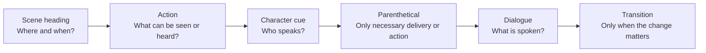
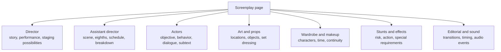
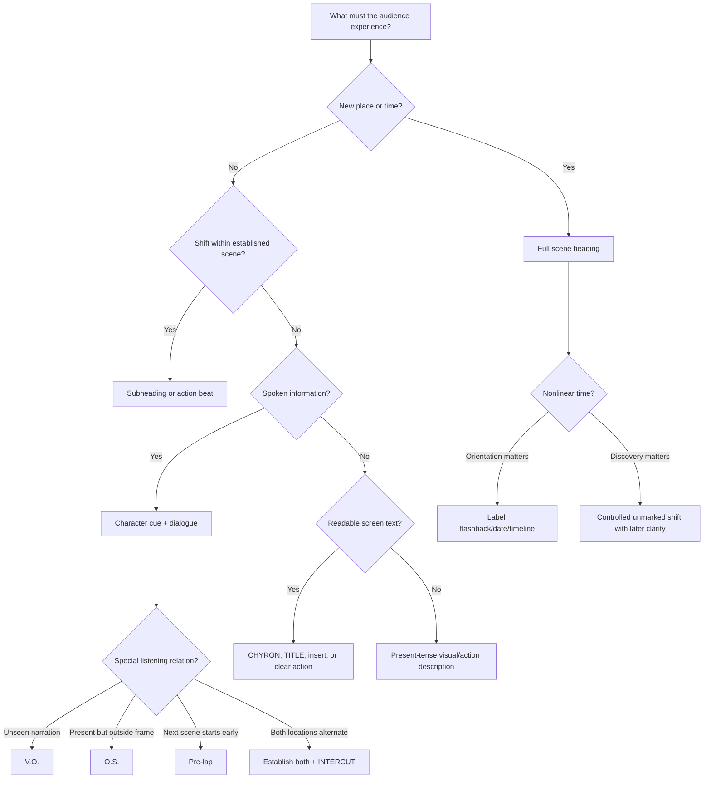
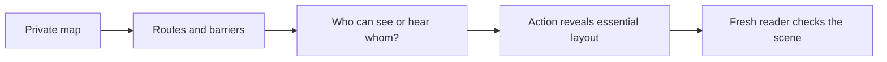
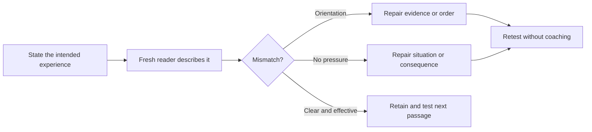

---
tags:
  - scriptwriting
  - screenplay-format
  - continuous-notes
source_playlist: StudioBinder screenplay playlist
coverage: Playlist synthesis plus Fountain and Beat documentation; Video 32 partial evidence from chapters/comments
---
# Screenplay Format: From Reading Rhythm to Production Blueprint

> [!tip] Use the expanded teaching laboratory
> [[01 - Screenplay Format#The page as an instrument: clarity, emphasis, and a distinctive voice|Page craft laboratory]] · [[01 - Screenplay Format#Build a space that can survive the scene|Space and blocking]] · [[01 - Screenplay Format#Actual draft comparison: Go separates the package from the movie|Actual draft comparison]]
> The new sections add worked decisions, examples, failure-and-repair tests, and practice. The research ledger in [[04 - Story Design, Structure and Practice#Research ledger — craft expansion, 29 October 2026|Volume 04]] records exactly what was inspected.


Picture a woman coming home with a wet envelope. Her phone rings. She opens the envelope while she answers. Inside is a photograph of her asleep in the room she is standing in.

You can already imagine a place, a person, a sound, a few movements, and a discovery. A **screenplay** writes those things down so other people can imagine and eventually make the same scene. The actors need to know what the people do and say. The crew needs to know which room, objects, sounds, clothes, and actions the scene requires.

**Format** is how the page separates these kinds of information. A location line looks different from spoken words, so the reader can tell which is which without stopping. The spacing also helps people estimate how long a passage might take on screen. That estimate is useful for planning, though a page never guarantees an exact running time.

This file teaches how to put that imagined scene on the page. [[02 - Scenes, Dialogue and Character]] explains what people want from one another and how their actions change a scene. [[03 - Story Devices and Placement]] explains choices such as showing a danger early or saving it for a surprise. [[04 - Story Design, Structure and Practice]] follows those choices through a whole story. You can use those files for more depth; each new idea needed here is explained here.

The central rule is simple:

> **A reader should always understand what is happening, where it is happening, when it is happening, who is speaking, and how the page relates to the experience on screen.**

Some page habits are widely shared; others have several accepted versions. We will learn what each choice helps a reader understand. When a studio, show, or submission process asks for a particular layout, follow that request. You do not have to treat every example in this file as a rule.

## The page is a time-and-production map

Start with a **scene**: a passage of action in a place and time, such as the woman opening her envelope in the kitchen at night. The form used here is called a **master scene screenplay**. It describes what happens in each scene without listing every camera view. One uninterrupted camera view is a **shot**; one scene may contain many shots. Older continuity scripts often specified the sequence of shots more closely. The modern form keeps the useful information a crew needs while leaving actors, directors, camera, design, editing, and sound teams room to make choices.

The commonly taught estimate is:

$$
1\text{ formatted screenplay page}\approx 1\text{ minute of finished screen time}.
$$

Treat this as a rough average. A page of quick conversation can pass fast; a page describing a long look, song, chase, or stunt can take much longer. **Monospaced** type gives every character the same width, so pages hold a more predictable amount of writing. Together with fairly consistent spacing, that makes page count useful for planning. It still cannot tell you exactly how long the action will take.

### The physical page

[Anatomy of a Screenplay](https://www.youtube.com/watch?v=6PLSJBTzaGw) gives these baseline measurements:

| Page property | Convention taught in the source | Why it exists |
|---|---:|---|
| Paper | Standard screenplay page, conventionally US Letter | Gives all readers the same physical reference |
| Typeface | 12-point Courier | Monospaced characters make line and page density more predictable |
| Left margin | 1.5 inches | Leaves binding space and a stable action boundary |
| Right margin | 1 inch | Preserves readable white space |
| Top margin | 1 inch | Leaves room for page number and revision information |
| Bottom margin | 1 inch | Keeps text away from the physical edge |
| Page numbers | Upper right on every script page except page one | Lets departments coordinate references |

The speaker’s name above their speech is a **character cue**. The spoken words beneath it are **dialogue**. The sources place the cue about **3.7 inches** from the left edge and the dialogue about **2.5 inches** from that edge. Other elements also have their own positions, but these sources do not specify every width. Screenwriting software usually handles those positions, called **tab stops**. Choose the kind of line you are writing; do not try to align the whole script by repeatedly pressing the space bar.

### Figure F1 — visual map of a screenplay page

This is a simplified page map, not a scale drawing. Notice how the location, action, speaker, speech, and change to the next scene occupy recognizable places. Use the measurements supplied in the labels for the conventions taught by the videos.

```text
                    8.5-inch page width
    ┌──────────────────────────────────────────────────────┐
    │  1-inch top margin                         PAGE NO.  │
    │                                                      │
    │← 1.5 in → ACTION / SCENE HEADING        ← 1 in →    │
    │           INT. APARTMENT - KITCHEN - NIGHT           │
    │                                                      │
    │           Rain needles the dark window. MAYA, 28,    │
    │           sets a WATER-STAINED ENVELOPE beside       │
    │           the silent phone.                          │
    │                                                      │
    │                         MAYA                          │
    │                    (barely audible)                   │
    │              I said I would come back.               │
    │                                                      │
    │                                           CUT TO:    │
    │                                                      │
    │  1-inch bottom margin                                │
    └──────────────────────────────────────────────────────┘

    Character cue begins near 3.7 inches from the left edge.
    Dialogue begins near 2.5 inches from the left edge.
    Transitions sit on the right side.
```

The white space is functional. A reader can identify scene, action, speaker, delivery note, spoken words, and transition before reading the sentences.

## The title page opens the document, not the story

Now that the body page has a recognizable shape, give the document its cover information. This helps someone identify the project before they enter the first scene.

The title page is the first physical page of the screenplay. It is not screenplay page 1 and does not receive a page number.

### Figure F2 — title-page map

```text
    ┌──────────────────────────────────────────────────────┐
    │                                                      │
    │                                                      │
    │                    THE LAST SIGNAL                   │
    │                                                      │
    │                       Written by                     │
    │                       Asha Rao                       │
    │                                                      │
    │              Based on "The Last Signal"             │
    │                    by Morgan Lee                     │
    │                                                      │
    │                                                      │
    │                                                      │
    │  Asha Rao                                Draft date  │
    │  asha@example.com                      24 Oct 2026   │
    │  Representation/contact                             │
    └──────────────────────────────────────────────────────┘
```

Use the following order:

1. Put the title in uppercase at the center of the page. The source notes that it is sometimes underlined.
2. Beneath it, write `Written by`, followed by the writer or writers.
3. If the screenplay adapts an existing property, add `Based on` and identify that property.
4. Put writer or representative contact information in the lower-left corner.
5. Put an optional draft date in the lower-right corner.

Keep the title page for identifying the work. A **synopsis** briefly tells the story; a **logline** presents its central situation in one sentence; a **treatment** tells it at greater length in prose. Those belong elsewhere, along with casting wishes, personal statements, or arguments about copyright, unless the submission instructions ask for them.

## Page one begins with a producible moment

After the title page comes screenplay page 1. It usually starts by telling us where we are and what happens. That location-and-time line is a **scene heading**. The description of visible events and sounds is **action**. When someone speaks, their **character cue** names them and **dialogue** gives their words.

A small instruction in round brackets, such as `(into the phone)`, is a **parenthetical**. A label such as `DISSOLVE TO:` is a **transition**: it calls attention to how one image changes to the next. You will see each used below. Those are the six main page elements taught in [Anatomy of a Screenplay](https://www.youtube.com/watch?v=6PLSJBTzaGw):



Follow the envelope scene through these six choices: establish the kitchen, describe the envelope and ringing phone, name the speaker, give her words, add a bracketed instruction only if needed, then move to the next image. The page stays easy to read because each kind of information looks familiar.

## The final page follows the same page contract

The formatting videos do not prescribe a separate margin, font, or layout for the last page. It uses the same body elements as earlier pages; page numbering continues in the upper-right position. If a character's dialogue continues across a page break, a continuation cue may clarify that it is the same speech. The dramatic ending belongs in the final scene's action and dialogue. The videos do not establish a compulsory final-page label such as “THE END,” so use an end marker only when the chosen script style or production needs it. Keep this distinction clear: page geometry is explained by the formatting lesson; a universal end-marker rule is not.

## Scene headings establish the production unit

Before we can picture the woman opening the envelope, we need to know where and when it happens. A **scene heading**, also called a **slug line**, gives that location and time. It also tells the crew whether the scene is inside or outside:

```text
INT. APARTMENT - KITCHEN - NIGHT
EXT. TRAIN PLATFORM - DAWN
INT./EXT. MOVING CAR - CONTINUOUS
```

Build it in three steps:

1. **Interior or exterior**
   - `INT.` for an interior.
   - `EXT.` for an exterior.
   - `INT./EXT.` when the scene genuinely occupies both, often a moving vehicle whose inside and outside are both relevant.
2. **Location**
   - Use a concise, repeatable production location.
   - Add a more specific area after a dash when useful: `MUSEUM - EAST GALLERY`.
3. **Time**
   - Usually `DAY`, `NIGHT`, `DAWN`, or another useful time marker.
   - Use relational time such as `CONTINUOUS` or `MOMENTS LATER` when the relationship to the prior scene matters more than clock time.

Keep a full scene heading on one line when possible. Consistent location names help production know that `MAYA'S KITCHEN` on page 5 is the same set as `KITCHEN AT MAYA'S` on page 73.

### Continuous means uninterrupted

`CONTINUOUS` says that the new scene follows directly from the previous action.

```text
INT. APARTMENT - HALLWAY - NIGHT

Maya runs from the kitchen.

INT. APARTMENT - BEDROOM - CONTINUOUS

She slams the door and braces it with a chair.
```

It should not be used as a generic replacement for `DAY` or `NIGHT`. Its value is the temporal connection.

### Subheadings move within an established scene

Once we know the main place, we may only need a short label to look at another part of it. That label is a **subheading**. `AT THE SERVER RACK` keeps us inside the established lab; `MOMENTS LATER` keeps the place but moves time forward. Neither needs to repeat the whole scene heading.

```text
INT. RESEARCH LAB - NIGHT

Maya enters the deserted lab.

AT THE SERVER RACK

One status light blinks red.

MOMENTS LATER

The entire rack goes black.
```

Subheadings are uppercase but lack the full `INT./EXT.` construction. [Screenplay Formatting 101](https://www.youtube.com/watch?v=_2uZ7IabVOM) warns that a subheading is not the same thing as a **shot**. A subheading relocates or advances the scene; a shot explicitly directs the reader’s eye to a particular visual.

## Action turns imagined events into visible behavior

The woman lifts the envelope, water drips from it, and the phone rings. These go into **action lines**: writing that tells us what can be seen or heard outside the spoken dialogue. A **beat** is a small step or change within that action—for example, opening the envelope, then discovering the photograph. Start with these habits:

- Present tense.
- Concrete, filmable description.
- Short paragraphs that expose changes and beats.
- Selective capitalization for production-significant information.

```text
Maya lifts the envelope. Water runs from one corner.

Inside: a POLAROID of Maya asleep in this room.

The phone RINGS.
```

This tells the crew what must be visible or audible. It does not tell the reader an unfilmable private fact such as “Maya remembers that she has always feared abandonment” unless the screenplay supplies behavior, speech, image, or sound through which that fact reaches the audience.

### Capitalization has a job

The sources recommend uppercase for:

- A character’s name at first appearance.
- Important sound effects.
- Essential props or story details.
- Interjections or moments that need production attention.

```text
MAYA RAO, 28, practical clothes and sleepless eyes, steps inside.

The GENERATOR COUGHS, then dies.

On the desk: the only BLUE KEYCARD in the building.
```

Capitalization is a spotlight. If every noun is uppercase, the spotlight illuminates nothing. Capitalize because a reader or department needs to register the element, not because the sentence feels insufficiently exciting.

### Paragraph shape controls reading rhythm

One dense block hides beats:

```text
Maya enters the lab and crosses to the console and sees the warning while the lights fail and someone moves behind the glass and she tries the door but it is locked.
```

Beat-aware formatting makes the same progression visible:

```text
Maya enters the lab and crosses to the console.

The display flashes: CONTAINMENT FAILURE.

The lights die.

A silhouette moves behind the glass.

Maya grabs the exit handle. Locked.
```

You do not need a new paragraph after every sentence. Break when something meaningful changes: the person notices a warning, tries a different way out, or discovers a new danger. That different way of trying to get a result is a **tactic**. Paragraphs help the reader follow these changes without turning every movement into a separate camera instruction.

### Camera directions are exceptional

The master scene script generally describes what the audience experiences rather than prescribing every lens and cut. Avoid routine directions such as `CLOSE ON`, `PAN TO`, or `WE TRACK` unless the way information is revealed is essential.

Compare:

```text
CLOSE ON the keycard. PAN LEFT as Maya's hand enters frame.
```

with:

```text
The BLUE KEYCARD rests beneath the security camera.

Maya's hand reaches for it.
```

The second version still makes us notice the keycard, but leaves the team free to choose how to show it. **Staging** means arranging people and actions in the space. A **reveal** is the moment we learn or see something previously hidden. Sometimes a particular view is needed for that reveal: an **insert**, for instance, is a separate close view of a detail such as a note the audience must read. Specify that view when losing it would make the story unclear.

## Character cues identify the speaker

When a character speaks, put the character cue in uppercase at its dedicated tab position.

```text
                         MAYA
```

Use one stable speaking name. If the action introduces `DR. MAYA RAO` but every cue alternates among `MAYA`, `DR. RAO`, and `RAO`, the reader may briefly wonder whether three people exist.

An unnamed character can use a functional label:

```text
                         DISPATCHER
                         MASKED WOMAN
                         PARAMEDIC
```

Change the cue when the story reveals an identity, but make the change easy to follow.

## Dialogue records spoken language, not hidden explanation

Dialogue sits beneath the character cue at its own narrower margins.

```text
                         MAYA
              I said I would come back.
```

Now ask why the person says the line. Are they asking for help, hiding a mistake, or trying to make someone leave? That reason is their **motive**. **Conflict** appears when something resists what they want. Their **voice** is the recognizable way they choose and arrange words. **Subtext** is what they mean or try to achieve beneath the literal words: “You’re early” might really mean “I wasn’t ready for you to see this.” The layout makes the words readable; these choices make them matter.

### Dialogue extensions explain how the audience hears a voice

The playlist demonstrates several extensions next to the character cue:

```text
                         MAYA (V.O.)
                         MAYA (O.S.)
                         MAYA (PRE-LAP)
```

- **Voice-over (`V.O.`):** the voice is not ordinary speech from a visible speaker in the immediate scene. Narration and a voice heard over another image commonly use it.
- **Off-screen (`O.S.`):** the character belongs to the present physical scene but is outside the frame.
- **Pre-lap:** dialogue from the coming scene begins before the image changes.

The exact label can vary among productions and software. Preserve the conceptual distinction: unseen narrator, present-but-unseen speaker, and next-scene sound are different relationships.

### Continued dialogue

The foundational video notes that `CONT'D` may appear when a character speaks again after an interruption or when dialogue crosses a page boundary. Software often manages this automatically. Do not hand-build it with spaces.

## Parentheticals provide only necessary local direction

A parenthetical appears below the character cue and before or inside dialogue.

```text
                         MAYA
                    (into the phone)
              The west stairwell is clear.

                         MAYA
              The west stairwell is --
                    (she listens)
              no. Forget it.
```

Use a parenthetical when the reader would otherwise misunderstand how a line works. If two people are in the room but a speaker is answering the phone, `(into the phone)` may prevent confusion. These small instructions can clarify:

- Who receives the line.
- A small action during speech.
- A necessary pause or shift.
- Delivery whose contradiction creates meaning.

Give an actor something they can do in the situation: stop someone leaving, disguise a lie, or ask for forgiveness. These are **playable** directions because they suggest actions to try. A label such as “angrily” names a feeling but does not always show what the person is trying to do. Use emotional instructions when they settle a necessary ambiguity, rather than labeling every line.

```text
                         MAYA
                    (angrily)
              Leave.
```

may be weaker than:

```text
Maya opens the door and drops his coat into the rain.

                         MAYA
              Leave.
```

The action produces the emotion instead of naming it.

## Transitions describe a meaningful relationship between scenes

Traditional transitions sit on the right and end with a colon:

```text
                                               CUT TO:
                                          DISSOLVE TO:
                                         MATCH CUT TO:
```

Most ordinary scene changes do not require `CUT TO:` because a new slug line already implies a cut. Use an explicit transition when its quality matters:

- `DISSOLVE TO:` can communicate temporal or visual blending.
- `MATCH CUT TO:` depends on a designed visual or conceptual match.
- A deliberately abrupt `CUT TO:` may create a joke, shock, or collision.

This is one of the clearest places where restraint preserves force.

## A complete basic page in context

```text
INT. APARTMENT - KITCHEN - NIGHT

Rain needles the dark window. MAYA RAO, 28, sets a
WATER-STAINED ENVELOPE beside the silent phone.

The phone RINGS.

                         MAYA
                    (into the phone)
              You said this address was clean.

                         ELIAS (V.O.)
              It was.

Maya opens the envelope. A POLAROID shows her asleep at
this table. Tonight's newspaper lies beside her in the image.

                         MAYA
              Then who took this?

Silence. The kitchen light switches off behind her.

                                               CUT TO:

EXT. APARTMENT BUILDING - NIGHT

A lone figure watches Maya's window go dark.
```

What the format communicates:

Here **continuity** means keeping the scene’s time, actions, and details consistent. If the envelope is wet inside the kitchen, a later view should not silently treat it as dry unless something has changed.

- Two production scenes and their locations.
- Night continuity.
- Maya’s first appearance.
- A significant envelope, ring, and photograph.
- Elias is heard but not present in the immediate location.
- Maya speaks into a phone.
- The final cut is emphasized because it reveals an observer and changes the audience’s knowledge.

## Phone calls: choose the format from what the audience sees and hears

[The Anatomy of a Screenplay Part 2](https://www.youtube.com/watch?v=KUnclLt2RqQ) treats phone formatting as a choice governed by presentation.

### Only one side is shown and heard

Write ordinary dialogue, optionally using a concise parenthetical:

```text
                         MAYA
                    (into the phone)
              Elias? Are you there?

She listens. Nothing.
```

### One person is visible; the other is heard

Use an extension appropriate to the production’s convention:

```text
                         ELIAS (V.O.)
              Do not turn on the hall light.
```

### Both locations are shown

Establish both locations, then use `INTERCUT` so the script does not repeat a slug line before every reply.

```text
INT. MAYA'S APARTMENT - NIGHT

Maya grips the phone.

INT. ELIAS'S CAR - NIGHT

Elias checks the empty rear seat.

INTERCUT MAYA / ELIAS

                         MAYA
              Where are you?

                         ELIAS
              Closer than I should be.
```

An **intercut** alternates between two established places, such as one caller’s kitchen and the other’s car. Show us both places before switching freely between them. Otherwise a change of speaker can be mistaken for someone entering the same room.

## Interruptions, overlap, and simultaneous dialogue

People can stop one another, trail off, or speak at the same time. These are different events. Show the one you mean, so the reader can hear the exchange rather than decode the punctuation.

### Interruption

The source notes Aaron Sorkin’s use of two dashes to show one line being cut off:

```text
                         MAYA
              If you would let me finish --

                         ELIAS
              We don't have time.
```

### True overlap

When two characters speak substantially at once, scripts can use side-by-side **dual dialogue**. Most screenwriting software provides a dual-dialogue command. Do not imitate it with an unstable grid of spaces.

```text
              MAYA                         ELIAS
      Shut the system down.        Open the west door.
```

**Dual dialogue** puts speeches side by side because we should hear them at the same time. A fast exchange where people take turns is still ordinary dialogue. Use the side-by-side layout only when the overlap matters, and check that your exported page displays it clearly.

## Other languages and subtitles

The advanced-formatting source presents language and subtitle treatment as flexible. State the listening rule clearly in action, then keep it consistent.

```text
They speak in Hindi. Subtitles appear throughout the exchange.

                         MAYA
              The archive was never empty.
```

or, for a brief line:

```text
                         GUARD
                    (in Hindi; subtitled)
              The archive was never empty.
```

The screenplay may present the translated line in English so its readers understand it while the action tells production what the audience hears and reads. If subtitles stop for a dramatic reason, identify that change.

## Music, lyrics, and musical time

A music cue can be a song named in action. A musical may distinguish song titles with a consistent typographic convention. The source cites bracketed, bold song titles in *La La Land* as one approach, not a universal mandate.

Lyrics create a timing problem: a few narrow lines may take much longer to sing than to speak. Two source-supported solutions are:

1. Space lyrics so page length better reflects performance time.
2. Describe the musical sequence rather than print every lyric.

Whichever form is chosen, make clear when music begins, what dramatic action continues during it, and when it ends.

## Montages, series of shots, and rapid cuts

Sometimes we need the result of several actions without watching each in full. A **montage** joins brief images to create a larger impression: preparation, repeated failure, growing skill, or passing time. A **series of shots** also lists brief images, often within one immediate sequence. The labels can overlap in practice; explain the progression and where it ends. **Rapid cuts** change images quickly, but speed alone does not make a meaningful montage.

The foundational source uses explicit bookends:

```text
BEGIN MONTAGE

-- Maya photographs every lock in the building.
-- Elias maps the photographs across his motel wall.
-- A red line connects three doors on three different floors.

END MONTAGE
```

The advanced source shows alternatives such as `SERIES OF SHOTS`, action lists, and short shots placed beside continuing dialogue. The right form depends on what the sequence must communicate.

Use a montage when compressed images collectively show development, repetition, preparation, passage of time, or thematic comparison. Do not use one merely to avoid writing causal scenes.

Charlie Kaufman’s *Eternal Sunshine of the Spotless Mind* is a deliberate exception discussed in [Anatomy of a Screenplay](https://www.youtube.com/watch?v=6PLSJBTzaGw): memories blur together in one flowing paragraph because the lack of separation creates the intended experience. The convention is bent for a specific cognitive effect.

## Chyrons, titles, documents, and readable inserts

When words appear as part of the screen image, tell the reader which words we need to read. A **chyron** is an on-screen text label, such as a person’s name or a time and place. Scripts may instead use **title** or another clear label. An **insert** singles out a detail, such as a document, in its own close view. These names help distinguish words shown to the audience from words spoken by a character.

For screen text, [Screenplay Formatting 101](https://www.youtube.com/watch?v=_2uZ7IabVOM) uses `CHYRON:` or `TITLE:` in an action line:

```text
CHYRON: MUMBAI — 18 HOURS EARLIER
```

A document or object whose exact text matters can receive an insert:

```text
INSERT - SECURITY LOG

03:17: WEST DOOR OPENED FROM INSIDE.

BACK TO SCENE
```

An insert is valuable when the audience must read the information. If only the fact matters, ordinary action is cleaner:

```text
The log says the west door opened from inside at 3:17 A.M.
```

The advanced source notes that *The Bourne Identity* offsets important passport text to attract production attention. This is an example of purposeful page design, not a command to right-align every document.

## Text messages, books, and computer screens

There is no single mandatory format for screen media. [The Anatomy of a Screenplay Part 2](https://www.youtube.com/watch?v=KUnclLt2RqQ) shows several solutions.

### Text messages

You can describe the exchange in action:

```text
Her phone lights up.

ELIAS: DON'T USE THE ELEVATOR.

Maya types: WHY?

The reply indicator appears. Vanishes.
```

Or use a consistent distinct style when a long exchange requires quick scanning. The page should communicate the wording and dramatic timing while allowing the director to decide whether messages appear as inserts, overlays, or another visual system.

### Books and letters

Options include:

- Insert the important page.
- Describe the relevant content in action.
- Use voice-over while the text or its effect is shown.

Choose the form by asking what the audience should receive. Do we read the letter, hear someone read it, or only see the person react? If the scene depends on a silent misreading, a voice reading the correct words aloud would change that experience. State the words or reaction that the story actually needs.

### Computer screens

Describe essential screen action in clear action prose. A film that takes place substantially on screens may add medium labels to scene headings or parentheticals, such as webcam, desktop, or phone footage. Consistency becomes more important as the number of interfaces increases.

## Flashbacks and flash-forwards: chronology must be readable

A **flashback** shows an event from before the story’s current moment. A **flash-forward** shows one from later. If we move from adult Maya in her kitchen to Maya as a child under a table, the audience is seeing a time change. [The Anatomy of a Screenplay Part 2](https://www.youtube.com/watch?v=KUnclLt2RqQ) gives several ways to mark it; other playlist lessons explore why to use it. The formatting options include:

### A full scene with time marked in the heading

```text
FLASHBACK - INT. MAYA'S CHILDHOOD HOME - NIGHT - 2008

Twelve-year-old Maya hides beneath the dining table.
```

### Explicit entry and exit

```text
BEGIN FLASHBACK

INT. CHILDHOOD HOME - NIGHT

The same envelope slides beneath the door.

END FLASHBACK
```

### A brief inserted memory

```text
FLASHBACK - A child's hand reaches for the blue keycard.

BACK TO MAYA.
```

### A differentiated timeline

The source notes that *Memento* differentiates timelines typographically and labels individual inserted memories. A repeated structural device can use a repeated page treatment if it remains clear.

### An intentionally unmarked shift

Some scripts omit the label because discovering that a scene belongs to another time is itself a story effect. *Slumdog Millionaire* is cited as moving across time without always announcing the device. This is controlled ambiguity: the reader must eventually be able to reconstruct the chronology.

A **flashback** shows an earlier event. A **flash-forward** shows a later one. A person thinking about yesterday while we continue watching their face is not automatically a flashback: the image has not moved into the past. First decide what the audience sees, then label a time change if that change needs to be clear.

## Dreams and subjective sequences

A **subjective sequence** shows or sounds like a person’s experience rather than a neutral record of the room: a dream, distorted memory, or a noise that overwhelms them. Decide whether we should recognize that altered experience immediately or discover it later. That decision tells you what to label.

A dream may be declared in a scene heading, introduced in action, or intentionally left unlabeled. *Total Recall* marks dream material; *The BFG* uses action; *A Nightmare on Elm Street* may conceal the boundary.

The decision depends on audience knowledge:

- Label it when orientation is more important than surprise.
- Conceal it when uncertainty is the intended experience.
- Supply enough later evidence that the ambiguity feels designed rather than accidental.

## Prologues use ordinary scene grammar

[How to Write a Prologue](https://www.youtube.com/watch?v=5yWnsDiU04s) defines a prologue by its **position and temporal relationship**, not by a special page template. Format it like other scenes. If its time differs from the main story, make that difference clear through a heading or title.

```text
PROLOGUE

EXT. COASTAL TRANSMITTER - NIGHT - 1998

A storm bends the radio mast toward the sea.
```

After the prologue:

```text
TITLE: TWENTY-EIGHT YEARS LATER

INT. MAYA'S APARTMENT - KITCHEN - NIGHT
```

A **prologue** is an opening passage that stands apart from the main story, often by taking place earlier. It delays meeting the main situation, so ask what it gives us in return. It might show a rule of the world, introduce someone whose action matters later, or establish the **tone**—the attitude of the telling, such as playful or uneasy. It can also introduce the **premise**, the basic situation the story will explore.

## Fight scenes: readable action before exhaustive choreography

[How to Write Fight Scenes like John Wick](https://www.youtube.com/watch?v=oWUJt_dYFNw) frames fight formatting around readability, timing, and production use.

Plan the dramatic shape:


The tutorial’s John Wick-inspired sequence mixes gunplay with close combat, tracks how many opponents remain, transitions to another setting, and culminates in a harder one-on-one encounter. Tracking opponents serves both the reader and stunt team.

Write major impacts with selective sound emphasis:

```text
The guard swings.

Maya ducks. The baton SLAMS into the steel rail.

Two guards remain.
```

The **protagonist** is the central person whose actions or experience we follow. In a fight, give them a problem that changes: a route closes, an injury limits a movement, or the first approach stops working. **Choreography** is the planned sequence of physical actions. It can demonstrate skill, but the scene gains pressure when those actions force the person to adapt or pay a cost.

The tutorial estimates its sample fight at approximately 30–40 seconds and checks page length against that duration. It does not support the claim that every move needs its own line or that a writer must dictate a finished stunt routine. Describe enough to communicate geography, progress, character style, reversals, and indispensable story beats.

## The logline is a separate compressed format

Suppose someone asks what the story is about before reading it. A **logline** answers in one sentence: who faces what problem, what they try to do, and why the result matters. [How to Write a Logline](https://www.youtube.com/watch?v=pMj8xUa1jOA) applies that idea to a **pilot**, the opening episode used to introduce a television series. The sentence belongs in material that presents the project, rather than inside its scenes. In the patterns below, an **inciting incident** is the event that starts the central problem; an **antagonist** is a person or force opposing the main character; **stakes** are what can be lost or gained.

Two formulas taught are:

$$
\text{Inciting incident}+\text{protagonist}+\text{action}+\text{antagonist}
$$

and

$$
\text{Protagonist}+\text{action}+\text{antagonist}+\text{goal}+\text{stakes}.
$$

Example:

> After an impossible transmission predicts her own murder, a disgraced radio engineer must break into the coastal station that ruined her career before its unseen operator broadcasts the final instruction.

In this example, the impossible transmission starts the problem. The engineer wants to reach the station, and the unseen operator opposes her. Her life and reputation are at risk. “Disgraced radio engineer” also suggests a history and a mood. Notice how the pieces cause one another: because the message threatens her, she must act. That cause-and-consequence link is **causality**. It makes the sentence feel like a story rather than a list.

## Television begins with feature grammar, then diverges by production model

[How to Write a Script for TV](https://www.youtube.com/watch?v=h4imidyLecA) separates **single-camera** and **multi-camera** scripts.

### Single-camera television

A **feature** is a film intended as a full-length work. Single-camera television uses a similar page layout; the name describes a production approach, not a promise that only one camera is ever used. The script may visibly divide the story into **acts**: larger stretches of action that build toward important changes or breaks. In broadcast television, those divisions have often led into commercials.

```text
                         ACT ONE

INT. MAYA'S APARTMENT - NIGHT

...

                       END OF ACT ONE
```

The video describes act labels as centered, bold, and underlined in the examples. Streaming scripts may retain act beats while omitting visible act headings.

#### Teaser or cold open

A short opening sequence precedes the principal acts. “Teaser” is common in drama and “cold open” in comedy, though these labels are not absolute.

```text
                         TEASER

EXT. COASTAL TRANSMITTER - NIGHT

...

                       END OF TEASER
```

#### Tag

A short sequence after the main resolution can deliver a final joke or cliffhanger.

```text
                           TAG

INT. EMPTY CONTROL ROOM - NIGHT

The dead transmitter begins to speak.

                       END OF SHOW
```

The source gives **25–35 pages** as a general half-hour single-camera range while explicitly citing shorter and longer exceptions. Page target follows show, platform, and production convention rather than a universal law.

### Multi-camera television

Multi-camera comedy is produced more like theater: several cameras record longer performances, commonly before a live audience. Its page layout makes rehearsal and stage production information prominent.

Conventions taught:

- Acts centered, uppercase, and underlined.
- Scenes lettered and underlined.
- Scene heading includes **story day** in parentheses.
- Scene or act number may appear below the page number.
- Characters present may be listed in parentheses at the scene opening.
- Action appears in uppercase.
- Sound effects and character references in action are underlined.
- Dialogue is double-spaced.
- A half-hour script commonly reaches **50–60 pages** because of the expanded spacing.

Schematic example:

```text
                              ACT ONE

                              SCENE A

INT. MAYA'S APARTMENT - NIGHT (DAY 1)

(MAYA, ELIAS)

MAYA OPENS THE WATER-STAINED ENVELOPE. THE PHONE RINGS.

                         MAYA

              Please tell me that's you.

                         ELIAS

              Would that make this better?
```

A **story day** is a day inside the fictional events, not a day on the filming schedule. Keeping it clear helps **continuity**: clothes, hair, objects, and actions should agree with the story’s order even when filming happens in another order. Going from `(DAY 1)` to `(DAY 2)` may therefore require costume, hair, makeup, or prop changes.

Do not combine feature, single-camera, and multi-camera conventions indiscriminately. Match the production form and, for an existing show, study that show’s own script style.

## Frame narratives need visible timeline ownership

An older Maya tells an interviewer what happened when she was young. The interview is the outside story; the events she recalls are a story inside it. This is a **frame narrative**. [What Is a Frame Narrative?](https://www.youtube.com/watch?v=e9_Ize7ZDwg) recommends clear headings and speaker names so we know which story we are watching and which age of the person is present.

```text
INT. INTERVIEW ROOM - PRESENT DAY

                         MAYA, 52
              I had heard the signal once before.

EXT. COASTAL TRANSMITTER - NIGHT - 2026

MAYA, 28, runs toward the collapsing mast.
```

The *Life of Pi* example distinguishes `ADULT PI` from younger Pi and puts dates in non-present headings. These choices answer two questions immediately:

1. Which story level are we in?
2. Which version of the character is present?

Each return to the interview interrupts our time with young Maya. Return when the conversation changes how we understand the remembered events, or when those events change what Maya can say now. Too many returns can keep us from settling into either story; too few can make the interview feel unnecessary. Use the labels to keep the movement clear, then decide when that movement helps the scene.

## Locked scripts, scene numbers, and revisions

A script first circulated to be read or sold is often called a **spec** or reading draft. During production, the team needs an agreed version to work from: a **shooting script**. To **lock** references means to keep existing page or scene identifiers stable while changes are tracked. It does not mean that no one can revise the story again.

### Scene numbers

Scene numbers are added to locked scripts. The foundational source describes them with approximately **0.75-inch margins on the left** and **1-inch margins on the right**, so the number appears beside the same scene heading on both sides.

```text
42   INT. APARTMENT - KITCHEN - NIGHT                    42
```

Writers normally do not number speculative scenes before production asks for a shooting draft. Numbers exist for schedules, breakdowns, call sheets, revisions, and departmental coordination. A **call sheet** gives cast and crew the daily filming schedule and instructions, so a scene number helps them find the right material quickly.

### Locked numbering protects references

Once a draft is locked, new scenes receive letters so existing references do not shift. The source’s example names a scene inserted before scene 44 as `A44`.

```text
A44  INT. SERVICE CORRIDOR - CONTINUOUS                 A44
44   INT. CONTROL ROOM - CONTINUOUS                      44
```

Some productions/software may display letter placement differently. Preserve the production’s established numbering scheme.

If a scene is deleted, its number remains with `OMITTED`:

```text
57   OMITTED                                              57
```

The crew can now understand that the scene was deliberately removed; every later scene retains its existing reference.

### Revision colors

The source gives the sequence beginning:

1. White original.
2. Blue revision.
3. Pink revision.
4. Yellow revision.
5. Further colors according to the production/WGA sequence.

The revision date and color appear in the upper-right corner of revised pages and on the title page. Only changed pages need to be redistributed, producing a multi-colored **rainbow script** over repeated revisions.

Everyone needs to know which version is current. A beautifully rewritten page can still cause a problem if half the crew is preparing yesterday’s scene. Dates, revision labels, and stable references help people assemble and use the same draft.

## The script breakdown explains why exact formatting matters

A **script breakdown** turns the written scene into a list of what filming it requires. The **assistant director** helps organize the work and schedule; marking page lengths in eighths gives a shared measure of how much script a scene occupies. That supports rough planning, not an exact prediction of screen time or shooting time. For example, `3/8` means the scene occupies roughly three eighths of a formatted page. It measures space on the page, not three eighths of a minute. Departments then mark requirements such as:

- Cast.
- Background performers.
- Costumes.
- Props.
- Set dressing.
- Stunts.
- Sound.
- Special production requirements.

**Props** are objects used in the action, such as Maya’s envelope. **Set dressing** furnishes the space: chairs, curtains, pictures, and background objects. An object’s job can change if someone later uses it in the action, so the team coordinates how to handle it.

The script’s stripped-down language is part of this collaboration. If an important prop is on the page, the art and property departments can plan for it. If a stunt is hidden inside vague metaphor, production may not discover the requirement until too late.

### Figure F3 — one page, many readers



A clear page lets a reader imagine the scene and lets each department find its work. That is why the same simple layout serves both storytelling and production.

## Fountain and Beat: write the script as portable text

You have now seen the page elements and the situations they describe. Next, here is a way to type them without manually arranging every margin. The story decisions remain yours; the software recognizes the kinds of lines you give it.

**Fountain** is screenplay markup written as plain text. The file stays human-readable and portable; a compatible app recognizes screenplay elements and renders them with screenplay typography and spacing. **Beat** is one such editor: it edits Fountain text and previews a formatted screenplay. The source text and the rendered PDF are two views of the same draft. Fountain syntax labels elements; it does not choose a lens, invent a cut, or guarantee identical rendering in every app. Before delivery, preview and export in the application you intend to use. [Fountain syntax](https://fountain.io/syntax/), [Beat: What is Fountain?](https://www.beat-app.fi/docs/what-is-fountain/syntax/what-is-fountain/)

### Scene-heading patterns in Fountain

~~~fountain
INT. ARCHIVE - NIGHT
EXT. CITY HALL - DAY
INT./EXT. MAYA'S CAR - NIGHT
.THE MEMORY ROOM
~~~

Standard interior/exterior abbreviations are automatically recognized by Fountain. A leading period forces a heading when a deliberately stylized slug such as `THE MEMORY ROOM` would otherwise be parsed as action. In rendered output the forcing period disappears. Use forced headings sparingly; headings should keep locations and times trackable for both reader and production.

### A minimal working Fountain screenplay

~~~fountain
Title: THE LAST SIGNAL
Credit: Written by
Author: Asha Rao
Draft date: 24 October 2026
Contact: asha@example.com

INT. APARTMENT - KITCHEN - NIGHT

Rain needles the window. MAYA RAO, 32, sets a wet envelope beside the phone.

The phone RINGS.

MAYA
(barely audible)
I said I would come back.

The line goes dead.

CUT TO:

EXT. TRAIN PLATFORM - DAWN

Maya steps onto the empty platform.
~~~

### Element-to-code quick map

**Syntax** means the written patterns the app recognizes. **Markup** means the small labels or symbols added to identify a type of content. **Metadata** is information about the document, such as its title, author, and draft date. To **export** is to save a copy in another format, such as PDF.

A **renderer** creates the visible formatted page from the text you type. Use this as a reference when you need a particular element, rather than memorizing every row. A **parser** is the part of the software that decides whether a line is a heading, a speaker name, dialogue, or something else. To **force** an element is to mark it explicitly when the software might otherwise guess wrong.

| On-screenplay element              | Fountain source text                                                                    | Reader sees                          | Use and guardrail                                                                                                                                         |
| ---------------------------------- | --------------------------------------------------------------------------------------- | ------------------------------------ | --------------------------------------------------------------------------------------------------------------------------------------------------------- |
| Title page                         | `Title:`, `Credit:`, `Author:`, `Draft date:`, `Contact:`; indented continuation values | Formatted title page                 | Put metadata before the first scene. Key values are app-rendered; verify the title page after export.                                                     |
| Scene heading / slug               | `INT. ROOM - NIGHT`; `.FLASHBACK` forces a nonstandard slug                             | Scene heading                        | Standard `INT`, `EXT`, `EST`, `INT./EXT`, `INT/EXT`, `I/E` headings are recognized. Prefix `.` when a deliberate slug does not match the normal patterns. |
| Action                             | Ordinary prose paragraph; `!ALL CAPS ACTION` forces action                              | Action / description                 | Present tense and visible/audible behavior are craft choices, not markup. `!` resolves ambiguity when all-caps action could look like a character cue.    |
| First character introduction       | Ordinary action with name uppercased conventionally                                     | Action                               | Fountain does not infer cast importance from capitalization; the uppercase convention is a reader/production signal.                                      |
| Character cue                      | `MAYA`; `@McCLANE` forces a cue                                                         | Character                            | Usually uppercase. The `@` is removed in formatted output.                                                                                                |
| Dialogue                           | Text immediately following a character cue                                              | Dialogue                             | New lines within dialogue are treated as deliberate line breaks. Use blank-line behavior intentionally.                                                   |
| Parenthetical                      | `(quietly)` under the cue or within dialogue                                            | Parenthetical                        | Use sparingly for an essential delivery/action clarification. The syntax cannot judge whether it is needed.                                               |
| Extension                          | `MAYA (O.S.)`, `MAYA (V.O.)`, `MAYA (PRE-LAP)`                                          | Cue with extension                   | Conventional labels work as character extensions; exact labels and rendering can vary by application.                                                     |
| Dual / simultaneous dialogue       | Put `^` after the second cue: `MAYA ^`                                                  | Side-by-side dialogue                | Use only when simultaneity matters. Check the renderer's result.                                                                                          |
| Sound or important visual emphasis | Ordinary action, often selective ALL CAPS; `*italic*`, `**bold**`, `_underline_`        | Action with emphasis                 | Emphasis is typography, not a camera instruction. Too much emphasis cancels itself.                                                                       |
| Lyrics                             | Prefix each lyric line with `~`                                                         | Lyric element                        | Explicitly marks song words; use only when lyrics need to appear on the page.                                                                             |
| Transition                         | `CUT TO:`; arbitrary forced transition: `>BURN TO WHITE.`                               | Transition                           | Standard transition must be uppercase, stand alone, and end in `TO:`. `>` forces a transition; a leading `>` is syntax, not part of the printed line.     |
| Centered text / end card           | `> THE END <`                                                                           | Centered action                      | The closing `<` distinguishes centered text from a forced transition.                                                                                     |
| Invisible note                     | `[[Check the year on the letter.]]`                                                     | Nothing in screenplay output         | Draft reminder for collaborators; remove or resolve before a clean submission.                                                                            |
| Omitted draft section              | `/* abandoned scene */` around text                                                     | Nothing in screenplay output         | Boneyard is not a substitute for version history; keep a recoverable draft.                                                                               |
| Structural heading                 | `# ACT TWO`, `## Sequence B`                                                            | Nothing in screenplay output         | Organizes the working file; does not create a printed act card by itself.                                                                                 |
| Scene/section synopsis             | `= Maya discovers the signal is a warning.`                                             | Nothing in screenplay output         | Outline aid. Verify app support before collaboration/export.                                                                                              |
| Page break                         | `===` on a line by itself                                                               | New page                             | Use for intentional act breaks or special layout; ordinary pagination belongs to the formatter.                                                           |
| Scene number                       | `INT. ROOM - NIGHT #12#`                                                                | Numbered slug (if renderer supports) | Most useful in a locked/production draft. Avoid manually numbering a changing spec draft.                                                                 |

### Beat-specific and production-stage additions

Some features belong to Beat rather than to every app that reads Fountain. A **spec** or reading draft is circulated for people to read and consider; a **locked** production draft keeps existing reference numbers stable as the crew tracks changes. **FDX** is an editable screenplay-exchange file format; a PDF preserves the appearance of exported pages. These are different jobs, even when one program can do them all.

Beat is a Fountain editor, but not every feature is portable Fountain syntax. Its preview, screenplay layout, outline, timeline, revision mode, scene numbering, page numbering, export, and macros are software functions; the portable text is still the readable `.fountain` source. Beat's own documentation says revision marks do not serve as an archive of previous drafts, so keep named snapshots or version control. Check current platform/version support before relying on any Beat-specific feature. [Beat documentation](https://www.beat-app.fi/docs/what-is-fountain/), [Beat revisions](https://www.beat-app.fi/docs/what-is-fountain/revisions/)

| Stage / need | In Fountain | In Beat / rendered delivery | Boundary |
|---|---|---|---|
| Spec/read draft | Unnumbered slugs, core elements, selective transitions | Preview/PDF | The Academy says submission drafts usually have no scene numbers and few camera shots. Follow the target's rules. |
| Development outline | `# ACT ONE`, `## Sequence`, `= synopsis`, `[[note]]` | Outline/index-card/timeline views where supported | Sections/synopses are hidden in normal print; verify an app preserves them on import. |
| Shooting/locked draft | Optional `#12#` on slug | Scene numbering, locked pages, revisions depend on software | Number/lock only when production requires; numbers are references, not decoration. |
| Visual planning | No standard inline storyboard code | Separate board, shot list, or storyboard app | A storyboard is a series of framed panels; a shot list is a written coverage plan. Link by scene identifier rather than pretending they are Fountain markup. |
| Deliverable | `.fountain` source | PDF for fixed page layout; FDX as editable handoff | Reopen the PDF and inspect all unusual elements. Export compatibility is application-dependent. |

The scene heading, character cue, dialogue, parenthetical, transition, section, note, boneyard, title page, and page-break rules above follow the [Fountain specification](https://fountain.io/syntax/). Beat-specific conveniences (outline/timeline, revision display, export choices, macros) are application features, not guaranteed syntax in every Fountain tool. Keep a plain-text `.fountain` master and a separately versioned, exported PDF/FDX when collaborators need those delivery formats. Beat documents its import/export behavior and advises saving an imported screenplay under a new Fountain filename; imported metadata may need review. [Beat importing](https://www.beat-app.fi/docs/syncing/importing-screenplays/)

### Transitions: name the edit only when it carries meaning

A **cut** switches directly to another image. A **dissolve** briefly overlaps the old and new images. A **match cut** connects similar shapes, movements, sounds, or ideas across the change. The table gives further options with their purpose beside the label; use the effect your scene needs.

In a master-scene draft, a normal cut is implied when one scene ends and another begins. A written transition is an editorial emphasis: it can signal a meaningful comparison, abrupt shock, passage of time, ending, or deliberately continuous movement. Do not add a transition after every scene as decoration. The named forms below are common screenplay vocabulary; Fountain recognizes how to mark them, but does not validate their dramatic need.

| Transition | Typical dramatic use | Fountain example |
|---|---|---|
| `CUT TO:` | Explicit abrupt change of scene or emphasis; often unnecessary between ordinary slugs | `CUT TO:` |
| `SMASH CUT TO:` | Sharp tonal, visual, or temporal collision; use when the jolt is part of the effect | `SMASH CUT TO:` |
| `MATCH CUT TO:` | A shape, motion, sound, phrase, or idea bridges distinct images | `MATCH CUT TO:` |
| `JUMP CUT TO:` | Deliberate discontinuity/time compression within related material | `JUMP CUT TO:` |
| `DISSOLVE TO:` | Images overlap to imply passage, association, or a soft transition | `DISSOLVE TO:` |
| `FADE OUT.` / `FADE IN:` | Strong passage, ending, or opening convention; confirm house style because variants exist | `>FADE OUT.` / `>FADE IN:` |
| `WIPE TO:` / `IRIS OUT.` | A conspicuous, stylistic transition whose look is story-relevant or period-specific | `>WIPE TO:` / `>IRIS OUT.` |
| `CUT TO BLACK.` / `FADE TO BLACK.` | Black image is itself the beat: shock, finality, pause, or deliberate void | `>CUT TO BLACK.` / `>FADE TO BLACK.` |
| `BURN TO WHITE.` | Stylized overexposure/white-out, if that precise effect matters | `>BURN TO WHITE.` |

Canonical Fountain's automatic transition rule recognizes uppercase lines ending `TO:` with blank lines around them. For other forms, force with `>`; ordinary prose can also describe a change without an explicit transition. Do not confuse **CUT TO** (an edit) with **CUT TO: CLOSE ON…** (a shot instruction) or a simple new slug. Unless you are preparing a director's/production draft, describe the indispensable story information and leave routine coverage to the collaborators. [Fountain transition syntax](https://fountain.io/syntax/#transition)

Do not teach `FADE IN:` as a universally mandatory first-page instruction. It is common, but contemporary scripts may begin directly with the opening scene. Follow the submission or production house style.

### Read an actual screenplay as a visual reference

An accessible copy of Darren Aronofsky's *The Fountain* November 2003 draft identifies itself as a 98-page screenplay. It demonstrates a mythic prologue, distinct time/world labels, scene headings and subheadings, sound cues, a flashback/recollection, and a forceful `SMASH TO:` between sequences. The screenplay is a worked artifact, not a rulebook: its shot labels, action density, and stylized transitions show authorial choices. The title is shared with the Fountain markup language by coincidence; the film's script was not used as proof of Fountain syntax. [*The Fountain* screenplay draft (PDF)](https://thismortalcoil.weebly.com/uploads/2/6/3/7/26372717/2.3.5._the_fountain_script.pdf); catalog metadata independently lists the November 6, 2003, 98-page draft. [Los Angeles Film School Library catalog](https://librarycatalog.lafilm.edu/cgi-bin/koha/opac-detail.pl?biblionumber=12292)

**What to study in the draft:** the opening overlays an image, scripture, setting, and immediate threat before explaining the whole mythology. A ring triggers an earlier scene; repeated motifs bridge separate worlds. The pattern to borrow is the craft problem-solving: label orientation, use an image or object as a bridge, and enter/exit a time shift at a meaningful beat. Do not copy its full prose, special style, or structure into your own script.

### Reusable patterns for screen elements

~~~fountain
INT. MAYA'S CAR - NIGHT

The red light changes. Maya doesn't move.

MAYA (V.O.)
I thought the city would sound different at night.

The PHONE VIBRATES in the cup holder.

MAYA
(into phone)
I'm outside.

INTERCUT - MAYA'S CAR / DISPATCH OFFICE

DISPATCHER
No, you're not.

MAYA ^
I can see the door.

DISPATCHER ^
You're looking at the wrong building.

END INTERCUT.

SMASH CUT TO:

INT. DISPATCH OFFICE - NIGHT

The dispatcher watches Maya's car on a live camera feed.
~~~

`INTERCUT` and `END INTERCUT` here are readable labels in action; they are not a special automatic pair in core Fountain. An intercut may also be represented with a shared slug and repeated character blocks. Choose one clear method and retain it consistently. The `^` makes the paired dialogue simultaneous; it does not itself create an intercut. In the car example, the first line is voiceover, the phone voice is heard through the device, and the intercut establishes simultaneous locations. Each signal answers a different reader question.

**On-screen text, messages, calls, split screen, montage, flashback, dream, and passage of time** are commonly written as action, headings, or transitions, not as a separate universal Fountain element. Example: `ON THE PHONE: “DON'T OPEN THE DOOR.”` remains action unless the app provides a specialized extension. For device-specific formats see [[03 - Story Devices and Placement]].

### The formatted output is a view, not the source of truth

Keep the plain-text Fountain file as your editable master. It is easy to save, back up, and compare with an earlier version to see what changed. Beat turns that text into a formatted preview. A **renderer** is the part of an app that creates that visible page. Inspect the preview for line wrapping, scene breaks, title information, page counts, and unusual elements. If you import from another program, keep its original until you have checked the result. An exported PDF or Final Draft file is a copy for delivery; retain the `.fountain` master too. When two apps need to work with the same file, test both: advanced features may behave differently. [Beat: What is Fountain?](https://www.beat-app.fi/docs/what-is-fountain/syntax/what-is-fountain/), [Fountain FAQ](https://fountain.io/faq/)


## Exceptions work when they create a precise reading experience

The rules are strict enough to make the document communal, but not so strict that every writer sounds the same.

Examples from [Anatomy of a Screenplay](https://www.youtube.com/watch?v=6PLSJBTzaGw):

- Charlie Kaufman compresses montage scenes into a dense paragraph when memories are meant to blur.
- Aaron Sorkin sometimes runs pages of dialogue with little action to preserve verbal rhythm.
- Spike Lee uses action lines for authorial perspective and social context.
- Todd Field uses unusually dense musical detail in *Tár*, then warns readers that the 94-page script will produce a substantially longer film.
- Greta Gerwig directly asks the reader to remember a short driving moment because it pays off at the ending.
- *Halloween* underlines frightening actions to guide reading emphasis.

In these examples, changing the usual layout changes how the passage reads: memories blur, speech gathers speed, or a detail stays in our mind. You can try unusual forms too. Ask what the change helps the reader experience, then test whether they actually experience it. Preference can start the experiment; the result tells you whether it works. Ask:

1. What conventional reading would occur without the deviation?
2. What specific experience does the deviation create?
3. Does the new form remain understandable to cast and crew?
4. Can the effect be achieved more clearly within the standard grammar?

## A practical formatting decision tree



## The page as an instrument: clarity, emphasis, and a distinctive voice

The element rules above let another person read the document. The next step is to control what that person imagines, notices, and expects. Two scripts can use identical margins and still create very different experiences. One makes a corridor feel empty; another makes the same corridor feel watched. The difference lies in the order of information, the precision of the verbs, the length of the units, and what the writer allows to remain uncertain.

This laboratory develops those choices. The scene mechanics continue in [[02 - Scenes, Dialogue and Character#Advanced scene laboratory: pressure, behavior, and form|the scene laboratory]], and the larger consequences belong in [[03 - Story Devices and Placement]] and [[04 - Story Design, Structure and Practice]]. All extended screenplay passages in this laboratory are original teaching examples. Short quotations from published movie scripts are identified separately.

### Separate the fact, the effect, and the proposed execution

Before adding a special instruction, identify three things. The **story fact** is what must happen: a visitor recognizes a stolen watch. The **audience effect** is what we should understand or feel: recognition becomes dangerous because the thief notices it. The **execution** is a possible way to stage that information: a close-up, a glance held too long, a stopped conversation, or an interrupted gesture.

These are related, but each permits a different degree of freedom. If the plot requires a readable serial number, specify the number and that we can read it. If any convincing behavior can convey recognition, you may not need to choose a lens. If concealment depends on keeping the thief outside the frame until the visitor speaks, the reveal itself needs describing. Precision means fixing the necessary relationship and leaving other choices available.

| What is indispensable? | What to put on the page | What can remain open? |
|---|---|---|
| The audience reads a particular word | The actual text and when it becomes legible | Lens, lighting arrangement, exact insert length |
| One person cannot hear another | The separation or sound condition that prevents hearing | Routine background coverage |
| A reaction gives away a secret | The visible reaction and who notices | An actor's exact facial movement |
| A continuous action cannot hide a substitution | State the continuity requirement and the action | Camera equipment and movement where alternatives work |
| Two events must be understood as simultaneous | Establish both places and their time relationship | Number of alternations between them |

**Original example:** a courier slides a passport under a closed door. We need to know whether the recipient is the intended person. “CLOSE ON THE DOOR, TRACK DOWN” specifies equipment-level attention but leaves the dramatic fact uncertain. “A hand draws the passport inside. The sleeve carries the same hospital band as the missing patient” identifies the evidence. If the audience must recognize the band before the courier does, add that relationship explicitly: the courier has already turned away. The sentence now creates a knowledge gap rather than merely a visual composition.

**Repair test:** underline every camera instruction in one scene. For each, write the fact or effect it protects. Keep the instruction when removing it changes the story experience; otherwise try expressing the necessary evidence directly. This is a diagnostic, not a ban on directing on the page.

### Attention has an order; make the sentences follow it

A reader imagines the scene one sentence at a time. Introduce a gun, stranger, mirror, and open window all at once, and they have to work out which matters first. Give them an order to follow: what is someone watching, what gets in the way, and what changes? If one detail is needed to understand the next, establish it first.

Compare two original versions:

~~~fountain
INT. RECORDS OFFICE - NIGHT

A guard with a flashlight is outside the glass door as NILA,
carrying the original ledger, hides beneath the reception desk
near a shredder whose cord is caught around her ankle.
~~~

The facts are present, but the threat and the physical problem arrive tangled together. Try an attention path:

~~~fountain
INT. RECORDS OFFICE - NIGHT

NILA folds herself beneath the reception desk. The original
ledger lies across her knees.

A flashlight searches the glass door.

She draws her feet in. One won't move.

The shredder cord loops around her ankle.
~~~

In the second version, we first follow Nila trying to hide. When her foot will not move, the cord becomes a problem we discover with her. The paragraph breaks tell us what to notice without naming a new shot every time. Check that a discovery is plausible: do not pretend a person missed an obvious object just because the writer wants a surprise.

This ordering principle helps with comedy too. Put the expectation before the detail that defeats it. “A solemn ribbon-cutting ceremony. The scissors will not open” creates a different rhythm from a sentence that explains the faulty scissors first. For grief, ordering can create recognition: an ordinary action begins, then the absence of the person who usually completes it becomes apparent. The technique does not determine the emotion; the relationship supplies it.

**Exercise:** choose six facts in a scene. Arrange them once for suspense, once for embarrassment, and once for tenderness. Change only their order and what the reader is allowed to notice. Then check whether the character still behaves plausibly in all three versions.

### Paragraphs measure changes of attention, not seconds

White space can encourage a pause, but an empty line is not a reliable duration command. One short sentence can describe a minute of labor; a long dialogue block can be delivered rapidly. Treat paragraphing as a way to group an action, reveal a consequence, or redirect attention. If exact duration matters, give the event a measurable progression or state the required duration plainly.

Three original approaches to the same wait show the distinction:

| Form | Page treatment | What it invites |
|---|---|---|
| Summary | “She waits until the last bus leaves.” | A compressed passage whose elapsed time matters |
| Sustained task | She counts arrivals, checks every passenger, and finally lowers the sign | Attention to effort and a changed expectation |
| Required real time | “For thirty uninterrupted seconds, she holds the receiver while the line rings.” | A specific duration that should earn its cost |

Do not scatter every noun onto a separate line to imitate intensity. If nothing changes, the spacing can feel insistent while the scene remains inert. Conversely, do not squeeze a complex rescue into one paragraph merely to lower the page count. Ask what must be tracked: the trapped hand, rising water, slipping tool, and rescuer's narrowing options may each need a distinct beat.

For a practical timing check, read dialogue aloud at a plausible pace, then separately estimate the physical actions. Add the time for essential listening, decisions, movement, and readable screen text. Call the result an estimate. A table read cannot prove stunt duration, and a quick silent read cannot prove running time. The historical BBC format sample groups action into short significant beats; it is a dated model of clear presentation, not a universal law that every paragraph has a fixed line count. [BBC screenplay-format sample, Matt Carless, updated 6 February 2004](https://downloads.bbc.co.uk/writersroom/scripts/screenplay.pdf)

### Build a space that can survive the scene

Suppose Nila needs to leave through a door but a guard can see it. We need to understand where the door, Nila, and the guard are. That useful layout is the scene’s **geography**: where people and objects are, which routes connect them, and what blocks movement, sight, or sound. Describe enough for the choices to make sense. We may need to know why a witness can see a doorway or why two people can speak privately; we rarely need a complete building survey.

John August and Liz Hannah discuss this balance in Scriptnotes episode 704: establish the relationships the story relies on, while avoiding movement instructions that merely replace the actor's and director's ordinary choices. They also distinguish essential architecture from details a writer may picture strongly but that do not affect the scene. The teaching exercise below is an original application of that distinction. [Scriptnotes 704, “Constructing Scene Geography” transcript section](https://johnaugust.com/2025/places-everyone)

Use three passes. First, sketch a private map of only the spaces the sequence uses. Second, draw what each character can see and hear at the important moments. Third, write the minimum description that lets a fresh reader recover those relationships. Introduce a route through purposeful activity rather than a guided tour whenever possible.



**Original setup:** a records room has one door into a public corridor and a service hatch into the copy room. The copy room opens onto the same corridor farther down. Nila cannot use the main door because a guard is approaching it. She can reach the hatch, but moving a cabinet away from it will make noise.

Now the environment supplies a choice: safety through movement increases the chance of detection. If a later draft moves the copy room upstairs, the escape no longer works. That is a continuity error with consequences, not a harmless production variation. Keep a private list of such dependencies. A room's wall color may be flexible; the only route around the guard may be essential.

**Failure and repair:** a chase becomes confusing when the pursuer appears wherever the next exciting beat requires them. After every major movement, identify the route, the pursuit relationship, and what changes. A locked door is not an obstacle if the previous paragraph already established an unguarded exit beside it. Either use that alternative or explain the condition that removes it.

### Filmable evidence and a readable authorial voice

The earlier rule about visible and audible action is a useful starting point. It needs a distinction: a screenplay is also a reading experience. A brief interpretive phrase may help the reader understand a character or the tone. Trouble arises when an essential fact exists only in that interpretation and has no route to the screen.

Consider the original line, “Nila has never trusted a promise.” It may provide an attitude, but the audience cannot directly see a lifelong belief. If the plot depends on her distrust, give it action: she asks for the promise in writing, photographs the signature, and waits while the other person notices what she is doing. Now the belief creates a relationship and a cost. A short aside can still supply flavor, but it is no longer carrying the entire fact.

Try this writing check: remove the private explanation and imagine watching the scene. Can the audience still understand the fact the story needs? If yes, a short aside may simply help the script’s reader hear your voice. If no, show the fact through an action, image, sound, or spoken line. Here “screen test” names this page-to-screen check; it does not mean an actor’s filmed audition. You can keep lively prose without making essential information exist only in prose.

A writer’s voice grows from what they choose to notice. **Lyrical** writing may attend to sounds, textures, and returning shapes. Comedy may expose the gap between how someone sees themselves and what they do. A **procedural**, a story following how a job or investigation is done, may focus on exact tasks and their results. These are different kinds of attention, not instructions to decorate every sentence. Choose details that belong to your story and still help when the action becomes complicated.

**Exercise:** describe the same empty waiting room in forty words three ways: a tired cleaner's practical attention, a child expecting a parent, and an investigator looking for an inconsistency. Keep the physical room unchanged. Do not identify an emotion. Compare which details each version selects, in what order, and with what verbs. Then decide whose attention the actual film should organize the scene around.

### Actual script reading: Big Fish makes a change of time legible

For a real example, read the opening of John August’s *Big Fish* final production draft. An **artifact** here means the particular document we can inspect, rather than the film we remember. This copy includes dialogue added after filming and scenes marked as omitted. Its opening is on PDF pages 3–5; printed script page 1 begins on PDF page 3. Scene 1 opens underwater; scenes 2–4 move through Will’s childhood and adolescence. One short action quotation is:

> “We're underwater, watching a fat catfish swim along.”

The draft pairs a continuing fish story with changing listeners and explicit years. The repeated material lets the reader recognize continuity while the listener's reaction changes. Learn the orientation device: repeat an anchor, label the changed circumstance, and make the repetition reveal a new relationship. These are observations about the inspected draft, not proof that each written instruction survived unchanged in the release. [John August's script library, *Big Fish* final shooting script](https://johnaugust.com/library)

**Original application:** a grandmother repeats a warning about a dangerous bridge at three family meals. At the first, a child believes her; at the second, a teenager interrupts; at the third, the same person repeats it to a younger cousin while the grandmother struggles to remember it. The repeated sentence alone is not the story. The changing ownership of the ritual supplies the development. Write clear ages, places, or dates if the audience needs them; do not rely on the reader guessing the intended chronology from a familiar phrase.

### Actual draft comparison: Go separates the package from the movie

**Artifacts:** John August's *Go* spec dated 15 April 1997 and the published shooting script with revision history through 26 August 1998. Inspect the title pages and first two story pages in each. The initial ditch sequence remains, but the first coffee conversation's location is presented differently: the spec identifies a cafe, while the shooting version initially gives less location information. Both contain the short line:

> “You know what I like best about Christmas? The surprises.”

The dialogue carries over other images before its immediate conversation is established. That creates an information relationship across scenes. The production copy also supplies numbered references and revision metadata. This small comparison shows why a public shooting draft is not automatically a template for a new spec. It does not establish the reasons for every change. [John August's library, *Go* original spec and final shooting script](https://johnaugust.com/library)

When comparing two drafts, write down where the passage is, what changed, what that changes for a reader, and what evidence explains the revision. “The heading changes” is something you can check. “They could not afford the cafe” is a guess unless a source confirms it. You can study what a revision does without pretending to know why the writer made it.

### Production revisions must preserve references

A developing draft is free to change length. Once production uses scene numbers and locked pages, those identifiers coordinate departments. An omitted scene can retain its reference as an omission; an added scene can receive a production-approved lettered identifier. The point is to keep an instruction, schedule, prop list, and revised script referring to the same work. Exact systems belong to the production's chosen workflow.

John August's *Charlie and the Chocolate Factory* blue-pages memo, dated 16 June 2004, explicitly explains skipped scene letters that could be confused with numerals. The blue revision PDF identifies its white-draft and revision dates and uses revision marks. This is direct evidence of one production's choices, not a universal numbering or color rule. [Script library: blue revisions and accompanying memo](https://johnaugust.com/library)

**Original miniature revision log:** scene 18 originally ends with Nila leaving a folder in a drawer. A revision has her photograph it and return it instead. Mark the scene as changed, but also ask which later dependencies have changed: she no longer possesses the original, the owner can still find it, a phone image now exists, and a later handoff may no longer work. Cosmetic revision marks identify a location of change. A private reasoning log identifies the consequences.

Keep a short record: which draft and date, which scene, what changed, why, what later scenes depend on it, and what remains unresolved. Those later connections are **dependencies**: if Nila now photographs the folder instead of taking it, a later scene cannot assume she still has the original. Keep this reasoning in your working notes. Before sending replacement pages, check that a recipient can assemble the right draft. A missing page can leave different departments preparing different versions of the scene.

### Format uncommon experiences by declaring the audience's contract

Before choosing a special layout, decide what the audience sees, hears, understands, and does not yet know. This set of expectations is the **audience contract**: the rules the story teaches us to follow. For example, if we only see what one security camera records, we expect events outside its view to remain unseen unless the story clearly changes that rule. The table tries different ways to present one original event: Nila receives a message saying the guard has changed sides.

| Presentation | Write clearly | Dramatic opportunity | Common failure |
|---|---|---|---|
| Readable phone insert | Exact message and when it arrives | Audience learns with Nila | A paragraph cannot plausibly be read in a flash |
| Overlaid message | That the text appears over the current image | Preserve attention to her physical reaction | Overlay mistaken for a real object in the space |
| Voice reading the message | Whether it is sender's voice, her imagined voice, or narration | The words can contradict the image | Unclear whether she hears a voice in the room |
| Withheld wording | Nila reads; the audience sees a specific consequential action | Delay explanation while maintaining curiosity | Concealment offers no legible change to track |
| Untranslated exchange | Identify language and whether subtitles appear | Restrict understanding to a character's experience | Reader understands a fact the intended audience cannot |
| Screen recording | Identify whose device and what is within the captured view | Control access through a limited interface | Offscreen activity treated as if recorded without a camera |

Keep the contract consistent unless a deliberate change is part of the intended experience. If we suddenly hear a phone call from a room with no recording device, an otherwise restricted-screen story has changed its rules. That may be justified, but the script should make the change readable. If the restriction is essential to the plot, test every apparent exception.

**Original Fountain example: withholding without confusion**

~~~fountain
INT. RECORDS OFFICE - NIGHT

Nila's phone lights up with a message. We cannot read it.

She looks through the glass door at the guard.

He pockets his radio. Turns his key in the lock.

Nila slides the ledger out from under the desk -- toward him.
~~~

The words are withheld, but a changed alliance is available to infer. If the next scene needs the audience to know an exact address in the message, inference is no longer enough. Show or speak that information in time for it to matter.

### Use a reader test that reveals causes, not preferences alone

A general response such as “I liked it” cannot tell you whether the page communicated the scene. Give a fresh reader a short passage, remove it, then ask: where were the people, what did each try, what changed, what did you expect next, and what was uncertain? Separate desired uncertainty from an orientation error. “I don't know who sent the message” may be intentional. “I thought Nila was outside the locked room” may break the scene.



Let readers meet the page without coaching. If you explain the room or the secret first, they may understand your explanation instead of the script. One person’s taste is useful feedback, not a verdict. If several readers independently misunderstand the same doorway, repair the doorway description. Write down the question you asked, what they understood, your likely explanation, and whether a revision helped.

For export, inspect a page with long dialogue, a page with overlap, one with special characters, and a sequence with unusual headings. Confirm that hidden Fountain notes remain hidden, cues stay attached to speech, and revision labels correspond to the intended draft. These notes teach the workflow; they do not certify a particular app's current export behavior. The portable syntax reference is [Fountain's specification](https://fountain.io/syntax/); the rendered deliverable still needs checking.

### Research boundary for this page-craft expansion

This section adds original instruction informed by inspected official format guidance, a Scriptnotes transcript section, selected screenplay passages, and revision artifacts. It does not represent a full reading of every draft, a viewing of every linked video, or a review of every screenwriting book. The dated BBC sample is historical guidance; the script examples are observations about identified documents. The new cases complement the earlier playlist evidence ledger without upgrading its missing-caption entries.


## Before handing the script to another reader

### Page and document check

- Is the font 12-point Courier or the requested industry-compatible Courier variant?
- Are the foundational margins correct?
- Is the title page separate and unnumbered?
- Does screenplay page 1 omit a printed number while later pages number at upper right?
- Did software, rather than manual spaces, create element alignment?

### Scene check

- Does every new production location/time receive a clear heading?
- Are location names consistent?
- Does `CONTINUOUS` actually mean uninterrupted action?
- Are subheadings distinguishable from shot directions?

### Action check

- Is action in present tense?
- Can the audience see or hear the information?
- Do paragraph breaks expose meaningful beats?
- Are capitals selective?
- Are essential props, sounds, stunts, and screen text discoverable?

### Dialogue check

- Is each speaker stable and unambiguous?
- Are `V.O.`, `O.S.`, pre-lap, and intercut used for the correct relationship?
- Are parentheticals necessary?
- Is overlap distinct from rapid alternation?

### Special-structure check

- Can a reader identify every timeline and story level?
- Is ambiguity deliberate, and does the script later supply enough evidence?
- Do montages have readable entry, progression, and exit?
- Does a phone, text, document, or computer sequence communicate both wording and timing?

### Production check

- If this is a speculative/read draft, have unnecessary scene numbers and revision marks been omitted?
- If this is a locked shooting script, have numbers been preserved through insertions and omissions?
- Does the revision date/color identify the correct changed pages?
- For television, does the format match single-camera or multi-camera production and the target show’s convention?

## Source coverage and limits

This volume merges the formatting instruction distributed across the playlist into one continuous system. The foundation comes from [Anatomy of a Screenplay — Movie Script Format Explained](https://www.youtube.com/watch?v=6PLSJBTzaGw) and [How to Format a Screenplay: Screenplay Formatting 101](https://www.youtube.com/watch?v=_2uZ7IabVOM). Less universal devices—phone calls, overlapping speech, text messages, flashbacks, dreams, rapid cuts, and screen media—are developed in [The Anatomy of a Screenplay Part 2](https://www.youtube.com/watch?v=KUnclLt2RqQ). Television differences come from [How to Write a Script for TV — Anatomy of a Screenplay Part 3](https://www.youtube.com/watch?v=h4imidyLecA). The formatting guidance is also compared with the Academy's note that professional scripts follow a recognizable range but no single absolute format. [Academy Nicholl Screenwriting Resources](https://www.oscars.org/nicholl/screenwriting-resources)

| Playlist item | Source contribution to this volume | Evidence used | Limits and cautions |
|---|---|---|---|
| [5 — Anatomy of a Screenplay — Movie Script Format Explained (And Why It Matters)](https://www.youtube.com/watch?v=6PLSJBTzaGw) | Master scene history; 12-point Courier; margins; title page; six basic elements; scene headings; action; capitalization; cue/dialogue placement; parentheticals; transitions; montage/chyron; page-time estimate; shooting scripts; scene numbers; revisions; breakdowns; purposeful exceptions | English caption file `005-6PLSJBTzaGw.en-US.vtt` | Captions give approximate tab positions but not every element width. Revision and numbering practices can vary by production software and current production agreement. |
| [19 — How to Format a Screenplay: Screenplay Formatting 101](https://www.youtube.com/watch?v=_2uZ7IabVOM) | Condensed reinforcement of slug lines, action, capitals, extensions, pre-lap, parentheticals, transitions, intercut, subheaders, shots, montage, lyrics, chyrons | English caption file `019-_2uZ7IabVOM.en-en.vtt` | Automatic captions omit or garble several labels shown visually on screen. This volume uses only distinctions recoverable from narration and does not invent unseen sample text. |
| [20 — The Anatomy of a Screenplay Part 2 — Formatting Techniques to Elevate Your Script](https://www.youtube.com/watch?v=KUnclLt2RqQ) | Phone-call options; dual dialogue and interruption; languages/subtitles; music; messages; documents; books; computers; flashbacks; dreams; rapid cuts; readability rule | English caption file `020-KUnclLt2RqQ.en-US.vtt` | The video explicitly says several forms have no single fixed rule. Examples here preserve that flexibility rather than declaring one house style universal. |
| [21 — How to Write a Prologue — Writing Tips and Tricks](https://www.youtube.com/watch?v=5yWnsDiU04s) | Prologues use normal scene formatting; time shift can be stated in heading or screen text; prologue must earn its placement | English caption file `021-5yWnsDiU04s.en-US.vtt` | Most of this video concerns dramatic purpose, not page geometry. This volume uses only its formatting-relevant claims. |
| [22 — How to Write Fight Scenes like John Wick](https://www.youtube.com/watch?v=oWUJt_dYFNw) | Fight readability; opponent tracking; sounds; scene shape; timing estimate; incorporating production notes | English caption file `022-oWUJt_dYFNw.en-en.vtt` | Much of the sample fight is visible inside writing software and absent from captions. Exact line breaks and complete choreography are therefore not claimed. |
| [26 — How to Write a Logline — TV Writing & Development Course: Ep4](https://www.youtube.com/watch?v=pMj8xUa1jOA) | One-sentence logline purpose; two component formulas; specificity and tone | English caption file `026-pMj8xUa1jOA.en-en.vtt` | A logline is packaging/development material, not an element placed inside screenplay scenes. Automatic captions are imperfect but the formulas are explicit. |
| [29 — How to Write a Script for TV — Anatomy of a Screenplay Part 3](https://www.youtube.com/watch?v=h4imidyLecA) | Single-camera acts, teaser/cold open, tag, page ranges; multi-camera acts, scenes, story days, action/dialogue treatment, page range; structural conventions | English caption file `029-h4imidyLecA.en-US.vtt` | Television norms evolve by network, platform, show, and production. The source itself identifies exceptions. A target show’s current script remains the best house-style reference. |
| [30 — What is a Frame Narrative? — Why Writers Use the Literary Device](https://www.youtube.com/watch?v=e9_Ize7ZDwg) | Scene headings, dates, and character cues for distinguishing frame and embedded narratives; transition-frequency tradeoff | English caption file `030-e9_Ize7ZDwg.en-US.vtt` | Primarily a narrative-device lesson. Only its script-clarity guidance belongs in this formatting volume. |
| [32 — Master Screenwriting: How to Write a Fight Scene](https://www.youtube.com/watch?v=tulAaKl2vL0) | Fight-page pacing, alternating advantage, name/prop subheadings, selective visual/sound cues | Chapter titles and creator reply in comments | Partial evidence only; no full caption/transcript. See [[03 - Story Devices and Placement]] for cautiously framed teaching. |

## Closing principle

Formatting is successful when it disappears into comprehension. A reader does not stop to decode whether a line is location, behavior, speech, a delivery note, a transition, an embedded message, or a new timeline. They understand immediately, continue imagining the film, and can later break that imagined film into work.

This volume synthesizes captions, Fountain/Beat documentation, and linked screenplay examples; it does not reproduce full transcripts. The Academy notes a recognizable professional format range rather than a single absolute micro-standard, so follow target submission, employer, competition, or production rules. For missing-caption videos, Video 32 has partial chapter/comment evidence, Video 98 has a StudioBinder companion article, Video 84 remains limited to sparse description/chapter metadata, and Video 69 remains unverified because no usable transcript, chapters, or relevant comments were found. Video 68 contains montage material but no instructional narration. Industry practices vary; clarity and target house style govern.

For a fuller lesson on cutting, pacing, and sound/image transitions, see [[03 - Story Devices and Placement]]. For scene purpose, character pressure, and dialogue delivery, see [[02 - Scenes, Dialogue and Character]]. For the story, drafting, revision, and industry voices, see [[04 - Story Design, Structure and Practice]].

Use convention to create trust. Bend it when the page must produce a specific experience. In both cases, make the intention readable.
