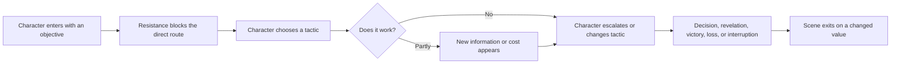
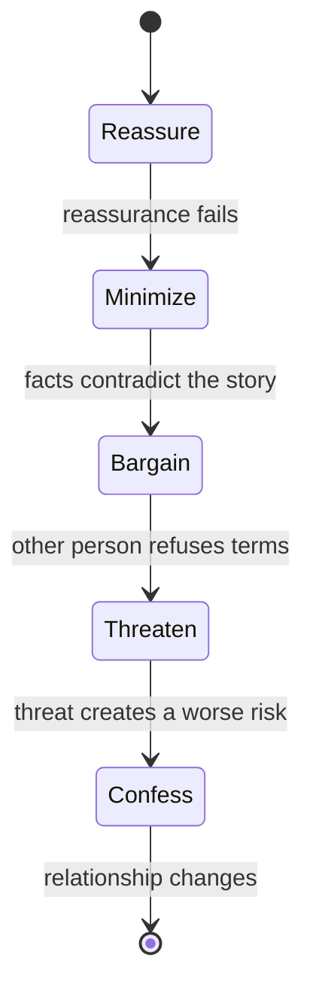
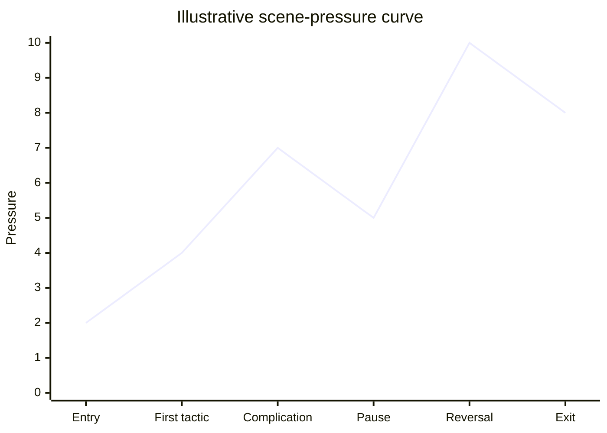
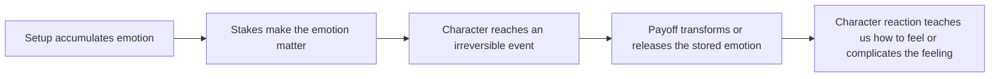
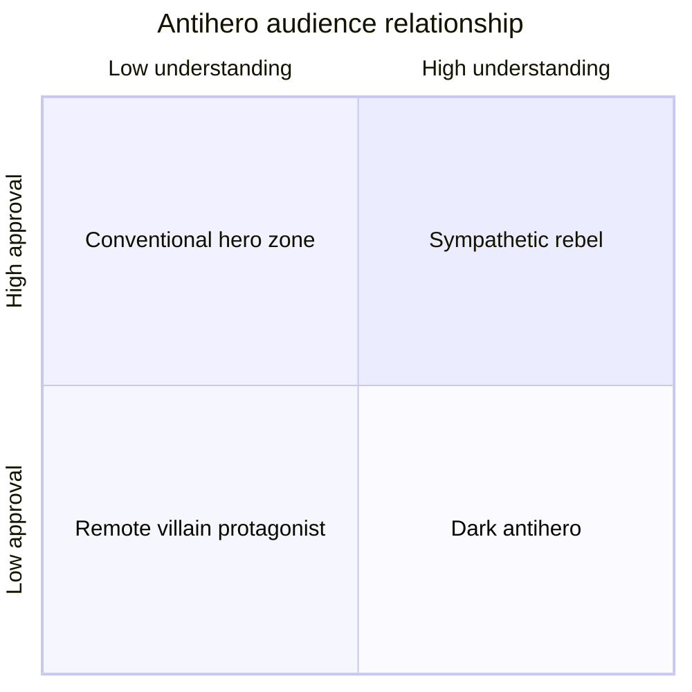
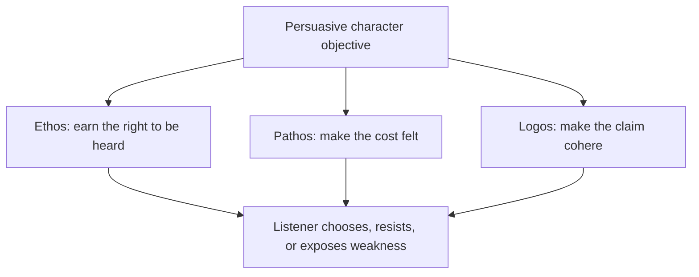
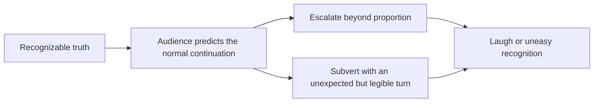
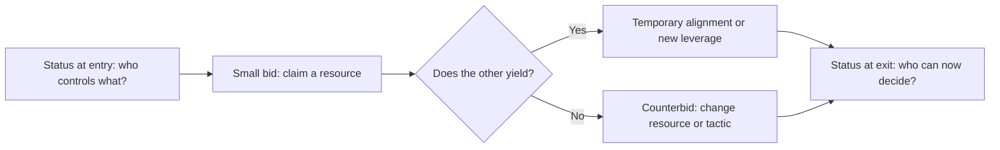
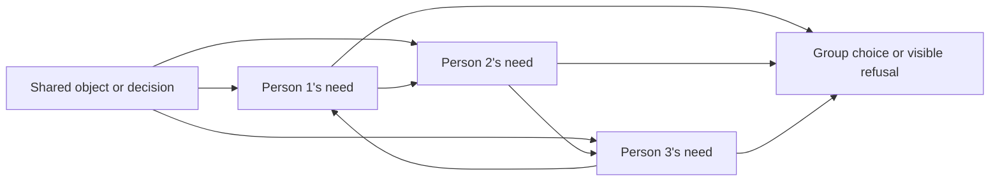

---
tags:
  - scriptwriting
  - continuous-notes
  - scenes
  - dialogue
  - character
source_playlist: StudioBinder playlist supplied 2026-10-24
source_batch: Videos 37-72
---

# Scenes, Dialogue, and Character

> [!tip] Use the expanded teaching laboratory
> [[02 - Scenes, Dialogue and Character#Advanced scene laboratory: pressure, behavior, and form|Advanced scene laboratory]] · [[02 - Scenes, Dialogue and Character#Style is a choice about how attention sounds|Dialogue styles and actor-playable choices]] · [[02 - Scenes, Dialogue and Character#Page-verified scene studies: *Lady Bird*|Actual script studies]]
> The new sections add worked decisions, examples, failure-and-repair tests, and practice. The research ledger in [[04 - Story Design, Structure and Practice#Research ledger — craft expansion, 29 October 2026|Volume 04]] records exactly what was inspected.


Start with a small problem. Maya sets a key between herself and her brother. He reaches for it; she closes her fist around it. A door handle turns. She puts the key in his hand. This bounded stretch of action, usually held together by one time and place, is a **scene**.

At first, Maya appears to want to keep the key. The immediate result a person wants is their **objective**. Her brother reaches for it, making that result harder: he supplies **resistance**. She closes her fist to stop him. That is a **tactic**, a way of trying to get the result.

Then the door handle turns and she hands him the key. The situation has changed: what looked like a struggle over possession becomes a handoff under a new threat. That meaningful change is a **turn**. It can change what someone knows, who has control, or how people relate to one another. It does not have to surprise us.

This is one of four connected Script volumes. [[01 - Screenplay Format]] explains how to lay out a screenplay; [[03 - Story Devices and Placement]] follows how story devices shape what the audience knows and when; [[04 - Story Design, Structure and Practice]] connects these scene choices to the design of a complete story.

A scene does not become dramatic just because it is long, loud, or visually busy. Pressure matters when it makes someone choose what to do. A **character** emerges through patterns in those choices. **Dialogue** is the spoken words; a character may use them to persuade, hide, test, or resist. A look or action can do the same work.

The teaching order follows the craft problems, not the playlist order. Examples use **Fountain**, a plain-text way to mark screenplay elements so software can format them. Volume 01 explains the limits of that markup. English captions from the supplied playlist provide the main craft sources; links and the closing coverage table show what evidence was available.

## Put the dramatic scene into Fountain

Now the same kind of choice appears as a page. The notation in `01 - Screenplay Format` controls how the screenplay is laid out; it does not create the dramatic change for you. Read the scene first for the objective, resistance, tactic, and turn, then preview the Fountain in Beat or another renderer:

~~~fountain
INT. APARTMENT - KITCHEN - NIGHT

MAYA, soaked, sets a key on the table between herself and her brother.

ARUN
You said you lost it.

MAYA
I said I couldn't find it.

He reaches for the key. She closes her fist around it.

ARUN
(quietly)
If you walk out with that, they know where to look.

MAYA
They already know.

The FRONT DOOR HANDLE turns.

Maya puts the key in Arun's hand. He thought she came to take it.
~~~

Read the first line again: it names the kitchen and the time. That is a **scene heading**, often called a **slug**. The description beneath it is **action**: what we can see or hear. Before each spoken line, a **character cue** names the speaker. Their words are **dialogue**. The small instruction `(quietly)` is a **parenthetical**, which can clarify delivery or whom the speaker addresses.

Now look at Maya saying she could not find the key while keeping her fist closed. The words and action do not tell the same simple story. That extra meaning beneath the literal words is **subtext**. A character’s **voice** is their recognizable way of speaking and noticing things. The closed fist and the handoff are each a small step in the exchange; such a step is often called a **beat**.

The reference table below also includes ways to show how speech sounds. An em dash marks an interruption; an ellipsis marks a thought trailing off. `^` asks the formatter to place simultaneous speeches side by side. `V.O.` marks voiceover, such as narration heard over an image. `O.S.` marks someone in the present physical scene who speaks from outside the image.

These conventions help us follow the scene. They cannot decide whether Maya’s handoff feels believable. Keep planning labels in an outline or scene card rather than putting explanations such as “this is the turn” inside the screenplay.

### The dialogue tool kit, expressed as elements

| Craft move | Fountain pattern | Test |
|---|---|---|
| Character-specific voice | `MAYA` then her own dialogue | If cues are swapped, can the reader still identify the speaker? If not, strengthen word choice, rhythm, knowledge, and tactics. |
| Subtext | `MAYA` + literal line whose action contradicts/complicates it | What does she want the other person to believe? What is she avoiding saying? |
| Parenthetical | `(quietly)` below the cue | Would the line's meaning be misunderstood without it? Prefer action or context when that can do the work. |
| Pause / beat | A short action line between dialogue turns: `Maya waits.` | What changes during the silence? Avoid parenthetical `(beat)` as default punctuation. |
| Interrupting line | Character dialogue ending in an em dash | Is interruption caused by pressure, not merely used to simulate liveliness? |
| Trailing off | Character dialogue ending in ellipsis | Is the thought incomplete, fading, or withheld? Do not substitute it for a specific cut-off. |
| Overlap | Second cue ends in `^` | Is simultaneous speech dramatically essential and readable in the export? |
| Voiceover / offscreen | `MAYA (V.O.)` / `MAYA (O.S.)` | Does narration add a distinct perspective? Is the offscreen sound/location clear? |
| Text message / readable insert | `ON THE PHONE: “DON'T OPEN THE DOOR.”` in action | Is the exact wording plot-critical? If it is not, summarize the visible behavior. |

The table shows available page conventions, not a checklist. Use a device only when it helps the reader understand the exchange. The writer still decides what each character wants, what they imply beyond the literal words, and how pressure grows. **Escalation** means that pressure increases as the cost, difficulty, or danger rises; it need not mean that voices get louder. A character-specific voice comes from what that speaker notices, knows, and chooses to say.

## The smallest complete dramatic unit

Before drafting dialogue, make the immediate situation easy to picture. Ask these six questions; they identify whose goal drives the moment, what blocks it, and what can change:

1. **Who owns the immediate objective?**
2. **What observable result do they want before the scene ends?**
3. **Who or what resists that result?**
4. **Why must it happen now?**
5. **What tactic will the character try first, and what forces a new tactic?**
6. **What is true at the end that was not true at the beginning?**

The last answer identifies the turn: what has changed by the end. A turn may shift what someone knows, who has power, their intimacy (felt closeness), whether they are safe, what they commit to, or what they hope for. “Status” here means a temporary advantage in this particular exchange, not a person’s worth.

| Scene value | Possible opening state | Possible closing state |
|---|---|---|
| Knowledge | The suspect appears innocent | The detective notices a contradiction |
| Power | The employee needs approval | The employee reveals leverage |
| Intimacy | Two people perform politeness | One admits the real wound |
| Safety | The room seems ordinary | An offscreen sound makes escape urgent |
| Status | One person controls the meeting | The subordinate makes the decisive choice |
| Commitment | The hero can still retreat | The hero crosses a threshold |

The scene does not always have to reverse from positive to negative. It can intensify in the same direction. “Unsafe” may become “trapped.” “Attracted” may become “committed.” The requirement is meaningful change, not mechanical reversal.



This is why elegant dialogue can still feel still: the speakers may be describing feelings without trying to change the other person’s choice, knowledge, or behavior.

## Want, need, wound, and the pressure of the scene

Suppose a person wants to win an argument with their brother. They might succeed by exposing a secret, but destroy the trust they were trying to recover. Getting the immediate prize and becoming able to care for the relationship are different changes.

The conscious result they pursue is their **want**. The deeper change they may struggle to recognize—here, learning to value trust more than winning—is their **need**. The main character whose choices we follow is the **protagonist**. Their pattern of change across the story is a **character arc**. A scene can let us see that change beginning without making the person announce it.

Why might this person keep treating family exchanges as competitions? Perhaps a painful earlier rejection still shapes their choices. That past hurt is sometimes called a **wound**. When its influence keeps returning, writers may call it a **ghost**. These are optional ways to think about a character; you do not have to invent one traumatic explanation for every behavior.

Another person may repeatedly challenge the belief that winning is the only way to be safe. In this model, that person is an **impact character**: their presence makes it harder for the protagonist to keep living by the old belief. [How to Write a Character Arc — “Positive Change” Character Arcs Explained](https://www.youtube.com/watch?v=CS1QkWSnP_o) distinguishes these ideas. The available caption focuses on the semi-sweet ending in *Rain Man*, so that is the material used here. The list below is a reference after the example:

- A **want** is external, conscious, specific, and plot-driving.
- A **need** is internal, often unrecognized, more universal, and arc-driving.
- A **ghost** is a past wound whose influence remains active.
- An **impact character** collides with the protagonist's old belief and makes change difficult to avoid.

These ideas also help at scene scale. A character can chase an immediate want while the events quietly test whether they are ready to meet a need. The scene need not name that deeper change; it can show the character defending an old belief or trying to control the same thing again.

### Worked reading: Charlie and Raymond

Charlie treats the inheritance as his problem to solve, so money and custody become his immediate wants. The **ghost** is the past wound still shaping him: his separation from his father. His need is to loosen his resentment and reconnect with family. Raymond is the **impact character**—the person whose presence pressures the protagonist’s old belief—because caring for Raymond forces Charlie to face that history in the present.

This creates two simultaneous scene tracks:

| Track | What Charlie consciously pursues | What the scene is actually testing |
|---|---|---|
| Plot | Money, custody, control | Whether Charlie treats Raymond as a person or an instrument |
| Arc | Winning the immediate argument | Replacing selfishness with care |

Do not save the need as a final-page revelation. Let the audience sense it earlier in what the character overreacts to, avoids, misunderstands, or keeps trying to control. The need can become clear through choices before the character has words for it.

### The four ending combinations

The caption maps want and need into four outcomes:

| Ending | External want | Internal need | Typical emotional effect |
|---|---:|---:|---|
| Sweet | Achieved | Achieved | Fulfillment |
| Bittersweet | Achieved | Missed | Success with spiritual loss |
| Semi-sweet | Missed | Achieved | Sacrifice, maturity, healing |
| Bitter | Missed | Missed | Defeat and non-growth |

A **semi-sweet** ending lets the character miss the external goal but make the inner change. Charlie does not gain custody; he acts in Raymond’s interest instead. That behavior is evidence of his **arc**, or change across the story. A character’s declaration that they have learned something is weaker proof than a final choice the earlier version could not have made.

## Conflict is a system, not an argument

[The Rule of 3 Explained](https://www.youtube.com/watch?v=TUFHJMuunxA) separates conflict into three useful layers. **Conflict** means something makes the character’s chosen path difficult; it does not require a quarrel.

1. **Internal conflict**: competing needs, values, fears, or identities inside one person.
2. **Interpersonal conflict**: people want incompatible outcomes from one another.
3. **Extrapersonal conflict**: institutions, society, environment, time, technology, or material conditions resist the character.

A scene can draw pressure from one layer or combine several. When a personal choice, another person’s demand, and an outside rule collide, the character has fewer easy exits.

### Example: a doctor must disclose an error

| Layer | Conflict |
|---|---|
| Internal | Preserve self-image versus accept responsibility |
| Interpersonal | The patient wants the full truth; the doctor wants to control the disclosure |
| Extrapersonal | Hospital procedure and legal exposure limit what can be said |

With only interpersonal conflict, the scene may become a simple disagreement. Internal conflict gives the doctor a reason to hesitate even when the patient asks a clear question. The hospital’s rules add a practical obstacle, so walking away does not settle the problem.

### Conflict should alter tactics

A **tactic** is the method a character uses to move someone toward the goal. The list below gives possible methods. Name the tactic privately while planning; let the finished dialogue and behavior carry it without labels.

- Reassure.
- Shame.
- Seduce.
- Distract.
- Bargain.
- Threaten.
- Minimize.
- Confess partially.
- Appeal to duty.
- Invoke shared history.
- Withdraw to make the other person pursue.

If every line applies the same kind of pressure, the exchange tends to stall. Let the other person’s response cause a change of method. A threat that fails may lead to a bargain; a bargain may reveal that the speaker is actually afraid.



The diagram is a pressure path, not a formula. The important feature is that each new tactic is caused by the failure or cost of the previous one.

## Stakes: make the cost specific

[Tarantino Dialogue — How *Kill Bill* Keeps Us Hooked](https://www.youtube.com/watch?v=_RNpyhJK65c) argues that a long scene should make its risk clear early. **Stakes** are the specific costs of success or failure; they can be a lost relationship, public exposure, money, or time. They do not have to involve death.

| Weak statement | Dramatic statement |
|---|---|
| The meeting is important | If Mara fails to obtain the signature today, the shelter closes before winter |
| He wants her trust | If she catches one more lie, she takes their son and leaves that night |
| The secret matters | Revealing it saves the patient but exposes the doctor who falsified the chart |

A vague statement that something is “important” gives the audience no way to measure pressure. Make the cost concrete by asking:

- What changes if the character succeeds?
- What changes if the character fails?
- Why can the decision not be postponed?
- Who else pays for the result?

## Scene structure: movements inside the scene

A long scene often changes shape as it goes. Its **movements** are larger stretches of action, each with a different immediate aim or kind of pressure. A short scene can have them too, but it does not need a miniature three-act structure to be complete.

The *Kill Bill Vol. 2* confrontation analyzed in [Tarantino Dialogue](https://www.youtube.com/watch?v=_RNpyhJK65c) divides into three movements:

1. **Physical**: the Bride enters, danger is immediate, and Bill gains physical control.
2. **Intellectual**: the scene downshifts into the Superman argument.
3. **Emotional**: the metaphor turns toward Beatrix's identity and the cost of her choices.

The scene holds attention because the relationship keeps changing: physical control gives way to an argument about meaning, which then becomes personal. The subject changes, but so do the power and the kind of pressure between them.

### A scene movement worksheet

| Movement | Immediate objective | Dominant mode | Turn that ends the movement |
|---|---|---|---|
| 1 | Gain entry or control | Physical | Someone demonstrates power |
| 2 | Define what events mean | Intellectual | The argument becomes personal |
| 3 | Force admission or choice | Emotional | A truth changes the relationship |

A new topic is not automatically a new movement. Two people can discuss several subjects while still doing the same thing to each other. A movement begins when their action changes—for example, a question becomes an accusation, or an argument becomes a request for help.

## Pacing begins on the page

[How to Pace Your Film](https://www.youtube.com/watch?v=a9reuDw4cnU) describes **pacing** as the speed at which a story is told. A story can slow down to make us wait or speed up through a run of events; keeping one tempo throughout often limits contrast.

### Micro and macro pacing

- **Micro pacing** is the rhythm inside one scene: actions, pauses, and exchanges.
- **Macro pacing** is the rhythm across longer stretches: scene and sequence lengths, act shape, and where major events fall.

The page can invite a faster or slower reading, though it cannot dictate exact screen duration. For example:

- Short action bursts, ellipses, and white space can sharpen tension.
- Longer action passages and explicit moments of looking or waiting can make time expand.
- Rapid dialogue with few action interruptions develops its own rhythm.
- Short fragmented scenes can depict a life spiraling out of control.
- Multiple simultaneous conversations make the protagonist and audience process competing demands.

Think of the page as a guide to attention. White space alone does not make a scene fast, and a dense paragraph does not guarantee a slow film. What matters is what the words ask the reader to notice and how that changes over the scene.

### Pace curve



The pause is not dead time. It creates contrast and gives the reversal room to land. Constant acceleration can exhaust attention because there is no lower level against which intensity can register.

### The production translation

The screenplay begins the rhythm, but performance, camera, sound, and editing complete it. A writer can still make the intended pulse clear:

- Silence can reveal inner struggle.
- A long beat can set up comedy.
- A moving long take can feel fast when action and camera are chaotic.
- A locked frame can let tension accumulate.
- Rapid cuts can increase tempo.
- A long hold can make grief or danger difficult to escape.
- Music can create urgency even over calm images.

The writer does not need to prescribe every cut. Make the important rhythm clear enough that collaborators can see what the scene must preserve, while leaving ordinary timing choices to performance and editing.

## Blocking: power made visible

**Blocking** is where performers stand and how they move through a space. Because position changes who can approach, leave, or face whom, blocking can carry story information. [Interrogation Scenes in Movies](https://www.youtube.com/watch?v=GPEihtvIf9M) uses good cop/bad cop to show how movement and dialogue can serve one shared goal.

### Good cop/bad cop geometry

**Good cop/bad cop** is a paired interrogation tactic: one questioner appears threatening while the other seems safer. Both are trying to get the same result.

- Good cop often sits at the suspect's level and appears calm.
- Bad cop may remain standing, distant, or brooding in the background.
- Good cop leads the questioning.
- Bad cop interrupts, invades, or threatens.
- Despite different behavior, both interrogators pursue the same result.

The arrangement offers the suspect two apparent paths: one interrogator seems to offer relief while the other supplies the threat. Their styles differ, but both work toward the same result.

```text
                [BAD COP]
             standing / mobile
                    ↓ threat

 [GOOD COP]  ↔  [SUSPECT]
 seated, level    seated
 apparent safety
```

When *The Big Lebowski* parodies the device, it removes the underlying control: both men stay seated, shout over each other, and pursue different questions. The comedy comes from spectators recognizing the expected form and seeing each functional part fail.

### Blocking vocabulary for writers

| Choice | Common dramatic implication | Use with care because... |
|---|---|---|
| Same eye level | Equality, negotiation, temporary balance | Dialogue may still contain a hidden imbalance |
| One standing, one seated | Authority, impatience, threat | It becomes generic if every power scene uses it |
| Character between another and exit | Control, protection, entrapment | Clarify geography before the block matters |
| Increasing physical distance | Withdrawal, distrust, fracture | Distance may read as simple movement without relational context |
| Crossing into private space | Seduction, intimidation, urgent care | Meaning depends on established boundaries |
| Shared frame | Alliance, intimacy, mutual problem | Composition can also make the pair feel trapped together |
| Isolated singles | Separation, suspicion, incompatible realities | Overuse can flatten spatial interaction |

### From beat to shot intention

[How to Make a Shot List for Film](https://www.youtube.com/watch?v=IhXMpBk3GDA) breaks a short story about a pen into planned shots. A **shot** is one camera view; a shot list records the views a production may need. For the screenwriter, connect a visual change to information the audience needs instead of adding a camera direction for decoration.

- Master wide establishes geography.
- Eye level is relatively neutral.
- Low angle can suggest power or danger.
- Moving from low angle to eye level can show two characters becoming equally matched.
- Static camera as the baseline makes a later handheld shift communicate chaos.
- Close-up or insert isolates a plot-critical object.
- Repeating an earlier composition can create a callback.
- Reversing a pedestal movement can visually close a movement opened earlier.

Write the dramatic function first. A screenplay that says “LOW ANGLE” without a reason is borrowing emphasis before it knows what deserves emphasis.

## Suspense: time, stakes, uncertainty

[The 3 Essential Elements of Suspense Explained](https://www.youtube.com/watch?v=FHXh_uy6gT4) offers a compact model. **Suspense** is sustained anticipation: we understand a possible danger or outcome and wait to learn what happens.

$$
\text{Suspense} = f(\text{time},\ \text{stakes},\ \text{uncertainty}).
$$

The equation below is a reminder to consider how these ingredients work together, not a formula that predicts audience response.

- **Time**: how long the audience waits for resolution.
- **Stakes**: what the outcome can destroy, protect, or transform.
- **Uncertainty**: how unsure the audience remains about outcome, cause, or identity.

### The suspense control panel

| If you change... | You can create... | Failure mode |
|---|---|---|
| More time | Dread, anticipation, painful waiting | Delay without new pressure becomes stalling |
| Higher stakes | Greater emotional weight | Stakes stated but not dramatized feel abstract |
| More uncertainty | Curiosity, suspicion, fear | Total confusion prevents anticipation |
| Less uncertainty | Inevitable dread | If outcome feels harmless, certainty deflates tension |

### Worked example: waiting outside the robbery

In the *Drive* example, the scene stays outside during the robbery. We hear clothing, footsteps, distant traffic, the engine, and a ticking watch, but do not see what is happening inside. This **information boundary**—the limit on what the audience can learn—makes waiting part of the suspense. For your own scene, decide what the audience can hear or see and what remains beyond reach.

### Worked example: the blood test

In *The Thing*, repeated close views of blood, a heated wire, and each suspect establish a procedure. Because each person is tested the same way, the audience waits for a result. The pattern makes the reveal sharper. After one negative result, the scene briefly widens, giving the audience a breath before pressure resumes.

### Worked example: the basement

In *Zodiac*, a man who seemed helpful may be the killer. The framing tightens, contrast-heavy shadows obscure him, and slow movement stretches the wait before the character can escape. These film choices follow the character’s changing understanding of the danger; they are not a general instruction to write camera directions into every suspense scene.

## Setup, payoff, and the promise economy

[What is Chekhov's Gun](https://www.youtube.com/watch?v=zQ1Feczm93A) treats an emphasized detail as a promise to the audience. A **setup** plants that detail; a **payoff** returns to it later with practical or emotional force. The “gun” need not be a weapon: it may be an object, a line, repeated behavior, a fact, a relationship, or an image.

How the promise feels depends on three things:

1. **Visibility**: how strongly the setup is presented.
2. **Relevance**: how clearly the audience understands its possible importance.
3. **Velocity**: how soon payoff follows setup.

| Setup pattern | Audience experience | Example use |
|---|---|---|
| High visibility, high relevance, slow payoff | Sustained suspense | Blood on a white shoe |
| Repeated visibility, unclear relevance | Curiosity | A baseball passed through scenes |
| High visibility, unclear relevance, climax payoff | Large explicit promise | A wall of knives |
| Strong setup, unexpectedly small payoff | Misdirection | Important-looking clue becomes an addendum |

A payoff need not make the object perform a practical job. It should reward the attention the story gave it. A photograph might matter because of who kept it, not because it hides a clue.

## Catharsis: the scene must release what the story stored

[Every Great Story's Secret Weapon — Catharsis Explained](https://www.youtube.com/watch?v=owxQGzgipaY) uses **catharsis** to mean an emotional release or clearing. In scene writing, the release has to grow from feeling the story has already built.

At its simplest:



The strongest release may answer a relationship question rather than the plot’s biggest practical question. In *The Shawshank Redemption*, escape matters, but Andy and Red’s reunion pays off the bond that gives the story much of its emotional force.

The source describes Aristotle’s tragic possibilities using two questions: does the character know what they are doing, and is the harmful act completed or stopped? No combination is always best. Each allows a different kind of recognition and emotional response.

| Knowledge/action combination | Dramatic possibility |
|---|---|
| Knows, stops | Relief; risks feeling like an idle threat |
| Knows, completes | Moral horror: the character chooses the wrong despite understanding |
| Does not know, completes | Discovery arrives too late; pity and irreversible tragedy |
| Does not know, stops | Recognition before catastrophe; room for reflection and change |

A breakdown, reunion, sacrifice, or triumph can release only what earlier scenes have built. Prepare the feeling through choices and consequences, so the final event has something to resolve or transform.

## Character architecture: four useful distinctions

[4 Types of Characters in a Film](https://www.youtube.com/watch?v=Wx43amro98c) separates two questions about a character. **Flat or round** describes how many sides the story reveals; **static or dynamic** describes whether the character meaningfully changes.

- **Flat versus round** asks how many dimensions the character presents.
- **Static versus dynamic** asks whether the character changes.

|  | Static: remains substantially the same | Dynamic: meaningfully changes |
|---|---|---|
| **Flat: built around a dominant quality** | Stable guard, comic function, emblematic antagonist | Minor figure whose limited but clear arc warns or assists the protagonist |
| **Round: complex and contradictory** | Deeply realized person whose constancy drives the plot | Complex protagonist whose inner change becomes the story's arc |

None of the four combinations is automatically better. A story needs different kinds of characters for different jobs:

- Flat peripheral characters conserve attention.
- Flat characters can embody ideas in satire.
- A static friend can expose the protagonist's change.
- A static antagonist can preserve conflict pressure.
- Sitcoms often depend on static dynamics that reset.
- A dynamic character can supply narrative movement even when external plot is minimal.

### *The Shawshank Redemption* as a mixed ensemble

An **ensemble** is a group of characters who each influence the same story. They need not all have equally large roles.

- Hadley: flat and static; cruelty remains a stable institutional force.
- Andy: round and largely static; complicated, but unwavering in the goal of freedom.
- Red: round and dynamic; cynicism changes into hope.
- Brooks: relatively flat and dynamic; his smaller arc warns what institutionalization can do.

An **ensemble** is a group of characters whose actions shape the same story. Give each person a useful pressure or function. A minor character does not need a hidden biography to feel human; a clear choice or point of view may be enough.

## Character dynamics begin with who, what, where, and want

[How to Create a TV Character and Develop Their Arc](https://www.youtube.com/watch?v=fYgw0i0HvMI) begins with three questions about the person and adds a fourth about relationships. The approach helps turn biography into present action:

### Who?

- Who is the story about?
- What immediately legible traits, roles, and contradictions define them?

### What?

- What happened to them?
- What is happening now?
- What might happen later?

**Backstory** is what happened before the story begins. It matters in a scene when it affects what the character does now; a past event that changes no present choice may not need to be explained.

### Where?

A setting helps determine who belongs in the story and what they can do. A school, hospital, spaceship, or family home creates its own roles and rules. Period and culture shape those relationships further, so setting can generate conflict as well as atmosphere.

### Want between every pair

For each important relationship, name the two-sided desire: “A wants ______ from B, while B wants ______ from A.” Then add what each person will not give. The mismatch shows where recurring friction can come from.

| Pair | A wants | B wants | Source of recurring conflict |
|---|---|---|---|
| Mentor / student | Obedience and continuation | Independence and recognition | Guidance feels like control |
| Partners | Reliability | Freedom | Each defines trust differently |
| Parent / child | Safety | Respect | Protection prevents agency |
| Rivals | Admission of superiority | Proof of fraud | Neither can concede without identity loss |

A **relational matrix** is a simple map of what each pair wants from one another. In a continuing series, these changing relationships can generate new scenes long after one plot has ended.

## Archetype as energy: the leader

[Character Archetypes: The Dynamic Leader](https://www.youtube.com/watch?v=tLNNiZjkEmc) presents a **leader archetype**: a familiar pattern of behavior that helps the audience recognize a character’s role. This version is focused, confident, motivated, and quick to act.

The same trait must create strength and weakness:

| Strength | Shadow |
|---|---|
| Focus | Tunnel vision |
| Confidence | Arrogance |
| Motivation | Obsession |
| Decisiveness | Recklessness |
| High standards | Domination or perfectionism |

A leader can restart a stalled scene because they choose action. Their morality changes the story's tone: courage inspires; sociopathy manipulates; intelligence solves; delusion produces catastrophe.

Pairings:

- **Leader + leader**: cooperation or rivalry between two high-force characters.
- **Leader + free spirit**: plan versus impulse; the free spirit forces detours and compromise.

Use an archetype to find the energy a character brings into a scene, not as a substitute for their history or individuality. A leader becomes particular through the beliefs, relationships, and limits that shape how they lead.

## The antihero: understanding without approval

An **antihero** is the central character who lacks some qualities audiences usually expect of a hero. [What is an Antihero](https://www.youtube.com/watch?v=iI75W7M4Puw) suggests separating two audience responses:

- Does the audience **understand** the action?
- Does the audience **approve** of the action?



These labels are guides, not fixed audience categories. Viewers may understand a choice without approving of it, or feel sympathy while judging the character’s actions.

### Methods for building understanding

- Backstory that reveals the formative wound.
- Internal monologue that exposes loneliness, resentment, or self-justification.
- A motivation with more than one layer.
- A setting that rewards or teaches corrupt behavior.
- Visible conflict between what the character wants to be and what they keep doing.

Understanding does not excuse harm. Rorschach’s past can help explain his severity without making it right. Walter White becomes harder to approve of as his power grows, even while the desire for respect remains understandable.

### Tone changes moral distance

Campy, stylized violence can keep an audience aligned with a revenge protagonist. Realistic, painful violence can make a similar revenge path feel dehumanizing. So tone affects how close the audience feels to the character and how it reads the violence. It is part of the story’s moral framing, not only its visual style.

### Thematic relevance

Ask what larger system the antihero reflects. Jordan Belfort’s greed is personal, but his methods also echo and intensify Wall Street’s incentives. The character has more staying power when private appetite and public context reinforce each other.

## Villains deserve complete dramatic treatment

[Story Structure Explained — *Infinity War* vs. Save the Cat](https://www.youtube.com/watch?v=BDIayz-hyKk) maps Thanos onto the fifteen Save the Cat beats. This is a structural comparison, not a moral one: an antagonist can pursue a complete line of action, just as a hero does.

An **antagonist** is a character or force that blocks the protagonist’s goal. To keep antagonist scenes from repeating the same obstacle, give the opposing character:

- A clear objective.
- A rationale they can articulate.
- A relationship that tests the objective.
- Internal and external opposition.
- Sacrifice and cost.
- A moment of apparent defeat.
- A renewed plan.
- A finale in which their transformation or unwavering belief becomes behavior.

If the villain only appears to stop the hero, each scene repeats the same move. When the villain pursues a goal, tests a belief, pays a cost, and adapts after failure, their decisions help create the story.

### Antagonist beat audit

| Question | Weak antagonist | Developed antagonist |
|---|---|---|
| What do they want? | “Stop the hero” | Restore what they believe is a necessary order |
| Why now? | Plot requires confrontation | A deadline or catalyst closes previous options |
| What do they sacrifice? | Disposable henchmen | A relationship, belief, status, or part of self |
| What can make them doubt? | Nothing | Evidence that their method violates their stated value |
| How do they adapt? | Increase force | Change plan, recruit, deceive, bargain, or reinterpret failure |

## Character in factual stories

A **biopic** is a dramatic story based on a real person’s life. [Are Biopics Good Cinema?](https://www.youtube.com/watch?v=1Uhw-O_QywA) warns against trying to cover a whole life in order. Research supplies material; the writer must select the part that makes a coherent drama.

- Find the universal theme within the specific life.
- Choose where the movie begins and ends.
- Consider one intense event rather than cradle-to-grave coverage.
- Consider one relationship as the way into the subject.
- Decide the subject's narrative role: hero, antihero, witness, artist, rival, parent, reformer.
- Ground an icon through youth, vulnerability, contradiction, sympathy, and flaw.
- Preserve the person's recognizable essence while creating a coherent narrative.

Research becomes useful on the page when it helps you picture what a person does. Ask:

- What did the person touch, wear, avoid, repeat, or collect?
- How did the real location constrain movement?
- What did their body know how to do?
- Who could contradict them without fear?
- Which relationship reveals a side absent from public history?

The aim is not a perfect impersonation or permission to invent anything. Shape the verified material into drama, and make any departures deliberate rather than accidental.

## Dialogue is action under social constraint

Dialogue is what a character says; the dramatic action is what the line tries to do. The two do not have to match. “You should get some sleep” might be a caring offer, a way to end a meeting, or an attempt to avoid a confession. Context—goal, relationship, timing, and withheld information—changes how the same words land. That extra meaning is **subtext**: what the exchange implies beyond its literal wording.

### Build subtext from asymmetry

Subtext often appears when the characters know different things, interpret the same event differently, or cannot safely say what they mean directly. A harmless topic can then carry a second conversation:

| Surface conversation | Hidden dramatic exchange |
|---|---|
| Discussing dinner | Testing whether the relationship still has a future |
| Reviewing a report | Deciding who will take blame |
| Asking about traffic | Delaying disclosure of an affair |
| Complimenting a speech | Warning the speaker that they sounded disloyal |

Do not hide a secret message under every sentence. Let the situation create the indirect meaning. When both people could say the truth safely, needless evasion may make them sound as though they are following a writing exercise.

## Voice: the character's selection system

A character’s **voice** is the recognizable way they notice and describe the world. It is more than catchphrases: it includes what they focus on, how they order their thoughts, and what they avoid naming.

Define voice through:

- Vocabulary range.
- Sentence length and rhythm.
- Concrete versus abstract language.
- Metaphor source: sport, religion, machinery, food, money, weather.
- Degree of certainty.
- Habit of answering directly or indirectly.
- Relationship to silence.
- Social performance: formal, intimate, defensive, comic.

Different slang is not enough. Two people should pick out different parts of the same event or give those facts different importance. That difference in attention makes their voices distinct.

### Voice contrast exercise

Event: a glass breaks during a tense family dinner.

- Controller: “Nobody move. There are shards under the table.”
- Appeaser: “It's fine. It was chipped anyway.”
- Accuser: “You always do this when the conversation turns to Dad.”
- Avoider: “Does anyone want coffee?”
- Child: “Are we in trouble?”

The broken glass is identical. Character appears in the chosen interpretation.

## The Rule of Three in dialogue

[The Rule of 3 Explained](https://www.youtube.com/watch?v=TUFHJMuunxA) introduces a **tricolon**, a series of three parallel words or phrases. The repeated shape creates rhythm and emphasis.

A group of three can also set up a joke. The first item points one way, the second confirms that pattern, and the third can complete it or break it. In the original example below, the late library book is much smaller than the crimes before it, so it punctures the pattern the first two items established:

> “He forged the signature, emptied the account, and returned the library book late.”

A three-part pattern can also build a threat, ritual, emotional accumulation, or a speaker’s attempt to sound certain. The final item may reveal what the speaker actually cares about.

- Escalating threat.
- Ritual.
- Emotional accumulation.
- A character trying to sound certain.
- A final item that reveals the speaker's real concern.

## Rhetorical dialogue: ethos, pathos, logos

[Ethos, Pathos, and Logos](https://www.youtube.com/watch?v=26HZjIjyIkQ) describes three ways a speaker can persuade: **ethos** (why the listener trusts them), **pathos** (what feeling or human cost matters), and **logos** (how the reasoning fits together). In a scene, these are choices a character can make, not boxes every speech must check.

### Ethos: why trust this speaker?

- **Phronesis**: intelligence, expertise, track record, or direct experience.
- **Arete**: moral character and the ethical value of the claim.
- **Eunoia**: goodwill, accessibility, and shared identity with the listener.

### Pathos: why feel this claim?

- Empathetic or sympathetic person.
- Vivid consequence.
- Shared memory.
- Analogy that turns abstraction into lived experience.

### Logos: why believe the reasoning?

- Evidence.
- Causal argument.
- Clear structure.
- Fair treatment of objections.
- Avoidance of logical fallacies.



A character’s argument need not be sound. A **straw man** misstates the other person’s position; a **false dilemma** pretends there are only two choices; a **circular argument** uses its conclusion as its proof. Such errors can reveal the speaker’s habits, but the writer should know what is happening even when the character does not.

## Metaphor as compressed character thought

A **metaphor** describes one thing through another to transfer a quality or way of seeing. [What is a Metaphor](https://www.youtube.com/watch?v=Aan0_wDrlvA) separates its parts:

- **Tenor**: the subject being described.
- **Vehicle**: the comparison that lends qualities.
- **Ground**: the quality they share.
- **Tension**: the ways they remain different.

Types useful in dialogue:

| Type | Form | Dramatic use |
|---|---|---|
| Direct metaphor | “The boardroom is a kennel.” | Bold worldview |
| Simile | “He circles like a dog guarding food.” | Qualified comparison |
| Analogy | Comparison plus explanation | Persuasion or teaching |
| Implied metaphor | Nonliteral verb without naming the vehicle | Subtle characterization |
| Extended metaphor | Repeated comparisons across a speech | Monologue structure |
| Mixed metaphor | Incompatible comparisons | Confusion or comedy |
| Dead metaphor | Familiar cliché | Social background or unimaginative voice |

Choose comparisons the speaker could plausibly reach for. A mechanic, priest, dancer, accountant, and child may describe the same problem through very different experiences.

### Metaphor versus symbol

A metaphor compares one thing with another and transfers selected qualities. A **symbol** is a concrete thing that also carries an additional meaning. A locked door may stand for exclusion; saying “her silence was a locked door” makes a metaphor.

A locked door may symbolize exclusion. “Her silence was a locked door” explicitly makes a metaphorical comparison.

## Parentheticals: precision without puppeteering

A **parenthetical** is a brief note beside dialogue that clarifies something the reader might otherwise misunderstand, such as who is addressed or whether a line is in another language. [When to Use Parentheticals in Screenplays](https://www.youtube.com/watch?v=iRzb1zuwxm4) lists six possible uses:

1. Emotional direction.
2. Brief physical direction within dialogue.
3. Line delivery.
4. Pacing or a beat.
5. Clarifying whom the line addresses.
6. Language or subtitle information.

Formatting principles:

- Place the parenthetical directly under the character name or between portions of the character's dialogue.
- Do not place it after the finished dialogue block.
- Keep it brief, normally a word or two.
- If it requires a full phrase or complicated action, use an action line.
- Avoid stacking adverbs.
- Use it only when delivery is not already clear from the words and action.
- Leave interpretive room for actors.

### Diagnostic test

Remove the parenthetical.

- If nothing changes, delete it.
- If the line becomes ambiguous in a productive way, consider deleting it.
- If the scene becomes unintelligible, first ask whether the dialogue or action should be rewritten.
- Keep the parenthetical when it supplies essential, concise information that cannot be inferred.

```text
MAYA
    (to Arun)
You knew.

ARUN
    (in Hindi; subtitled)
Not soon enough.
```

Use the format to make the exchange readable, not to prescribe every emotion. If the words and situation already show how a line should land, the parenthetical may be unnecessary.

## Monologues and stories within scenes

A **monologue** is an extended speech by one character. It still belongs to a scene: the speaker wants a response or effect, even if the listener is silent, absent, dead, imagined, or the speaker themselves.

The [Tarantino dialogue analysis](https://www.youtube.com/watch?v=_RNpyhJK65c) identifies three uses for an embedded story:

- Add humor.
- Delay an inevitable event and create suspense.
- Reveal character or internal conflict.

Bill’s Superman speech does more than explain his ideas. It becomes an argument about Beatrix’s identity, so the story he tells changes the pressure of their confrontation.

### Monologue audit

1. Who is the intended listener?
2. What response does the speaker want?
3. Why choose a story instead of a direct statement?
4. What does the story accidentally reveal?
5. Where does the listener gain or lose power during it?
6. What action follows the last line?

### Stories within stories

A **frame narrative** is a story that contains another storyteller or story. [The Hidden Element of Wes Anderson's Style](https://www.youtube.com/watch?v=eLwLR_XoMi4) shows how that frame can do more than decorate the plot. It can:

- Establish tone before the central action.
- Justify literary or visibly artificial dialogue.
- Make voiceover feel motivated.
- Allow fourth-wall breaks without destroying the form.
- Distinguish visual worlds for different narrators.
- Make the work reflect on why stories are told.

A frame also affects how much we trust the account. A memory may be precise, self-serving, incomplete, or stylized. Dialogue inside it can sound carefully composed because the story has shown us that someone is shaping the recollection.

## Interrogation scenes: dialogue as tactical warfare

An **interrogation scene** is an attempt to get information or a decision from someone who may resist. [Interrogation Scenes in Movies](https://www.youtube.com/watch?v=GPEihtvIf9M) describes three ways the interrogator can apply pressure:

### Good cop/bad cop

The interrogators behave differently but want the same result. The suspect is invited to see one as the safer person to trust.

### External threat

Threaten the person, object, or relationship the subject values most.

- State or demonstrate the stakes.
- Preview enough pain to make the threat credible.
- Give reaction space so the audience sees the internal decision.
- The threat may be real or fabricated.

### Deception

A **deception** makes the subject believe the situation is different from what it is. To make the audience accept the reveal, show how the trick worked and let earlier details gain new meaning. Otherwise the writer seems to have hidden information arbitrarily rather than letting a character outmaneuver someone.

### Interrogation beat grid

| Beat | Interrogator action | Subject action | Information change |
|---|---|---|---|
| Establish | Defines apparent rules | Performs confidence | Audience learns the stated objective |
| Probe | Tests a small fact | Gives controlled answer | A discrepancy appears |
| Pressure | Changes tactic | Protects vulnerable point | Hidden value becomes visible |
| Reversal | Subject exposes deception or leverage | Interrogator adapts | Power changes hands |
| Choice | Makes final offer or threat | Speaks, lies, or refuses | Scene exits with consequence |

## Comedy: truth, escalation, and subversion

[What Makes a Movie Funny?](https://www.youtube.com/watch?v=veSYRK8Sjbg) begins with a useful limit: no technique guarantees a laugh. Comedy depends on the audience, so craft can improve the chance of a response without controlling it.

### Start from a recognizable truth

Comedy often begins with something familiar—a fear, frustration, habit, or social contradiction—and makes us see it differently. *Dr. Strangelove* draws on Cold War paranoia, *Superbad* on the pain of high school, and *Office Space* on workplace boredom.

Then change the familiar pattern. **Escalation** pushes it farther than expected. **Subversion** establishes an expectation, then turns in a different direction. Both work best when the audience can recognize what changed.



### Comic dialogue tools

- Repetition.
- Wordplay.
- Verbal irony.
- Rule of Three.
- Meta-commentary.
- A character taking the wrong thing seriously.
- A character remaining serious while the world becomes absurd.

### Comic character pairing

A **straight person** is the character whose reaction helps the audience measure another character’s absurd behavior. **Deadpan** reverses the arrangement: the speaker treats an unreasonable situation as ordinary.

### Comedy in cuts and staging

- Wide staging lets the audience discover spatial gags.
- A pan, zoom, or focus shift can reveal the punchline.
- Production design can embody character absurdity.
- A smash cut can contradict the previous line.
- A Gilligan cut moves from “that will never happen” directly to it happening.
- A pause can build anticipation; rapid exchange can prevent recovery.

## Satire: comedy needs a target

**Satire** uses comedy to criticize a person, institution, practice, or belief. [3 Types of Satire Every Storyteller Should Know](https://www.youtube.com/watch?v=HTEUXulCJZY) describes it as moral outrage shaped into comic art. The audience needs to recognize the target.

| Type | Tone | Typical target/effect |
|---|---|---|
| Horatian | Light, playful, overtly comic | Expose folly and invite reflection |
| Juvenalian | Dark, abrasive, cynical | Provoke anger at abuse or inequality |
| Menippean | Variable from slapstick to tragedy | Attack a belief or moral attitude |

To plan a satire, name the practice or belief you are criticizing. Decide whether the audience should laugh, feel anger, or move between the two. Then choose how the scene will show the criticism—through irony, exaggeration, a tonal clash, setting, or propaganda language. Check the target again in revision: without a clear critical frame, the work may repeat the harmful idea it meant to challenge.

Flat characters can be useful here because they embody ideas. [4 Types of Characters](https://www.youtube.com/watch?v=Wx43amro98c) notes that *Dr. Strangelove* uses one-dimensional types to make the critique broadly applicable.

## Tropes: use audience memory deliberately

A **trope** is a familiar story device or pattern: a character type, repeated kind of dialogue, plot shape, or image. [Tropes Explained](https://www.youtube.com/watch?v=lLcM9mh9sic) describes how audiences learn to recognize these patterns.

A familiar pattern can establish a role or genre quickly, save explanation, invite homage, or set up a misdirection. You can also exaggerate or subvert it by changing the expected power, identity, or outcome. It fails when recognition replaces a particular character or repeats a harmful stereotype.

### Character trope pass

For a detective, mentor, femme fatale, chosen one, or comic relief figure, ask:

1. What useful expectation does the trope create?
2. Which expected quality will be honored?
3. Which will be complicated?
4. What interiority does this version possess that the type often lacks?
5. Does the trope carry a harmful cultural assumption?

### Dialogue trope pass

Familiar lines such as “you don't have to do this” may now read as comedy. A trope can still work if the exact character, timing, and consequence renew it.

### Visual trope pass

A haunted house, abandoned warehouse, perfect suburb, traumatic haircut, or hero walking from an explosion is cinematic shorthand. The writer should know what meaning the audience supplies before deciding to fulfill, delay, or overturn it.

## Dreams: interiority without explanation dumping

A **dream sequence** presents an experience that may not follow waking reality. It differs from a daydream, nightmare, hallucination, or premonition, though a story may blur those boundaries. [Writing a Dream — The Secret Behind Iconic Dream Sequences](https://www.youtube.com/watch?v=IHV22zD15xI) considers several purposes:

A dream can:

- Show desire.
- Show fear.
- Reveal a trait or general mental state.
- Produce a fake-out.
- Carry theme through open-ended imagery.
- Trigger the plot through premonition.
- Supply evidence or direct an investigation.

A dream can feel like a shortcut if it supplies whatever fact the plot needs. Ask what it lets the audience experience that waking behavior, dialogue, or imagery could not do as well.

### Formatting follows purpose

- Hide the dream label when disorientation or fake-out is the goal.
- Mark a distinction in the slug line without fully explaining it.
- Use `CUT TO:` when the transition should feel jarring.
- State in action that the character wakes when clarity matters.
- Label `DREAM` or `NIGHTMARE` in the scene heading when surprise is unnecessary.
- For flashes, describe the intercut in action rather than creating a complete new scene.
- Stylized typography can suggest chaos, but clarity remains the governing standard.

No single format suits every dream. Decide how much the audience should recognize and when; then keep the page clear enough to support that experience.

## Intercutting parallel scenes

An **intercut** alternates between two or more scenes. It can show events happening at the same time, compare different actions, connect ideas, or follow a conversation across locations. [How to Intercut Scenes in a Script](https://www.youtube.com/watch?v=XcPJxHA3lt8) describes several page conventions:

Accepted approaches include:

- `INTERCUT` as a transition followed by a subheading.
- An action line announcing that the sequence intercuts with another location.
- A subheading such as `INTERCUT WITH MAYA IN THE CAR`.
- A scene heading carrying an intercut modifier.

Once the reader knows both locations, the script can move between them without repeating a full heading at every switch. Mark clearly when the alternation ends and the story returns to one place or begins a new scene.

Rules:

- Pick a convention and remain consistent.
- Use the device sparingly.
- Every strand must advance the story.
- Balance length and pace among strands.
- Make beginning and end unmistakable.

## Symbolic detail inside character scenes

A **symbol** is an element that carries meaning beyond its immediate practical role. [How Filmmakers Create Depth — Symbolism Explained](https://www.youtube.com/watch?v=bFnaOhzgfDU) notes that character, setting, action, object, color, and sound can all take on symbolic meaning.

In a character scene, give the symbol a real job in the moment as well as a possible larger meaning. Then the audience can follow the action without having to decode it first.

- A character repeatedly polishing a medal can reveal identity and symbolize dependence on past status.
- A locked window can obstruct escape and symbolize chosen confinement.
- A shared song can operate as memory, threat, or reconciliation.

Four-step design:

1. Identify the theme.
2. Choose a symbol naturally connected to it.
3. Decide how obvious it must be.
4. Plan its introduction and meaningful returns.

Plot-critical symbolism should be readable. Optional thematic enrichment may remain subtle. Meaning can also be interpreted differently by different viewers; the writer controls presentation, not every final reading.

## A complete worked scene: “The Recommendation”

The next scene is original. It brings together several ideas introduced above: a character’s immediate goal, subtext, pressure on an arc, blocking, suspense, persuasion, metaphor, and payoff. It is meant to show how the parts can work together, not to prescribe a template.

### Story context

NILA, 27, is a gifted junior architect. Her father died after years of taking credit for colleagues' work. She has promised herself never to become him. Her firm is selecting one person for a prestigious overseas project.

ARUN, 58, her mentor, asks her into the model room after everyone leaves. Nila believes he will recommend her. Arun knows that Nila copied an uncredited structural solution from intern DEV's discarded sketch.

### Character architecture

| Element | Nila | Arun |
|---|---|---|
| Immediate want | Obtain Arun's recommendation | Make Nila credit Dev before the board meets |
| Deeper need | Separate ambition from her father's legacy | Stop protecting talented students from consequences |
| Ghost | Father's dishonesty and disgrace | A former student whose misconduct he concealed |
| Fear | Becoming ordinary; becoming her father | Repeating his old cowardice |
| First tactic | Perform gratitude | Invite voluntary confession |
| Final tactic | Partial confession, then ownership | Refuse the recommendation but offer a path to repair |

### Blocking plan

The room contains Nila's large white model on a central table. Dev's small folded sketch is under a transparent ruler near Arun.

1. Nila enters and stands beside the model, visually aligned with success.
2. Arun remains seated at eye level with the sketch.
3. Nila circles toward him while pitching herself.
4. Arun slides the ruler aside, revealing the sketch without naming it.
5. Nila moves between Arun and the door when she feels threatened, trying to control the room.
6. After confessing, she moves the sketch beside the model.
7. Arun stands only after she makes the honest choice, bringing them to equal height.

Each movement follows a change in pressure. Nila does not cross the room just to keep the page busy; she moves when her tactic changes.

### Beat table

| Beat | Nila's tactic | Arun's resistance | Turn |
|---|---|---|---|
| 1. Expected reward | Gratitude and modesty | Does not mention the recommendation | Expectation becomes uncertainty |
| 2. Self-presentation | Logos: lists project results | Asks who solved the cantilever | Achievement becomes authorship test |
| 3. Evasion | Minimizes Dev's contribution | Reveals the sketch | Hidden evidence becomes visible |
| 4. Moral defense | Pathos: invokes pressure and her father | Rejects inherited shame as an excuse | Sympathy no longer protects her |
| 5. Threat | Suggests the firm also benefited | Accepts institutional blame but preserves her agency | Threat fails because Arun concedes his part |
| 6. Choice | Full confession and concrete repair | Refuses immediate recommendation | External want is lost |
| 7. Arc proof | Credits Dev before being forced | Offers future support, not rescue | Need is partly achieved |

### Sample screenplay

```text
INT. MODEL ROOM - NIGHT

The city glows beyond glass walls. At the center of the dark room,
NILA'S WHITE TOWER MODEL catches the last desk lamp.

NILA, 27, enters carrying two paper cups.

ARUN, 58, sits at the far end of the model table. A transparent
ruler covers a small, folded SKETCH near his hand.

                         NILA
             I guessed no sugar.

                         ARUN
             You remembered.

She sets the coffee beside him, then takes her place next to the
tower. Candidate beside achievement.

                         NILA
             The board meets at nine?

                         ARUN
             Eight-thirty now.

                         NILA
             Even better. Less time for them to
             invent reasons to be cautious.

Arun studies the tower.

                         ARUN
             The west cantilever held.

                         NILA
             Six millimeters under the limit.

                         ARUN
             Who found the brace?

                         NILA
             I led the redesign.

                         ARUN
             That wasn't my question.

A beat. Nila picks a speck from the model's roof.

                         NILA
             We all touched it.

Arun slides the ruler aside. The folded sketch bears DEV'S initials.

Nila sees it. Does not look away.

                         NILA
             He threw it out.

                         ARUN
             He was nineteen and you were his lead.

                         NILA
             It was three lines on tracing paper.

                         ARUN
             Three lines holding up your tower.

She circles the table, stopping between Arun and the door.

                         NILA
             You know what one clean project changes
             for me.

                         ARUN
             I know what a hidden line changes.

                         NILA
             My father confessed to everything and
             they still buried him.

                         ARUN
             Your father is not in this room.

                         NILA
             He is every time someone says my name.

                         ARUN
             Then stop giving him your work.

That lands. Nila looks at the sketch, the model, the city.

                         NILA
             If I tell the board, the firm loses the
             presentation too.

                         ARUN
             Yes.

                         NILA
             You signed the review.

                         ARUN
             Yes.

Her threat has nowhere to go. Arun has accepted his share.

Nila lifts the sketch and places it against the model's base.

                         NILA
             Dev presents the brace. I tell them why.

                         ARUN
             And the recommendation?

                         NILA
             You don't write it.

Arun stands. For the first time, they face each other at eye level.

                         ARUN
             Not this year.

Nila nods. It hurts. It also fits.

                         NILA
             Eight-thirty, then.
```

### Why the scene works

- The objective is immediate and observable: secure a recommendation.
- The evidence exists in the room and is planted before dialogue names it.
- Arun begins with questions rather than accusation, giving Nila room to reveal character through choices.
- Nila changes tactics: charm, evidence, minimization, emotional appeal, threat, ownership.
- Arun's admission that he signed the review defeats her threat without making him morally spotless.
- The father's history creates subtext but does not excuse the act.
- “Three lines holding up your tower” is literal and metaphorical.
- The final blocking change to equal eye level follows the ethical choice.
- Nila loses the external want but moves toward the internal need: a semi-sweet scene ending.

### How to make this scene weaker

- Have Arun immediately say, “You stole Dev's idea.” The scene loses discovery and tactical movement.
- Let Nila confess on the first question. Her internal conflict never becomes behavior.
- Make Arun perfectly righteous. The scene loses the institutional dimension and his own arc pressure.
- Add unexplained camera directions to every line. The page begins managing equipment instead of drama.
- End with Nila receiving the recommendation anyway. The choice carries no cost.

## Rewrite passes

Do not attempt every correction in one pass. Separate the questions.

### Pass 1 — Objective and turn

- Can I state each principal character's scene objective with an active verb?
- Does resistance force tactic changes?
- What value changes by the exit?
- Could the scene be removed without changing later action? If yes, what work is it doing?

### Pass 2 — Character pressure

- What want drives the scene?
- What need is being tested beneath it?
- Which ghost or prior event distorts the present response?
- What action proves the character rather than merely describing them?

### Pass 3 — Conflict layers

- Is there internal conflict?
- Is there interpersonal conflict?
- Is there extrapersonal pressure?
- Are all obstacles independent, or does each consequence cause the next?

### Pass 4 — Dialogue and subtext

- What is each line trying to do?
- Can the other character resist it?
- Does each voice select different details and metaphors?
- Are characters saying what both could already safely state?
- Can a line be replaced by behavior or silence?

### Pass 5 — Rhythm

- Where does the scene accelerate?
- Where does it breathe?
- Are long speeches internally structured?
- Are pauses earned by thought or pressure?
- Does paragraph length reflect the intended reading experience?

### Pass 6 — Space and objects

- Is geography clear before movement matters?
- Does every major cross or reposition have a cause?
- Is a prop a tool, promise, obstacle, or symbol?
- Have emphasized details been paid off?

### Pass 7 — Formatting restraint

- Are parentheticals essential and brief?
- Are intercuts clearly opened and closed?
- Are dream labels or withheld labels serving the intended effect?
- Are action lines clear, active, and economical?

## Compact scene-design card

| Layer | Question |
|---|---|
| Objective | What does the character need from this scene? |
| Resistance | Who or what makes the direct route impossible? |
| Stakes | What exact cost follows success or failure? |
| Clock | Why must this happen now? |
| Tactics | What does the character try, and why do they change approach? |
| Subtext | What cannot be said safely or directly? |
| Space | How does placement express or complicate power? |
| Promise | What detail receives audience attention, and how is it paid off? |
| Turn | What changes before the scene exits? |
| Arc | What choice could the earlier version of the character not make? |

## Advanced scene laboratory: pressure, behavior, and form

The earlier scene card is a useful diagnostic, but a dramatic scene is not a mechanical sequence of objective, obstacle, tactic, reversal. Scenes also hold, drift, gather evidence, invite intimacy, withhold a name, or let the audience notice a change before the character does. Use these models to find what gives a particular scene life. They are questions, not a mandatory order: some scenes turn quickly, while others hold, repeat, gather evidence, or end without a clear answer.

### Choose the scene’s actual engine

**Why this matters.** “Two people argue” tells us what we see, but not why this moment matters. The pressure might be that someone cannot ask for help, a truth is dangerous to say, one person controls something scarce, or a familiar routine is about to end. Call this the scene’s **engine**: the central difficulty that keeps the action moving. Naming it helps you solve a weak situation instead of adding more speeches.

**How to find it.** Start with something the characters can do, not a mood. “Awkward” describes the feeling; “the office closes soon, and the signer knows this form exposes a lie” gives us a playable condition. Then ask why it must happen now: someone is leaving, a mistake has been seen, the body has a need, or a deadline is close. A request, test, ritual, rescue, or negotiation creates a different expectation about what the audience will watch for.

| Engine | What the audience tracks | A playable complication |
|---|---|---|
| Request / refusal | Whether help, permission, or access will be granted | The requested person is willing, but the price is unacceptable |
| Transaction | Who gives what, and what counts as fair exchange | The buyer has money but lacks the one thing the seller values |
| Test | Whether someone knows, can do, or will admit something | The examiner needs the subject to fail without revealing the test |
| Concealment | What is known by whom, and when the gap will close | A third person enters who knows only half the truth |
| Ritual | Whether familiar behavior can continue | A customary phrase or task no longer fits the changed relationship |
| Confession | Whether truth is offered, extracted, or withheld | The listener needs a confession but cannot forgive its cost |
| Waiting | What the characters do while no new external event arrives | Each has a different theory of what the delay means |
| Departure | Whether someone leaves, stays, or is stopped | The person leaving is also the only one who can complete a task |
| Performance | Who is watching and which self is being presented | The audience within the scene changes unexpectedly |
| Shared labor | Whether the people can coordinate around a task | Their hands cooperate while their interpretations conflict |

**Worked example.** Consider a clinic desk. A daughter wants her mother to sit for a blood draw. Calling the mother “afraid” only names an emotion. Make the task active: the daughter steadies the chair and handles the forms; the mother gives directions to the nurse. When a child patient asks her a question, she answers kindly but still refuses the needle. The daughter adjusts from commanding her mother to staying beside her. No new plot fact is needed; the changed way they handle the same task supplies the turn.

**Failure and repair.** If the scene only shows anxiety, the next scene may repeat the same information. Give the anxiety a consequence: how does the mother try to stay in control, who changes their behavior for her, and what does that make harder? A scene also does not need a reversal. The daughter may not remove the fear; she may let her mother hold her wrist instead of the chair.

**Exercise.** Take one location and two characters. Draft five one-sentence scene premises, each using a different engine from the table. Keep the location, relationship, and story facts constant. For each version, write the first visible action and the audience’s central question. Choose the version that reveals the most through behavior with the least explanation.

### Track status as something people negotiate

**Why this matters.** Here, **status** means who has an advantage in this encounter, not who is more valuable. A person may control the subject, the task, or what counts as an answer. A junior employee can have less formal authority but more useful knowledge; a parent may own the home yet depend on a child to translate. A frightened person can even control the pace by refusing to continue. Show that advantage through specific actions.

**How it works.** Before writing the exchange, note who controls information, time, space, attention, and permission. Someone who knows the answer has information; the person who delays a meeting controls time; a person at the only exit controls space. When another character changes who holds one of these resources, status shifts. The change may be as small as correcting a name, asking an unanswerable question, letting silence continue, refusing a chair, or ending the conversation.



**Worked example.** Imagine a landlord inspecting a leak. The landlord expects to direct the visit; the tenant keeps cooking and has placed three labeled jars beneath the ceiling. When the landlord calls it old staining, the tenant sets the lease beside the jar that filled that morning and asks which date belongs in the report. The tenant has made evasion harder to hide. The landlord can still refuse repairs, but the choice now has a recordable cost.

**Failure and repair.** A posture alone does not create a power shift. Decide what each person can control and what they are trying to claim. Silence is not automatically powerful either: someone may be frozen, listening, withholding, or simply disengaged. Show the choice around the silence. If one person wins every exchange, let a victory cost them something—for example, an answer may impress one witness but make another distrust them.

**Exercise.** Map a short scene in two passes. First annotate every line with the resource it seeks: time, information, space, attention, permission, credibility, or exit. Then remove the character names and draw a simple authority line above the dialogue. If the line never shifts, identify whether the flatness is purposeful. If it is not, add one concrete bid and one consequence, then rewrite the scene without adding an explanation of who has power.

### Let intimacy emerge through chosen attention

**Why this matters.** **Intimacy** is a feeling of closeness built through attention, knowledge, and risk. It does not require romance, agreement, or confession. A character may show closeness by remembering a small preference or accepting an obligation without keeping score. Two people can be intimate while disagreeing; a speech about love can still feel distant if it ignores the other person’s actual needs.

**How to build it.** Let people show care in different ways. One remembers how the other takes tea; another waits outside a closed door without demanding an explanation. Build closeness from such attention, then test it with a mistake or a boundary. Understanding someone does not mean agreeing to everything they ask. A limit can make the relationship feel more real than unconditional rescue.

BAFTA’s Céline Sciamma lecture describes the quiet kitchen passage in *Portrait of a Lady on Fire*: the painter, sitter, and servant share a room without speaking, while preparation of food, time of day, weather, plates, glasses, and practiced embroidery determine what the moment means. The lecture’s point is not that a screenplay must inventory every object. It is that a quiet scene still contains choices, and each choice can convey care, hierarchy, habit, or distance. [Sciamma’s lecture](https://www.bafta.org/media-centre/press-releases/screenwriters-lecture-series-2019-celine-sciamma/)

**Worked example.** A son brings his recently separated father a box of old records. They argue about whether to keep them. The scene might seem to concern possessions, but each record carries a different memory. The son chooses one with a torn sleeve, expecting his father to remember a summer drive. The father recognizes the record but corrects the son’s version of who was in the car. The son learns that the memory he inherited is incomplete. Rather than settle who is right, the father carefully puts the record back in its sleeve and leaves it in the son’s bag. The action accepts the son’s wish to keep a connection while declining to certify the polished story. Their care lives in the correction and the handoff.

**Failure and repair.** An “intimate” scene can become a disclosure conveyor belt: each character names a wound, explains it, and receives an affirming response. This can flatten the risk of being known. Let one person misunderstand; let the listener respond with a practical action before they can formulate a wise sentence; let affection coexist with irritation. Repair a generalized line like “I know you better than anyone” by identifying the knowledge in evidence: the person brings the unsweetened drink, moves the chair away from the draft, or does not ask the question everyone else asks. Keep the detail relevant to this relationship rather than turning it into a universal symbol.

**Exercise.** Write a two-person scene with no words about a familiar task: folding laundry, cleaning a kitchen, tying a tie, packing a lunch. Each person must make one choice that helps and one choice that resists. Give the audience enough repeatable behavior to infer the relationship. Then write a second pass with a maximum of three dialogue lines. Use words only where action cannot carry the needed change.

### Make silence, physical action, and waiting legible

**Why this matters.** The sentence “they sit in silence” tells us time passes, but not what to watch. Quiet becomes dramatic when we can follow what each person expects, notices, or struggles to do. Physical action also reveals character when someone chooses or changes a method under pressure. In both cases, make cause and consequence clear enough to follow.

**How it works.** In a quiet scene, direct attention to an object, repeated task, outside sound, physical need, or avoided decision. In an action scene, make the goal visible: reach the door, keep a package dry, stop the engine, or catch a running child. Track what the character can use and how each attempt changes the options. Instead of saying someone feels trapped, show the locked stairwell, dead phone, and choice about which to test first.

The BAFTA transcript of Brian Helgeland’s lecture discusses a scene in *Man on Fire* where the characters’ movement from the front to back seat supplies the boundary that words had postponed. His account is useful as an example of a behavioral scene turn: a small physical choice ends the conversation and reasserts a professional distance. That account is an interview description of the scene, not a claim about the screenplay’s precise wording. [Helgeland’s lecture](https://www.bafta.org/media-centre/press-releases/screenwriters-lecture-brian-helgeland/)

**Worked example: quiet.** Two sisters wait in a laundromat while their mother’s dress is being cleaned for a funeral. One sorts coins into the machine’s slot; the other keeps smoothing a crease that will not disappear. A dryer stops, but neither gets up. The sister who usually manages the family moves to stand, then sits again when she sees the other sister’s hands shake. The scene’s turn is that she permits the delay. No dialogue is needed if the repeated action and interrupted attempt are clear. If the story needs a new fact, one small question can arrive after the physical choice rather than explaining it beforehand.

**Worked example: action.** A courier cycles through a crowded market carrying a glass medicine bottle in a loose paper bag. A delivery van blocks the lane. Instead of an abstract chase, each action solves one problem and creates another: the rider dismounts; someone takes the handlebars; the bottle shifts; a vendor holds open a stall curtain; the rider must choose between protecting the bottle and keeping the customer’s receipt dry. The audience understands the geography and the cost of each decision. Character enters through which loss the courier accepts first.

**Failure and repair.** Quiet can become inert when no attention moves. Add a task, a changed sound, a body’s need, or a choice that could reasonably be made differently. Action becomes noise when locations, goals, and cause-effect disappear. Before adding more impacts, draw a three-box route: start, obstacle, exit. For each beat, state what the character tried, what changed physically, and which option disappeared. Remove actions that do not change danger, information, resources, or position unless their exact repetition is the point.

**Exercise.** Draft one page of a waiting scene and one page of a physical problem scene. In the silent version, use only visible action and sound. In the action version, ban generic verbs such as “fights,” “runs,” and “struggles”; write the physical task and its result. Exchange the pages with a reader. Ask them to sketch the room or route and to identify the moment their understanding of the relationship or danger changes. Revise only where the reader cannot infer the intended change.

### Give each voice a private logic

**Why this matters.** A character’s voice reveals what they count as evidence. Someone who thinks in costs may turn a dispute into a ledger; someone afraid of dependence may answer an offer with a joke; someone who cares for others may answer a personal question with a practical instruction. This **private logic** helps the character understand the world, but it can also limit what they see.

**How to create it.** Build a voice profile from the character’s experience, not a list of quirks. What have they learned at work? Which words embarrass them? What subject becomes an anecdote? How do they show uncertainty—by pausing, hedging, overexplaining, boasting, or going quiet? Steven Knight’s BAFTA interview describes swapping lines between characters as a way to hear what the change reveals. Use that as a diagnostic: does the thought still sound like it belongs to this person? It is not a recipe for a finished style. [Knight’s lecture](https://www.bafta.org/media-centre/press-releases/screenwriters-lecture-steven-knight/)

**Worked example.** At a failed community fundraiser, three organizers look at the same half-empty hall. The accountant counts unused chairs and asks who approved the catering. The former teacher remembers the names of the families who did not come. The performer notices the microphone is still live and turns the failure into a story for the remaining guests. Each voice selects different facts and proposes a different repair: reduce costs, call the absent families, or keep the event going. A character’s diction follows from attention and tactic; a catchphrase could be removed without erasing the distinction.

**Failure and repair.** Slang alone dates quickly and can make all characters sound like the writer wearing different hats. So do constant metaphors, jokes, or stutters. If changing the names leaves the exchange plausible, inspect the lines for interchangeable thoughts. Give each speaker a different relationship to the same fact, then let them interrupt, answer an adjacent question, or decline the offered frame. Dee Rees’s BAFTA discussion of *Pariah* stresses that a character faces consequences for what they say and may protect themselves; dialogue should account for that character’s actual social risk instead of making them an unrestricted authorial advocate. [Rees’s lecture](https://www.bafta.org/media-centre/press-releases/bafta-screenwriters-lecture-series-dee-rees/)

**Exercise.** Pick an event: an expensive mistake, a missed train, an unexpected visitor. Write six short responses from six characters whose daily skills differ. Do not change the event; change what they notice, what they call it, and what they want the listener to do. Then remove occupation labels. If the lines remain recognizable, the distinction is carried by thought. If not, redesign the characters’ priorities before adding verbal decoration.

### Design comedy around a social move

**Why this matters.** A funny line can still be separate from the scene. Comedy becomes character action when it relieves pressure, exposes a lie, makes a bid for status, embarrasses someone, or helps a speaker avoid answering. If the joke could move to any character without changing the exchange, it may be a detachable gag.

**How it works.** First ask what the joke does socially and what the audience expects next. The character might understate a crisis, repeat a failed request, obsess over a minor rule while ignoring a serious problem, or break a pattern with a third example. Choose who or what the joke targets. A joke about the speaker’s vanity leaves a different feeling from one aimed at an institution or a vulnerable person. Timing and reaction complete it; the line may be only half the joke.

**Worked example.** During a building evacuation, a manager keeps insisting that everyone use the “approved exit route,” although smoke is creeping into the lobby. An employee politely asks whether the route map is also expected to evacuate itself. The joke first buys a second of attention, then the manager notices that the employee has been holding the door for everyone. The manager finally drops the clipboard and helps. The humor reveals that the employee sees the institution’s absurdity but still protects the people trapped inside it. The scene’s comic beat produces a practical change.

**Failure and repair.** If every character is witty, no one has a distinct relationship to humor. If a joke is followed by another joke before the first can register, audience attention has nowhere to land. If the scene humiliates a vulnerable character while framing the powerful speaker as charming, the writer may have chosen a target by accident. Repair by assigning who is allowed to joke, who pays for it, and whether the joke changes the room. Try deleting the punchline: if behavior already carries the scene, the line may be unnecessary. Conversely, let a joke fail when failure is more revealing than a laugh.

**Exercise.** Write the same awkward request three ways: as a joke that protects the speaker, a joke that challenges the listener, and a joke that recruits a bystander. Keep the underlying ask identical. In each version, give the listener a different reaction and let that reaction force the next tactic. This shows whether humor functions as action rather than garnish.

### Build ensemble scenes from crossing needs

**Why this matters.** In a group scene, characters should affect one another instead of waiting in turn to speak. Each person can have a different goal, but not everyone needs equal dialogue or page time. Give each a way to influence the shared event: a refusal, a task, a witness, or a shift of attention.

**How to build it.** Give the group one shared focus—a meal, budget, photograph, vote, empty chair, or absent guest. Decide what each person can do and what they want hidden or changed. Then trace influence: who recruits, interprets, witnesses, interrupts, or mistakes someone for an ally? Let alliances form and shift. When conversation branches, return attention to the shared object or decision.



**Worked example.** Three siblings and an aunt pack their late grandmother’s kitchen. The eldest wants the house ready for sale; the youngest wants to keep the chipped blue bowl; the aunt is trying to return a key before admitting she has been sleeping there. Each packing choice affects another person: the eldest labels boxes, the youngest unpacks them, the aunt quietly keeps only the bowl’s lid. A neighbor arrives to collect a borrowed ladder and calls the aunt by the name she used decades ago. The room’s alliances shift. The bowl changes hands, the key remains hidden, and the family learns that “clearing the house” has not meant the same thing to everyone.

**Failure and repair.** Too many new facts introduced in a group scene can make the audience perform bookkeeping. Give each beat one primary relationship and one visible anchor. Avoid assigning every person a quirk, secret, and punchline; that produces noise rather than an ensemble. If a character can be removed without changing any action or interpretation, either cut them from the scene or give them a concrete function. The goal is not equal dialogue; it is meaningful influence.

**Exercise.** Make a four-character objective map around one object. Draw an arrow from each person to the person whose plan they obstruct, then mark which arrow changes direction by the end. Draft the scene with no more than one line of dialogue per character per round. Use actions and pairwise reactions to create new combinations. On revision, remove any entrance that does not redirect attention, information, or control.

### Preserve specificity without turning people into diagnoses

**Why this matters.** Psychological specificity comes from what a person notices, remembers, protects, and chooses. A private label such as “anxious” may help you orient, but it does not tell the reader what the character does. People can also behave differently as the context changes; that difference is not automatically a continuity error.

**How to work from behavior.** Compare the character in several conditions: calm, embarrassed, watched, interrupted, thanked, or denied. What do they do to protect themselves, and what does that strategy help them avoid right now? Who else adapts, and what cost grows over time? Do not settle on one explanation too quickly. A refusal may come from fear, anger, tiredness, principle, or missing information; the story may leave that open.

**Worked example.** A careful paramedic always asks patients to name three objects in the room before treatment. Coworkers think this is a rote grounding trick. In a high-pressure scene, the paramedic skips it with a patient who cannot speak but keeps naming objects to herself. Later, a colleague discovers that the patient has been tracking the paramedic’s voice and has begun matching her breathing. We understand the behavior through repetition and adaptation, not a backstory monologue. If the paramedic fails to help, that does not make her practice fraudulent; it reveals a limit she has to face.

**Failure and repair.** A “wound” should not become a universal explanation for every behavior. Nor must every action trace back to childhood. Give the character a present incentive and allow other people to read the same behavior differently. A parent may call a child secretive; the child may be protecting a friend; the audience may still not know whether the protection is wise. This keeps psychological specificity from becoming an authorial answer key. When writing about a lived condition outside your experience, research language and practical realities, avoid claiming every person behaves alike, and use readers with relevant experience as part of responsible revision.

**Exercise.** Write a three-column private note: “What the character does,” “What it helps them avoid,” and “What it costs someone else.” Create at least two distinct interpretations for one behavior. Draft the scene so the audience can observe the act and its cost without the narrator naming a diagnosis. Revise any line that explains what the physical evidence already makes clear.

### Use structure as support, then let the scene refuse it

**Why this matters.** Objectives, turns, beats, and escalating tactics help diagnose unclear pages. They become formula when the writer inserts a reversal because a worksheet expects one, or makes every scene end on a surprise. Some scenes take shape through ritual, repetition, waiting, a failed attempt to connect, or a choice whose meaning grows later. This is not randomness. It means the scene follows its own pressure rather than forcing a reversal at a preset point.

**How to keep the work legible.** Choose the audience’s experience: a routine becoming strange, a task continuing after its purpose is gone, an image changing through repetition, or an ending that withholds an expected answer. Keep enough of the pattern visible that the audience can notice the departure. A scene can stay unresolved and still change what we know, expect, or feel about an image or relationship.

Bong Joon-ho’s BAFTA lecture gives a useful contrast in working methods: he says he knew *Mother*’s ending very early, while *Parasite*’s second half emerged during drafting after the night-time doorbell disrupts the established movement of the story. This is not evidence for one correct planning style. It shows how a writer can hold an image or pressure while discovering the route that earns it. [Bong’s lecture](https://www.bafta.org/media-centre/press-releases/screenwriters-lecture-series-2019-bong-joon-ho)

**Worked example.** Two former friends meet every Tuesday to play chess in a park. The first scene establishes a routine: one arrives early, sets out the pieces, and begins the game before the other sits down. Across later scenes, the player who used to arrive early is increasingly late, while the other continues preparing the board. A missing piece is replaced with a pebble. The pattern is legible, but there is no required argument or reveal. In the final meeting, the regular player leaves the board half-set and goes to help a child retrieve a ball from the street. The image changes because we have watched the ritual repeat; the choice is an ending, not a twist.

**Failure and repair.** Randomness is not freedom if the audience cannot tell what to attend to. An unmotivated omission can feel like a missing page; an unexplained symbol can feel like a riddle the writer has not solved. Repair by planting a repeatable pattern, then altering one element at a time. The audience does not need one fixed interpretation, but should be able to identify the experience of change. If a scene’s conventional turn feels false, try a different value: accumulation instead of reversal, recognition instead of confession, a failed attempt instead of a victory, or a cut that denies the expected reaction.

**Exercise.** Draft a conventional version of a scene with objective, obstacle, tactic change, and turn. Then write two alternatives: one built from repeated action and one built around a detail the audience notices before the protagonist. Preserve the same story consequence. Compare which version makes the consequence feel most particular, not which one is easiest to outline.

### Style is a choice about how attention sounds

Dialogue does not have to imitate casual conversation to feel true. It may be poetic, witty, stylized, or spare, while the image and performance carry other parts of the moment. Two limited publisher excerpts point in different directions: Claudia Hunter Johnson discusses rich theatrical language alongside film’s visual nature; Paolo Braga reads a *Devil Wears Prada* street encounter through looks, gestures, and silence before a brief instruction. These are selected excerpts, not reviews of either full book. Ask which mix of words, behavior, and image best serves this moment. [Johnson, Chapter 9 preview](https://www.oreilly.com/library/view/crafting-short-screenplays/9781040316436/xhtml/Ch09.xhtml); [Braga, pp. 1–3 excerpt](https://www.peterlang.com/document/1067636).

Style is not a choice between “real” and “unreal.” A natural-sounding line may be carefully shaped; a polished line can still feel emotionally true. Ask what kind of speech the audience is being invited to accept here. One character may speak plainly to a child, use polished wit at work, and reach for a private metaphor in grief. Let the relationship, situation, and point of view explain the change.

#### Three registers, three different promises

**Conversational realism** uses selected features of ordinary talk—unfinished thoughts, corrections, distractions, and uneven replies—to make an exchange feel unplanned. It can bring the audience close to an encounter or show a character hiding how much it matters. It is not a transcript: keep the hesitations and repetitions that reveal pressure, and cut the rest. Too much verbal debris hides the changing tactics; too little can make a new encounter feel rehearsed.

**Heightened verbal play** makes language itself an event. Characters may debate, spar, trade analogies, or respond with polished speed. It suits a social arena where verbal skill is a form of status, a comedy whose rhythm depends on surprise, or a character who uses fluency to dominate and hide. The words can be more patterned than ordinary conversation while the reactions stay specific: the opponent may miss the reference, answer the wrong question, or refuse to play. If every character is equally quick, the style stops distinguishing power. Decide who controls the exchange, who pays for the performance, and where a stumble reveals the person under the display.

**Poetic or ritualized speech** gives language a shaped, recurring texture: parallel phrases, images, repeated words, ceremonial forms, or unusually clear metaphor. It suits heightened emotion, memory, communal practice, private obsession, or a world whose characters experience events through a shared symbolic language. The scene should make that texture feel native to its people and circumstances. A poem-like line dropped into otherwise plain dialogue can work as a rupture, but the rupture needs a reason: someone has reached for language that ordinary speech cannot hold, or is deliberately making a performance. If every line strains for beauty, no line can mark the moment when the character finally says what they mean.

These are working registers, not fixed genres or quality rankings. Comedy can be naturalistic; realism can include metaphor; poetic language can be blunt. A scene may begin in one register and change when a character loses control, chooses a public mask, or finds a form of speech the other person recognizes.

#### A single request in three voices

Situation: a nurse wants a colleague to cover the first ten minutes of her shift because her father has called from the hospital. The request is the same; each pass promises a different relationship between speaker and listener.

**Conversational realism:**

```text
NURSE
Could you start the board for me? My dad called.

COLLEAGUE
Is he—

NURSE
I don't know yet. I just need ten minutes.

The colleague turns the phone face down and reaches for the board.
```

The broken question and short answer keep uncertainty present. The colleague’s action supplies the care neither character has time to name. This register would weaken if both speakers delivered polished summaries of their feelings.

**Heightened verbal play:**

```text
NURSE
You get ten minutes of command. Try not to declare war on radiology.

COLLEAGUE
I make no promises to a department that labels every drawer “miscellaneous.”

NURSE
That's the spirit. Keep them busy while I call home.
```

Here the colleagues use an established comic contest to make the request bearable. The joke creates a small ritual of competence; it does not erase the serious reason. The style would feel glib if no action showed the colleague understands what the joke is protecting.

**Poetic / ritualized:**

```text
NURSE
Take my first ten minutes. I'll bring you the last ten of mine tomorrow.

COLLEAGUE
You always pay the debt before anyone asks.

NURSE
Then let this be the one I don't settle tonight.
```

This version makes reciprocal care almost ceremonial and implies a long shared practice. Its composure suits a story where these colleagues already speak through a familiar language of favors. Without that history, it can sound like the writer’s lyric voice replacing the nurse’s.

None is automatically the “correct” version. Choose based on the scene’s purpose and the movie’s established language. If the rest of the screenplay is spare and physically grounded, a sudden ceremonial exchange can be a deliberate break; if it is not, the same words may feel imported. Keep the action and consequence stable while testing styles so you can hear what changes: intimacy, comic distance, status, pace, or audience expectation.

#### Let the actor complete the sentence

Braga’s reading of the *The Devil Wears Prada* street encounter is useful because he treats looks and gestures as part of the dialogue’s action. Andrea stops, offers a restrained greeting, and waits for acknowledgment; Miranda’s withheld return gesture makes distance visible. The book supplies imagined verbal equivalents for those silent beats, but a screenwriter should not assume those imagined sentences belong in the screenplay. Their value is analytical: they help a writer ask what each look attempts and how the other person answers. When the final film supplies enough behavior, the page may not need to translate it into invisible inner speech.

That distinction is useful in the writer’s own scene planning. Write the unspoken thought privately if it helps you understand an actor’s playable action, but put on the page only what can be seen or heard and what the audience needs to track. “She realizes how lonely he is” directs an interpretation. “She reaches for the second cup, notices he has not touched his, and takes both to the sink” creates a sequence an actor and filmmaker can shape. The action need not have only one interpretation; it should have a clear physical event and a credible connection to the people in the room.

A playable line is not necessarily one that dictates emotion. It gives the performer a task, listener, obstacle, and moment. “Tell her you’re fine” is a result direction if the script’s only instruction is to display a specific feeling. “Ask whether she wants the chair, then keep your hand on its back when she says no” supplies behavior with room for the actor’s approach. The screenwriter can support performance by making the circumstances precise: who is present, what just happened, what is at risk, and which object or action matters. Leave the exact breath, facial nuance, and emotional temperature open unless the story depends on a specific observable change.

#### Failure modes and repair

- **Everyday chatter without selection:** Keep repetitions only when they show avoidance, status, listening, or confusion. Cut the rest.
- **Elegant lines detached from the speaker:** Tie imagery and rhythm to the character’s experience, then test the line in a plain register. If the meaning survives but the voice does not, the diction needs grounding.
- **Poetry used as instant emotion:** Give the image a source in the character’s world or establish a pattern that makes this deviation legible.
- **Wit with no social consequence:** Let the joke alter the listener’s response, establish an alliance, or cost the speaker something.
- **Inner meaning written as stage direction:** Translate intention into a visible bid, hesitation, withheld action, or object choice. Keep only the information necessary to understand the scene.
- **One style applied to every character:** Assign different rhythms and tolerances for metaphor, then let the relationship shift those habits. A normally fluent person who cannot finish one practical sentence may reveal more than a new catchphrase.

#### Exercises: style and performance

**Register pass.** Write a half-page request between two coworkers. Keep the objective and outcome fixed. Draft it once as interrupted, conversational speech; once as a verbal contest; and once with a recurring image or ritual phrase. Read each aloud. Mark where the listener’s status changes, which line carries the emotional turn, and whether the register feels native to the relationship. Combine only the choices that serve the same scene intention.

**Playable-action pass.** Underline every sentence that claims an emotion or interpretation. For each, write two visible actions that could express it differently. Choose the one that best changes the other character’s next behavior. If neither action matters to the scene, remove the claim instead of decorating it.

**Silence pass.** Remove one spoken line from an intimate exchange. Replace it with an action that the other character can accept, misread, refuse, or answer. Then remove one more line. Stop when the audience would lose the essential fact or choice. This identifies where language is doing necessary work and where it is merely naming what behavior already shows.

**Audience contract pass.** Choose one scene in your draft and list what style it has taught the reader to expect so far. If the scene breaks that pattern, write a brief private note naming the cause: audience, danger, grief, deception, ritual, or a character’s chosen performance. Make sure at least one observable cue signals that the change is intentional.


### Page-verified scene studies: *Lady Bird*

These observations refer to Greta Gerwig’s clean shooting script dated 11.8.17, not a transcript of the released film. Quoted dialogue below totals thirteen words. [Gerwig’s *Lady Bird* shooting script](https://www.dailyscript.com/scripts/LADY_BIRD_shooting_script.pdf)

- **Scene 36, screenplay p. 38:** A brief silence precedes Lady Bird’s request for a direct instruction: “Why didn’t you just say ‘Pick up your feet.’” [pp. 37–38, scene 36](https://www.dailyscript.com/scripts/LADY_BIRD_shooting_script.pdf)
- **Scene 38, screenplay p. 40:** A teacher offers one student an A, then challenges Lady Bird’s estimate before accepting her quiz evidence. Their different treatment is visible in the test. [p. 40, scene 38](https://www.dailyscript.com/scripts/LADY_BIRD_shooting_script.pdf)
- **Scene 74, screenplay pp. 77–78:** During a family argument about money and sacrifice, Lady Bird takes a pen and asks, “Give me a number.” [pp. 77–78, scene 74](https://www.dailyscript.com/scripts/LADY_BIRD_shooting_script.pdf)

These are screenplay observations; performance and editing may shape the released scenes differently. The practice below uses separate, original situations.

### Original practice: let a tactic change the meaning of a line

A tactic is what a character does to influence someone: bargain, reassure, test, distract, enlist, or withdraw. A goal can remain steady while tactics change, giving actors playable behavior and making a scene turn without raising the volume. Ask what the character wants the other person to do next; choose a plausible behavior toward that response.

**Original example:** A nurse wants her brother to take their father to an appointment. She offers to cover his Saturday shift; he declines. She asks whether he remembers the last hospitalization; he jokes. She stops arguing and lays the appointment card beside his keys. The goal remains a ride, but the tactics move from fairness to shared memory to a quiet challenge. The prop does not force an answer; it makes refusal visible.

Write the scene once with only the goal and obstacles. In the next pass, mark each tactic change. If the tactic changes but the other person responds the same way, make the behavior more legible or choose a different tactic. If every line explains or pleads, let the character demonstrate competence, offer something, expose a cost, recruit a witness, or stop supplying attention.

**Exercise:** Write a two-person scene in which one person wants the other to stay ten minutes. Use at most twelve spoken lines. Try three tactics, each producing a distinct response. Then describe the scene without dialogue and restore only lines that add information, change the relationship, or create a useful contradiction.

### Original practice: status shifts without a raised voice

Status is an advantage within one encounter, not a permanent measure of human worth. One person may control the schedule while another controls needed information. Track observable permissions: who chooses the topic, handles a shared object, defines terms, or ends the meeting. A shift matters when a permission changes hands.

**Original example:** At a repair counter, a customer has a receipt and a deadline; the technician has the only working device and knows what failed. At first, the technician sets the pace. The customer reveals a backup copy, so the technician cannot insist on a rushed replacement. Then the backup proves corrupted, and the practical advantage shifts again. Neither person needs to shout. Information and dependence turn the scene.

A weak version marks every shift with an insult or a looming figure. Small transfers can be stronger: someone stops taking notes, turns a document around, withholds an answer until a witness leaves, or declines to offer a chair. Such actions matter only when the relationship establishes their meaning; otherwise they are empty business.

**Exercise:** Make a three-column map: current advantage, evidence, possible transfer. Write a short scene with two shifts and no raised voices. Ask a reader to mark the shifts without seeing your map. If they cannot, clarify the evidence or make the change consequential.

### Original practice: distinctive voices, playable speech, and silence

Voice comes from more than accent or vocabulary. It can be sentence length, interruption, response speed, preferred comparisons, and what a speaker notices. Give characters different attention patterns: one notices prices, another promises, a third how a room is arranged. Their speech then grows from competing perceptions rather than interchangeable cleverness.

**Original example:** Three cousins discuss a broken kitchen clock. One wants to repair it because the shop is cheap; one wants to keep it because their grandfather fixed it; the third asks whether keeping it matters if nobody winds it. Keep the facts fixed but vary what each notices and how each forms a sentence. Avoid catchphrases that reduce people to sketches.

Silence is active when someone uses it, resists it, or interprets it. It may withhold consent, invite another person to continue, or refuse a premise. It is not automatically profound: without a question, pressure, partner’s behavior, or visible cost, a pause may feel empty.

**Exercise:** Write a plain disagreement whose characters differ through attention and response, not cleverness. Remove one line and replace it with an action the other person can accept, misread, refuse, or answer. Read aloud; when a line is hard to intend or answer, revise the behavior around it instead of adding an emotion label.

### A practical advanced revision pass

Use the following questions after the earlier scene-design card, not instead of it:

1. **Engine:** What kind of encounter is this: request, test, ritual, shared labor, concealment, waiting, departure, or something else? What expectation does that type create?
2. **Tactical movement:** What does each person do to affect the other? Is a new tactic caused by a specific failure, cost, or discovery?
3. **Status:** Who controls information, time, space, attention, permission, credibility, and exit at entry? Which resource changes hands?
4. **Specificity:** Which concrete detail could belong to this relationship and not a generic one? Does it do practical work as well as emotional work?
5. **Constraint:** What can each person not safely say? Who would pay for the direct version?
6. **Attention:** In a quiet scene, where does attention move? In action, which physical option disappears at each beat?
7. **Voice:** If the dialogue cues vanished, could an attentive reader infer who is speaking from what they notice and how they reason?
8. **Ensemble:** What action does each person cause? Does the group scene redistribute attention or keep cycling through speeches?
9. **Form:** Does the scene need a reversal, or would accumulation, delay, ritual, failed contact, or incomplete closure express it more truthfully?
10. **Evidence:** Is a film interpretation based on the written draft, the released film, or a filmmaker’s later description? Name the evidence honestly when teaching from a specific example.

## Source coverage and caption limits

The table records all playlist positions 37–72 so omissions remain visible. “Used” means the caption contained material integrated into this volume. A source may also belong more strongly in another planned volume.

| # | Captioned source | Use in this volume | Caption/evidence limit |
|---:|---|---|---|
| 37 | [How to Write a Character Arc — “Positive Change” Character Arcs Explained](https://www.youtube.com/watch?v=CS1QkWSnP_o) | Want, need, ghost, impact character, four endings, positive arc | Metadata title and caption topic differ; caption teaches semi-sweet endings through *Rain Man* |
| 38 | [What Makes a Movie Funny?](https://www.youtube.com/watch?v=veSYRK8Sjbg) | Comedy subgenres, truth, escalation, subversion, staging, timing | Full English caption available; examples summarized rather than transcribed |
| 39 | [How to Pace Your Film](https://www.youtube.com/watch?v=a9reuDw4cnU) | Micro/macro pacing and page rhythm | Full English caption available |
| 40 | [Film Tone](https://www.youtube.com/watch?v=Tkbto1oLAnE) | Supporting visual-tone implications | Caption uses “tone” specifically for brightness, lighting, exposure, and art direction; fuller treatment belongs outside this volume |
| 41 | [How to Make a TV Show Bible](https://www.youtube.com/watch?v=Z56nxVKmwR8) | Character wants/needs and sustainable ensemble context | Short captioned tutorial; primary show-bible formatting belongs in the formatting/development volumes |
| 42 | [How Filmmakers Create Depth — Symbolism Explained](https://www.youtube.com/watch?v=bFnaOhzgfDU) | Symbolic detail in character scenes | Full caption available; broader symbolism belongs in the devices volume |
| 43 | [Writing a Dream](https://www.youtube.com/watch?v=IHV22zD15xI) | Dream purpose and screenplay treatment | Full caption available; examples show multiple valid conventions rather than one mandatory form |
| 44 | [Every Great Story's Secret Weapon — Catharsis Explained](https://www.youtube.com/watch?v=owxQGzgipaY) | Setup, payoff, stakes, reaction, emotional release | Full caption available; Aristotle's ranking is presented as the video's account, not a universal law |
| 45 | [How to Pitch a TV Show Idea](https://www.youtube.com/watch?v=hFL0qLOihzc) | Not directly integrated | Caption is a brief pitch map; stronger fit for development/general storywriting volume |
| 46 | [Introducing “Making It”](https://www.youtube.com/watch?v=ZL-jE4wqEwE) | Not directly integrated | Promotional announcement, not a substantive screenplay lesson |
| 47 | [The Rule of 3 Explained](https://www.youtube.com/watch?v=TUFHJMuunxA) | Conflict degrees, tricolon, comic triple, character faces | Full caption available |
| 48 | [Story Structure Explained — *Infinity War* vs. Save the Cat](https://www.youtube.com/watch?v=BDIayz-hyKk) | Complete antagonist treatment | Full caption available; detailed fifteen-beat system belongs principally in the story-structure volume |
| 49 | [How to Create a TV Character and Develop Their Arc](https://www.youtube.com/watch?v=fYgw0i0HvMI) | Who/what/where/want and relationship matrix | Caption is shorter and series-oriented |
| 50 | [Aristotle's *Poetics* Explained](https://www.youtube.com/watch?v=eW2WjJWkLMU) | Causality, unity, character consistency, diction | Full caption available; complete six-element treatment belongs in general storywriting |
| 51 | [Are Biopics Good Cinema?](https://www.youtube.com/watch?v=1Uhw-O_QywA) | Selecting and humanizing factual characters | Full caption available; directing/casting material included only where it clarifies character construction |
| 52 | [Interrogation Scenes in Movies](https://www.youtube.com/watch?v=GPEihtvIf9M) | Blocking, good cop/bad cop, threats, deception | Full caption available |
| 53 | [Tropes Explained](https://www.youtube.com/watch?v=lLcM9mh9sic) | Character, dialogue, plot, and image tropes | Full caption available; broader taxonomy belongs in devices volume |
| 54 | [How to Make a Shot List for Film](https://www.youtube.com/watch?v=IhXMpBk3GDA) | Blocking-to-camera translation and object coverage | Full caption available; production workflow condensed to scene-relevant lessons |
| 55 | [What is a MacGuffin](https://www.youtube.com/watch?v=QcxhklyiMqo) | Not directly integrated | Full caption available; device fits the separate plot-device volume |
| 56 | [What is Chekhov's Gun](https://www.youtube.com/watch?v=zQ1Feczm93A) | Setup/payoff promise economy | Full caption available |
| 57 | [Dan Harmon Story Circle](https://www.youtube.com/watch?v=-XGUVkOmPTA) | Arc proof and visible change as supporting context | Full caption available; detailed eight-step model belongs in story-structure volume |
| 58 | [The 3 Essential Elements of Suspense Explained](https://www.youtube.com/watch?v=FHXh_uy6gT4) | Time, stakes, uncertainty; sound/editing/camera translation | Full caption available |
| 59 | [Tarantino Dialogue — How *Kill Bill* Keeps Us Hooked](https://www.youtube.com/watch?v=_RNpyhJK65c) | Stakes, scene movements, monologues, stories within dialogue | Full caption available |
| 60 | [Character Archetypes: The Dynamic Leader](https://www.youtube.com/watch?v=tLNNiZjkEmc) | Leader strengths, shadows, and pairings | Short captioned archetype lesson |
| 61 | [How to Intercut Scenes in a Script](https://www.youtube.com/watch?v=XcPJxHA3lt8) | Intercut formatting and use | Available caption repeats many lines three times; repeated auto-caption text was normalized conceptually |
| 62 | [4 Types of Characters in a Film](https://www.youtube.com/watch?v=Wx43amro98c) | Flat/round and static/dynamic matrix | Full caption available |
| 63 | [The Hidden Element of Wes Anderson's Style](https://www.youtube.com/watch?v=eLwLR_XoMi4) | Frame narratives, motivated voiceover, literary dialogue | Full caption available |
| 64 | [Edgar Wright on How He Writes and Directs His Movies](https://www.youtube.com/watch?v=fa_lP82gAZY) | Process: genre as delivery system, cards, music, boards, coverage | Full caption available; interview anecdotes condensed to transferable method |
| 65 | [How Quentin Tarantino Keeps You Hooked](https://www.youtube.com/watch?v=NFiy-1DxJqs) | Story reversals, camera emotion, reaction holds, sound and music | Caption available; source is primarily directing analysis, so only scene-writing implications are used |
| 66 | [When to Use Parentheticals in Screenplays](https://www.youtube.com/watch?v=iRzb1zuwxm4) | Parenthetical purposes, placement, restraint | Available auto-caption repeats phrases; content was deduplicated conceptually |
| 67 | [3 Types of Satire Every Storyteller Should Know](https://www.youtube.com/watch?v=HTEUXulCJZY) | Horatian, Juvenalian, Menippean satire and target design | Full caption available |
| 68 | [How to Write Like the Coen Brothers](https://www.youtube.com/watch?v=SClmTduYHS0) | Not integrated | Available caption is only a brief film-dialogue montage with no instructional narration; no lessons inferred from the title |
| 69 | [A24's Secret](https://www.youtube.com/watch?v=ILkQN7K0Jnc) | Not integrated | No caption file was downloaded; title alone was not used as evidence |
| 70 | [What is an Antihero](https://www.youtube.com/watch?v=iI75W7M4Puw) | Understanding/approval spectrum, backstory, tone, thematic relevance | Full caption available |
| 71 | [Ethos, Pathos, and Logos](https://www.youtube.com/watch?v=26HZjIjyIkQ) | Persuasive dialogue and logical fallacies | Full caption available |
| 72 | [What is a Metaphor](https://www.youtube.com/watch?v=Aan0_wDrlvA) | Metaphor types, character voice, metaphor versus symbol | Full caption available |

## Evidence boundary

This volume synthesizes available captions with the external Fountain/Beat layer and linked craft interviews in Volume 4. It does not reproduce full transcripts. Playlist visuals were not all independently frame-checked. Video 32's fight material in Volume 3 is chapter/comment-supported, Video 98's storyboard material is companion-article-supported, and Video 84 remains sparse chapter/description evidence. Video 69 remains unverified; Video 68's captions are a dialogue montage rather than instructional narration. Practices vary, especially for dreams, intercuts, and parentheticals; clarity and target house style govern.
