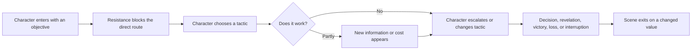
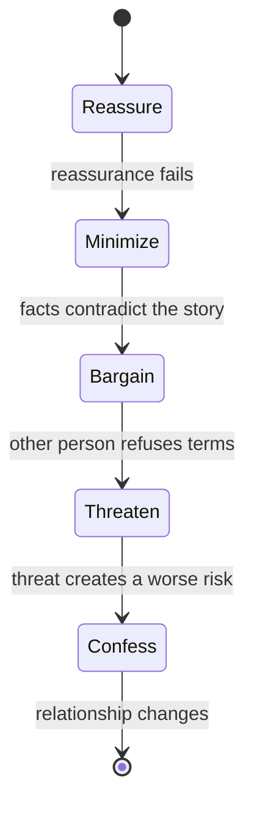
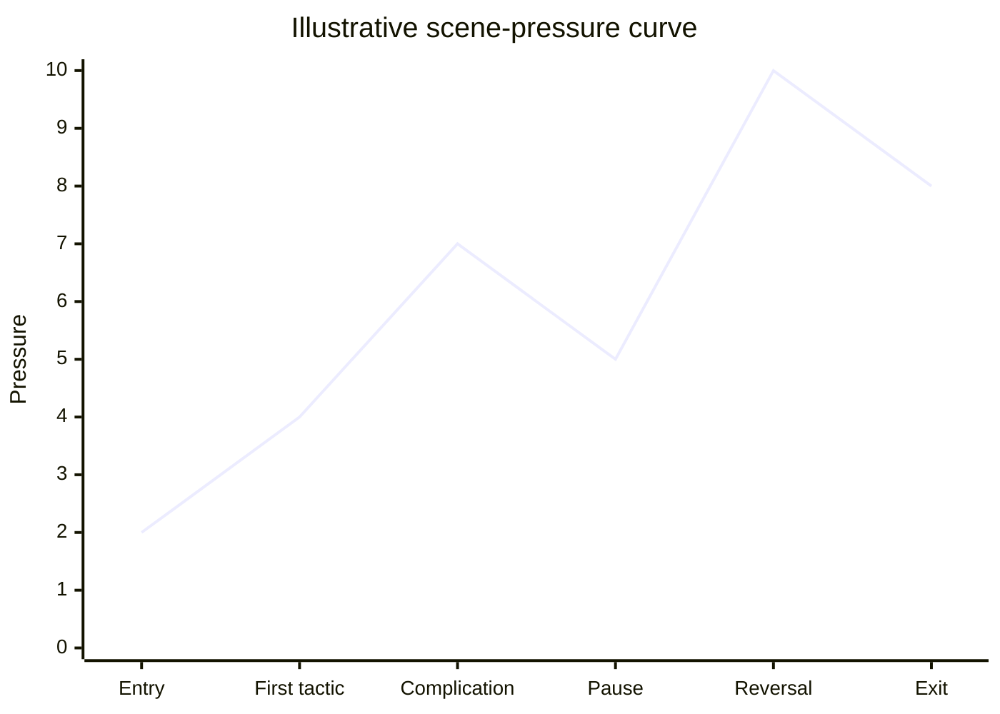
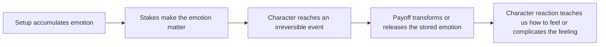
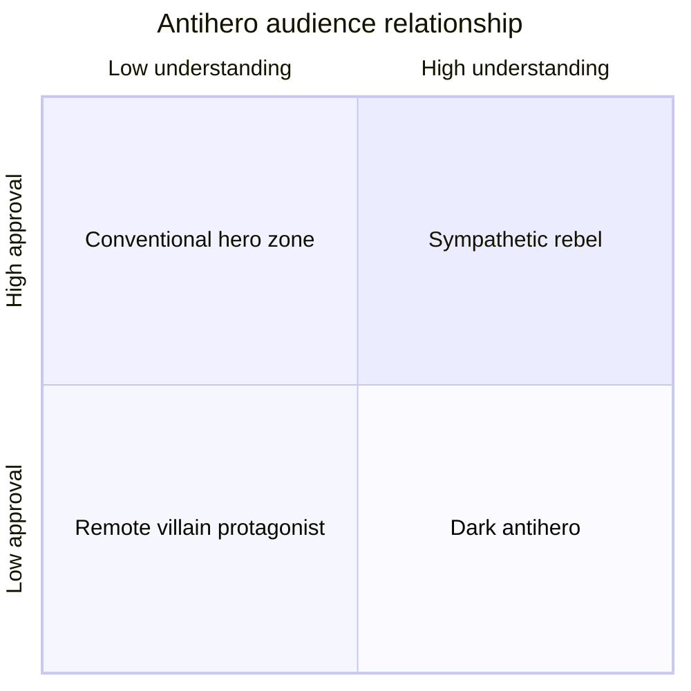
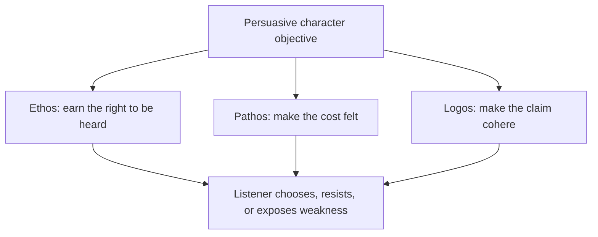
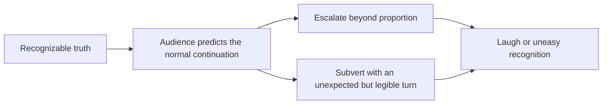

---
tags:
  - scriptwriting
  - continuous-notes
  - scenes
  - dialogue
  - character
source_playlist: StudioBinder playlist supplied 2026-10-24
source_batch: Videos 37-72
---

# Scenes, Dialogue, and Character

A screenplay becomes alive when a person enters a situation wanting something, encounters resistance, changes tactics, and leaves with the situation altered. Everything in this volume grows from that sentence.

This is one of four connected Script volumes. [[01 - Screenplay Format]] explains how to present the work on the page; [[03 - Story Devices and Placement]] develops devices that shape audience knowledge and timing; [[04 - Story Design, Structure and Practice]] connects scene craft to the architecture of a complete story.

A scene is not made dramatic by location, length, shouting, camera movement, or the amount of dialogue. A scene becomes dramatic when **pressure forces behavior**. Character is the pattern inside that behavior. Dialogue is one tool the character uses to change another person, hide from another person, or avoid changing themselves.

The main craft synthesis comes from English captions in the supplied playlist. The teaching order is concept-led rather than playlist-led. Fountain examples are an added markup layer, with the parser boundary described in Volume 1. Each source is linked where useful, and the final coverage table records what evidence was available.

## Put the dramatic scene into Fountain

The tags in `01 - Screenplay Format` control the formatted page; the scene design controls the change. Draft a short scene with one objective, an opposing tactic, and a turn, then preview it in Beat or another Fountain renderer:

~~~fountain
INT. APARTMENT - KITCHEN - NIGHT

MAYA, soaked, sets a key on the table between herself and her brother.

ARUN
You said you lost it.

MAYA
I said I couldn't find it.

He reaches for the key. She closes her fist around it.

ARUN
(quietly)
If you walk out with that, they know where to look.

MAYA
They already know.

The FRONT DOOR HANDLE turns.

Maya puts the key in Arun's hand. He thought she came to take it.
~~~

The markup labels a slug, action, cue, dialogue and parenthetical. The final action supplies the turn: the apparent objective changes from taking the key to handing over responsibility. Fountain will format these blocks; it cannot determine whether that turn is earned. Keep objective/tactic/turn visible in an outline, synopsis or separate scene card, not as production-facing explanation inside the action.

### The dialogue tool kit, expressed as elements

| Craft move | Fountain pattern | Test |
|---|---|---|
| Character-specific voice | `MAYA` then her own dialogue | If cues are swapped, can the reader still identify the speaker? If not, strengthen word choice, rhythm, knowledge, and tactics. |
| Subtext | `MAYA` + literal line whose action contradicts/complicates it | What does she want the other person to believe? What is she avoiding saying? |
| Parenthetical | `(quietly)` below the cue | Would the line's meaning be misunderstood without it? Prefer action or context when that can do the work. |
| Pause / beat | A short action line between dialogue turns: `Maya waits.` | What changes during the silence? Avoid parenthetical `(beat)` as default punctuation. |
| Interrupting line | Character dialogue ending in an em dash | Is interruption caused by pressure, not merely used to simulate liveliness? |
| Trailing off | Character dialogue ending in ellipsis | Is the thought incomplete, fading, or withheld? Do not substitute it for a specific cut-off. |
| Overlap | Second cue ends in `^` | Is simultaneous speech dramatically essential and readable in the export? |
| Voiceover / offscreen | `MAYA (V.O.)` / `MAYA (O.S.)` | Does narration add a distinct perspective? Is the offscreen sound/location clear? |
| Text message / readable insert | `ON THE PHONE: “DON'T OPEN THE DOOR.”` in action | Is the exact wording plot-critical? If it is not, summarize the visible behavior. |

These are syntax examples, not a checklist to use every device. Beat and Fountain format the content; a character's goal, subtext, escalation, or distinctive voice remains a dramatic decision.

## The smallest complete dramatic unit

Before writing dialogue, reduce the scene to six questions:

1. **Who owns the immediate objective?**
2. **What observable result do they want before the scene ends?**
3. **Who or what resists that result?**
4. **Why must it happen now?**
5. **What tactic will the character try first, and what forces a new tactic?**
6. **What is true at the end that was not true at the beginning?**

The last question is the scene's turn. A scene may turn knowledge, power, intimacy, safety, status, commitment, or hope.

| Scene value | Possible opening state | Possible closing state |
|---|---|---|
| Knowledge | The suspect appears innocent | The detective notices a contradiction |
| Power | The employee needs approval | The employee reveals leverage |
| Intimacy | Two people perform politeness | One admits the real wound |
| Safety | The room seems ordinary | An offscreen sound makes escape urgent |
| Status | One person controls the meeting | The subordinate makes the decisive choice |
| Commitment | The hero can still retreat | The hero crosses a threshold |

The scene does not always have to reverse from positive to negative. It can intensify in the same direction. “Unsafe” may become “trapped.” “Attracted” may become “committed.” The requirement is meaningful change, not mechanical reversal.



This model explains why a beautifully written exchange can still feel inert: the characters may be expressing themselves without trying to alter anything.

## Want, need, wound, and the pressure of the scene

[How to Write a Character Arc — “Positive Change” Character Arcs Explained](https://www.youtube.com/watch?v=CS1QkWSnP_o) distinguishes the protagonist's **want** from their **need**. The available caption actually teaches the semi-sweet ending through *Rain Man*, so that is the source used here.

- A **want** is external, conscious, specific, and plot-driving.
- A **need** is internal, often unrecognized, more universal, and arc-driving.
- A **ghost** is a past wound whose influence remains active.
- An **impact character** collides with the protagonist's old belief and makes change difficult to avoid.

These four ideas operate at scene scale as well as story scale. In a scene, a character may pursue the want while the writer applies pressure to the need.

### Worked reading: Charlie and Raymond

Charlie says and behaves as though the inheritance is the problem. That is the conscious want. His estrangement from his father is the ghost. His deeper need is to release resentment and recover a meaningful connection to family. Raymond is the impact character because his existence joins the past wound to a present relationship.

This creates two simultaneous scene tracks:

| Track | What Charlie consciously pursues | What the scene is actually testing |
|---|---|---|
| Plot | Money, custody, control | Whether Charlie treats Raymond as a person or an instrument |
| Arc | Winning the immediate argument | Replacing selfishness with care |

The useful lesson is not “hide the need until the ending.” The need should be **felt before it is named**. It appears in what the character overreacts to, refuses to discuss, misreads, or repeatedly tries to control.

### The four ending combinations

The caption maps want and need into four outcomes:

| Ending | External want | Internal need | Typical emotional effect |
|---|---:|---:|---|
| Sweet | Achieved | Achieved | Fulfillment |
| Bittersweet | Achieved | Missed | Success with spiritual loss |
| Semi-sweet | Missed | Achieved | Sacrifice, maturity, healing |
| Bitter | Missed | Missed | Defeat and non-growth |

A semi-sweet ending often proves a positive arc because the character gives up the old measure of success. Charlie does not gain custody, but he finally acts according to Raymond's welfare. The proof is behavioral. An arc is not complete because a character announces a lesson; it is complete when the final decision would have been impossible for the earlier version of that character.

## Conflict is a system, not an argument

[The Rule of 3 Explained](https://www.youtube.com/watch?v=TUFHJMuunxA) identifies three degrees of conflict:

1. **Internal conflict**: competing needs, values, fears, or identities inside one person.
2. **Interpersonal conflict**: people want incompatible outcomes from one another.
3. **Extrapersonal conflict**: institutions, society, environment, time, technology, or material conditions resist the character.

Strong scenes often activate at least two layers at once.

### Example: a doctor must disclose an error

| Layer | Conflict |
|---|---|
| Internal | Preserve self-image versus accept responsibility |
| Interpersonal | The patient wants the full truth; the doctor wants to control the disclosure |
| Extrapersonal | Hospital procedure and legal exposure limit what can be said |

If the scene uses only interpersonal conflict, it may become a loud disagreement. Internal conflict gives every line a second pressure. Extrapersonal conflict prevents either character from solving the problem by simply leaving.

### Conflict should alter tactics

A tactic is the action beneath the line. Common tactics include:

- Reassure.
- Shame.
- Seduce.
- Distract.
- Bargain.
- Threaten.
- Minimize.
- Confess partially.
- Appeal to duty.
- Invoke shared history.
- Withdraw to make the other person pursue.

Write the tactic in your private scene plan, then remove the label from the finished dialogue. If every line uses the same tactic, the scene usually plateaus. Resistance should force a tactical change.



The diagram is a pressure path, not a formula. The important feature is that each new tactic is caused by the failure or cost of the previous one.

## Stakes: make the cost specific

[Tarantino Dialogue — How *Kill Bill* Keeps Us Hooked](https://www.youtube.com/watch?v=_RNpyhJK65c) argues that a long scene must establish what is at risk from the outset. “High stakes” does not always mean death. It means the outcome has a precise cost the audience understands.

| Weak statement | Dramatic statement |
|---|---|
| The meeting is important | If Mara fails to obtain the signature today, the shelter closes before winter |
| He wants her trust | If she catches one more lie, she takes their son and leaves that night |
| The secret matters | Revealing it saves the patient but exposes the doctor who falsified the chart |

Stakes become usable when they answer:

- What changes if the character succeeds?
- What changes if the character fails?
- Why can the decision not be postponed?
- Who else pays for the result?

## Scene structure: movements inside the scene

Every scene can contain a miniature beginning, middle, and end. This is especially important when the scene runs for many pages.

The *Kill Bill Vol. 2* confrontation analyzed in [Tarantino Dialogue](https://www.youtube.com/watch?v=_RNpyhJK65c) divides into three movements:

1. **Physical**: the Bride enters, danger is immediate, and Bill gains physical control.
2. **Intellectual**: the scene downshifts into the Superman argument.
3. **Emotional**: the metaphor turns toward Beatrix's identity and the cost of her choices.

The scene remains engaging because each movement changes tone, subject, power, and kind of pressure.

### A scene movement worksheet

| Movement | Immediate objective | Dominant mode | Turn that ends the movement |
|---|---|---|---|
| 1 | Gain entry or control | Physical | Someone demonstrates power |
| 2 | Define what events mean | Intellectual | The argument becomes personal |
| 3 | Force admission or choice | Emotional | A truth changes the relationship |

Do not confuse movement with topic. Two characters can discuss three topics while the dramatic movement stays flat. A movement changes the **action between them**.

## Pacing begins on the page

[How to Pace Your Film](https://www.youtube.com/watch?v=a9reuDw4cnU) defines pacing as the speed at which a story is told. Most effective stories vary speed rather than maintaining one tempo.

### Micro and macro pacing

- **Micro pacing** concerns beats, pauses, actions, and exchanges inside a scene.
- **Macro pacing** concerns scene length, sequence length, act rhythm, and the distribution of major events.

Page choices influence pace:

- Short action bursts, ellipses, and white space can sharpen tension.
- Longer action passages and explicit moments of looking or waiting can make time expand.
- Rapid dialogue with few action interruptions develops its own rhythm.
- Short fragmented scenes can depict a life spiraling out of control.
- Multiple simultaneous conversations make the protagonist and audience process competing demands.

The page is a score for attention. White space does not automatically equal fast pace, and dense description does not automatically equal slowness. The words must direct a specific experience.

### Pace curve



The pause is not dead time. It creates contrast and gives the reversal room to land. Constant acceleration can exhaust attention because there is no lower level against which intensity can register.

### The production translation

Pacing continues through performance, camera, sound, and editing:

- Silence can reveal inner struggle.
- A long beat can set up comedy.
- A moving long take can feel fast when action and camera are chaotic.
- A locked frame can let tension accumulate.
- Rapid cuts can increase tempo.
- A long hold can make grief or danger difficult to escape.
- Music can create urgency even over calm images.

The writer need not direct every cut. The writer should make the dramatic rhythm unmistakable enough that later departments understand what must be preserved.

## Blocking: power made visible

Blocking is the arrangement and movement of performers in space. It is story information. [Interrogation Scenes in Movies](https://www.youtube.com/watch?v=GPEihtvIf9M) uses good cop/bad cop to show how blocking, dialogue, and shared objective work together.

### Good cop/bad cop geometry

- Good cop often sits at the suspect's level and appears calm.
- Bad cop may remain standing, distant, or brooding in the background.
- Good cop leads the questioning.
- Bad cop interrupts, invades, or threatens.
- Despite different behavior, both interrogators pursue the same result.

The physical arrangement gives the suspect two apparent choices. One body represents relief; the other represents pain.

```text
                [BAD COP]
             standing / mobile
                    ↓ threat

 [GOOD COP]  ↔  [SUSPECT]
 seated, level    seated
 apparent safety
```

When *The Big Lebowski* parodies the device, it removes the underlying control: both men stay seated, shout over each other, and pursue different questions. The comedy comes from spectators recognizing the expected form and seeing each functional part fail.

### Blocking vocabulary for writers

| Choice | Common dramatic implication | Use with care because... |
|---|---|---|
| Same eye level | Equality, negotiation, temporary balance | Dialogue may still contain a hidden imbalance |
| One standing, one seated | Authority, impatience, threat | It becomes generic if every power scene uses it |
| Character between another and exit | Control, protection, entrapment | Clarify geography before the block matters |
| Increasing physical distance | Withdrawal, distrust, fracture | Distance may read as simple movement without relational context |
| Crossing into private space | Seduction, intimidation, urgent care | Meaning depends on established boundaries |
| Shared frame | Alliance, intimacy, mutual problem | Composition can also make the pair feel trapped together |
| Isolated singles | Separation, suspicion, incompatible realities | Overuse can flatten spatial interaction |

### From beat to shot intention

[How to Make a Shot List for Film](https://www.youtube.com/watch?v=IhXMpBk3GDA) turns a three-act short scene about a pen into visual coverage. Its most useful writing lesson is that every visual change should correspond to story information.

- Master wide establishes geography.
- Eye level is relatively neutral.
- Low angle can suggest power or danger.
- Moving from low angle to eye level can show two characters becoming equally matched.
- Static camera as the baseline makes a later handheld shift communicate chaos.
- Close-up or insert isolates a plot-critical object.
- Repeating an earlier composition can create a callback.
- Reversing a pedestal movement can visually close a movement opened earlier.

Write the dramatic function first. A screenplay that says “LOW ANGLE” without a reason is borrowing emphasis before it knows what deserves emphasis.

## Suspense: time, stakes, uncertainty

[The 3 Essential Elements of Suspense Explained](https://www.youtube.com/watch?v=FHXh_uy6gT4) supplies a compact model:

$$
\text{Suspense} = f(\text{time},\ \text{stakes},\ \text{uncertainty}).
$$

This is a relationship, not a numeric formula.

- **Time**: how long the audience waits for resolution.
- **Stakes**: what the outcome can destroy, protect, or transform.
- **Uncertainty**: how unsure the audience remains about outcome, cause, or identity.

### The suspense control panel

| If you change... | You can create... | Failure mode |
|---|---|---|
| More time | Dread, anticipation, painful waiting | Delay without new pressure becomes stalling |
| Higher stakes | Greater emotional weight | Stakes stated but not dramatized feel abstract |
| More uncertainty | Curiosity, suspicion, fear | Total confusion prevents anticipation |
| Less uncertainty | Inevitable dread | If outcome feels harmless, certainty deflates tension |

### Worked example: waiting outside the robbery

The *Drive* sequence remains outside rather than showing the robbery. The writer and filmmakers preserve uncertainty by denying interior information. Quiet sounds make waiting physical: clothes, footsteps, distant traffic, engine, ticking watch. The deadline is audible, but the result remains unseen.

The lesson for a writer is to choose the **information boundary**. Suspense often depends on where the scene refuses to go.

### Worked example: the blood test

In *The Thing*, repeated close-ups create a procedure: blood, heated wire, faces. Equal treatment of suspects withholds the answer. Repetition teaches the pattern, then the reveal violates safety. The scene briefly widens after a negative result, giving the audience a breath before pressure resumes.

### Worked example: the basement

In *Zodiac*, the situation turns when an apparently helpful man may be the killer. Framing tightens, lighting becomes more contrast-heavy, the suspected threat looms or disappears into shadow, and slow movement lengthens the time before escape. The formal choices track the character's changing interpretation.

## Setup, payoff, and the promise economy

[What is Chekhov's Gun](https://www.youtube.com/watch?v=zQ1Feczm93A) treats every emphasized detail as a promise. The “gun” can be a prop, line, behavior, fact, relationship, or image.

Three variables govern the promise:

1. **Visibility**: how strongly the setup is presented.
2. **Relevance**: how clearly the audience understands its possible importance.
3. **Velocity**: how soon payoff follows setup.

| Setup pattern | Audience experience | Example use |
|---|---|---|
| High visibility, high relevance, slow payoff | Sustained suspense | Blood on a white shoe |
| Repeated visibility, unclear relevance | Curiosity | A baseball passed through scenes |
| High visibility, unclear relevance, climax payoff | Large explicit promise | A wall of knives |
| Strong setup, unexpectedly small payoff | Misdirection | Important-looking clue becomes an addendum |

Do not pay off every object literally. Pay off the **attention** you asked the audience to spend. If the script emphasizes a photograph, the payoff might be emotional rather than mechanical.

## Catharsis: the scene must release what the story stored

[Every Great Story's Secret Weapon — Catharsis Explained](https://www.youtube.com/watch?v=owxQGzgipaY) defines catharsis as emotional cleansing or release.

At its simplest:



The true cathartic target may differ from the obvious plot goal. In *The Shawshank Redemption*, escape matters, but Andy and Red's reunion resolves the relationship that gives the story its emotional force.

The source summarizes Aristotle's tragic possibilities along two axes: whether the character acts knowingly or unknowingly, and whether the harmful act is completed or stopped. The important writing question is not which box is universally “best.” It is what kind of recognition the ending permits.

| Knowledge/action combination | Dramatic possibility |
|---|---|
| Knows, stops | Relief; risks feeling like an idle threat |
| Knows, completes | Moral horror: the character chooses the wrong despite understanding |
| Does not know, completes | Discovery arrives too late; pity and irreversible tragedy |
| Does not know, stops | Recognition before catastrophe; room for reflection and change |

Catharsis requires preparation. A breakdown, reunion, sacrifice, or triumph cannot release emotion the story never accumulated.

## Character architecture: four useful distinctions

[4 Types of Characters in a Film](https://www.youtube.com/watch?v=Wx43amro98c) separates two axes that writers often confuse.

- **Flat versus round** asks how many dimensions the character presents.
- **Static versus dynamic** asks whether the character changes.

|  | Static: remains substantially the same | Dynamic: meaningfully changes |
|---|---|---|
| **Flat: built around a dominant quality** | Stable guard, comic function, emblematic antagonist | Minor figure whose limited but clear arc warns or assists the protagonist |
| **Round: complex and contradictory** | Deeply realized person whose constancy drives the plot | Complex protagonist whose inner change becomes the story's arc |

No quadrant is automatically superior.

- Flat peripheral characters conserve attention.
- Flat characters can embody ideas in satire.
- A static friend can expose the protagonist's change.
- A static antagonist can preserve conflict pressure.
- Sitcoms often depend on static dynamics that reset.
- A dynamic character can supply narrative movement even when external plot is minimal.

### *The Shawshank Redemption* as a mixed ensemble

- Hadley: flat and static; cruelty remains a stable institutional force.
- Andy: round and largely static; complicated, but unwavering in the goal of freedom.
- Red: round and dynamic; cynicism changes into hope.
- Brooks: relatively flat and dynamic; his smaller arc warns what institutionalization can do.

Design the ensemble as a set of functions and pressures. Giving every minor character a large hidden biography can make the story less clear rather than more humane.

## Character dynamics begin with who, what, where, and want

[How to Create a TV Character and Develop Their Arc](https://www.youtube.com/watch?v=fYgw0i0HvMI) asks three foundation questions, then one relational question.

### Who?

- Who is the story about?
- What immediately legible traits, roles, and contradictions define them?

### What?

- What happened to them?
- What is happening now?
- What might happen later?

This turns backstory into pressure. Backstory matters when it changes present choices.

### Where?

The setting generates the ensemble. A bar, ad agency, school, hospital, spaceship, or family home naturally produces different roles and hierarchies. Time period and culture narrow the possibilities further.

### Want between every pair

For each meaningful relationship, write:

> A wants ______ from B, while B wants ______ from A.

Then add what each refuses to give.

| Pair | A wants | B wants | Source of recurring conflict |
|---|---|---|---|
| Mentor / student | Obedience and continuation | Independence and recognition | Guidance feels like control |
| Partners | Reliability | Freedom | Each defines trust differently |
| Parent / child | Safety | Respect | Protection prevents agency |
| Rivals | Admission of superiority | Proof of fraud | Neither can concede without identity loss |

In television, this relational matrix is often more durable than a single plot premise.

## Archetype as energy: the leader

[Character Archetypes: The Dynamic Leader](https://www.youtube.com/watch?v=tLNNiZjkEmc) describes the leader as focused, confident, motivated, and action-oriented.

The same trait must create strength and weakness:

| Strength | Shadow |
|---|---|
| Focus | Tunnel vision |
| Confidence | Arrogance |
| Motivation | Obsession |
| Decisiveness | Recklessness |
| High standards | Domination or perfectionism |

A leader can restart a stalled scene because they choose action. Their morality changes the story's tone: courage inspires; sociopathy manipulates; intelligence solves; delusion produces catastrophe.

Pairings:

- **Leader + leader**: cooperation or rivalry between two high-force characters.
- **Leader + free spirit**: plan versus impulse; the free spirit forces detours and compromise.

An archetype should tell you what energy the character brings into the room. It should not replace their history, contradiction, or individual voice.

## The antihero: understanding without approval

[What is an Antihero](https://www.youtube.com/watch?v=iI75W7M4Puw) defines an antihero as a protagonist lacking conventional heroic principles. The useful analytical split is:

- Does the audience **understand** the action?
- Does the audience **approve** of the action?



The labels are approximate. Moral response differs among viewers.

### Methods for building understanding

- Backstory that reveals the formative wound.
- Internal monologue that exposes loneliness, resentment, or self-justification.
- A motivation with more than one layer.
- A setting that rewards or teaches corrupt behavior.
- Visible conflict between what the character wants to be and what they keep doing.

Understanding is not absolution. Rorschach's past explains his severity without requiring approval. Walter White becomes less approvable as his power grows, while his hunger for respect remains intelligible.

### Tone changes moral distance

Campy, stylized violence can keep an audience aligned with a revenge protagonist. Realistic, painful violence can make a similar revenge path feel dehumanizing. Tone is therefore part of character ethics, not merely surface decoration.

### Thematic relevance

Ask what social system or anxiety the antihero embodies. Jordan Belfort is more than a greedy individual; his methods reflect and intensify the incentives of Wall Street. The antihero becomes durable when personal appetite and social diagnosis reinforce one another.

## Villains deserve complete dramatic treatment

[Story Structure Explained — *Infinity War* vs. Save the Cat](https://www.youtube.com/watch?v=BDIayz-hyKk) maps Thanos onto the fifteen Save the Cat beats. The claim is structural, not moral: a villain can occupy the pursuit position normally given to the hero.

The lesson for scene writing is direct. Give the antagonist:

- A clear objective.
- A rationale they can articulate.
- A relationship that tests the objective.
- Internal and external opposition.
- Sacrifice and cost.
- A moment of apparent defeat.
- A renewed plan.
- A finale in which their transformation or unwavering belief becomes behavior.

If the villain enters only to block the hero, every villain scene repeats one action. If the villain pursues a complete line of action, their choices create the plot.

### Antagonist beat audit

| Question | Weak antagonist | Developed antagonist |
|---|---|---|
| What do they want? | “Stop the hero” | Restore what they believe is a necessary order |
| Why now? | Plot requires confrontation | A deadline or catalyst closes previous options |
| What do they sacrifice? | Disposable henchmen | A relationship, belief, status, or part of self |
| What can make them doubt? | Nothing | Evidence that their method violates their stated value |
| How do they adapt? | Increase force | Change plan, recruit, deceive, bargain, or reinterpret failure |

## Character in factual stories

[Are Biopics Good Cinema?](https://www.youtube.com/watch?v=1Uhw-O_QywA) warns against treating a life as a complete chronology. Research provides material; drama requires selection.

- Find the universal theme within the specific life.
- Choose where the movie begins and ends.
- Consider one intense event rather than cradle-to-grave coverage.
- Consider one relationship as the way into the subject.
- Decide the subject's narrative role: hero, antihero, witness, artist, rival, parent, reformer.
- Ground an icon through youth, vulnerability, contradiction, sympathy, and flaw.
- Preserve the person's recognizable essence while creating a coherent narrative.

For scene work, factual research should produce behavior:

- What did the person touch, wear, avoid, repeat, or collect?
- How did the real location constrain movement?
- What did their body know how to do?
- Who could contradict them without fear?
- Which relationship reveals a side absent from public history?

The goal is neither impersonation nor unrestricted invention. It is a dramatically shaped truth whose deviations are deliberate.

## Dialogue is action under social constraint

Dialogue works when the literal sentence and the dramatic action are related but not identical.

> Literal line: “You should get some sleep.”
> Possible actions: dismiss, protect, avoid confession, end the meeting, establish intimacy, conceal panic.

The same words change meaning with objective, relationship, timing, and what remains unsaid.

### Build subtext from asymmetry

Subtext grows when characters possess unequal information, incompatible interpretations, or forbidden intentions.

| Surface conversation | Hidden dramatic exchange |
|---|---|
| Discussing dinner | Testing whether the relationship still has a future |
| Reviewing a report | Deciding who will take blame |
| Asking about traffic | Delaying disclosure of an affair |
| Complimenting a speech | Warning the speaker that they sounded disloyal |

Do not write a second secret meaning beneath every line. Subtext should emerge from the situation. If both characters can state the truth safely and immediately, indirectness may feel artificial.

## Voice: the character's selection system

Voice is not a collection of catchphrases. It is the pattern by which a character selects what to notice, how to organize it, and what they refuse to name.

Define voice through:

- Vocabulary range.
- Sentence length and rhythm.
- Concrete versus abstract language.
- Metaphor source: sport, religion, machinery, food, money, weather.
- Degree of certainty.
- Habit of answering directly or indirectly.
- Relationship to silence.
- Social performance: formal, intimate, defensive, comic.

Two characters should not merely use different slang. They should make different **mental cuts** through the same event.

### Voice contrast exercise

Event: a glass breaks during a tense family dinner.

- Controller: “Nobody move. There are shards under the table.”
- Appeaser: “It's fine. It was chipped anyway.”
- Accuser: “You always do this when the conversation turns to Dad.”
- Avoider: “Does anyone want coffee?”
- Child: “Are we in trouble?”

The broken glass is identical. Character appears in the chosen interpretation.

## The Rule of Three in dialogue

[The Rule of 3 Explained](https://www.youtube.com/watch?v=TUFHJMuunxA) introduces the **tricolon**: three parallel words or phrases. It creates rhythm, balance, and emphasis.

Three also supports comedy:

1. First item establishes a direction.
2. Second confirms the pattern.
3. Third fulfills or subverts it.

Original example:

> “He forged the signature, emptied the account, and returned the library book late.”

The third unit violates the scale of the first two. The joke works because the first two teach the expected category.

Use triads for more than jokes:

- Escalating threat.
- Ritual.
- Emotional accumulation.
- A character trying to sound certain.
- A final item that reveals the speaker's real concern.

## Rhetorical dialogue: ethos, pathos, logos

[Ethos, Pathos, and Logos](https://www.youtube.com/watch?v=26HZjIjyIkQ) treats persuasion as a triangle.

### Ethos: why trust this speaker?

- **Phronesis**: intelligence, expertise, track record, or direct experience.
- **Arete**: moral character and the ethical value of the claim.
- **Eunoia**: goodwill, accessibility, and shared identity with the listener.

### Pathos: why feel this claim?

- Empathetic or sympathetic person.
- Vivid consequence.
- Shared memory.
- Analogy that turns abstraction into lived experience.

### Logos: why believe the reasoning?

- Evidence.
- Causal argument.
- Clear structure.
- Fair treatment of objections.
- Avoidance of logical fallacies.



In drama, the speech need not be logically perfect. A straw man, false dilemma, or circular argument can reveal character. The writer must know the fallacy is present even if the speaker does not.

## Metaphor as compressed character thought

[What is a Metaphor](https://www.youtube.com/watch?v=Aan0_wDrlvA) separates:

- **Tenor**: the subject being described.
- **Vehicle**: the comparison that lends qualities.
- **Ground**: the quality they share.
- **Tension**: the ways they remain different.

Types useful in dialogue:

| Type | Form | Dramatic use |
|---|---|---|
| Direct metaphor | “The boardroom is a kennel.” | Bold worldview |
| Simile | “He circles like a dog guarding food.” | Qualified comparison |
| Analogy | Comparison plus explanation | Persuasion or teaching |
| Implied metaphor | Nonliteral verb without naming the vehicle | Subtle characterization |
| Extended metaphor | Repeated comparisons across a speech | Monologue structure |
| Mixed metaphor | Incompatible comparisons | Confusion or comedy |
| Dead metaphor | Familiar cliché | Social background or unimaginative voice |

A metaphor should come from the speaker's available world. A mechanic, priest, dancer, accountant, and child will not naturally reach for the same vehicle.

### Metaphor versus symbol

- A metaphor compares and transfers selected qualities.
- A symbol stands for an additional meaning.

A locked door may symbolize exclusion. “Her silence was a locked door” explicitly makes a metaphorical comparison.

## Parentheticals: precision without puppeteering

[When to Use Parentheticals in Screenplays](https://www.youtube.com/watch?v=iRzb1zuwxm4) gives six legitimate uses:

1. Emotional direction.
2. Brief physical direction within dialogue.
3. Line delivery.
4. Pacing or a beat.
5. Clarifying whom the line addresses.
6. Language or subtitle information.

Formatting principles:

- Place the parenthetical directly under the character name or between portions of the character's dialogue.
- Do not place it after the finished dialogue block.
- Keep it brief, normally a word or two.
- If it requires a full phrase or complicated action, use an action line.
- Avoid stacking adverbs.
- Use it only when delivery is not already clear from the words and action.
- Leave interpretive room for actors.

### Diagnostic test

Remove the parenthetical.

- If nothing changes, delete it.
- If the line becomes ambiguous in a productive way, consider deleting it.
- If the scene becomes unintelligible, first ask whether the dialogue or action should be rewritten.
- Keep the parenthetical when it supplies essential, concise information that cannot be inferred.

```text
MAYA
    (to Arun)
You knew.

ARUN
    (in Hindi; subtitled)
Not soon enough.
```

The format should clarify the exchange without describing every emotion.

## Monologues and stories within scenes

A monologue is not exempt from scene mechanics. The speaker still wants an effect from someone, even if the listener is absent, silent, dead, imagined, or the speaker themselves.

The [Tarantino dialogue analysis](https://www.youtube.com/watch?v=_RNpyhJK65c) identifies three uses for an embedded story:

- Add humor.
- Delay an inevitable event and create suspense.
- Reveal character or internal conflict.

Bill's Superman speech works because it is not detachable commentary. It becomes an argument about Beatrix's identity. The anecdote changes the pressure of the confrontation.

### Monologue audit

1. Who is the intended listener?
2. What response does the speaker want?
3. Why choose a story instead of a direct statement?
4. What does the story accidentally reveal?
5. Where does the listener gain or lose power during it?
6. What action follows the last line?

### Stories within stories

[The Hidden Element of Wes Anderson's Style](https://www.youtube.com/watch?v=eLwLR_XoMi4) explains frame narratives as more than decoration. A storyteller inside the work can:

- Establish tone before the central action.
- Justify literary or visibly artificial dialogue.
- Make voiceover feel motivated.
- Allow fourth-wall breaks without destroying the form.
- Distinguish visual worlds for different narrators.
- Make the work reflect on why stories are told.

The frame also changes reliability. A recollection can be precise, self-serving, incomplete, or stylized. Dialogue inside the remembered story may sound “written” because the framing declares it to be a shaped account.

## Interrogation scenes: dialogue as tactical warfare

[Interrogation Scenes in Movies](https://www.youtube.com/watch?v=GPEihtvIf9M) identifies three mind games.

### Good cop/bad cop

Different performance, same goal. The suspect is encouraged to treat one interrogator as safety.

### External threat

Threaten the person, object, or relationship the subject values most.

- State or demonstrate the stakes.
- Preview enough pain to make the threat credible.
- Give reaction space so the audience sees the internal decision.
- The threat may be real or fabricated.

### Deception

Make the subject believe the circumstances differ from reality.

A fair deception needs:

- A reveal.
- An explanation of how it was accomplished.
- Previously available details that become newly meaningful.

Without explanation, the twist feels like withheld authorship rather than successful character strategy.

### Interrogation beat grid

| Beat | Interrogator action | Subject action | Information change |
|---|---|---|---|
| Establish | Defines apparent rules | Performs confidence | Audience learns the stated objective |
| Probe | Tests a small fact | Gives controlled answer | A discrepancy appears |
| Pressure | Changes tactic | Protects vulnerable point | Hidden value becomes visible |
| Reversal | Subject exposes deception or leverage | Interrogator adapts | Power changes hands |
| Choice | Makes final offer or threat | Speaks, lies, or refuses | Scene exits with consequence |

## Comedy: truth, escalation, and subversion

[What Makes a Movie Funny?](https://www.youtube.com/watch?v=veSYRK8Sjbg) begins with a useful caution: there is no guaranteed formula. Comedy is subjective. Craft increases opportunity; it does not guarantee laughter.

### Start from a recognizable truth

Comedy often reflects a shared fear, frustration, habit, or social contradiction. *Dr. Strangelove* uses Cold War paranoia. *Superbad* uses high-school pain. *Office Space* uses workplace boredom.

Then transform the truth:

- **Escalation** enlarges it toward absurdity.
- **Subversion** establishes an expectation and turns away from it.



### Comic dialogue tools

- Repetition.
- Wordplay.
- Verbal irony.
- Rule of Three.
- Meta-commentary.
- A character taking the wrong thing seriously.
- A character remaining serious while the world becomes absurd.

### Comic character pairing

An exaggerated character often benefits from a **straight person** who registers the absurdity. Deadpan performance does the reverse: the character treats a mad situation as routine.

### Comedy in cuts and staging

- Wide staging lets the audience discover spatial gags.
- A pan, zoom, or focus shift can reveal the punchline.
- Production design can embody character absurdity.
- A smash cut can contradict the previous line.
- A Gilligan cut moves from “that will never happen” directly to it happening.
- A pause can build anticipation; rapid exchange can prevent recovery.

## Satire: comedy needs a target

[3 Types of Satire Every Storyteller Should Know](https://www.youtube.com/watch?v=HTEUXulCJZY) defines satire as moral outrage transformed into comic art. The non-negotiable element is a target.

| Type | Tone | Typical target/effect |
|---|---|---|
| Horatian | Light, playful, overtly comic | Expose folly and invite reflection |
| Juvenalian | Dark, abrasive, cynical | Provoke anger at abuse or inequality |
| Menippean | Variable from slapstick to tragedy | Attack a belief or moral attitude |

Writing process:

1. Name the exact institution, practice, or belief under attack.
2. Decide whether the audience should primarily laugh, feel angry, or move between both.
3. Choose devices: irony, exaggeration, tonal contradiction, costume, setting, character analogy, or propaganda language.
4. Check whether the target remains legible. A satire can accidentally repeat the harmful belief if the work supplies spectacle without a critical frame.

Flat characters can be useful here because they embody ideas. [4 Types of Characters](https://www.youtube.com/watch?v=Wx43amro98c) notes that *Dr. Strangelove* uses one-dimensional types to make the critique broadly applicable.

## Tropes: use audience memory deliberately

[Tropes Explained](https://www.youtube.com/watch?v=lLcM9mh9sic) defines a trope as a recurring narrative device, character type, dialogue pattern, plot structure, or visual image.

Tropes can:

- Establish a function quickly.
- Signal genre.
- Save exposition.
- Create homage.
- Misdirect.
- Be pushed to an extreme for commentary.
- Be subverted by altering expected power, identity, or outcome.

They fail when they reproduce a harmful stereotype or substitute recognition for complexity.

### Character trope pass

For a detective, mentor, femme fatale, chosen one, or comic relief figure, ask:

1. What useful expectation does the trope create?
2. Which expected quality will be honored?
3. Which will be complicated?
4. What interiority does this version possess that the type often lacks?
5. Does the trope carry a harmful cultural assumption?

### Dialogue trope pass

Familiar lines such as “you don't have to do this” may now read as comedy. A trope can still work if the exact character, timing, and consequence renew it.

### Visual trope pass

A haunted house, abandoned warehouse, perfect suburb, traumatic haircut, or hero walking from an explosion is cinematic shorthand. The writer should know what meaning the audience supplies before deciding to fulfill, delay, or overturn it.

## Dreams: interiority without explanation dumping

[Writing a Dream — The Secret Behind Iconic Dream Sequences](https://www.youtube.com/watch?v=IHV22zD15xI) distinguishes dreams, daydreams, nightmares, hallucinations, and premonitions.

A dream can:

- Show desire.
- Show fear.
- Reveal a trait or general mental state.
- Produce a fake-out.
- Carry theme through open-ended imagery.
- Trigger the plot through premonition.
- Supply evidence or direct an investigation.

The danger is convenience. Ask what the dream accomplishes that waking behavior, dialogue, or imagery cannot.

### Formatting follows purpose

- Hide the dream label when disorientation or fake-out is the goal.
- Mark a distinction in the slug line without fully explaining it.
- Use `CUT TO:` when the transition should feel jarring.
- State in action that the character wakes when clarity matters.
- Label `DREAM` or `NIGHTMARE` in the scene heading when surprise is unnecessary.
- For flashes, describe the intercut in action rather than creating a complete new scene.
- Stylized typography can suggest chaos, but clarity remains the governing standard.

There is no single correct dream format. The degree and timing of disclosure should serve the audience experience.

## Intercutting parallel scenes

[How to Intercut Scenes in a Script](https://www.youtube.com/watch?v=XcPJxHA3lt8) defines intercutting as alternating between two or more scenes to show simultaneous action, contrast, thematic relationship, or a phone conversation.

Accepted approaches include:

- `INTERCUT` as a transition followed by a subheading.
- An action line announcing that the sequence intercuts with another location.
- A subheading such as `INTERCUT WITH MAYA IN THE CAR`.
- A scene heading carrying an intercut modifier.

After establishing the two sides, write the exchange without repeating complete headings for every switch.

End the intercut with a clear transition, action line, subheading, or new full scene heading.

Rules:

- Pick a convention and remain consistent.
- Use the device sparingly.
- Every strand must advance the story.
- Balance length and pace among strands.
- Make beginning and end unmistakable.

## Symbolic detail inside character scenes

[How Filmmakers Create Depth — Symbolism Explained](https://www.youtube.com/watch?v=bFnaOhzgfDU) identifies character, setting, action, object, color, and sound as possible symbols.

In a character scene, symbolism works best when it is also physically present in the action.

- A character repeatedly polishing a medal can reveal identity and symbolize dependence on past status.
- A locked window can obstruct escape and symbolize chosen confinement.
- A shared song can operate as memory, threat, or reconciliation.

Four-step design:

1. Identify the theme.
2. Choose a symbol naturally connected to it.
3. Decide how obvious it must be.
4. Plan its introduction and meaningful returns.

Plot-critical symbolism should be readable. Optional thematic enrichment may remain subtle. Meaning can also be interpreted differently by different viewers; the writer controls presentation, not every final reading.

## A complete worked scene: “The Recommendation”

The following original example combines objective, subtext, character arc pressure, blocking, suspense, rhetoric, metaphor, and payoff.

### Story context

NILA, 27, is a gifted junior architect. Her father died after years of taking credit for colleagues' work. She has promised herself never to become him. Her firm is selecting one person for a prestigious overseas project.

ARUN, 58, her mentor, asks her into the model room after everyone leaves. Nila believes he will recommend her. Arun knows that Nila copied an uncredited structural solution from intern DEV's discarded sketch.

### Character architecture

| Element | Nila | Arun |
|---|---|---|
| Immediate want | Obtain Arun's recommendation | Make Nila credit Dev before the board meets |
| Deeper need | Separate ambition from her father's legacy | Stop protecting talented students from consequences |
| Ghost | Father's dishonesty and disgrace | A former student whose misconduct he concealed |
| Fear | Becoming ordinary; becoming her father | Repeating his old cowardice |
| First tactic | Perform gratitude | Invite voluntary confession |
| Final tactic | Partial confession, then ownership | Refuse the recommendation but offer a path to repair |

### Blocking plan

The room contains Nila's large white model on a central table. Dev's small folded sketch is under a transparent ruler near Arun.

1. Nila enters and stands beside the model, visually aligned with success.
2. Arun remains seated at eye level with the sketch.
3. Nila circles toward him while pitching herself.
4. Arun slides the ruler aside, revealing the sketch without naming it.
5. Nila moves between Arun and the door when she feels threatened, trying to control the room.
6. After confessing, she moves the sketch beside the model.
7. Arun stands only after she makes the honest choice, bringing them to equal height.

The movement is causal. Nobody crosses the room merely to make the page feel active.

### Beat table

| Beat | Nila's tactic | Arun's resistance | Turn |
|---|---|---|---|
| 1. Expected reward | Gratitude and modesty | Does not mention the recommendation | Expectation becomes uncertainty |
| 2. Self-presentation | Logos: lists project results | Asks who solved the cantilever | Achievement becomes authorship test |
| 3. Evasion | Minimizes Dev's contribution | Reveals the sketch | Hidden evidence becomes visible |
| 4. Moral defense | Pathos: invokes pressure and her father | Rejects inherited shame as an excuse | Sympathy no longer protects her |
| 5. Threat | Suggests the firm also benefited | Accepts institutional blame but preserves her agency | Threat fails because Arun concedes his part |
| 6. Choice | Full confession and concrete repair | Refuses immediate recommendation | External want is lost |
| 7. Arc proof | Credits Dev before being forced | Offers future support, not rescue | Need is partly achieved |

### Sample screenplay

```text
INT. MODEL ROOM - NIGHT

The city glows beyond glass walls. At the center of the dark room,
NILA'S WHITE TOWER MODEL catches the last desk lamp.

NILA, 27, enters carrying two paper cups.

ARUN, 58, sits at the far end of the model table. A transparent
ruler covers a small, folded SKETCH near his hand.

                         NILA
             I guessed no sugar.

                         ARUN
             You remembered.

She sets the coffee beside him, then takes her place next to the
tower. Candidate beside achievement.

                         NILA
             The board meets at nine?

                         ARUN
             Eight-thirty now.

                         NILA
             Even better. Less time for them to
             invent reasons to be cautious.

Arun studies the tower.

                         ARUN
             The west cantilever held.

                         NILA
             Six millimeters under the limit.

                         ARUN
             Who found the brace?

                         NILA
             I led the redesign.

                         ARUN
             That wasn't my question.

A beat. Nila picks a speck from the model's roof.

                         NILA
             We all touched it.

Arun slides the ruler aside. The folded sketch bears DEV'S initials.

Nila sees it. Does not look away.

                         NILA
             He threw it out.

                         ARUN
             He was nineteen and you were his lead.

                         NILA
             It was three lines on tracing paper.

                         ARUN
             Three lines holding up your tower.

She circles the table, stopping between Arun and the door.

                         NILA
             You know what one clean project changes
             for me.

                         ARUN
             I know what a hidden line changes.

                         NILA
             My father confessed to everything and
             they still buried him.

                         ARUN
             Your father is not in this room.

                         NILA
             He is every time someone says my name.

                         ARUN
             Then stop giving him your work.

That lands. Nila looks at the sketch, the model, the city.

                         NILA
             If I tell the board, the firm loses the
             presentation too.

                         ARUN
             Yes.

                         NILA
             You signed the review.

                         ARUN
             Yes.

Her threat has nowhere to go. Arun has accepted his share.

Nila lifts the sketch and places it against the model's base.

                         NILA
             Dev presents the brace. I tell them why.

                         ARUN
             And the recommendation?

                         NILA
             You don't write it.

Arun stands. For the first time, they face each other at eye level.

                         ARUN
             Not this year.

Nila nods. It hurts. It also fits.

                         NILA
             Eight-thirty, then.
```

### Why the scene works

- The objective is immediate and observable: secure a recommendation.
- The evidence exists in the room and is planted before dialogue names it.
- Arun begins with questions rather than accusation, giving Nila room to reveal character through choices.
- Nila changes tactics: charm, evidence, minimization, emotional appeal, threat, ownership.
- Arun's admission that he signed the review defeats her threat without making him morally spotless.
- The father's history creates subtext but does not excuse the act.
- “Three lines holding up your tower” is literal and metaphorical.
- The final blocking change to equal eye level follows the ethical choice.
- Nila loses the external want but moves toward the internal need: a semi-sweet scene ending.

### How to make this scene weaker

- Have Arun immediately say, “You stole Dev's idea.” The scene loses discovery and tactical movement.
- Let Nila confess on the first question. Her internal conflict never becomes behavior.
- Make Arun perfectly righteous. The scene loses the institutional dimension and his own arc pressure.
- Add unexplained camera directions to every line. The page begins managing equipment instead of drama.
- End with Nila receiving the recommendation anyway. The choice carries no cost.

## Rewrite passes

Do not attempt every correction in one pass. Separate the questions.

### Pass 1 — Objective and turn

- Can I state each principal character's scene objective with an active verb?
- Does resistance force tactic changes?
- What value changes by the exit?
- Could the scene be removed without changing later action? If yes, what work is it doing?

### Pass 2 — Character pressure

- What want drives the scene?
- What need is being tested beneath it?
- Which ghost or prior event distorts the present response?
- What action proves the character rather than merely describing them?

### Pass 3 — Conflict layers

- Is there internal conflict?
- Is there interpersonal conflict?
- Is there extrapersonal pressure?
- Are all obstacles independent, or does each consequence cause the next?

### Pass 4 — Dialogue and subtext

- What is each line trying to do?
- Can the other character resist it?
- Does each voice select different details and metaphors?
- Are characters saying what both could already safely state?
- Can a line be replaced by behavior or silence?

### Pass 5 — Rhythm

- Where does the scene accelerate?
- Where does it breathe?
- Are long speeches internally structured?
- Are pauses earned by thought or pressure?
- Does paragraph length reflect the intended reading experience?

### Pass 6 — Space and objects

- Is geography clear before movement matters?
- Does every major cross or reposition have a cause?
- Is a prop a tool, promise, obstacle, or symbol?
- Have emphasized details been paid off?

### Pass 7 — Formatting restraint

- Are parentheticals essential and brief?
- Are intercuts clearly opened and closed?
- Are dream labels or withheld labels serving the intended effect?
- Are action lines clear, active, and economical?

## Compact scene-design card

| Layer | Question |
|---|---|
| Objective | What does the character need from this scene? |
| Resistance | Who or what makes the direct route impossible? |
| Stakes | What exact cost follows success or failure? |
| Clock | Why must this happen now? |
| Tactics | What does the character try, and why do they change approach? |
| Subtext | What cannot be said safely or directly? |
| Space | How does placement express or complicate power? |
| Promise | What detail receives audience attention, and how is it paid off? |
| Turn | What changes before the scene exits? |
| Arc | What choice could the earlier version of the character not make? |

## Source coverage and caption limits

The table records all playlist positions 37–72 so omissions remain visible. “Used” means the caption contained material integrated into this volume. A source may also belong more strongly in another planned volume.

| # | Captioned source | Use in this volume | Caption/evidence limit |
|---:|---|---|---|
| 37 | [How to Write a Character Arc — “Positive Change” Character Arcs Explained](https://www.youtube.com/watch?v=CS1QkWSnP_o) | Want, need, ghost, impact character, four endings, positive arc | Metadata title and caption topic differ; caption teaches semi-sweet endings through *Rain Man* |
| 38 | [What Makes a Movie Funny?](https://www.youtube.com/watch?v=veSYRK8Sjbg) | Comedy subgenres, truth, escalation, subversion, staging, timing | Full English caption available; examples summarized rather than transcribed |
| 39 | [How to Pace Your Film](https://www.youtube.com/watch?v=a9reuDw4cnU) | Micro/macro pacing and page rhythm | Full English caption available |
| 40 | [Film Tone](https://www.youtube.com/watch?v=Tkbto1oLAnE) | Supporting visual-tone implications | Caption uses “tone” specifically for brightness, lighting, exposure, and art direction; fuller treatment belongs outside this volume |
| 41 | [How to Make a TV Show Bible](https://www.youtube.com/watch?v=Z56nxVKmwR8) | Character wants/needs and sustainable ensemble context | Short captioned tutorial; primary show-bible formatting belongs in the formatting/development volumes |
| 42 | [How Filmmakers Create Depth — Symbolism Explained](https://www.youtube.com/watch?v=bFnaOhzgfDU) | Symbolic detail in character scenes | Full caption available; broader symbolism belongs in the devices volume |
| 43 | [Writing a Dream](https://www.youtube.com/watch?v=IHV22zD15xI) | Dream purpose and screenplay treatment | Full caption available; examples show multiple valid conventions rather than one mandatory form |
| 44 | [Every Great Story's Secret Weapon — Catharsis Explained](https://www.youtube.com/watch?v=owxQGzgipaY) | Setup, payoff, stakes, reaction, emotional release | Full caption available; Aristotle's ranking is presented as the video's account, not a universal law |
| 45 | [How to Pitch a TV Show Idea](https://www.youtube.com/watch?v=hFL0qLOihzc) | Not directly integrated | Caption is a brief pitch map; stronger fit for development/general storywriting volume |
| 46 | [Introducing “Making It”](https://www.youtube.com/watch?v=ZL-jE4wqEwE) | Not directly integrated | Promotional announcement, not a substantive screenplay lesson |
| 47 | [The Rule of 3 Explained](https://www.youtube.com/watch?v=TUFHJMuunxA) | Conflict degrees, tricolon, comic triple, character faces | Full caption available |
| 48 | [Story Structure Explained — *Infinity War* vs. Save the Cat](https://www.youtube.com/watch?v=BDIayz-hyKk) | Complete antagonist treatment | Full caption available; detailed fifteen-beat system belongs principally in the story-structure volume |
| 49 | [How to Create a TV Character and Develop Their Arc](https://www.youtube.com/watch?v=fYgw0i0HvMI) | Who/what/where/want and relationship matrix | Caption is shorter and series-oriented |
| 50 | [Aristotle's *Poetics* Explained](https://www.youtube.com/watch?v=eW2WjJWkLMU) | Causality, unity, character consistency, diction | Full caption available; complete six-element treatment belongs in general storywriting |
| 51 | [Are Biopics Good Cinema?](https://www.youtube.com/watch?v=1Uhw-O_QywA) | Selecting and humanizing factual characters | Full caption available; directing/casting material included only where it clarifies character construction |
| 52 | [Interrogation Scenes in Movies](https://www.youtube.com/watch?v=GPEihtvIf9M) | Blocking, good cop/bad cop, threats, deception | Full caption available |
| 53 | [Tropes Explained](https://www.youtube.com/watch?v=lLcM9mh9sic) | Character, dialogue, plot, and image tropes | Full caption available; broader taxonomy belongs in devices volume |
| 54 | [How to Make a Shot List for Film](https://www.youtube.com/watch?v=IhXMpBk3GDA) | Blocking-to-camera translation and object coverage | Full caption available; production workflow condensed to scene-relevant lessons |
| 55 | [What is a MacGuffin](https://www.youtube.com/watch?v=QcxhklyiMqo) | Not directly integrated | Full caption available; device fits the separate plot-device volume |
| 56 | [What is Chekhov's Gun](https://www.youtube.com/watch?v=zQ1Feczm93A) | Setup/payoff promise economy | Full caption available |
| 57 | [Dan Harmon Story Circle](https://www.youtube.com/watch?v=-XGUVkOmPTA) | Arc proof and visible change as supporting context | Full caption available; detailed eight-step model belongs in story-structure volume |
| 58 | [The 3 Essential Elements of Suspense Explained](https://www.youtube.com/watch?v=FHXh_uy6gT4) | Time, stakes, uncertainty; sound/editing/camera translation | Full caption available |
| 59 | [Tarantino Dialogue — How *Kill Bill* Keeps Us Hooked](https://www.youtube.com/watch?v=_RNpyhJK65c) | Stakes, scene movements, monologues, stories within dialogue | Full caption available |
| 60 | [Character Archetypes: The Dynamic Leader](https://www.youtube.com/watch?v=tLNNiZjkEmc) | Leader strengths, shadows, and pairings | Short captioned archetype lesson |
| 61 | [How to Intercut Scenes in a Script](https://www.youtube.com/watch?v=XcPJxHA3lt8) | Intercut formatting and use | Available caption repeats many lines three times; repeated auto-caption text was normalized conceptually |
| 62 | [4 Types of Characters in a Film](https://www.youtube.com/watch?v=Wx43amro98c) | Flat/round and static/dynamic matrix | Full caption available |
| 63 | [The Hidden Element of Wes Anderson's Style](https://www.youtube.com/watch?v=eLwLR_XoMi4) | Frame narratives, motivated voiceover, literary dialogue | Full caption available |
| 64 | [Edgar Wright on How He Writes and Directs His Movies](https://www.youtube.com/watch?v=fa_lP82gAZY) | Process: genre as delivery system, cards, music, boards, coverage | Full caption available; interview anecdotes condensed to transferable method |
| 65 | [How Quentin Tarantino Keeps You Hooked](https://www.youtube.com/watch?v=NFiy-1DxJqs) | Story reversals, camera emotion, reaction holds, sound and music | Caption available; source is primarily directing analysis, so only scene-writing implications are used |
| 66 | [When to Use Parentheticals in Screenplays](https://www.youtube.com/watch?v=iRzb1zuwxm4) | Parenthetical purposes, placement, restraint | Available auto-caption repeats phrases; content was deduplicated conceptually |
| 67 | [3 Types of Satire Every Storyteller Should Know](https://www.youtube.com/watch?v=HTEUXulCJZY) | Horatian, Juvenalian, Menippean satire and target design | Full caption available |
| 68 | [How to Write Like the Coen Brothers](https://www.youtube.com/watch?v=SClmTduYHS0) | Not integrated | Available caption is only a brief film-dialogue montage with no instructional narration; no lessons inferred from the title |
| 69 | [A24's Secret](https://www.youtube.com/watch?v=ILkQN7K0Jnc) | Not integrated | No caption file was downloaded; title alone was not used as evidence |
| 70 | [What is an Antihero](https://www.youtube.com/watch?v=iI75W7M4Puw) | Understanding/approval spectrum, backstory, tone, thematic relevance | Full caption available |
| 71 | [Ethos, Pathos, and Logos](https://www.youtube.com/watch?v=26HZjIjyIkQ) | Persuasive dialogue and logical fallacies | Full caption available |
| 72 | [What is a Metaphor](https://www.youtube.com/watch?v=Aan0_wDrlvA) | Metaphor types, character voice, metaphor versus symbol | Full caption available |

## Evidence boundary

This volume synthesizes available captions with the external Fountain/Beat layer and linked craft interviews in Volume 4. It does not reproduce full transcripts. Playlist visuals were not all independently frame-checked. Video 32's fight material in Volume 3 is chapter/comment-supported, Video 98's storyboard material is companion-article-supported, and Video 84 remains sparse chapter/description evidence. Video 69 remains unverified; Video 68's captions are a dialogue montage rather than instructional narration. Practices vary, especially for dreams, intercuts, and parentheticals; clarity and target house style govern.
