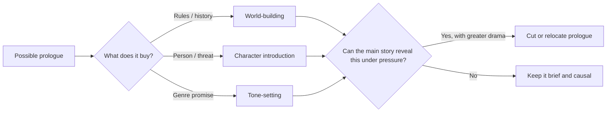
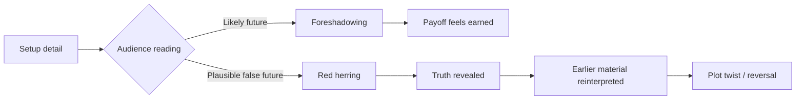
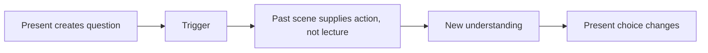
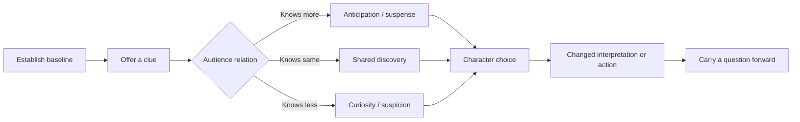
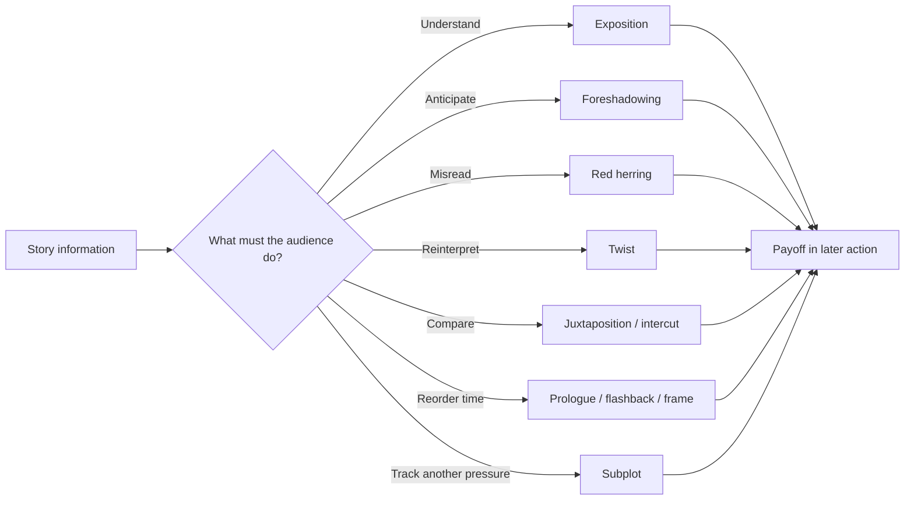
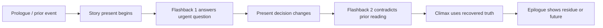

# Story Devices and Placement

Imagine a night caretaker hears a knock from a room that should be empty. If the audience hears the knock at the same time as the caretaker, it may startle us. If we hear it first, we can worry while the caretaker walks toward the door. If we see the caretaker react but never hear the knock, we have to infer what happened. The event stays the same; the order and amount of information change how we feel.

That choice is a story device: a way of arranging events or evidence so the audience watches, understands, or feels something in a particular way. A device earns its place when it changes what the audience expects or how we understand a character. The notes below move from that simple choice to more complex ones.

> [!tip] Use the expanded teaching laboratory
> [[03 - Story Devices and Placement#10.5 Scene design as control of knowledge, attention, and absence|10.5 Scene design as control of knowledge, attention, and absence]] · [[03 - Story Devices and Placement#10.6 Nonlinear order, unreliable accounts, and the return to now|10.6 Nonlinear order, unreliable accounts, and the return to now]] · [[03 - Story Devices and Placement#10.7 Compressing time: scene, montage, ellipsis, and transition|10.7 Compressing time: scene, montage, ellipsis, and transition]] · [[03 - Story Devices and Placement#10.8 Offscreen space, sound, and the meaning of what is not shown|10.8 Offscreen space, sound, and the meaning of what is not shown]] · [[03 - Story Devices and Placement#10.9 Genre combination and subjective form|10.9 Genre combination and subjective form]] · [[03 - Story Devices and Placement#10.10 Paired treatments: same story fact, different presentation|10.10 Paired treatments: same story fact, different presentation]]
> The new sections add worked decisions, examples, failure-and-repair tests, and practice. The research ledger in [[04 - Story Design, Structure and Practice#Research ledger — craft expansion, 29 October 2026|Volume 04]] records exactly what was inspected.


> **Evidence key:** a source note marked **captioned** comes from an available English caption; **partial** means chapter titles/comments, not a full transcript; **companion article** means StudioBinder's written breakdown, not the video audio. Related visual teachings later in this note use the strongest evidence available and keep those classes separate.

## How a screenplay controls knowledge, time, attention, and meaning

> **Evidence key continued:** major lessons in this volume come from captioned playlist entries linked at point of use. Where video captions were missing, the entry is explicitly labeled partial or companion-article evidence; that material informs the teaching without being attributed to unseen narration.

Think of a simple mystery: the caretaker finds a wet footprint beside a locked door. We could show it immediately, wait until the caretaker notices it, or first show someone returning from the rain. Each version invites a different guess. Before choosing a named technique, decide what you want the audience to wonder about. We will introduce the names as each choice becomes useful.

Keep five questions nearby: what do we know or suspect; when do we see each event; which detail draws our attention; what changes our understanding; and what can we learn from an image, sound, or movement without speech? [[01 - Screenplay Format]] explains how to write the result on the page. [[02 - Scenes, Dialogue and Character]] follows people and their behavior. [[04 - Story Design, Structure and Practice]] connects these choices across a whole story.


Name the audience's job at each point: understand a fact, anticipate a threat, misread a clue, compare two images, or follow a second storyline. Before adding a device, complete this sentence: **“The audience needs to ___ at this exact point.”** If you cannot fill the blank clearly, the device may be decoration.

---

## 1. The opening is a contract

An opening teaches the audience how to watch this story. It may promise speed, intimacy, mystery, comedy, terror, or romance. It also introduces the clues and questions we should pay attention to. Think of it as the film's first promise: later scenes can fulfill it, complicate it, or deliberately break it.

In [Art of the Opening Scene — How to Start a Movie 6 Different Ways, From Nolan to Baumbach](https://www.youtube.com/watch?v=Jw_ysaoVlt4), the examples show that an opening can begin with action, a character, an object, the film's tone, its history, or a structural device. Genre means a broad kind of story with familiar expectations, such as horror or romance; tone is the story's attitude toward its subject, such as playful or mournful. A prologue is a short opening set apart by time or purpose; it may build the world by showing its rules or history. A MacGuffin is an object that starts a pursuit even when the object's exact nature matters less than what characters do to get it. Whichever opening you choose, the rest of the story needs to develop or change its promise.

### Six useful opening designs

To read the last row, picture three opening choices. A **flash-forward** shows a later event first, creating a question about how we reach it. A **bookend** pairs an opening situation or image with a related ending, so we can notice what changed. A **red herring** offers a plausible wrong explanation, such as showing the caretaker beside a wet coat when someone else made the footprint. A **metaphor** makes us understand one thing through another: a home shown like a cage can suggest confinement. In the table, **stakes** means what can be gained or lost, and **conflict** means what resists someone’s goal. We will work through the uses in more detail as they arise.

| Opening design | Immediate job | Long-term obligation | Example from the source |
|---|---|---|---|
| Action or spectacle | Capture attention and establish danger | Make the action reveal character, stakes, or a governing conflict | *The Dark Knight* introduces the Joker through a bank robbery; *Skyfall* turns a chase into the wound between Bond and M |
| Character or relationship | Make the audience care before the plot accelerates | Let later conflict transform what the opening established | *Marriage Story* spends about eight and a half pages building the marriage, then reveals on page nine that it is failing |
| Central object or concept | Give a prop symbolic and causal weight | Keep changing what the object means | *Uncut Gems* begins at the mine so the opal carries fascination, exploitation, hope, and violence |
| Tone and genre | Teach the emotional grammar of the film | Maintain or deliberately complicate that grammar | *La La Land* establishes fantasy versus routine; *Get Out* combines horror, comedy, social anxiety, and ironic music |
| World or history | Supply a past or rule set the present depends on | Limit information to what creates present pressure | Mythic history, flashback, or a world-building prologue |
| Structural device | Create a question through chronology or presentation | Return to, answer, or transform the device | Flash-forward, dream, bookend, metaphor, red herring, or MacGuffin |

One opening image does not need to explain everything. Choose its main promise, then let smaller clues support it.

### The first image as compressed screenplay

[Why Some Movies Hook You Instantly](https://www.youtube.com/watch?v=822eeaOBVII) shows how a first image can carry several clues at once. Some images are subjective: they show the world as a character experiences it, shaped by memory or emotion. A repeated image, sound, or object that gathers new meaning is called a motif. An offscreen detail exists outside the visible frame; we may hear it, see its shadow, or notice a character looking toward it. Watch for these effects in the examples:

- *Oppenheimer*: raindrop ripples resemble atomic reactions, foreshadow the final nuclear vision, and symbolize consequences spreading from one act.
- *Hell or High Water*: a small town, bailout graffiti, crosses, and a for-sale sign establish economic injury, failed institutions, moral tension, and the revisionist Western setting.
- *Marie Antoinette*: luxury, bored posture, desserts, a knowing glance, and anachronistic music announce a subjective portrait of youth and rebellion rather than a conventional historical pageant.
- *Nope*: an impossible upright shoe amid blood and wreckage introduces spectacle, trauma, dissociation, and the idea of a “bad miracle.”
- *Raging Bull*: slow motion and operatic music make boxing both brutal and tragic, promising that Jake LaMotta's life will unfold like opera.
- *Past Lives*: three people, warm light, off-screen speculation, and Nora's glance ask the audience to become a detective of relationships.
- *Hereditary*: a fly, a miniature house, and an omniscient move establish rot, predestination, and characters treated like dolls without agency.

Use this first-image audit:

```text
What do we literally see and hear?
What question does it create?
What emotional instruction does it give?
What theme or conflict does it compress?
Which detail will gain a second meaning later?
```

If the first image could move unchanged into an unrelated film, it may create a mood but does not yet tell us much about this particular story.

### Prologues: begin before the beginning

A prologue is an opening sequence temporally distinct from the primary story. It may occur centuries earlier, days earlier, or even later than the main events. [How to Write a Prologue — Writing Tips and Tricks](https://www.youtube.com/watch?v=5yWnsDiU04s) identifies three core uses:

1. **World-building.** Establish rules, history, or danger that the ordinary first act cannot efficiently supply. Keep explicit explanation brief. *The Terminator* combines a gripping future wasteland with concise text. *28 Days Later* shows contagion spreading without answering everything. *Starship Troopers* uses an in-world advertisement to establish both the universe and its anti-jingoistic satire.
2. **Character introduction.** Orient an ensemble, reveal a protagonist before the main plot pulls them forward, or demonstrate an antagonist's capabilities before the hero meets them. *The Royal Tenenbaums* maps family members and relationships; *Erin Brockovich* reveals intelligence and frustrated ambition; *The Dark Knight* makes the audience wait anxiously for the Joker's return.
3. **Tone-setting.** Deliver the genre experience early so the first act can later slow down. *Jurassic Park* proves that the creatures are dangerous; *The Matrix* previews the film's action language; horror prologues can create a victim outside the main cast so ordinary setup remains charged with dread.

Keep a prologue if the audience would lose an important rule, threat, character insight, or genre promise without it. If the same facts could arrive later through a character's choice, the prologue may be delaying the story's stronger beginning.



### Opening credits are narrative space

[Reacting to Opening Credits — What Makes a Great Title Sequence?](https://www.youtube.com/watch?v=gFUtF0gNocM) treats the credit sequence as story space. It can establish tone and repeat an image or sound that later changes meaning—the kind of pattern called a motif. The examples show how:

- *Catch Me If You Can* uses 2D animation to preview disguise, pursuit, and a protagonist who blends into crowds.
- *The Room* illustrates generic failure: city footage and dramatic music do not belong specifically to its story. Inserts of the room, football, flowers, or relationships would have carried narrative meaning.
- *Dawn of the Dead* combines found emergency footage, quick cuts, blood imagery, glitches, and Johnny Cash. The music-image contradiction gives the apocalypse a specific personality.
- *True Detective* uses double exposures, landscapes, bodies, maps, and recurring images that reward repeated viewing.

Ask whether the same sequence could fit another film unchanged. If so, the credits may be too generic to tell us anything about this story.

---

## 2. Exposition is controlled access to meaning

Characters and viewers often need facts about the place, a person's past, a rule, or what caused an event. Screenwriters call this information exposition. Too much at once can feel like a lecture; too little can leave the audience lost. The craft question is when a fact becomes useful to the character and to us.

A room can supply facts before anyone explains them: a dusty second place setting can suggest someone has stopped coming home. **Production design** is the planned physical look of the story’s world. **Props** are objects used in the action. A **montage** joins selected moments so we notice a pattern or passage of time, such as repeated failed repairs. These are options for showing information in the list below.

[What is Exposition in Screenwriting — 4 Keys to Writing Film Exposition That Works](https://www.youtube.com/watch?v=oEq2XjFCaps) offers four ways to place those facts inside an active story:

1. **Disguise the information.** Hitchcock's “sugar-coated pill” means the audience receives facts while attending to conflict, spectacle, humor, curiosity, or emotion.
2. **Visualize it.** Production design, behavior, montage, props, and setting can communicate facts without explanatory speech.
3. **Delay it until it matters.** Information placed at the moment it changes a decision is stronger than the same information supplied as insurance in act one.
4. **Withhold what is not yet necessary.** Mystery is often created by the shaped absence of exposition.

### Delivery channels

The table compares ways to give the audience a fact. **Direct address** means speaking to the audience rather than only to another character. **In-world media** is a broadcast, article, recording, or other medium that exists inside the fictional world. **Mise-en-scène** is a French term for what is arranged before the camera: the space, objects, clothes, light, and people. For now, think of the room’s arrangement doing some of the explaining. A later section explores its fuller range.

| Channel | Strength | Risk | Example |
|---|---|---|---|
| On-screen text | Fast time/place orientation | Feels like a label if it supplies no dramatic pressure | A location or historical date |
| Narration | Can establish voice and compress history | Can duplicate the image or explain emotion already visible | A narrator whose attitude is itself characterization |
| Dialogue | Can integrate fact with conflict | “As you know” speech between people who already share the facts | A novice asks because they need the answer now |
| Direct address | Handles dense or alien subject matter openly | Can rupture tone if the film has not established this rule | *The Big Short* explains financial systems to camera |
| Song | Makes lists, relationships, and history memorable | Can become a catalogue without dramatic progression | *Encanto* introduces the family and its gifts |
| In-world media | Lets the world teach characters and viewers together | Can become a disguised lecture | Mr. DNA in *Jurassic Park* |
| Mise-en-scène | Creates inference and questions without words | May be missed if essential facts are too subtle | In *Signs*, family photo, empty bed, and missing cross imply loss and lost faith |

The separate playlist item [Mastering the Screenplay: Exposition in Film](https://www.youtube.com/watch?v=njZBYNu2vxA) supplied only example clips in the available caption track: scientific transformation, the 1.21-gigawatt requirement in *Back to the Future*, DNA explanation in *Jurassic Park*, and an engineering warning about shale and a prior disaster. These examples support one limited observation: technical information becomes more watchable when it is tied to an immediate problem, demonstration, requirement, or refusal. The track did not contain a recoverable narrated framework, so no broader doctrine is attributed to it.

### The exposition-pressure test

Before retaining an explanatory passage, ask:

```text
Who needs this information now?
What will they decide differently after receiving it?
What resistance, cost, conflict, or surprise accompanies it?
Could an object, behavior, image, or consequence communicate part of it?
What can remain unanswered until the audience actively wants it?
```

Exposition works best when a character can use the fact to make a choice, challenge someone, avoid danger, or change their mind. Then the audience learns while the scene is moving.

---

## 3. Foreshadowing prepares; misdirection redirects; twists reinterpret

These devices are related but not interchangeable.



### Foreshadowing

Foreshadowing is an early clue that prepares the audience for something that happens later. [Types of Foreshadowing in Films — What is Indirect vs. Direct Foreshadowing?](https://www.youtube.com/watch?v=JOas2BLjPR4) distinguishes two forms:

- **Direct foreshadowing:** an explicit warning, prophecy, prediction, stated rule, promise, or threat. It can reveal an outcome while shifting suspense to how it occurs. “An act of true love” in *Frozen* is direct but ambiguous enough to misdirect the characters and audience about the kind of love required.
- **Indirect foreshadowing:** a clue whose predictive value is recognized mainly in hindsight. It may be dialogue, behavior, an object, a number, a title, a mural, production design, or a character trait.

An Easter egg is usually a hidden reference or joke. Foreshadowing prepares an event that affects the story. Chekhov's gun is the related idea that a prominently introduced object creates an expectation that it will matter later. A satisfying clue lets viewers think on a second viewing: **“It was there, but I interpreted it differently.”**

### Red herrings

A red herring is a clue or event that points toward a believable wrong explanation. [What is a Red Herring — 5 Techniques to Mislead & Distract an Audience](https://www.youtube.com/watch?v=47ntBElzaWk) shows how a suspect, a casting choice, or a familiar story pattern can pull attention in the wrong direction.

Five practical methods:

1. **False suspect or clue.** Classic mysteries make each innocent suspect a provisional answer. *Murder on the Orient Express* subverts the convention: the expectation that most suspects are false becomes the false assumption.
2. **Unreliable narrator.** *The Others* and *The Usual Suspects* let a limited or deceptive perspective construct the wrong reality.
3. **Emotional identity error.** *Saving Private Ryan* encourages viewers to connect the cemetery visitor with Captain Miller, then converts assumed failure into catharsis when the visitor is revealed as Ryan.
4. **External knowledge.** Tarantino uses known history as the false track in *Inglourious Basterds* and *Once Upon a Time in Hollywood*.
5. **Casting and marketing.** A major star implies narrative survival; an actor's wholesome persona repels suspicion. *Psycho* uses both Janet Leigh and Anthony Perkins this way.

A red herring should be easy enough to notice, believable enough to affect our guess, and fair once the truth comes out. A clue that has no connection to the answer is just noise.

### Plot twists and reversals

A plot twist is a new fact or event that changes how we understand what came before. [The Secret to Writing Compelling Plot Twists — The Art of Misdirection Explained](https://www.youtube.com/watch?v=YHbOVOZWhZM) explains why a strong twist needs two things at once:

- **Misdirection:** a convincing present-tense explanation.
- **Breadcrumbs:** true evidence that usually becomes legible on a second viewing.

Placement determines function:

| Placement | Structural effect | Example |
|---|---|---|
| Midpoint | Replaces the apparent movie with a new dramatic direction | *Psycho* shifts from theft story to slasher/investigation |
| Break into act three | Reveals the real trap and gives the protagonist a final objective | Rose's reveal in *Get Out* occurs around the three-quarter point |
| Climax | Resolves the central mystery at the last possible moment | *The Village* uses a smaller act-three reveal before its larger final reality reveal |

The later the twist, the less time the audience has to experience its consequences. A twist near the ending should help resolve the main question. A twist around the middle can send the story in a new direction and create a second half.

### The fairness matrix

| | Truth well planted | Truth poorly planted |
|---|---|---|
| False explanation convincing | Earned surprise | Shock that feels arbitrary |
| False explanation weak | Predictable but coherent | Confusion |

Aim for the upper-left cell: a convincing wrong explanation and a truth that was planted. Start with the answer, then list which earlier moments it changes. Plant enough real evidence for recognition, while giving viewers a believable reason to read that evidence another way.

---

## 4. Flashbacks: the past must act on the present

A flashback takes us to an event that happened before the story's current moment. [How to Write a Flashback — What the Best Movie Flashbacks Have in Common](https://www.youtube.com/watch?v=E7XDucl6ABY) argues that it needs a stronger reason than explaining one trait. A person is rarely shaped by one event alone; the past matters when it changes what the present means.

### What earns a flashback

A remembered event can have its own **arc**: a small progression from one condition through an attempt or discovery to a changed condition. That is why a flashback can feel like an active scene rather than a pause for background information.

- It answers a question the present story has made urgent.
- It forms a compelling mini-story with its own progression.
- It changes the interpretation of a person, event, or goal.
- It raises urgency rather than pausing it.
- It draws a thematic parallel between past and present.
- It completes or complicates a reveal.

Examples:

- *Citizen Kane* organizes recollections around the question of “Rosebud.”
- *The Bourne Identity* uses fragments to recover identity and danger.
- *Lost* gives flashbacks internal arcs while making present behavior more legible.
- *Ratatouille* proves a flashback can be extremely brief when one sensory trigger carries a complete emotional turn.
- *Manchester by the Sea* withholds the central trauma, then uses brief flashbacks around pages 43, 50, and 52 to build toward an emotional outburst rather than front-loading explanation.
- *Gone Girl* uses flashbacks after the midpoint reveal to reconstruct Amy's plan.
- *The Sixth Sense* uses rapid flashbacks to make the final twist visually undeniable.
- *Arrival* disguises future memories as flashbacks, turning chronology itself into the twist.
- *The Tree of Life* compares an adult son and father through intercut past and present.

### Placement model



If the character only learns a fact and then carries on unchanged, the flashback may feel like background information. A useful flashback changes what the character decides or does now.

### Formatting flashbacks clearly

[Screenplay Flashbacks Explained | How to Format a Screenplay](https://www.youtube.com/watch?v=ejvaOUxkeOI) presents three accepted entry methods:

```text
BEGIN FLASHBACK:

INT. CHILDHOOD HOME – NIGHT
```

or:

```text
INT. CHILDHOOD HOME – NIGHT (FLASHBACK)
```

or a transition:

```text
FLASHBACK TO:
```

Return with a matching clear marker:

```text
END FLASHBACK
```

```text
INT. APARTMENT – NIGHT (BACK TO PRESENT)
```

```text
BACK TO PRESENT
```

Dialogue and action still use the screenplay's ordinary form inside a flashback. What matters is that readers can tell when the scene moves into the past and when it returns. Pick a clear marker and use it consistently.

---

## 5. Frame narratives and stories within stories

A frame narrative begins with one story, pauses to tell another story inside it, and may return to the first. The outside story is the frame; the story told within it is embedded. [What is a Frame Narrative? — Why Writers Use the Literary Device](https://www.youtube.com/watch?v=e9_Ize7ZDwg) also lists other names for this structure, including sandwich, nested, and intercalated narrative.

### Two main layouts

1. **Bookend:** the outer story opens the film, releases the embedded story, and returns in the epilogue.
2. **Interwoven frame:** the film repeatedly moves between outer and embedded narratives.

Other variants include in-world media, documentary interviews plus reenacted past, multiple narrators, and stories nested several layers deep.

### What a frame can do

- Reorder a life nonlinearly.
- Create a question about how the known endpoint was reached.
- Make storytelling itself the subject.
- Compare narratives across eras or contexts.
- Expose unreliable memory or narration.
- Show multiple perspectives and the discrepancies between them.
- Reflect a character's inner life through a play, book, program, or tale inside the film.
- Connect an anthology of otherwise separate stories.

In *Citizen Kane*, Kane's death and last word start an investigation into his life. *Rashomon* shows conflicting accounts of one event, so the audience must compare witnesses. *The Grand Budapest Hotel* places one narrator's story inside another's, making it feel passed down. *I Saw the TV Glow* uses a fictional TV series to reflect the protagonist's life. In *Big Fish*, the son learns about his father through the stories his father tells.

### Design decisions

```text
Who tells the embedded story?
Why are they telling it now?
What can they know?
What might they distort?
Why does the outer story need the inner one?
How often should the film cross the boundary?
What changes in the outer story after each return?
```

In the script, make changes of time and storyteller easy to follow with scene headings, dates, and character names. The source's *Life of Pi* example labels the older storyteller **ADULT PI** and dates the past scenes.

If the film jumps between frame and inner story too often, viewers may not settle into either. If it returns too rarely, the frame can feel pasted on. *The Princess Bride* comes back to its outer story to release suspense and create a joke; the interruption is part of the intended pleasure.

---

## 6. Subplots: a second line of pressure

A subplot is a storyline with less emphasis than the primary narrative. [How to Write a Subplot in a Screenplay — Adding Layers to Your Film](https://www.youtube.com/watch?v=iZbac66pHLc) distinguishes a subplot from a multiplot story, where several storylines receive similar weight.

Writers often call the main plot the A story and a subplot the B story; C and D stories are additional, smaller threads. A subplot may follow the main character or someone else. Give it a start, a change, and an ending so it feels like a real line of action.

### Four common subplot forms

| Form | Relationship to A story | Typical use |
|---|---|---|
| Romantic | Emotional relationship develops during the main pursuit | Humanizes scale and creates personal stakes |
| Expository | Secondary arc reveals a key cause, history, or motive | Reframes the primary story, as Snape's history or Cobb's past does |
| Parallel | Mirrors the main action | Expands theme, comedy, or comparison |
| Contrasting | Takes a different tonal, thematic, or moral direction | Tests the A story's values, as love and revenge contrast in *The Princess Bride* |

### Functions

- Reveal dimensions of the protagonist unavailable in the main pursuit.
- Give secondary characters motives and arcs.
- State, mirror, or challenge theme.
- Raise stakes around the A story.
- Add urgency to scenes that would otherwise feel safe.
- Create turning points when B and A collide.
- Control pacing by cutting away, delaying resolution, offering relief, or adding humor.

A subplot can stay smaller than the main story and still matter. In *Challengers*, Tashi's tennis career rises and falls, and an injury marks the middle turn. *High and Low* holds back the criminal's storyline until halfway, then shifts the film into a cat-and-mouse pursuit. Shoshana's story in *Inglourious Basterds* starts in the opening scene, keeping the human cost of the occupation in view.

### The weave test

For every subplot beat, identify at least one connection:

```text
A-story decision changes B story
B-story consequence complicates A story
B story mirrors or contradicts theme
B story changes pacing before an A-story payoff
B-story climax becomes an A-story turn
```

If none applies, the subplot may be a separate short film competing for pages.

---

## 7. Parallel action, intercutting, and juxtaposition

An intercut alternates between two or more scenes. The scenes may happen at the same time, contrast each other, share a theme, or form a conversation across locations. [How to Intercut Scenes in a Script | How to Format a Screenplay](https://www.youtube.com/watch?v=XcPJxHA3lt8) shows several ways to mark one:

- A transition such as `INTERCUT:` followed by the second location.
- An action line indicating the intercut.
- A subheading such as `INTERCUT WITH EMILY IN HER ROOM`.
- A scene heading with an intercut modifier.

After you introduce both locations, a phone call can continue without repeating a full scene heading for each speaker. End the alternation clearly with a transition, action line, subheading, or new heading.

There is no single required format. Choose one clear pattern, keep it consistent, and include only the switches that help the audience follow the call or compare the action. Balance the time spent in each place so the rhythm does not drag.

### Juxtaposition is the meaning created between elements

Juxtaposition means placing two things beside each other so their difference or similarity creates a new idea. [What is Juxtaposition in Film — How to Take Visual Storytelling to the Next Level](https://www.youtube.com/watch?v=TVmVir2Uwb8) shows that the comparison can come from more than alternating scenes. Mise-en-scène—the things arranged in a shot, such as setting, costume, props, light, and where people stand—can create a contrast:

- Mise-en-scène can contrast costume, color, setting, props, light, scale, and position.
- Music may contradict or intensify an image.
- Dialogue or narration may conflict with behavior.
- Cross-cutting alternates between actions or characters so their relationship becomes clear.
- Match cuts connect similar shapes while comparing different states.
- Dissolves layer images and ideas.
- Smash cuts create shock or comedy through extreme difference.
- Split screens expose parallel experience in one frame.
- Intellectual montage combines images to create an abstract political or thematic conclusion.

When two images or sounds meet, ask what new idea their connection creates. The key question is **“what third idea appears because these two things touch?”**

### Split screen as simultaneous comparison

A split screen shows two or more parts of the image at once. The seam may be hidden through compositing or visible as separate panels. [The Split Screen — The Ultimate Guide for Filmmakers](https://www.youtube.com/watch?v=HDJ-q2Q2X9I) distinguishes these hidden and visible forms. Hidden splits can combine performances or duplicate an actor; visible panels can:

- Compare routines, classes, expectations, or perspectives.
- Show action and reaction simultaneously.
- Put distant characters into visual intimacy.
- Build suspense by displaying danger and delayed response at once.
- Compress montage information.
- Reproduce comic-book panels or expand the physical frame.
- Sustain several storylines while sound directs attention.

The screenplay needs to say why these images must be seen at the same time. A storyboard—the planned sequence of drawings for key images—and the editing plan can settle the exact panel shapes and sizes.

---

## 8. Genre, tone, atmosphere, and the audience's expectation machine

A genre is a kind of story with familiar patterns. A crime film may promise a crime and its consequences; a romance may promise a relationship tested by conflict. [Movie Genres Explained — Types of Films & the Art of Subverting Film Genres](https://www.youtube.com/watch?v=rDVVE8ZHJ3o) shows that genre helps the audience know what to expect and helps the writer choose which expectations to use.

A subgenre is a narrower kind within a broad genre. A murder mystery, for example, adds suspects and an investigation to the crime story. Writers can also bend genre expectations in several ways:

1. **Spoof:** make the familiar rules silly by exaggerating them.
2. **Inversion or subversion:** reverse a familiar choice. *Midsommar* makes daylight frightening.
3. **Genre switch:** start in one kind of story and later become another; *From Dusk Till Dawn* changes from crime to vampire horror.
4. **Hybrid:** combine two or more genres throughout; *Blade Runner* blends noir and science fiction.

A surprise works better when viewers recognize the rule being bent. Without that shared expectation, the change may feel accidental.

### Tone, atmosphere, and mood

Tone is the story's attitude toward its subject; atmosphere is the sensory feel created by images and sounds; mood is the feeling viewers experience. [Mood vs. Tone vs. Atmosphere — The Backbone of Any Film](https://www.youtube.com/watch?v=hfEpK51DnsY) connects them this way:

```text
Tone + Atmosphere = Intended mood
```

- **Tone:** the work's attitude toward its subject, beginning in plot, narration, scene construction, and dialogue.
- **Atmosphere:** the sensory environment built through location, design, costume, light, color, camera, sound, music, and editing.
- **Mood:** the emotional condition intended for the audience.

The setting and sound can support the story's attitude or push against it. Cheerful music over violence may make the viewer question how to feel; comic acting in a Gothic castle can turn fear into comedy. Since viewers will not all feel the same thing, table reads and screenings can show whether the intended effect is coming through.

---

## 9. Devices that alter the boundary between story and audience

### Breaking the fourth wall

The fourth wall is the imagined boundary between the characters' world and the audience. A character breaks it by speaking or looking directly to viewers. [What is the Fourth Wall? The Best Examples of Breaking the Fourth Wall](https://www.youtube.com/watch?v=PZL13w9TqbA) offers three ways to make that choice clear:

1. **Be extreme:** make frequency intentional—either a governing pattern or a rare exceptional event.
2. **Be thoughtful:** place the address before a scene for privileged information, during it for a private reaction or progress report, or after it to punctuate the event.
3. **Be bold:** the break should command attention or communicate something consequential.

In *House of Cards*, Frank speaks to the audience while the other characters remain unaware. That private address makes viewers feel included in his plans. Keep that rule steady unless changing who can hear him is itself a story event.

### Deus ex machina: when intervention destroys meaning

A deus ex machina is a sudden outside rescue that solves the hero's problem without a setup. The name comes from a traditional stage device that lowered a god onto the stage. [What is Deus Ex Machina — The “God From the Machine” Plot Device Explained](https://www.youtube.com/watch?v=SNvj8jCrGiw) identifies four common failures:

- The ending changes established rules.
- A payoff has no meaningful setup.
- Last-minute help arrives from nowhere and solves the problem for the protagonist.
- Random coincidence supplies victory.

Help from another person is not automatically a cheat. It becomes frustrating when it erases the hero's final choice. Plant the help early, keep it within the story's rules, and give the hero a meaningful action or cost. A coincidence can work if it connects to the story's theme. Comedy may also openly joke about a rule-breaking rescue in a way that serious drama usually cannot.

### Epilogues and the last piece of meaning

An epilogue is a short passage after the main conflict has ended. It may show what happens later, add irony, or leave the audience with a new possibility. [How to End a Movie with an Epilogue — 8 Techniques Behind the Best Film Endings](https://www.youtube.com/watch?v=bZFMawBa5cI) covers several forms:

Forms include:

- On-screen text.
- Voiceover over montage.
- Silent future montage.
- A final pre-credit scene.
- Mid-credit or post-credit scene.
- Time jump or next-generation scene.
- A bridge between dramatization and real people.
- A deliberately false or prematurely placed epilogue.

An epilogue cannot fix a climax that never resolves the main conflict. It should add something after the answer, not repeat it. The producer-added ending of *Blade Runner* is a warning in the source: forced optimism and explanation may weaken an ambiguity the film had earned.

---

## 10. Film language that must be anticipated on the page

A screenplay specifies visible and audible action, but it should also anticipate what departments will need to make meaning. The goal is not to direct every cut. It is to write scenes whose dramatic design can be translated into blocking, composition, sound, design, and editing.

### Mise-en-scène

[What is Mise en Scene — How Directors Like Kubrick Master the Elements of Visual Storytelling](https://www.youtube.com/watch?v=3euNFd7-TCg) defines mise-en-scène as everything selected and arranged in a shot: set, props, costume, makeup, actor placement, blocking, performance, light, composition, lens/depth, camera position and movement, with sound and music included in the video's expanded model.

Naturalistic mise-en-scène aims to resemble ordinary reality. Theatrical mise-en-scène foregrounds stylization. Both require deliberate alignment with the story's vision.

In *The Shining*, carpet geometry, toys, high-key lighting, a high angle, centered framing, deep focus, slow zoom, ominous score, and Danny's seated blocking make a bright corridor feel like a trap. The scriptwriter's contribution is the dramatic image: a vulnerable child absorbed in play while an unseen force seems to watch.

### Visual storytelling without dialogue

[Directing Without Words: Visual Storytelling in Film](https://www.youtube.com/watch?v=WMcWLFtGnAs) demonstrates five systems:

1. Performance: facial tension, pauses, swallowing, posture.
2. Camera relation: distance, angle, movement, and when perspective changes.
3. Setting and symbol: a place or object carries social and emotional meaning.
4. Blocking: bodies approach, circle, retreat, mirror, dominate, or avoid.
5. Editing: reaction, eyeline, duration, and cut order construct an unspoken decision.

When revising a dialogue-heavy scene, remove the dialogue temporarily and write what the audience can still understand. Restore only words that add conflict, concealment, rhythm, or information that image and behavior cannot carry.

### Time lapse and compressed duration

[What is a Time Lapse – How Filmmakers Manipulate Time](https://www.youtube.com/watch?v=9HGH86o1tIk) explains that footage captured below playback rate appears accelerated. At 24 fps playback, 12 captured fps is about twice normal speed; one captured frame per second appears about 24 times faster.

For the writer, the important choices are purpose and visible change. A time lapse can move across a day, compress years, show urban speed, express cosmic scale, connect character evolution to environmental change, or make time itself the theme. A hyperlapse adds controlled camera movement. Write what changes and why the compression matters; leave capture interval and rigging to production unless plot-critical.

### Subtitles as composition and meaning

[Subtitles — The Ultimate Guide to Movie Subtitling Format, Style & Etiquette](https://www.youtube.com/watch?v=5Y3Em-IMSwM) distinguishes same-language transcription, translation, closed captions, karaoke, and freeform text. The track appears to say “interlingual” twice; the intended standard distinction is **intralingual** for the same language and **interlingual** for translation.

Source guidelines include approximately 17 characters per second for English subtitles, no more than two lines, about 50 characters per line, natural segmentation, no splitting tight syntactic units, consistent gaps of roughly two to four frames, and strong contrast against the image. Text competes for attention, so the writer and visual team should avoid placing crucial simultaneous visual information where reading makes it invisible.

### Storyboards: the evidence boundary

Two playlist entries concern storyboarding:

- [How to Make a Storyboard (ft. Star Wars)](https://www.youtube.com/watch?v=238eypcdOzU)
- [How to Master a Storyboard like Jordan Peele: Get Out](https://www.youtube.com/watch?v=2FGA4jZcifA)

The first has a caption file, but it contains only music/applause markers and the isolated phrase “I am pulling up.” It is substantively unavailable. The second has no usable caption track in the collected set; the written companion article is analyzed earlier in this volume and is clearly labeled. No lesson is attributed to unseen narration.

The usable storyboard principle comes from other captioned sources: storyboard when simultaneous composition, complex movement, split screens, branded pitches, or exact visual comparison must be communicated before production. The storyboard tests whether the written dramatic intention can be understood as a sequence of images.

---

## 10.5 Scene design as control of knowledge, attention, and absence

A screenplay chooses which clues the audience gets, when we get them, and whose experience guides us. Sometimes an event changes the plot. Sometimes no new event happens, but an image or sound changes what we think about a person. Before using a device, ask what you want viewers to do: notice, compare, predict, infer, doubt, or rethink.

A useful planning card has five fields:

| Field | Question | Example answer |
|---|---|---|
| Dramatic want | What does the viewpoint character need in this scene? | Find out whether the locked room is occupied |
| Available evidence | What can the audience actually see or hear? | Light under the door, one moving shadow, a repeated scrape |
| Information gap | What does the character know that we do not, or vice versa? | The character knows the building's layout; the audience knows the scrape has repeated |
| Scene turn | What changes the character's next action? | A second shadow appears when the first person is still |
| After-effect | What question or feeling should travel into the next scene? | Is there someone in the room, or is the light itself deceptive? |

Use the card to check whether a scene changes something. The change may be a new fact, a shift in power, or growing worry. Page count alone does not tell us whether a scene is useful: a brief exchange can reverse a relationship, while a longer wait can build pressure. Make the reason for waiting clear.

### Restriction is a choice about access, not merely camera position

Point of view (often shortened to POV) means the position from which the audience receives a moment. It has several parts. Optical POV is where the camera seems to be. Perceptual POV is what a character can see, hear, remember, or recognize. Narrative alignment means whose goals and changing situation we follow. Moral allegiance is whose judgment the story invites us to share. We can follow a character closely without agreeing with them, or know something they do not while staying emotionally near them.

Restriction means limiting what the audience can see or learn. It can make a familiar room uncertain, let us enjoy an expert noticing details, or make a mystery fair by giving us the same clues as the character. Hiding information alone does not create suspense. Give the character a question and a cost for getting it wrong. Make the limit concrete: a closed door, a blocked view, an unfamiliar language, a damaged recording, a memory gap, or a rule that controls access.

Andrew Niccol's *The Truman Show* shooting-script copy opens with what Truman sees and with how others watch him. The opening describes a bathroom mirror as two-way glass. Its short text cues are `A FOGGED MIRROR` and `two-way mirror` (five quoted words total). The audience sees evidence of surveillance before Truman understands it. That gives us more information than Truman has, even while the scene stays close to his world. This is a reading of the screenplay's opening pages, not a claim about the exact final camera shots. [The Truman Show screenplay, pp. 1–2](https://assets.scriptslug.com/live/pdf/scripts/the-truman-show-1998.pdf).

For each scene, note what each person knows at the start and at the end. A fact may be shared, private, inferred, or unknown for now. Then compare the character's knowledge with the audience's. If we know more, we may worry about what the character is about to do. If we know the same amount, we discover things together. If the character knows more, we may suspect a secret or wait for a confession. Mark the exact beat when that balance changes.

A reliable repair for a confusing restricted scene is not “add explanation.” First check whether the audience knows the character's immediate objective. Then check whether the relevant clue is visible or audible, whether it is distinguishable from background noise, and whether the next action follows from it. If the clue is essential but invisible in practice, strengthen its dramatic contrast, repeat it with variation, or let another character react to it. If the clue is meant to be missed on first viewing, preserve enough context for it to become recognizable later. In a fair-play puzzle, an essential clue must become interpretable in retrospect; an experimental work may deliberately leave uncertainty unresolved.

### Suspense, surprise, and delayed recognition

Surprise is a sudden change in what the audience thinks is happening. Suspense is worry that lasts while we wait to see whether a danger will occur. A new sound or unexpected entrance can startle us; a danger we know about but cannot yet see resolved can keep us tense. The two can happen together. For example, we may hear a timer before the character notices it, then be surprised when it stops for an unexpected reason.

Hitchcock's familiar bomb-under-the-table example is often retold in different forms, so treat it as an illustration rather than a verified quotation. If a bomb suddenly explodes during a conversation, the audience gets a shock. If we see the bomb and a ticking clock first, the same conversation becomes tense because we wait for it to explode. Giving viewers more information can create suspense when they can see a danger the characters have not noticed. The characters' choices still matter: if no action can change the outcome, the countdown may become spectacle; if someone can act, each beat can test their priorities and skill.

A scene can manipulate anticipation through four adjustable controls:

1. **Certainty:** Is danger confirmed, suspected, or merely imaginable?
2. **Timing:** Is the event imminent, approaching, or delayed by a visible process?
3. **Agency:** Can a character prevent, redirect, or worsen it?
4. **Attention:** Does the audience watch the threat, the threatened person, or the person who might help?

Change one control at a time. A scream behind a door leaves its source uncertain. A clock gives it a deadline. A character with a key can act. A second person who hears the scream creates a new question: who will move first? If every element is turned up at once, the scene may feel noisy instead of tense.

A sudden surprise can work in comedy, horror, or a story designed to shock us. It feels unfair when the writer hid a fact for no story reason or changes the rules only after the reveal. A fair twist usually supports two readings: the first seems likely before the reveal; the second makes sense once we know more. Plant evidence the audience could have noticed. If viewers guess the answer early, add a deeper question about motive, timing, cost, or choice instead of piling on false clues.

In Alfred Hitchcock's *Rear Window*, Jeff's limited mobility keeps him watching the neighbors from one window. The audience sees only pieces of their lives, filtered through distance and Jeff's interest. That limit builds suspense and raises an ethical question: when does watching become intrusion? For a screenwriter, the boundary of what can be seen can be part of the story. This is an observation about the finished film's point of view, not a line-by-line description of its screenplay.

### When to disclose, reveal, or let a detail ripen

A reveal gives the audience a new fact. Recognition is when we understand the meaning of a fact already shown. A reversal changes who has control or what can happen next. Recontextualization means that new information changes how we read an earlier moment. These changes can happen at once, but naming them separately can help place a scene.

A clear fact can have a large effect. The audience can easily notice a second key on the table; the important change is realizing that someone opened the locked door from inside. Do not ask one beat to explain identity, rules, motive, location, and emotion all at once. First help viewers understand where they are. If you want them disoriented, give them one steady clue, such as a repeated sound, familiar object, or clear goal.

## 10.6 Nonlinear order, unreliable accounts, and the return to now

The story's chronology is the order in which events happen in the fictional world. Presentation order is the order in which we see them. A writer can change the presentation order to resemble memory, testimony, investigation, ritual, or grief. If viewers are meant to solve a time puzzle, give them enough clues to do so. If the story is meant to leave time or cause uncertain, give the audience some other clear experience to follow, such as a character's choice or emotion.

Before writing scenes out of order, make a simple list of what happened and when. For every event, note who saw it, what each witness believes, what evidence remains, and what the audience has already seen. Then make a second list in viewing order. The difference between the lists is a choice. If you cannot explain what happened in time order, viewers may struggle both with the facts and with the way they are presented.

Christopher Nolan's *Memento* screenplay PDF identifies itself as an October 4, 1999 shooting-script revision, based on Jonathan Nolan's short story. The opening makes a Polaroid image run backward, then introduces a black-and-white sequence. The script's fragment `The image ... starts to FADE` calls for an effect without dictating every edit. Later, on printed pages 121 and 123, it uses `FLASHBACK TO` and `BACK TO SCENE` (ten quoted words total across excerpts). Those labels are not from the opening. The script proposes the time shifts; the released film adds its own rhythm and sound. [Memento screenplay, opening and later cues](https://raindance.org/wp-content/uploads/2022/06/memento-2000.pdf).

A useful nonlinear structure gives every displacement a job:

- **Question:** What question can only become active after the audience sees a later consequence?
- **Contrast:** What does placing these moments beside each other reveal that chronological order would flatten?
- **Revision:** Which earlier assumption changes when the audience learns more?
- **Pressure:** What present-tense decision is made harder or clearer by the remembered event?
- **Orientation:** What repeated marker tells us where we are—color, date, location, object, sound, costume, or stated rule?

Nonlinear sequences fail in two opposite ways. In one, the audience is confused about basic logistics and cannot form an emotional hypothesis. In the other, chronology is a puzzle whose solution has no bearing on character or theme. To repair the first, strengthen recurring anchors and clarify the status of each transition. To repair the second, ask what the order changes about responsibility, causality, sympathy, or expectation; if the answer is “nothing,” chronological order may be more forceful.

An unreliable account is a story told from a limited or distorted position. It is not always a deliberate lie: a character may be mistaken, protecting themselves, traumatized, misinformed, or forgetful. A recording can be edited; an archive can leave some evidence out; a witness can tell the truth about what they saw and still miss what happened elsewhere. Let each detail have its own status: true, omitted, mistaken, or misattributed. Then viewers can compare accounts instead of waiting for a final verdict.

Build a discrepancy chart for each account:

| Account detail | What the teller says | What is independently shown | Possible explanation | When audience can assess it |
|---|---|---|---|---|
| Door position | “It was open” | Frame shows latch engaged | Memory error or deliberate cover | After the second witness |
| Sound | “A crash” | Recorder catches a soft tap | Different position in the room | During replay |
| Motive | “I was protecting her” | Earlier action blocks her exit | Self-justification | When costs surface |

A fair unreliable narrative lets the audience identify the account as situated before it can fully prove how. This may be done through contradictions, conspicuous blind spots, shifts in wording, a mismatch between confident speech and uncertain evidence, or a second account that is itself partial. Avoid the lazy “everything was a dream” reset: if a sequence has consumed the audience's attention, its consequences should remain in the character's behavior, relationships, or understanding.

A subjective sequence shows an experience as it feels to the character rather than as a neutral observer might see it. It can express a memory, panic, pain, intoxication, intrusive thought, or a child's sense that a room is enormous. Tell readers what changes in the character's experience and why it matters. A dream may reveal a wish, rehearse a fear, connect images, or break ordinary cause and effect; it need not predict the future. If every image has one fixed translation, the scene can feel like a puzzle answer. If the dream simply repeats a spoken thought, it may be doing no new work.

Give the audience a way to recognize when a dream or hallucination ends. You might change the sound, repeat an image, use a scene heading, or show the character recognizing where they are. Do not use an unmarked dream to erase consequences. Even if viewers never learn whether it was real, its emotional effect should continue.

### Placement and temporal clarity

A flashback can interrupt an urgent present question, but it should intensify that question or alter the next move. A flash-forward can create a gap between outcome and cause, but the audience needs a reason to return to the intervening events. A loop can turn a repeated situation into variation: each return should add a changed detail, a new witness, a different decision, or a new interpretation. A frame narrative can question the authority of its teller, but the outer story must develop while the inner one is told.

Use a location/time marker only as strongly as required. A stable series of clearly labeled past scenes needs less repeated explanation than a deliberately unstable timeline. A character's repeated phrase or object may be enough to orient a brief memory; a major time jump with new ages, geography, and knowledge may need explicit labels. The rule is not “never confuse.” It is “confuse the question you mean to raise, while preserving the facts the audience needs to ask it.”

The return from an out-of-order scene is a dramatic beat of its own. What has changed in the present? Does the character touch the object differently, reverse a decision, notice a person who was invisible before, or discover that the remembered scene was not complete? If the return simply resumes action, the temporal jump may be a detachable information packet. Keep it only if the new understanding affects behavior or prepares a later payoff.

## 10.7 Compressing time: scene, montage, ellipsis, and transition

A **full scene** gives the audience sustained access to an event's changing action, behavior, and turn. **Montage** selects and juxtaposes moments so their accumulation, contrast, or acceleration becomes the event. **Ellipsis** omits a stretch of story time and lets the audience infer that it passed. These are not levels of importance. A three-minute montage may carry a major transformation; a single omitted night may be the story's most charged absence.

Choose the form by asking what the audience must experience directly. Show a full scene when a decision, negotiation, reversal, discovery, or reaction must unfold in real time. Use montage when the pattern across several moments matters more than any one moment, or when repetition itself is the pressure. Use ellipsis when the skipped interval is predictable, irrelevant to the current question, or more powerful as an unknown. A montage should be more than “many things happen quickly”: it needs a governing relation such as repetition with variation, increasing difficulty, parallel contrast, or a measurable transformation.

| Form | Time experienced | Primary unit of meaning | Typical risk |
|---|---|---|---|
| Full scene | Near-continuous | Choice and consequence within one encounter | A static exchange with no change |
| Montage | Selected fragments | Pattern created across images/actions | Decorative checklist without progression |
| Ellipsis | Omitted interval | Inference about what happened or changed | A missing cause makes behavior arbitrary |
| Summary action | Compressed continuous description | Efficient causal bridge | Prose claims a transformation without showing evidence |

A practical montage outline has a start state, three to five changed states, and an end state. For each beat, say what is new. “She practices” is repetition. “The first jars break; she changes her grip; the last jar lands intact” is development. A contrast montage may alternate two people's routines so that the cut itself argues. A thematic montage may pair images that do not share direct cause, but it still needs a clear visual or sonic relation. The audience should feel why these images belong together now.

Montage and full scene can be combined. A training passage may use a montage to establish repetitive labor, then land in a full scene where one attempt fails in a new way. An investigation may jump through several leads, then stop on a witness's hesitation. The montage compresses familiar effort; the scene makes a singular decision visible. This pattern avoids both extremes: showing every repeated step and skipping the moment when the character's method changes.

**Ellipsis** asks the audience to bridge a gap. It can create speed, mystery, tenderness, dread, or respect for privacy. A cut from a character closing the door to the same room at dawn may imply sleep, violence, or nothing at all depending on prior context. If the omitted event is necessary to explain a later choice, plant the bridge: a changed object, an injury, a missing hour, a newly adopted habit. If the uncertainty is intentional, let later scenes show what the uncertainty costs rather than prematurely explaining it.

A **transition** is a relation between adjacent units, not a decorative label. A cut can preserve spatial or temporal continuity; a dissolve can imply duration, memory, or layered images; a fade can mark closure or an extended absence; a smash cut can make a contrast feel abrupt; a sound bridge can carry one scene's sound into the next. In a spec screenplay, name a transition when the transition's effect is story-relevant or when the reader might otherwise misunderstand the intended change. Routine cuts usually need no special command.

A **pre-lap** lets the next scene's dialogue or sound begin before the image changes. It can make the present seem to anticipate the next scene, connect unlike spaces by a shared sound, or turn a line into irony when its visual context arrives. A **sound bridge** is broader: sound from one scene continues across the transition. Decide what the bridge is doing. Is it continuous in the fictional world, remembered by a character, or only an editorial comparison? If the answer changes the story's reality, signal that status. If it is an ordinary editorial choice, write the essential sound and let collaborators shape the join.

### Match patterns and motifs

A **match cut** connects shots through a visible or conceptual similarity—shape, motion, color, direction, sound, or meaning. The match lets the audience perceive both continuity and difference. An image of a circular drain followed by a spinning planet could connect scale and helplessness; the relationship should be legible enough to matter without forcing the script to explain its symbolism. A match on action preserves movement across a cut; a graphic match connects forms; a sound match carries a tone, rhythm, or repeated phrase across images. These are useful descriptions, not a mandate to specify every cut in a spec draft.

A **motif** is a recurring element whose meaning changes through repetition. It may be an object, gesture, sound, color, phrase, framing relation, or action. Repetition alone is not a motif. The audience must be able to notice recurrence, and the later appearance must gain or alter meaning. A useful motif map records first appearance, variation, association, reversal, and final state. If a red scarf begins as a practical way to mark a route, later becomes evidence of a rescue attempt, then remains folded at an empty chair, the changes in function tell a story. The scarf itself need not be called symbolic in the action description.

Visual metaphor can carry a theme without naming it: an obstacle that becomes a bridge, a house whose rooms shrink as a family fractures, a plant thriving in a sealed jar. A metaphor becomes heavy-handed when the scene stops to point at its own meaning, or when every visual element repeats the same thesis. Let a symbol keep a literal job. The door still keeps out rain even if it also marks exclusion. A character can misread it. A recurring image may gather meanings that do not collapse into a single answer.

### Long take, cutting, and duration

A long take sustains action without an internal cut. It can make effort, geography, discomfort, waiting, or a shift in power more palpable. Cutting can compare, compress, redirect attention, conceal a gap, or weight a reaction. Neither approach is inherently more sophisticated: both depend on staging, performance, sound, and managed attention.

Béla Tarr's BFI interview about *Sátántangó* describes a cinema where space and time are central and discusses the extended opening shot of cattle crossing a muddy field. This is primary filmmaker commentary on intention, not a universal prescription. The scene's duration asks viewers to inhabit weather, movement, and a village's temporal texture. For a screenplay writer, the transferable question is: what does continuous duration let the audience notice or endure that cuts would remove? If the answer is “nothing, but it looks impressive,” the form may be an ornament.

Compare the two approaches in planning:

```text
CONTINUOUS VERSION
The courier crosses the flooded platform. A train passes. She holds the envelope above the water, loses one shoe, catches the railing, and reaches the other side as the station clock changes.

CUT VERSION
The courier's shoe slips into the flood. / The envelope buckles in her grip. / The clock jumps forward one minute. / She reaches the far platform, soaked and alone.
```

Both versions can tell the same basic event, but they shape attention differently. The continuous version makes coordination and exposure the experience. The cut version can compress time and emphasize selected consequences. A hybrid can begin in a sustained shot, then cut when the envelope opens or when a bystander chooses not to help. Write the dramatic continuity and the essential reveal; reserve rigid shot instructions for moments where the story depends on them.

## 10.8 Offscreen space, sound, and the meaning of what is not shown

Offscreen space is the part of the fictional world that exists beyond the frame or beyond the audience's present access. It is not empty by definition. A sound from the hallway, a shadow crossing a wall, a character's gaze toward an unseen person, or a response to an event we do not witness lets the audience imagine a larger space. **Negative space** is an intentionally unoccupied or visually quiet region of a composition or scene. In screenwriting, the writer may not control exact composition, but can create a dramatic reason for an absence: an empty chair in a family photograph, a gap in a line of witnesses, a silence after a question, a room whose sound changes when a machine stops.

The key distinction is between **unshown** and **unavailable**. An event may be outside the frame but available through sound; it may be shown but not understood; it may be deliberately omitted and later inferred. Decide which state applies. If the audience is supposed to know that something happened but not how, let an aftermath supply evidence. If the audience should doubt whether it happened at all, keep evidence ambiguous and show that characters disagree. If the event is omitted for ethical or tonal reasons, do not later use a sensational reveal that undermines the restraint without a strong reason.

Horror often makes offscreen space active by establishing a sound rule and then changing it. John Krasinski's *A Quiet Place* screenplay opens on black with wind, then spends time on an apparently empty street before revealing a bird and expanding the view to a town. The opening uses the action cues `BLACK` and `light wind` (three words total across excerpts) before it reveals the bird and town. In the screenplay text, this is an image-and-sound sequence, not a dialogue explanation. [A Quiet Place screenplay text, opening scene](https://imsdb.com/scripts/A-Quiet-Place.html). The later film makes the sound system especially central, but the script alone already demonstrates that a quiet page can direct attention to small changes. The archive copy is not a studio-authenticated production draft, so use it as an accessible screenplay text rather than a definitive record of every production revision.

For a suspense beat, design the sound in stages:

```text
baseline sound -> anomaly -> character response -> audience hypothesis -> confirmation or contradiction
```

The baseline teaches what normal sounds like. The anomaly gains meaning because it breaks that pattern. The response helps direct attention: a character may freeze, continue working, or look toward the wrong place. Confirmation may be visual, acoustic, or absent. If the anomaly is not distinguishable from the background, it cannot fairly carry the clue. If the character reacts before the audience can identify any stimulus, the moment may seem arbitrary unless we are intentionally outside their perceptual access.

Sound can also bridge point of view. The BAFTA transcript of filmmaker Justin Kurzel discussing Peter Weir's *Gallipoli* describes amplified details—paper, knife, ring, breath—and a shift to quiet around a death sequence. Kurzel emphasizes how these sounds place the audience near the character's experience. This is a filmmaker's interpretation of the finished film in a discussion, not the screenplay's original instruction. The craft lesson is that a sound can be both literal action and subjective emphasis. In a screenplay, name the details that carry meaning and the change in hearing (for example, traffic falls away as the character focuses on a clock); do not prescribe an entire mix unless the point of view depends on it.

There are ethical reasons to keep some events offscreen: to avoid making suffering a spectacle, to preserve a victim's dignity, to prevent a harmful procedure from becoming instructional, or to hold attention on a survivor's response. Restraint is not automatically ethical or powerful. It may erase the people affected, imply that violence is unimportant, or hide responsibility. Ask whose experience the omission protects, whose it silences, and what later consequences remain visible. A scene may withhold the act while showing the choice, aftermath, care, testimony, or institutional response. The goal is not to sanitize but to choose a responsible point of attention.

## 10.9 Genre combination and subjective form

Genres carry promises about danger, pleasure, pacing, character roles, and the kinds of endings that feel possible. Combining genres can make those promises collide. Horror-comedy can use laughter to lower defenses before threat, or use a joke to reveal that a character does not perceive danger as the audience does. A crime story with romance may make intimacy a source of evidence or vulnerability. A science-fiction mystery can turn a question about technology into a question about grief. The hybrid becomes coherent when the genres share a pressure, image, character choice, or causal mechanism.

Do not define a hybrid by listing labels alone. Write what each tradition contributes to scene design. Which one supplies the central question? Which one shapes the rhythm? Which one governs the threat? Which expectation will the film honor, and which will it bend? If the tone changes radically, give the audience a bridge: a character reaction, a consequence, an image that carries across, or a clear shift in the world. Abrupt change can be a purposeful shock, but unmotivated tonal drift often feels like competing drafts.

Jordan Peele's *Get Out* is a useful source-backed case of oscillation between social satire and horror. The published excerpt of *Get Out: The Complete Annotated Screenplay* explicitly reproduces filmmaker Jordan Peele's notes on the Sunken Place and lawn-party sequences. Its source framing identifies those scenes as set pieces where satire and classic horror meet. The script's page descriptions can be studied alongside the filmmaker's annotations, while the annotations describe later interpretation of craft; neither should be conflated with the final film's exact edit. The draft's first sequence labels the unseen car occupant with `Driver’s POV` and specifies that `The ENGINE PURRS` (five words total across excerpts); sound and restricted access help make pursuit legible before identity is known. [Get Out screenplay by Jordan Peele, pages 1–5](https://assets.scriptslug.com/live/pdf/scripts/get-out-2017.pdf). The same scene can invite a nervous laugh and then make that laugh uncomfortable by changing what the audience understands about the social encounter.

A hybrid must attend to context as well as mechanics. If a story borrows imagery from a real culture, trauma, or marginalized experience, ask who is allowed interiority, who exists only as a threat or symbol, and who bears the consequences of the joke. Research the context with people and sources close to it; do not treat a cultural marker as a decorative shortcut to authenticity. Genre irony does not automatically excuse stereotypes, and good intentions do not guarantee that the audience will read a sequence as intended. Specificity, consultation, and revision can improve both ethical judgment and dramatic credibility.

Subjective imagery can be an efficient way to combine genres: a thriller may let a memory scene behave like horror; a romance may turn the beloved's first appearance into a heightened, nearly impossible image; a science-fiction scene may stage an unfamiliar concept through the protagonist's bodily perception. Anchor such sequences in a recognizable need. What is the character attempting to do? Which sensation or image interrupts that task? Does the shift change the next action? If a subjective passage has no trace in the character's later behavior and no formal relation to the story, it may be an attractive detour rather than a scene.

## 10.10 Paired treatments: same story fact, different presentation

The following miniature treatments are fictional examples. Their purpose is to show how a presentation choice changes the audience's job. The scene premise—the starting situation that raises the story's central question—stays fixed: a night caretaker hears a knock from a sealed archive room, though the building should be empty.

### Pair A: surprise versus suspense

**Treatment 1 — Surprise**

```fountain
INT. ARCHIVE CORRIDOR - NIGHT

NIA wheels a cart past the sealed door.

A KNOCK from inside.

She spins. The corridor is empty.
```

The sound and reaction arrive together. The audience receives a short shock and shares Nia's immediate startle. This version is clean, but it does not yet establish whether the knock is dangerous, mechanical, or supernatural. If the scene continues, the next beat must create a question rather than repeat the same jump.

**Treatment 2 — Suspense**

```fountain
INT. ARCHIVE CORRIDOR - NIGHT

The wall clock ticks. Nia checks the seal on the archive door: unbroken.

She pushes her cart away. Three seconds later, a knock comes from behind her.

Nia stops. The clock ticks twice. She looks at the seal again.

A second knock. From the other side of the door, something drags once across the floor.
```

Now the scene gives the audience a known boundary (sealed room), a quiet baseline (clock), and a repeated anomaly. Each beat tests whether Nia will investigate. The sound sequence makes the audience anticipate a cause before the door opens. If the later reveal is only a loose pipe, that may disappoint unless the story has taught us why this pipe's timing matters. The repair can be to give the pipe a consequential connection, or to let the sound lead to a different, fairer explanation.

### Pair B: full scene versus montage and ellipsis

**Treatment 1 — Full scene**

```fountain
INT. ARCHIVE ROOM - MORNING

Nia and the archivist compare two catalog cards. One has a hole where the accession number should be.

NIA
It was here last night.

The archivist turns the card over. The handwriting is Nia's.

Nia reaches for the card, then stops short. A fresh cut crosses her palm.
```

The audience experiences the discovery as a present-tense exchange. The handwriting and wound turn a missing-object problem into a question about Nia's memory and responsibility. The scene needs the pause and recognition; compressing it into a list would remove the change.

**Treatment 2 — Montage across days**

```fountain
MONTAGE - NIA TRIES TO RECONSTRUCT THE NIGHT

— She photographs the door seal before her shift.
— She labels the cart wheels with chalk; one mark is smeared by morning.
— She rewinds a security recording. At the same time mark, the image breaks into static.
— She leaves a paper strip beneath the door. In the morning it is folded inward.

END MONTAGE.
```

Here the important event is accumulation. No single test proves entry, but each attempt changes her method and the audience's confidence. A full scene could follow when she decides to lock herself inside. If the montage has five variations that produce no new information or action, shorten it or skip to that decision.

### Pair C: show, withhold, or bridge with sound

**Treatment 1 — Direct image**

```fountain
INT. ARCHIVE ROOM - NIGHT

A gloved hand slides the ledger from its box and closes the lid.
```

The audience knows someone entered and removed the ledger. Suspense shifts to identity and motive.

**Treatment 2 — Offscreen event**

```fountain
INT. ARCHIVE CORRIDOR - NIGHT

Nia waits outside the sealed door. The clock ticks.

A paper page turns inside.

The seal does not move.

Nia touches the door, then pulls her hand away.
```

The audience knows there is an event inside but not its source. This can sustain uncertainty, but if the eventual explanation requires a hidden mechanism, give the audience enough later evidence to recognize it.

**Treatment 3 — Sound bridge**

```fountain
INT. ARCHIVE ROOM - NIGHT

Nia sets the ledger on the table. Its cover shuts with a soft THUMP.

CUT TO:

INT. CARETAKER'S FLAT - MORNING

The same THUMP continues in the radiator. Nia opens her eyes. She has slept in her coat.
```

The repeated sound joins two spaces and suggests that the night has followed her home. The writer need not decide whether the radiator literally makes an identical sound or whether the cut creates a subjective echo; if that distinction matters later, make it clear through the character's behavior or the sound's recurrence.

### A compact scene-placement diagram



The diagram describes options, not a formula. Curiosity, suspense, and shared discovery may alternate inside one scene. The final action should still matter even when the scene's main pleasure is atmosphere.

### A three-pass repair on a short scene

Start with a flat version:

```fountain
Nia hears a sound, gets scared, and leaves.
```

**Pass 1 — Make the physical event specific.** What sound? From where? What does she do before leaving? “A page turns behind the sealed door” gives the reader an observable stimulus; “gets scared” only names an interpretation.

**Pass 2 — Give the audience a position.** If we hear it at the same moment as Nia, the beat can produce surprise. If we hear it first, we can watch her approach. If the sound is omitted and we see only her response, we must infer what reached her. Choose according to the intended effect.

**Pass 3 — Make the reaction change something.** Does she leave, test the seal, call the archivist, or hide? Each action makes a different claim about her fear and priorities. If she leaves, what does she abandon? The cart, the key, the door unattended? Pressure often comes from the cost of the action, not from a louder sound.

The revised sequence might be:

```fountain
INT. ARCHIVE CORRIDOR - NIGHT

Nia lays a strip of receipt paper across the sealed door. The paper's torn edge lines up with a crack in the tile.

She turns away.

A page turns inside.

Nia looks back. The paper still bridges the gap. She crouches to inspect the seal.

The building alarm begins its nightly test. Nia has thirty seconds to reach the control panel before the doors lock.

She chooses the alarm panel. As she runs, the receipt strip slides inward beneath the door.
```

The alarm creates a competing goal. The audience now has visible evidence the character cannot inspect, and her choice has a cost. The last image is a clue and a question. Later, the script must honor the paper's movement with a plausible mechanism or an established uncanny rule.

## 10.11 Revision checks for presentation choices

### The information check

For each scene, write three sentences: what the character believes; what the audience believes; what the world has actually established. These can differ, but the differences should be intentional. If you cannot say what evidence supports each belief, add evidence or make the uncertainty itself explicit. Mark facts that are known, inferred, falsely believed, or not yet available. This is especially useful when a character lies: track not only the lie but also the truth the character avoids, the audience's access to it, and the moment that access changes.

### The temporal check

Read the story in chronological order once, without dialogue. Then read it in presentation order. Circle every jump, loop, dream, account, and omitted interval. For each, state the gain in one line. Note the marker that orients the audience and the event that changes when the sequence returns to the present. If a jump has no gain or return effect, move it, simplify it, or remove it. If every marker is different, choose a recurring visual or sonic anchor.

### The attention check

For each major beat, ask what the audience is looking or listening for. If the answer changes, identify the redirect: a look, sound, movement, withheld reaction, cut, or newly visible object. A paragraph that contains five equally emphasized objects asks the reader to attend to all five at once. Rank details by function: clue, context, atmosphere, and incidental texture. Emphasize only what needs to lead the eye.

### The form check

Ask whether the moment needs a scene, montage, ellipsis, long take, cut pattern, or offscreen event. Write a version in the simplest form first. Then try the more stylized form and compare what information, emotion, or agency each version gains and loses. If a visual instruction dictates a costly or complex production method, its story function should justify that specificity. Where the same effect can be described through character behavior and sound, use the simpler description.

### The fairness check

For every mystery, list what evidence is shown before the answer. Separate evidence that is visible, evidence that is audible, evidence characters mention, and evidence that is only disclosed later. Ask whether the audience could reasonably notice the clue without already knowing the answer. If the clue is intentionally obscure, does the later explanation make its obscurity meaningful? The desired effect is usually retrospective recognition, not retrospective invention.

### The responsibility check

For violence, trauma, disability, culture, and other lived experiences, ask who controls the scene's point of view and who is reduced to an image, joke, clue, or threat. Does the scene let affected characters make choices and have consequences? Is an omission protecting a character's dignity or concealing the story's responsibility? Are culturally specific details grounded in research and consultation rather than borrowed as atmosphere? These are story questions as well as ethical ones: specificity and agency often make the conflict more credible.

### The restraint check

A script can propose a sound bridge, a long take, a split screen, a subjective image, a match cut, or an exact transition. Include it when the dramatic reading depends on it. Avoid prescribing a shot because it is impressive in isolation. A spec reader needs to understand the experience, not simulate every department's final decisions. When the mechanism is essential—an audience must see danger before a character does, or a repeated image must transform—describe that mechanism in plain action. When an editorial choice is optional, leave room for collaboration.

> **Source boundary:** Film examples below are observations about a screenplay draft, filmmaker commentary, or finished film as identified. They do not establish that the written draft and released edit are identical. Quoted screenplay fragments are kept very short; most discussion paraphrases observable structure and page design.

## Classic scene construction: the investigative frame and the room of petition

Two influential older screenplays show how the audience can be guided through knowledge without being given a single neutral account. *Citizen Kane* uses an inquiry to organize incomplete, conflicting memories; *The Godfather* opens inside a private appeal whose emotional and social meanings unfold as the camera's written position changes. These are not templates to copy. They are concrete tests of a scene question: what does the audience know now, who controls the account, and what changes when the frame widens?

A screenplay can manage audience knowledge through **nested access**. One event is first reported, then remembered, then reinterpreted by another person. Each layer might add evidence, omit a motive, or show how a teller sees themselves. A useful distinction is between “the scene proves this happened” and “the scene shows that this person remembers or claims it happened.” Scripted framing can preserve that ambiguity. Avoid declaring a witness unreliable merely because accounts differ; make the disagreement itself evidence and allow distinct motives, positions, and memory limits.

Similarly, an opening scene may teach more than plot. It can establish the social rules of a world through movement, attention, space, sound, and withheld information. The script does not need to name a theme if the scene stages it: who may ask, who must wait, what counts as a debt, or which people remain outside the room. When a scene gradually changes scale or access, that shift can function as a reveal even before a new fact is spoken.

### Case study: *Citizen Kane* — inquiry as a frame, with a source-version caveat

The circulating 179-page PDF credits Herman J. Mankiewicz and Orson Welles but lacks a draft number and date. Its prologue descends from Xanadu’s remote window through neglected grounds to Kane’s death (PDF pp. 1–4); the projection-room sequence turns his last word into reporter Thompson’s assignment (PDF pp. 18–22). It uses the fragments “Rosebud...” and “Build the picture around the question” (7 quoted words total). This frame turns spectacle into inquiry: the opening images suggest wealth and isolation, then witnesses contest the newsreel’s account. At the end, the audience sees what Thompson cannot identify, leaving a gap between a clue’s meaning and a person’s full life. [Circulated screenplay PDF](https://thescriptsavant.com/movies/Citizen_Kane.pdf).

**Version limit:** SimplyScripts calls a linked June 18, 1940 copy “final draft,” but this PDF does not show that date or label. Sotheby’s describes seven iterations through a July 16 shooting script; Illinois catalogs an April 16 rough draft (metadata inspected, text not inspected). [Listing](https://www.simplyscripts.com/2014/05/08/citizen-kane-screenplay/), [Sotheby’s history](https://www.sothebys.com/en/auctions/ecatalogue/2014/1000-ways-seeing-l14313/lot.766.html), [Illinois catalog item](https://digital.library.illinois.edu/items/f4d25c70-6ae8-0137-6d00-02d0d7bfd6e4-0).

### Case study: *The Godfather* — a request becomes a negotiated bond

The inspected Paramount-labeled third-draft PDF identifies Mario Puzo and Francis Ford Coppola, and a title-page line dates it March 29, 1971. The opening Don's-office sequence begins on PDF page 2 (screenplay folio 3) with Bonasera's close view and gradually loosens the “view” until Corleone's room and listening family members enter the account (PDF pp. 2–4; screenplay folios 3–5). The sound and space outside—the wedding music and guests—continue while this private request is negotiated. Two short script fragments are “I believe in America” and “Be my friend” (7 words total). The first turns Bonasera's faith in public justice into a personal petition; the second marks the transition from transactional payment toward reciprocal obligation. The scene's power comes from changing the terms of the request, not from explaining the family's code in advance. It also creates counterpoint: the wedding celebration and private appeal coexist, while the room's hierarchy is visible in blocking and reaction. [Third-draft screenplay PDF](https://screenplayreader.net/assets/godfather.pdf).

### Rehearsal: turn the case studies into a scene tool

Draft a short scene in which a building inspector must tell a family their home is unsafe. Try two arrangements:

1. **Inquiry frame:** show a later hearing first, then offer two witnesses' accounts of the inspection. Give each a different blind spot. Include one observable detail that lets the audience notice the mismatch before the characters resolve it.
2. **Petition in a room:** begin in a tight view of the inspector's hands or the family's evidence. Widen attention only when a person enters, refuses to sit, or changes the terms of the request. Keep a second sound source active outside the room so public life continues around the private choice.

For each draft, answer four questions: what can the audience verify; what belongs only to a character's account; when does the balance of knowledge change; and what choice becomes possible or impossible afterward? A frame should make inquiry active, while a widening room should make relationships and power legible. If the structure only delays a fact, add an interpretive consequence or simplify the order.

Use a scene ledger to protect clarity:

| Beat | Character's immediate aim | Audience's evidence | What changes |
|---|---|---|---|
| Entry | Secure a hearing | Who is admitted; who remains outside | Access is unequal |
| Claim | Establish a version | One detail can be checked | Trust becomes conditional |
| Challenge | Preserve status or obtain help | A second account conflicts | The listener must choose |
| Turn | Set terms | A gesture or object makes the cost concrete | Relationship replaces transaction—or breaks |
| Exit | Carry a decision forward | The outside sound resumes or changes | Private choice has public residue |

### What survives adaptation from page to screen

These cases invite attention to images and sound, but a screenplay's instructions are proposals. The released films add casting, performance, camera placement, music, editing, production design, and studio revisions. Even when an archival text matches a recognizable scene, it does not prove every feature of the finished sequence originated on that page. Analyze the text for its playable action, selected viewpoint, temporal order, and clue placement; analyze the film separately for the resulting composition and rhythm.

For *Citizen Kane*, the draft/version boundary is especially material: source histories describe multiple iterations, and the linked transcript's own cover does not establish its version. For *The Godfather*, the inspected text is explicitly labeled a March 29 third draft, not a guarantee of the exact shooting-day pages. The useful teaching claim is narrower than “the film does X because the writer specified it”: these screenplay pages deliberately stage an inquiry and a changing social request. Where the film's final image, cut, or sound differs from the draft, credit the final effect to the film as a collaborative work.


## Translate a story device into a readable Fountain page

Fountain is a plain-text way to lay out a screenplay; its basic pieces are scene headings, action, character names, dialogue, parentheticals, and transitions. A story device is a choice about how the audience gets information. For example, a flashback shows an earlier event; a montage joins selected moments so we feel their pattern or passage of time; a split-screen shows two images at once; and an intercut alternates between separate scenes. A pre-lap lets the next scene's sound begin early. These devices can be written with Fountain's ordinary pieces. Use a transition such as a match cut—a cut that links images by a shared shape, movement, sound, or idea—only when that link matters. The page format and the final editing choice are related but separate. See the element map in [[01 - Screenplay Format]].

~~~fountain
INT. ARCHIVE ROOM - NIGHT

Maya opens the envelope. A photograph slips out: her mother at the same desk, decades younger.

FLASHBACK:

INT. ARCHIVE ROOM - DAY (TWENTY YEARS EARLIER)

YOUNG MAYA's mother hides the same envelope in the desk.

BACK TO PRESENT:

Maya turns the photograph over. One word: RUN.

MATCH CUT TO:

EXT. RAILWAY PLATFORM - DAWN

The word is reflected in the train window as Maya boards.
~~~

Here, `FLASHBACK:` and `BACK TO PRESENT:` are plain action labels. Fountain does not require those exact words. A scene heading with a date can identify the past instead. Choose one clear method and show when the story returns to now. The match cut matters because the reflected word links the photograph to the train window; if the next scene has no meaningful link to the last image, just move to it without naming a special cut.

### Device-to-Fountain choices

| Device | Plain, robust pattern | Optional emphasis | Story clarity check |
|---|---|---|---|
| Flashback | Slug with past time (`INT. HOUSE - NIGHT (1998)`) | `FLASHBACK:` then later `BACK TO PRESENT:` or a labeled return transition | Does the past alter the present question or interpretation? |
| Montage | `MONTAGE - MAYA SEARCHES THE CITY` then short action beats | Numbered beats / `END MONTAGE` as readable action labels | Does each beat add a step, contrast or escalation? Is end point explicit? |
| Intercut | Start both locations, then alternate clearly | `INTERCUT - A / B` and `END INTERCUT` labels in action | Is the simultaneity essential? Can reader tell who hears/sees what? |
| Split screen | Describe simultaneous panels as action and name each panel | `SPLIT SCREEN:` heading/label; use `>` only if intended as a printed transition element | Does parallel information change suspense or comparison? |
| Phone call | Show caller location, dialogue cue with `(V.O.)` or device-specific context | Intercut two slug lines when both locations matter | Does the audience know whether the character is heard, seen, or both? |
| Pre-lap | Begin next scene's sound/dialogue before its slug, or use `(PRE-LAP)` extension | Explicitly mark when the sound bridges a meaningful transition | Does the bridge create anticipation, irony or continuity? |
| Dream / hallucination | Give a scene heading and signal dream status through action if needed | `DREAM SEQUENCE` as heading or label; return with clear cut/slug | Does the sequence reveal pressure, image logic, or information unavailable otherwise? |
| Time passage | New slug with day/night/date, or action marker such as `WEEKS LATER` | Dissolve/fade only if the passage's visual quality matters | Can audience track elapsed time without a decorative edit? |
| On-screen text | Quote only the words the viewer must read within action | `SUPER:` or `TITLE CARD:` as ordinary action labels | Would paraphrase obscure a clue, joke, or reveal? |
| Flash-forward | Future-time slug or clear `FLASH-FORWARD` label, then return marker | Strong transition if it creates a deliberate temporal jolt | What question should the audience carry back to the present? |
| Fight / action sequence | Slug plus short action paragraphs that track who acts, who is affected, and how advantage changes | Optional forced transition or action mini-slug for a pivotal change of place/phase | Can a reader stage the geography and understand cause/effect at speed? |

You can write every example above as ordinary Fountain text, but screenplay apps do not all read extra labels the same way. `MONTAGE`, `INTERCUT`, `SUPER`, and `FLASHBACK` may be treated as plain text rather than special commands. Use familiar scene-heading forms and preview the exported pages. A shooting script may add numbered shots or storyboards; a spec draft usually needs only the directions required to understand the scene.

### Action beats and fight scene readability

The full transcript for Video 32 was unavailable. Its chapter titles and one creator reply are partial evidence, not a full account of the lesson. They point to four practical questions: how quickly the fight moves on the page, when each fighter gains control, whether a character or object subheading helps track action, and which sight or sound deserves emphasis. The reply says to mark where slow motion begins and ends. Treat these as prompts for revision, not a complete fight-writing method.

~~~fountain
INT. SERVICE STAIRWELL - NIGHT

MAYA charges up the steps. ARUN blocks the landing.

Arun drives her into the rail.

MAYA
Give me the key.

She hooks his ankle with the loose FIRE EXTINGUISHER hose.

Arun slips. The key skitters down three flights.

They both go after it.

SLOW MOTION:

The key spins end over end, catching each red EXIT light.

END SLOW MOTION.

Maya reaches it first. Arun grabs her wrist.

She lets the key drop.
~~~

The fight has clear changes in advantage: Arun blocks Maya, Maya uses the hose, then Arun catches her wrist. The extinguisher hose changes jobs too: first an obstacle, then a tool, then part of the struggle. The slow-motion labels are plain action text here, not special Fountain code; check the PDF if your app uses an extension. Keep paragraphs short when the action turns. Capitalize only key sounds and objects, so every beat does not compete for equal attention. On revision, ask: who acts, what changes, who gains control, and what danger comes next? Evidence: [Video 32](https://www.youtube.com/watch?v=tulAaKl2vL0), chapters/comments; **partial evidence, not full video analysis**.

### Storyboard, shot list, and screenplay are different artifacts

Video 84's recovered chapter labels and description say a storyboard—a sequence of key drawings—can communicate a visual plan before sets and crews are in place. The captions contain no useful instruction, so this is title, description, and chapter evidence only. A screenplay describes dramatic action; a storyboard lays out selected images; a shot list records planned camera coverage. They can refer to the same scene, but they serve different jobs. Fountain has no standard way to embed drawings. Keep a board separately or link it to a scene.

Video 98 has no usable captions. StudioBinder's companion article discusses the teacup sound, Missy's control, the shift into Chris's point of view (whose experience guides what the audience sees and knows), and the changes in framing and pace. The practical lesson is to give each image a job: it can change who seems powerful, how close or isolated someone feels, or whose experience we follow. Describe the essential experience in action. Use camera terms when a reveal or point-of-view limit depends on them. A storyboard can then check whether the sequence of images reads clearly. The article is one scene analysis, not a universal recipe. [StudioBinder: *Get Out* storyboard and shot analysis](https://www.studiobinder.com/blog/mastering-storyboard-peele-get-out/); [Video 98](https://www.youtube.com/watch?v=2FGA4jZcifA).


The diagram below is a review of the choices we have now explored. Use it to find the kind of change your scene needs.



## 11. A placement workflow for revision

Use this pass after the first complete draft.

### Pass 1 — Inventory information

For every major fact, mark:

```text
K = audience knows
S = audience suspects
M = audience misunderstands
C = character knows
U = character does not know
```

The notation exposes accidental omniscience, repeated exposition, and reveals that arrive after they have stopped mattering.

### Pass 2 — Track questions and answers

Create a ledger:

| Question created | Scene/page | Provisional answer | True answer | Payoff scene | Consequence |
|---|---:|---|---|---:|---|
| Why is the cross missing? | Opening | Personal neglect | Loss of faith after family tragedy | Later revelation | Reframes behavior |

Every important answer should alter emotion, action, or interpretation.

### Pass 3 — Map time



Remove any time shift that supplies information without affecting the return to the present.

### Pass 4 — Test every secondary line

Give each subplot, frame, and intercut strand a one-sentence function. Then mark its beginning, escalation, turn, and resolution. If it has no turn, it may be atmosphere rather than a story. If its resolution does not touch the A story, decide whether the separation is thematic and intentional.

### Pass 5 — Convert explanation into filmable evidence

Search for dialogue that names an emotion, relationship, rule, or history. For each instance, try the following replacements:

- behavior under pressure;
- a consequential object;
- setting or costume contrast;
- a withheld answer;
- a reaction shot implied by the action;
- an in-world demonstration;
- a juxtaposed scene;
- a recurring sound or image.

Keep dialogue when speaking itself is the action: confession, persuasion, evasion, threat, negotiation, seduction, teaching, or performance.

### Pass 6 — Run the device-removal test

Temporarily remove the prologue, flashback, frame, red herring, subtitle device, fourth-wall address, or epilogue. If the story becomes clearer and loses no necessary pressure, the device was not earning its pages. If removal destroys a specific question, comparison, transformation, or payoff, restore it and sharpen that function.

---

## 12. Compact reference: device, purpose, failure, repair

| Device | Best use | Common failure | Repair |
|---|---|---|---|
| Prologue | Rules, threat, character, tonal promise | Delays the real beginning | Make it brief, active, and causal |
| Exposition | Enables current understanding or choice | Lecture before interest exists | Disguise, visualize, delay, withhold |
| Foreshadowing | Prepares payoff | Too obvious or irrelevant | Preserve ambiguity; tie to causal outcome |
| Red herring | Supplies a plausible wrong model | Random distraction | Make it arise from real evidence and expectation |
| Twist | Reinterprets prior story | Unplanted shock | Build breadcrumbs beneath misdirection |
| Flashback | Makes past alter present | Biography dump | Trigger it with a present question; change the return |
| Frame narrative | Compares stories and perspectives | Constant detachment or decorative narrator | Define narrator, reason, transitions, and outer-story change |
| Subplot | Adds pressure, contrast, character, theme, pacing | Competes with A story or feels tacked on | Give it an arc and a specific A-story connection |
| Intercut | Simultaneity, contrast, tension | Confusing geography or monotonous rhythm | Establish locations; balance section length; format consistently |
| Split screen | Simultaneous comparison | Visual overload without hierarchy | Decide where the viewer should look and why |
| Fourth-wall break | Privileged intimacy or commentary | Arbitrary joke that ruptures rules | Make frequency and placement intentional |
| Deus ex machina | Rarely; deliberate comedy or thematic chance | Removes protagonist's decisive action | Setup, cost, logic, and character choice |
| Epilogue | Adds residue, future, irony, or reopening | Explains a completed ending | Add a new layer or omit it |

---

## Evidence and coverage notes

This volume is a concept-led synthesis of the playlist captions rather than a transcript. Examples and teaching claims are paraphrased and reorganized so related ideas teach one continuous system.

### Fully usable sources central to this volume

- [The Secret to Writing Compelling Plot Twists — The Art of Misdirection Explained](https://www.youtube.com/watch?v=YHbOVOZWhZM)
- [What is Exposition in Screenwriting — 4 Keys to Writing Film Exposition That Works](https://www.youtube.com/watch?v=oEq2XjFCaps)
- [How to Write a Subplot in a Screenplay — Adding Layers to Your Film](https://www.youtube.com/watch?v=iZbac66pHLc)
- [How to Write a Prologue — Writing Tips and Tricks](https://www.youtube.com/watch?v=5yWnsDiU04s)
- [What is a Red Herring — 5 Techniques to Mislead & Distract an Audience](https://www.youtube.com/watch?v=47ntBElzaWk)
- [What is a Frame Narrative? — Why Writers Use the Literary Device](https://www.youtube.com/watch?v=e9_Ize7ZDwg)
- [How to Write a Flashback — What the Best Movie Flashbacks Have in Common](https://www.youtube.com/watch?v=E7XDucl6ABY)
- [How to Intercut Scenes in a Script | How to Format a Screenplay](https://www.youtube.com/watch?v=XcPJxHA3lt8)
- [Screenplay Flashbacks Explained | How to Format a Screenplay](https://www.youtube.com/watch?v=ejvaOUxkeOI)
- [Types of Foreshadowing in Films — What is Indirect vs. Direct Foreshadowing?](https://www.youtube.com/watch?v=JOas2BLjPR4)
- [Art of the Opening Scene — How to Start a Movie 6 Different Ways, From Nolan to Baumbach](https://www.youtube.com/watch?v=Jw_ysaoVlt4)
- [What is Deus Ex Machina — The “God From the Machine” Plot Device Explained](https://www.youtube.com/watch?v=SNvj8jCrGiw)
- [What is Juxtaposition in Film — How to Take Visual Storytelling to the Next Level](https://www.youtube.com/watch?v=TVmVir2Uwb8)
- [Why Some Movies Hook You Instantly](https://www.youtube.com/watch?v=822eeaOBVII)
- [Mood vs. Tone vs. Atmosphere — The Backbone of Any Film](https://www.youtube.com/watch?v=hfEpK51DnsY)
- [Movie Genres Explained — Types of Films & the Art of Subverting Film Genres](https://www.youtube.com/watch?v=rDVVE8ZHJ3o)
- [What is the Fourth Wall? The Best Examples of Breaking the Fourth Wall](https://www.youtube.com/watch?v=PZL13w9TqbA)
- [Directing Without Words: Visual Storytelling in Film](https://www.youtube.com/watch?v=WMcWLFtGnAs)
- [Subtitles — The Ultimate Guide to Movie Subtitling Format, Style & Etiquette](https://www.youtube.com/watch?v=5Y3Em-IMSwM)
- [How to End a Movie with an Epilogue — 8 Techniques Behind the Best Film Endings](https://www.youtube.com/watch?v=bZFMawBa5cI)
- [What is Mise en Scene — How Directors Like Kubrick Master the Elements of Visual Storytelling](https://www.youtube.com/watch?v=3euNFd7-TCg)
- [The Split Screen — The Ultimate Guide for Filmmakers](https://www.youtube.com/watch?v=HDJ-q2Q2X9I)
- [What is a Time Lapse – How Filmmakers Manipulate Time](https://www.youtube.com/watch?v=9HGH86o1tIk)
- [Reacting to Opening Credits — What Makes a Great Title Sequence?](https://www.youtube.com/watch?v=gFUtF0gNocM)

### Partial or unavailable evidence

- [Mastering the Screenplay: Exposition in Film](https://www.youtube.com/watch?v=njZBYNu2vxA), playlist item 079: the available caption track contains example dialogue but no recoverable instructional narration. Only the narrow observation recorded in the exposition section is attributed to it.
- [4 Pixar Story Rules That Make Characters Memorable](https://www.youtube.com/watch?v=UdDZFr31ApE), playlist item 091: only a short fragment is available. It defines a character's “spine” as a dominant, often unconscious inner goal and names WALL-E, Marlin, and Woody as examples. The other promised rules are not reconstructed and are outside this volume's teaching claims.
- [Ethos, Pathos, & Logos: How to Use Persuasive Ad Techniques](https://www.youtube.com/watch?v=lmR58_dqLxY), playlist item 099: the track contains advertisement excerpts but no reliable explanatory narration or labels. No ethos/pathos/logos framework is inferred here.
- [How to Make a Storyboard (ft. Star Wars)](https://www.youtube.com/watch?v=238eypcdOzU), playlist item 084: the caption file contains no substantive instruction; chapter/description evidence is limited to storyboards as preproduction communication before sets/crew. Details beyond that are not attributed to the video.
- [How to Master a Storyboard like Jordan Peele: Get Out](https://www.youtube.com/watch?v=2FGA4jZcifA), playlist item 098: no usable caption track was available; StudioBinder's companion article was used for the specific shot/pacing analysis linked above. This is article-backed, not transcript-backed.

These boundaries matter. A title can identify a subject, but it cannot establish what the video actually taught. Missing instruction remains marked rather than silently replaced with generic knowledge.
