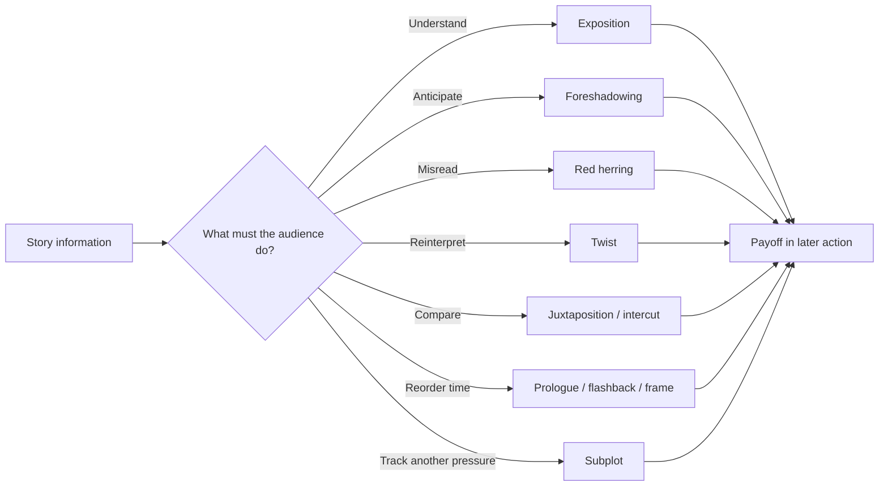
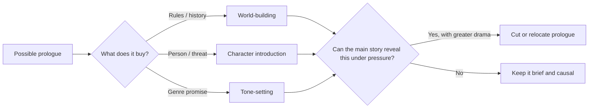
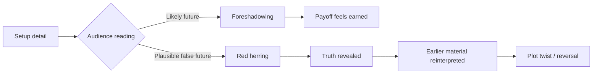
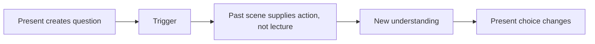
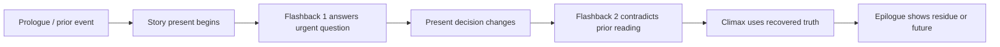

# Story Devices and Placement

> **Evidence key:** a source note marked **captioned** comes from an available English caption; **partial** means chapter titles/comments, not a full transcript; **companion article** means StudioBinder's written breakdown, not the video audio. Related visual teachings later in this note use the strongest evidence available and keep those classes separate.

## Translate a story device into a readable Fountain page

Fountain's core elements remain scene headings, action, cues, dialogue, parentheticals and transitions. Devices such as a flashback, montage, split-screen, phone call, dream, or time jump are usually expressed by combining those building blocks. The heading or action says what the audience is watching; a transition says how the image changes when that change itself matters. Core syntax and editorial choice are separate. See the element map in [[01 - Screenplay Format]].

~~~fountain
INT. ARCHIVE ROOM - NIGHT

Maya opens the envelope. A photograph slips out: her mother at the same desk, decades younger.

FLASHBACK:

INT. ARCHIVE ROOM - DAY (TWENTY YEARS EARLIER)

YOUNG MAYA's mother hides the same envelope in the desk.

BACK TO PRESENT:

Maya turns the photograph over. One word: RUN.

MATCH CUT TO:

EXT. RAILWAY PLATFORM - DAWN

The word is reflected in the train window as Maya boards.
~~~

The labels `FLASHBACK:` and `BACK TO PRESENT:` are action subheadings in this example; they are not mandatory special Fountain syntax. A clear time-specific slug can do the work instead. Select the convention that fits the story, and make the return unambiguous. A match cut is a transition because the visual/idea match has meaning; if the next scene simply follows, omit it.

### Device-to-Fountain choices

| Device | Plain, robust pattern | Optional emphasis | Story clarity check |
|---|---|---|---|
| Flashback | Slug with past time (`INT. HOUSE - NIGHT (1998)`) | `FLASHBACK:` then later `BACK TO PRESENT:` or a labeled return transition | Does the past alter the present question or interpretation? |
| Montage | `MONTAGE - MAYA SEARCHES THE CITY` then short action beats | Numbered beats / `END MONTAGE` as readable action labels | Does each beat add a step, contrast or escalation? Is end point explicit? |
| Intercut | Start both locations, then alternate clearly | `INTERCUT - A / B` and `END INTERCUT` labels in action | Is the simultaneity essential? Can reader tell who hears/sees what? |
| Split screen | Describe simultaneous panels as action and name each panel | `SPLIT SCREEN:` heading/label; use `>` only if intended as a printed transition element | Does parallel information change suspense or comparison? |
| Phone call | Show caller location, dialogue cue with `(V.O.)` or device-specific context | Intercut two slug lines when both locations matter | Does the audience know whether the character is heard, seen, or both? |
| Pre-lap | Begin next scene's sound/dialogue before its slug, or use `(PRE-LAP)` extension | Explicitly mark when the sound bridges a meaningful transition | Does the bridge create anticipation, irony or continuity? |
| Dream / hallucination | Give a scene heading and signal dream status through action if needed | `DREAM SEQUENCE` as heading or label; return with clear cut/slug | Does the sequence reveal pressure, image logic, or information unavailable otherwise? |
| Time passage | New slug with day/night/date, or action marker such as `WEEKS LATER` | Dissolve/fade only if the passage's visual quality matters | Can audience track elapsed time without a decorative edit? |
| On-screen text | Quote only the words the viewer must read within action | `SUPER:` or `TITLE CARD:` as ordinary action labels | Would paraphrase obscure a clue, joke, or reveal? |
| Flash-forward | Future-time slug or clear `FLASH-FORWARD` label, then return marker | Strong transition if it creates a deliberate temporal jolt | What question should the audience carry back to the present? |
| Fight / action sequence | Slug plus short action paragraphs that track who acts, who is affected, and how advantage changes | Optional forced transition or action mini-slug for a pivotal change of place/phase | Can a reader stage the geography and understand cause/effect at speed? |

Every line above can be written as readable Fountain text, but advanced parsing is renderer-dependent. Use conventional slug patterns where possible and preview the export. Do not imply that all renderers treat labels such as `MONTAGE`, `INTERCUT`, `SUPER`, or `FLASHBACK` as a special code. They are often plain action/slug text. For a shooting script, a director may expand these into numbered shots or boards; in a spec, retain only directions needed to understand the story.

### Action beats and fight scene readability

Video 32's transcript was unavailable, but its chapter titles and a creator reply in the comments provide partial, not transcript-level, evidence. The chapters identify four topics: pacing a fight on the page; alternating who has the upper hand; using combatant names or props as action subheadings; and selecting visual/sound cues to highlight important elements. A StudioBinder creator reply to a question about slow motion says to mark its beginning and end. These are useful prompts, not a complete choreographic doctrine.

~~~fountain
INT. SERVICE STAIRWELL - NIGHT

MAYA charges up the steps. ARUN blocks the landing.

Arun drives her into the rail.

MAYA
Give me the key.

She hooks his ankle with the loose FIRE EXTINGUISHER hose.

Arun slips. The key skitters down three flights.

They both go after it.

SLOW MOTION:

The key spins end over end, catching each red EXIT light.

END SLOW MOTION.

Maya reaches it first. Arun grabs her wrist.

She lets the key drop.
~~~

This example maps advantage reversals and a prop with a changing function (weapon/obstacle/goal) to ordinary action paragraphs. The labels `SLOW MOTION:` and `END SLOW MOTION.` are ordinary action markers in this example, not core Fountain syntax; use a renderer-specific extension only after checking the PDF. Keep short paragraphs for discrete turns, and use a subheading only when it improves location/action tracking. Capitalize only important sound/prop cues, because blanket capitals make the entire fight equally loud. A practical audit: who acts → what changes physically → who gains/loses control → what new danger follows. Evidence: [Video 32](https://www.youtube.com/watch?v=tulAaKl2vL0), chapters/comments; **partial evidence, not full video analysis**.

### Storyboard, shot list, and screenplay are different artifacts

For Video 84 (*Star Wars*), the recovered chapter labels and description say the storyboard is used before set and crew to communicate a vision, but the caption track contains no substantive instruction. Treat that as title/description/chapter-level evidence only. In practical workflow, the screenplay conveys dramatic action; a storyboard sequences representative frames; a shot list records planned camera coverage. They can be linked, but they do different jobs. Fountain has no standard embedded drawing syntax. Use a separate board or a link/scene identifier; do not turn every spec page into a storyboard.

For Video 98 (*Get Out*), the caption track is unavailable, but the creator's companion article gives a scene-specific analysis. It connects the tea-cup sound, Missy's close framing and control, the shift into Chris's point of view, widening/extreme-wide perspective, slow motion and alternation back to close-ups. The teaching point is motivation: each image changes perceived power, distance, isolation, and audience alignment. In Fountain, write the essential experience in action, and reserve camera terminology for a reveal or point-of-view constraint the story depends on. A storyboard may then test whether those beats read in sequence. Do not treat the article's shot analysis as a universal shot recipe. [StudioBinder: *Get Out* storyboard and shot analysis](https://www.studiobinder.com/blog/mastering-storyboard-peele-get-out/); [Video 98](https://www.youtube.com/watch?v=2FGA4jZcifA).

## How a screenplay controls knowledge, time, attention, and meaning

> **Evidence key continued:** major lessons in this volume come from captioned playlist entries linked at point of use. Where video captions were missing, the entry is explicitly labeled partial or companion-article evidence; that material informs the teaching without being attributed to unseen narration.

A story device is useful only when it changes the audience's experience of the story. A flashback is not valuable because it visits the past. It is valuable because the past arrives at the moment when it changes what the present means. A red herring is not valuable because it fools people. It is valuable because the false explanation makes the true explanation more surprising, more emotional, or more revealing. A subplot is not valuable because a feature screenplay is expected to have a B story. It is valuable because a second line of action can pressure, mirror, contradict, or deepen the first.

This volume treats devices as decisions about five things:

It belongs to the four-volume Script series: [[01 - Screenplay Format]] covers how to mark devices on the page, [[02 - Scenes, Dialogue and Character]] covers the human behavior those devices shape, and [[04 - Story Design, Structure and Practice]] connects them to the whole story.

1. **Knowledge:** what the audience knows, suspects, misunderstands, and later reinterprets.
2. **Time:** when an event is shown relative to when it occurred.
3. **Attention:** which detail, person, image, or storyline the audience follows.
4. **Structure:** where a reveal, detour, frame, or secondary arc changes the dramatic path.
5. **Expression:** how image, sound, cutting, blocking, and design carry story information that prose and dialogue alone cannot.



The map is a diagnostic. Before adding a device, complete the sentence: **“The audience needs to ___ at this exact point.”** If the blank cannot be filled precisely, the device is probably decoration.

---

## 1. The opening is a contract

The opening tells the audience how to watch. It may promise speed, intimacy, mystery, irony, terror, romance, or intellectual play. It establishes the kind of evidence that matters and the kind of question the film expects the viewer to carry.

The lesson in [Art of the Opening Scene — How to Start a Movie 6 Different Ways, From Nolan to Baumbach](https://www.youtube.com/watch?v=Jw_ysaoVlt4) is that an opening has several legitimate jobs. It can begin with action, character, an object, tone, history, or a structural device. Its success depends on whether the rest of the story develops the promise.

### Six useful opening designs

| Opening design | Immediate job | Long-term obligation | Example from the source |
|---|---|---|---|
| Action or spectacle | Capture attention and establish danger | Make the action reveal character, stakes, or a governing conflict | *The Dark Knight* introduces the Joker through a bank robbery; *Skyfall* turns a chase into the wound between Bond and M |
| Character or relationship | Make the audience care before the plot accelerates | Let later conflict transform what the opening established | *Marriage Story* spends about eight and a half pages building the marriage, then reveals on page nine that it is failing |
| Central object or concept | Give a prop symbolic and causal weight | Keep changing what the object means | *Uncut Gems* begins at the mine so the opal carries fascination, exploitation, hope, and violence |
| Tone and genre | Teach the emotional grammar of the film | Maintain or deliberately complicate that grammar | *La La Land* establishes fantasy versus routine; *Get Out* combines horror, comedy, social anxiety, and ironic music |
| World or history | Supply a past or rule set the present depends on | Limit information to what creates present pressure | Mythic history, flashback, or a world-building prologue |
| Structural device | Create a question through chronology or presentation | Return to, answer, or transform the device | Flash-forward, dream, bookend, metaphor, red herring, or MacGuffin |

An opening should not try to perform every job. Choose the primary promise, then let secondary information ride inside it.

### The first image as compressed screenplay

[Why Some Movies Hook You Instantly](https://www.youtube.com/watch?v=822eeaOBVII) examines how much a first shot can contain:

- *Oppenheimer*: raindrop ripples resemble atomic reactions, foreshadow the final nuclear vision, and symbolize consequences spreading from one act.
- *Hell or High Water*: a small town, bailout graffiti, crosses, and a for-sale sign establish economic injury, failed institutions, moral tension, and the revisionist Western setting.
- *Marie Antoinette*: luxury, bored posture, desserts, a knowing glance, and anachronistic music announce a subjective portrait of youth and rebellion rather than a conventional historical pageant.
- *Nope*: an impossible upright shoe amid blood and wreckage introduces spectacle, trauma, dissociation, and the idea of a “bad miracle.”
- *Raging Bull*: slow motion and operatic music make boxing both brutal and tragic, promising that Jake LaMotta's life will unfold like opera.
- *Past Lives*: three people, warm light, off-screen speculation, and Nora's glance ask the audience to become a detective of relationships.
- *Hereditary*: a fly, a miniature house, and an omniscient move establish rot, predestination, and characters treated like dolls without agency.

Use this first-image audit:

```text
What do we literally see and hear?
What question does it create?
What emotional instruction does it give?
What theme or conflict does it compress?
Which detail will gain a second meaning later?
```

If the first image could be moved to an unrelated film without losing meaning, it is likely atmospheric but not yet specific.

### Prologues: begin before the beginning

A prologue is an opening sequence temporally distinct from the primary story. It may occur centuries earlier, days earlier, or even later than the main events. [How to Write a Prologue — Writing Tips and Tricks](https://www.youtube.com/watch?v=5yWnsDiU04s) identifies three core uses:

1. **World-building.** Establish rules, history, or danger that the ordinary first act cannot efficiently supply. Keep explicit explanation brief. *The Terminator* combines a gripping future wasteland with concise text. *28 Days Later* shows contagion spreading without answering everything. *Starship Troopers* uses an in-world advertisement to establish both the universe and its anti-jingoistic satire.
2. **Character introduction.** Orient an ensemble, reveal a protagonist before the main plot pulls them forward, or demonstrate an antagonist's capabilities before the hero meets them. *The Royal Tenenbaums* maps family members and relationships; *Erin Brockovich* reveals intelligence and frustrated ambition; *The Dark Knight* makes the audience wait anxiously for the Joker's return.
3. **Tone-setting.** Deliver the genre experience early so the first act can later slow down. *Jurassic Park* proves that the creatures are dangerous; *The Matrix* previews the film's action language; horror prologues can create a victim outside the main cast so ordinary setup remains charged with dread.

The prologue earns its place when removing it damages comprehension, anticipation, character understanding, or the tonal contract. It fails when it delays a stronger beginning to explain material the story could dramatize later.



### Opening credits are narrative space

[Reacting to Opening Credits — What Makes a Great Title Sequence?](https://www.youtube.com/watch?v=gFUtF0gNocM) treats credits as an opportunity to establish tone, motifs, and story beats:

- *Catch Me If You Can* uses 2D animation to preview disguise, pursuit, and a protagonist who blends into crowds.
- *The Room* illustrates generic failure: city footage and dramatic music do not belong specifically to its story. Inserts of the room, football, flowers, or relationships would have carried narrative meaning.
- *Dawn of the Dead* combines found emergency footage, quick cuts, blood imagery, glitches, and Johnny Cash. The music-image contradiction gives the apocalypse a specific personality.
- *True Detective* uses double exposures, landscapes, bodies, maps, and recurring images that reward repeated viewing.

The test is severe: if the same sequence could accept another title without changing, it is probably too generic.

---

## 2. Exposition is controlled access to meaning

Exposition is information about setting, biography, characterization, rules, history, or causality that the audience needs to follow the story. The problem is dosage and placement: too much information produces passivity; too little produces confusion.

[What is Exposition in Screenwriting — 4 Keys to Writing Film Exposition That Works](https://www.youtube.com/watch?v=oEq2XjFCaps) gives four governing principles:

1. **Disguise the information.** Hitchcock's “sugar-coated pill” means the audience receives facts while attending to conflict, spectacle, humor, curiosity, or emotion.
2. **Visualize it.** Production design, behavior, montage, props, and setting can communicate facts without explanatory speech.
3. **Delay it until it matters.** Information placed at the moment it changes a decision is stronger than the same information supplied as insurance in act one.
4. **Withhold what is not yet necessary.** Mystery is often created by the shaped absence of exposition.

### Delivery channels

| Channel | Strength | Risk | Example |
|---|---|---|---|
| On-screen text | Fast time/place orientation | Feels like a label if it supplies no dramatic pressure | A location or historical date |
| Narration | Can establish voice and compress history | Can duplicate the image or explain emotion already visible | A narrator whose attitude is itself characterization |
| Dialogue | Can integrate fact with conflict | “As you know” speech between people who already share the facts | A novice asks because they need the answer now |
| Direct address | Handles dense or alien subject matter openly | Can rupture tone if the film has not established this rule | *The Big Short* explains financial systems to camera |
| Song | Makes lists, relationships, and history memorable | Can become a catalogue without dramatic progression | *Encanto* introduces the family and its gifts |
| In-world media | Lets the world teach characters and viewers together | Can become a disguised lecture | Mr. DNA in *Jurassic Park* |
| Mise-en-scène | Creates inference and questions without words | May be missed if essential facts are too subtle | In *Signs*, family photo, empty bed, and missing cross imply loss and lost faith |

The separate playlist item [Mastering the Screenplay: Exposition in Film](https://www.youtube.com/watch?v=njZBYNu2vxA) supplied only example clips in the available caption track: scientific transformation, the 1.21-gigawatt requirement in *Back to the Future*, DNA explanation in *Jurassic Park*, and an engineering warning about shale and a prior disaster. These examples support one limited observation: technical information becomes more watchable when it is tied to an immediate problem, demonstration, requirement, or refusal. The track did not contain a recoverable narrated framework, so no broader doctrine is attributed to it.

### The exposition-pressure test

Before retaining an explanatory passage, ask:

```text
Who needs this information now?
What will they decide differently after receiving it?
What resistance, cost, conflict, or surprise accompanies it?
Could an object, behavior, image, or consequence communicate part of it?
What can remain unanswered until the audience actively wants it?
```

Exposition works best when it is not background homework. It is ammunition for an active scene.

---

## 3. Foreshadowing prepares; misdirection redirects; twists reinterpret

These devices are related but not interchangeable.



### Foreshadowing

[Types of Foreshadowing in Films — What is Indirect vs. Direct Foreshadowing?](https://www.youtube.com/watch?v=JOas2BLjPR4) divides the device into two forms:

- **Direct foreshadowing:** an explicit warning, prophecy, prediction, stated rule, promise, or threat. It can reveal an outcome while shifting suspense to how it occurs. “An act of true love” in *Frozen* is direct but ambiguous enough to misdirect the characters and audience about the kind of love required.
- **Indirect foreshadowing:** a clue whose predictive value is recognized mainly in hindsight. It may be dialogue, behavior, an object, a number, a title, a mural, production design, or a character trait.

An Easter egg is generally a hidden reference or joke with little causal relevance. Foreshadowing prepares an actual story event. Chekhov's gun overlaps with foreshadowing because giving an element prominence creates an expectation of later use.

The ideal second viewing produces: **“It was there, but I interpreted it differently.”**

### Red herrings

A red herring intentionally leads the audience toward a false explanation. [What is a Red Herring — 5 Techniques to Mislead & Distract an Audience](https://www.youtube.com/watch?v=47ntBElzaWk) shows that it may be a clue, character, casting choice, historical expectation, or even an entire plot.

Five practical methods:

1. **False suspect or clue.** Classic mysteries make each innocent suspect a provisional answer. *Murder on the Orient Express* subverts the convention: the expectation that most suspects are false becomes the false assumption.
2. **Unreliable narrator.** *The Others* and *The Usual Suspects* let a limited or deceptive perspective construct the wrong reality.
3. **Emotional identity error.** *Saving Private Ryan* encourages viewers to connect the cemetery visitor with Captain Miller, then converts assumed failure into catharsis when the visitor is revealed as Ryan.
4. **External knowledge.** Tarantino uses known history as the false track in *Inglourious Basterds* and *Once Upon a Time in Hollywood*.
5. **Casting and marketing.** A major star implies narrative survival; an actor's wholesome persona repels suspicion. *Psycho* uses both Janet Leigh and Anthony Perkins this way.

A red herring must be plausible, visible enough to influence interpretation, and fair once the truth is known. Random noise is not misdirection; it is clutter.

### Plot twists and reversals

[The Secret to Writing Compelling Plot Twists — The Art of Misdirection Explained](https://www.youtube.com/watch?v=YHbOVOZWhZM) defines a twist as an unexpected development that makes earlier story material appear in a new light. A twist needs two simultaneous systems:

- **Misdirection:** a convincing present-tense explanation.
- **Breadcrumbs:** true evidence that usually becomes legible on a second viewing.

Placement determines function:

| Placement | Structural effect | Example |
|---|---|---|
| Midpoint | Replaces the apparent movie with a new dramatic direction | *Psycho* shifts from theft story to slasher/investigation |
| Break into act three | Reveals the real trap and gives the protagonist a final objective | Rose's reveal in *Get Out* occurs around the three-quarter point |
| Climax | Resolves the central mystery at the last possible moment | *The Village* uses a smaller act-three reveal before its larger final reality reveal |

The later a twist occurs, the less time the audience has to live inside its new reality. A climactic twist must therefore resolve rather than merely complicate. A midpoint twist has time to generate a second story.

### The fairness matrix

| | Truth well planted | Truth poorly planted |
|---|---|---|
| False explanation convincing | Earned surprise | Shock that feels arbitrary |
| False explanation weak | Predictable but coherent | Confusion |

The target is the upper-left cell. Draft backward from the reveal: list every earlier scene it changes, plant true evidence, then supply an emotionally and causally plausible false reading.

---

## 4. Flashbacks: the past must act on the present

A flashback depicts an event earlier than the current narrative line. [How to Write a Flashback — What the Best Movie Flashbacks Have in Common](https://www.youtube.com/watch?v=E7XDucl6ABY) argues that the device needs a dramatic reason beyond “this explains why the character is like this.” Human behavior is rarely a one-cause equation.

### What earns a flashback

- It answers a question the present story has made urgent.
- It forms a compelling mini-story with its own progression.
- It changes the interpretation of a person, event, or goal.
- It raises urgency rather than pausing it.
- It draws a thematic parallel between past and present.
- It completes or complicates a reveal.

Examples:

- *Citizen Kane* organizes recollections around the question of “Rosebud.”
- *The Bourne Identity* uses fragments to recover identity and danger.
- *Lost* gives flashbacks internal arcs while making present behavior more legible.
- *Ratatouille* proves a flashback can be extremely brief when one sensory trigger carries a complete emotional turn.
- *Manchester by the Sea* withholds the central trauma, then uses brief flashbacks around pages 43, 50, and 52 to build toward an emotional outburst rather than front-loading explanation.
- *Gone Girl* uses flashbacks after the midpoint reveal to reconstruct Amy's plan.
- *The Sixth Sense* uses rapid flashbacks to make the final twist visually undeniable.
- *Arrival* disguises future memories as flashbacks, turning chronology itself into the twist.
- *The Tree of Life* compares an adult son and father through intercut past and present.

### Placement model



If the chain stops at “new understanding,” the flashback may be informative but inert. Strong placement lets the recovered past alter a present decision.

### Formatting flashbacks clearly

[Screenplay Flashbacks Explained | How to Format a Screenplay](https://www.youtube.com/watch?v=ejvaOUxkeOI) presents three accepted entry methods:

```text
BEGIN FLASHBACK:

INT. CHILDHOOD HOME – NIGHT
```

or:

```text
INT. CHILDHOOD HOME – NIGHT (FLASHBACK)
```

or a transition:

```text
FLASHBACK TO:
```

Return with a matching clear marker:

```text
END FLASHBACK
```

```text
INT. APARTMENT – NIGHT (BACK TO PRESENT)
```

```text
BACK TO PRESENT
```

Dialogue and action inside the flashback use ordinary formatting. The essential rules are temporal clarity and internal consistency: choose a system and use it throughout so the reader and production departments can identify the time change instantly.

---

## 5. Frame narratives and stories within stories

A frame narrative contains one or more distinct embedded stories. [What is a Frame Narrative? — Why Writers Use the Literary Device](https://www.youtube.com/watch?v=e9_Ize7ZDwg) also gives the terms sandwich narrative, intercalation, frame story, embedded narrative, and nested story.

### Two main layouts

1. **Bookend:** the outer story opens the film, releases the embedded story, and returns in the epilogue.
2. **Interwoven frame:** the film repeatedly moves between outer and embedded narratives.

Other variants include in-world media, documentary interviews plus reenacted past, multiple narrators, and stories nested several layers deep.

### What a frame can do

- Reorder a life nonlinearly.
- Create a question about how the known endpoint was reached.
- Make storytelling itself the subject.
- Compare narratives across eras or contexts.
- Expose unreliable memory or narration.
- Show multiple perspectives and the discrepancies between them.
- Reflect a character's inner life through a play, book, program, or tale inside the film.
- Connect an anthology of otherwise separate stories.

*Citizen Kane* begins with Kane's death, then turns “Rosebud” into the reason to explore his life. *Rashomon* uses incompatible accounts to demonstrate that perspective alters truth. *The Grand Budapest Hotel* adds layers around Mustafa so the story feels inherited and mythologized. *I Saw the TV Glow* lets a fictional television series mirror the protagonist's life. *Big Fish* makes tall tales the only route by which a son can understand his father.

### Design decisions

```text
Who tells the embedded story?
Why are they telling it now?
What can they know?
What might they distort?
Why does the outer story need the inner one?
How often should the film cross the boundary?
What changes in the outer story after each return?
```

For script clarity, distinguish timelines and identities with scene headings, dates, and character cues. The source cites *Life of Pi*, where the older storyteller is labeled **ADULT PI** and past scenes receive dates.

Too many transitions can prevent immersion. Too few can make the frame feel attached after the fact. *The Princess Bride* deliberately returns to the frame to release suspense and create comedy. That interruption works because detachment is the intended effect.

---

## 6. Subplots: a second line of pressure

A subplot is a storyline with less emphasis than the primary narrative. [How to Write a Subplot in a Screenplay — Adding Layers to Your Film](https://www.youtube.com/watch?v=iZbac66pHLc) distinguishes it from a multiplot story, where several narratives have roughly equal status.

Subplots are often called B stories; additional lines may be C or D stories according to their connection to the A story. They may involve the protagonist or secondary characters, but each should have a beginning, middle, and end.

### Four common subplot forms

| Form | Relationship to A story | Typical use |
|---|---|---|
| Romantic | Emotional relationship develops during the main pursuit | Humanizes scale and creates personal stakes |
| Expository | Secondary arc reveals a key cause, history, or motive | Reframes the primary story, as Snape's history or Cobb's past does |
| Parallel | Mirrors the main action | Expands theme, comedy, or comparison |
| Contrasting | Takes a different tonal, thematic, or moral direction | Tests the A story's values, as love and revenge contrast in *The Princess Bride* |

### Functions

- Reveal dimensions of the protagonist unavailable in the main pursuit.
- Give secondary characters motives and arcs.
- State, mirror, or challenge theme.
- Raise stakes around the A story.
- Add urgency to scenes that would otherwise feel safe.
- Create turning points when B and A collide.
- Control pacing by cutting away, delaying resolution, offering relief, or adding humor.

A subplot remains secondary but must not feel disposable. *Challengers* gives Tashi's tennis career a full rise and fall; its injury climax also operates as the film's midpoint turn. *High and Low* delays the criminal's B story until halfway, preserving mystery before pivoting to cat-and-mouse. Shoshana's story in *Inglourious Basterds* starts in the first scene, keeping the occupation's human cost alive beneath the primary line.

### The weave test

For every subplot beat, identify at least one connection:

```text
A-story decision changes B story
B-story consequence complicates A story
B story mirrors or contradicts theme
B story changes pacing before an A-story payoff
B-story climax becomes an A-story turn
```

If none applies, the subplot may be a separate short film competing for pages.

---

## 7. Parallel action, intercutting, and juxtaposition

An intercut alternates two or more scenes to show simultaneous action, contrasting action, thematically linked action, or a conversation across locations. [How to Intercut Scenes in a Script | How to Format a Screenplay](https://www.youtube.com/watch?v=XcPJxHA3lt8) gives several acceptable markers:

- A transition such as `INTERCUT:` followed by the second location.
- An action line indicating the intercut.
- A subheading such as `INTERCUT WITH EMILY IN HER ROOM`.
- A scene heading with an intercut modifier.

Once both locations are established, a phone conversation can often continue as though the speakers share a scene, avoiding repeated slug lines. End the intercut with the same kinds of clear delimiters: transition, action, subheading, or full scene heading.

The format has no single mandatory form. Clarity and consistency govern it. Use intercuts sparingly, make every included strand necessary, and balance section length and pace.

### Juxtaposition is the meaning created between elements

[What is Juxtaposition in Film — How to Take Visual Storytelling to the Next Level](https://www.youtube.com/watch?v=TVmVir2Uwb8) expands comparison beyond intercutting:

- Mise-en-scène can contrast costume, color, setting, props, light, scale, and position.
- Music may contradict or intensify an image.
- Dialogue or narration may conflict with behavior.
- Cross-cutting compares actions and characters.
- Match cuts connect similar shapes while comparing different states.
- Dissolves layer images and ideas.
- Smash cuts create shock or comedy through extreme difference.
- Split screens expose parallel experience in one frame.
- Intellectual montage combines images to create an abstract political or thematic conclusion.

The writing question is not merely “what do we cut to?” It is **“what third idea appears because these two things touch?”**

### Split screen as simultaneous comparison

[The Split Screen — The Ultimate Guide for Filmmakers](https://www.youtube.com/watch?v=HDJ-q2Q2X9I) separates visible and invisible splits. Invisible splits combine performances, duplicate actors, or construct impossible continuous shots. Visible splits can:

- Compare routines, classes, expectations, or perspectives.
- Show action and reaction simultaneously.
- Put distant characters into visual intimacy.
- Build suspense by displaying danger and delayed response at once.
- Compress montage information.
- Reproduce comic-book panels or expand the physical frame.
- Sustain several storylines while sound directs attention.

The script should state the dramatic reason for simultaneity. The storyboard and editorial plan determine exact geometry.

---

## 8. Genre, tone, atmosphere, and the audience's expectation machine

Genre is a contract built from recurring plot patterns, character types, and presentation. [Movie Genres Explained — Types of Films & the Art of Subverting Film Genres](https://www.youtube.com/watch?v=rDVVE8ZHJ3o) gives genre two purposes: it sets audience expectations and supplies a roadmap for the storyteller.

Subgenre sharpens the contract. “Crime” promises criminal activity; “murder mystery” additionally promises a murder, suspects, investigation, clues, and some form of reveal.

Four ways to work against the expected pattern:

1. **Spoof:** exaggerate conventions for comedy.
2. **Inversion or subversion:** reverse an expected setting, character, plot beat, or atmosphere. *Midsommar* makes daylight unsafe.
3. **Genre switch:** begin as one form and become another, as *From Dusk Till Dawn* moves from crime to vampire horror.
4. **Hybrid:** combine genres throughout, such as noir and science fiction in *Blade Runner*.

Subversion works when the audience knows the rule being bent. Ignorance of genre produces accidental disappointment; mastery allows purposeful surprise.

### Tone, atmosphere, and mood

[Mood vs. Tone vs. Atmosphere — The Backbone of Any Film](https://www.youtube.com/watch?v=hfEpK51DnsY) uses this practical relationship:

```text
Tone + Atmosphere = Intended mood
```

- **Tone:** the work's attitude toward its subject, beginning in plot, narration, scene construction, and dialogue.
- **Atmosphere:** the sensory environment built through location, design, costume, light, color, camera, sound, music, and editing.
- **Mood:** the emotional condition intended for the audience.

Atmosphere may reinforce tone or complicate it. Contradictory music over violence can produce moral uncertainty. Comic dialogue and performance can turn a Gothic castle into comedy. Because audience mood is a result rather than a guaranteed command, table reads, visual references, and later screenings test whether the intended combination actually communicates.

---

## 9. Devices that alter the boundary between story and audience

### Breaking the fourth wall

The fourth wall is the imaginary boundary separating the story from its viewers. [What is the Fourth Wall? The Best Examples of Breaking the Fourth Wall](https://www.youtube.com/watch?v=PZL13w9TqbA) offers three principles:

1. **Be extreme:** make frequency intentional—either a governing pattern or a rare exceptional event.
2. **Be thoughtful:** place the address before a scene for privileged information, during it for a private reaction or progress report, or after it to punctuate the event.
3. **Be bold:** the break should command attention or communicate something consequential.

In *House of Cards*, only Frank and the viewer share the address, creating complicity. Preserve rules about who can perceive the break unless changing the rule is itself a story event.

### Deus ex machina: when intervention destroys meaning

[What is Deus Ex Machina — The “God From the Machine” Plot Device Explained](https://www.youtube.com/watch?v=SNvj8jCrGiw) identifies four common failures:

- The ending changes established rules.
- A payoff has no meaningful setup.
- Last-minute help arrives from nowhere and solves the problem for the protagonist.
- Random coincidence supplies victory.

Assistance is not automatically a cheat. It becomes damaging when it removes the final meaningful choice. To repair it: plant the solution, maintain world logic, attach cost or sacrifice, link coincidence to theme, keep the protagonist responsible for the decisive action, and ensure the result completes the character arc. Self-aware comedy can survive a deliberate violation that serious drama cannot.

### Epilogues and the last piece of meaning

[How to End a Movie with an Epilogue — 8 Techniques Behind the Best Film Endings](https://www.youtube.com/watch?v=bZFMawBa5cI) defines an epilogue as material separate from the main story that adds closure, irony, future outcome, or renewed possibility.

Forms include:

- On-screen text.
- Voiceover over montage.
- Silent future montage.
- A final pre-credit scene.
- Mid-credit or post-credit scene.
- Time jump or next-generation scene.
- A bridge between dramatization and real people.
- A deliberately false or prematurely placed epilogue.

An epilogue cannot repair a story whose climax did not resolve its central conflict. It should add a final layer, not repeat the answer. The producer-added explanatory ending of *Blade Runner* is presented as a warning: forced optimism and clarification can weaken productive ambiguity.

---

## 10. Film language that must be anticipated on the page

A screenplay specifies visible and audible action, but it should also anticipate what departments will need to make meaning. The goal is not to direct every cut. It is to write scenes whose dramatic design can be translated into blocking, composition, sound, design, and editing.

### Mise-en-scène

[What is Mise en Scene — How Directors Like Kubrick Master the Elements of Visual Storytelling](https://www.youtube.com/watch?v=3euNFd7-TCg) defines mise-en-scène as everything selected and arranged in a shot: set, props, costume, makeup, actor placement, blocking, performance, light, composition, lens/depth, camera position and movement, with sound and music included in the video's expanded model.

Naturalistic mise-en-scène aims to resemble ordinary reality. Theatrical mise-en-scène foregrounds stylization. Both require deliberate alignment with the story's vision.

In *The Shining*, carpet geometry, toys, high-key lighting, a high angle, centered framing, deep focus, slow zoom, ominous score, and Danny's seated blocking make a bright corridor feel like a trap. The scriptwriter's contribution is the dramatic image: a vulnerable child absorbed in play while an unseen force seems to watch.

### Visual storytelling without dialogue

[Directing Without Words: Visual Storytelling in Film](https://www.youtube.com/watch?v=WMcWLFtGnAs) demonstrates five systems:

1. Performance: facial tension, pauses, swallowing, posture.
2. Camera relation: distance, angle, movement, and when perspective changes.
3. Setting and symbol: a place or object carries social and emotional meaning.
4. Blocking: bodies approach, circle, retreat, mirror, dominate, or avoid.
5. Editing: reaction, eyeline, duration, and cut order construct an unspoken decision.

When revising a dialogue-heavy scene, remove the dialogue temporarily and write what the audience can still understand. Restore only words that add conflict, concealment, rhythm, or information that image and behavior cannot carry.

### Time lapse and compressed duration

[What is a Time Lapse – How Filmmakers Manipulate Time](https://www.youtube.com/watch?v=9HGH86o1tIk) explains that footage captured below playback rate appears accelerated. At 24 fps playback, 12 captured fps is about twice normal speed; one captured frame per second appears about 24 times faster.

For the writer, the important choices are purpose and visible change. A time lapse can move across a day, compress years, show urban speed, express cosmic scale, connect character evolution to environmental change, or make time itself the theme. A hyperlapse adds controlled camera movement. Write what changes and why the compression matters; leave capture interval and rigging to production unless plot-critical.

### Subtitles as composition and meaning

[Subtitles — The Ultimate Guide to Movie Subtitling Format, Style & Etiquette](https://www.youtube.com/watch?v=5Y3Em-IMSwM) distinguishes same-language transcription, translation, closed captions, karaoke, and freeform text. The track appears to say “interlingual” twice; the intended standard distinction is **intralingual** for the same language and **interlingual** for translation.

Source guidelines include approximately 17 characters per second for English subtitles, no more than two lines, about 50 characters per line, natural segmentation, no splitting tight syntactic units, consistent gaps of roughly two to four frames, and strong contrast against the image. Text competes for attention, so the writer and visual team should avoid placing crucial simultaneous visual information where reading makes it invisible.

### Storyboards: the evidence boundary

Two playlist entries concern storyboarding:

- [How to Make a Storyboard (ft. Star Wars)](https://www.youtube.com/watch?v=238eypcdOzU)
- [How to Master a Storyboard like Jordan Peele: Get Out](https://www.youtube.com/watch?v=2FGA4jZcifA)

The first has a caption file, but it contains only music/applause markers and the isolated phrase “I am pulling up.” It is substantively unavailable. The second has no usable caption track in the collected set; the written companion article is analyzed earlier in this volume and is clearly labeled. No lesson is attributed to unseen narration.

The usable storyboard principle comes from other captioned sources: storyboard when simultaneous composition, complex movement, split screens, branded pitches, or exact visual comparison must be communicated before production. The storyboard tests whether the written dramatic intention can be understood as a sequence of images.

---

## 11. A placement workflow for revision

Use this pass after the first complete draft.

### Pass 1 — Inventory information

For every major fact, mark:

```text
K = audience knows
S = audience suspects
M = audience misunderstands
C = character knows
U = character does not know
```

The notation exposes accidental omniscience, repeated exposition, and reveals that arrive after they have stopped mattering.

### Pass 2 — Track questions and answers

Create a ledger:

| Question created | Scene/page | Provisional answer | True answer | Payoff scene | Consequence |
|---|---:|---|---|---:|---|
| Why is the cross missing? | Opening | Personal neglect | Loss of faith after family tragedy | Later revelation | Reframes behavior |

Every important answer should alter emotion, action, or interpretation.

### Pass 3 — Map time



Remove any time shift that supplies information without affecting the return to the present.

### Pass 4 — Test every secondary line

Give each subplot, frame, and intercut strand a one-sentence function. Then mark its beginning, escalation, turn, and resolution. If it has no turn, it may be atmosphere rather than a story. If its resolution does not touch the A story, decide whether the separation is thematic and intentional.

### Pass 5 — Convert explanation into filmable evidence

Search for dialogue that names an emotion, relationship, rule, or history. For each instance, try the following replacements:

- behavior under pressure;
- a consequential object;
- setting or costume contrast;
- a withheld answer;
- a reaction shot implied by the action;
- an in-world demonstration;
- a juxtaposed scene;
- a recurring sound or image.

Keep dialogue when speaking itself is the action: confession, persuasion, evasion, threat, negotiation, seduction, teaching, or performance.

### Pass 6 — Run the device-removal test

Temporarily remove the prologue, flashback, frame, red herring, subtitle device, fourth-wall address, or epilogue. If the story becomes clearer and loses no necessary pressure, the device was not earning its pages. If removal destroys a specific question, comparison, transformation, or payoff, restore it and sharpen that function.

---

## 12. Compact reference: device, purpose, failure, repair

| Device | Best use | Common failure | Repair |
|---|---|---|---|
| Prologue | Rules, threat, character, tonal promise | Delays the real beginning | Make it brief, active, and causal |
| Exposition | Enables current understanding or choice | Lecture before interest exists | Disguise, visualize, delay, withhold |
| Foreshadowing | Prepares payoff | Too obvious or irrelevant | Preserve ambiguity; tie to causal outcome |
| Red herring | Supplies a plausible wrong model | Random distraction | Make it arise from real evidence and expectation |
| Twist | Reinterprets prior story | Unplanted shock | Build breadcrumbs beneath misdirection |
| Flashback | Makes past alter present | Biography dump | Trigger it with a present question; change the return |
| Frame narrative | Compares stories and perspectives | Constant detachment or decorative narrator | Define narrator, reason, transitions, and outer-story change |
| Subplot | Adds pressure, contrast, character, theme, pacing | Competes with A story or feels tacked on | Give it an arc and a specific A-story connection |
| Intercut | Simultaneity, contrast, tension | Confusing geography or monotonous rhythm | Establish locations; balance section length; format consistently |
| Split screen | Simultaneous comparison | Visual overload without hierarchy | Decide where the viewer should look and why |
| Fourth-wall break | Privileged intimacy or commentary | Arbitrary joke that ruptures rules | Make frequency and placement intentional |
| Deus ex machina | Rarely; deliberate comedy or thematic chance | Removes protagonist's decisive action | Setup, cost, logic, and character choice |
| Epilogue | Adds residue, future, irony, or reopening | Explains a completed ending | Add a new layer or omit it |

---

## Evidence and coverage notes

This volume is a concept-led synthesis of the playlist captions rather than a transcript. Examples and teaching claims are paraphrased and reorganized so related ideas teach one continuous system.

### Fully usable sources central to this volume

- [The Secret to Writing Compelling Plot Twists — The Art of Misdirection Explained](https://www.youtube.com/watch?v=YHbOVOZWhZM)
- [What is Exposition in Screenwriting — 4 Keys to Writing Film Exposition That Works](https://www.youtube.com/watch?v=oEq2XjFCaps)
- [How to Write a Subplot in a Screenplay — Adding Layers to Your Film](https://www.youtube.com/watch?v=iZbac66pHLc)
- [How to Write a Prologue — Writing Tips and Tricks](https://www.youtube.com/watch?v=5yWnsDiU04s)
- [What is a Red Herring — 5 Techniques to Mislead & Distract an Audience](https://www.youtube.com/watch?v=47ntBElzaWk)
- [What is a Frame Narrative? — Why Writers Use the Literary Device](https://www.youtube.com/watch?v=e9_Ize7ZDwg)
- [How to Write a Flashback — What the Best Movie Flashbacks Have in Common](https://www.youtube.com/watch?v=E7XDucl6ABY)
- [How to Intercut Scenes in a Script | How to Format a Screenplay](https://www.youtube.com/watch?v=XcPJxHA3lt8)
- [Screenplay Flashbacks Explained | How to Format a Screenplay](https://www.youtube.com/watch?v=ejvaOUxkeOI)
- [Types of Foreshadowing in Films — What is Indirect vs. Direct Foreshadowing?](https://www.youtube.com/watch?v=JOas2BLjPR4)
- [Art of the Opening Scene — How to Start a Movie 6 Different Ways, From Nolan to Baumbach](https://www.youtube.com/watch?v=Jw_ysaoVlt4)
- [What is Deus Ex Machina — The “God From the Machine” Plot Device Explained](https://www.youtube.com/watch?v=SNvj8jCrGiw)
- [What is Juxtaposition in Film — How to Take Visual Storytelling to the Next Level](https://www.youtube.com/watch?v=TVmVir2Uwb8)
- [Why Some Movies Hook You Instantly](https://www.youtube.com/watch?v=822eeaOBVII)
- [Mood vs. Tone vs. Atmosphere — The Backbone of Any Film](https://www.youtube.com/watch?v=hfEpK51DnsY)
- [Movie Genres Explained — Types of Films & the Art of Subverting Film Genres](https://www.youtube.com/watch?v=rDVVE8ZHJ3o)
- [What is the Fourth Wall? The Best Examples of Breaking the Fourth Wall](https://www.youtube.com/watch?v=PZL13w9TqbA)
- [Directing Without Words: Visual Storytelling in Film](https://www.youtube.com/watch?v=WMcWLFtGnAs)
- [Subtitles — The Ultimate Guide to Movie Subtitling Format, Style & Etiquette](https://www.youtube.com/watch?v=5Y3Em-IMSwM)
- [How to End a Movie with an Epilogue — 8 Techniques Behind the Best Film Endings](https://www.youtube.com/watch?v=bZFMawBa5cI)
- [What is Mise en Scene — How Directors Like Kubrick Master the Elements of Visual Storytelling](https://www.youtube.com/watch?v=3euNFd7-TCg)
- [The Split Screen — The Ultimate Guide for Filmmakers](https://www.youtube.com/watch?v=HDJ-q2Q2X9I)
- [What is a Time Lapse – How Filmmakers Manipulate Time](https://www.youtube.com/watch?v=9HGH86o1tIk)
- [Reacting to Opening Credits — What Makes a Great Title Sequence?](https://www.youtube.com/watch?v=gFUtF0gNocM)

### Partial or unavailable evidence

- [Mastering the Screenplay: Exposition in Film](https://www.youtube.com/watch?v=njZBYNu2vxA), playlist item 079: the available caption track contains example dialogue but no recoverable instructional narration. Only the narrow observation recorded in the exposition section is attributed to it.
- [4 Pixar Story Rules That Make Characters Memorable](https://www.youtube.com/watch?v=UdDZFr31ApE), playlist item 091: only a short fragment is available. It defines a character's “spine” as a dominant, often unconscious inner goal and names WALL-E, Marlin, and Woody as examples. The other promised rules are not reconstructed and are outside this volume's teaching claims.
- [Ethos, Pathos, & Logos: How to Use Persuasive Ad Techniques](https://www.youtube.com/watch?v=lmR58_dqLxY), playlist item 099: the track contains advertisement excerpts but no reliable explanatory narration or labels. No ethos/pathos/logos framework is inferred here.
- [How to Make a Storyboard (ft. Star Wars)](https://www.youtube.com/watch?v=238eypcdOzU), playlist item 084: the caption file contains no substantive instruction; chapter/description evidence is limited to storyboards as preproduction communication before sets/crew. Details beyond that are not attributed to the video.
- [How to Master a Storyboard like Jordan Peele: Get Out](https://www.youtube.com/watch?v=2FGA4jZcifA), playlist item 098: no usable caption track was available; StudioBinder's companion article was used for the specific shot/pacing analysis linked above. This is article-backed, not transcript-backed.

These boundaries matter. A title can identify a subject, but it cannot establish what the video actually taught. Missing instruction remains marked rather than silently replaced with generic knowledge.
