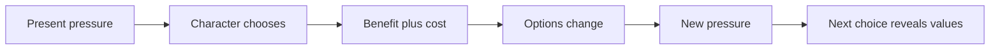
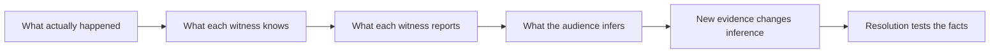

# Story Design, Structure, and Practice

A woman discovers that her brother has hidden the key she needs. She tries asking for it, then offers something in exchange. He refuses because using the key would put someone else in danger. Now she has to choose what matters more. A few linked choices can begin a whole story.

We will start with that connection: one event makes the next choice necessary. As the story grows, we will ask who we follow, what keeps them trying, what changes their plans, and what their final choice means. The names for those ideas will appear beside the problems they help solve. You can learn the idea here before consulting the source library or software examples later in the file.

> [!tip] Use the expanded teaching laboratory
> [[04 - Story Design, Structure and Practice#14. Choose the story's shape from its audience contract|Audience contracts]] · [[04 - Story Design, Structure and Practice#26. Book lenses: action, reversal, and the limits of a paradigm|Book lenses]] · [[04 - Story Design, Structure and Practice#27. Script case studies: read the artifact before the movie in your head|Actual script studies]] · [[04 - Story Design, Structure and Practice#Research ledger — craft expansion, 29 October 2026|New source ledger]]
> The new sections add worked decisions, examples, failure-and-repair tests, and practice. The research ledger in [[04 - Story Design, Structure and Practice#Research ledger — craft expansion, 29 October 2026|Volume 04]] records exactly what was inspected.

> **Purpose.** This file follows a story from its first situation to its ending, then helps you improve a draft. [[01 - Screenplay Format]] explains how to put it on the page. [[02 - Scenes, Dialogue and Character]] follows what people do and say within a scene. [[03 - Story Devices and Placement]] explains choices about what the audience sees and when.

## 1. A story is a chain of changed conditions

A child misses the bus, so her parent drives her to school; the detour reveals a road is closed, so they take a route that exposes a hidden construction site. Each event changes what can happen next. That link—one event producing a consequence or forcing a response—is dramatic causality. Chronology only says what came next; causality shows why it came next and what changed. Use a simple “but / therefore” test when outlining:

~~~text
A happens, THEREFORE the protagonist tries B,
BUT an obstacle changes the plan,
THEREFORE the protagonist tries C,
BUT the cost forces a choice.
~~~

If the outline is only “and then … and then …,” events may be adjacent without being connected. A scene can still serve as a breath, contrast, setup, or delay, but give it a deliberate job.

For each scene, name one important value before and after:

| Value | Before | After |
|---|---|---|
| Knowledge | She thinks the key is lost | She learns her brother has it |
| Power | The captain controls the room | A witness exposes his lie |
| Relationship | They cooperate | One discovers the other hid evidence |
| Safety | The house seems secure | The alarm proves someone is inside |
| Plan | Escape through the tunnel | The tunnel is flooded |
| Moral position | He can deny involvement | He destroys the evidence |

If the value never moves, ask what the scene contributes. It may still be a useful pause or image, but its purpose should be clear. The playlist describes conflict, character development, plot development, and blocking or staging as scene elements; use them as prompts for revision, not as a checklist that every scene must satisfy equally.

## 2. Premise, protagonist, and story engine

A premise is the story's central situation: the person, problem, and pressure that make this particular chain of events possible. A logline is a short sentence that tests whether that situation can be explained clearly. Try this flexible pattern:

Before the one-sentence pattern below, ask what success or failure would cost. Those possible gains and losses are the **stakes**: a job, a relationship, safety, or a belief the person needs to protect. A **logline** is a short sentence presenting the central situation, pursuit, and pressure to someone who has not read the story.

~~~text
When [disruption] happens, [specific protagonist] must [active action]
to [goal] before / or else [stakes], while [opposing force] blocks them.
~~~

The pattern is a diagnostic, not a required industry formula. One version can begin with the event that disrupts ordinary life; another can foreground the main character, their action, the opposing force, goal, and stakes. Choose the order that makes the story easiest to grasp. Concrete details carry more story than praise words: “A disgraced paramedic must cross a quarantined city to reach her son” gives a reader more to imagine than “a brave woman faces danger.”

The protagonist is the character whose pursuit organizes the main action. This does not mean the character is good, admirable, or even the person who narrates. Ask whose goal keeps events moving, whose choices change what can happen, and whose struggle carries the story's central question. These jobs can belong to different characters. The *Infinity War* analysis treats Thanos as the structural protagonist because his goal drives the plot while he remains its villain.

For a television series, one strong situation has to keep producing new stories. Its story engine is the repeatable source of pressure: the people, work, place, or mission that brings fresh problems into contact with the regular characters. A bar can bring incompatible people together; a hospital can generate new cases; a continuing mission can reveal new parts of a world. *Cheers* uses a bar as a social engine, while *Justified* links individual cases to Raylan's continuing struggle with his own violence. Sketch five different episodes. If each repeats the same conflict with names changed, add variety or make the narrow pattern part of the show's design.

**Evidence limit:** the playlist treatment lesson teaches concept development, not a detailed treatment document template, length, or formatting specification. Verify those details against the recipient’s requirements.

## 3. Baseline, disruption, and commitment

Picture a teacher whose quiet morning routine includes hiding a letter from the school board. When the board announces a surprise inspection, the ordinary routine cannot continue. The event that breaks the current pattern is an inciting incident: it starts the main story by making an existing desire or problem urgent. The audience needs enough of the earlier condition to understand what has been disturbed.

~~~text
Baseline → disruption → reaction/debate → choice/commitment
         → new conditions and consequences
~~~

The lesson gives examples including personal loss, discovery of hidden knowledge, a call to adventure, an attack, or evidence of evil. It cites a common model placement around 12–12.5% (about page 20 in a 165-page script). This is a diagnostic model, not a universal deadline. A quiet opening can be right when baseline and attachment matter; a thriller can begin with an attack.

Some stories split setup and activation. Jaws opens with the shark attack, then Brody encounters the body and becomes responsible for action. The opening establishes danger; the later event activates the protagonist’s choices.

Keep these events distinct. An **act** is a larger movement of the story. An **Act One commitment** carries the person out of the starting situation into the main course of action. A **midpoint** is a major change around the middle that makes the earlier plan, knowledge, or balance of power insufficient. The table compares their jobs:

| Event | Job | Question |
|---|---|---|
| Inciting incident | Disturbs baseline | What makes the old routine impossible? |
| Act One commitment | Closes or complicates the old route | What commits the protagonist to the new course? |
| Midpoint | Reframes the second half | What makes the first-half plan insufficient? |

## 4. Three-act structure as a flexible map

An act is a large movement in the story, marked by a significant change in the protagonist's situation or route. A familiar three-act map gives the first, middle, and final movements approximate shares of 25%, 50%, and 25%. One lesson places a disruption near 12%, a major turn near 25%, pressure points near 37% and 62%, a midpoint near 50%, another turn near 75%, and the **climax**—the decisive confrontation or choice that resolves the central pressure—near the end. These percentages are landmarks for diagnosis, not coordinates every script must hit.

~~~text
0%                 25%                 50%                 75%            100%
|---- ACT I --------|------ ACT II ------|------ ACT II ------|--- ACT III ---|
baseline → disruption → commitment → pressure → midpoint → pressure → final turn
                                                                  → climax → result
~~~

| Model position | Dramatic work | Revision question |
|---|---|---|
| Opening | Establish world, people, tone, tension | Is the reader oriented and curious? |
| Disruption | Create a problem that matters to this protagonist | Does it alter later choices? |
| Act One turn | Commit the protagonist to a new course | Is the old option closed or costly? |
| Early Act Two | React, test methods, learn rules | Does the new world produce behavior? |
| Pinch point | Make the opposing force tangible | What pushes back? |
| Midpoint | Unite threads, raise cost, change plan/knowledge/agency | What new question governs the second half? |
| Second pinch | Renew pressure | Are obstacles harder or more personal? |
| Act Three turn | Remove the old plan or expose its cost | What forces direct confrontation with the truth? |
| Climax | Resolve the decisive struggle by choice and action | Does the choice answer the story question? |
| Resolution | Show consequences | What changed and what meaning remains? |

The midpoint is a major change around the center of a story, where the plan, knowledge, stakes, or balance of power shifts. It can be a setback, false defeat, false victory, reversal, twist, or a new deadline. It may connect separate story lines, start a clock, or turn a reactive protagonist into an active one. In *Jaws*, danger to Brody's son makes the hunt personal and pushes him toward leadership; in *Titanic*, the iceberg turns survival into a race against time. The point is not the page number; the second half should now face a changed problem.

### The first ten pages make a promise

The opening lesson identifies five useful signals: tone/genre, principal characters, story world, theme, and stakes. An opening need not explain all five; it should make the experience legible and create questions. WALL-E uses a silent landscape of waste as setting and backstory. Sound of Metal makes hearing loss threaten a musician’s vocation and relationship. Monty Python and the Holy Grail declares comic period parody through mismatched image and sound. Ask whether a reader can describe the people, world, tonal promise, and why the outcome matters.

### Climax and aftermath

The climax is the final decisive struggle or choice that answers the story's main question. The denouement is what follows: a brief or extended view of the consequences. Some stories need time to show what changed; others can end on one image or altered behavior. A quiet aftermath can deepen a resolution, but it cannot supply the choice the climax never made.

## 5. Other structural models are lenses, not commandments

A map can help a writer notice that the middle feels repetitive or the ending arrives without preparation. Different structure models describe some of the same functions in different language. Pick one that helps diagnose the page-level problem, then check whether its proposed shape fits the whole story. No diagram is a form every story must obey.

### Save the Cat

The *Infinity War* analysis uses **Save the Cat**, a model that gives names to fifteen functions a story may perform. A **beat** here is a noticeable step in the larger story: a new fact, choice, difficulty, or change in power. Read the names as questions about what the story does, not as a schedule you must obey.

The **Opening Image** gives a first impression of life before the journey. **Theme Stated** introduces an idea the events will test, sometimes through a remark. **Setup** establishes people, conditions, and problems we need to understand. The **Catalyst** disturbs those conditions. **Debate** is the hesitation or attempt to decide what to do next.

**Break into Two** is the choice or event that takes the central character into a substantially changed situation. **B Story** names a secondary thread, often a relationship that tests the main character in another way. **Fun and Games** explores what the premise makes possible; in a dark story, it need not be fun for the characters. The **Midpoint** changes the problem around the middle. **Bad Guys Close In** names growing pressure, whether it comes from an enemy, circumstances, or the character’s own choices.

**All Is Lost** is the apparent collapse of the current hope or plan. **Dark Night of the Soul** is the response to that loss: what can the person understand or accept now? **Break into Three** brings a new approach into reach. The **Finale** tests that approach in action. The **Final Image** lets us compare the ending condition with the opening.

The analysis divides the Finale further: gathering the team, trying the plan, facing its failure, finding the resolve or insight to continue (“digging deep”), and trying a changed plan. Use these names to find a problem on your pages. Has the premise been explored? Does the plan change for a reason? Does the ending answer the opening in a useful way? A label does not require a particular event at an exact page.

### Dan Harmon’s Story Circle

~~~text
1 YOU      familiar condition
2 NEED     a lack or disruption
3 GO       enter unfamiliar conditions
4 SEARCH   adapt through obstacles
5 FIND     obtain the desired thing
6 TAKE     pay a meaningful cost
7 RETURN   move toward familiar ground
8 CHANGE   prove transformation through action
~~~

Give the protagonist an external want and an internal need. Make the cost force a reassessment, then make change visible through a consequential choice. The Dark Knight example returns Bruce to the conflict after Rachel’s death and shows him accepting blame to preserve Harvey as a civic symbol: a public figure who stands for an ideal the city wants to believe in.

### Hero’s Journey

Campbell's Hero's Journey describes 17 stages grouped as Departure, Initiation, and Return; Vogler's adaptation uses 12 stages, from Ordinary World to Return with the Elixir. Writers use these patterns to shape a transformation through unfamiliar experiences. A story may leave out, combine, reverse, or challenge stages. Ask whether the journey fulfills this story's promise and whether the changed condition is visible.

### Aristotle’s causal test

Aristotle's *Poetics* asks whether a beginning, middle, and end form one connected action. It uses terms such as *peripeteia* (a reversal in the action), *anagnorisis* (a shift from not knowing to knowing), and *catharsis* (emotional release). A practical test: imagine removing a scene. If the rest of the story means and moves exactly as before, the scene may not be connected to the main action. A story can have several protagonists or parallel plots and still give the audience a unifying question.

## 6. Conflict architecture and antagonistic pressure

A person wants the key, but someone else has locked it away. The clash between a goal and what resists it is conflict. Resistance can come from another person, a social system or physical world, or the protagonist's own fear and guilt:

~~~text
                    social system / nature / technology
                                  ↑
       another person ← protagonist → another person
                                  ↓
                      fear / guilt / desire / denial
~~~

Layered forces can reinforce each other. In Hereditary, family tension, Peter’s guilt, and the supernatural threat are different pressures; the external threat intensifies damage already present in the family. Build opposition from the protagonist’s goal. A protective parent can face a situation where care becomes control; a status-seeker can have to choose recognition over a relationship.

An antagonist may be a person, institution, environment, illness, aging, technology, internal compulsion, or group. One force can replace another as the story changes scale. The essential function is to obstruct the protagonist’s goal and pressure the choices they must make. In ensembles, map what each character wants from the others. A location is a productive story world when it repeatedly assembles people with incompatible wants.

## 7. Theme as a question tested by a character web

Plot is what happens; theme is the idea the events investigate. Phrase a theme as a question (“Does security justify surrendering freedom?”), not a lecture. A moral is a conclusion; a theme lets competing answers remain alive.

Place the question at the center and design characters as different answers. Let choices and consequences test their positions. Setting makes the argument visible; recurring motifs accumulate meaning; dialogue can stage the debate. A **motif** is a detail or pattern that returns, such as a locked gate appearing at moments of exclusion. A **symbol** is something that suggests a further meaning: that gate might stand for a boundary between people. Repetition can strengthen a symbol, but the two names describe different jobs. The Dark Knight puts opposing views of order, chaos, and faith in people into conflict. Parasite uses vertical space and stairs to embody class hierarchy.

~~~text
                    character A: position 1
                              ↘
setting / motifs → THEME QUESTION ← character B: position 2
                              ↗
                    protagonist: tested position
~~~

Theme should shape consequences. If the story asks whether revenge restores a person, the climax should make revenge costly or revealing. A color scheme alone cannot carry the entire argument.

## 8. Want, need, and the ending’s cost

A character might say, “I want to win the case,” while the deeper problem is that they cannot admit they were wrong. Keep the visible goal and the inner change separate: the **want** is the concrete result they pursue; the **need** is a truth or change they resist but must face. The **ghost** is a past wound shaping their behavior, and the **lie** is the belief they use to avoid that wound. An **impact character** is someone whose choices collide with the belief and make it harder to maintain.

| Ending type | Want | Need | Effect |
|---|---|---|---|
| Sweet | Gained | Gained | External and inner fulfillment |
| Bittersweet | Gained | Missed | Prize arrives; deeper lack remains |
| Semi-sweet | Missed | Gained | Literal goal lost; character changes |
| Bitter | Missed | Missed | External failure and rejected truth |

In Rain Man, Charlie’s initial want is control of the inheritance; his ghost is estrangement from his father; his need is meaningful family connection. Raymond links the past to the present and forces a choice. Charlie gives up the custody strategy and prioritizes Raymond’s care: he loses the original want and gains the need.

In a fall arc, the protagonist repeatedly rejects truth. The Social Network’s Mark believes status will create acceptance; achievement costs him friendship. The final image of refreshing Erica’s page makes that cost visible. A change arc should be proved by a choice the earlier character would not make, not by a final speech alone.

## 9. Genre, tone, and audience expectation

When someone chooses a horror film, they expect a threat and vulnerability; a mystery invites them to investigate clues and anticipate a reveal. Genre is this set of expectations about situations, characters, style, and emotional experience. A subgenre makes the promise more specific, such as a locked-room mystery or a supernatural horror story.

| Approach | How it handles expectation |
|---|---|
| Spoof | Exaggerates the convention for comedy |
| Inversion | Makes an expected element its opposite |
| Genre switch | Moves into a different genre partway through |
| Hybrid | Sustains two or more genres together |

Imagine a cheerful song playing over an empty hospital corridor. The scene's **tone**—its attitude toward what happens—may feel ironic; the **atmosphere** comes from the corridor's light, sound, and emptiness; the **mood** is the unease the audience may feel. These parts can reinforce or contradict one another. Decide what response you want, then use writing, performance, design, sound, and pace deliberately; the audience's response can never be guaranteed.

## 10. Real lives, personal material, and production limits

A biopic need not cover a life from birth to death. Research the person, then choose a cinematic lens: a crisis, relationship, transformation, or defining event. Ask what universal question the specific life can reveal. A tight focus such as the ordeal in 127 Hours can show more than a rushed chronology.

Personal experience can provide specific behavior, feeling, longing, and embarrassment without requiring literal autobiography. Identify the emotional truth in the memory and place it in a fictional situation with its own causal logic.

A story may need several streets, a crowd, vehicles, stunts, and night shoots—or it may create equal pressure in one warehouse. Budget and schedule are design conditions because every location, performer, and effect creates work and cost. In the cited *Making It* budgeting episode, a 23-page short had more than 30 characters, 15 speaking roles, 16 extras, and seven locations; the revision chose essential characters and combined locations. Keep the dramatic center, then look for costly details that add little to it.

~~~text
What must the audience learn?
        ↓
Which person, location, or image can carry it?
        ↓
Can it serve plot, character, theme, and production at once?
        ↓
What can be combined, implied, or removed without breaking the promise?
~~~

## 11. Pitching, show bibles, and treatment development

A pitch gives someone a quick way to picture the show. State the human situation, who wants what, what repeatedly gets in their way, and what future episodes might explore. The pilot is one example; the pitch should show why the story can continue. The TV pitch lesson recommends clarity, emotional connection, and a delivery style that fits the show. One *Breaking Bad*-style example begins with a familiar fear, presents crisis as a beginning, explains the character's major choice, previews the engine, and ends on a guiding metaphor.

A show bible is a short guide that helps a reader understand how a series works and what it may become. The playlist lesson suggests a one-page pitch, logline, tone and style notes, main-character descriptions, future episode or season ideas, and worldbuilding. For each character, state their goal, relationships, current position, and possible change. Five or six episode ideas can show range. Describe how the world creates pressure rather than listing lore; a mood board can communicate visual references.

The treatment lesson in this playlist teaches concept and engine development, not a page count or required document layout. Verify the recipient’s requested format separately. As a writing exercise, use a treatment to test premise, causal sequence, protagonist goal, act turns, and series engine before writing screenplay pages.

## 12. Revision passes

Make the passes separate so each question is clear:

1. **Promise:** What does the opening promise about genre, people, world, and stakes? Does the ending fulfill or deliberately change that promise?
2. **Causality:** Connect scenes with because / but / therefore. Flag events that happen only because the outline needs them.
3. **Goal:** State the protagonist’s immediate goal in every sequence.
4. **Opposition:** Identify what blocks the goal and why it pressures this character.
5. **Turns:** Mark what changes in each scene, sequence, act, and midpoint.
6. **Want and need:** Track external pursuit and inner avoidance separately; make the climax force a choice.
7. **Theme:** List the positions embodied by the character web and test them through consequence, not speeches.
8. **Pace:** Vary scene and sequence tempo. Check dialogue, performance, action density, camera intention, sound, and edit separately.
9. **Setup/payoff:** Track promises, planted details, recurring images, and questions. Payoffs should surprise now and feel fair in hindsight.
10. **Production:** Break down cast, locations, props, effects, vehicles, animals, stunts, night work, crowds, and safety.
11. **Removal:** Cut a scene or subplot in thought and see what breaks. If nothing changes, cut it or give it a stronger job.

## A working screenwriting craft library beyond the playlist

Imagine a writer has a strong scene but cannot tell whether it belongs in a film about a rescue, a family, or a mystery. A craft source can offer a question that helps decide; it cannot choose the story for them. The playlist is the spine of these notes, while the interviews and lectures below add other working methods. Read each as a tool to test against your own pages, not as a law or a style to copy.

Causality means that an event gives a character a reason or pressure to act next; a list of events in time order alone is chronology. A **beat** is a small change in a scene or story movement: a new fact, decision, tactic, or shift in power. A **premise** is the central situation and pressure that make this story possible; its **protagonist** is the character whose pursuit organizes the main action. In a series, a **story engine** is the repeatable source of new problems. These are working descriptions, not labels that decide whether a story is good.

| Writer / source | Transferable lesson | Practical exercise |
|---|---|---|
| Quentin Tarantino, [BAFTA A Life in Pictures](https://www.bafta.org/media-centre/press-releases/bafta-a-life-in-pictures-quentin-tarantino/) | An alternate point-of-view draft can test whether a pivotal character's treatment feels earned. His extended scenes work by steadily accumulating suspense, not by hitting a required length. | Draft one major scene from a different character's perspective, then extract new motive/leverage; audit every beat of a long scene for a rising pressure or changed reading. |
| Quentin Tarantino, [Festival de Cannes master class](https://www.festival-cannes.com/en/2008/master-class-quentin-tarantino/) | His account links learning to write scenes with acting them: understand the moment, objective and responsibility of the scene before polishing language. | Read the scene aloud standing up. Mark where a tactic changes, not just where a sentence ends. Rewrite any speech with no action underneath it. |
| Christopher Nolan, [BAFTA conversation](https://www.bafta.org/media-centre/press-releases/a-life-in-pictures-christopher-nolan/) | For nonlinear work, plan chronology and relationships, but draft in the order the audience experiences. This avoids building a chronological draft that later requires structural reconstruction. | Draw a two-track timeline: actual chronology and audience order. Write scene cards in audience order; label the knowledge each placement gives or withholds. |
| Aaron Sorkin, [WIRED Tech Support](https://www.wired.com/video/watch/tech-support-aaron-sorkin-answers-screenwriting-questions-from-twitter) | Rewriting is central, not an emergency after drafting. A useful scene begins with a playable intention meeting a strong obstacle; tactics make that conflict actable. | Name the scene as a negotiation, seduction, interrogation, escape, or other encounter. If the scene will not move, diagnose the intention/obstacle before polishing lines. |
| Charlie Kaufman, [BAFTA/BFI lecture transcript](https://static.bafta.org/uploads_pre_202411/transcripts/30_sept_2011_screenwriters_lecture_by_charlie_kaufman_0.pdf) | Ask why a story needs to be a movie: identify what image, sound, performance, time, or juxtaposition can do that prose-only narration cannot. Preserve discoveries that complicate the first plan. | Write why the idea must be screen-based. Convert its key claim into image/sound/performance, then ask what discovery changes the original outline. |
| Steven Knight, [BAFTA Screenwriters' Lecture](https://www.bafta.org/stories/steven-knight-screenwriters-lecture/) | Let the opening event cause the story; give exposition to someone who genuinely needs to learn it or a process that needs precision. A strong person in a vulnerable situation creates useful pressure. | Write an opening decision with consequences. Give a scene's required information to the least-informed character and make the exchange matter to their goal. |
| Tony Gilroy, [BAFTA Screenwriters' Lecture](https://www.bafta.org/stories/tony-gilroy-screenwriters-lecture/) | Research the behavior and systems of the imagined world; understanding people sets a ceiling on believable writing. Outline rapidly, then draft and edit for clarity, rhythm, and economy. | Become a reporter for one scene: verify how the job/procedure/location works. Then make the page's line lengths and action beats reflect the scene's tempo. |
| Greta Gerwig, [WGA East OnWriting: *Little Women*](https://www.wgaeast.org/onwriting/greta-gerwig-little-women/) | An expansive early draft can be a discovery space; nonlinear adaptation can preserve the emotional force of two timelines while making each internally legible. | Make a chronology card set and a viewing-order card set. Draft in the chosen order; check whether both logic and emotion remain clear on first viewing. |

The Academy's [Nicholl reader criteria](https://www.oscars.org/nicholl/about) make a useful final diagnostic: original premise and voice; a story that creates a journey and emotional connection; vivid characters whose dialogue fits voice, tone, and setting; craft that uses description and dialogue for suspense, comedy, conflict, and tension; choices that move the story and remain true to character; and a theme or purpose that stays with the reader. These are competition questions, not a guarantee of professional success. Convert them to revision questions: **Is the premise specific? Does the story move causally? Do choices reveal character? Does each speaker sound distinct? Do image and dialogue create pressure? Does the ending leave a meaningful afterimage?**

These are attributed paraphrases of interviews, not universal commandments. For instance, Nolan's nonlinear drafting process is useful when audience knowledge depends on order; it is unnecessary overhead for a straightforward chronology. Tarantino's page count, violence, and dialogue style are his voice, not a novice's quota. Other reliable practices include researching systems and lived behavior, giving exposition to a character who genuinely needs the information, and testing the draft from the audience's viewpoint as well as production readers'. The craft test is always whether a method solves the current story problem.

## Learn by comparing script versions and artifacts

A finished film and the script that helped make it are related records, not identical documents. A transcript records what is heard in the released cut; a screenplay shows one written plan; a shooting draft may include production changes and instructions. A dated PDF can differ from the final film, so use it to study choices visible in that version, not to claim it is definitive. The Academy distinguishes a submission or reading draft from a shooting script: a spec draft usually avoids production scene numbers and detailed camera directions. [Academy Nicholl formatting guidance](https://www.oscars.org/nicholl/screenwriting-resources)

For example, the catalogued 2003 draft of Darren Aronofsky's *The Fountain* is 98 pages and begins with a striking sequence before establishing another story world. The opening asks the reader to track images, a threat, a shift into the past, and a transition between worlds. Study how repeated images help connect those layers. The dense description and `SMASH TO:` transition are choices in this draft, not formatting rules for your own script. See the close format discussion in [[01 - Screenplay Format]] and the [*The Fountain* draft](https://thismortalcoil.weebly.com/uploads/2/6/3/7/26372717/2.3.5._the_fountain_script.pdf) and [Los Angeles Film School catalog record](https://librarycatalog.lafilm.edu/cgi-bin/koha/opac-detail.pl?biblionumber=12292).

### The Fountain: reverse-engineer one passage, do not copy it

Use three passes on the opening pages:

1. **Orientation:** mark each new location/time-world label and record what the reader knows after it. The draft moves from a mythic 1535 sequence into a 2150 space-garden after a `SMASH TO:`; its time/world distinctions are unusually stylized, so treat them as choices.
2. **Bridges:** trace the gold ring and repeated tree imagery across story layers. Each recurrence invites the audience to connect lives/worlds without explaining the connection all at once.
3. **Page-to-screen translation:** identify which details are visible/soundable (muddy foot, insect silence, drum, constellation, ring), which information arrives through dialogue, and where the script briefly interprets meaning for the reader. Ask what can be expressed by an image, actor behavior, sound, or juxtaposition in your own story.

Write your own 2–3 page passage with two timelines and one recurring object. Label time clearly in the script; let the object acquire a new meaning on its second appearance. Then remove one explanatory sentence and test whether the audience can still infer the connection. This exercise studies architecture rather than reproducing copyrighted screenplay text.

### The file-and-draft workflow: Fountain source to reviewable script

Fountain is a portable plain-text authoring format; Beat reads Fountain, formats it, and provides a preview. An act is a large movement in a story, marked by a substantial change in the character's situation or route; a Fountain Section such as `# Act One` can label that movement for the writer. The bracketed note in the sample is a reminder that a setup—the dry envelope—is planted early for a later payoff, the explanation that gives it consequence. Keep structure notes inside the working file only when the chosen renderer supports them; Synopses (`= The clue changes the plan`), Notes (`[[resolve this clue]]`), and Boneyard blocks (`/* abandoned version */`) are organizational markup and normally do not appear in printed pages. See [[01 - Screenplay Format]] for the complete code map. [Fountain syntax](https://fountain.io/syntax/), [Beat: What is Fountain?](https://www.beat-app.fi/docs/what-is-fountain/syntax/what-is-fountain/)

~~~fountain
# ACT ONE
= Establish the ordinary system and the protagonist's mistaken solution.

INT. CITY ARCHIVE - NIGHT

MAYA, 32, searches a cabinet marked FLOOD DAMAGE.
[[Why is this envelope still dry? Pay off at midpoint.]]

/* OLDER OPENING: Maya explains the signal to her brother. */

The lights fail. A printer starts by itself.
~~~

For a long project, keep one editable `.fountain` master, a backup/version history, and named export snapshots (`Project_2026-10-24_Draft-03.pdf`). Beat's revision view can mark changed pages, but the app documentation distinguishes visual revision indicators from a true archive of past versions; use ordinary versioned copies or version control for recovery. Reopen the exported PDF and inspect title page, pagination, forced elements, scene labels, dialogue wraps, transitions, and the final page. Importing a script into Fountain can require metadata review, so retain the original source until the round trip is checked. [Beat revisions](https://www.beat-app.fi/docs/what-is-fountain/revisions/), [Beat importing](https://www.beat-app.fi/docs/syncing/importing-screenplays/)

## 13. Playlist coverage and evidence limits

These notes gather the playlist into a teaching sequence rather than reproducing video transcripts. A video's lesson appears where it helps explain a concept, and the ledger records all playlist positions with the evidence available for each. Repeated advice is combined; where sources disagree, the notes present the options and a clarity or house-style test. All 109 entries remain accounted for, including items whose teaching content could not be recovered.

The linked playlist contains 109 videos. English caption tracks were retrieved for 106. Videos 32, 69, and 98 had no usable English captions. Video 84's captions contained only music/applause and an isolated phrase. Further research recovered partial Video 32 chapter/comment evidence and a StudioBinder companion article for Video 98; both are used and labeled as non-transcript evidence. Video 84 remains limited to sparse description/chapter information. Video 69's identity is verified, but no instructional transcript, chapters, or relevant comments were found. Video 79's captions are examples without explanatory narration; Video 91 contains only a short fragment about character "spine"; Video 99 contains advertising examples without a clear explanation. These gaps remain marked. Subtitle text can contain recognition errors; the examples are paraphrased.

The full playlist roster and per-video status is recorded in this volume’s source ledger below. “Caption available” means an English track existed for analysis, not that every visual point has been independently verified against the video image.

| 1 | [The Secret to Writing Compelling Plot Twists — The Art of Misdirection Explained](https://www.youtube.com/watch?v=YHbOVOZWhZM) | English captions analyzed |
| 2 | [The Midpoint in Film — 5 Ways to Write a Compelling Act Two](https://www.youtube.com/watch?v=a5eDYVo98uQ) | English captions analyzed |
| 3 | [How to Hook a Reader with Your Screenplay — The First 10 Pages Explained](https://www.youtube.com/watch?v=zDReQ3MZ8qo) | English captions analyzed |
| 4 | [How to Write Great Scenes — 4 Elements Every Scene Should Have](https://www.youtube.com/watch?v=3TukzX6R57Y) | English captions analyzed |
| 5 | [Anatomy of a Screenplay — Movie Script Format Explained (And Why It Matters)](https://www.youtube.com/watch?v=6PLSJBTzaGw) | English captions analyzed |
| 6 | [What is Exposition in Screenwriting — 4 Keys to Writing Film Exposition That Works](https://www.youtube.com/watch?v=oEq2XjFCaps) | English captions analyzed |
| 7 | [What is an Inciting Incident — And How to Write a Great One](https://www.youtube.com/watch?v=gwimvaj2XqQ) | English captions analyzed |
| 8 | [Writing Subtext  — The Secret to Writing What's Under the Surface](https://www.youtube.com/watch?v=wrR8ggeD4h4) | English captions analyzed |
| 9 | [How to Write a Subplot in a Screenplay — Adding Layers to Your Film](https://www.youtube.com/watch?v=iZbac66pHLc) | English captions analyzed |
| 10 | [The Denouement Explained — Writing a Denouement Like Scorsese, Kubrick, and The Coens](https://www.youtube.com/watch?v=OmTA4k2ERCU) | English captions analyzed |
| 11 | [The Secret to a Great Character — How to Write Character Motivation](https://www.youtube.com/watch?v=G_7AWxJLBRc) | English captions analyzed |
| 12 | [How to Write Great Dialogue — Making Conversations Sound Real](https://www.youtube.com/watch?v=GMWLIvY-jG0) | English captions analyzed |
| 13 | [How to Write the Main Conflict of the Story — The Engine of a Narrative](https://www.youtube.com/watch?v=CsfLB79qhCY) | English captions analyzed |
| 14 | [What is Theme — 5 Ways to Layer Theme into a Screenplay](https://www.youtube.com/watch?v=9ELleu9J05g) | English captions analyzed |
| 15 | [Three Act Structure Explained — The Secret to Telling a Great Story](https://www.youtube.com/watch?v=tvqjp1CxxD8) | English captions analyzed |
| 16 | [How to Write a TV Show Treatment (with Examples) — TV Writing & Development: Ep1](https://www.youtube.com/watch?v=231en2UptyE) | English captions analyzed |
| 17 | [The Secret to Great Characters — Characterization Explained](https://www.youtube.com/watch?v=43Vrnaz8fYU) | English captions analyzed |
| 18 | [Writing a Meet Cute — From Eternal Sunshine to La La Land, Romeo to Scott Pilgrim](https://www.youtube.com/watch?v=flXkLHpVCTI) | English captions analyzed |
| 19 | [How to Format a Screenplay: Screenplay Formatting 101](https://www.youtube.com/watch?v=_2uZ7IabVOM) | English captions analyzed |
| 20 | [The Anatomy of a Screenplay Part 2 — Formatting Techniques to Elevate Your Script](https://www.youtube.com/watch?v=KUnclLt2RqQ) | English captions analyzed |
| 21 | [How to Write a Prologue — Writing Tips and Tricks](https://www.youtube.com/watch?v=5yWnsDiU04s) | English captions analyzed |
| 22 | [How to Write Fight Scenes like John Wick #johnwick #screenwriting #filmmaking](https://www.youtube.com/watch?v=oWUJt_dYFNw) | English captions analyzed |
| 23 | [Weapons — The Genius of Zach Cregger's Screenplay Explained](https://www.youtube.com/watch?v=nrfRmUzR9ZQ) | English captions analyzed |
| 24 | [What is a Monologue – Four Ways to Write Solo Speeches](https://www.youtube.com/watch?v=_A3ewMq8Ubc) | English captions analyzed |
| 25 | [How to Write a TV Show Pilot Script That Sells — TV Writing & Development Course: Ep3](https://www.youtube.com/watch?v=BDy7mN_eY4Q) | English captions analyzed |
| 26 | [How to Write a Logline — TV Writing & Development Course: Ep4](https://www.youtube.com/watch?v=pMj8xUa1jOA) | English captions analyzed |
| 27 | [How Christopher Nolan Writes and Directs a Movie \| The Director's Chair](https://www.youtube.com/watch?v=zZJi_78XUVg) | English captions analyzed |
| 28 | [What is a Red Herring — 5 Techniques to Mislead & Distract an Audience](https://www.youtube.com/watch?v=47ntBElzaWk) | English captions analyzed |
| 29 | [How to Write a Script for TV — Anatomy of a Screenplay Part 3](https://www.youtube.com/watch?v=h4imidyLecA) | English captions analyzed |
| 30 | [What is a Frame Narrative? — Why Writers Use the Literary Device](https://www.youtube.com/watch?v=e9_Ize7ZDwg) | English captions analyzed |
| 31 | [Wes Anderson Explains How to Write & Direct Movies \| The Director's Chair](https://www.youtube.com/watch?v=Sdt0oam6O1o) | English captions analyzed |
| 32 | [Master Screenwriting: How to Write a Fight Scene](https://www.youtube.com/watch?v=tulAaKl2vL0) | Partial: chapter and creator-comment evidence; fight beats are taught cautiously in [[03 - Story Devices and Placement]] |
| 33 | [Writing Great Villains — 3 Archetypes of Villainy from Nolan, Fincher, and PT Anderson](https://www.youtube.com/watch?v=4ZOEPpjll0U) | English captions analyzed |
| 34 | [Writing Great Villains – Three Character Archetypes to Create Memorable Villains](https://www.youtube.com/watch?v=DGaNVqDD2vA) | English captions analyzed |
| 35 | [How to Write a Flashback — What the Best Movie Flashbacks Have in Common](https://www.youtube.com/watch?v=E7XDucl6ABY) | English captions analyzed |
| 36 | [The Social Network Analysis — How David Fincher and Aaron Sorkin Craft a Perfect Fall Arc](https://www.youtube.com/watch?v=unNjjAbrsRc) | English captions analyzed |
| 37 | [How to Write a Character Arc — "Positive Change" Character Arcs Explained](https://www.youtube.com/watch?v=CS1QkWSnP_o) | English captions analyzed |
| 38 | [What Makes a Movie Funny? — How to Write, Direct, and Edit Comedy](https://www.youtube.com/watch?v=veSYRK8Sjbg) | English captions analyzed |
| 39 | [How to Pace Your Film — Examples of Good and Bad Pacing in Editing, Writing and More](https://www.youtube.com/watch?v=a9reuDw4cnU) | English captions analyzed |
| 40 | [Film Tone — Filmmaking Techniques for Directors: Ep1](https://www.youtube.com/watch?v=Tkbto1oLAnE) | English captions analyzed |
| 41 | [How to Make a TV Show Bible [with Template and Examples] — TV Writing & Development: Ep5](https://www.youtube.com/watch?v=Z56nxVKmwR8) | English captions analyzed |
| 42 | [How Filmmakers Create Depth — Symbolism Explained](https://www.youtube.com/watch?v=bFnaOhzgfDU) | English captions analyzed |
| 43 | [Writing a Dream — The Secret Behind the Most Iconic Dream Sequences](https://www.youtube.com/watch?v=IHV22zD15xI) | English captions analyzed |
| 44 | [Every Great Story’s Secret Weapon — Catharsis Explained](https://www.youtube.com/watch?v=owxQGzgipaY) | English captions analyzed |
| 45 | [How to Pitch a TV Show Idea — TV Writing & Development: Ep6](https://www.youtube.com/watch?v=hFL0qLOihzc) | English captions analyzed |
| 46 | [Introducing "Making It" ⁠— A New Series on How to Make a Short Film](https://www.youtube.com/watch?v=ZL-jE4wqEwE) | English captions analyzed |
| 47 | [The Rule of 3 Explained — Why Three is Key to Comedy, Storytelling, and Character](https://www.youtube.com/watch?v=TUFHJMuunxA) | English captions analyzed |
| 48 | [Story Structure Explained — Avengers Infinity War vs Save the Cat's Beat Sheet (Is Thanos the Hero?)](https://www.youtube.com/watch?v=BDIayz-hyKk) | English captions analyzed |
| 49 | [How to Create A TV Character and Develop Their Arc](https://www.youtube.com/watch?v=fYgw0i0HvMI) | English captions analyzed |
| 50 | [Aristotle’s Poetics Explained — And Why It Matters For Screenwriters](https://www.youtube.com/watch?v=eW2WjJWkLMU) | English captions analyzed |
| 51 | [Are Biopics Good Cinema? — A Guide to Writing and Directing Biopics](https://www.youtube.com/watch?v=1Uhw-O_QywA) | English captions analyzed |
| 52 | [Interrogation Scenes in Movies — How Spielberg, J.J. Abrams and the Coens Use Mind Games](https://www.youtube.com/watch?v=GPEihtvIf9M) | English captions analyzed |
| 53 | [Tropes Explained — Types of Tropes & the Art of Subverting Them](https://www.youtube.com/watch?v=lLcM9mh9sic) | English captions analyzed |
| 54 | [How to Make a Shot List for Film: A Step-by-Step Guide](https://www.youtube.com/watch?v=IhXMpBk3GDA) | English captions analyzed |
| 55 | [What is a MacGuffin in Film — Are You Team Hitchcock or Team Lucas?](https://www.youtube.com/watch?v=QcxhklyiMqo) | English captions analyzed |
| 56 | [What is Chekhov's Gun — How Knives Out Perfects the Setup and Payoff](https://www.youtube.com/watch?v=zQ1Feczm93A) | English captions analyzed |
| 57 | [Dan Harmon Story Circle: 8 Proven Steps to Better Stories](https://www.youtube.com/watch?v=-XGUVkOmPTA) | English captions analyzed |
| 58 | [The 3 Essential Elements of Suspense Explained — How Fincher, Carpenter and Refn Create Suspense](https://www.youtube.com/watch?v=FHXh_uy6gT4) | English captions analyzed |
| 59 | [Tarantino Dialogue — How Kill Bill Keeps Us Hooked](https://www.youtube.com/watch?v=_RNpyhJK65c) | English captions analyzed |
| 60 | [Character Archetypes in Movies Ep1: How to Write a DYNAMIC Leader [Character Traits & Development]](https://www.youtube.com/watch?v=tLNNiZjkEmc) | English captions analyzed |
| 61 | [How to Intercut Scenes in a Script \| How to Format a Screenplay](https://www.youtube.com/watch?v=XcPJxHA3lt8) | English captions analyzed |
| 62 | [4 Types of Characters in a Film — Flat vs. Round & Static vs. Dynamic](https://www.youtube.com/watch?v=Wx43amro98c) | English captions analyzed |
| 63 | [The Hidden (and Crucial) Element of Wes Anderson’s Style](https://www.youtube.com/watch?v=eLwLR_XoMi4) | English captions analyzed |
| 64 | [Edgar Wright on How He Writes and Directs His Movies \| The Director's Chair](https://www.youtube.com/watch?v=fa_lP82gAZY) | English captions analyzed |
| 65 | [How Quentin Tarantino Keeps You Hooked — Directing Styles Explained](https://www.youtube.com/watch?v=NFiy-1DxJqs) | English captions analyzed |
| 66 | [When to Use Parentheticals in Screenplays \| How to Format a Screenplay](https://www.youtube.com/watch?v=iRzb1zuwxm4) | English captions analyzed |
| 67 | [3 Types of Satire Every Storyteller Should Know — Horatian vs. Juvenalian vs. Menippean Satire](https://www.youtube.com/watch?v=HTEUXulCJZY) | English captions analyzed |
| 68 | [How to Write Like The Coen Brothers](https://www.youtube.com/watch?v=SClmTduYHS0) | Captions contain dialogue montage only; no instructional narration |
| 69 | [A24’s Secret — Why the Studio is So Successful](https://www.youtube.com/watch?v=ILkQN7K0Jnc) | Video identity confirmed; no usable captions, chapters, or relevant comments found; lesson details remain unverified |
| 70 | [What is an Antihero — And Why Are They So Compelling?](https://www.youtube.com/watch?v=iI75W7M4Puw) | English captions analyzed |
| 71 | [Ethos, Pathos, and Logos — The Art of Persuasion Explained](https://www.youtube.com/watch?v=26HZjIjyIkQ) | English captions analyzed |
| 72 | [What is a Metaphor — 8 Ways to Create Meaning with Comparison](https://www.youtube.com/watch?v=Aan0_wDrlvA) | English captions analyzed |
| 73 | [Screenplay Flashbacks Explained \| How to Format a Screenplay](https://www.youtube.com/watch?v=ejvaOUxkeOI) | English captions analyzed |
| 74 | [How Your First Film Can Be Like Tarantino’s — The Secrets Behind Reservoir Dogs’ Success](https://www.youtube.com/watch?v=xegJMLFUUdc) | English captions analyzed |
| 75 | [Three Cliches in Every Sports Movie — And How to Subvert Them](https://www.youtube.com/watch?v=funQnixJjhE) | English captions analyzed |
| 76 | [What is a Protagonist — A Breakdown of Different Types and Functions of the Main Character](https://www.youtube.com/watch?v=pqQTv8KJxQc) | English captions analyzed |
| 77 | [Coming of Age Movies — 3 Things All Great Rites of Passage Movies Have](https://www.youtube.com/watch?v=uT1e6GITCs0) | English captions analyzed |
| 78 | [What is The Hero’s Journey — Joseph Campbell’s Story Structure Explained](https://www.youtube.com/watch?v=e8nMhb9Z7ko) | English captions analyzed |
| 79 | [Mastering the Screenplay: Exposition in Film](https://www.youtube.com/watch?v=njZBYNu2vxA) | Partial: examples only; narration missing |
| 80 | [What is a Leitmotif — 4 Ways to Tell a Story With Film Music](https://www.youtube.com/watch?v=91IQJEzLHY4) | English captions analyzed |
| 81 | [Types of Foreshadowing in Films — What is Indirect vs. Direct Foreshadowing?](https://www.youtube.com/watch?v=JOas2BLjPR4) | English captions analyzed |
| 82 | [Art of the Opening Scene — How to Start a Movie 6 Different Ways, From Nolan to Baumbach](https://www.youtube.com/watch?v=Jw_ysaoVlt4) | English captions analyzed |
| 83 | [What is Deus Ex Machina — The "God From the Machine" Plot Device Explained](https://www.youtube.com/watch?v=SNvj8jCrGiw) | English captions analyzed |
| 84 | [How to Make a Storyboard (ft. Star Wars)](https://www.youtube.com/watch?v=238eypcdOzU) | Captions are music/applause/one phrase; sparse chapter/description evidence only, recorded in [[03 - Story Devices and Placement]] |
| 85 | [What is an Antagonist — 7 Types and How They Work](https://www.youtube.com/watch?v=1HKqgro8v7c) | English captions analyzed |
| 86 | [What is Juxtaposition in Film — How to Take Visual Storytelling to the Next Level](https://www.youtube.com/watch?v=TVmVir2Uwb8) | English captions analyzed |
| 87 | [Inglourious Basterds — How Tarantino Keeps You Hooked](https://www.youtube.com/watch?v=DB5DN-nV1PM) | English captions analyzed |
| 88 | [Why Some Movies Hook You Instantly](https://www.youtube.com/watch?v=822eeaOBVII) | English captions analyzed |
| 89 | [Mood vs. Tone vs. Atmosphere — The Backbone of Any Film](https://www.youtube.com/watch?v=hfEpK51DnsY) | English captions analyzed |
| 90 | [Movie Genres Explained —  Types of Films & the Art of Subverting Film Genres](https://www.youtube.com/watch?v=rDVVE8ZHJ3o) | English captions analyzed |
| 91 | [4 Pixar Story Rules That Make Characters Memorable](https://www.youtube.com/watch?v=UdDZFr31ApE) | Partial: short character-spine fragment only |
| 92 | [What is the Fourth Wall? The Best Examples of Breaking the Fourth Wall #breakthefourthwall](https://www.youtube.com/watch?v=PZL13w9TqbA) | English captions analyzed |
| 93 | [BEWARE! This video is EVIL — How to Build Suspense with Shot Composition](https://www.youtube.com/watch?v=pC1-i1PI8Lw) | English captions analyzed |
| 94 | [Directing Without Words: Visual Storytelling in Film](https://www.youtube.com/watch?v=WMcWLFtGnAs) | English captions analyzed |
| 95 | [The Problem with Superhero Movies — How to Avoid them & Make Superheroes Believable](https://www.youtube.com/watch?v=zjZ5z8I7lWU) | English captions analyzed |
| 96 | [Character Archetypes in Movies Ep2: How to Write a Supporting Friend [Character Development]](https://www.youtube.com/watch?v=uRNSDWy6bTk) | English captions analyzed |
| 97 | [Subtitles — The Ultimate Guide to Movie Subtitling Format, Style & Etiquette](https://www.youtube.com/watch?v=5Y3Em-IMSwM) | English captions analyzed |
| 98 | [How to Master a Storyboard like Jordan Peele: Get Out](https://www.youtube.com/watch?v=2FGA4jZcifA) | No usable captions; companion article analyzed and linked in [[03 - Story Devices and Placement]] |
| 99 | [Ethos, Pathos, & Logos: How to Use Persuasive Ad Techniques](https://www.youtube.com/watch?v=lmR58_dqLxY) | Partial: ad excerpts; explanatory labels unavailable |
| 100 | [The Most Popular (and Controversial) Theory in Film Criticism](https://www.youtube.com/watch?v=VNBFtyTqFeg) | English captions analyzed |
| 101 | [How to End a Movie with an Epilogue — 8 Techniques Behind the Best Film Endings](https://www.youtube.com/watch?v=bZFMawBa5cI) | English captions analyzed |
| 102 | [What is Mise en Scene — How Directors Like Kubrick Master the Elements of Visual Storytelling](https://www.youtube.com/watch?v=3euNFd7-TCg) | English captions analyzed |
| 103 | [The Pre-Production Process in Film Explained [Stages of Filmmaking, Ep 2]](https://www.youtube.com/watch?v=U6I1tMgjW-I) | English captions analyzed |
| 104 | [Making It - Ep1 - Budget Bombshell (Film Budgeting & Script Breakdowns)](https://www.youtube.com/watch?v=69ZNTBB8IXQ) | English captions analyzed |
| 105 | [The Split Screen — The Ultimate Guide for Filmmakers](https://www.youtube.com/watch?v=HDJ-q2Q2X9I) | English captions analyzed |
| 106 | [Pitch vs Pitch — Brainstorming Techniques & Storyboarding for Commercials and Branded Content](https://www.youtube.com/watch?v=HRrc1C8awmA) | English captions analyzed |
| 107 | [Why Anton Chigurh is the Perfect Antagonist — Anton Chigurh Character Analysis](https://www.youtube.com/watch?v=7ObhuzmdLGo) | English captions analyzed |
| 108 | [What is a Time Lapse – How Filmmakers Manipulate Time](https://www.youtube.com/watch?v=9HGH86o1tIk) | English captions analyzed |
| 109 | [Reacting to Opening Credits — What Makes a Great Title Sequence?](https://www.youtube.com/watch?v=gFUtF0gNocM) | English captions analyzed |

## 14. Choose the story's shape from its audience contract

Before outlining, ask what the audience should keep wondering about. In a straight chronological story, it may be, “What will happen because of this choice?” In a mystery, “What is true, and which clue changes my understanding?” In a romance, “What keeps these people from choosing each other honestly?” A procedural may ask whether this case can be solved and what solving it costs the continuing characters. A memory story may ask whether remembering helps or protects someone. These questions are different audience contracts: promises about the attention the story asks viewers to bring. A film can make several promises, but one usually guides the order of scenes.

Aristotle's *Poetics* remains a productive starting point when read as a theory of connected action rather than a demand for three equal acts. He calls plot an arrangement of incidents, distinguishes a whole from a random beginning or ending, and values incidents whose consequences make the action intelligible. His terms do not prescribe modern screenplay page counts, studio act breaks, or a single genre. They invite the writer to test whether the ending follows from the action and whether the middle changes the available choices. [Aristotle, *Poetics*, Part VII](https://classics.mit.edu/Aristotle/poetics.1.1.html)

A practical design begins with an audience contract, a knowledge map, and an ending condition:

| Design question | Useful answer form | Diagnostic |
|---|---|---|
| What does the audience track? | A goal, a puzzle, a relationship, a threat, a transformation | Can a viewer state the active question after the opening? |
| What information changes the question? | A discovery, contradiction, reversal, or new alliance | Does each reveal alter interpretation or action? |
| What ends the experience? | Goal reached, goal refused, truth accepted, relation changed, threat contained | Does the final image show a changed condition? |
| What is deliberately unresolved? | A moral, social, emotional, or factual remainder | Is the open question the intended aftertaste, or an unclosed plot obligation? |

For a simple test, write a one-sentence “audience journey”: “At first we believe ___; after ___ we suspect ___; by the end we understand ___, even though ___ remains uncertain.” If it only describes plot events, add the changing interpretation. If the last blank contains basic information needed to understand the outcome, the ending may feel unfinished by accident.

### The event chain and the pressure chain

Think of a locked harbor gate. At first, the protagonist can take the legal route; after their forged permit is detected, that option disappears and a coworker offers a dangerous tunnel. The event chain is what physically happens. The pressure chain is how each event changes what characters know, can do, or can risk. A major turn matters when it removes an option, opens another, changes who knows, or shifts who can act. The same fact can affect a character and audience differently: a person may learn a secret after the viewer does, making the scene tense because we watch them act on a false belief.

~~~text
EVENT: The harbor gate is locked.
CAUSE: The protagonist's forged permit was detected.
NEW LIMIT: The legal route is closed.
NEW OPTION: A coworker offers a dangerous service tunnel.
PRICE: Taking it makes the coworker complicit.
CHOICE: The protagonist refuses the tunnel and exposes the forgery publicly.
~~~

The sequence is not improved by inserting a twist. It becomes dramatic because each move changes the next move's cost. A good outlining card therefore records not only “what happens,” but also “what changes,” “what does the audience know,” and “what choice is now forced.” A useful test is to remove a beat: if the next event still follows with the same meaning and pressure, the removed beat may be decorative; if the chain loses an inference, a cost, or a choice, it was carrying structure.

### Figure S1 — a choice changes the next choice

Use this as a diagnostic for a causal story, not a compulsory shape for every scene. An event changes the available choices; the character's response changes the next situation. If the same response would work just as well before and after the event, the event may be decorative. In an observational or ritual-based film, track a change of attention, relationship, or repetition instead of forcing a conventional escalation.

## 15. Design for knowledge: suspense, surprise, irony, and point of view

Suspense and surprise are different knowledge arrangements. Surprise withholds a fact and reveals it at a selected instant. Suspense gives the audience enough information to anticipate danger while a character remains unaware, or gives the character a plan whose likely failure we can see. Curiosity begins with a gap in the past: what caused this condition? Suspense stretches the present: what will happen before time or resources run out? A story can move among all three, but the writer should know which one is carrying each passage.

Dramatic irony occurs when the audience's understanding differs from a character's in a way that changes how we read their behavior. It can make a harmless line painful, a polite exchange dangerous, or an apparent victory ominous. It is not simply “the audience knows a secret.” The knowledge must exert pressure. If we know a witness is hiding in the room, every delay in the search has a different meaning. If the secret does not change our interpretation of action, it is trivia.

Make a knowledge ledger for scenes with reveals or concealment:

| Beat | Protagonist knows | Audience knows | Other character knows | Effect |
|---|---|---|---|---|
| Arrival | The key is missing | The audience saw it in the coat | The usher knows the coat was moved | Search plays as dread, not puzzle-solving |
| First accusation | The witness lied | We know the witness is protecting a child | Accuser believes the witness is protecting a suspect | Accusation threatens a relationship |
| Offer | The offer is genuine | We know it expires at midnight | The rival knows the price but not the deadline | Silence itself becomes a choice |

Do not confuse deliberate uncertainty with muddle. The audience can be unsure what happened while being clear about who wants what. It can know the facts but be uncertain about motive. It can understand motive while being unsure which value the story endorses. Pick the uncertainty that creates the desired experience, and stabilize the others enough to let the viewer participate.

Point of view is the distribution of access, not only camera placement. A close point of view can limit facts, intensify misinterpretation, and create empathy, but it can also hide information in a way that feels like cheating. A distant point of view can show social patterns and conflicting needs that no single character recognizes. When a scene changes viewpoint, establish what new access buys: a contradiction, an independent motive, a larger system, or a new emotional cost. Do not switch simply to explain something the original viewpoint could have discovered through action.

**Original exercise — the three tellings.** Invent a brief incident: a caretaker opens a locked greenhouse after hours. Write it once from the caretaker's viewpoint, once from a child watching through glass, and once from a night guard arriving afterward. Keep the physical facts fixed. Change what each person notices, assumes, and risks. Then choose the version that generates the strongest next action. This trains point of view without borrowing any existing scene.

## 16. Episodic, serial, ensemble, and nonlinear architectures

A feature usually follows a major change toward one ending. A series must also decide what can happen again next week and what carries forward. In an episodic series, a weekly case or problem reaches a local resolution while characters retain some continuity. In a serialized series, choices, secrets, and consequences continue into later episodes. A hybrid does both. Ask how the story can vary while still letting past events matter.

For a series, make two maps:

1. **The renewable engine:** what regularly brings people into conflict? It may be a job, a community, an investigation, a shared institution, a mission, or a recurring social ritual.
2. **The accumulating change:** what cannot reset after the episode ends? It may be trust, status, skill, debt, grief, knowledge, a promise, or a changing power structure.

Now propose six episode situations. Change the pressure, not just the guest problem. One episode can test a character's loyalty; another can make their competence harmful; a third can reveal that the institution rewards the behavior the characters say they oppose. If every episode can be swapped with no change to character relationships, the long arc may be too weak. If every episode requires remembering a dense chain of unresolved clues, new viewers may lack a foothold. A simple “entry scene” can orient a new audience while still carrying meaning for a returning one.

An ensemble is a group of characters whose choices affect one another. Give each regular a private goal, a public role, something others need, and a boundary they protect. Then connect those goals: one person's success should change someone else's options. This makes the group a working drama rather than several biographies placed side by side. A simple relationship map can reveal the links:

~~~text
A needs B's expertise; B needs C's access; C distrusts A.
D controls the deadline; E controls the missing evidence.
A's shortcut solves the case but makes D's job impossible.
~~~

Nonlinear order can create comparison, irony, suspense, uncertainty, or subjective memory. Make a chronology timeline and an audience-order timeline separately. For each inserted past event, write the exact question it answers or the assumption it revises. If it answers no active question and changes no later scene's reading, it may be a detour. If the timeline is intentionally hard to reconstruct, keep local orientation stable: the viewer should know whose experience is central and what immediate action is at stake even when dates are withheld.

A reverse chronology is more than telling the ending first. Each step backward should change the moral or causal interpretation of the scene just seen. A dual timeline should make each strand compelling on its own and create a third meaning at the point of intersection. A frame story should change how the embedded story is received, not merely provide a container. In Greta Gerwig's WGA East interview about *Little Women*, she describes finding architecture after gathering and drafting material, and relates her interest in the gap between events and how they are remembered or written. This is one documented working process; it does not establish a universal rule for adapting novels or for using nonlinearity. [WGA East, “Greta Gerwig, *Little Women*”](https://www.wgaeast.org/onwriting/greta-gerwig-little-women/)

## 17. Genre is a pressure system

A horror viewer expects a threat to test safety; a mystery viewer expects clues to lead toward an answer. Genre is the shared set of expectations that tells an audience what kinds of pressure and payoff to watch for. A genre beat is a situation that activates one of those expectations, not a required prop or checklist item. Writers can satisfy, complicate, or redirect a familiar expectation once they understand what it is doing.

| Genre | Main audience question | Useful pressure source | Common failure | Better revision question |
|---|---|---|---|---|
| Horror | What is threatening us, and what will fear make us do? | Limited safety, uncertain rules, violated boundaries | A monster appears without changing behavior or belief | What does the threat reveal about a relationship or system? |
| Thriller | Can the protagonist act before danger closes options? | Time, pursuit, surveillance, compromised information | Motion without decision | Which choice makes the next danger more personal? |
| Mystery | What happened, and who could have done it? | Evidence, access, motive, unreliable accounts | Clues are withheld from the audience unfairly | Could a careful viewer infer the answer while still being surprised? |
| Comedy | What mismatch keeps generating attempts and consequences? | Status, self-deception, timing, incompatible social rules | Characters become foolish only to force a joke | Does the comic choice reveal a desire or cost? |
| Romance | Can these people make a mutual choice without denying themselves? | Incompatible needs, timing, vulnerability, social constraints | A misunderstanding could end with one honest sentence | What deeper fear makes honesty difficult? |
| Tragedy | How does a value or strength contribute to loss? | Irreversible choice, conflicting duties, recognition too late | Suffering is mistaken for inevitability | What understandable action narrows the path to catastrophe? |

In horror, track safety as a variable: where can a character rest, what rule do they trust, and what did the threat teach them about the space? Fear often strengthens when the audience understands the character's attempted solution and sees why it cannot work. Graphic intensity is only one instrument; offscreen sound, empty space, delayed recognition, and conflict among survivors can all generate dread. Do not treat trauma as decoration or the victim as a disposable mechanism for another person's growth.

In a thriller, pace comes from consequential decisions, not merely short scenes. A chase can be slow if the protagonist has to choose who to abandon; an interrogation can be fast if each answer closes a route. Make clocks legible and fair. If a deadline can be suspended whenever convenient, it is not pressure but a reminder written on the outline.

A mystery distributes evidence and interpretation. Separate facts, inferences, and beliefs. The detective may be wrong for a reason that can be revisited; the audience should have a fair chance to notice at least some of the evidence that matters. Red herrings should expose the investigator's assumptions or the world’s bias, not just waste attention. At the reveal, explain the causal route without turning the final act into a lecture. Then pay off the emotional case: what did solving the factual puzzle cost, restore, or make impossible?

Comedy is designed through expectation, status, and reversal. A line can be funny because it means two things, because the speaker is too sincere, because a person with less power sees the truth, or because a confident plan meets a physical fact. Read aloud for timing; comedy lives in duration and reaction as well as wording. Preserve character logic: a comic mistake should arise from how this person sees the world, not from an arbitrary lapse in intelligence.

Romance requires more than attraction plus obstacle. Each person should have an independent life and a specific reason not to choose the relationship yet. The climax is often an act of disclosure, changed behavior, or mutual risk that makes the choice credible. A grand gesture cannot substitute for evidence that the people have learned to treat each other differently. The ending need not promise a permanent union; it should resolve the particular question the story has posed about intimacy, autonomy, trust, or timing.

Tragedy is not simply a sad ending. A tragic design makes the loss emerge from a web of choices, limitations, and recognitions. The protagonist may act from a real virtue that becomes destructive under pressure; the surrounding system can shape the available options without removing all agency. If catastrophe depends on a character ignoring an obvious fact for no reason, deepen the blind spot, conflict, or cost of knowing. Aristotle's discussion of reversal and recognition can prompt questions about a change in fortune and a change in understanding, but contemporary tragedy need not reproduce Greek convention.

## 18. Thematic argument without speeches that explain the movie

A writer may say the theme is “loyalty,” but that word alone cannot guide a scene. Ask a question with a choice inside it: “When does protecting a friend become complicity?” Now characters can answer differently through action. Give each person a position that makes sense from their history and interests, then create a situation where every answer has a cost.

A theme becomes visible in a pattern: who gets believed, who has time, who is allowed to make a mistake, whose labor is invisible, whose safety is treated as expendable. This pattern need not be delivered as a speech. A repeated object, ritual, location, or transaction can carry meaning if its value changes. At first, a spare key may represent trust; later it may represent surveillance; in the final scene it may be returned as an admission that privacy was violated. The symbol works because it participates in the action.

Build a simple argument map:

~~~text
QUESTION: Is truth always the best protection?
Position A: Truth prevents hidden harm; cost = immediate danger.
Position B: Silence buys time for the vulnerable; cost = unequal power.
Position C: Truth without consent can become another form of control.
CLIMAX: The protagonist can reveal everything or disclose one fact with the affected person's consent.
AFTERIMAGE: What does the audience still have to judge?
~~~

The story does not need to announce a correct answer. It does need to show the consequences of its choices with enough clarity that the audience can form one. Watch for accidental argument: if a story says it values solidarity but rewards only the lone savior, the ending may endorse a different idea than the dialogue claims. That mismatch can be intentional; make it legible as contradiction rather than oversight.

## 19. Endings: resolve the promise, preserve the remainder

An ending has two jobs: complete the central movement and leave an afterimage. Completion does not mean answering every imaginable question. It means paying the obligation the opening created. If the audience has followed a missing-person investigation, it needs to know what happened to that person, even if the investigation's effect on the detective remains open. If the story asks whether a family can repair trust, an ending should show a changed act of trust or a deliberate refusal, not just announce that they are closer.

The final turn should be prepared and surprising in proportion. Preparation means the ending grows from earlier facts, desires, or rules; surprise means the audience did not simply predict the surface event. The strongest ending often changes the meaning of a recurring detail or reveals what the protagonist will now do when the old pressure returns. Avoid a last-minute moral, a new rule introduced only to solve the climax, or an epilogue that repeats information the image already gives.

Try four ending audits:

1. **Promise:** What question did the opening teach the audience to care about? Is it answered, reframed, or consciously left open?
2. **Choice:** What irreversible decision does the protagonist make, or what meaningful choice do they refuse?
3. **Cost:** Who or what pays for the outcome? If nobody pays, is that the honest result of this story's world?
4. **Image:** What final action, sound, or object holds the theme in a concrete form?

An open ending is precise when the uncertainty is specific. We may not know whether a character will return, but we understand what would have to change for return to be possible. We may not know whether a community will succeed, but we understand who took responsibility and what remains at stake. Ambiguity becomes frustrating when the writer withholds the basic cause, choice, or consequence needed to interpret the ending.

**Original ending exercise.** A ferry worker has spent the story falsifying passenger counts so that an isolated island can keep its service. In the climax, inspectors arrive and a storm makes the final crossing dangerous. Draft three endings: the worker confesses and loses the route; the worker refuses inspection and risks lives; the worker reveals the actual count and asks the island to decide publicly. For each, write the last image without dialogue, then name the value the image endorses and the value it leaves unresolved. This is an invented teaching scenario.

## 20. Adaptation, research, and the ethics of representation

When a novel becomes a film, a page of inner thought cannot simply be photographed. Adaptation is a new interpretation of the source, shaped by rights and by relationships with the people whose work or lives it uses. First ask what each part of the source does: move the plot, express its voice, or make a historical or cultural argument. Then choose what film can do with image, sound, acting, time, and omission. Preserve a function when useful; do not assume every incident must remain.

For each major change, keep an adaptation ledger:

| Source element | Dramatic function | Screen choice | What is gained | What is lost or put at risk |
|---|---|---|---|---|
| A long interior reflection | Lets the reader hear self-contradiction | A character revises a letter while another waits | Visible hesitation and conflict | Exact interior phrasing |
| A broad historical span | Shows social change over time | Two time periods intercut around one recurring place | Comparison and memory | Continuous chronology |
| A secondary narrator | Makes omission explicit | A scene contradicts the narrator's account | Audience scrutiny | The narrator's verbal texture |

For public-domain or licensed work, attribution and permissions still matter; for living communities and source contributors, legal clearance is not the only ethical question. Ask whose experience is being used, whose perspective is absent, what stereotypes the premise relies on, who has authority to correct details, and who benefits from the story. Do not assume that research or a single consultant grants universal authenticity. If the story borrows trauma, ritual, language, or a real person's life, consider whether the dramatic purpose justifies the exposure and whether the people represented retain specificity beyond the plot function.

Research should solve a story problem. Start with a question a scene needs answered: what would a dispatcher actually say, what does a nurse document, what does a novice misunderstand, what can a witness legally disclose? Use sources appropriate to the claim: primary documents for rules and records, trained practitioners for workflow, multiple perspectives for contested experience, and first-person accounts for lived details. Record source date, jurisdiction, role, and uncertainty. A scene may require compression, but compression should not quietly turn a contested practice into universal fact.

An efficient research note has four fields: **claim**, **source and date**, **confidence or dispute**, **dramatic consequence**. Example: “A rural clinic's on-call coverage differs from the urban hospital routine; local policy and staffing determine who answers after hours; confirm with region-specific source; the protagonist cannot plausibly summon a specialist instantly.” This keeps research from becoming a trivia dump and makes the script's invented parts easier to distinguish.

Tony Gilroy's BAFTA/BFI lecture discusses understanding human behavior, outlining, researching the imagined scene, and revising toward clarity. His advice is useful as a record of one experienced writer's practice, not a universal workflow. The lesson to transfer is a question: what would these people plausibly do in this exact situation, and what do I still need to learn before I can write it? [BAFTA/BFI, Tony Gilroy lecture transcript](https://static.bafta.org/files/tony-gilroy-lecture-transcript-2058.pdf)

## 21. Voice and style are choices that can be practiced

A new writer may think “voice” is a gift that some people have and others lack. It is more practical to treat voice as a pattern of choices: what details the writer notices or omits, how long a moment lasts, which images return, how characters speak, and how much the audience must infer. You can study and practice those choices without copying a favorite writer's phrases or surface style.

Build a style inventory from a short passage of your own work:

- What verbs make action visible, and where do abstract labels replace behavior?
- Which details carry setting, class, labor, history, or mood efficiently?
- Do sentence length and paragraph breaks guide attention or merely decorate it?
- How do characters avoid, interrupt, repeat, joke, bargain, and change the subject?
- What does the scene let remain unsaid, and is that silence readable?
- Are recurring images doing new work each time, or simply repeating?

Then write the same small scene in three controlled versions: clipped and procedural; generous and associative; spare and observational. Keep goals and facts constant. Compare the emotional effect and what the reader can infer. This is not a hunt for the “correct” style; it demonstrates that style is an instrument. Select the version that supports the story's viewpoint and audience contract. Read dialogue aloud, but also test it silently on the page: a line can sound natural and still be visually overexplained.

Voice develops through observation. Keep a notebook of distinct behaviors rather than borrowed phrases: how one person delays a decision, how another offers help while retaining control, how strangers use politeness to test a boundary. Change identifying details and do not turn a real person's private pain into a recognizable character without thoughtful consent and protection. A character's pattern should arise from goals and circumstances, not from a collection of verbal tics.

## 22. Revision: diagnose before polishing

If the middle of a script lacks a decisive choice, polishing its sentences will not supply one. Revision means making changes after diagnosing what is not working; a line edit improves wording, while a structural revision changes events, order, or decisions. Handle those questions in separate passes so you do not polish a scene that may need to move or disappear. Writers work differently: Tony Gilroy describes outlining before script pages; Greta Gerwig describes finding structure while gathering and drafting material; Mike Leigh describes collaborative discovery followed by distillation. These examples show different processes, not one recipe. Borrow the question that helps your draft. [BAFTA/BFI, Gilroy](https://static.bafta.org/files/tony-gilroy-lecture-transcript-2058.pdf); [WGA East, Gerwig](https://www.wgaeast.org/onwriting/greta-gerwig-little-women/); [BAFTA, Mike Leigh](https://www.bafta.org/stories/mike-leigh-screenwriters-lecture/)

A staged revision sequence:

| Pass | Inspect | Evidence of a useful revision |
|---|---|---|
| Promise | Premise, audience question, protagonist's active goal | The opening teaches a clear reason to continue |
| Causality | Setup, choice, consequence, turn | Major events arise from earlier actions or established forces |
| Character | Tactics, contradiction, relationship change | Choices reveal a person under pressure, not just a plot function |
| Knowledge | Clues, reveals, secrets, point of view | Audience access creates intended curiosity, suspense, or irony |
| Shape | Sequence order, duration, parallel lines, entry/exit | Each movement changes pressure or meaning |
| Theme and representation | Values, whose costs count, missing perspectives | The ending's argument matches or knowingly challenges the story's pattern |
| Scene craft | Objective, obstacle, tactic, turn, image | A scene is playable and changes at least one condition |
| Language | Specificity, rhythm, subtext, silence | Each line performs a job and sounds attributable to its speaker |
| Production | Locations, cast, stunts, effects, time, budget | Limits create design opportunities without hiding story obligations |
| Proofread | Names, continuity, formatting, spelling, page references | The document can be read and handed off without avoidable friction |

To diagnose structure, list each scene in one line. Add whose viewpoint it follows, what they want, what blocks them, what changes, what new information appears, and roughly how long it lasts. The list may reveal repeated conversations with no tactic change, a protagonist missing from a decisive stretch, a reveal that arrives too late, or a subplot that no longer affects the main story. Try removing a scene, combining two jobs, shifting viewpoint, or moving an event; write the alternative before deciding that a line edit is enough.

Use readers for different questions. A cold reader can report where they became confused, bored, or emotionally engaged; a subject expert can identify factual or procedural errors; an actor can test playable intention; a producer or director can surface production implications. Do not ask “Did you like it?” as the only question. Ask them to describe what they think the protagonist wants, what they expect next, which choice surprised them, and where they stopped believing the behavior. Record observations separately from proposed solutions. A reader's solution is one possible repair; the confusion they experienced is evidence to investigate.

A rewrite brief should fit on a page: the central problem, evidence in the current draft, the intended audience effect, three or fewer high-level changes, and what must remain strong. If the draft has many notes, group them by cause. Ten comments about a slow middle may all point to one missing irreversible choice. Address the cause, then reread the whole draft; structural changes create new continuity and pacing problems downstream.

## 23. Production is a design condition

A screenplay must work for a reader and describe events that a production team can make. Every location, performer, stunt, effect, permit, and night shoot affects time, cost, or safety. These conditions do not decide whether a story is good, but they shape how a scene can be realized. A reading draft need not dictate every camera move; the writer should still know which moments are costly or risky and why they matter to the story.

Make a production map after the story works: number of locations, company moves, speaking roles, crowd demands, night work, specialized props, stunts, effects, animals, vehicles, weather dependencies, and scenes requiring sensitive coordination. Mark each as **essential**, **replaceable**, or **unknown**. Then ask whether a constraint suggests a more expressive design. One location can intensify a pressure-cooker story; a limited cast can make an unseen institution feel powerful through sound and consequence; a practical prop can carry a recurring relationship. Do not disguise a missing story beat as a budget problem, or sacrifice a character's essential decision simply to reduce the page count.

Production risk should be identified early when it affects the premise. A climax dependent on a huge crowd, a dangerous stunt, a historical location, or an animal performance has different planning needs from an intimate two-hander. Research feasibility with current and local information; regulations, costs, technology and labor practices change. A creative solution may still require specialist input. Explain the dramatic function first, then compare realizable alternatives that preserve it.

## 24. Integrated practice lab: one seed, several architectures

Use this original premise: **A junior archivist discovers that the town's annual flood map has been altered, and the next storm arrives before the public hearing.** This premise is a teaching invention, not a sourced film. Keep the core facts constant while testing different forms.

**Causal feature version.** The archivist wants the corrected map entered into the record. The supervisor blocks access because disclosure could expose a past mistake. A resident produces a paper copy that contradicts both versions. The archivist must decide whether to publish an uncertain claim before the hearing or wait for verification and risk another neighborhood being omitted. Map each scene to evidence, choice, consequence, and changing leverage. The climax should answer the ethical choice even if the weather outcome remains uncertain.

**Mystery version.** Begin with a surveyor's signature on a map that they could not have seen. Give the audience the same physical clues as the archivist but let the characters interpret them differently. Every reveal should update a suspect's access, motive, or timeline. At the solution, show how the alteration could occur and what the solver had to misread. Then resolve whether public truth is repaired or only the individual culprit identified.

**Thriller version.** A data backup will overwrite at midnight; the archivist has a legal access route, an unsafe shortcut, and an ally who insists on being named publicly. Every tactic saves time but increases exposure. The clock must have a causal basis: what process runs at midnight and who can stop it? Avoid a magical deadline that vanishes when a scene needs more time.

**Ensemble series version.** The archive's annual hearing creates a renewable engine: residents bring records, officials control procedure, and archivists authenticate evidence. Across episodes, each local dispute changes who trusts the archive and who can access it. The series engine generates different conflicts; accumulated consequences change the institution. Draft an episode matrix with a case, a character pressure, and a serial consequence in each row.

**Nonlinear memory version.** Open after the hearing with the archivist removing a brass clip from a map. Intercut three earlier dates, each associated with a different person's memory of when the map changed. The timeline should make viewers revise a concrete belief about who had access, not just conceal chronology. Use a stable visual cue for each date and ensure each fragment advances an immediate question.

For every version, answer: who is the protagonist; what do they want this week; what blocks them; what can they lose; what does the audience know; what is the story's thematic question; what changes at the end; and what remains unresolved by design? Compare versions by the experience they create, not by which structure is most fashionable.

A compact route from seed to pages:

~~~text
OBSERVATION -> QUESTION -> PROTAGONIST'S CONTRADICTION
      -> AUDIENCE CONTRACT -> PRESSURE ENGINE -> ENDING CONDITION
      -> CAUSAL BEATS -> SCENE CHOICES -> DRAFT -> DIAGNOSIS -> REWRITE
~~~

Keep a one-sentence log of what changed in each version. If all variants lead to the same ending, either the premise naturally converges or the structural experiments are too superficial. Change the audience's knowledge, the protagonist's leverage, or the time scale and test again.

## 25. Further research coverage and limits

This expansion is original teaching prose informed by the inspected sources listed below. It is not a complete literature review, and it does not claim to have watched or read every item in the existing playlist, every book, every interview, or every cited screenplay. The inherited playlist ledger remains the specific record of that 109-item project; the table below records only the additional source material directly inspected for this expansion. These sources disagree about process, and their advice is presented as situated practice rather than law.

| Source | Type and inspected scope | Used for |
|---|---|---|
| [Aristotle, *Poetics*, MIT Classics](https://classics.mit.edu/Aristotle/poetics.1.1.html) | Primary text in English translation; read the online text's plot/whole-action discussion, including beginning, middle, end and causal structure | Action, causality, and why a beginning/end should not be arbitrary; not modern act/page rules |
| [Tony Gilroy, BAFTA/BFI Screenwriters' Lecture transcript](https://static.bafta.org/files/tony-gilroy-lecture-transcript-2058.pdf) | Primary transcript; inspected the full 18-page PDF, with close reading of sections on human behavior, outlining, research, editing and production | Research practice, outline choices, revision, production realities; attributed to this speaker |
| [Greta Gerwig, WGA East OnWriting interview](https://www.wgaeast.org/onwriting/greta-gerwig-little-women/) | Primary interview transcript; inspected the complete posted transcript, including adaptation, chronology, drafting, revision and page-to-screen discussion | Adaptation as interpretation, nonlinear design and one writer's material-first architecture |
| [Anthony McCarten, BAFTA Screenwriters' Lecture](https://www.bafta.org/media-centre/press-releases/bafta-screenwriters-lecture-series-anthony-mccarten/) | Primary lecture report/transcript excerpts; inspected the posted account and available text around screenwriting structure and spatial/language tasks | Structure as one design mode among multiple kinds of craft; modestly used, not relied on for neuroscience claims |
| [Mike Leigh, BAFTA Screenwriters' Lecture](https://www.bafta.org/stories/mike-leigh-screenwriters-lecture/) | Primary BAFTA lecture report; inspected the full posted article on collaborative discovery, rehearsal and distillation | One contrasting collaborative development process |
| [Andrew Bovell, BAFTA/BFI Screenwriters' Lecture Q&A](https://www.bafta.org/media-centre/press-releases/bafta-bfi-screenwriters-lecture-series-andrew-bovell/) | Primary lecture Q&A; inspected the posted discussion of discovery, structure, turns and formula risks | Structure can help limit choices while still becoming reductive if applied mechanically |
| [Academy Nicholl program page](https://www.oscars.org/nicholl) | Official program page; inspected overview and links to scoring rubric/program materials | Context only; not used as proof of a universal quality standard |

The source-linked case discussion of *Little Women* is about Gerwig's stated process and her film's adaptation design. It is not a shot-by-shot film analysis or an assertion that the screenplay and released cut are identical. The existing *The Fountain* example already distinguishes a dated screenplay artifact from a finished film; readers should continue to verify draft provenance before treating any circulating PDF as authoritative. This expansion contains no quoted screenplay dialogue from a copyrighted film. Original exercises are labeled as invented examples. No claim is made that these sources exhaust the craft, that one method fits every writer, or that the existing playlist's caption gaps have been filled by this research.

## 26. Book lenses: action, reversal, and the limits of a paradigm

A craft book is most useful when it gives the writer a question to test on pages, not when its diagram is mistaken for the shape every story must take. Two inspected excerpts make a good contrast: Aristotle's *Poetics*, read in the MIT Classics Archive's S. H. Butcher translation, especially Parts VII–XI; and Syd Field's publisher-authorized excerpt from *Screenplay: The Foundations of Screenwriting* (2005 revised edition), especially “In the beginning…”. Neither excerpt is a whole-book reading. Their claims belong to their own historical and instructional contexts. [Aristotle, *Poetics*, Parts VII–XI](https://classics.mit.edu/Aristotle/poetics.1.1.html); [Syd Field, *Screenplay*, publisher excerpt](https://sydfield.com/products/screenplay-the-foundations-of-screenwriting/)

### Aristotle: a unity of action, not a unity of biography

In Parts VII–IX, Aristotle argues that a whole has a beginning, middle, and end, then clarifies that unity does not mean collecting everything that happens to one hero. The episodes must compose one action: removing a part should disturb the whole, rather than leaving the story unchanged. This is a strong diagnostic for a feature that has accumulated attractive scenes. Ask not “Does this tell us something about the protagonist?” but “Does this event alter the action that the film is following?” A scene can deepen character and still belong to a different story if its removal leaves the central decision and its consequences untouched.

Part IX also distinguishes a sequence of events that merely follows another from one that follows because of it. Surprise, Aristotle suggests, can be intensified when it arrives through cause rather than accident. That distinction lets a writer preserve the unexpected without resorting to arbitrary coincidence: plant a rule, desire, error, or relationship that later produces an outcome the character did not intend. The viewer can be surprised by the outcome and still recognize, on reflection, how the action made it possible.

Parts X–XI name *reversal* as a turn in the direction of the action and *recognition* as movement from ignorance to knowledge. For contemporary script analysis, these are not labels to stamp onto every midpoint. They are useful questions: what changes direction, and what new knowledge changes a relationship or decision? A reveal that merely adds information is weaker than one that changes what the protagonist must do. Likewise, an apparent setback can be a reversal if it turns a presumed solution into the source of the problem.

**Original example.** A junior engineer reports a sensor malfunction to stop a launch. Her report is accepted, and she believes she has bought time. But the safety protocol automatically transfers control to a remote contractor, who disables the wrong sensor. The report has reversed its intended effect. Recognition arrives when she sees that the fault was not in the sensor but in her own calibration file; her earlier “protective” edit created the blind spot. The reveal matters because it changes responsibility, not because the plot has supplied a surprising fact.

Aristotle's terms arise from an account of tragedy and should not be treated as a ready-made template for comedy, romance, a television season, or a nonlinear feature. The portable principle is tighter: distinguish one connected action from a biography-shaped assortment, and make turns grow from the structure already in play. The text also contains judgments about spectacle and craft that belong to its era; they are not modern production policy.

### Field: a drafting scaffold, not a measuring law

In the authorized “In the beginning…” excerpt from *Screenplay*, Field frames the screenplay as visual storytelling arranged through dramatic structure. He recalls learning to identify a strong script by the way its opening pages establish style, situation, protagonist, and story problem; he also recognizes that contemporary films can use subjective time, memory fragments, and other novel-like techniques. Read this alongside the famous Field paradigm in the broader book with care: the useful idea is that a writer can make a large story navigable through major changes of direction. The risky reading is that all films must place equivalent events at exact page numbers or fit equal-sized boxes.

A turning point is better understood functionally. It changes the protagonist's available route, not merely the outline's label. If a character has already been trying to escape a flooded station, “deciding to escape” is not a new turn. A turn might be learning that the only exit requires leaving behind the person who caused the flood. It reorganizes the objective and the moral cost at once. This is how a broad act model can guide without dictating: identify the problem's emergence, escalation, and changed strategy, then see whether those movements happen in this story's natural rhythm.

Field's opening-pages emphasis suggests a concrete cold-read audit: after the first several pages, can a reader tell what kind of experience they are entering, whose attention matters, what immediate pressure is active, and what makes this story particular? The answers need not be stated aloud. An image can introduce the conflict before a character names it; a repeated sound can establish a world rule; an omission can set the audience searching. The question is whether the pages invite the intended kind of attention.

### Synthesis: use models to diagnose different scales

The Aristotle lens asks whether the incidents belong to one action and whether the ending follows from preceding choices. The Field lens asks whether the large movements remain legible as the protagonist's situation changes. They operate at related but distinct scales. Use a coarse act map to see the journey; use a causal chain to inspect its joints. If the map says the protagonist has crossed into a new phase but no available choice changed, the turn may be only a page-count marker. If every small event has a plausible cause but the whole does not accumulate toward a consequential choice, the sequence is locally connected but globally aimless.

| Draft symptom | Aristotle question | Field-style turn question | Repair to test |
|---|---|---|---|
| Several scenes could be removed without changing anything | Is this incident part of the whole action? | Does this movement change the route? | Cut, combine, or make the event force a new decision |
| A midpoint feels like an announcement | Does the event cause later action? | What becomes newly possible or impossible? | Give the turn a consequence that changes tactic or cost |
| A reveal arrives but the character keeps doing the same thing | Does recognition affect action or fortune? | Does the story enter a different phase? | Tie knowledge to a decision, not another explanation |
| The outline is clear but the opening feels generic | Is the action specific and unified? | Does the opening establish a distinctive situation? | Add a story-specific pressure, image, or relationship |

These are diagnostic lenses, not authorities that settle artistic disputes. A deliberately episodic or essay-like film may reject a single protagonist's continuous arc; then identify the organizing action, pattern, or question that gives the audience a reason to connect its parts. A film can start at its apparent ending and still build a strong beginning in audience experience. The model is useful if it helps the writer see and choose; it is harmful when it makes the writer hide a story's actual movement to satisfy a diagram.

## 27. Script case studies: read the artifact before the movie in your head

The two cases address different design problems: *Arrival* joins information order to an intimate decision; *Knives Out* joins a fair-play puzzle to a protagonist whose choices shape our judgment. Page references below identify the distributed PDFs. They are not claims that these copies represent every draft or match the released films exactly.

### *Arrival*: Heisserer’s dated final shooting draft

The inspected PDF identifies *Arrival*, screenplay by Eric Heisserer, based on Ted Chiang’s “Story of Your Life,” as a “Final Shooting Draft” dated August 20, 2015. It has 132 PDF pages including the cover; screenplay page numbers run through 124. Revision-color headers are visible in the copy. [*Arrival*, final shooting draft, 20 Aug 2015](https://assets.scriptslug.com/live/pdf/scripts/arrival-2016.pdf?v=1729114862)

**Inspected sequence and structural reading (source-specific summary).** Printed pages 1–7 (PDF pages 2–8) begin at Louise’s home, follow her daughter from infancy through illness and death, then cut to a later day as the alien-arrival plot begins. The audience receives a clear emotional event before it knows that event’s temporal relation to the science-fiction action. Around printed pages 62–64, Louise’s language work and the larger geopolitical pressure occupy the same movement. The final pages return to the opening lake-house situation with knowledge the audience and Louise did not share at first. In this draft, the return makes the last decision legible as informed, consequential choice rather than a surprise fact alone.

**Independent writing method.** Draft a factual timeline first, then reorder when a beat creates or revises an active question. In an original rescue story, for example, a character might first be seen refusing help; a later scene can show the failed rescue that shaped that refusal. The factual sequence remains coherent, but the audience changes its judgment. Test whether the reordered event changes a present choice, rather than merely explaining a trait. Do not assume that placing the ending first improves a story: compare the two versions and identify the different question each creates.

**Practice.** Make two lists: chronological events and page order. Beside each moved event, note whether it creates suspense, curiosity, irony, or a changed interpretation. Then write a chronological synopsis to check that the underlying causal chain still works. Compare the screenplay to the finished film as a separate artifact; performance, editing, sound, or revised material may create effects not contained in these pages.

### *Knives Out*: Johnson’s “Screen Script”

The Lionsgate-hosted PDF credits *Knives Out* to Rian Johnson as “A Murder Mystery” and labels itself “SCREEN SCRIPT.” The file contains 125 PDF pages including a cover and numbered screenplay pages through 124; the cover does not establish a draft date. It is therefore safest to call it the distributed screen-script artifact, not a verified shooting draft. [*Knives Out*, Lionsgate screen script](https://lionsgate.brightspotcdn.com/fb/14/23cd58a147afbb5c758ecb3dff0a/knivesout-final.pdf)

**Inspected sequence and structural reading (source-specific summary).** Printed pages 1–4 follow Fran through the manor to Harlan’s body, then cut to Marta and her family one week later. The murder question arrives first; the emotional center shifts to a nurse with a different stake in the estate. Printed pages 38–43 return to the night of Harlan’s death: a medical misunderstanding, Harlan’s plan, an interruption, and Marta’s attempt to follow his instructions create an apparently implicating but incomplete account. On printed pages 96–100, Marta discovers Fran and chooses to help her despite the danger to herself. That choice changes our judgment of Marta and connects the solution of the case to the protagonist’s values. The page sequence thus makes audience interpretation part of the mystery’s action.

**Independent writing method.** Draw event chronology and discovery order separately. For an original missing-key mystery, give three witnesses different reasons to notice a visitor: a neighbor tracks noise, a clerk tracks purchases, and a child tracks a borrowed bicycle. Their accounts can conflict without any one of them lying. Keep the physical facts stable and identify what each person could actually observe. If a late choice exposes the truth, list the access, knowledge, timing, and physical conditions that make that choice possible. Plant those conditions before the solution needs them.

**Practice.** Remove one interview segment from an outline. If the audience would infer the same thing at the same time, identify whether it contributes character, social tension, tonal change, or evidence. Then draft the culprit’s plan as a causal checklist and test each prerequisite. This distinguishes a clue from a merely withheld fact.

### Figure S2 — a mystery has two sequences

The underlying event, a person's knowledge, their account, and the audience's inference can differ. Mark the difference in an outline before deciding which version to show. A lie is a character's action; withholding is a presentation choice; a mistaken inference is the audience's response. Confusing them can make a supposed reveal feel like the story changed its own facts. Deliberately unresolved mysteries may leave the final test open, but their uncertainty still needs to serve the intended experience.

### Evidence boundary for these cases

The *Arrival* metadata and page references come from the dated PDF itself; this analysis does not reconstruct earlier drafts. *Knives Out*’s cover gives no date or shooting status. Neither case is a full scene inventory or a verified frame-by-frame comparison with the released film. No screenplay dialogue is quoted in this section.

## 28. Further inspected book and screenplay sources

| Source | Artifact and exact inspection scope | What this expansion draws from it |
|---|---|---|
| [Aristotle, *Poetics*](https://classics.mit.edu/Aristotle/poetics.1.1.html) | S. H. Butcher translation in the MIT Classics Archive; inspected Parts VII–XI, especially Parts VIII–XI on unity of action, probability/necessity, episodic plotting, reversal and recognition | Distinguishing biography from unified action; cause from mere sequence; reversal/recognition as functional tests |
| [Syd Field, *Screenplay: The Foundations of Screenwriting*](https://sydfield.com/products/screenplay-the-foundations-of-screenwriting/) | Publisher-authorized excerpt, “In the beginning…”, from the 2005 revised edition; read the full excerpt on the publisher/author page, including visual storytelling, subjective time, and opening-page diagnostic claims | A practical opening-pages audit and broad turning-point scaffold; explicitly tempered against page-count rules |
| [Eric Heisserer, *Arrival*](https://assets.scriptslug.com/live/pdf/scripts/arrival-2016.pdf?v=1729114862) | Publicly readable PDF of “Final Shooting Draft,” dated 20 August 2015; inspected cover, first sequence (printed pp. 1–12), selected middle sections (around pp. 47–64 and 72), late timeline/choice material (around pp. 93–98), and final return (pp. 117–124) | Nonlinear audience order, repeated scene meaning, technical concept fused with intimate decision |
| [Rian Johnson, *Knives Out*](https://lionsgate.brightspotcdn.com/fb/14/23cd58a147afbb5c758ecb3dff0a/knivesout-final.pdf) | Lionsgate-hosted 125-page PDF; cover labels “SCREEN SCRIPT” and gives no draft date; inspected opening (printed pp. 1–4), central Harlan/Marta sequence (pp. 38–43), late Fran choice and resolution (pp. 96–100) | Perspective-led mystery, fair misdirection, converging puzzle and character decision |

The Field excerpt is not the whole book, and the *Poetics* discussion is a limited passage from one translated text. The two scripts are not all drafts of their films. These four sources add specific close readings to the earlier interview/lecture research; they do not fill the playlist's caption gaps or constitute an exhaustive history of screenwriting theory.

## Research ledger — craft expansion, 29 October 2026

This ledger records 45 distinct inspected URLs for this expansion. A URL is an evidence item, not a claim that an entire book, film, channel, or course was reviewed. Some entries are contextual catalogues or short previews. The reading scope below controls the claim. Lecture and interview transcripts were read as text; no new video-viewing or caption-completion count is claimed. The earlier 109-item StudioBinder ledger and its gaps remain unchanged.

The additions combine source-specific observations with original teaching, invented practice scenes, comparisons, exercises, and revision methods. **All extended sample scenes added in this expansion are original exercises; actual movie excerpts are short and explicitly attributed.** Script archive copies establish what that document says, not production authentication or identity with the released film. Book previews establish only their available passages.

| Source | Evidence and inspected scope (abbreviated) | Used in volumes |
|---|---|---|
| [Fountain syntax](https://fountain.io/syntax/) | official markup specification; Element and escaping rules; syntax reference, not a rendered-export test. | 01 |
| [Academy screenwriting resources](https://www.oscars.org/nicholl/screenwriting-resources) | official guidance; Formatting discussion of recognizable range and subjective reader reactions; sample links not counted as read scripts. | 01 |
| [BBC Screenplay Format, Matt Carless](https://downloads.bbc.co.uk/writersroom/scripts/screenplay.pdf) | official historical format sample; PDF pp.1-6 text; page3 screenshot requested; dated 6 February 2004, no assertion current submission rules. | 01 |
| [Scriptnotes 704, Places Everyone](https://johnaugust.com/2025/places-everyone) | primary published podcast transcript; Constructing Scene Geography and revision discussion inspected; not audio/video watched. | 01 |
| [Big Fish final production draft](https://johnaugust.com/downloads_ripley/big-fish.pdf) | author-provided screenplay PDF; Cover and PDF pp.3-5 opening; page3 screenshot requested; 8 quoted words; selected passage, not full script reading. | 01 |
| [Go original spec](https://johnaugust.com/downloads_ripley/Go-Spec.pdf) | author-provided screenplay PDF; Cover and first2 story pages; dated 15 April1997. Quote shared with production copy,10 words total, not counted twice. | 01 |
| [Go shooting script](https://johnaugust.com/downloads_ripley/Go-Shoot.pdf) | author-provided screenplay PDF; Cover and first2 story pages; revision history through26Aug1998; narrow comparison only. | 01 |
| [Charlie blue revisions](https://johnaugust.com/wp-content/uploads/2022/01/Charlie-BLUE.pdf) | author-provided revision artifact; Cover and initial changed pages; screenshot cover requested; 16June2004 blue revision date. | 01 |
| [Charlie blue memo](https://johnaugust.com/wp-content/uploads/2022/01/Blue-Pages-Memo.pdf) | author-provided one-page production memo; Whole one-page memo; skipped letters I/O explained. No movie dialogue quoted. | 01 |
| [John August library](https://johnaugust.com/library) | author resource catalogue; Artifact metadata and author linking preference; catalogue is not extra film script analyzed. | 01 |
| [Clarifying scene geography](https://johnaugust.com/2022/clarifying-scene-geography) | author video companion page; Companion text only, video not watched or counted. | 01 |
| [Writing better scene openings](https://johnaugust.com/2009/entering-a-scene) | author video companion page; Companion text only; video not watched or counted. | 01 |
| [Brian Helgeland, BAFTA and BFI Screenwriters’ Lecture](https://www.bafta.org/media-centre/press-releases/screenwriters-lecture-brian-helgeland/) | Primary source: screenwriter lecture transcript and discussed film scene; Discusses Man on Fire car scene: movement from front seat to back seat ends a conversation and redefines employee/employer distance; says visual behavior can … | 02 |
| [Steven Knight, BAFTA and BFI Screenwriters’ Lecture](https://www.bafta.org/media-centre/press-releases/screenwriters-lecture-steven-knight/) | Primary source: screenwriter interview transcript; Knight describes dialogue as character-specific spontaneous thought, the danger of making characters deliver required information, and a line-swapping test that can expose unexpected motives. | 02 |
| [Dee Rees, BAFTA Screenwriters’ Lecture Series](https://www.bafta.org/media-centre/press-releases/bafta-screenwriters-lecture-series-dee-rees/) | Primary source: screenwriter interview transcript discussing Pariah scene; Rees emphasizes that characters face real consequences for speech and may protect themselves; the discussion identifies a multi-part scene where father and daughter circle … | 02 |
| [Bong Joon-ho, BAFTA Screenwriters’ Lecture Series 2019](https://www.bafta.org/media-centre/press-releases/screenwriters-lecture-series-2019-bong-joon-ho/) | Primary source: screenwriter/director lecture transcript; Discusses knowing Mother’s ending from an early stage versus discovering Parasite’s second half while drafting; a rainy-night doorbell precipitates a major story shift. | 02 |
| [Céline Sciamma, BAFTA Screenwriters’ Lecture Series 2019](https://www.bafta.org/media-centre/press-releases/screenwriters-lecture-series-2019-celine-sciamma/) | Primary source: screenwriter/director lecture transcript discussing Portrait of a Lady on Fire; Describes a silent kitchen scene among painter, sitter, and servant: writing is brief, but time of day, weather, food, plate and glass placement, and … | 02 |
| [Greta Gerwig, Lady Bird clean shooting script 11.8.17](https://www.dailyscript.com/scripts/LADY_BIRD_shooting_script.pdf) | Primary source: screenplay PDF, 115 pages, draft/version identified in PDF title; PDF text layer inspected; Page 38, scene 36, supermarket walk: after Marion’s indirect comment and Lady Bird’s silence, daughter asks for a direct instruction; the exchange turns on … | 02 |
| [Claudia Hunter Johnson, Crafting Short Screenplays That Connect, 6th Edition, Chapter 9 preview](https://www.oreilly.com/library/view/crafting-short-screenplays/9781040316436/xhtml/Ch09.xhtml) | Publisher-hosted book text preview from Routledge edition, O'Reilly Library; inspected opening paragraph(s), not full chapter; The available excerpt contrasts poetic, witty, ornate language in theatre with film's visual emphasis and names fast, witty screwball comedy as a cinematic dialogue … | 02 |
| [Paolo Braga, Words in Action: Forms and Techniques of Film Dialogue, Peter Lang publisher excerpt](https://www.peterlang.com/document/1067636) | Publisher-hosted book excerpt, inspected introduction pages 1-3; The excerpt analyzes the closing street encounter in The Devil Wears Prada: the characters see one another, gesture and look without speaking, and their … | 02 |
| [memento 2000.pdf](https://raindance.org/wp-content/uploads/2022/06/memento-2000.pdf) | screenplay PDF; revisioned shooting script; Cover credits and revision history; PDF opening, printed screenplay pages 1-4; later explicit flashback and return labels at numbered scenes 162-163. Used for limited … | 03 |
| [the truman show 1998.pdf](https://assets.scriptslug.com/live/pdf/scripts/the-truman-show-1998.pdf) | screenplay PDF; shooting script; Cover credits and pages 1-3; two-way mirror opening, prolonged mirror behavior, hidden camera obstruction, and falling light fixture/memory playback. Used for layered access, mediated … | 03 |
| [A Quiet Place.html](https://imsdb.com/scripts/A-Quiet-Place.html) | screenplay text; archive copy, not production-authenticated; Credit block and opening scene through streetlight/bird/town reveal; also inspected the later sound and character-perception passage around the script's printed page 59. Used for … | 03 |
| [get out 2017.pdf](https://assets.scriptslug.com/live/pdf/scripts/get-out-2017.pdf) | screenplay PDF by Jordan Peele; Cover credits and first five printed pages: opening abduction, shift between driver's point of view and Andre's perceptual access, diegetic language tutorial sound, and … | 03 |
| [excerpt get out the complete annotated screenplay jordan peele](https://www.filmcomment.com/excerpt-get-out-the-complete-annotated-screenplay-jordan-peele/) | licensed excerpt of an annotated screenplay with filmmaker notes; Page describes the authorized annotated screenplay and reproduces Jordan Peele's notes on the Sunken Place, waking transition, camera/point-of-view, and lawn-party hybridization. These are creator … | 03 |
| [bela tarr satantango werckmeister harmonies](https://www.bfi.org.uk/interviews/bela-tarr-satantango-werckmeister-harmonies) | BFI filmmaker interview; primary interview source; Interview text around opening and time/space discussion, including the seven-minute cattle shot, long takes, routine and duration, and Tarr's description of developing form. Used … | 03 |
| [bafta_guru_live_ _justin_kurzel_ _film_keynote.pdf](https://static.bafta.org/uploads_pre_202411/transcripts/bafta_guru_live_-_justin_kurzel_-_film_keynote.pdf) | BAFTA event transcript; primary filmmaker discussion transcript; PDF transcript pages 3-4 discussing Peter Weir's Gallipoli death scene and Dead Poets Society: point of view, keeping the camera below the trenches, amplified … | 03 |
| [man of mystery 495856.html](https://www.independent.co.uk/arts-entertainment/films/features/man-of-mystery-495856.html) | published profile with attributed filmmaker commentary; secondary source; Sections on Hitchcock's lesson about delayed punishment, advance planning, audience identification, suspense and technical emotion. Used as contextual framing only; not treated as a … | 03 |
| [list](https://www.wga.org/writers-room/101-best-lists/101-best-screenplays-of-the-21st-century-so-far/list) | Writers Guild of America screenplay recognition / context page; Arrival entry identifies Eric Heisserer, Ted Chiang's source story, and the nonlinear structure and communication challenge. Used only for attribution/context, not as a screenplay … | 03 |
| [poetics.1.1.html](https://classics.mit.edu/Aristotle/poetics.1.1.html) | primary philosophical text in translation; Read online text's plot and whole-action discussion; inspected section on beginnings, middles, ends, causal structure. S. H. Butcher translation; specifically inspected Parts VII-XI, including … | 04 |
| [tony gilroy lecture transcript 2058.pdf](https://static.bafta.org/files/tony-gilroy-lecture-transcript-2058.pdf) | primary lecture transcript; Inspected full 18-page transcript; close reading of human behavior, outlining, research, editing and production sections. | 04 |
| [greta gerwig little women](https://www.wgaeast.org/onwriting/greta-gerwig-little-women/) | primary interview transcript; Inspected complete posted transcript; adaptation, chronology, drafting, revision, and page-to-screen portions. | 04 |
| [bafta screenwriters lecture series anthony mccarten](https://www.bafta.org/media-centre/press-releases/bafta-screenwriters-lecture-series-anthony-mccarten/) | primary lecture account/transcript excerpts; Inspected posted account and relevant structure/spatial and language task discussion. | 04 |
| [mike leigh screenwriters lecture](https://www.bafta.org/stories/mike-leigh-screenwriters-lecture/) | primary lecture report; Inspected full posted article on collaboration, rehearsal and distillation. | 04 |
| [bafta bfi screenwriters lecture series andrew bovell](https://www.bafta.org/media-centre/press-releases/bafta-bfi-screenwriters-lecture-series-andrew-bovell/) | primary lecture Q&A; Inspected posted Q&A discussion of discovery, structure, turns and formula risks. | 04 |
| [nicholl](https://www.oscars.org/nicholl) | official Academy program page; Inspected program overview and rubric links; used for context only. | 04 |
| [screenplay the foundations of screenwriting](https://sydfield.com/products/screenplay-the-foundations-of-screenwriting/) | publisher-authorized book excerpt; Read the full excerpt posted by Syd Field/publisher, discussing visual storytelling, nonlinear time, opening pages, and screenplay reading. | 04 |
| [arrival 2016.pdf](https://assets.scriptslug.com/live/pdf/scripts/arrival-2016.pdf?v=1729114862) | publicly readable screenplay PDF; Inspected cover, opening printed pp. 1-12, selected middle sections around pp. 47-64 and 72, late sequence around pp. 93-98, final return around pp. 117-124. | 04 |
| [knivesout final.pdf](https://lionsgate.brightspotcdn.com/fb/14/23cd58a147afbb5c758ecb3dff0a/knivesout-final.pdf) | studio-hosted screenplay PDF; Inspected cover, opening printed pp. 1-4, central Harlan/Marta sequence pp. 38-43, late Fran choice/resolution pp. 96-100. | 04 |
| [Citizen_Kane.pdf](https://thescriptsavant.com/movies/Citizen_Kane.pdf) | circulated screenplay PDF; transcription/scan on a script archive; inspected; draft identity unresolved; Inspected 179-page PDF cover and opening through Xanadu/snow-globe prologue (viewer pages 1-4), projection-room assignment of Thompson's investigation (viewer pp. 18-22), and final furnace/sled image … | 03 |
| [citizen kane screenplay](https://www.simplyscripts.com/2014/05/08/citizen-kane-screenplay/) | screenplay link listing / secondary source; inspected; The listing describes its external linked item as a June 18, 1940 final-draft script by Welles and Mankiewicz. Did not equate the listing's copy … | 03 |
| [lot.766.html](https://www.sothebys.com/en/auctions/ecatalogue/2014/1000-ways-seeing-l14313/lot.766.html) | auction catalog description of archival screenplay artifact; secondary catalog record; inspected; Read description and provenance of the 30 April-9 May 1940 second-draft working copy, discussion of the multiple draft sequence, and statement that shooting script … | 03 |
| [f4d25c70 6ae8 0137 6d00 02d0d7bfd6e4 0](https://digital.library.illinois.edu/items/f4d25c70-6ae8-0137-6d00-02d0d7bfd6e4-0) | University of Illinois Library archival item metadata for digital surrogate; metadata inspected; manuscript images not inspected; Item is titled '1st Rough Draft American Citizen Kane 4-16-40, 6 of 6'; inclusive dates 1940; genre script rough drafts; repository University of Illinois … | 03 |
| [godfather.pdf](https://screenplayreader.net/assets/godfather.pdf) | full screenplay PDF on third-party screenplay archive; Paramount-labeled draft text; inspected; Inspected title page and opening office sequence, viewer PDF pages 2-4 (opening slug, Bonasera account, gradual widening of view, wedding sound, Corleone negotiation). Title … | 03 |
| [PuzoInventory.pdf](https://d2skn5554g4boz.cloudfront.net/lists/PuzoPDFs/PuzoInventory.pdf) | archival collection inventory / auction inventory PDF for Mario Puzo papers; inspected; Read inventory descriptions of multiple complete/partial Godfather screenplay drafts, including January 21, 1971 revision, March 1971 pages, official Paramount-bound third draft, and annotations. Used … | 03 |

**Access gap:** the publisher-listed sample of Judith Weston’s *Directing Actors* returned HTTP 403 and was not used. The iCloud PDF/EPUB filename inventory did not reveal a screenwriting-book collection; this is not a claim that no such books exist elsewhere. The two John August video companion pages were read as pages only, and their videos were not analyzed. The Academy and Writers Guild contextual pages are not counted as additional script case studies.

**Source-access recheck:** direct HTTP fetches returned 200 for 31 of the 45 ledger URLs, 403 for 13, and 503 for one. These are access results for this machine, not proof that the denied URLs are dead. Source reading used the browser-accessible text/PDF results described above; the screenplay links include third-party archive copies with the stated authentication limits. No claim is made that every external URL will remain accessible.
