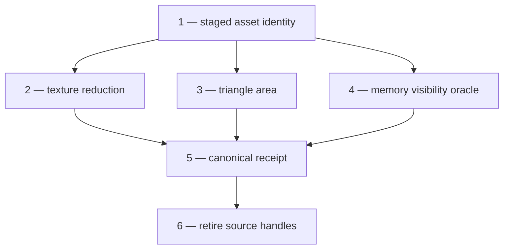

### CPP-19E — A complete asset-to-evidence trace, from bytes to safe retirement

The preceding chapters have taught several individually defensible ideas. A file reader can own its bytes, a decoder can refuse malformed data without leaking a half-constructed value, a generational registry can prevent stale logical handles from identifying a new asset, and a dependency planner can derive ordering from reads and writes. Yet the central engineering question is harder: **does the complete path preserve all of those guarantees when the steps are connected?** A passing parser does not prove that the right parser was called. An acyclic task graph does not prove that a task saw initialized memory. A valid output image does not prove that it was produced by the scene revision currently open in the editor. This lesson turns those separations into one executable, inspectable CPU acceptance trace.

The physical inputs are two *real binary files* created in a disposable test directory: a tiny TXR4 RGBA8 texture and a tiny MSH1 quantized triangle. These formats belong to the existing Book 1 Pass 05 source; they are deliberately not described as PNG, KTX, OBJ or glTF. The file layer is the actual C++23 Pass 18 `std::filesystem` / `std::ifstream` / `std::jthread` pipeline. Once the input has become an owned byte vector, the Pass 05 codec decodes it, the Pass 06 registry assigns typed owner-aware handles, the Pass 08 dependency planner orders the work, and the Pass 09 memory oracle refuses an illegal publication or early retirement. The result is a deterministic textual receipt. Every module in this route is an existing implementation from earlier passes; the new file is `tools/labs/book01_end_to_end_cpp23_lab.cpp`, not a parallel imaginary asset library.

#### Start with the observable result, then work backward

Consider an artist who changes a texture while a geometry analysis is running. An editor needs to answer four questions before it displays the result: which exact bytes were used; whether they decoded into valid, owned domain objects; which version of the scene those objects belong to; and whether the jobs finished before any source or intermediate resource was retired. A research reproduction asks the same questions about the source geometry, input configuration, numerical transform and saved measurement, although its correctness oracle is different. The shared foundation is **provenance joined to lifetime and execution order**, not a particular renderer or emulator.

We construct a receipt with an explicitly versioned layout:

```text
AllMight-Book01-CPU-Trace-v1
texture_source_fnv1a=<decimal number>
mesh_source_fnv1a=<decimal number>
texture_weighted_rgb_sum=297
mesh_signed_double_area_q16=65536
```

The numerical outputs are not magic constants that the implementation merely prints. The executable reads the two actual files, decodes their payloads, computes the quantities and verifies these independently derived expected results. The input fingerprints are calculated over **all bytes of the source fixtures**, including format headers, whereas the computed results operate on the decoded pixel/vertex payload. A change in a header can therefore change source identity without necessarily changing a decoded numerical value. Conversely, a modified pixel changes both the source fingerprint and the reduction. These are different invariants and must not be conflated.

The fingerprint is the fixed 64-bit FNV-1a function already supplied by Pass 18. It is reproducible for the same ordered bytes, but it is **not cryptographic authentication** and should not be used as a security proof or as a substitute for a cryptographic artifact digest in research release manifests. We deliberately omit the temporary filesystem directory, process-local registry owner ID and wall-clock time from the receipt. If they appeared, repeating the identical operation would produce a different text file despite identical computation.

#### A real ownership boundary: disk bytes are not scene objects

The first boundary is asynchronous ingestion. Two names are submitted to the bounded `WorkerBatch`: `assets/tex.txr4` and `models/tri.msh1`. The worker owns a copy of its manifest, sorts the requested paths, reads under explicit file and aggregate byte budgets, and returns two `OwnedAsset` results. The caller may destroy the original request vector or close its local view without invalidating the returned bytes. There is no borrowed stream buffer escaping the worker. The producer might run on a thread, but `co_yield` itself never creates a thread: the single worker resumes the generator and transfers owned results under synchronization.

We identify the returned resources by both expected path and `AssetKind`, not just by whatever position a sorting algorithm happens to give them. A duplicate or wrong-kind input is an error. A missing file is also an error. We require exactly two successful outputs before attempting the next stage. This deliberately excludes a dangerous partial-success policy in which a missing mesh is silently replaced by yesterday's mesh or an empty vector.

The two domain decoders are invoked **before either asset is published**. That matters because the underlying registry guarantees per-asset transactional import, not an atomic transaction over an entire scene. Validating the texture alone and immediately publishing it would leave a partially updated live scene if the mesh then failed. Pass 19 builds a *local staging registry*. A failed second import causes local state to die, without exposing that staging registry as a live scene. When adapting the pattern into a real editor, scene publication must also be guarded by an owned scene-snapshot or transaction mechanism; preflight validation alone is not sufficient when multiple writers race.

The Pass 06 handles carry three independent pieces of logical identity, an `owner`, a `slot`, and a `generation`. They are **not pointers** and do not by themselves extend the lifetime of an asset. Here the registry's `lookup` returns a borrowed reference; our reduction finishes reading that reference inside one case arm before the later retirement step runs. Nothing caches a borrowed reference past `erase`. The final test deliberately asks for the old handles again and expects `LookupError::stale_or_dead`.

#### Derive the result, do not trust a screenshot

The TXR4 payload has width 2 and height 1. Each pixel contains four unsigned byte channels `(R,G,B,A)`. For this controlled CPU reference we choose the integer weighted-RGB sum

\[
L = \sum_{p=0}^{WH-1} \bigl(R_p + 2G_p + B_p\bigr).
\]

This is a *test reduction*, not a colorimetrically correct sRGB luminance conversion. Alpha is intentionally unused. For the first pixel `(255,3,4,255)`, the contribution is `255 + 2(3) + 4 = 265`. For the second `(7,8,9,255)`, it is `7 + 2(8) + 9 = 32`. Therefore the independent reference result is `L = 297`. The code iterates in groups of four bytes and accumulates in `std::uint64_t`, rather than allowing repeated byte-sized arithmetic to wrap.

The mesh stores three-dimensional positions as signed 16-bit integers measured in units of 1/256 world unit. Its one triangle uses `p=(0,0,0)`, `q=(256,0,0)`, and `r=(0,256,0)` in quantized coordinates. For a 2D projection of a triangle, twice the *signed* area is

\[
2 A_{xy} = (q_x-p_x)(r_y-p_y) - (q_y-p_y)(r_x-p_x).
\]

Substitution gives `256 × 256 - 0 = 65,536` integer squared quantization units, or a world-space twice-area of one when divided by `256^2`. A change in winding changes the sign, which is useful for exposing orientation errors; the output is not normalized with `abs`. The implementation promotes coordinates to signed 64-bit integers **before subtraction and multiplication**. A valid 16-bit displacement can approach 65,535, and multiplying two such differences can overflow signed 32-bit arithmetic. For arbitrary maximal triangle coordinates the cross-product difference fits within signed 64 bits, but it does not necessarily fit signed 32 bits.

This exercise uses actual decoded vertices and indices, not a hard-coded result. The MSH1 decoder already rejects out-of-range indices and incomplete triangles. The capstone relies on that contract while still checking there are at least three indices before accessing them. Such contracts should be explicit at a subsystem boundary; merely saying “the parser checked it” without referring to a concrete parser implementation makes a refactor dangerous.

#### Build the dependency graph from hazards

The work is divided into six host tasks: validate staged handles, compute the texture reduction, compute the triangle area, execute the CPU memory/retirement oracle, format the receipt, and retire the registry identities. The tasks share the exact `ResourceKey` representation used by Pass 08: `kind, owner, slot, generation`. Result slots are distinct keys so parallel *read-only* work is not serialized by a fake output collision.



The graph is computed from declared resource accesses, not merely this drawing. Task 1 writes the two logical source keys, tasks 2–4 read them and write different result keys, task 5 reads all three outputs and writes the receipt key, and task 6 writes the two original identities to retire them after consumption. The actual planner may include additional transitive or explicit edges; what must be invariant is that every emitted dependency points forward in its topological execution order. The executable independently checks this edge-order property rather than accepting an ordered vector on faith.

A task DAG is **not an executor**, and a host DAG is **not a GPU synchronization primitive**. Pass 19 explicitly interprets the emitted `PlannedTask` order in a small sequential CPU executor. For Vulkan or Metal, the right actual pipeline stages, access masks, layouts, queue ownership transfers, timeline/fence completion and device-loss behavior would have to be mapped and validated independently. An edge in a CPU graph cannot replace any of those native contracts.

#### Why order and visibility are different

Pass 09 supplies a virtual memory-contract oracle. In the fourth task we allocate a conceptual GPU texture identity, write actual decoded pixel bytes from the host, and change the conceptual owner/layout to a compute-reader state using `execution_only_transition`. This transition intentionally does **not** publish the recent write epoch. The next read must fail with `consumer_not_visible`. If it succeeds, the example has failed to distinguish ordering from data visibility.

Only after an explicit `memory_dependency` from host producer to conceptual compute consumer does a read return the exact eight pixel bytes. That comparison is an independent byte oracle: the result is compared with the actual decoded texture, rather than with whatever the memory model happened to return. We then mark a virtual submission ticket in flight. Attempting to retire the resource before simulated completion must return `completion_pending`; after `observe_completion(1)`, retirement must succeed, and another read must fail with `already_retired`.

These API names sound GPU-like, but this remains a **portable CPU model**. No shader was dispatched, no GPU counter was sampled, and no device or queue was opened. That limitation is a strength of the test's interpretation: it can prove that our *host-side assumptions* enforce specific ordering and visibility rules, without implying that a particular native driver implements the mapping correctly.

#### Revision identity: stale work must not become current output

Even a perfectly valid receipt can belong to the wrong scene. Imagine a long-running file-import task starts when a scene is at revision 7. The user switches or edits the scene, advancing the live revision to 8, before the result is ready. A system that publishes solely because the job succeeded will overwrite more recent work. The Pass 19 sample demonstrates an optimistic revision check:

```cpp
// Illustrative excerpt; see the complete executable for the tested context.
// In a concurrent editor, both comparison and assignment must happen under
// one scene mutex or within one actor/serial executor.
bool publish(std::uint64_t expected, Receipt result) {
    if (revision != expected) return false;
    if (revision == std::numeric_limits<std::uint64_t>::max()) return false;
    visible.emplace(std::move(result));
    ++revision; // the same expected revision cannot commit twice
    return true;
}
```

The executable rejects an expected revision of 6 when the scene is at 7, accepts the correct revision 7 exactly once, and then rejects a second stale publication with expected revision 7 because the scene has advanced to 8. This is a **single-threaded reference protocol**, not a race-safe production scene editor. In an actual multi-threaded engine the equality check and commit must be made indivisible by a mutex, actor or appropriate compare-and-swap state protocol; source-resource lifetime and render-thread consumption still require independent ownership rules.

The core point is that *source content fingerprint*, *registry generation*, *scene revision*, and *GPU completion ticket* describe different kinds of identity and time. They cannot be replaced by a single “current version” integer. The source fingerprint answers “what bytes?”, the registry handle answers “which live logical slot?”, the scene revision answers “which publication epoch?”, and the completion ticket answers “has the dependent work finished?” Engineers who keep these separate can reason clearly about hot reload, experimental reproducibility and safe resource retirement.

#### Independent rejection cases and expected failures

The executable creates the required texture but omits the mesh. The input stage must return `read_failure`; no receipt may be produced. It then writes a mesh with a corrupted magic byte and expects `decode_failure` after the real file read. Finally it restores the valid mesh, truncates the texture's RGBA8 payload, and expects another `decode_failure`. These cases distinguish file availability from semantic format validation, and prohibit a valid-looking final output assembled from a mixture of good and invalid source objects.

A stronger test suite should eventually include duplicate manifest paths, symlink replacement races, invalid numerical indices, allocator-failure injection, cross-thread publication under competing revisions, interruption during file replacement, process restart, and actual GPU completion events. They should not be labeled “covered by the capstone” until a test explicitly exercises them. The Pass 18 reader already has independent tests for bounded requests, path policies, aggregate size limits and cooperative cancellation; Pass 19 consumes that reader rather than reimplementing those rules.

#### How to adapt the same trace into actual engineering projects

For a **Kairo or Maveb asset workflow**, the binary input is a verified asset or scene bundle, the typed registry stores a parsed mesh/texture or scene view, and the task DAG connects decode, upload, resource transition, computation/draw, readback and result capture. Borrowed CPU spans must end before ownership transfer, GPU resources must stay alive until a real completion signal, and the scene's revision gate must reject stale async jobs. The illustrative memory oracle is replaced by real Vulkan or Metal commands whose synchronization correctness is separately tested.

For **Kyoto collision broad-phase experiments**, the input identity should include scene generation, body topology, material assignment, collision regime, seed and frame configuration. The independent oracle is an exact pair-set or solver-state comparison, not a weighted RGB sum. The receipt must include both correctness and timing provenance; a fast candidate-pair path that changes physical solver behavior cannot be certified by timing alone. An immutable frozen evidence manifest plays the same role as the versioned receipt in this teaching exercise.

For **Vulkax scientific controls and an XR/foveation pipeline**, the important change is the deadline and confidence model. Vulkax requires independent residual and controlled-perturbation checks with separated validation data. XR requires a timestamped path from gaze sample and prediction through rendering, compositor and actual display; a CPU task graph cannot claim motion-to-photon latency without measured clocks. All these systems can reuse the foundation's idea of source-pinned owned inputs, explicit task and publication identities, rejected stale work, and independent correctness evidence without pretending they share a single physics or display backend.

#### Reconstruct and extend the project yourself

First, locate `tools/labs/book01_end_to_end_cpp23_lab.cpp` and redraw the task/resource graph from the **actual resource access declarations**, without using the diagram above. Explain every RAW and WAR edge the planner generates, and why two independent readers need not wait for one another. Then alter the mesh winding by swapping indices 1 and 2. Before running anything, derive the expected signed area and identify which assertion must change; after running, check whether the signed result agrees with the derivation. Repeat by modifying only a texture alpha value: the source fingerprint must change, but the weighted RGB sum must stay fixed. That distinction is a simple test of source provenance versus computational output.

Next, remove the `memory_dependency` call without weakening the output condition. The read should be rejected by the CPU oracle, teaching why a topologically correct plan cannot be used as a substitute for data visibility. Remove or move the virtual completion observation, and prove that early retirement fails. Finally, attempt to publish the same receipt twice against the same scene revision. Predict which attempt succeeds, why the second fails, and exactly which synchronization is missing before adapting the pattern to a threaded renderer.

For an independent acceptance exercise, instrument a real engine-owned asset and a real renderer command submission, while leaving the original capstone intact. Record the compiler version, all source and shader hashes, device/driver/SDK, input assets, task identities, observed completion and exact output oracle. If an actual native device run fails, show the failure and repair it; do not silently fall back to this CPU oracle and call the GPU path verified. The correct end state is not merely one more green test, but a learner who can trace every resource's lifetime and every claimed result back to reproducible inputs.

#### Evidence boundary and book-release gate

This pass adds a complete portable C++23 test **source** grounded in existing APIs and a connected lesson. It is staged in the same additive manuscript workflow and does not shorten, rewrite, regenerate or compile the original multi-thousand-page book. The outcome of the new integrated 18th test **must not be reported as passing** until the full Git checkout compiles and executes it under GCC, Clang and applicable AppleClang configurations with real CTest/JUnit receipts. A staged source file, a CMake test declaration or a text receipt format is not a measured result.

The next release gate is therefore an observed **18-target** build and tests, validated source-preserving insertions, and a chapter-by-chapter narrative transition pass. Native Vulkan/Metal, editor hot-reload races, real asset formats and research-correctness claims remain separate deliverables. We preserve the whole prior manuscript while adding this new, precisely bounded witness at the existing build/evidence chapter's conceptual boundary.
