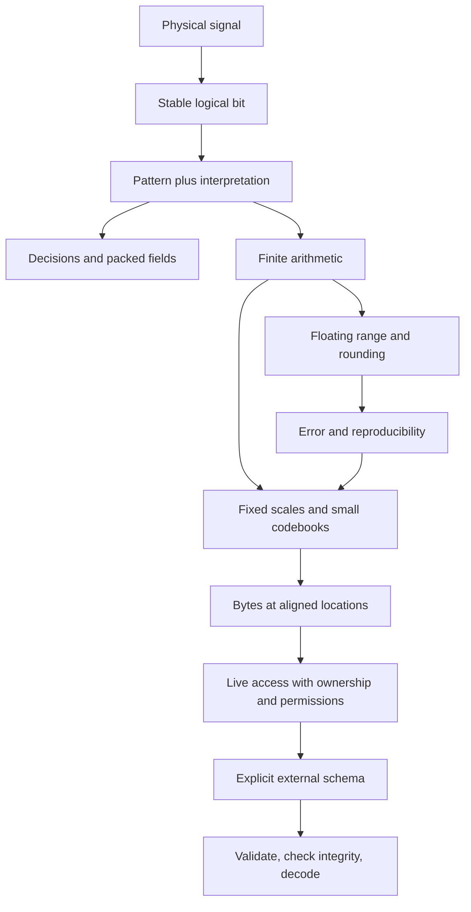
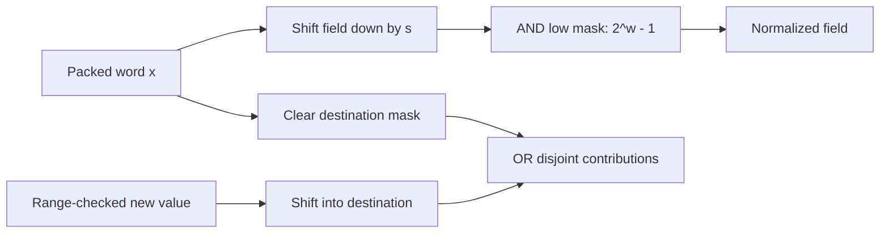
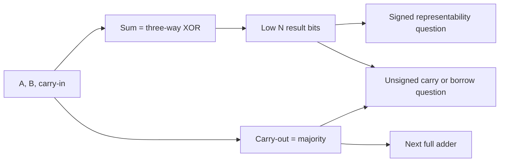
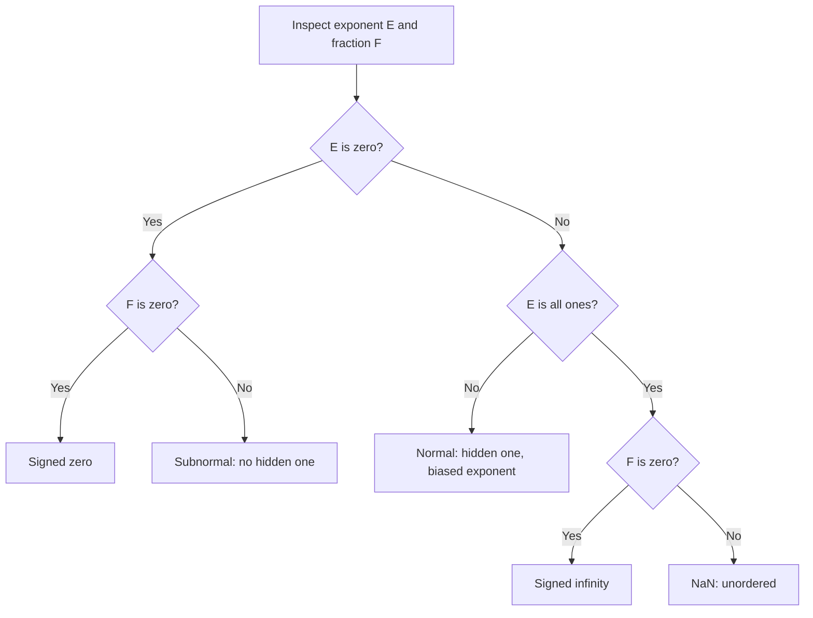
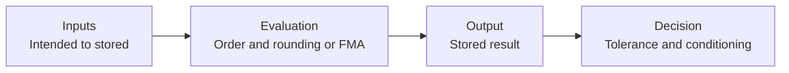
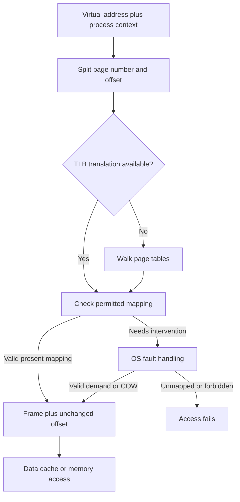
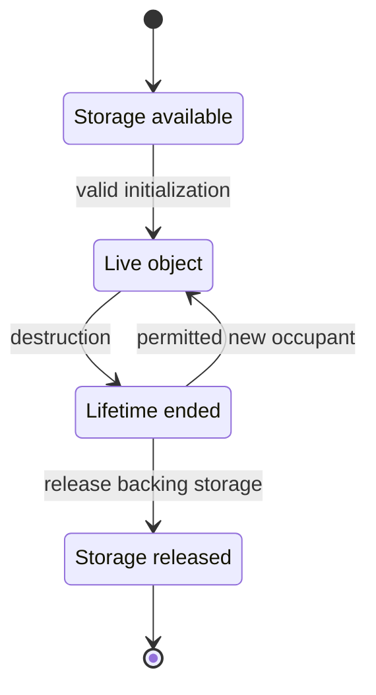
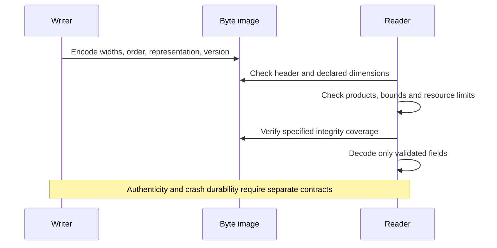

---
tags:
  - visual-recall
  - foundations
coverage: "Parts 1–100"
companion: "Volume 01"
---

# Bits, Numbers and Memory - Visual Recall

**Scope:** Parts 1–100 only, M001–M006. Companion to [[Continuous Notes/01 - From Signals to Meaning - Bits, Numbers and Memory|From Signals to Meaning]]. No C++ Volume 02 material is included. This is a retrieval desk, not another textbook.

## How to use this desk

Cover the visual, sketch it from memory, answer the numbered prompts, then expand the answer key. Score each prompt **0** (missing/wrong), **1** (correct label but weak explanation), or **2** (can reconstruct an example and its limits). Revisit weak prompts in the linked teaching section. Do not turn recognition of a diagram into a mastery claim.

Mermaid shows relationships; byte strips show placement; tables show exact distinctions; state/sequence diagrams show what changes over time. Diagrams are conceptual models, not fixed CPU/OS layouts. Answer keys use collapsible Obsidian callouts.

## The entire story on one board



**Opening challenge:** Explain each arrow without using “it just works.” At every stage ask: **Which bits? Which meaning? Where? Valid to access?**

## 1 - A pattern does not announce its meaning

[[Continuous Notes/01 - From Signals to Meaning - Bits, Numbers and Memory#From a signal to an interpretation|Repair this foundation]] · [[Interpretation contract]] · [[Two's complement]]

```text
bit index       7    6    5    4    3    2    1    0
pattern         1    0    1    0    1    1    0    1
unsigned weight 128  64   32   16    8    4    2    1
signed weight  -128  64   32   16    8    4    2    1

same pattern:   binary 10101101 = hex AD = octal 255
unsigned:       128 + 32 + 8 + 4 + 1 = 173
two's complement: -128 + 32 + 8 + 4 + 1 = -83
```

| Eight-bit interpretation | Zero patterns | Range | −5 |
|---|---:|---|---|
| Unsigned | 1 | 0…255 | Not in domain |
| Signed magnitude | 2 | −127…127 | 10000101 |
| One's complement | 2 | −127…127 | 11111010 |
| Two's complement | 1 | −128…127 | 11111011 |

For $N$ independent bits: $2^N$ patterns. Unsigned maximum is $2^N-1$, not $2^N$. Two's-complement decode subtracts $2^N$ when the top bit is set.

**Recall**

1. Why can imperfect voltage ranges represent a stable bit? Distinguish noise margin, bit, byte, octet, word and character.
2. Encode 13 by repeated division; decode 1101 using Horner steps. Why do hex and octal group four and three bits?
3. Derive invert-plus-one rather than reciting it. Why is the signed minimum asymmetric and unsafe to negate in its own signed type?

> [!answer]- Reveal 1–3
> Noise margin tolerates disturbances within a logical range. A bit has two logical states; octet means exactly eight bits; C++ byte has CHAR_BIT bits and sizeof(char)=1. A word is architecture-specific; a character can need multiple bytes. Historical byte sizes varied.
>
> 13→6 remainder1→3 remainder0→1 remainder1→0 remainder1; reverse gives1101. Horner states1→3→6→13. Bases16 and8 are powers2^4 and2^3.
>
> $2^N-x=(2^N-1-x)+1$: width-limited complement plus one. Zero negates back to zero after the carry is discarded. The positive counterpart of −128 is128, outside the signed eight-bit range. Promotion can change the actual C++ operation type; inspect it first.

## 2 - Select, move, replace

[[Continuous Notes/01 - From Signals to Meaning - Bits, Numbers and Memory#Bits become decisions and compact fields|Repair decisions and fields]] · [[Bit mask]] · [[Bit packing]]



| Operation | Eight-bit cue | Reconstruct the purpose |
|---|---|---|
| AND | AD & 07 = 05 | Keep selected bits |
| OR | AD OR 40 = ED | Set selected bits |
| XOR | AD XOR 08 = A5 | Toggle; repeat restores AD |
| NOT | NOT₈(0F) = F0 | Invert at a stated width |
| Extract | (AD >> 4) & 03 = 2 | Move then isolate |
| Replace | quality2→1: AD→9D | Clear then insert; preserve other bits |

For width $w$, offset $s$, carrier $N$: require $0<w$, $s+w\le N$, valid shift counts, and a declared reject/truncate policy. The full-width low-mask case needs care in executable code: shifting 1 by the carrier width is invalid.

**Recall**

4. Prove both De Morgan identities from four input pairs. Why is built-in logical AND not interchangeable with bitwise AND?
5. Reconstruct extraction/insertion formulas. Explain any-selected versus all-selected flags and how to test a packer beyond a round trip.
6. On the C++23 baseline, why can −3/2 and −3>>1 differ? What changes when a byte operand is promoted?

> [!answer]- Reveal 4–6
> NOT(A AND B)=NOT A OR NOT B; NOT(A OR B)=NOT A AND NOT B. Logical operators test truth and built-in AND/OR short-circuit; bitwise operators transform every bit.
>
> Low mask $L=2^w-1$, positioned mask $M=L2^s$. Extract is right-shift then AND L; insert clears M and ORs the shifted valid field. Any tests nonzero; all compares with the whole mask. Use independent golden bytes, preservation/range checks and boundary/invalid cases: encoder and decoder can share one bug.
>
> Integer division truncates toward zero (−1); arithmetic right shift rounds downward (−2). Promotions determine the operation width, including the width of NOT; a narrow stored type does not force a narrow expression.

## 3 - The adder is simple; the policy is not

[[Continuous Notes/01 - From Signals to Meaning - Bits, Numbers and Memory#Arithmetic becomes a policy|Repair finite arithmetic]] · [[Full adder]] · [[Arithmetic policies]]



| Calculation | Exact/wide result | Eight-bit destination policy |
|---|---:|---|
| 250+20 | 270 | Wrap14 / saturate255 / reject |
| 127+1 | 128 | Signed eight-bit overflow; no legal wrapping assumption |
| 0−1 unsigned | −1 mathematically | Residue255 |
| 13×11 | 13+26+104 | 143 |
| 13÷3 | $13=4(3)+1$ | Quotient4, remainder1 |

```text
stored type → promotion → common operation type → calculation → destination conversion
uint8 + uint8       commonly becomes int arithmetic before narrowing
signed overflow    must be prevented BEFORE evaluating the expression
```

**Recall**

7. Derive a half adder, add carry-in, and explain ripple delay versus generate/propagate carry networks. Distinguish carry, overflow, negative and zero flags.
8. Rebuild shift-and-add multiplication and long division. What intermediate width and invalid inputs must be handled?
9. Choose wrap/saturate/reject/widen for a counter, image sample and size calculation. Why can saturation break associativity?
10. Explain signed minimum/−1, unsigned reverse-loop failure, plain-char signedness, exact/least/fast widths, and mixed-sign comparisons.

> [!answer]- Reveal 7–10
> Half-adder sum=A XOR B, carry=A AND B. Full-adder carry is true when at least two of its three inputs are true. Ripple chains carry dependencies; prefix designs combine generate/propagate information. Carry answers an unsigned question; overflow a signed-range question; N observes a result sign bit; Z observes all-zero result. Borrow conventions vary: binary6502 SBC uses A−B−(1−C), with C=1 meaning no borrow.
>
> Set multiplier bits select shifted partial products. Division shifts bits into a remainder, conditionally subtracts, and satisfies D=Qd+R with0≤R<d. Prove partial/intermediate ranges. Reject division by0 and same-type signed-min/−1.
>
> Policies follow meaning: bounded samples may clamp, modular counters may wrap, sizes usually need checked arithmetic. Signed overflow remains undefined behavior; widening after the overflowing expression is too late. Saturation and capped updates are order-dependent.
>
> An unsigned i≥0 never terminates a reverse loop. char signedness varies; exact-width aliases are optional, least/fast may be wider. Promotions/common-type conversions can turn a negative operand into a large unsigned value. Track all five stages, not only storage width.

## 4 - A stretching ruler with special regions

[[Continuous Notes/01 - From Signals to Meaning - Bits, Numbers and Memory#A stretching ruler for real-valued quantities|Repair floating representation]] · [[IEEE-754 floating point]]

```text
binary32: [ sign:1 ][ stored exponent:8 ][ fraction:23 ]  normal precision24
binary64: [ sign:1 ][ stored exponent:11][ fraction:52 ]  normal precision53
```



Binary32 normal value, for $1\le E\le254$:

$$
x=(-1)^S(1+F/2^{23})2^{E-127}.
$$

Here S is sign0/1, E stored exponent, F the unsigned23-bit fraction. Subnormal value is $(-1)^SF2^{-149}$.

| Visual checkpoint | Reconstruct |
|---|---|
| 10.625 | $1.010101_2\times2^3$ → word412A0000 |
| C1540000 | Sign1, exponent130, significand1.65625 → −13.25 |
| Above1 | binary32 spacing $2^{-23}$ |
| Immediately below1 | gap $2^{-24}$ |
| Subnormal grid | step $2^{-149}$, not a hidden-one format |

**Recall**

11. Decode the class before the normal formula. Why do +0 and −0 compare equal but differ as representations?
12. Reconstruct both words above and explain bias127/1023 and hidden precision24/53.
13. Distinguish epsilon, min-normal, min-subnormal and local ULP. Explain guard/round/sticky and all four rounding directions.

> [!answer]- Reveal 11–13
> Reserved exponent fields alter the interpretation. Zero has E=F=0 and a separate sign; infinities have all-one E,F=0; NaNs have all-one E,F≠0. Signed-zero reciprocals can differ under IEEE behavior; signbit sees the sign even when x<0 does not. NaN comparisons are unordered; payload/signaling behavior needs a declared policy.
>
> Normal exponent is E−bias and significand is1+F/2^fractionBits. Subnormals remove the hidden one and keep a fixed tiny grid. A C++ float is not universally required to be binary32.
>
> Epsilon is spacing above1, not a universal comparison tolerance. Binary32 min-normal=$2^{-126}$; min-subnormal=$2^{-149}$. Normal binade exponent e gives step $2^{e-23}$. Guard/round/sticky summarize discarded information. Nearest-even picks the even retained significand at an exact tie; upward/downward/toward-zero are signed directions. Check and restore runtime rounding state.

## 5 - Follow the rounding points, not algebra alone

[[Continuous Notes/01 - From Signals to Meaning - Bits, Numbers and Memory#When arithmetic meets uncertainty|Repair numerical reasoning]] · [[Cancellation and loss of significance]] · [[Numerical reproducibility]]



| Witness | What it exposes |
|---|---|
| 0.1 | Reduced denominator10 is not a power of two: repeating binary fraction |
| binary32 $2^{24}+1$ | Nearest-even stores $2^{24}$: absorption |
| Nearby stored x−y | Subtraction can be exact while intended inputs remain uncertain |
| min-normal/2 | Exact subnormal is not automatically an underflow flag |
| FMA versus multiply then add | One final rounding versus two rounding points |
| Atomic floating sum | Race-free update does not fix update order |

**Recall**

14. When does a rational terminate in binary? Why can cancellation magnify relative input error even when subtraction itself is exact?
15. Classify overflow, tiny exact results, tiny inexact results, invalid operations and division-by-zero flags.
16. Distinguish absolute/relative and forward/backward error; stability versus conditioning. Why is approximate closeness not equality?
17. Draw factored/distributed and FMA/unfused evaluation graphs. What do pairwise/compensated sums, wider accumulation and fixed order solve—and not solve?

> [!answer]- Reveal 14–17
> A reduced rational terminates iff its denominator is a power of two. Sterbenz's nearby-float condition x/2≤y≤2x for nonnegative stored values can give exact subtraction under the stated gradual-underflow conditions. A small difference can still expose earlier input uncertainty; sensitivity scales with (|x|+|y|)/|x−y|.
>
> Tiny and underflow are not synonyms. Flags also include inexact, overflow, divide-by-zero and invalid; classify the actual operation/environment.
>
> Absolute error has units; relative error needs a nonzero reference. Forward error measures output discrepancy; backward error asks how perturbed inputs explain the output. Conditioning belongs to the problem, stability to the algorithm. Validate tolerances and non-finite inputs first; pairwise closeness need not be transitive.
>
> FMA rounds ab+c once; unfused arithmetic rounds the product too. Reassociation/distribution move rounding points. Pairwise and compensated algorithms can reduce error but do not reconstruct lost input bits or guarantee identical cross-platform execution. Wider transient arithmetic does not preserve a repeatedly narrowed state. Determinism needs order, precision, compiler/environment and algorithm contracts; capped TSDF-style weighted updates can remain history-dependent mathematically.

## 6 - Choose what information to keep

[[Continuous Notes/01 - From Signals to Meaning - Bits, Numbers and Memory#Choosing what information to keep|Repair representation choices]] · [[Fixed-point representation]] · [[Affine quantization and zero point]]

| Format | What it buys | What remains |
|---|---|---|
| Fixed point I/S | Constant absolute step1/S | Bounded range; rescale/overflow policy |
| FP16 fields1/5/10 | 11-bit normal precision | Maximum65504; narrow range |
| BF16 fields1/8/7 | Wide exponent range,8-bit precision | Coarse spacing; NaN/rounding policy |
| Groupwise INT4 | Small local codebook | Clipping, scales, padding, task error |
| UNORM8 | 256 codes in0…1 | Step1/255; 128 is not exactly0.5 |
| SNORM8 | Normalized signed range | −128 and−127 both decode−1 |

```text
fixed F=8:    1.5 → raw384     2.25 → raw576
multiply:    384×576 =221184  (scale256²)
rescale:     221184/256=864   (scale256)
decode:      864/256=3.375

offset INT4 codes:  [1,5,8,11,15]
low nibble first:  [5|1] [11|8] [padding0|15] → 51 B8 0F
quantization loses information; packing valid codes does not.
```

**Recall**

18. Choose F for a signed32-bit fixed domain ±10^6 with step≤0.001. Derive multiply/divide rescaling and nearest unclipped error.
19. Encode1.5 in FP16; compare FP16/BF16 near1 and at large magnitude. Why can truncating a NaN payload accidentally produce infinity?
20. Explain affine q/z/scale, outlier effects, group metadata, learned one-bit centroids, RMSE/MAE and normalized graphics/color-space distinctions.

> [!answer]- Reveal 18–20
> Require $2^{-F}\le0.001$ and $10^6 2^F\le2^{31}-1$: F=10 or11. Multiply raw operands at scale S² then round AB/S; quotient rounds AS/B for B≠0. Prove intermediate capacity before calculating, check destination range, and define negative ties. Nearest unclipped error≤1/(2S); relative error can explode nearzero.
>
> FP16 1.5→3E00; bias15, normal min2^-14, subnormal min2^-24. BF16 bias127, normal spacing above1 is2^-7 versus FP16's2^-10. Dropping a nonzero discarded NaN fraction can leave all-one exponent and zero fraction: infinity. Classify first; canonicalization is a policy.
>
> Affine reconstruction is scale×(q−z), with positive valid scale; nearest unclipped ideal error≤scale/2. A max-absolute outlier can erase small values. INT4 payload costs ceil(N/2)+4ceil(N/G) bytes with float32 scales, not four bits/value universally. At N=5,G=32 it costs7 bytes. One-bit labels can select learned means rather than±1. RMSE squares errors; MAE takes magnitudes; neither proves application quality. UNORM is not sRGB; quantized normals may need safe renormalization and still lose direction.

## 7 - Placement, translation and lifetime are separate

[[Continuous Notes/01 - From Signals to Meaning - Bits, Numbers and Memory#Where the bytes live|Repair memory reasoning]] · [[Endianness]] · [[Alignment and padding]] · [[Page tables and MMU]]

```text
value 12345678 hex     increasing byte addresses →
little endian         78 56 34 12
big endian            12 34 56 78

ordinary ABI example: char / uint32 / char, alignments1/4/1
offset 0: [a][pad][pad][pad][b b b b][c][tail][tail][tail]
member offsets0,4,8; size12; alignment4; array stride12
```



Example4-KiB pages: VA12345ABC → VPN12345, offsetABC → PFN987 → PA987ABC. A TLB miss is not automatically a fault; a fault is not automatically disk I/O or a crash.



**Recall**

21. Why does swapping bytes not reverse bits? Derive aligned offsets and tail padding; compare packing, reordering, AoS/SoA and CPU/GPU layouts.
22. Reconstruct the address translation. Distinguish process isolation, shared mappings, TLB/data-cache misses, faults, COW, virtual/physical contiguity and huge-page tradeoffs.
23. Separate stack/heap/static regions from storage duration and object lifetime. Explain fragmentation, dangling views, mapped files, const, W^X and ASLR.

> [!answer]- Reveal 21–23
> Endianness orders significance bytes, not bits within an octet. Align each member under stated ABI requirements; round total extent for aligned array stride. Reordering can reduce holes but change ABI. Packing may misalign; smaller is not automatically faster. AoS groups records, SoA fields; hot access patterns and backend layout contracts decide.
>
> For page size P, VPN=floor(VA/P), offset=VA mod P; PA=PFN×P+offset. Context/permissions matter. TLB caches translations; data cache caches contents. COW copies a shared backing page when a permitted write needs a private copy. Consecutive virtual pages may use scattered frames. Larger pages increase simplified TLB reach entries×pageSize but reduce granularity/flexibility.
>
> Automatic objects often use stack frames, but optimization/ABI can differ; heap allocation manages variable-lifetime blocks. Static duration can still need runtime initialization. Internal fragmentation is allocated slack; external fragmentation is separated holes. A span does not own/extend backing life. A mapped file needs bounds, permissions and access/lifetime validity. const does not force a read-only segment; W^X concerns mapping permissions; ASLR varies locations. Old bytes do not prove a live object.

## 8 - External bytes need a complete agreement

[[Continuous Notes/01 - From Signals to Meaning - Bits, Numbers and Memory#Bytes become a durable agreement|Repair external bytes]] · [[Checked binary parsing]] · [[Integrity and authenticity]]



| Same binary32-compatible value1 | Result |
|---|---|
| Numeric conversion to uint32 | 1 |
| Representation bit-cast | Word3F800000 |
| Little-endian encoding | Bytes00 00 80 3F |
| Big-endian encoding | Bytes3F 80 00 00 |

| Defense | Answers | Does not establish |
|---|---|---|
| Magic/version | Which proposed format/revision? | Valid dimensions or trusted sender |
| Checked schema | Structurally permitted content? | Unchanged payload |
| CRC/checksum | Matches stated error-detection reference? | Adversarial authenticity |
| Cryptographic hash | Matches trusted digest? | Trust if attacker replaces digest too |
| MAC/signature | Authenticated under trusted key policy? | Semantic correctness |
| Atomic publication | Replacement visibility contract? | Crash durability |

**Recall**

24. State bit-cast preconditions; distinguish native ABI from external schema. Give safe multiplication and range checks before parsing.
25. Explain checksum blind spots, specified CRC parameters, hash collisions, authenticity and durability. Decode the mini-dump below.

> [!answer]- Reveal 24–25
> Bit-cast needs same size, trivially copyable types and valid initialized representations under the applicable rules. It is not numeric conversion, endian conversion or permission for arbitrary typed access.
>
> Before unsigned a×b check a=0 or b≤MAX/a. Before reading n bytes at o in length L, check o≤L then n≤L−o. Check header≤length, exact payload length, size_t representability and practical resource limits before allocation.
>
> Additive byte sums miss reorderings. A CRC needs polynomial, initial/final operations, reflection/order and covered range. CRC-32/ISO-HDLC check string123456789 gives CBF43926. Finite digests necessarily have collisions over unrestricted messages. A hostile replacement requires trusted digest/key policy; valid decoding, integrity, authenticity, publication and durability are different claims.

### Mini-dump - Reconstruct before revealing

```text
0000  4E 51 54 4E 53 52 30 31   magic
0008  01 00 00 00               version
000C  02 00 00 00 00 00 00 00   rows
0014  03 00 00 00 00 00 00 00   columns
001C  00 00 80 3F               first payload word
```

Assume explicit little-endian uint32 version, uint64 dimensions and IEEE binary32 payload. What are shape, header size, payload size and total size? What changes if payload byte80 becomes00?

> [!answer]- Reveal the dump
> Shape2×3; header28 bytes; payload24 bytes; total52 bytes. First word3F800000 decodes1. Flipping80→00 gives3F000000, value0.5. Magic, dimensions and file length can remain plausible; structural validation alone misses this substitution. This is a teaching schema, not a freshly verified production format.

## Final blank-board test

Without looking above, draw: interpretation fork → mask/extract/replace → adder with two flag questions → floating classifier → rounding graph → precision-choice table → byte/alignment strip → virtual translation → live-object state → safe reader.

For every diagram supply **one numeric example, one invariant, one failure case and one assumption**. Then explain the same stored bytes under two interpretations. A round trip is only one test: demand independent golden bytes and invalid-input checks too.

## Coverage map - No source parts dropped

This map is navigation, not partwise lesson segmentation. Overlapping examples may revisit a concept; the listed coverage ranges assign each of1–100 exactly once.

| Source parts | Recall panel |
|---|---|
| 1–7; 21–27 | [[#1 - A pattern does not announce its meaning]] |
| 8–20 | [[#2 - Select, move, replace]] |
| 28–40 | [[#3 - The adder is simple; the policy is not]] |
| 61–76 | [[#4 - A stretching ruler with special regions]] |
| 77–88 | [[#5 - Follow the rounding points, not algebra alone]] |
| 89–96 | [[#6 - Choose what information to keep]] |
| 41–60 | [[#7 - Placement, translation and lifetime are separate]] |
| 97–100 | [[#8 - External bytes need a complete agreement]] |

Repair exact definitions in [[Supplementary/Foundations]]; longer proofs in [[Supplementary/Derivations]]; extended experiments in [[Supplementary/Code Snippets]] and [[Supplementary/Worked Traces]]. The full teaching explanations remain in Volume01. Future recall companions should reuse this one-per-volume structure; none is created for C++ in this request.
