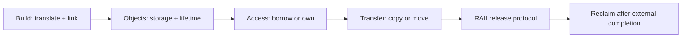
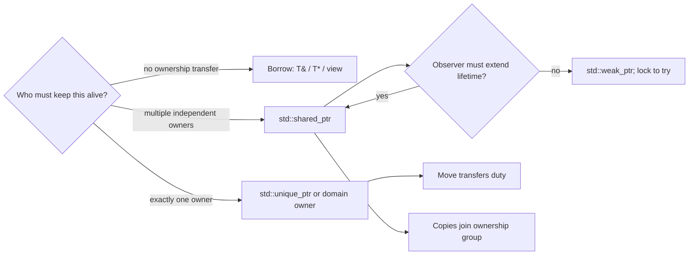
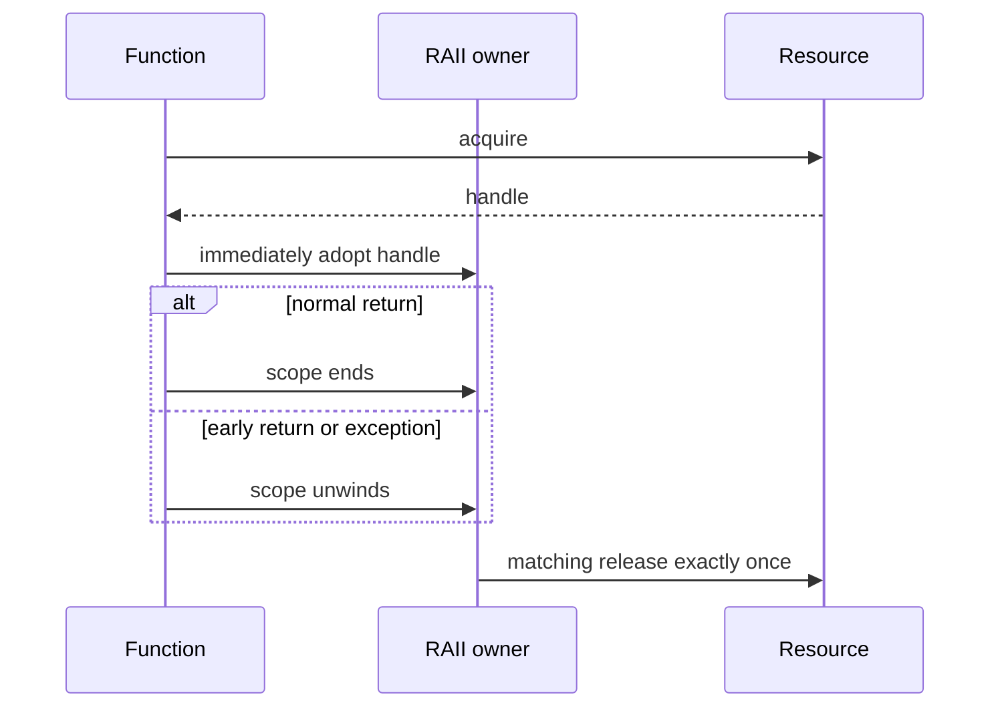
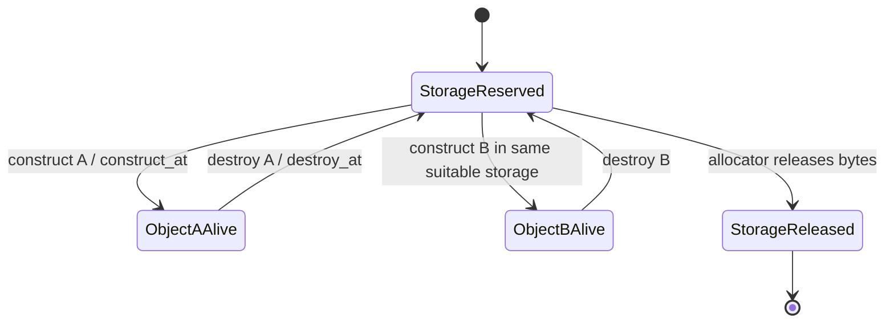
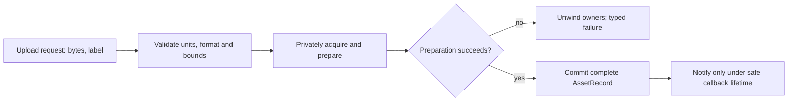
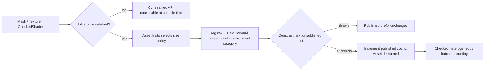
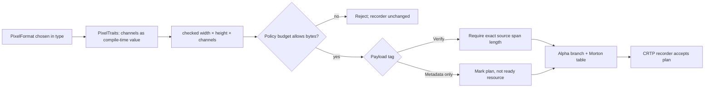
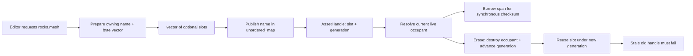

# C++: Objects, Ownership and Lifetime — Visual Recall

**Scope:** Companion to [[Continuous Notes/Computing Foundations - From Bits to C++ and Systems APIs]]. A compact teaching board, not a substitute for the worked chapter. Draw each model from memory; explain every arrow and state its preconditions.

## One-page short notes

| Story stop | Shortest useful note | Open the explanation / figure |
|---|---|---|
| Build | Translation makes declarations visible, definitions executable, and linking joins program pieces. | [[Continuous Notes/Computing Foundations - From Bits to C++ and Systems APIs#The journey from text to a live object\|Build pipeline]] · [[Continuous Notes/Computing Foundations - From Bits to C++ and Systems APIs#A compiled interface rather than repeated text\|Modules]] |
| Object | Storage is the place; lifetime is the interval; identity is the occupant. Same address does not promise same object. | [[Continuous Notes/Computing Foundations - From Bits to C++ and Systems APIs#Storage is a place; an object is its occupant\|Storage/object figure]] · [[Continuous Notes/Computing Foundations - From Bits to C++ and Systems APIs#A handle remembers which occupant was intended\|Generation handle]] |
| Borrow | A pointer/reference/view grants access, not ownership. Validity depends on the referent, lifetime, mutation, and invalidation contract. | [[Continuous Notes/Computing Foundations - From Bits to C++ and Systems APIs#When a valid borrow stops naming the intended thing\|Borrow hazards]] · [[Continuous Notes/Computing Foundations - From Bits to C++ and Systems APIs#Borrowed views and deferred work need an owner story\|Deferred views]] |
| Value | Construction creates; assignment replaces; move may transfer responsibility while source remains alive. Rule of Zero composes tested owners. | [[Continuous Notes/Computing Foundations - From Bits to C++ and Systems APIs#Construction establishes a usable state\|Construction/destruction]] · [[Continuous Notes/Computing Foundations - From Bits to C++ and Systems APIs#From three repairs to five decisions to zero boilerplate\|Rule of Zero]] |
| Resource | RAII binds cleanup to an owner lifetime; external users may require deferred release. | [[Continuous Notes/Computing Foundations - From Bits to C++ and Systems APIs#From a live object to responsible resource ownership\|Four-lifetime figure and full story]] |
| Smart owner | `unique_ptr` = one duty; `shared_ptr` = shared lifetime; `weak_ptr` = observe, then `lock()` to try. Shared ownership does not synchronize the pointee. | [[Continuous Notes/Computing Foundations - From Bits to C++ and Systems APIs#Exclusive ownership: `unique_ptr` makes transfer visible\|Exclusive ownership]] · [[Continuous Notes/Computing Foundations - From Bits to C++ and Systems APIs#Shared ownership: one object, a group of owners, and a separate control block\|Shared ownership]] · [[Continuous Notes/Computing Foundations - From Bits to C++ and Systems APIs#Weak observation breaks cycles without pretending an object is alive\|Weak observation]] |
| Raw storage | Allocation obtains bytes; construction starts an object; destruction ends its life; deallocation returns bytes. Placement construction does not allocate. | [[Continuous Notes/Computing Foundations - From Bits to C++ and Systems APIs#Custom allocation separates obtaining bytes from constructing objects\|Allocation versus construction]] · [[Continuous Notes/Computing Foundations - From Bits to C++ and Systems APIs#Placement construction reuses storage; it does not allocate it\|Placement/lifetime figure]] |

**Board in one breath:** source → object → borrow/owner → value transfer → RAII cleanup → safe external reclamation. At every arrow ask: **who owns it, how long is it valid, and what ends use?**

The notes above target a single landscape page when rendered at ordinary study-note scale. The diagrams and answer keys below remain the linked detail, not required reading for every review pass.

## One story: from source text to responsibly released resource

**Caption:** Resource safety starts with the object model but ends only when the external-use contract permits release. A C++ destructor is not a GPU completion fence.

## Four figure briefs

Use one row as a small revision card. Open its figure to see the caption and the surrounding worked example. The four cards supplement the existing notes and ownership boards.

| Card | Short note | Figure and explanation | Check yourself |
|---|---|---|---|
| Build | Declare to compile a call; supply the definition to link it. Header guards act inside one translation unit. | [[Continuous Notes/Computing Foundations - From Bits to C++ and Systems APIs#Figure CPP-01 - Two build lanes meet at the linker\|CPP-01 · two build lanes]] | Why can a call compile yet fail at link time? |
| Borrow | Reallocation can dangle a path; slot assignment can keep it live while changing the entity. Validate, then reacquire. | [[Continuous Notes/Computing Foundations - From Bits to C++ and Systems APIs#Figure CPP-02 - A borrow can fail in two different ways\|CPP-02 · lifetime versus identity]] | Can the same address still reach the wrong entity? |
| Move | Construction creates a destination; a move operation may transfer duty. The source remains alive under its type's contract. | [[Continuous Notes/Computing Foundations - From Bits to C++ and Systems APIs#Figure CPP-03 - Move the duty, keep both object lifetimes\|CPP-03 · two live objects, one duty]] | Why does `std::move(x)` alone release nothing? |
| GPU release | RAII triggers the selected cleanup protocol; GPU completion governs when native release is safe. | [[Continuous Notes/Computing Foundations - From Bits to C++ and Systems APIs#Figure CPP-04 - CPU cleanup can precede GPU reclamation\|CPP-04 · deferred reclamation]] | Which owner keeps the device and pending release queue alive? |

**Answers:** translation sees a usable declaration but linking still needs the definition; yes, semantic invalidation can preserve a live slot; `std::move` changes expression category and requires a consuming operation; the renderer must explicitly own the queue/device until all pending duties complete.

## Ownership decision board

**Caption:** Pick semantics first, syntax second. A raw pointer usually borrows; it does not extend lifetime. Shared ownership is a relationship, not a generic safety upgrade.

| Need | Recall | Common trap |
|---|---|---|
| Borrow briefly | `T&`, `T*`, `span` | Caller must preserve lifetime and validity. |
| Own exclusively | `unique_ptr<T>` | `get()` borrows; `release()` transfers the duty. |
| Own jointly | `shared_ptr<T>` | Control-block safety does not synchronize `T`. |
| Observe jointly owned object | `weak_ptr<T>::lock()` | Check the returned owner; `expired()` then use is a race. |
| Release a native handle | Custom/domain deleter | Match the API, device/context, and allocator. |

## RAII: move cleanup from branches into scope

**Caption:** Partial construction is safe only for responsibilities already held by fully constructed members/guards. A naked raw handle between acquire and adoption is a leak window.

## Storage, object and occupant are different states

**Caption:** Destroying an occupant does not necessarily free its storage. Same address does not mean same object. Correct alignment, size, construction, destruction and replacement rules still apply; `std::launder` does not construct or revive anything.

## The four questions to ask at a resource boundary

| Layer | Ask | Example |
|---|---|---|
| Storage | Which bytes, with what size/alignment? | Arena slot large and aligned enough for `Widget`. |
| Object | Which live typed occupant? | `Widget` has completed construction. |
| Ownership | Who ends its lifetime/releases the handle? | Move-only `GpuBuffer` owner. |
| External use | When is reclamation safe? | GPU completion fence/timeline. |

## Retrieval prompts

1. Why can a stack object own heap or GPU resources?
2. What does RAII automate, and what release timing must a GPU wrapper still know?
3. Why is `shared_ptr` copying not a synchronization policy for the pointed-to object?
4. Why does `weak_ptr::lock()` give a stronger test than checking `expired()` first?
5. How can a `weak_ptr` keep control-block storage allocated after object destruction?
6. What is the difference among `new T`, `::operator new`, `construct_at`, `destroy_at`, and deallocation?
7. Why does `unique_ptr<Derived>` converting to `unique_ptr<Base>` require a correct base destruction contract?
8. What exactly does `std::launder` not do?

> [!answer]- Compact key
> Scope-based owners run cleanup on normal exit and unwinding. External completion is a separate condition. Shared-pointer thread safety concerns ownership bookkeeping, not arbitrary pointee mutation. `lock()` atomically attempts to obtain a strong owner. Weak observers can keep the control block, but not the managed object's lifetime, alive. A new-expression combines storage allocation and initialization; allocation functions alone only acquire storage; construction starts an object lifetime; destruction ends it; deallocation returns storage. Base deletion needs a valid virtual destructor or a deleter retaining the concrete type. `launder` can obtain a pointer to an already-live object only under its rules; it is no general repair tool.

[[Continuous Notes/Computing Foundations - From Bits to C++ and Systems APIs#From a live object to responsible resource ownership|Teach the full ownership story]] · [[Supplementary/Foundations#M010 - Parts 148-160|Part coverage]] · [[Dependency Map]]

## Added retrieval prompt

Borrow: T& or const T&. Consume: unique_ptr<T> by value. Retain shared lifetime: shared_ptr<T> by value. Borrow an existing shared handle: const shared_ptr<T>& only for that call. Use a matching deleter for non-memory resources. [[Continuous Notes/Computing Foundations - From Bits to C++ and Systems APIs#Worked API choice: borrow, consume, retain, or copy a value|Rebuild the API lab]].

## Requests and replaceable backends — M011 retrieval experiment

A renderer's command is **one of several known shapes**; the runtime backend is **one implementation of a common contract**. These are two different decisions, so redraw the story without looking: command value → active alternative → borrowed submit call → virtual override → checked visitor → logical result → correctly destroyed owner. Then explain what remains separate from the story: the GPU's completion and native-resource release rules.

| From memory, reconstruct the situation | What the answer must account for |
|---|---|
| Why can a union's storage not be treated as several simultaneously live objects? | One active member and the correct lifetime transitions; a byte pattern is not a type tag. |
| How does a request prove its form? | `variant` discriminant, checked `get_if` / `visit`, and possible exceptional valueless state. |
| Why does a base reference call the derived implementation but a copied base value not preserve it? | Static type, dynamic type, subobjects, virtual dispatch and slicing. |
| Why is the interface destructor virtual? | Destruction through an owning base pointer must reach the derived destructor; external GPU use has its own completion rule. |
| What does a diamond with a virtual common base mean? | Two inheritance paths reach one most-derived common-base subobject, not a mandated memory offset. |
| What can each cast prove? | `static_cast` follows a statically permitted conversion; `dynamic_cast` can runtime-check polymorphic relationships; `reinterpret_cast` does not create objects; `const_cast` does not legalize writing to genuinely const storage. |
| Why must two handles with the same slot but different generations compare unequal? | Identity includes the occupant generation; equality still does not prove current liveness. |
| Why does the overridden `reserve` body see 2 through a base view but 7 through a derived view? | Default argument from static type; virtual body from dynamic type. |
| Can `<=>` always produce a total order? | Integer ID fields can support strong ordering; NaN yields unordered floating comparisons and demands an explicit container key policy. |
| Can we claim this is the fastest dispatch architecture? | No: compare allocation, memory layout, branch behavior and optimizer effects on the same workload. |

**Blank-file reconstruction:** Recreate `Clear`, `DrawMesh`, `Upload`, `Request`, `Backend` and `CountingBackend` with a single exclusive owner; verify command counts, derived destructor execution, failed runtime cast, slicing, shared virtual base, generation-aware equality, NaN's unordered comparison, overload selection and static default-argument binding. Full code and the checked build command are in [[tools/labs/backend_choice_lab.cpp|the M011 C++20 laboratory]]; complete derivations and failure explanations are in [[Continuous Notes/Computing Foundations - From Bits to C++ and Systems APIs#From one owned resource to many requests and a replaceable backend|the continuous narrative]]. Do not infer Kairo or GPU execution from this standalone test.

## One request, one transaction, callbacks that may outlive their caller — M012 reconstruction

Read the complete [[Continuous Notes/Computing Foundations - From Bits to C++ and Systems APIs#From an accepted render request to a resource that survives failures and callbacks|M012 narrative]] only *after* attempting this recall route. The important picture begins with an editor requesting a resource and ends with either a fully published asset or the original published store unchanged.

The first thing to reconstruct is *why each arrow is necessary*. The request's count must be distinct from an asset index, because identical raw integer types do not carry the same domain meaning. The file must be decoded as checked bytes, not by assuming any pointer cast creates a live `WireHeader`. Preparation must be private because callbacks or render systems must never observe half-constructed state. Every acquired handle must have one owner before a throwing operation can intervene. Publication needs a precise boundary: an exception before the commit must not modify existing records under the stated guarantee; a callback that throws afterward is a different event requiring its own policy.

| Reconstruction question | Minimum evidence the reader must produce |
|---|---|
| Why is a raw `std::size_t` a dangerous API for bytes? | Show accidental unit mixing; write `explicit ByteCount` with explicit conversion back. |
| Can a function pointer close over a local variable? | No: a plain pointer carries a callable identity; extra state needs a context, whose lifetime is separately guaranteed. |
| Why is a member-function pointer not an ordinary callback address? | Explain the required instance and demonstrate `object.*member` invocation. |
| What does a functor or lambda actually store? | Draw state fields or references; contrast capture of an integer, pointer, view and `this`. |
| How do value and reference captures differ after mutation? | Predict snapshot 10 and live view 20; explain why a deferred reference may dangle. |
| What changes when a lambda is stored in `std::function`? | Type erasure, copyable target, possible storage cost, empty-call error; no guaranteed inline capacity. |
| Which exceptions cause cleanup, and what cannot be rolled back? | Distinguish stack unwinding/local RAII from preexisting external side effects. |
| What are the basic, strong and no-throw guarantees? | State valid-but-changed, unchanged observable state, and non-escaping exceptions; give each an example. |
| Why must the native resource move be non-throwing? | Trace vector growth, element relocation, and the relevant strong-guarantee conditions. |
| Why can't input validation live only in `assert`? | `NDEBUG` can remove it; show typed invalid-input errors separately from programmer invariant failures. |
| What do `bit_cast` and trivially copyable prove? | A constrained representation-value operation, not a portable six-byte disk schema. |
| Why is a typed pointer into an arbitrary file unsafe? | Length, alignment, lifetime, alias rules, endian and padding are independent checks. |
| How do we demonstrate rollback? | Reproduce counts: (0,0,0), (1,1,0), (1,2,1), (2,3,1), then 0 live at destruction. |

**Blank-file laboratory:** Rebuild `ByteCount`; the fake device; the move-only `Resource`; the private `AssetRecord`; `AssetStore::upload` returning a typed result; function/member/functor callbacks; value/reference and owning-lifetime lambda captures; and a six-byte little-endian serializer. Compile under C++20 and warnings as errors, execute the deliberate failure after handle acquisition, then repeat under `-DNDEBUG`. The tested reference and exact commands are in [[tools/labs/safe_asset_pipeline_lab.cpp|the M012 lab]] and the source/evidence record. Do not classify this exercise as complete learner mastery until it can be reconstructed and explained independently.

## One asset pipeline, many types — M013 retrieval

The preceding recall exercise ended with a safe, published asset. Now the editor wants *the same preparation and publication guarantees* for meshes, textures with different channel counts, and shader records. We must avoid duplicating stores without erasing type safety. Redraw this path from memory, then justify every boundary rather than reciting template vocabulary:

Imagine one `Mesh` containing three unsigned indices, one `Texture<4>` containing twelve texels, and one `Texture<3>` containing five texels. Explain why a trait gives 12, 48 and 15 source bytes, then derive why the checked batch accumulator returns 75. Show why a bound such as `texel_count > max/Channels` must be checked *before* multiplication. Finally explain why none of these counts establishes the actual GPU allocation size.

Now reconstruct the implementation without opening the reference. Start with `template<class T>` function-template deduction. Build `template<class T, size_t Capacity>` with fixed optional slots and explain why the non-type capacity changes the class specialization. Provide the full `AssetTraits<Mesh>` specialization and the partial `AssetTraits<Texture<Channels>>` specialization, then contrast class-template specialization with function overloading. Derive `U& & → U&`, `U& && → U&`, `U&& & → U&`, and `U&& && → U&&`. Use those results to show why `meshes.emplace(input)` makes a copy while `meshes.emplace(std::move(input))` selects a move path; do not assume the moved-from vector must be empty.

The next reconstruction must connect a heterogeneous parameter pack to a checked fold. Show what happens for zero arguments and why a fold's grouping is not itself a universal left-to-right side-effect guarantee. Then implement the earlier `std::void_t` SFINAE detection pattern and a clearer `Uploadable` concept with compound requirements. State exactly what a `requires` expression checks and what it *does not* execute. Constrain `emplace` with `std::constructible_from` and show why the overload `route(const T&)` selects the constrained path for supported assets and the generic fallback for `UnknownAsset`.

Finally prove publication. If the published count is `c`, slots `[0,c)` are live and slots `[c,Capacity)` are empty. When the constructor throws in slot `c`, the count is not incremented. Reconstruct the deliberately failed `CheckedShader(-1)` attempt and show why the previously published version 3 remains valid and version 4 can use the next slot. Explain what would break if we supported deletion, stored raw references after the depot's lifetime, invoked the API concurrently or replaced the CPU-only record with an asynchronously used GPU buffer without retirement bookkeeping.

**Evidence and full explanation:** [[Continuous Notes/Computing Foundations - From Bits to C++ and Systems APIs#One asset pipeline, many asset types — generic code without accidental promises|the M013 narrative]], [[tools/labs/generic_asset_pipeline_lab.cpp|the tested C++20 laboratory]] and [[Supplementary/Foundations#M013 — Parts 201–216: generic asset preparation with constrained APIs|the 16-part coverage map]]. The test checks representative semantics, not the learner's independent ability to reconstruct these decisions or current Kairo implementation details.

## The tile planner makes a choice — M014 reconstruction

This recall path belongs after [[Continuous Notes/Computing Foundations - From Bits to C++ and Systems APIs#A texture tile that chooses its work before the frame begins|the full M014 narrative]] and the [[tools/labs/compile_time_asset_policy_lab.cpp|C++20 lab]]. Its purpose is to rebuild the decision chain from memory, not to duplicate an encyclopedia of template keywords.

Picture one 8×2 RGBA texture tile, a budget of 64 bytes, a 64-byte CPU buffer, and a counting recorder. Before the renderer tries to use it, the planning layer must establish what is known from the type and what still depends on the incoming data. Draw this path, then explain each transition and its failure condition:

A correct reconstruction should derive \(8\times2\times4=64\) bytes from the uncompressed source representation, then explain why \(8\times3\times4=96\) fails the budget. It should show why a 4×4 RGBA request with no buffer fails **only when the verification tag demands a real payload**. The metadata-only 4×4 RGB path may report 48 planned bytes, but it has not proved any upload complete. Show how overflow is rejected by checking \(x > \mathrm{max}/y\) *before multiplication*, not by multiplying and inspecting the wrapped result.

Rebuild `PixelTraits<Format>` using `std::integral_constant` and distinguish the fact that a type is empty from an assertion that it costs zero bytes in every containing object. Demonstrate an `if constexpr` RGBA branch and contrast it with a normal runtime `if`. Write a `constexpr` function that accepts either compile-time or runtime arguments; then change the problem so that a `consteval` function demands a valid compile-time tile definition. Explain why `constinit` permits a mutable, single-threaded diagnostic counter but does not make it `const` or atomic.

Derive the four-bit Morton lookup without memorizing its answer. Spread \(x=3\) to binary `00000101` and \(y=5\) to `00010001`. Shift the second pattern and OR the results to recover decimal 39. Construct the sixteen-entry table during constant evaluation. Then explain when a small lookup table might lose to shift/mask arithmetic because memory traffic and locality matter.

From that setup, implement a stateless policy and a stateful budget policy with the same `validate` operation. Use `TilePlanner<Format,Policy,Recorder>` to compose the behavior without a runtime backend switch. Show why `RecorderBase<Derived>` may call `Derived::record_impl` only when it is genuinely part of an appropriately derived object; compare this static dispatch with a runtime-selected `std::function` target. Construct `VerifyPayloadTag` and `MetadataOnlyTag` and explain exactly how overload resolution chooses a validation path from the caller's tag type. Finally compare normal empty-policy membership, private empty-base inheritance, and `[[no_unique_address]]` membership. On the tested Linux compilers their respective sizes were 16, 8 and 8 bytes; the rule is **a permitted optimization**, not a universal numeric contract, and compilers can treat the attribute differently.

A complete blank-screen test recreates the accepted 64-byte RGBA plan, rejected 96-byte budget attempt, rejected empty verified payload, accepted 48-byte metadata-only RGB plan, and rejected overflowing extent. The recorder receives exactly two plans in the demonstrated sequence; failed requests do not reach it. Then state why this is **not** a real GPU resource, performance benchmark, atomic transaction for arbitrary throwing recorders, or proof of thread safety. The evidence ledger preserves the exact compiled commands and original fourteen-part mapping: [[Supplementary/Foundations#M014 — Parts 217–230: one tile planner and its compile-time policy decisions|M014 traceability]] · [[Supplementary/Sources and Code Anchors#Phase 4 additive reconstruction — M014 / Parts 217–230|verification record]].

## A growing asset store must preserve its promises — M015 retrieval

A previously working fixed-capacity asset depot now grows, removes assets, accepts work in different scheduling orders, and lets the editor find items by name. **Do not use the following as a replacement for the derivations** in [[Continuous Notes/Computing Foundations - From Bits to C++ and Systems APIs#An asset registry grows while its handles must not change|the complete M015 chapter]]. Start with this diagram and explain why its arrows and lifetime boundaries exist:

First distinguish `size` from `capacity`, and prove why `reserve(2)` creates **zero** live elements whereas `resize(5)` creates five. With a geometric capacity sequence `1,g,g²,...`, derive the sum of relocation work and explain why an individual append can still have linear latency while amortized append cost remains constant. State the operations that invalidate vector pointers and the difference between an append with spare capacity, one requiring reallocation, a middle erase and `reserve` that does or does not change capacity. A pointer does not move itself when the vector relocates.

Then reconstruct the identity protocol. Slot zero holds generation one; a handle `{0,1}` reaches it. After erase, that occupant is destroyed, its generation advances, and a new asset occupies slot zero at generation two. Draw why `{0,1}` no longer resolves. Explain what happens if generation wraps, if a raw `Asset*` or span was retained across reallocation, or if the renderer still has an asynchronous GPU read in flight. Distinguish a CPU identity check from the device-completion requirement.

Show the two injected publication failures: one before any slot change, another after a new slot has been populated but before the name index becomes discoverable. Prove why the rollback resets the candidate and removes a newly appended unpublished slot; explain why the test's successful outcome is not an unrestricted claim about arbitrary throwing user callbacks or all allocator behaviors.

Now change the workload. A fixed-size channel array needs `std::array`, not vector growth. A front/back event stream makes `deque` attractive, but its iterator stability differs from that of its existing element references. A `list` can transfer a node with `splice` while keeping an iterator to an unaffected node; a `forward_list` needs the predecessor for `erase_after`. Explain what those guarantees cost in nodes, pointer chasing and cache locality compared with a contiguous vector scan.

Next give two lookup problems. For ordered traversal and range queries, consider `std::map` / `std::set`, with logarithmic comparison-based behavior. For name-to-handle lookup or membership, use `std::unordered_map` / `std::unordered_set` and explain expected versus worst-case complexity. Write a hash that returns zero for every string; twenty-four distinct names now collide in the same bucket without becoming equal. Derive `load_factor = size/bucket_count`, explain what `max_load_factor(0.5)` and `reserve(96)` request, and state why rehash invalidates unordered iterators but does not generally invalidate references to surviving elements.

Finally build the scheduling choices from user needs: a FIFO `queue`, LIFO `stack`, and a `priority_queue` whose comparator orders priority 3 before priority 1 and earlier sequence numbers before later ones within equal priority. Explain why priority_queue does not promise tie stability unless the comparator defines it.

Finish by distinguishing **borrow** from **ownership**. A `span<const uint8_t>` carries a range while its byte vector remains alive and stable; it does not own the bytes. A `string_view` may point into only the middle of a stored string and need not be NUL-terminated at its end. Copy `"stone"` into `std::string` before destroying or modifying the source. Describe why the local observed short-string capacity of 15 cannot be advertised as a portable SSO specification.

**Actual reconstruction witness:** [[tools/labs/asset_container_lab.cpp|M015 C++20 lab]], compiled and run with GCC sanitizers, Clang, and a GCC release-style build. A learner should be able to recreate the sequence of checks without the reference and explain every failure. [[Supplementary/Foundations#M015 — Parts 231–250: growing the asset registry without losing identities|Original 20-part mapping]] · [[Supplementary/Sources and Code Anchors#Phase 5 additive reconstruction — M015 / Parts 231–250|Exact test and provenance ledger]]. Do not claim personal mastery or real Kairo/GPU verification merely because this standalone model passes.

## Query the registry without confusing identity and a snapshot — M016 reconstruction

The previous M015 exercise produced a generation-checked asset registry. The new problem is to report on assets without changing their live ownership and without assuming that a handle stays current forever. Read the [[Continuous Notes/Computing Foundations - From Bits to C++ and Systems APIs#From a living asset registry to reliable queries and transformations|full M016 narrative]] before testing recall; the questions below should be reconstructed as *one processing story*, not as twenty memorized API names.

Starting with the five records `brick.mesh` (48 bytes, priority 2), `sky.tex` (64, priority 3), `ui.tex` (16, priority 3), `terrain.mesh` (128, priority 1) and `rock.mesh` (48, priority 2), answer each part in coherent explanations:

1. **Describe each result's meaning.** Why does `optional<AssetHandle>` mean “possibly absent” but fail to distinguish an empty query from a missing name? Build `ExpectedLike<AssetHandle,LookupError>` as a C++20 model. Explain exactly what its `has_value()` contract requires before `value()` is accessed and why it is not a full replacement for C++23 `std::expected`. Then distinguish that result from an Inspect/Upload/Evict `variant` and from a diagnostic `any`. Predict a wrong `any_cast`.

2. **Rebuild the report shape.** Group count and error count in a `pair` and three report fields in a `tuple`. Show that `auto [a,b] = pair` copies this pair, while `auto& [a,b] = pair` aliases it. Explain why a named struct can be clearer at a long-lived public API boundary and why a borrowed structured binding needs an owner that outlives it.

3. **Prove the traversal capabilities before selecting the algorithm.** Classify `istream_iterator<int>`, `forward_list<int>::iterator`, `list<int>::iterator`, `deque<int>::iterator` and `vector<int>::iterator` according to input, forward, bidirectional, random-access and contiguous iterator concepts. Why can `std::sort` operate on the vector's random-access iterators but not directly on `list` iterators? Why may binary search over forward iterators have logarithmic comparison count but linear iterator advances?

4. **Choose ordering by what the editor needs.** Write a comparator that first orders byte counts, then asset names so equal byte counts have deterministic tie breaking. Explain why `std::sort` need not preserve the order of comparator-equivalent records and why common introsort-like implementations are not mandated by the C++ standard. For descending priorities, write `stable_sort` and predict the relative order of `sky.tex` vs `ui.tex` and `brick.mesh` vs `rock.mesh`. State the strict-weak-ordering requirements the comparator must satisfy.

5. **Partition only when the task is binary membership.** Use `std::partition` to put mesh records before non-mesh records; verify both halves and use `partition_point` on the resulting already-partitioned range. Explain why the two groups are not automatically sorted and why partitioning does not promise to retain original relative order. Say when `stable_partition` would be appropriate.

6. **Derive the binary-search boundaries.** Once the byte-count ordering is `[16,48,48,64,128]`, prove that `lower_bound(48)` returns index 1 and `upper_bound(48)` returns index 3. Explain why `equal_range` gives `[1,3)` and why `lower_bound(50)` points to index 3 despite having no match. Supply comparator overloads in both element/value and value/element orders. Describe why using a priority-sorted sequence here would violate the precondition.

7. **Compare one-off scanning with a maintained index.** Use `std::find` to look for `sky.tex` in an unsorted name snapshot. Explain when this simple linear scan is preferable to building a fresh hash index, and when repeated lookups should instead use the registry's already maintained name index.

8. **Transform and reduce with the correct numeric meaning.** Derive `[48,64,16,128,48]` using `std::transform` and an output back inserter, then calculate `304` using an explicit `std::size_t{0}` initial accumulator. Write the ordered `std::accumulate` fold and explain why `std::reduce` may regroup operations, even if a particular run happens to use one thread. Use \(10^{20},1,-10^{20},3\) to derive both 3 and 4 from different floating-point groupings. State separate overflow, accuracy and deterministic-reproducibility policies.

9. **Erase at the correct ownership boundary.** Starting with `{1,2,3,4,5,6}`, use `remove_if` to keep odd IDs but demonstrate that the vector still reports size six until `erase` destroys the suffix. Then use C++20 `std::erase_if` to remove the two texture records from an **owned report snapshot**, leaving three rows. Explain why the live asset registry has not evicted those assets and what additional generation validation, index cleanup and GPU retirement a real eviction would require.

**Blank-file witness:** reconstruct the program in [[tools/labs/asset_query_algorithm_lab.cpp|asset_query_algorithm_lab.cpp]] with active failure checks, compile under C++20 with warnings as errors, then rerun with `-DNDEBUG` and sanitizers. The reference was actually run with GCC 14.2 ASan/UBSan, Clang 17 and GCC release flags. Reconstruct the expected values before running it; a passing executable is not a substitute for understanding the data/iterator/lifetime contracts.

**Audit:** [[Supplementary/Foundations#M016 — Parts 251–270: the asset registry becomes a query and transformation pipeline|the original 20-part mapping]] and [[Supplementary/Sources and Code Anchors#Phase 6 additive reconstruction — M016 / Parts 251–270|the source and verification ledger]]. The registry's *live* concurrency, the separately named Kairo implementations and the learner's independent reconstruction remain unverified here.

## From borrowed reports to module boundaries — M017 reconstruction

The Phase 6 report used an owned snapshot so that sorting and erasing metadata did not mutate live engine state. The next problem is making that report *composable* without accidentally copying intermediates, choosing where its scratch allocations live, and sharing its API with separately compiled consumers. The full explanation is [[Continuous Notes/Computing Foundations - From Bits to C++ and Systems APIs#From copying every asset report to a lazy, allocatable, separately compiled query service|the M017 continuous chapter]]. Reconstruct the mechanism below **from the problem**, not by reciting the names of its twenty C++ features.

```mermaid
flowchart LR
    A["Owned snapshot: five live + one retired"] --> B["Custom forward iterator skips tombstone"]
    B --> C["Lazy filter | transform view"]
    C --> D["Borrowed or owning view?"]
    D --> E["Ranges algorithms with projections"]
    E --> F["Owned output: custom allocator / PMR"]
    F --> G["Monotonic arena lifetime and overflow"]
    G --> H["Named C++ module interface and partition"]
    H --> I["Separate implementation and importers"]
    I --> J["Versioned C ABI wrapper for C11 caller"]
```

**First reconstruct what the loop means.** Draw the hidden range variable, begin iterator, end sentinel and increment/compare/dereference sequence behind a range-for. Define a cursor that holds a borrowed pointer to the snapshot vector and a numeric index, and makes `operator++` skip retired slots. State the invariants for normal, end and default-created iterators; do not dereference the end. Explain why your cursor models `std::forward_iterator` and why it does not model random access or contiguity. With one 512-byte retired texture and live byte counts 48,64,16,128,48, predict exactly five visits and total 304.

**Next reconstruct laziness and lifetime.** Compose `views::all(rows) | views::filter(...) | views::transform(...)` to obtain four names from those live rows with at least 48 bytes. Explain why merely forming the pipeline does not copy all four names into a vector and why iterating it later can call the predicate again. Predict why it is wrong to rely on a precise predicate invocation count for arbitrary repeat traversals. Compare `views::all(lvalue_vector)` with `views::all(rvalue_vector)` and explain how a `ref_view` can satisfy `borrowed_range` without keeping the vector itself alive. Conversely, explain why an owning view storing the vector need not qualify as a borrowed range when the view's own destruction destroys the data.

**Use a projection only when the search needs one property.** Without constructing a separate names vector, use `std::ranges::find(rows, "sky.tex", &Row::name)` and predict the record's byte count. Sort an *owned copy* by `&Row::bytes` and state why the 512-byte retired row will still appear at the end unless you filtered it first. Discuss why the source vector's contiguity does not make a filter view a writable random-access container. Compare `AtLeastBytes{48}` against an equivalent threshold-capturing lambda, giving a plan for benchmarking actual instruction and allocation costs instead of asserting one form is always faster.

**Now choose who owns allocation.** Build a typed `TrackingAllocator<T>` that shares statistics across copies and rebindings, uses proper alignment and pairs successful storage acquisitions with deallocation. Explain why allocation is not the same as constructing a `T` object, and why allocator equality/propagation matter when a container moves or swaps. Then replace the compile-time allocator type with a `std::pmr::vector` and a `std::pmr::unordered_map`, both pointing to a counting `memory_resource`. Explain how unordered buckets/nodes and nested PMR strings may require allocator propagation, and why the resource must outlive both containers.

**Derive the arena lifetime, not just its common-case speed.** Give a 128-byte aligned scratch buffer to a monotonic resource, then allocate 2,048 64-bit values. Explain why the initial buffer cannot contain the entire request; the resource must obtain upstream blocks. Predict why destroying the vector does not immediately free those blocks and why destroying/releasing the arena later can. Repeat with a 64-byte buffer and `null_memory_resource` upstream and predict `std::bad_alloc`. State the difference between a frame scratch lifetime and staging memory still held by an asynchronous GPU operation; neither the presence of PMR nor a move-only vector resolves the missing completion fence.

**Finally build an actual module graph.** In separate files, put a `:rules` partition containing an exported 1,024-byte preview budget, a primary `export module allmight.asset_query` interface that re-exports that partition, and a `module allmight.asset_query;` implementation unit defining `make_preview`. Compile in dependency order. Write two *separate importing translation units* that use an exported inline function, link them with the implementation, and explain which declarations are exported and why that is distinct from C++ namespace naming or C language linkage. Build `asset_query_interop.hpp` as a header unit before using `import "asset_query_interop.hpp";`; compare this with an ordinary `#include` and explain macro/toolchain implications. Then expose a small versioned C header declaring `int allmight_asset_approved_v1(uint64_t)`; build a C11 consumer using `gcc` and link it with the C++ wrapper and module objects. Explain exactly what this test establishes about the chosen GCC14 toolchain, and why it does not certify ABI stability across unrelated compilers or plugin versions.

The real sources are [[tools/labs/asset_ranges_pmr_lab.cpp|the tested C++20 CPU lab]] and [[tools/modules/build_module_lab.sh|the executable module graph script]]. The local runtime lab passed GCC14 ASan/UBSan, Clang17 and GCC14 release; the module graph passed GCC14's ordered module/header-unit build with three linked consumers. The original [[Supplementary/Foundations#M017 — Parts 271–290: lazy asset queries, allocation lifetimes and compiled API boundaries|twenty-title coverage map]] and [[Supplementary/Sources and Code Anchors#Phase 7 additive reconstruction — M017 Parts 271–290|verification ledger]] distinguish that evidence from external Kairo audits and unmeasured performance. Personal mastery is earned only after independent explanation, tests and failure-case reconstruction; the authored lesson and one passing lab cannot grant it automatically.

## Preserve an asset while the engine changes — M018 reconstruction

The editor selected a teapot before the asset service started deleting, reallocating and reusing storage. The renderer has independently compiled clients, several classes of resource handles and mathematical values from different coordinate frames. Reconstruct the API by starting with the event, **not** with a memorized list of PIMPL, concepts and expression templates. The complete reasoning lives in [[Continuous Notes/Computing Foundations - From Bits to C++ and Systems APIs#A registry crosses its last C++ boundary hidden implementation, typed identity and measured abstraction cost|the M018 continuous chapter]]. The actually compiled service and its test program are in [[tools/m018/m018_lab.cpp|the test laboratory]] and [[tools/m018/build_m018_lab.sh|the multi-TU build]].

**Reconstruction 1 — identity, storage, and ABI.** A mesh occupies slot zero in catalog A at generation one, and the client retains a handle. The vector reallocates, the mesh is erased, and a second mesh occupies the same slot. Explain precisely why a pointer might become invalid on reallocation, why a stale index could identify the wrong mesh, why a generation alone does not distinguish two separate catalogs, and why a MeshTag prevents a texture handle being silently passed to a mesh operation. The correct handle is a value containing a type-level kind and catalog/slot/generation runtime identity. A valid lookup compares all required fields and checks that the slot still holds a live value. After erase, the old generation must fail even when the slot is reused. The returned optional MeshInfo is a copy, so keeping it after erase cannot dangle, although its description is now stale. Confirm with the executable's delete/reuse and cross-catalog tests.

**Reconstruction 2 — the public header is not the implementation.** Write a declaration of an asset service that contains only an incomplete Impl and a unique pointer to that implementation. Explain why the destructor and move assignment must be defined where Impl is complete. Identify which client recompilations PIMPL can avoid and which ABI questions remain. Then identify the *actual costs*: one implementation allocation in the constructed design, pointer indirection and possible out-of-line call overhead. PIMPL is appropriate for a relatively cold service boundary, not automatically for every inner-loop vector, task or splat. Name the deep-const hazard: an owning pointer stored in a const public object does not in itself make the pointee immutable.

**Reconstruction 3 — three floats are not automatically the same mathematical value.** Demonstrate why a world-space displacement and a camera-space displacement must be different C++ types, while also explaining the actual linear or affine transform that converts between them. Show why a point requires translation but a direction does not, why a normal may require inverse-transpose transformation, and why a quantity in meters cannot simply be added to a quantity in seconds. The phantom marker constrains type checking without adding a stored tag field; the underlying numeric representation does not perform a coordinate transform. Compare a fixed-size Vector<float,3,WorldSpace> with a runtime span requiring an explicit extent check. Explain why the supplied RealScalar concept intentionally rejects integers and user-defined autodiff scalars.

**Reconstruction 4 — materialization is both a performance and a lifetime decision.** Trace eager a+b+c. Then trace a SumExpr storing references and evaluating operator on demand. Construct the dangerous saved outer expression that refers to a destroyed temporary inner node, and explain why its later evaluation is undefined behavior. Rewrite the example so the inner expression outlives evaluation. Explain how aliasing, SIMD, floating-point reassociation and compiler optimization affect the claim that lazy evaluation must be faster. The tested vectors produce (12,15,18); matching output is necessary but cannot alone establish absence of hidden allocations or the safety of every expression tree.

**Reconstruction 5 — own storage or embed links?** Compare an intrusive task stack, where the task contains its next pointer and must outlive its membership, against a forward_list owning its elements. Show what breaks when a linked Task is destroyed, moved or inserted twice. The tested stack rejects duplicate membership and unlinks on pop. That is not a safe general-purpose ownership scheme for arbitrary user destruction. Predict how allocation, locality and mutation patterns could make either representation preferable.

**Reconstruction 6 — interrogate the machine rather than assuming zero cost.** Compile the assembly probe with optimized GCC and Clang. Find the named externally visible function. Decide whether the templated addition was inlined and whether there are calls or unnecessary transfers *on that compiler/target*. Explain why a different ISA, link-time optimization, compiler flags or fast-math setting can produce different machine code and numerical results. State a fair baseline and define actual comparable workloads before declaring one catalog representation faster. A successful presence check for an assembly symbol is a build witness, not a timing benchmark.

**Final synthesis.** Draw the lifetime sequence from editor selection to catalog erase and eventual GPU retirement. Distinguish three independently necessary guarantees: the CPU logical handle remains validated, the public C++ representation remains insulated as promised, and a GPU resource stays alive while submitted work may still read it. The M018 sample tests the first two in a limited CPU setting and does **not** implement the third. Compile under release -DNDEBUG and explain why the test program uses throwing checks instead of ordinary asserts. Then independently implement an asset handle with one additional version or session policy, state its invariants and design negative tests that could falsify those invariants.

**Mastery criterion:** without looking up the code, reconstruct the public header, its out-of-line implementation, the validation predicate, an exception-safe reuse transition, a typed fixed/dynamic math interface, a lifetime-safe lazy expression evaluation, and a falsifiable compiler-cost experiment. Reading the answers is not evidence of independent reconstruction.

## GPU interfaces and cooperation — shortest useful recall

| Prompt | Recall answer | Expand immediately |
|---|---|---|
| Size, alignment, stride? | Payload extent, legal start addresses, distance between elements. A 12-byte `vec3` can require 16-byte start alignment. | [[Continuous Notes/Computing Foundations - From Bits to C++ and Systems APIs#Make a shader record an explicit binary contract|Buffer ABI and examples]] |
| Is a texture-table index ownership? | No. Keep its referenced generation and allocation alive through pending uses. | [[Continuous Notes/Game Engine - From First Frame to Living Worlds#Let a renderer evolve without losing resource ownership|Publication and retirement]] |
| Workgroup versus subgroup? | Workgroups cooperate with shared storage and barriers; subgroups expose a smaller execution collective. Width is not universally 32. | [[Continuous Notes/Computing Foundations - From Bits to C++ and Systems APIs#Let many invocations cooperate without inventing a global clock|Execution vocabulary]] |
| What does scan allocate? | Nonoverlapping output ranges: counts $(2,0,3,1)$ become offsets $(0,2,2,5)$. | [[Continuous Notes/Computing Foundations - From Bits to C++ and Systems APIs#Scan turns local counts into nonoverlapping output regions|Allocation proof and diagram]] |
| Atomic, ordering, barrier? | Protect an operation; govern visibility/order; rendezvous with specified memory effects. These are different contracts. | [[Continuous Notes/Computing Foundations - From Bits to C++ and Systems APIs#Scan turns local counts into nonoverlapping output regions|Synchronization explanation]] |
| Can out-of-range lanes return before a required group barrier? | Generally no. Supply neutral values while preserving the barrier participation contract. | [[Continuous Notes/Computing Foundations - From Bits to C++ and Systems APIs#Scan turns local counts into nonoverlapping output regions|Partial-tile example]] |

Explain the two barriers in tiled matrix multiplication: one protects complete tile loading; one protects reuse after every consumer finishes. Explain why a later dispatch still needs the API's execution and memory dependency, rather than assuming a dispatch boundary flushes everything.
