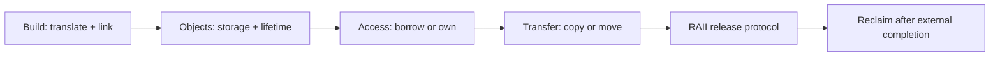
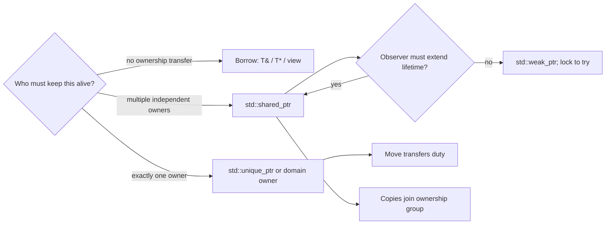
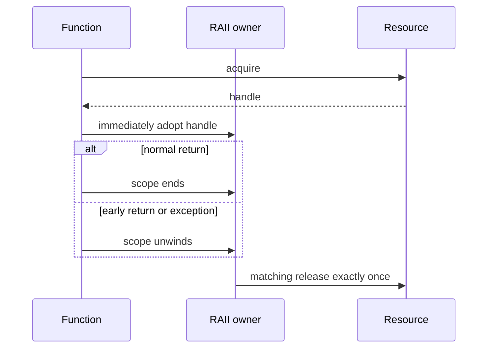
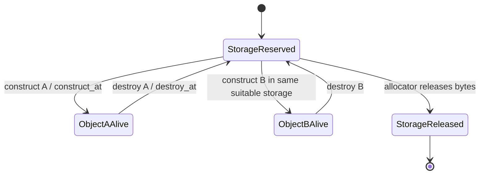
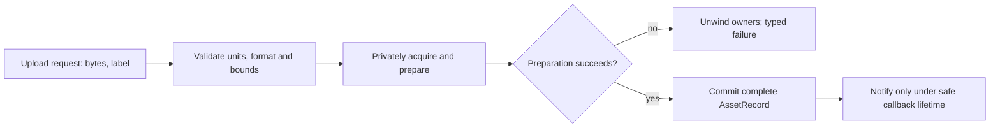

# C++: Objects, Ownership and Lifetime — Visual Recall

**Scope:** Companion to [[Continuous Notes/Computing Foundations - From Bits to C++ and Systems APIs]]. A compact teaching board, not a substitute for the worked chapter. Draw each model from memory; explain every arrow and state its preconditions.

## One-page short notes

| Story stop | Shortest useful note | Open the explanation / figure |
|---|---|---|
| Build | Translation makes declarations visible, definitions executable, and linking joins program pieces. | [[Continuous Notes/Computing Foundations - From Bits to C++ and Systems APIs#The journey from text to a live object\|Build pipeline]] · [[Continuous Notes/Computing Foundations - From Bits to C++ and Systems APIs#A compiled interface rather than repeated text\|Modules]] |
| Object | Storage is the place; lifetime is the interval; identity is the occupant. Same address does not promise same object. | [[Continuous Notes/Computing Foundations - From Bits to C++ and Systems APIs#Storage is a place; an object is its occupant\|Storage/object figure]] · [[Continuous Notes/Computing Foundations - From Bits to C++ and Systems APIs#A handle remembers which occupant was intended\|Generation handle]] |
| Borrow | A pointer/reference/view grants access, not ownership. Validity depends on the referent, lifetime, mutation, and invalidation contract. | [[Continuous Notes/Computing Foundations - From Bits to C++ and Systems APIs#When a valid borrow stops naming the intended thing\|Borrow hazards]] · [[Continuous Notes/Computing Foundations - From Bits to C++ and Systems APIs#Borrowed views and deferred work need an owner story\|Deferred views]] |
| Value | Construction creates; assignment replaces; move may transfer responsibility while source remains alive. Rule of Zero composes tested owners. | [[Continuous Notes/Computing Foundations - From Bits to C++ and Systems APIs#Construction establishes a usable state\|Construction/destruction]] · [[Continuous Notes/Computing Foundations - From Bits to C++ and Systems APIs#From three repairs to five decisions to zero boilerplate\|Rule of Zero]] |
| Resource | RAII binds cleanup to an owner lifetime; external users may require deferred release. | [[Continuous Notes/Computing Foundations - From Bits to C++ and Systems APIs#From a live object to responsible resource ownership\|Four-lifetime figure and full story]] |
| Smart owner | `unique_ptr` = one duty; `shared_ptr` = shared lifetime; `weak_ptr` = observe, then `lock()` to try. Shared ownership does not synchronize the pointee. | [[Continuous Notes/Computing Foundations - From Bits to C++ and Systems APIs#Exclusive ownership: `unique_ptr` makes transfer visible\|Exclusive ownership]] · [[Continuous Notes/Computing Foundations - From Bits to C++ and Systems APIs#Shared ownership: one object, a group of owners, and a separate control block\|Shared ownership]] · [[Continuous Notes/Computing Foundations - From Bits to C++ and Systems APIs#Weak observation breaks cycles without pretending an object is alive\|Weak observation]] |
| Raw storage | Allocation obtains bytes; construction starts an object; destruction ends its life; deallocation returns bytes. Placement construction does not allocate. | [[Continuous Notes/Computing Foundations - From Bits to C++ and Systems APIs#Custom allocation separates obtaining bytes from constructing objects\|Allocation versus construction]] · [[Continuous Notes/Computing Foundations - From Bits to C++ and Systems APIs#Placement construction reuses storage; it does not allocate it\|Placement/lifetime figure]] |

**Board in one breath:** source → object → borrow/owner → value transfer → RAII cleanup → safe external reclamation. At every arrow ask: **who owns it, how long is it valid, and what ends use?**

The notes above target a single landscape page when rendered at ordinary study-note scale. The diagrams and answer keys below remain the linked detail, not required reading for every review pass.

## One story: from source text to responsibly released resource

**Caption:** Resource safety starts with the object model but ends only when the external-use contract permits release. A C++ destructor is not a GPU completion fence.

## Four figure briefs

Use one row as a small revision card. Open its figure to see the caption and the surrounding worked example. The four cards supplement the existing notes and ownership boards.

| Card | Short note | Figure and explanation | Check yourself |
|---|---|---|---|
| Build | Declare to compile a call; supply the definition to link it. Header guards act inside one translation unit. | [[Continuous Notes/Computing Foundations - From Bits to C++ and Systems APIs#Figure CPP-01 - Two build lanes meet at the linker\|CPP-01 · two build lanes]] | Why can a call compile yet fail at link time? |
| Borrow | Reallocation can dangle a path; slot assignment can keep it live while changing the entity. Validate, then reacquire. | [[Continuous Notes/Computing Foundations - From Bits to C++ and Systems APIs#Figure CPP-02 - A borrow can fail in two different ways\|CPP-02 · lifetime versus identity]] | Can the same address still reach the wrong entity? |
| Move | Construction creates a destination; a move operation may transfer duty. The source remains alive under its type's contract. | [[Continuous Notes/Computing Foundations - From Bits to C++ and Systems APIs#Figure CPP-03 - Move the duty, keep both object lifetimes\|CPP-03 · two live objects, one duty]] | Why does `std::move(x)` alone release nothing? |
| GPU release | RAII triggers the selected cleanup protocol; GPU completion governs when native release is safe. | [[Continuous Notes/Computing Foundations - From Bits to C++ and Systems APIs#Figure CPP-04 - CPU cleanup can precede GPU reclamation\|CPP-04 · deferred reclamation]] | Which owner keeps the device and pending release queue alive? |

**Answers:** translation sees a usable declaration but linking still needs the definition; yes, semantic invalidation can preserve a live slot; `std::move` changes expression category and requires a consuming operation; the renderer must explicitly own the queue/device until all pending duties complete.

## Ownership decision board

**Caption:** Pick semantics first, syntax second. A raw pointer usually borrows; it does not extend lifetime. Shared ownership is a relationship, not a generic safety upgrade.

| Need | Recall | Common trap |
|---|---|---|
| Borrow briefly | `T&`, `T*`, `span` | Caller must preserve lifetime and validity. |
| Own exclusively | `unique_ptr<T>` | `get()` borrows; `release()` transfers the duty. |
| Own jointly | `shared_ptr<T>` | Control-block safety does not synchronize `T`. |
| Observe jointly owned object | `weak_ptr<T>::lock()` | Check the returned owner; `expired()` then use is a race. |
| Release a native handle | Custom/domain deleter | Match the API, device/context, and allocator. |

## RAII: move cleanup from branches into scope

**Caption:** Partial construction is safe only for responsibilities already held by fully constructed members/guards. A naked raw handle between acquire and adoption is a leak window.

## Storage, object and occupant are different states

**Caption:** Destroying an occupant does not necessarily free its storage. Same address does not mean same object. Correct alignment, size, construction, destruction and replacement rules still apply; `std::launder` does not construct or revive anything.

## The four questions to ask at a resource boundary

| Layer | Ask | Example |
|---|---|---|
| Storage | Which bytes, with what size/alignment? | Arena slot large and aligned enough for `Widget`. |
| Object | Which live typed occupant? | `Widget` has completed construction. |
| Ownership | Who ends its lifetime/releases the handle? | Move-only `GpuBuffer` owner. |
| External use | When is reclamation safe? | GPU completion fence/timeline. |

## Retrieval prompts

1. Why can a stack object own heap or GPU resources?
2. What does RAII automate, and what release timing must a GPU wrapper still know?
3. Why is `shared_ptr` copying not a synchronization policy for the pointed-to object?
4. Why does `weak_ptr::lock()` give a stronger test than checking `expired()` first?
5. How can a `weak_ptr` keep control-block storage allocated after object destruction?
6. What is the difference among `new T`, `::operator new`, `construct_at`, `destroy_at`, and deallocation?
7. Why does `unique_ptr<Derived>` converting to `unique_ptr<Base>` require a correct base destruction contract?
8. What exactly does `std::launder` not do?

> [!answer]- Compact key
> Scope-based owners run cleanup on normal exit and unwinding. External completion is a separate condition. Shared-pointer thread safety concerns ownership bookkeeping, not arbitrary pointee mutation. `lock()` atomically attempts to obtain a strong owner. Weak observers can keep the control block, but not the managed object's lifetime, alive. A new-expression combines storage allocation and initialization; allocation functions alone only acquire storage; construction starts an object lifetime; destruction ends it; deallocation returns storage. Base deletion needs a valid virtual destructor or a deleter retaining the concrete type. `launder` can obtain a pointer to an already-live object only under its rules; it is no general repair tool.

[[Continuous Notes/Computing Foundations - From Bits to C++ and Systems APIs#From a live object to responsible resource ownership|Teach the full ownership story]] · [[Supplementary/Foundations#M010 - Parts 148-160|Part coverage]] · [[Dependency Map]]

## Added retrieval prompt

Borrow: T& or const T&. Consume: unique_ptr<T> by value. Retain shared lifetime: shared_ptr<T> by value. Borrow an existing shared handle: const shared_ptr<T>& only for that call. Use a matching deleter for non-memory resources. [[Continuous Notes/Computing Foundations - From Bits to C++ and Systems APIs#Worked API choice: borrow, consume, retain, or copy a value|Rebuild the API lab]].

## Requests and replaceable backends — M011 retrieval experiment

A renderer's command is **one of several known shapes**; the runtime backend is **one implementation of a common contract**. These are two different decisions, so redraw the story without looking: command value → active alternative → borrowed submit call → virtual override → checked visitor → logical result → correctly destroyed owner. Then explain what remains separate from the story: the GPU's completion and native-resource release rules.

| From memory, reconstruct the situation | What the answer must account for |
|---|---|
| Why can a union's storage not be treated as several simultaneously live objects? | One active member and the correct lifetime transitions; a byte pattern is not a type tag. |
| How does a request prove its form? | `variant` discriminant, checked `get_if` / `visit`, and possible exceptional valueless state. |
| Why does a base reference call the derived implementation but a copied base value not preserve it? | Static type, dynamic type, subobjects, virtual dispatch and slicing. |
| Why is the interface destructor virtual? | Destruction through an owning base pointer must reach the derived destructor; external GPU use has its own completion rule. |
| What does a diamond with a virtual common base mean? | Two inheritance paths reach one most-derived common-base subobject, not a mandated memory offset. |
| What can each cast prove? | `static_cast` follows a statically permitted conversion; `dynamic_cast` can runtime-check polymorphic relationships; `reinterpret_cast` does not create objects; `const_cast` does not legalize writing to genuinely const storage. |
| Why must two handles with the same slot but different generations compare unequal? | Identity includes the occupant generation; equality still does not prove current liveness. |
| Why does the overridden `reserve` body see 2 through a base view but 7 through a derived view? | Default argument from static type; virtual body from dynamic type. |
| Can `<=>` always produce a total order? | Integer ID fields can support strong ordering; NaN yields unordered floating comparisons and demands an explicit container key policy. |
| Can we claim this is the fastest dispatch architecture? | No: compare allocation, memory layout, branch behavior and optimizer effects on the same workload. |

**Blank-file reconstruction:** Recreate `Clear`, `DrawMesh`, `Upload`, `Request`, `Backend` and `CountingBackend` with a single exclusive owner; verify command counts, derived destructor execution, failed runtime cast, slicing, shared virtual base, generation-aware equality, NaN's unordered comparison, overload selection and static default-argument binding. Full code and the checked build command are in [[tools/labs/backend_choice_lab.cpp|the M011 C++20 laboratory]]; complete derivations and failure explanations are in [[Continuous Notes/Computing Foundations - From Bits to C++ and Systems APIs#From one owned resource to many requests and a replaceable backend|the continuous narrative]]. Do not infer Kairo or GPU execution from this standalone test.

## One request, one transaction, callbacks that may outlive their caller — M012 reconstruction

Read the complete [[Continuous Notes/Computing Foundations - From Bits to C++ and Systems APIs#From an accepted render request to a resource that survives failures and callbacks|M012 narrative]] only *after* attempting this recall route. The important picture begins with an editor requesting a resource and ends with either a fully published asset or the original published store unchanged.

The first thing to reconstruct is *why each arrow is necessary*. The request's count must be distinct from an asset index, because identical raw integer types do not carry the same domain meaning. The file must be decoded as checked bytes, not by assuming any pointer cast creates a live `WireHeader`. Preparation must be private because callbacks or render systems must never observe half-constructed state. Every acquired handle must have one owner before a throwing operation can intervene. Publication needs a precise boundary: an exception before the commit must not modify existing records under the stated guarantee; a callback that throws afterward is a different event requiring its own policy.

| Reconstruction question | Minimum evidence the reader must produce |
|---|---|
| Why is a raw `std::size_t` a dangerous API for bytes? | Show accidental unit mixing; write `explicit ByteCount` with explicit conversion back. |
| Can a function pointer close over a local variable? | No: a plain pointer carries a callable identity; extra state needs a context, whose lifetime is separately guaranteed. |
| Why is a member-function pointer not an ordinary callback address? | Explain the required instance and demonstrate `object.*member` invocation. |
| What does a functor or lambda actually store? | Draw state fields or references; contrast capture of an integer, pointer, view and `this`. |
| How do value and reference captures differ after mutation? | Predict snapshot 10 and live view 20; explain why a deferred reference may dangle. |
| What changes when a lambda is stored in `std::function`? | Type erasure, copyable target, possible storage cost, empty-call error; no guaranteed inline capacity. |
| Which exceptions cause cleanup, and what cannot be rolled back? | Distinguish stack unwinding/local RAII from preexisting external side effects. |
| What are the basic, strong and no-throw guarantees? | State valid-but-changed, unchanged observable state, and non-escaping exceptions; give each an example. |
| Why must the native resource move be non-throwing? | Trace vector growth, element relocation, and the relevant strong-guarantee conditions. |
| Why can't input validation live only in `assert`? | `NDEBUG` can remove it; show typed invalid-input errors separately from programmer invariant failures. |
| What do `bit_cast` and trivially copyable prove? | A constrained representation-value operation, not a portable six-byte disk schema. |
| Why is a typed pointer into an arbitrary file unsafe? | Length, alignment, lifetime, alias rules, endian and padding are independent checks. |
| How do we demonstrate rollback? | Reproduce counts: (0,0,0), (1,1,0), (1,2,1), (2,3,1), then 0 live at destruction. |

**Blank-file laboratory:** Rebuild `ByteCount`; the fake device; the move-only `Resource`; the private `AssetRecord`; `AssetStore::upload` returning a typed result; function/member/functor callbacks; value/reference and owning-lifetime lambda captures; and a six-byte little-endian serializer. Compile under C++20 and warnings as errors, execute the deliberate failure after handle acquisition, then repeat under `-DNDEBUG`. The tested reference and exact commands are in [[tools/labs/safe_asset_pipeline_lab.cpp|the M012 lab]] and the source/evidence record. Do not classify this exercise as complete learner mastery until it can be reconstructed and explained independently.

## GPU interfaces and cooperation — shortest useful recall

| Prompt | Recall answer | Expand immediately |
|---|---|---|
| Size, alignment, stride? | Payload extent, legal start addresses, distance between elements. A 12-byte `vec3` can require 16-byte start alignment. | [[Continuous Notes/Computing Foundations - From Bits to C++ and Systems APIs#Make a shader record an explicit binary contract|Buffer ABI and examples]] |
| Is a texture-table index ownership? | No. Keep its referenced generation and allocation alive through pending uses. | [[Continuous Notes/Game Engine - From First Frame to Living Worlds#Let a renderer evolve without losing resource ownership|Publication and retirement]] |
| Workgroup versus subgroup? | Workgroups cooperate with shared storage and barriers; subgroups expose a smaller execution collective. Width is not universally 32. | [[Continuous Notes/Computing Foundations - From Bits to C++ and Systems APIs#Let many invocations cooperate without inventing a global clock|Execution vocabulary]] |
| What does scan allocate? | Nonoverlapping output ranges: counts $(2,0,3,1)$ become offsets $(0,2,2,5)$. | [[Continuous Notes/Computing Foundations - From Bits to C++ and Systems APIs#Scan turns local counts into nonoverlapping output regions|Allocation proof and diagram]] |
| Atomic, ordering, barrier? | Protect an operation; govern visibility/order; rendezvous with specified memory effects. These are different contracts. | [[Continuous Notes/Computing Foundations - From Bits to C++ and Systems APIs#Scan turns local counts into nonoverlapping output regions|Synchronization explanation]] |
| Can out-of-range lanes return before a required group barrier? | Generally no. Supply neutral values while preserving the barrier participation contract. | [[Continuous Notes/Computing Foundations - From Bits to C++ and Systems APIs#Scan turns local counts into nonoverlapping output regions|Partial-tile example]] |

Explain the two barriers in tiled matrix multiplication: one protects complete tile loading; one protects reuse after every consumer finishes. Explain why a later dispatch still needs the API's execution and memory dependency, rather than assuming a dispatch boundary flushes everything.
