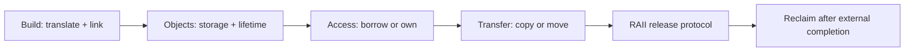
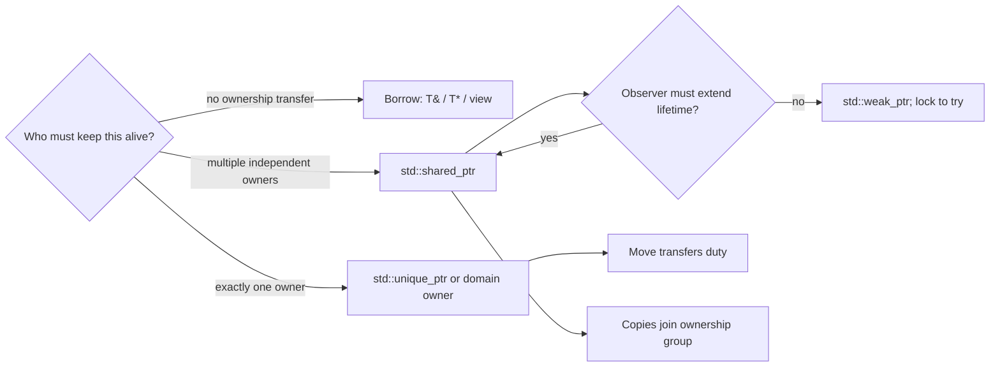
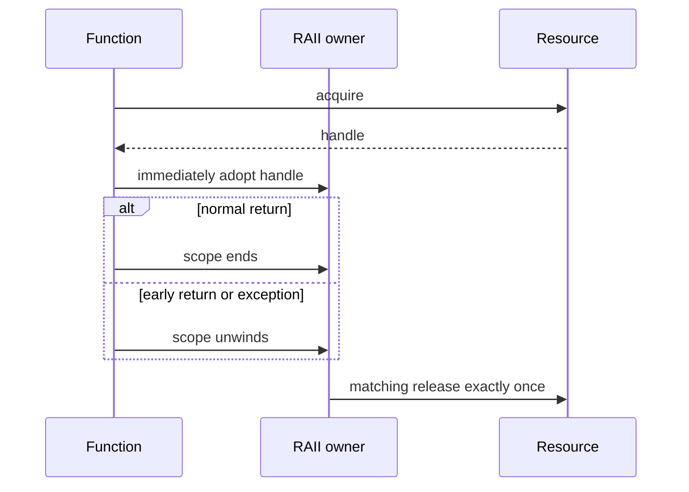
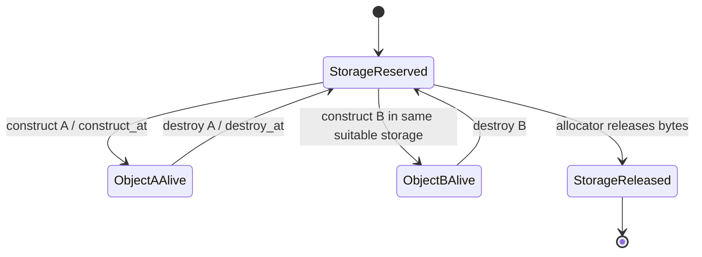

# C++: Objects, Ownership and Lifetime — Visual Recall

**Scope:** Companion to [[Continuous Notes/02 - C++ - From Objects to Reliable Programs]]. A compact teaching board, not a substitute for the worked chapter. Draw each model from memory; explain every arrow and state its preconditions.

## One-page short notes

| Story stop | Shortest useful note | Open the explanation / figure |
|---|---|---|
| Build | Translation makes declarations visible, definitions executable, and linking joins program pieces. | [[Continuous Notes/02 - C++ - From Objects to Reliable Programs#The journey from text to a live object\|Build pipeline]] · [[Continuous Notes/02 - C++ - From Objects to Reliable Programs#A compiled interface rather than repeated text\|Modules]] |
| Object | Storage is the place; lifetime is the interval; identity is the occupant. Same address does not promise same object. | [[Continuous Notes/02 - C++ - From Objects to Reliable Programs#Storage is a place; an object is its occupant\|Storage/object figure]] · [[Continuous Notes/02 - C++ - From Objects to Reliable Programs#A handle remembers which occupant was intended\|Generation handle]] |
| Borrow | A pointer/reference/view grants access, not ownership. Validity depends on the referent, lifetime, mutation, and invalidation contract. | [[Continuous Notes/02 - C++ - From Objects to Reliable Programs#When a valid borrow stops naming the intended thing\|Borrow hazards]] · [[Continuous Notes/02 - C++ - From Objects to Reliable Programs#Borrowed views and deferred work need an owner story\|Deferred views]] |
| Value | Construction creates; assignment replaces; move may transfer responsibility while source remains alive. Rule of Zero composes tested owners. | [[Continuous Notes/02 - C++ - From Objects to Reliable Programs#Construction establishes a usable state\|Construction/destruction]] · [[Continuous Notes/02 - C++ - From Objects to Reliable Programs#From three repairs to five decisions to zero boilerplate\|Rule of Zero]] |
| Resource | RAII binds cleanup to an owner lifetime; external users may require deferred release. | [[Continuous Notes/02 - C++ - From Objects to Reliable Programs#From a live object to responsible resource ownership\|Four-lifetime figure and full story]] |
| Smart owner | `unique_ptr` = one duty; `shared_ptr` = shared lifetime; `weak_ptr` = observe, then `lock()` to try. Shared ownership does not synchronize the pointee. | [[Continuous Notes/02 - C++ - From Objects to Reliable Programs#Exclusive ownership: `unique_ptr` makes transfer visible\|Exclusive ownership]] · [[Continuous Notes/02 - C++ - From Objects to Reliable Programs#Shared ownership: one object, a group of owners, and a separate control block\|Shared ownership]] · [[Continuous Notes/02 - C++ - From Objects to Reliable Programs#Weak observation breaks cycles without pretending an object is alive\|Weak observation]] |
| Raw storage | Allocation obtains bytes; construction starts an object; destruction ends its life; deallocation returns bytes. Placement construction does not allocate. | [[Continuous Notes/02 - C++ - From Objects to Reliable Programs#Custom allocation separates obtaining bytes from constructing objects\|Allocation versus construction]] · [[Continuous Notes/02 - C++ - From Objects to Reliable Programs#Placement construction reuses storage; it does not allocate it\|Placement/lifetime figure]] |

**Board in one breath:** source → object → borrow/owner → value transfer → RAII cleanup → safe external reclamation. At every arrow ask: **who owns it, how long is it valid, and what ends use?**

The notes above target a single landscape page when rendered at ordinary study-note scale. The diagrams and answer keys below remain the linked detail, not required reading for every review pass.

## One story: from source text to responsibly released resource

**Caption:** Resource safety starts with the object model but ends only when the external-use contract permits release. A C++ destructor is not a GPU completion fence.

## Four figure briefs

Use one row as a small revision card. Open its figure to see the caption and the surrounding worked example. The four cards supplement the existing notes and ownership boards.

| Card | Short note | Figure and explanation | Check yourself |
|---|---|---|---|
| Build | Declare to compile a call; supply the definition to link it. Header guards act inside one translation unit. | [[Continuous Notes/02 - C++ - From Objects to Reliable Programs#Figure CPP-01 - Two build lanes meet at the linker\|CPP-01 · two build lanes]] | Why can a call compile yet fail at link time? |
| Borrow | Reallocation can dangle a path; slot assignment can keep it live while changing the entity. Validate, then reacquire. | [[Continuous Notes/02 - C++ - From Objects to Reliable Programs#Figure CPP-02 - A borrow can fail in two different ways\|CPP-02 · lifetime versus identity]] | Can the same address still reach the wrong entity? |
| Move | Construction creates a destination; a move operation may transfer duty. The source remains alive under its type's contract. | [[Continuous Notes/02 - C++ - From Objects to Reliable Programs#Figure CPP-03 - Move the duty, keep both object lifetimes\|CPP-03 · two live objects, one duty]] | Why does `std::move(x)` alone release nothing? |
| GPU release | RAII triggers the selected cleanup protocol; GPU completion governs when native release is safe. | [[Continuous Notes/02 - C++ - From Objects to Reliable Programs#Figure CPP-04 - CPU cleanup can precede GPU reclamation\|CPP-04 · deferred reclamation]] | Which owner keeps the device and pending release queue alive? |

**Answers:** translation sees a usable declaration but linking still needs the definition; yes, semantic invalidation can preserve a live slot; `std::move` changes expression category and requires a consuming operation; the renderer must explicitly own the queue/device until all pending duties complete.

## Ownership decision board

**Caption:** Pick semantics first, syntax second. A raw pointer usually borrows; it does not extend lifetime. Shared ownership is a relationship, not a generic safety upgrade.

| Need | Recall | Common trap |
|---|---|---|
| Borrow briefly | `T&`, `T*`, `span` | Caller must preserve lifetime and validity. |
| Own exclusively | `unique_ptr<T>` | `get()` borrows; `release()` transfers the duty. |
| Own jointly | `shared_ptr<T>` | Control-block safety does not synchronize `T`. |
| Observe jointly owned object | `weak_ptr<T>::lock()` | Check the returned owner; `expired()` then use is a race. |
| Release a native handle | Custom/domain deleter | Match the API, device/context, and allocator. |

## RAII: move cleanup from branches into scope

**Caption:** Partial construction is safe only for responsibilities already held by fully constructed members/guards. A naked raw handle between acquire and adoption is a leak window.

## Storage, object and occupant are different states

**Caption:** Destroying an occupant does not necessarily free its storage. Same address does not mean same object. Correct alignment, size, construction, destruction and replacement rules still apply; `std::launder` does not construct or revive anything.

## The four questions to ask at a resource boundary

| Layer | Ask | Example |
|---|---|---|
| Storage | Which bytes, with what size/alignment? | Arena slot large and aligned enough for `Widget`. |
| Object | Which live typed occupant? | `Widget` has completed construction. |
| Ownership | Who ends its lifetime/releases the handle? | Move-only `GpuBuffer` owner. |
| External use | When is reclamation safe? | GPU completion fence/timeline. |

## Retrieval prompts

1. Why can a stack object own heap or GPU resources?
2. What does RAII automate, and what release timing must a GPU wrapper still know?
3. Why is `shared_ptr` copying not a synchronization policy for the pointed-to object?
4. Why does `weak_ptr::lock()` give a stronger test than checking `expired()` first?
5. How can a `weak_ptr` keep control-block storage allocated after object destruction?
6. What is the difference among `new T`, `::operator new`, `construct_at`, `destroy_at`, and deallocation?
7. Why does `unique_ptr<Derived>` converting to `unique_ptr<Base>` require a correct base destruction contract?
8. What exactly does `std::launder` not do?

> [!answer]- Compact key
> Scope-based owners run cleanup on normal exit and unwinding. External completion is a separate condition. Shared-pointer thread safety concerns ownership bookkeeping, not arbitrary pointee mutation. `lock()` atomically attempts to obtain a strong owner. Weak observers can keep the control block, but not the managed object's lifetime, alive. A new-expression combines storage allocation and initialization; allocation functions alone only acquire storage; construction starts an object lifetime; destruction ends it; deallocation returns storage. Base deletion needs a valid virtual destructor or a deleter retaining the concrete type. `launder` can obtain a pointer to an already-live object only under its rules; it is no general repair tool.

[[Continuous Notes/02 - C++ - From Objects to Reliable Programs#From a live object to responsible resource ownership|Teach the full ownership story]] · [[Supplementary/Foundations#M010 - Parts 148-160|Part coverage]] · [[Dependency Map]]

## Added retrieval prompt

Borrow: T& or const T&. Consume: unique_ptr<T> by value. Retain shared lifetime: shared_ptr<T> by value. Borrow an existing shared handle: const shared_ptr<T>& only for that call. Use a matching deleter for non-memory resources. [[Continuous Notes/02 - C++ - From Objects to Reliable Programs#Worked API choice: borrow, consume, retain, or copy a value|Rebuild the API lab]].
