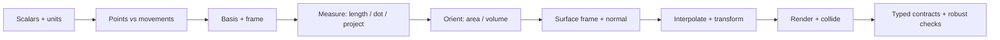
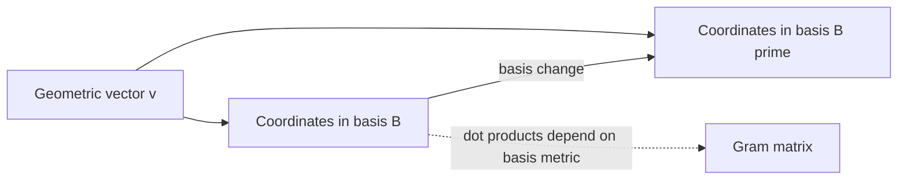
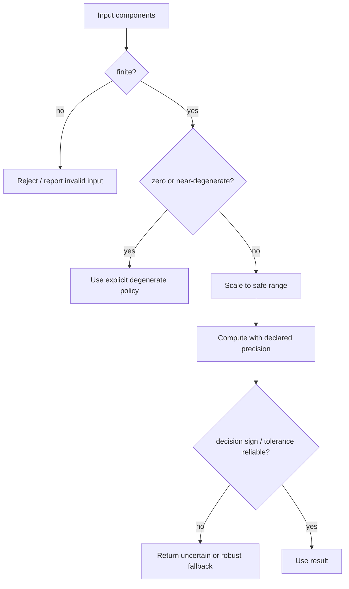
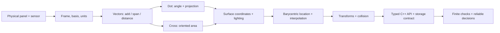
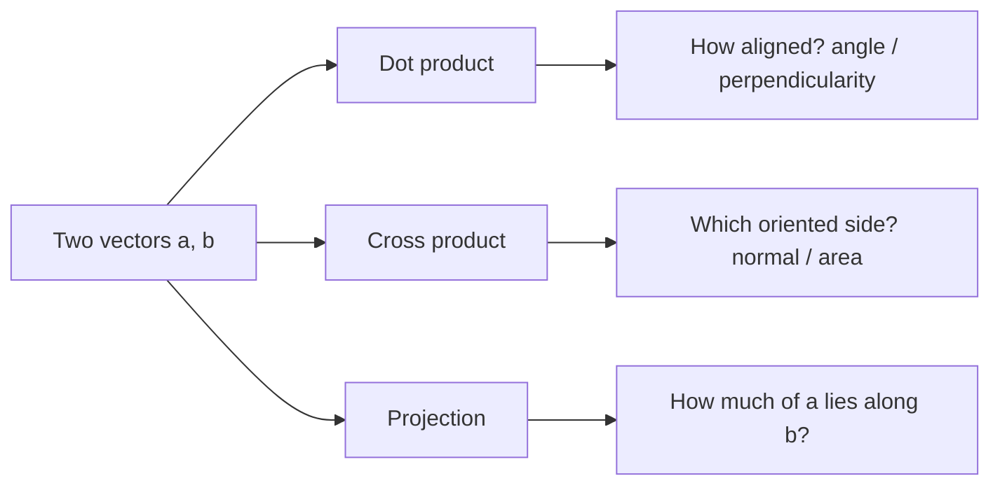
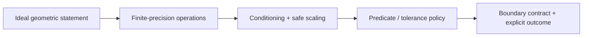

# From Movement to Meaning — Geometry and Vector Implementation

**Scope:** Companion to [[Continuous Notes/06 - From Movement to Meaning - Vectors, Geometry and Reliable Code]]. The diagrams compress the robot-panel story; reconstruct the definitions, equations and failure cases from the chapter.

## One panel, one coordinate story

## Four figure cards - read, hide, reconstruct

![[Visual Recall/geometry_robot_panel.png|600]]

**Scene cue:** identify the panel's corners, a sensor location, its displacement and a surface normal before writing components. The illustration is qualitative; its cyan cone is a schematic camera field of view. [[Continuous Notes/06 - From Movement to Meaning - Vectors, Geometry and Reliable Code#Figure G0 - The robot and its inspection panel|Open Figure G0 and the numerical panel setup]].

Each card links to a captioned figure beside its full explanation in the continuous chapter. The numbers use the chapter's robot panel; each figure is compact and horizontal so it can be studied independently.

| Card | Shortest useful note | Figure and explanation |
|---|---|---|
| **G1 · Role before tuple** | $Q-P=\mathbf v$; $P+\mathbf v=Q$. A basis changes components, not the arrow: $(3,2)=1(1,0)+2(1,1)$. A skew basis needs $\|\mathbf v\|^2=c^\mathsf TGc=13$, not $1^2+2^2$. | [[Continuous Notes/06 - From Movement to Meaning - Vectors, Geometry and Reliable Code#G1 - One movement, two descriptions\|Open Figure G1 and its limits]] |
| **G2 · Along + across** | $\mathbf p=\frac{\mathbf a\cdot\mathbf b}{\mathbf b\cdot\mathbf b}\mathbf b$; $\mathbf r=\mathbf a-\mathbf p$. For $(3,4,0)$ along $(2,0,0)$: $\alpha=1.5$, $\mathbf p=(3,0,0)$, $\mathbf r=(0,4,0)$. Require $\mathbf b\ne0$; check $\mathbf r\cdot\mathbf b=0$. | [[Continuous Notes/06 - From Movement to Meaning - Vectors, Geometry and Reliable Code#G2 - Split the request into rail travel and sideways travel\|Open Figure G2 and the numerical trace]] |
| **G3 · Location + interpolation** | $P=\alpha A+\beta B+\gamma C$, $\alpha+\beta+\gamma=1$. Panel weights $(5/12,1/4,1/3)$ give $P=(1,1,0)$ and $T=35$. Nonnegative weights mean inside only for an in-plane point and nondegenerate triangle. | [[Continuous Notes/06 - From Movement to Meaning - Vectors, Geometry and Reliable Code#G3 - Reconstruct a sensor location from the corners\|Open Figure G3 and off-plane/perspective limits]] |
| **G4 · Preserve perpendicularity** | $\mathbf t'=A\mathbf t$, $\mathbf n'=A^{-\mathsf T}\mathbf n$. For $A=\operatorname{diag}(2,1,1)$, $(2,1,0)\cdot(1/2,-1,0)=0$. Check numerical usability; normalize shading normals after transformation. | [[Continuous Notes/06 - From Movement to Meaning - Vectors, Geometry and Reliable Code#G4 - Transform the normal and prove the relationship survived\|Open Figure G4 and failure branches]] |

**Recall test:** redraw one card without looking, reproduce its arithmetic, then state a case where its formula cannot safely be used. For uncertainty in determinant signs, reopen [[Continuous Notes/06 - From Movement to Meaning - Vectors, Geometry and Reliable Code#A predicate needs a trustworthy sign|the predicate discussion]] rather than adding a universal epsilon.

### Whole-story overview



**Caption:** Coordinates describe a geometric object relative to a basis; they are not the object itself. A point has a location role; a vector has a displacement role.

## Geometry operations by question

| Geometric question | Tool | Key interpretation / check |
|---|---|---|
| How long is this displacement? | Norm | Scale inputs before squaring when range could overflow/underflow. |
| How aligned are two directions? | Dot product | Sign and magnitude depend on lengths; normalize only after validating nonzero finite inputs. |
| What part points along a direction? | Projection | Decompose into parallel and perpendicular components. |
| Which way is the oriented surface facing? | Cross product | Order/winding matters; magnitude is parallelogram area. |
| Which side or signed volume? | Determinant/triple product | Near-zero signs can be numerically uncertain. |
| Where inside the triangle? | Barycentric weights | Weights sum to one; perspective interpolation changes screen-space weights. |
| How do normals transform? | Inverse transpose | Preserve orthogonality to transformed tangents. |
| Are these shapes intersecting? | Convex support / Minkowski difference | Convert shared-point question to whether the origin is in the difference set. |

## Coordinate frame: same movement, different coordinates



**Caption:** Changing components does not change the underlying vector. In a non-orthonormal basis, ordinary component dot products do not directly equal geometric inner products; the Gram matrix carries the metric.

## Robust computation: validate before normalizing or deciding



**Caption:** Clamping an invalid intermediate is not a proof that the original geometry was valid. Input validity, arithmetic range, tolerance meaning and decision confidence are separate checks.

## A three-number type is not the complete contract

```text
geometric promise  ──> initialization, role, units, space
storage promise    ──> size, alignment, offsets, stride
execution promise  ──> scalar/SIMD behavior and errors
boundary promise   ──> GPU format, shader layout, serialization
```

**Caption:** A 12-byte CPU `Vec3` does not prove shader compatibility, array semantics, safe indexing, or a portable file representation.

## Retrieval prompts

1. Why can point minus point produce a vector, but point plus point be meaningless?
2. What does a basis change alter, and what stays fixed?
3. Why does a cross-product sign depend on order and handedness?
4. Which exact conditions make a normalized vector meaningful?
5. Why does perspective correction change barycentric interpolation?
6. Why must the normal matrix be the inverse transpose?
7. What evidence distinguishes a robust predicate from a merely tested floating-point expression?

> [!answer]- Compact key
> Affine points have no intrinsic origin, while displacements do. Coordinates depend on the chosen basis; the geometric vector does not. Cross product is antisymmetric and encodes orientation. A direction needs finite, nonzero input and range-safe length computation. Perspective division is nonlinear, so interpolation must account for reciprocal depth. The inverse transpose preserves tangent-normal orthogonality under a general linear transform. A tested expression is evidence over those cases; a robust/certified claim requires stated assumptions and a procedure that guarantees the decision.

[[Continuous Notes/06 - From Movement to Meaning - Vectors, Geometry and Reliable Code#The panel gives us a reason to learn|Teach the full Phase 6 story]] · [[Supplementary/Foundations#Phase 6 - Parts 501-600|Part coverage]] · [[Supplementary/Derivations#Phase 6 - Geometry reconstruction proofs|Derivations]]

## One-page active-recall mini-atlas

Use each row as a prompt: say the rule, state its precondition, then point to the linked chapter section for the full explanation and figures. The short cues are retrieval hooks, not replacements for the teaching narrative.

| Recall cue | Shortest useful note | Reopen in the continuous chapter |
|---|---|---|
| **What is the robot trying to represent?** | A tuple is only storage; decide whether it means a point, displacement, direction, unit normal, or measurement, and state its frame and units. | [[Continuous Notes/06 - From Movement to Meaning - Vectors, Geometry and Reliable Code#The panel gives us a reason to learn\|Panel and problem setup]] · [[Continuous Notes/06 - From Movement to Meaning - Vectors, Geometry and Reliable Code#Three stored numbers are not the complete contract\|Vec3 contracts]] |
| **What changes when I change coordinates?** | The geometric vector stays fixed; its components change with the basis. A skew basis needs its Gram matrix to measure angles and lengths correctly. | [[Continuous Notes/06 - From Movement to Meaning - Vectors, Geometry and Reliable Code#An arrow is not the address written beside it\|Points and vectors]] · [[Continuous Notes/06 - From Movement to Meaning - Vectors, Geometry and Reliable Code#A basis is a measuring arrangement, not the vector itself\|Basis change]] · [[Continuous Notes/06 - From Movement to Meaning - Vectors, Geometry and Reliable Code#A Gram matrix remembers the geometry of a slanted basis\|Gram matrix]] |
| **Can the robot reach this movement?** | Allowed combinations form a span; closure under addition and scalar scaling makes a subspace. Independence means no control direction is redundant. | [[Continuous Notes/06 - From Movement to Meaning - Vectors, Geometry and Reliable Code#The reachable movements form a vector space\|Reachability and independence]] |
| **How much, which way, how aligned?** | Norm measures length; dot measures alignment; projection extracts a component. Check finite/nonzero inputs before normalization and scale before squaring. | [[Continuous Notes/06 - From Movement to Meaning - Vectors, Geometry and Reliable Code#A ruler needs more than coordinate components\|Norm and distance]] · [[Continuous Notes/06 - From Movement to Meaning - Vectors, Geometry and Reliable Code#The dot product turns two movements into a measurement\|Dot and angle]] · [[Continuous Notes/06 - From Movement to Meaning - Vectors, Geometry and Reliable Code#Projection separates useful movement from sideways movement\|Projection]] |
| **Which side is the panel facing?** | Cross-product order encodes orientation; magnitude is area. A triple product gives signed volume; near-zero signs need a reliability policy. | [[Continuous Notes/06 - From Movement to Meaning - Vectors, Geometry and Reliable Code#Oriented area tells us which side of the panel is front\|Cross product and winding]] · [[Continuous Notes/06 - From Movement to Meaning - Vectors, Geometry and Reliable Code#Signed volume extends the same idea into space\|Signed volume]] |
| **How do I make a stable local surface frame?** | Choose tangents, reject the unwanted component, then normalize safely. Gram–Schmidt is repeated rejection; order and precision affect the result. | [[Continuous Notes/06 - From Movement to Meaning - Vectors, Geometry and Reliable Code#Surface movement becomes a local frame\|Surface frame]] · [[Continuous Notes/06 - From Movement to Meaning - Vectors, Geometry and Reliable Code#Orthonormal frames make reconstruction simple\|Orthonormal frame]] |
| **How does geometry become shading?** | Reflection flips the normal component; refraction changes the tangent component. Normals are covectors: transform them with inverse transpose to preserve perpendicularity. | [[Continuous Notes/06 - From Movement to Meaning - Vectors, Geometry and Reliable Code#Light uses the same decomposition in a new role\|Lighting decomposition]] · [[Continuous Notes/06 - From Movement to Meaning - Vectors, Geometry and Reliable Code#A normal is a measuring rule before it is an arrow\|Normal transform]] |
| **Where is the sensor on the triangle?** | Barycentric weights sum to one; they locate points and interpolate attributes. Perspective projection changes screen-space weights; orientation predicates need trustworthy signs. | [[Continuous Notes/06 - From Movement to Meaning - Vectors, Geometry and Reliable Code#The sensor needs coordinates inside the triangle\|Barycentric coordinates and predicates]] |
| **When do shapes touch?** | Convex combinations describe convex shapes; a Minkowski difference turns intersection into asking whether the origin belongs to the difference. | [[Continuous Notes/06 - From Movement to Meaning - Vectors, Geometry and Reliable Code#Weighted points lead from affine geometry to collision shapes\|Convexity and collision]] |
| **Why add a fourth coordinate?** | Homogeneous coordinates let matrix operations express translation; projective points have equivalent scaled representatives. NDC is not a normalized direction. | [[Continuous Notes/06 - From Movement to Meaning - Vectors, Geometry and Reliable Code#Homogeneous coordinates preserve the role of a location\|Homogeneous and projective coordinates]] |
| **What can the computer invalidate?** | Floating-point arithmetic can overflow, underflow, lose small changes, or give an uncertain sign. Validate inputs, scale safely, then apply explicit tolerance/error policy. | [[Continuous Notes/06 - From Movement to Meaning - Vectors, Geometry and Reliable Code#The machine is a model of the field, not the field\|Floating-point model]] · [[Continuous Notes/06 - From Movement to Meaning - Vectors, Geometry and Reliable Code#Reliability begins at the boundary of the calculation\|Numerical boundary]] |
| **What must the C++ type/API promise?** | Separate geometric role, units, scalar precision, memory layout, SIMD behavior, and GPU/serialization agreement; `Vec3` alone proves none of the external contracts. | [[Continuous Notes/06 - From Movement to Meaning - Vectors, Geometry and Reliable Code#Types can remember the promises that three components forget\|Semantic types]] · [[Continuous Notes/06 - From Movement to Meaning - Vectors, Geometry and Reliable Code#Storage and computation can choose different layouts\|CPU/GPU layout]] · [[Continuous Notes/06 - From Movement to Meaning - Vectors, Geometry and Reliable Code#A complete scalar laboratory makes the story executable\|Executable reference and tests]] |

## Landscape concept maps

### The panel: from geometry to engine data



**Caption:** Read left to right as the robot's work, not a list of disconnected formulas. Revisit [[Continuous Notes/06 - From Movement to Meaning - Vectors, Geometry and Reliable Code#The panel gives us a reason to learn|the panel setup]] and [[Continuous Notes/06 - From Movement to Meaning - Vectors, Geometry and Reliable Code#The sensor needs coordinates inside the triangle|the sensor's triangle coordinates]].

### Three tools, three different questions



**Caption:** Do not substitute one operation for another: they answer different geometric questions. See [[Continuous Notes/06 - From Movement to Meaning - Vectors, Geometry and Reliable Code#The dot product turns two movements into a measurement|dot]], [[Continuous Notes/06 - From Movement to Meaning - Vectors, Geometry and Reliable Code#Oriented area tells us which side of the panel is front|cross]], and [[Continuous Notes/06 - From Movement to Meaning - Vectors, Geometry and Reliable Code#Projection separates useful movement from sideways movement|projection]].

### Reliability ladder



**Caption:** A mathematically valid construction is not automatically a reliable machine decision. Follow [[Continuous Notes/06 - From Movement to Meaning - Vectors, Geometry and Reliable Code#A direction can exist even when the naive length overflows|safe norm]], [[Continuous Notes/06 - From Movement to Meaning - Vectors, Geometry and Reliable Code#A predicate needs a trustworthy sign|predicate reliability]], and [[Continuous Notes/06 - From Movement to Meaning - Vectors, Geometry and Reliable Code#Reliability begins at the boundary of the calculation|calculation boundary]].
