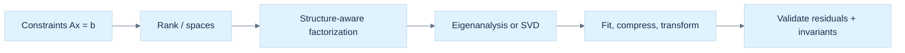

---
tags:
  - visual-recall
  - linear-algebra
coverage: Parts 701–800
---

# Phase 8 — Linear Algebra: Active Recall

**Fast spine:** Measurements constrain → rank separates knowledge from freedom → factorizations expose structure → eigenvectors describe square-map directions → SVD describes every map → stable APIs report evidence.

Read the full explanations in [[Continuous Notes/08 - From Constraints to Spectra - Systems, Decompositions and Matrix Functions|From Constraints to Spectra]]. These figure links jump to their source chapters.

## The story at a glance

## Retrieve the mechanisms

| Cue | Short answer | Read / view |
|---|---|---|
| Why may $A\mathbf x=\mathbf b$ have no answer? | The target is outside $\operatorname{Col}(A)$. | [[Continuous Notes/08 - From Constraints to Spectra - Systems, Decompositions and Matrix Functions#A linear equation is a measurement, and several equations are geometry\|Constraint geometry]] · [[Continuous Notes/08 - From Constraints to Spectra - Systems, Decompositions and Matrix Functions#Figure L2 - Consistency, freedom, and the four fundamental spaces\|L2]] |
| What does a null vector mean? | An input change no measurement can see; add it to any solution. | [[Continuous Notes/08 - From Constraints to Spectra - Systems, Decompositions and Matrix Functions#Rank separates what the measurements determine from what they leave free\|Four spaces]] · [[Continuous Notes/08 - From Constraints to Spectra - Systems, Decompositions and Matrix Functions#Figure L2 - Consistency, freedom, and the four fundamental spaces\|L2]] |
| What does elimination preserve? | The solution set, only if row operations also transform $\mathbf b$. | [[Continuous Notes/08 - From Constraints to Spectra - Systems, Decompositions and Matrix Functions#Elimination turns the geometry into an auditable calculation\|Elimination]] · [[Continuous Notes/08 - From Constraints to Spectra - Systems, Decompositions and Matrix Functions#Figure L3 - Elimination stores work for later solves\|L3]] |
| Why factor once? | Reuse $L,U$ or $Q,R$ for additional right-hand sides. | [[Continuous Notes/08 - From Constraints to Spectra - Systems, Decompositions and Matrix Functions#Figure L3 - Elimination stores work for later solves\|L3]] |
| Which factorization for what structure? | LU general square; Cholesky SPD; QR least squares; SVD rank insight; iteration for huge sparse systems when suitable. | [[Continuous Notes/08 - From Constraints to Spectra - Systems, Decompositions and Matrix Functions#Structure makes a decomposition a better tool than generic elimination\|Factorization guide]] · [[Continuous Notes/08 - From Constraints to Spectra - Systems, Decompositions and Matrix Functions#Figure L4 - Matrix structure determines the useful factorization\|L4]] |
| What does a small residual prove? | Near satisfaction of the equations; sensitivity can still make the solution inaccurate. | [[Continuous Notes/08 - From Constraints to Spectra - Systems, Decompositions and Matrix Functions#Eigenvectors reveal the directions a square map does not turn\|Eigenpair sensitivity]] · [[Continuous Notes/08 - From Constraints to Spectra - Systems, Decompositions and Matrix Functions#Matrix norms give scale to residuals and error claims\|Norms and error]] |
| Why is a symmetric eigenbasis special? | It is orthonormal, preserving 2-norm while diagonalizing the map. | [[Continuous Notes/08 - From Constraints to Spectra - Systems, Decompositions and Matrix Functions#Figure L5 - Eigenanalysis is cleanest when the basis is orthonormal\|L5]] |
| What is the SVD action? | Input orthogonal coordinates → independent stretches → output orthogonal coordinates. | [[Continuous Notes/08 - From Constraints to Spectra - Systems, Decompositions and Matrix Functions#Singular value decomposition covers every rectangular map\|SVD geometry]] · [[Continuous Notes/08 - From Constraints to Spectra - Systems, Decompositions and Matrix Functions#Figure L6 - Every linear map is orthogonal change, stretch, orthogonal change\|L6]] |
| What does the pseudoinverse choose? | Exact $A^+$: least-squares fit, then minimum norm. Truncated $A_\tau^+$: solve the retained-rank problem; original residual can increase. | [[Continuous Notes/08 - From Constraints to Spectra - Systems, Decompositions and Matrix Functions#Pseudoinverse makes least squares and minimum norm one operation\|Pseudoinverse]] · [[Continuous Notes/08 - From Constraints to Spectra - Systems, Decompositions and Matrix Functions#Figure L7 - The singular spectrum makes inversion and compression explicit\|L7]] |
| How does PCA connect to SVD? | Center rows, factor $X=U\Sigma V^\mathsf T$; $V$ gives principal directions and $U\Sigma$ scores. | [[Continuous Notes/08 - From Constraints to Spectra - Systems, Decompositions and Matrix Functions#PCA turns a cloud of points into measured variation\|PCA]] |
| What does polar decomposition separate? | Orthogonal motion from symmetric stretch; reflection and singular ambiguity need attention. | [[Continuous Notes/08 - From Constraints to Spectra - Systems, Decompositions and Matrix Functions#Polar decomposition separates rotation-like motion from stretch\|Polar decomposition]] |
| Which SVD checks are independent? | Reconstruction, $U$ orthogonality, $V$ orthogonality, ordering, dimensions, convergence. | [[Continuous Notes/08 - From Constraints to Spectra - Systems, Decompositions and Matrix Functions#Figure L8 - SVD validation needs independent checks\|L8]] |
| When can diagonalization explain a matrix function? | When its eigenbasis is usable; otherwise use a stable function-specific algorithm. | [[Continuous Notes/08 - From Constraints to Spectra - Systems, Decompositions and Matrix Functions#Matrix functions turn repeated linear actions into one operator\|Matrix functions]] · [[Continuous Notes/08 - From Constraints to Spectra - Systems, Decompositions and Matrix Functions#Figure L9 - A matrix function follows the same action after a change of basis\|L9]] |
| Direct or iterative solve? | Decide from size, sparsity, right-hand-side reuse, convergence, memory, and error needs. | [[Continuous Notes/08 - From Constraints to Spectra - Systems, Decompositions and Matrix Functions#Figure L10 - Direct and iterative methods occupy different workloads\|L10]] |

## Thirty-second reconstruction

1. Sketch one measurement as a hyperplane; explain consistency using column space.
2. Explain why rank and nullity count determined and invisible directions.
3. Derive one pivot step and show the same row operation on the right-hand side.
4. Select LU, Cholesky, QR, SVD, or an iterative method from matrix structure.
5. Explain why normal equations square the condition number.
6. Trace $A=U\Sigma V^\mathsf T$ on one vector.
7. State what thresholding changes in a pseudoinverse or truncated SVD.
8. Name separate SVD correctness checks and what a residual cannot prove.

[[Continuous Notes/08 - From Constraints to Spectra - Systems, Decompositions and Matrix Functions|Full teaching volume]] · [[Supplementary/Foundations#Phase 8 - Parts 701-800|100-part title ledger]] · [[Dependency Map#Phase 8 - From constraints to spectra|Dependency spine]]

## Fast retrieval: restore the details that are easy to blur

[[Continuous Notes/08 - From Constraints to Spectra - Systems, Decompositions and Matrix Functions#Figure L6a - Watch the same directions become an ellipse|Figure L6a: exact SVD geometry]] · [[Visual Recall/phase8_svd_geometry.svg|Editable SVG]]

![[Visual Recall/phase8_svd_geometry.png]]

| Cue | Shortest reliable answer | Deep read / figure |
|---|---|---|
| When does Gram–Schmidt normalize a new column? | Only if its residual norm is safely nonzero; rank deficiency needs rank handling or completion. | [[Continuous Notes/08 - From Constraints to Spectra - Systems, Decompositions and Matrix Functions#Orthogonal coordinates preserve the shape of the problem\|Gram–Schmidt]] |
| What does a Householder sign choice prevent? | Choose $\alpha=-\operatorname{copysign}(\|x\|,x_1)$ to avoid cancellation; compute the norm safely. | [[Continuous Notes/08 - From Constraints to Spectra - Systems, Decompositions and Matrix Functions#Reflections and plane rotations build QR without losing lengths\|Householder reflectors]] |
| When is Givens rotation undefined? | If $a=b=0$, skip it; otherwise use `hypot(a,b)` for the scale. | [[Continuous Notes/08 - From Constraints to Spectra - Systems, Decompositions and Matrix Functions#Reflections and plane rotations build QR without losing lengths\|Givens rotations]] |
| What residual remains after QR least squares? | The irreducible perpendicular part $b_\perp=(I-QQ^T)b$; minimum residual norm is $\|b_\perp\|$. | [[Continuous Notes/08 - From Constraints to Spectra - Systems, Decompositions and Matrix Functions#QR turns least squares into a triangular solve plus an irreducible residual\|QR residual derivation]] |
| What makes an eigenvector estimate sensitive? | A small residual is backward evidence; a small eigengap can still rotate the vector or subspace. | [[Continuous Notes/08 - From Constraints to Spectra - Systems, Decompositions and Matrix Functions#Residuals distinguish backward accuracy from forward certainty\|Residual and eigengap]] · [[Continuous Notes/08 - From Constraints to Spectra - Systems, Decompositions and Matrix Functions#Figure L5 - Eigenanalysis is cleanest when the basis is orthonormal\|L5]] |
| What does a real Schur 2×2 block mean? | A real representation of a complex-conjugate eigenvalue pair; do not read only its diagonal. | [[Continuous Notes/08 - From Constraints to Spectra - Systems, Decompositions and Matrix Functions#QR iteration and Jacobi rotations preserve the spectrum while simplifying shape\|QR and Schur form]] |
| Where is the plane-fit normal in an $N\times3$ data SVD? | In the right singular vectors $V$; take the smallest-variance direction. | [[Continuous Notes/08 - From Constraints to Spectra - Systems, Decompositions and Matrix Functions#Plane fits, eigengaps, and interpretation of uncertain components\|Plane fit and eigengap]] |
| What must a wide SVD return? | With $r=\min(m,n)$, thin $U:m\times r$, $\sigma:r$, $V^T:r\times n$; factor $A^T$ if using a tall backend. | [[Continuous Notes/08 - From Constraints to Spectra - Systems, Decompositions and Matrix Functions#Householder reductions turn a dense SVD into a bidiagonal problem\|Wide SVD shapes]] · [[Continuous Notes/08 - From Constraints to Spectra - Systems, Decompositions and Matrix Functions#Figure L6 - Every linear map is orthogonal change, stretch, orthogonal change\|L6]] |
| What are zero singular vectors for? | Right zero directions span $\operatorname{Null}(A)$; full $U$ zero/completion directions span $\operatorname{Null}(A^T)$. | [[Continuous Notes/08 - From Constraints to Spectra - Systems, Decompositions and Matrix Functions#Zero singular directions require deliberate orthonormal completion\|Zero-singular completion]] |
| What is the exact $A^+$ rule? | Reciprocate every positive $\sigma_i$; it minimizes original residual, then chooses minimum norm. | [[Continuous Notes/08 - From Constraints to Spectra - Systems, Decompositions and Matrix Functions#The Moore–Penrose inverse and its four identities\|Exact pseudoinverse]] · [[Continuous Notes/08 - From Constraints to Spectra - Systems, Decompositions and Matrix Functions#Figure L7 - The singular spectrum makes inversion and compression explicit\|L7]] |
| What does $A_\tau^+$ change? | It discards positive values at or below $\tau$; the original least-squares residual can increase. | [[Continuous Notes/08 - From Constraints to Spectra - Systems, Decompositions and Matrix Functions#Thresholding and regularization are different choices\|Thresholding versus regularization]] · [[Continuous Notes/08 - From Constraints to Spectra - Systems, Decompositions and Matrix Functions#Figure L7 - The singular spectrum makes inversion and compression explicit\|L7]] |
| What errors does rank-$k$ SVD leave? | Spectral error $\sigma_{k+1}$; Frobenius squared error $\sum_{i>k}\sigma_i^2$. | [[Continuous Notes/08 - From Constraints to Spectra - Systems, Decompositions and Matrix Functions#Low-rank approximation and why the largest directions win\|Eckart–Young errors]] |
| How do PCA scores relate to SVD? | For centered row samples $X=U\Sigma V^T$, scores are $XV=U\Sigma$; covariance eigenvalues are $\sigma_i^2/(N-1)$. | [[Continuous Notes/08 - From Constraints to Spectra - Systems, Decompositions and Matrix Functions#Centered measurements reveal principal directions\|PCA scores]] |
| What does polar decomposition call a reflection? | $UV^T$ is orthogonal; if its determinant is $-1$, it is improper, and nearest $SO(n)$ flips a least-singular direction. | [[Continuous Notes/08 - From Constraints to Spectra - Systems, Decompositions and Matrix Functions#Two-sided rotations, nearest proper rotation, and nonunique directions\|Nearest proper rotation]] |
| Which Jacobi angle convention is in use? | For $J=[[c,s],[-s,c]]$, use $p'=cp-sq$, $q'=sp+cq$, $\tau=(\beta-\alpha)/(2\gamma)$; skip $\gamma=0$. | [[Continuous Notes/08 - From Constraints to Spectra - Systems, Decompositions and Matrix Functions#Jacobi SVD removes column coupling pair by pair\|Jacobi convention]] |
| What bounds a strided matrix view? | Check $c\le s$, checked last offset $(r-1)s+(c-1)<e$, and null pointer only with zero extent. | [[Continuous Notes/08 - From Constraints to Spectra - Systems, Decompositions and Matrix Functions#Matrix views need checked address arithmetic as well as a stride\|View bounds]] · [[Continuous Notes/08 - From Constraints to Spectra - Systems, Decompositions and Matrix Functions#Workspace allocation is part of the solver contract\|Workspace bounds]] |
| When is the principal matrix log defined? | When the spectrum avoids the closed negative real axis, including zero; other real logs may still exist. | [[Continuous Notes/08 - From Constraints to Spectra - Systems, Decompositions and Matrix Functions#Logarithms and square roots need domains and branches\|Log domain and branches]] · [[Continuous Notes/08 - From Constraints to Spectra - Systems, Decompositions and Matrix Functions#Figure L9 - A matrix function follows the same action after a change of basis\|L9]] |
| What must CG preconditioning preserve? | Use SPD PCG/symmetric preconditioning; vanilla CG on arbitrary $M^{-1}A$ may lose symmetry. Stop before zero-residual divisions. | [[Continuous Notes/08 - From Constraints to Spectra - Systems, Decompositions and Matrix Functions#Direct and iterative solvers suit different workloads\|CG preconditioning and true residual]] · [[Continuous Notes/08 - From Constraints to Spectra - Systems, Decompositions and Matrix Functions#Figure L10 - Direct and iterative methods occupy different workloads\|L10]] |
| What makes an SVD API result inspectable? | Shapes/mode, rank threshold, workspace, convergence status, and independent reconstruction/orthogonality checks. | [[Continuous Notes/08 - From Constraints to Spectra - Systems, Decompositions and Matrix Functions#An SVD API begins with shapes and guarantees\|SVD API contract]] · [[Continuous Notes/08 - From Constraints to Spectra - Systems, Decompositions and Matrix Functions#Figure L8 - SVD validation needs independent checks\|L8]] |

> Read the linked teaching sections for the derivations and caveats; this table is a retrieval prompt, not a replacement explanation.
