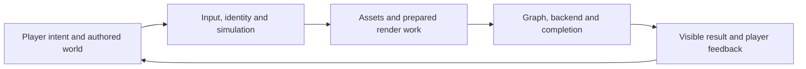
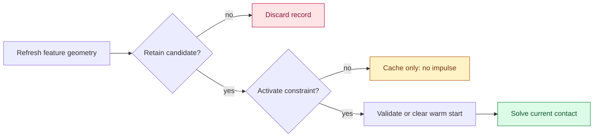

# Game Engine - Retrieval Card

Use this as a short teaching route, then follow the heading links for explanations, traces and code. The diagram shows responsibilities; it does not imply that every stage runs on a separate thread.

| Recall | Minimum mechanism to reconstruct | Reopen the explanation |
|---|---|---|
| Ownership | Initialization order follows dependencies; shutdown releases dependents first. A manager does not remove those edges. | [[Game Engine - From First Frame to Living Worlds#Keep engine lifecycle separate from game-specific frame work|Lifecycle]] |
| Time | Elapsed wall time and simulated time are separate. State catch-up, interpolation and pause policies before diagnosing movement. | [[Game Engine - From First Frame to Living Worlds#Make timestep and integration choices explicit|Timestep]] |
| Identity | A storage index can move or be reused. Stable identity plus a generation/revision prevents stale references naming a replacement. | [[Game Engine - From First Frame to Living Worlds#A live object needs an identity that survives storage changes|Identity]] |
| Assets | Decode, validate and build a replacement before publication. CPU ownership and final GPU use are different lifetime facts. | [[Game Engine - From First Frame to Living Worlds#6. Asset publication connects files, runtime, and graph resources|Publication]] |
| Render graph | Reads name versions; dependencies order users; compatible non-overlapping lifetimes may alias. Async schedules need actual completion edges. | [[Game Engine - From First Frame to Living Worlds#2. Compile a render graph before executing it|Graph compiler]] |
| Contact coupling | $G$ maps velocity to gap velocity; $W=GM^{-1}G^T$ maps reactions to contact acceleration. Shared bodies create off-diagonal coupling. | [[Game Engine - From First Frame to Living Worlds#Contact forces form a coupled system|Contact derivation]] |
| Captured worlds | A splat index is not durable entity identity. Physical support supplies deformation; appearance alone supplies neither mass nor colliders. | [[Game Engine - From First Frame to Living Worlds#Rendering identity becomes world identity only through an explicit bridge|Editable capture]] |
| Edit bounds | Name color range, contributor order, evaluated pixel opacities, appearance changes and actual stop policy. An alpha-only estimate misses color/order edits. | [[Game Engine - From First Frame to Living Worlds#An image-change certificate must name the edits it covers|Certificate contract]] |
| Save | New scene clears its path. Cancel is a no-op; failed writing keeps the dirty document. Save must choose authored versus runtime state explicitly. | [[Game Engine - From First Frame to Living Worlds#A scene's save path is part of its editor state|Save transaction]] |
| Camera | The controller chooses input, zoom, speed and resize policy. A viewport change alone does not recompute projection. | [[Game Engine - From First Frame to Living Worlds#A camera controller is a policy object, not a projection matrix|Camera policy]] |
| Replay | Inputs need compatible state/simulation; snapshots need interpolation; captured video limits camera freedom. Edited retellings are separate from authoritative records. | [[Game Engine - From First Frame to Living Worlds#Let play become a replayable story|Replay and recam]] |
| Game rules | Trace immediate reward and delayed consequences together. Shooting a segment can remove danger while creating mushrooms and split threats. | [[Game Engine - From First Frame to Living Worlds#From one core action to a coupled play system: Centipede|Coupled rules]] |
| Narrative | Authored context and emergent play histories cooperate. Make state changes legible before assuming players understand their consequences. | [[Game Engine - From First Frame to Living Worlds#Narrative can be authored, played, and retold|Narrative play]] |
| Design document | Record the rule, exception, intended experience and evidence status. A large specification is not proof that play works. | [[Game Engine - From First Frame to Living Worlds#A design document is a working reference, not a frozen game|Working design reference]] |

## Two figures worth reconstructing

![[Visual Recall/Game Engine/sphere-bound-gap.svg]]

An enclosing parent bound can overlap a candidate that misses both children: broad-phase inclusion is a possibility, not a collision. Reopen [[Game Engine - From First Frame to Living Worlds#See the empty space inside a parent bound|the scaled witness and its distances]].

For the separate contracts of pixel footprint, compositing order and storage reuse, use [[University - Worlds, Images and Inference - Graphics, Vision and Photography#Figure ER1 - Footprint, compositing order and storage lifetime|Figure ER1 and its caption]].

Before teaching a topic, reconstruct one failure trace: which invariant was violated, what visible symptom followed, and which measurement isolates the first wrong state? A successful build, a correct CPU formula and a correct native frame are different kinds of evidence.

**Trace a confusing action:** context → visible option → accepted action → changed state → visible result. Reopen [[Game Engine - From First Frame to Living Worlds#Figure E-choice - From opportunity to consequence|the five-stage choice figure and door trace]].

**Stable IDs:** random identifiers need a bit-width/count model and a collision policy. [[Game Engine - From First Frame to Living Worlds#Figure E-ID - Birthday collision risk|Figure E-ID]] compares the assumptions; a display name or temporary entity slot is a different kind of identifier.

## Contact candidates, active constraints, and surviving identities

**Read the figure:** retaining a key preserves a candidate, not a force. Refresh its geometry before deciding whether it belongs in this step's active constraints; validate any old impulse separately.

| Prompt | Short answer | Reopen the worked teaching |
|---|---|---|
| Sphere passes each box slab test; collision proved? | No: diagonal corner distance can exceed the radius. A 0.30-radius sphere at (1.25,1.25,0) misses a unit-half-extent box. | [[Continuous Notes/Game Engine - From First Frame to Living Worlds#From a conservative box check to a sphere–box contact|Corner trace, containment and SAT limits]] |
| Closest-point delta is zero? | The sphere center may be inside. Declare a containment policy before choosing a normal. | [[Continuous Notes/Game Engine - From First Frame to Living Worlds#From a conservative box check to a sphere–box contact|Nearest-face exit example]] |
| A contact remains cached across a small gap? | It can remain geometrically retained while inactive; no automatic support, friction, restitution or old impulse. | [[Continuous Notes/Game Engine - From First Frame to Living Worlds#Keep contact features coherent across frames|Four-sample cache/activation trace]] |
| Reconnecting seat is still owned? | Preserve participant/avatar identity; rebind authenticated transport, change its generation and reject stale or duplicate commands. | [[Continuous Notes/Game Engine - From First Frame to Living Worlds#A reconnect window needs an ownership policy|State graph and deadline trace]] |
| Five seconds equals 300 ticks? | Only at 60 ticks per elapsed second. Declare whether pause/stall consumes the grace window. | [[Continuous Notes/Game Engine - From First Frame to Living Worlds#A reconnect window needs an ownership policy|Clock and expiry rule]] |

**Reconstruct:** calculate the corner miss, then explain the inside-box normal failure. Trace a cached depth through 0.018, 0.004, -0.006 and -0.014 metres with separate retention and activation thresholds. Finally decide the outcomes of reconnect at ticks 1499 and 1500, an old-generation packet, and a duplicated new-generation command.

## Clip first, divide second, query only completed pass inputs

| Prompt | Short answer | Expand immediately |
|---|---|---|
| Is clip x restricted to minus one through one? | No. Its bounds depend on w; x=2,w=2 lies on the right plane. | [[Continuous Notes/Game Engine - From First Frame to Living Worlds#Clip coordinates are not normalized device coordinates|Clipping narrative and horizontal pipeline figure]] |
| Why is NDC-only testing unsafe? | Dividing (0,0,0,-1) hides its invalid clip inequalities. | [[Continuous Notes/Game Engine - From First Frame to Living Worlds#Clip coordinates are not normalized device coordinates|Negative-w failure]] |
| Which edge parameter creates the clip intersection? | For (0,0,0,1) to (6,0,0,2), homogeneous t=1/5; divided-coordinate interpolation gives 1/3. | [[Continuous Notes/Game Engine - From First Frame to Living Worlds#Clip coordinates are not normalized device coordinates|Worked plane trace]] |
| Can the first cascade iteration consume the last cascade's bound? | Only after that bound is complete. Produce pass inputs before gathering geometry. | [[Continuous Notes/University - Worlds, Images and Inference - Graphics, Vision and Photography#Compute pass inputs before gathering objects|Producer/consumer trace]] |

## The editor has its own visibility and freshness rules

| Prompt | Short answer | Worked teaching |
|---|---|---|
| Slow directory result arrives after navigation? | Check project, path and request generation; the old folder's result does not own the new active panel. | [[Continuous Notes/Game Engine - From First Frame to Living Worlds#Keep filesystem work out of the editor’s frame loop|Refresh trace and failure policy]] |
| Gizmo drawn above a wall but cannot be clicked? | Its input precedence disagrees with its displayed depth policy. Keep rendering and picking consistent. | [[Continuous Notes/Game Engine - From First Frame to Living Worlds#An editor manipulator can stay in world space while drawing above the scene|World position, depth and interaction]] |
| Overlay means skip clipping? | No. Valid projection and viewport inputs still apply even when scene depth cannot hide the handle. | [[Continuous Notes/Game Engine - From First Frame to Living Worlds#An editor manipulator can stay in world space while drawing above the scene|Depth example and limits]] |

## Signed forces and changing contacts

| Prompt | Short answer | Return to the narrative / figure |
|---|---|---|
| Compressed ordinary spring versus slack bungee? | Ordinary spring pushes apart; bungee has zero compression force. With k=8 N/m and rest length1m, half-length spring gives +4N outward. | [[Continuous Notes/Game Engine - From First Frame to Living Worlds#A spring law is signed, not just a magnitude|Force law and source-code audit]] · [[Visual Recall/Game Engine/spring-force-law.png|Signed force plots]] |
| Can a current force fix a position-first Euler endpoint? | No. That position update already uses old velocity; derive the target force for the actual integrator. | [[Continuous Notes/Game Engine - From First Frame to Living Worlds#The analytic “fake stiff spring” has two separate caveats|Dimensional and integration-order checks]] |
| What happens to neighboring contact depths? | Translation and small rotation shift shared points; project their relative shift onto the frozen normal and search severity again. | [[Continuous Notes/Game Engine - From First Frame to Living Worlds#Refresh neighboring penetrations after position correction|Three-contact ranking trace]] |
| Is the shared-point calculation executable? | The full planar witness checks body-order signs, 2/10/13mm depths, unchanged unrelated contact and tangential motion. | [[Continuous Notes/Game Engine - From First Frame to Living Worlds#A planar penetration refresh witness|Complete C++20 reference]] |
| Which kind of game correctness did a test establish? | Separate formal rules, participant perception/coordination and community expectations; use the matching evidence. | [[Continuous Notes/Game Engine - From First Frame to Living Worlds#Read a game feature at three nested scales|Medical-kit worked example and four interaction modes]] |

## Model choices before tuning

| Prompt | Short answer | Full explanation |
|---|---|---|
| Is static friction always at its limit? | No: a 45 N push needs 45 N, below a 60 N limit. The coefficient describes the material pair. | [[Continuous Notes/Game Engine - From First Frame to Living Worlds#A friction coefficient describes a pair, not a timestep|Crate trace and kinetic friction]] |
| Does an energy-preserving slow projectile preserve impact momentum? | No: the 2 kg proxy keeps 625 J but multiplies momentum by twenty. | [[Continuous Notes/Game Engine - From First Frame to Living Worlds#Slow a projectile only after choosing what to preserve|Energy, momentum and trajectory comparison]] |
| What preserves drop at fixed horizontal range when speed falls twentyfold? | Under the stated drag-free horizontal-launch model, gravity must fall four hundredfold. | [[Continuous Notes/Game Engine - From First Frame to Living Worlds#Slow a projectile only after choosing what to preserve|Derive flight time and drop]] |

## Context and lifecycle

| Prompt | Short answer | Full teaching |
|---|---|---|
| Does a successful thread-status query mean the job succeeded? | No. Query success, final worker status, and handle lifetime are separate states. Closing a handle does not stop its worker. | [[Continuous Notes/Game Engine - From First Frame to Living Worlds#Query success, worker completion and handle lifetime are separate states|Shutdown and buffer-lifetime trace]] |
| Does identifying a reward prove its effect on every player? | No. Observe the rule, state the cultural interpretation, then test actual behavior. | [[Continuous Notes/Game Engine - From First Frame to Living Worlds#Ask what the game makes valuable|Cultural rhetoric and medical-kit comparison]] |
