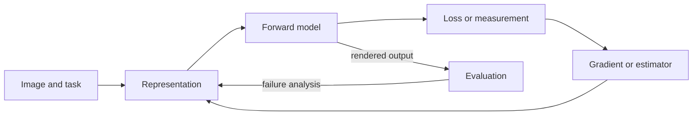

# Worlds, Images and Inference — Fast Recall

## Fast route

Start with a world description and follow it through the physical and computational steps that form an image. Then ask what the measurements let us recover about the world. Each step changes representation and may discard information.

1. **Represent** points, curves, surfaces, and meshes with the data each operation needs.
2. **Place and move** geometry with coordinate frames, hierarchies, animation, and simulation.
3. **Measure** the scene through optics, exposure, sensors, and camera projection.
4. **Render** visible surfaces, material response, and light transport; rasterization and ray queries organize the work differently.
5. **Sample** the continuous image with filters and finite pixels, then encode color for a device.
6. **Infer** hidden motion, orientation, shape, or object pose from measurements, stating ambiguities and assumptions.

For the core visual anchors, open [[Continuous Notes/University - Worlds, Images and Inference - Graphics, Vision and Photography#Figure U1 - Linear maps separate directions stretches and output placement|Figure U1]]; [[Continuous Notes/University - Worlds, Images and Inference - Graphics, Vision and Photography#Figure U2 - A half-edge separates face traversal from edge traversal|Figure U2]]; [[Continuous Notes/University - Worlds, Images and Inference - Graphics, Vision and Photography#Figure U3 - Two signals can share the same samples|Figure U3]]; [[Continuous Notes/University - Worlds, Images and Inference - Graphics, Vision and Photography#Figure U4 - Lighting rank determines which normal components can be measured|Figure U4]]; and [[Continuous Notes/University - Worlds, Images and Inference - Graphics, Vision and Photography#Figure U5 - A direct-light renderer makes the pipeline executable|Figure U5]].

## Thirty-five retrieval briefs

Each brief gives a mechanism to recall, the condition that matters, and a concrete question to use when reopening that section. The links target the matching chapter in the main note.

1. **[[Continuous Notes/University - Worlds, Images and Inference - Graphics, Vision and Photography#A scene description becomes an image|A scene description becomes an image]]** — Graphics maps a scene description to image measurements; vision works backward from measurements to constraints on the scene. Both depend on camera, geometry, light, and sampling assumptions. **Ask:** In a ray renderer and a rasterizer, which direction does the visibility query travel?

2. **[[Continuous Notes/University - Worlds, Images and Inference - Graphics, Vision and Photography#Mathematical language: points, vectors, and derivatives|Mathematical language: points, vectors, and derivatives]]** — A point locates; a vector displaces. In a skew basis, geometric squared length is $c^T Gc$, with $G=B^TB$. A Jacobian predicts local change; the Hessian records curvature. **Ask:** Why does summing squared coordinates fail when basis vectors are not orthogonal?

3. **[[Continuous Notes/University - Worlds, Images and Inference - Graphics, Vision and Photography#Coordinate frames, transformations, and pose|Coordinate frames, transformations, and pose]]** — Homogeneous coordinates let one matrix translate points while leaving direction vectors unchanged. For column vectors, $TS$ means scale first, then translate; order matters. Normals use inverse-transpose under nonuniform scale. **Ask:** What result does $ST$ produce for a point when translation is accidentally scaled too?

4. **[[Continuous Notes/University - Worlds, Images and Inference - Graphics, Vision and Photography#Curves as controllable functions|Curves as controllable functions]]** — A cubic has four degrees of freedom: endpoint positions and endpoint tangents fit Hermite data. Bézier controls expose tangents; de Casteljau evaluates and subdivides exactly. $C^1$ matches parameter speed as well as direction; $G^1$ only matches tangent direction. **Ask:** Why can a visually tangent join still have a speed jump?

5. **[[Continuous Notes/University - Worlds, Images and Inference - Graphics, Vision and Photography#Surfaces, patches, topology, and parameterization|Surfaces, patches, topology, and parameterization]]** — A chart maps a parameter domain onto a surface; its partial derivatives span the tangent plane. A chart can distort or become singular even if the surface itself is regular. **Ask:** What condition on the two tangent vectors makes a parameterization lose a local direction?

6. **[[Continuous Notes/University - Worlds, Images and Inference - Graphics, Vision and Photography#Meshes, connectivity, and geometry processing|Meshes, connectivity, and geometry processing]]** — A mesh stores geometry plus adjacency. Half-edges encode directed edge pairs and make face and vertex neighborhoods traversable. Edits must preserve required topology and orientation. See [[Continuous Notes/University - Worlds, Images and Inference - Graphics, Vision and Photography#Figure U2 - A half-edge separates face traversal from edge traversal|Figure U2]]. **Ask:** After an edge flip, which adjacent face can become inverted if the new diagonal is geometrically invalid?

7. **[[Continuous Notes/University - Worlds, Images and Inference - Graphics, Vision and Photography#Lens optics, focus, and image formation|Lens optics, focus, and image formation]]** — A thin lens maps object distance to image distance; defocus spreads a point into a blur circle. Acceptable focus depends on the blur tolerance and output scale, not a universal depth-of-field boundary. The added derivation estimates a focus interval of about 2.34–4.19 m for its stated setup. **Ask:** Which chosen circle-of-confusion threshold changes that interval?

8. **[[Continuous Notes/University - Worlds, Images and Inference - Graphics, Vision and Photography#Exposure, sensors, and dynamic range|Exposure, sensors, and dynamic range]]** — Exposure controls collected photons through aperture, shutter time, and sensitivity; equivalent brightness does not imply equivalent motion blur, depth of field, noise, or highlight headroom. Sensor readout and saturation add limits. **Ask:** If shutter time is halved and aperture widened one stop, what changes besides image brightness?

9. **[[Continuous Notes/University - Worlds, Images and Inference - Graphics, Vision and Photography#Cameras, projection, and calibration|Cameras, projection, and calibration]]** — Pinhole projection $x=fX/Z$ couples image scale to depth. Vanishing points constrain parallel directions; calibration estimates internal parameters and pose from known geometry. Orthographic projection is useful when depth variation is negligible or should not affect measured scale. **Ask:** Why can three orthogonal vanishing directions still leave a mirror-related calibration solution?

10. **[[Continuous Notes/University - Worlds, Images and Inference - Graphics, Vision and Photography#Sampling continuous signals and image formation|Sampling continuous signals and image formation]]** — Sampling records finite values of a continuous signal. Frequencies above half the sample rate can alias to a lower pattern; prefilter before reducing resolution. Pixel-area averaging is already a weak low-pass filter. See [[Continuous Notes/University - Worlds, Images and Inference - Graphics, Vision and Photography#Figure U3 - Two signals can share the same samples|Figure U3]]. **Ask:** How can two different sinusoids produce identical samples on one grid?

11. **[[Continuous Notes/University - Worlds, Images and Inference - Graphics, Vision and Photography#Image sampling, filtering, and efficient reconstruction|Image sampling, filtering, and efficient reconstruction]]** — Reconstruction filters trade alias suppression, blur, and ringing. A texture Jacobian maps a pixel footprint into texture space; mipmaps suit near-isotropic footprints, anisotropic filters suit elongated ones. Integral images turn any axis-aligned box sum into four table reads after one cumulative pass. **Ask:** Why does an integral image not make an arbitrary convolution constant-time?

12. **[[Continuous Notes/University - Worlds, Images and Inference - Graphics, Vision and Photography#Color perception, encoding, and display|Color perception, encoding, and display]]** — Cone responses compress a spectrum into three values, so distinct spectra can be metamers. Display codes are often nonlinear: decode to linear light before averaging or compositing, then encode for display. Gamut bounds which responses a device can reproduce. **Ask:** Why does encoded midpoint 0.5 represent roughly 0.22 linear intensity under gamma 2.2?

13. **[[Continuous Notes/University - Worlds, Images and Inference - Graphics, Vision and Photography#Light measurement and radiometry|Light measurement and radiometry]]** — Flux, irradiance, intensity, and radiance use different measures. For an area-light element, conversion from area density to solid-angle density uses $|n_y\cdot(-\omega)|/r^2$. Use the same measure as the integral. **Ask:** Why does sampling an area light require both the inverse-square factor and the light-normal cosine?

14. **[[Continuous Notes/University - Worlds, Images and Inference - Graphics, Vision and Photography#Reflectance, BRDFs, and shading|Reflectance, BRDFs, and shading]]** — A BRDF describes how incoming direction becomes outgoing radiance. Lambertian reflectance is constant at $\rho/\pi$; mirrors are delta-like and glossy materials form lobes. **Ask:** Why can a smooth directional sampler fail to hit an ideal mirror reflection?

15. **[[Continuous Notes/University - Worlds, Images and Inference - Graphics, Vision and Photography#The rendering equation and light transport|The rendering equation and light transport]]** — Outgoing radiance is emitted light plus visible reflected incoming radiance integrated over a hemisphere. Since incoming radiance comes from other surfaces, transport is coupled. A renderer makes this executable with visibility, BRDF, light, and accumulation. See [[Continuous Notes/University - Worlds, Images and Inference - Graphics, Vision and Photography#Figure U5 - A direct-light renderer makes the pipeline executable|Figure U5]]. **Ask:** Which term becomes zero when geometry blocks a sampled direction?

16. **[[Continuous Notes/University - Worlds, Images and Inference - Graphics, Vision and Photography#Numerical integration and Monte Carlo estimation|Numerical integration and Monte Carlo estimation]]** — For samples $X\sim p$, estimate $\int f(x)dx$ with the mean of $f(X)/p(X)$. Importance sampling reduces estimator variance only when the density covers every contributing region. **Ask:** Why does quadrupling independent samples usually halve standard error rather than quarter it?

17. **[[Continuous Notes/University - Worlds, Images and Inference - Graphics, Vision and Photography#Rasterization, coverage, and depth|Rasterization, coverage, and depth]]** — Rasterization tests projected primitives at pixel sample locations, interpolates attributes, then depth-tests. Exact edge coverage is an area integral; multisampling estimates it with subpixel tests. Perspective-correct interpolation compensates for the projection divide. **Ask:** What artifact appears if a checkerboard floor is linearly interpolated in screen space?

18. **[[Continuous Notes/University - Worlds, Images and Inference - Graphics, Vision and Photography#Textures and surface detail|Textures and surface detail]]** — Texture is a signal over surface coordinates. Charts introduce seams and distortion; filtering must follow how that domain projects into each pixel. **Ask:** Why can one square mip level overblur a floor receding toward the horizon?

19. **[[Continuous Notes/University - Worlds, Images and Inference - Graphics, Vision and Photography#Visibility queries and ray intersections|Visibility queries and ray intersections]]** — A ray query asks which geometry intersects a path from an origin; hit parameters, barycentric coordinates, and surface orientation answer different parts of the intersection contract. **Ask:** What additional bound distinguishes a ray from a finite line segment?

20. **[[Continuous Notes/University - Worlds, Images and Inference - Graphics, Vision and Photography#Acceleration structures and robust queries|Acceleration structures and robust queries]]** — A BVH groups geometry in nested bounds. Traversal skips a node only when its bound cannot intersect the query, so bounds must conservatively contain descendants. Robust predicates matter near tangencies and degenerate geometry. **Ask:** What correctness failure follows from rounding a bound inward?

21. **[[Continuous Notes/University - Worlds, Images and Inference - Graphics, Vision and Photography#Scene graphs and articulated geometry|Scene graphs and articulated geometry]]** — A node's world transform composes parent and local transforms; skinning blends posed bone candidates using per-vertex weights. Linear blends can collapse volume when averaging opposing rotations. **Ask:** Why does applying the inverse bind transform preserve a vertex when current pose equals rest pose?

22. **[[Continuous Notes/University - Worlds, Images and Inference - Graphics, Vision and Photography#Animation curves and motion paths|Animation curves and motion paths]]** — A moving camera needs position and orientation, plus a valid up direction. Smooth position does not guarantee smooth orientation; rotation interpolation and time parameterization are separate choices. **Ask:** What makes the camera frame singular when view and up vectors align?

23. **[[Continuous Notes/University - Worlds, Images and Inference - Graphics, Vision and Photography#Dynamics, forces, and numerical integration|Dynamics, forces, and numerical integration]]** — Dynamics evolves state from forces or interaction rules; an integrator approximates continuous time with steps. Large steps can inject energy or destabilize springs and cloth. **Ask:** Why can explicit Euler make a spring oscillation grow even when the physical model conserves energy?

24. **[[Continuous Notes/University - Worlds, Images and Inference - Graphics, Vision and Photography#Optimization, constraints, and inverse kinematics|Optimization, constraints, and inverse kinematics]]** — Define variables, objective, constraints, and derivatives before solving. IK linearizes forward kinematics with a Jacobian; feasibility and conditioning govern whether a target is reachable and stable. **Ask:** What changes when the end-effector Jacobian loses rank?

25. **[[Continuous Notes/University - Worlds, Images and Inference - Graphics, Vision and Photography#PDEs, fields, and discrete solvers|PDEs, fields, and discrete solvers]]** — A PDE, spatial discretization, and boundary conditions together define a numerical problem. Choosing a mesh or basis changes the system matrix; boundary data is part of the model. **Ask:** Why can two solvers using the same interior equation produce different solutions at the boundary?

26. **[[Continuous Notes/University - Worlds, Images and Inference - Graphics, Vision and Photography#Optical flow and motion from images|Optical flow and motion from images]]** — Brightness constancy yields one equation, $I_xu+I_yv+I_t=0$, for two flow components. A local aperture therefore leaves motion along an edge ambiguous. **Ask:** What does a single straight edge constrain well, and which motion component remains unobserved?

27. **[[Continuous Notes/University - Worlds, Images and Inference - Graphics, Vision and Photography#Edges, contours, and subpixel localization|Edges, contours, and subpixel localization]]** — Blur spreads an ideal edge; fitting a response profile can estimate its center between pixels. Hough voting accumulates weak local evidence into a global line or shape hypothesis. **Ask:** Why can an edge's subpixel estimate shift when the blur model is wrong?

28. **[[Continuous Notes/University - Worlds, Images and Inference - Graphics, Vision and Photography#Recognition, templates, and industrial matching|Recognition, templates, and industrial matching]]** — Template matching searches over pose and transformation with a score chosen for expected noise and deformation. Coarse-to-fine search reduces cost; thresholds set tolerance, not truth. **Ask:** Why should an edge alignment score treat normal displacement differently from tangent displacement?

29. **[[Continuous Notes/University - Worlds, Images and Inference - Graphics, Vision and Photography#Pose estimation, transforms, and robust fitting|Pose estimation, transforms, and robust fitting]]** — Estimate rigid pose from correspondences, enforce a proper rotation, and use robust fitting when outliers contaminate matches. RANSAC trial count depends on inlier rate and sample size. **Ask:** Why does lowering the assumed inlier fraction sharply increase the number of RANSAC trials?

30. **[[Continuous Notes/University - Worlds, Images and Inference - Graphics, Vision and Photography#Stereo, relative orientation, and reconstruction|Stereo, relative orientation, and reconstruction]]** — Two views constrain rays and relative pose; triangulation recovers structure up to gauge freedoms such as global scale. Critical surfaces make the geometry ill-conditioned. **Ask:** Why can perfect image correspondences still leave metric scale unknown?

31. **[[Continuous Notes/University - Worlds, Images and Inference - Graphics, Vision and Photography#Surface orientation from illumination|Surface orientation from illumination]]** — Photometric stereo uses several known light directions to solve for scaled normal from brightness measurements. The lighting matrix must span the components being estimated. See [[Continuous Notes/University - Worlds, Images and Inference - Graphics, Vision and Photography#Figure U4 - Lighting rank determines which normal components can be measured|Figure U4]]. **Ask:** Which normal component becomes unobservable if every light direction lies in one plane?

32. **[[Continuous Notes/University - Worlds, Images and Inference - Graphics, Vision and Photography#Shape from shading and reflectance|Shape from shading and reflectance]]** — A single shading image gives a nonlinear relation among surface normal, reflectance, and illumination; integration into height requires boundary conditions and extra assumptions. **Ask:** Why does a locally valid normal field fail to guarantee one globally consistent surface?

33. **[[Continuous Notes/University - Worlds, Images and Inference - Graphics, Vision and Photography#Surface descriptions and Gaussian images|Surface descriptions and Gaussian images]]** — A Gaussian image maps surface area to normal directions. Its directional mass distribution summarizes orientation and curvature patterns but can be shared by geometrically different surfaces. **Ask:** Why does the zero-centroid condition hold for a closed surface, and what does it rule out?

34. **[[Continuous Notes/University - Worlds, Images and Inference - Graphics, Vision and Photography#Photographic composition, history, and communication|Photographic composition, history, and communication]]** — Viewpoint, crop, sequence, and caption shape how a photograph functions as evidence or argument. A recorded scene is selected and framed, not a neutral inventory. **Ask:** What does a wide frame reveal that a close crop hides in the same documentary image?

35. **[[Continuous Notes/University - Worlds, Images and Inference - Graphics, Vision and Photography#Photographic workflow and integrated decisions|Photographic workflow and integrated decisions]]** — Trace a capture from scene spectrum through optics, exposure, sampling, processing, and display. Each stage can discard information or add artifacts; choose settings around the intended output. **Ask:** Which stage caused a moiré pattern, and what evidence distinguishes it from JPEG blocking?

## Evidence and scope

The source ledger covers **88 entries: 70 requested lectures and 18 added sources**. Its evidence includes **86 published English automatic-caption tracks, one locally generated Whisper transcript for a technical lecture, one sampled showcase video, and 70 lecture PDFs matched to their course years**. Captions, notes, and sampled visuals support different claims; the legend records which evidence supports each entry.

These briefs are deliberately compact retrieval notes for a 35-chapter continuous treatment. They are not a transcript, a substitute for the worked derivations, or a claim that the entire companion fits on one physical page.

## Four more figures to redraw from memory

- [[Continuous Notes/University - Worlds, Images and Inference - Graphics, Vision and Photography#Figure U6 - Principal rays explain the thin lens|Figure U6 - Principal rays explain the thin lens]]: Draw the parallel, center and front-focus rays. Which intersections establish the inverted image, and why are image height and object/image distance signs different?
- [[Continuous Notes/University - Worlds, Images and Inference - Graphics, Vision and Photography#Figure U7 - Independent gradients resolve the aperture ambiguity|Figure U7 - Independent gradients resolve the aperture ambiguity]]: From one local edge, draw the whole set of permissible velocities. Add an independent gradient constraint and predict when noisy constraints make the estimate unstable.
- [[Continuous Notes/University - Worlds, Images and Inference - Graphics, Vision and Photography#Figure U8 - Stereo disparity uses local image coordinates|Figure U8 - Stereo disparity uses local image coordinates]]: Measure both feature positions relative to their own camera axes. Explain why subtracting the two world positions on the drawing would give the wrong disparity.
- [[Continuous Notes/University - Worlds, Images and Inference - Graphics, Vision and Photography#Figure U9 - Homogeneous depth changes interpolation weights|Figure U9 - Homogeneous depth changes interpolation weights]]: Recover the screen weights, divide each by its clip-space denominator, renormalize, and obtain the attribute 2/11 rather than 1/4.

## New mechanisms to retrieve

A vertex buffer is a byte array interpreted by a draw command. The stride says how many bytes separate successive vertices; the attribute offset says where one field begins inside a vertex. [[Continuous Notes/University - Worlds, Images and Inference - Graphics, Vision and Photography#Rasterization, coverage, and depth|Rasterization and vertex layout]] · [[Continuous Notes/University - Worlds, Images and Inference - Graphics, Vision and Photography#Figure U10 - Vertex fetch uses a stride and byte offset|U10]]. **Ask:** For 24-byte float32 vertices with RGB after XYZ, what are the position stride and color offset?

A mathematical projection of a finite point set is a map to a line. Small image size means many collisions. Scale, spacing, and additive structure determine whether many directions can compress the same set. This is separate from a camera's projection matrix. [[Continuous Notes/University - Worlds, Images and Inference - Graphics, Vision and Photography#Finite-field projections turn image size into collision counts|Finite-field collisions]] · [[Continuous Notes/University - Worlds, Images and Inference - Graphics, Vision and Photography#Real projections add scale, spacing, and incidence geometry|Real projection scales]] · [[Continuous Notes/University - Worlds, Images and Inference - Graphics, Vision and Photography#Figure U11 - Finite-grid projections expose collision counts|U11]]. **Ask:** Is the obstruction arithmetic, spatial clustering, or an incidence pattern?

A classifier maps an image representation to scores; a loss compares those scores with the target. The gradient sends a local change backward through each operation by the chain rule. Convolution shares a local filter over the image; attention instead builds content-dependent weights between tokens. [[Continuous Notes/University - Worlds, Images and Inference - Graphics, Vision and Photography#Learning a visual classifier from examples|Learning basics]] · [[Continuous Notes/University - Worlds, Images and Inference - Graphics, Vision and Photography#Convolutional models preserve image neighborhoods|CNNs]] · [[Continuous Notes/University - Worlds, Images and Inference - Graphics, Vision and Photography#Sequence models and attention|Attention]]. **Ask:** Which shape changes at each layer, and where does the chain rule multiply upstream and local derivatives?

Dense prediction assigns an output to every pixel; detection also predicts object locations and categories. Video adds temporal alignment, motion, and compute cost. [[Continuous Notes/University - Worlds, Images and Inference - Graphics, Vision and Photography#Predict pixels and localize objects|Dense prediction and detection]] · [[Continuous Notes/University - Worlds, Images and Inference - Graphics, Vision and Photography#Video adds motion and temporal cost|Video]]. **Ask:** Does the evaluation measure pixel accuracy, object matching, or temporal consistency?

Self-supervision creates training targets from the data; generative objectives instead define how a model represents or samples possible outputs. Evaluation must match the claim: reconstruction quality, likelihood, sample quality, and downstream usefulness are different measurements. [[Continuous Notes/University - Worlds, Images and Inference - Graphics, Vision and Photography#Self-supervision and evaluation|Self-supervision]] · [[Continuous Notes/University - Worlds, Images and Inference - Graphics, Vision and Photography#Generative models learn distributions and samplers|Generative models]]. **Ask:** What observable target trains the model, and what test would falsify the capability claim?

NeRF represents a scene with a learned field queried along rays; Gaussian splatting stores explicit 3D elements and composites their projected contributions. A planar Gaussian gives a direct local surface normal, while 3D Gaussian splats need geometric regularization to recover reliable surfaces. [[Continuous Notes/University - Worlds, Images and Inference - Graphics, Vision and Photography#Learned representations of 3D shape and scenes|Learned 3D representations]] · [[Continuous Notes/University - Worlds, Images and Inference - Graphics, Vision and Photography#From scene representations to research methods|research methods]] · [[Continuous Notes/University - Worlds, Images and Inference - Graphics, Vision and Photography#Figure U12 - Volume compositing accumulates visible contributions|U12]] · [[Continuous Notes/University - Worlds, Images and Inference - Graphics, Vision and Photography#Figure U13 - A local Gaussian covariance projects to an ellipse|U13]]. **Ask:** Which representation is queried per ray and which is explicitly rasterized?

An environment map supplies incoming illumination by direction. ReSTIR uses weighted reservoirs to reuse light candidates, but the final estimator still needs correct proposal support and normalization. LoD changes also change geometry, so reused paths need a surface correspondence and its area Jacobian. [[Continuous Notes/University - Worlds, Images and Inference - Graphics, Vision and Photography#Light measurement and radiometry|Image-based lighting]] · [[Continuous Notes/University - Worlds, Images and Inference - Graphics, Vision and Photography#Numerical integration and Monte Carlo estimation|Monte Carlo reuse]] · [[Continuous Notes/University - Worlds, Images and Inference - Graphics, Vision and Photography#Figure U14 - A reservoir selects a candidate by its weight|U14]]. **Ask:** What distribution was each candidate drawn from, and what normalization makes reuse valid?

Mitsuba 2 shows how a renderer can change execution mode and differentiate through image formation. It is a 2019 Enoki-based system; its API details are historical and should not be treated as Mitsuba 3 guidance. [[Continuous Notes/University - Worlds, Images and Inference - Graphics, Vision and Photography#The rendering equation and light transport|Differentiable rendering]]. **Ask:** Which quantities are differentiated and which sampling decisions are held fixed?

ARAP editing alternates local rigid rotations with a global sparse position solve. Field-aligned remeshing uses orientation and position fields to guide edge direction and placement. [[Continuous Notes/University - Worlds, Images and Inference - Graphics, Vision and Photography#Meshes, connectivity, and geometry processing|Mesh processing]]. **Ask:** Which part is local per vertex and which system is solved globally?

IPC combines a contact barrier with continuous collision detection and a feasibility-preserving line search. A positive barrier alone is not a proof that a finite time step cannot cross a contact. [[Continuous Notes/University - Worlds, Images and Inference - Graphics, Vision and Photography#Dynamics, forces, and numerical integration|Contact dynamics]] · [[Continuous Notes/University - Worlds, Images and Inference - Graphics, Vision and Photography#Figure U15 - The contact barrier grows near zero separation|U15]]. **Ask:** What checks the entire path between the current and proposed configurations?

Read the loop as a diagnostic map: representation, forward model, objective, and evaluation can each limit the result. It is not a single training algorithm; Monte Carlo rendering and supervised learning use different estimators and losses.

This rendering/inference loop joins the original image-formation chapters to learned 3D methods. The reverse arrow indicates an inference problem; it does not imply a unique reconstruction.

