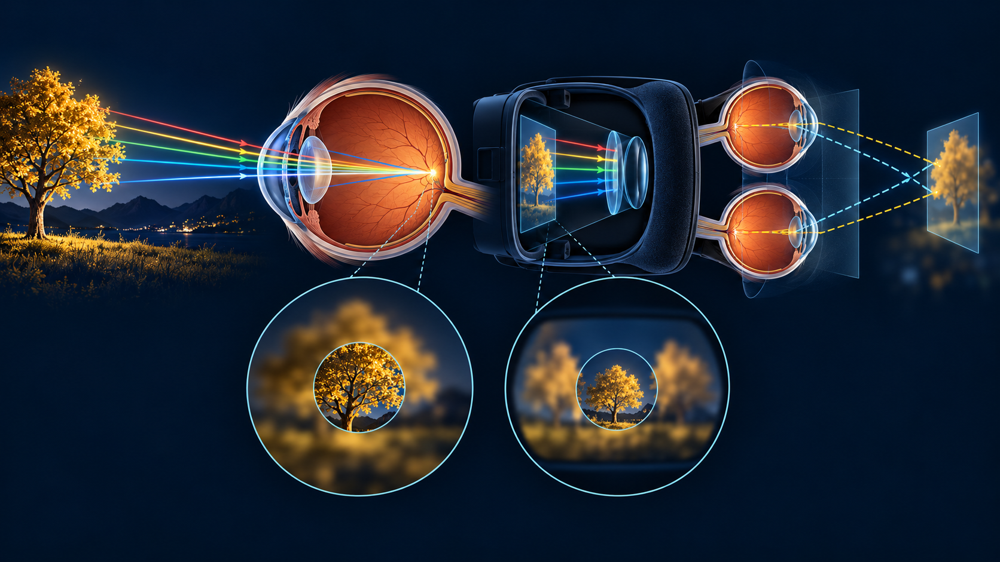
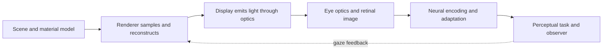
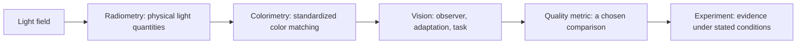
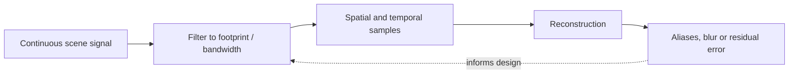
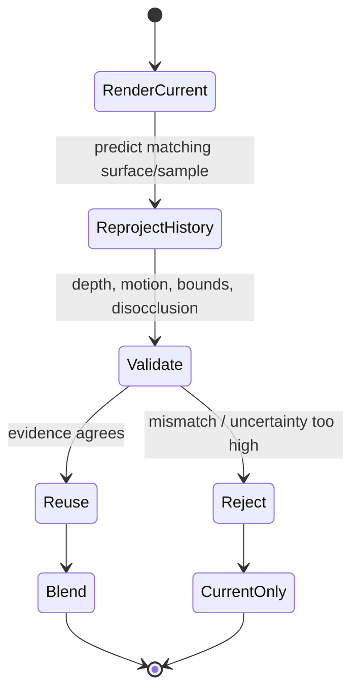

# Light, Vision and Perception — Visual Recall

**Scope:** Companion to [[Continuous Notes/XR - From Light to Perception - Seeing and Representing Reality]]. This is a recall board: sketch the path, then explain what each stage measures and what it cannot establish.

> [!abstract] One-page quick notes
> **Light → eye → task → display:** rendering is a loop; code values are not the light itself. [[Continuous Notes/XR - From Light to Perception - Seeing and Representing Reality#Light must become a quantity before it becomes a color|Radiometry → colorimetry]]
> **See only what survives the pipeline:** optics, contrast, adaptation, eccentricity, sampling and reconstruction all constrain visibility. [[Continuous Notes/XR - From Light to Perception - Seeing and Representing Reality#The eye is an optical instrument with neural processing inside it|Eye and neural processing]] · [[Continuous Notes/XR - From Light to Perception - Seeing and Representing Reality#Visibility is about contrast, conditions and tasks|Visibility and task]]
> **Time matters twice:** eye motion changes the retinal sample; history reuse predicts correspondence and must validate it. [[Continuous Notes/XR - From Light to Perception - Seeing and Representing Reality#A gaze sample needs a time as well as a direction|Gaze and time]] · [[Continuous Notes/XR - From Light to Perception - Seeing and Representing Reality#Temporal reconstruction is an inference about correspondence|Temporal reuse]]
> **Measure, don’t assume:** quality metrics and thresholds answer only the question their procedure tested. [[Continuous Notes/XR - From Light to Perception - Seeing and Representing Reality#Quality numbers need a question they can actually answer|Quality metrics]] · [[Continuous Notes/XR - From Light to Perception - Seeing and Representing Reality#A threshold is evidence from a procedure, not a universal border|Threshold evidence]]
> **Spend detail where useful, safely:** foveation is a resource allocation with prediction uncertainty and latency margins. [[Continuous Notes/XR - From Light to Perception - Seeing and Representing Reality#Foveation is allocation under uncertain perception and timing|Foveation]]

## Figure-linked short notes

Use one row at a time: explain the claim, open its figure, then follow the nearby chapter explanation. The figure labels are shared with the continuous chapter.

| Figure in the chapter | Shortest useful brief | Boundary to remember |
|---|---|---|
| [[Continuous Notes/XR - From Light to Perception - Seeing and Representing Reality#Figure X0 — A qualitative picture of the XR loop\|X0 · Perception collage]] | Scene → display light → optics → retina → task; gaze feeds rendering decisions. | Qualitative AI illustration; not calibrated rays or anatomical dimensions. |
| [[Continuous Notes/XR - From Light to Perception - Seeing and Representing Reality#Figure X1 — Two simultaneous depth demands\|X1 · Focus and pointing]] | Vergence points the eyes; accommodation changes focus. A near stereo target can coexist with a distant optical image. | Demanded distances can disagree; sharpness alone cannot fix that. |
| [[Continuous Notes/XR - From Light to Perception - Seeing and Representing Reality#Figure X2 — The samples cannot name their original\|X2 · Aliasing witness]] | At 10 Hz, 13 Hz and 3 Hz cosines give identical samples: their phase difference is whole cycles. | Filter before reducing sample rate; more bits cannot recover lost distinctions. |
| [[Continuous Notes/XR - From Light to Perception - Seeing and Representing Reality#Figure X3 — Same endpoints, different averaging domain\|X3 · Linear-light mean]] | Black/white mean is 0.5 linear → about 0.73536 sRGB. Encoded mean 0.5 → about 0.21404 linear. | Values are normalized channels, not nits. Specify the encoding and arithmetic domain. |
| [[Continuous Notes/XR - From Light to Perception - Seeing and Representing Reality#Figure X4 — Aim detail at visible time\|X4 · Gaze timing]] | Predict gaze for visible time; expand the sharp region for measured uncertainty. | A 90 Hz stream gives 11.11 ms intervals, not a latency measurement. |

**Connect the rest:** [[Continuous Notes/XR - From Light to Perception - Seeing and Representing Reality#Fourier coordinates reveal what a filter removes|Fourier coefficients describe frequency and phase]] · [[Continuous Notes/XR - From Light to Perception - Seeing and Representing Reality#What happens to a point of light?|PSF → OTF → MTF]] · [[Continuous Notes/XR - From Light to Perception - Seeing and Representing Reality#Temporal reconstruction is an inference about correspondence|TAA requires valid correspondence]] · [[Continuous Notes/XR - From Light to Perception - Seeing and Representing Reality#A threshold is evidence from a procedure, not a universal border|Thresholds depend on procedure]] · [[Continuous Notes/XR - From Light to Perception - Seeing and Representing Reality#Less shading does not mean the whole frame becomes equally faster|Whole-frame savings need profiling]].

## Visual atlas — what each view is for



*Illustration caption:* The rendered image is not the perceptual result. Light, optics, neural processing, task and display timing intervene. This is a qualitative AI teaching collage, not a calibrated optical ray diagram or anatomical measurement; [[Continuous Notes/XR - From Light to Perception - Seeing and Representing Reality#Figure X0 — A qualitative picture of the XR loop|open the same figure in context]].

| Recall figure | One-line takeaway | Open the full explanation |
|---|---|---|
| [[#From emitted light to a perceptual claim\|Perception loop]] | The display closes the loop by changing the next light reaching the observer. | [[Continuous Notes/XR - From Light to Perception - Seeing and Representing Reality#Prologue - A perfect scene can still make a poor experience\|Prologue]] |
| [[#Four measurement families that must not be collapsed\|Measurement ladder]] | Physical light, color matches, perception, metrics and experiments are different claims. | [[Continuous Notes/XR - From Light to Perception - Seeing and Representing Reality#Light must become a quantity before it becomes a color\|Radiometry and colorimetry]] |
| [[#Sampling and filtering: preserve what can be distinguished\|Sampling loop]] | Filter before sampling; reconstruction cannot recover distinctions already aliased. | [[Continuous Notes/XR - From Light to Perception - Seeing and Representing Reality#Sampling is a question of what remains distinguishable\|Sampling and aliasing]] · [[Continuous Notes/XR - From Light to Perception - Seeing and Representing Reality#A footprint is more meaningful than an isolated pixel center\|Pixel footprint]] |
| [[#Temporal reuse is a correspondence hypothesis\|History validation]] | Reuse prior samples only when correspondence evidence supports them. | [[Continuous Notes/XR - From Light to Perception - Seeing and Representing Reality#Temporal reconstruction is an inference about correspondence\|Temporal reconstruction]] |
| [[#Foveation is a budget under uncertainty\|Foveation margin]] | Gaze prediction error and latency determine the safe high-detail region. | [[Continuous Notes/XR - From Light to Perception - Seeing and Representing Reality#Foveation is allocation under uncertain perception and timing\|Foveation design]] |

## From emitted light to a perceptual claim



**Caption:** The rendering loop is closed: the display changes the light reaching the observer, and observer/task conditions shape what counts as visible. RGB code values are not spectra and are not automatically linear-light energy.

## Four measurement families that must not be collapsed



**Caption:** A metric score is not a direct reading of human experience. Each transformation adds assumptions and conditions.

| Question | Distinction to retrieve |
|---|---|
| How much physical light? | Radiant power/energy and radiance/irradiance are different quantities. |
| What color signal? | Spectrum and colorimetric coordinates are not interchangeable. |
| What does the eye resolve? | Acuity varies with eccentricity, contrast, adaptation and task. |
| Is the displayed result equivalent? | Focus/accommodation and binocular vergence can conflict in stereoscopic displays. |
| Does a score prove improvement? | Only for the metric, conditions, observers and task actually tested. |

## Sampling and filtering: preserve what can be distinguished



**Caption:** Sampling without suitable filtering can make distinct signals produce identical samples. A pixel footprint, motion, and time interval all matter; one isolated pixel center is not a complete image measurement.

## Temporal reuse is a correspondence hypothesis



**Caption:** Reprojection is not “old pixels are correct.” It is a prediction plus validation. Jitter, temporal antialiasing and motion blur address related but distinct problems.

## Foveation is a budget under uncertainty

```text
gaze estimate ──> predicted gaze at display time ──> high-quality region
      │                        │                              │
      └── latency/error ───────┴── safety margin ────────────┘
                               ↓
                   lower peripheral work only where justified
```

**Caption:** Less shading work does not imply the whole frame becomes equally faster. Prediction error, transition smoothness, display timing and workload determine the usable benefit.

## Retrieval prompts

1. Why can two different continuous signals produce the same samples?
2. How do sampling rate, filter footprint and reconstruction relate?
3. What changes between linear-light averaging and averaging encoded RGB values?
4. Why can a sharp stereo image still feel uncomfortable?
5. What evidence is needed before a threshold can be treated as a boundary?
6. Why does valid foveation require a margin for gaze prediction error?

> [!answer]- Compact key
> Frequencies beyond the sampling system's distinguishable range can alias. Filtering limits content before discrete sampling; reconstruction defines what is inferred between samples. Nonlinear transfer encoding changes averages. Accommodation and vergence can demand different focal distances. A threshold depends on procedure and conditions, not just a fitted curve. Gaze latency/error can move the true fovea outside a region sized only around the estimate.

[[Continuous Notes/XR - From Light to Perception - Seeing and Representing Reality#Sampling is a question of what remains distinguishable|Teach the complete XR chapter]] · [[Supplementary/Foundations#XR01 - Independent seeing and representation source|Source ledger]]
